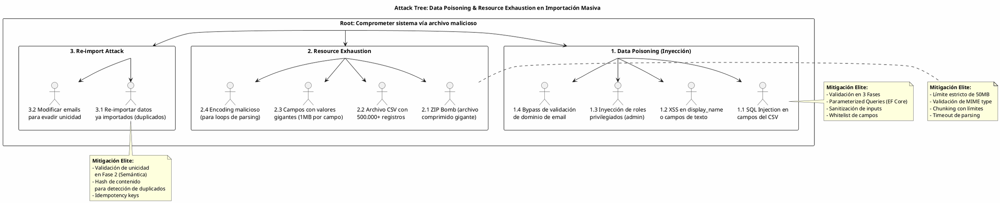

# UC-10: Import/Export Masivo - Análisis de Amenazas Específico (Security Threat Model)

| Metadatos del Documento | |
| :--- | :--- |
| **Proyecto:** | SHUGO - Identity & Access Platform |
| **Caso de Uso:** | UC-10 - Import/Export Masivo (Bulk Identity Operations) |
| **Documento:** | 11_UC_Specific_Security_Threats.md |
| **Metodología:** | STRIDE + DREAD + Attack Trees + Defense-in-Depth + Async Processing Security |
| **Estándares:** | OWASP Top 10 (A01:2021 Broken Access Control, A03:2021 Injection, A05:2021 Security Misconfiguration), NIST SP 800-63A, GDPR Art. 5 & 32, SOC 2 CC6.1 & CC7.2, ISO 27001 A.12.6 |
| **Autor:** | Gastón Ruiz |
| **Versión Actual:** | 1.0.0 |
| **Fecha:** | 14/09/2026 |

---

## Historial de Versiones

| Versión | Fecha | Autor | Descripción de Cambios | Impacto |
| :--- | :--- | :--- | :--- | :--- |
| **1.0.0** | 14/09/2026 | Gastón Ruiz | **Creación inicial.** Análisis exhaustivo de amenazas específicas para operaciones masivas asíncronas. Evalúa 8 vectores de ataque usando STRIDE+DREAD, incluyendo Data Poisoning, Resource Exhaustion (ZIP Bombs, Processing Loops), PII Leakage en archivos, Job Tampering, Queue Manipulation, Report Data Leakage, Re-import Attack, y Export Filter Bypass. Define controles de mitigación de nivel enterprise (Validación en 3 Fases, Chunking con Límites, URLs Firmadas, RLS, OCC, Idempotency Keys) para garantizar la seguridad del procesamiento masivo. | Documento crítico de seguridad para el UC-10. Establece los controles obligatorios que deben implementarse antes del go-live del endpoint de importación/exportación masiva, con especial énfasis en la prevención de inyección de datos maliciosos, agotamiento de recursos, y fugas de PII en archivos exportados. |

---

## 1. Introducción y Alcance

Este documento presenta el **Análisis de Amenazas Específico** para el UC-10 (Import/Export Masivo).

A diferencia de los UCs transaccionales individuales, el UC-10 introduce una superficie de ataque única debido a su naturaleza de **procesamiento masivo asíncrono de larga duración**:

1. **Entrada de Datos No Confiables:** Los archivos de importación son subidos por usuarios y pueden contener payloads maliciosos (SQL Injection, XSS, datos corruptos).
2. **Consumo Intensivo de Recursos:** El procesamiento de archivos grandes (hasta 50MB, 500.000 registros) puede agotar CPU, memoria, I/O de DB, y ancho de banda.
3. **Almacenamiento de PII en Reposo:** Los archivos de exportación contienen datos personales sensibles (emails, nombres, roles) que deben protegerse en Storage.
4. **Operaciones de Larga Duración:** Los jobs pueden durar horas, creando ventanas de oportunidad para ataques de manipulación de estado.
5. **Dependencia de Infraestructura Externa:** Storage (S3/Azure Blob) y Job Queue (RabbitMQ/SQS) son puntos de ataque adicionales.
6. **Reportes con Datos Sensibles:** Los reportes de importación contienen PII y errores que no deben ser accesibles por usuarios no autorizados.

Este documento modela estos vectores de ataque y define las mitigaciones de nivel enterprise que SHUGO implementa nativamente.

---

## 2. Attack Trees (Árboles de Ataque)

### 2.1. Attack Tree #1: Data Poisoning y Resource Exhaustion

**Objetivo del Atacante:** Inyectar datos maliciosos en el sistema o agotar recursos mediante archivos especialmente diseñados.



### 2.2. Attack Tree #2: PII Leakage y Job Tampering

**Objetivo del Atacante:** Robar datos personales de archivos exportados o manipular el estado de jobs en proceso.

```text
[Root: Robar PII o manipular jobs masivos]
  |
  +-- [1. PII Leakage en Exportación]
  |     +-- 1.1. Acceder a URL firmada después de TTL (Mitigado: URLs con expiración estricta)
  |     +-- 1.2. Compartir URL firmada con terceros (Mitigado: URLs de un solo uso o con IP binding)
  |     +-- 1.3. Acceder a bucket de Storage sin autenticación (Mitigado: Bucket privado + RLS)
  |     +-- 1.4. Interceptar archivo en tránsito (Mitigado: HTTPS + encriptación en reposo)
  |
  +-- [2. Job Tampering]
  |     +-- 2.1. Modificar estado de job (PENDING → COMPLETED) sin procesar (Mitigado: RLS + OCC)
  |     +-- 2.2. Manipular progreso (processed_records) para engañar al sistema (Mitigado: Validación de consistencia)
  |     +-- 2.3. Inyectar errores falsos en JSONB (Mitigado: Solo INSERT, no UPDATE de errores)
  |
  +-- [3. Queue Manipulation]
        +-- 3.1. Inyectar mensajes falsos en la cola (Mitigado: Autenticación de cola + firma de mensajes)
        +-- 3.2. Replay de mensajes ya procesados (Mitigado: Idempotency keys + validación de job_id)
        +-- 3.3. Priorizar mensajes maliciosos (Mitigado: FIFO estricto + rate limiting por tenant)
```

### 2.3. Attack Tree #3: Export Filter Bypass y Report Leakage

**Objetivo del Atacante:** Exportar datos que no debería poder ver o acceder a reportes de otros usuarios.

```text
[Root: Exportar datos no autorizados o acceder a reportes ajenos]
  |
  +-- [1. Export Filter Bypass]
  |     +-- 1.1. Inyectar filtros SQL en custom_filters JSONB (Mitigado: Validación de schema + parameterized queries)
  |     +-- 1.2. Exportar identidades de otro tenant (Mitigado: RLS estricto en queries de exportación)
  |     +-- 1.3. Exportar campos sensibles sin permiso (Mitigado: Whitelist de campos exportables)
  |
  +-- [2. Report Data Leakage]
  |     +-- 2.1. Acceder a reporte de otro tenant (Mitigado: RLS en bulk_import_jobs)
  |     +-- 2.2. Acceder a reporte de otro usuario (Mitigado: Validación de initiated_by)
  |     +-- 2.3. Acceder a reporte después de expiración (Mitigado: URL firmada con TTL)
  |
  +-- [3. Audit Log Tampering]
        +-- 3.1. Modificar logs de auditoría (Mitigado: Solo INSERT, tabla inmutable)
        +-- 3.2. Eliminar particiones de auditoría (Mitigado: Permisos restringidos + backup automático)
        +-- 3.3. Acceder a logs de otro tenant (Mitigado: RLS estricto)
```

---

## 3. Matriz de Amenazas Específicas (STRIDE + DREAD)

| ID | Amenaza | Categoría STRIDE | D | R | E | A | D | Score | Nivel |
| :--- | :--- | :--- | :---: | :---: | :---: | :---: | :---: | :---: | :---: |
| **T-63** | **Data Poisoning (SQL/XSS Injection)** | Tampering | 10 | 8 | 7 | 10 | 6 | **8.2** | 🔴 |
| **T-64** | **Resource Exhaustion (ZIP Bomb, Processing Loop)** | Denial of Service | 8 | 9 | 8 | 9 | 7 | **8.2** | 🔴 |
| **T-65** | **PII Leakage en Archivos Exportados** | Information Disclosure | 10 | 6 | 5 | 10 | 4 | **7.0** | 🟠 |
| **T-66** | **Job Tampering (Manipulación de Estado)** | Tampering | 9 | 5 | 4 | 9 | 3 | **6.0** | 🟡 |
| **T-67** | **Queue Manipulation (Inyección de Mensajes)** | Tampering | 9 | 6 | 5 | 8 | 4 | **6.4** | 🟡 |
| **T-68** | **Report Data Leakage (Acceso No Autorizado)** | Information Disclosure | 9 | 5 | 4 | 10 | 3 | **6.2** | 🟡 |
| **T-69** | **Re-import Attack (Duplicación de Datos)** | Tampering | 7 | 7 | 6 | 8 | 5 | **6.6** | 🟠 |
| **T-70** | **Export Filter Bypass (SQL Injection en JSONB)** | Tampering / Info Disclosure | 10 | 7 | 6 | 9 | 5 | **7.4** | 🟠 |

---

## 4. Análisis Detallado de Amenazas Críticas y Mitigaciones

### 4.1. 🔴 T-63: Data Poisoning (SQL/XSS Injection)

**Descripción:** Un atacante sube un archivo CSV/JSON con payloads maliciosos en los campos de datos (email, display_name, roles) para inyectar SQL, XSS, o crear usuarios con roles privilegiados.

**Escenario de Ataque:**
```csv
email,display_name,password,roles
admin@khcs.com,Admin<script>alert('XSS')</script>,SecureP@ss1,super_admin
user@khcs.com,User'; DROP TABLE identities;--,SecureP@ss2,user
```

**Mitigaciones Implementadas:**

1. **Validación en Tres Fases (Fail-Fast):**
```csharp
public class RecordValidator : IRecordValidator
{
    public async Task ValidateAsync(Record record, int rowNumber, TenantId tenantId, CancellationToken ct)
    {
        // Fase 1: Validación Sintáctica (sin DB)
        ValidateSyntacticPhase(record, rowNumber);

        // Fase 2: Validación Semántica (consultas ligeras)
        await ValidateSemanticPhaseAsync(record, rowNumber, tenantId, ct);

        // Fase 3: Validación de Consistencia (dependencias)
        await ValidateConsistencyPhaseAsync(record, rowNumber, tenantId, ct);
    }

    private void ValidateSyntacticPhase(Record record, int rowNumber)
    {
        // Validar formato de email (previene SQL Injection)
        if (!IsValidEmail(record.Email))
            throw new ValidationException("INVALID_EMAIL_FORMAT", 
                $"Row {rowNumber}: Email has invalid format.", 
                ValidationPhase.SYNTACTIC);

        // Sanitizar display_name (previene XSS)
        if (ContainsDangerousCharacters(record.DisplayName))
            throw new ValidationException("DANGEROUS_CHARACTERS", 
                $"Row {rowNumber}: Display name contains dangerous characters.", 
                ValidationPhase.SYNTACTIC);

        // Validar roles contra whitelist (previene escalación de privilegios)
        var allowedRoles = new HashSet<string> { "user", "manager", "viewer" };
        if (record.Roles.Any(r => !allowedRoles.Contains(r)))
            throw new ValidationException("INVALID_ROLES", 
                $"Row {rowNumber}: Roles must be one of: {string.Join(", ", allowedRoles)}", 
                ValidationPhase.SYNTACTIC);
    }

    private bool ContainsDangerousCharacters(string input)
    {
        var dangerousPatterns = new[] { "<script", "javascript:", "onerror=", "onload=", "';", "--" };
        return dangerousPatterns.Any(p => input.Contains(p, StringComparison.OrdinalIgnoreCase));
    }
}
```

2. **Parameterized Queries (EF Core):**
```csharp
// EF Core automáticamente parametriza todas las consultas
// Esto previene SQL Injection incluso si el atacante logra pasar la validación
var identity = await _dbContext.Identities
    .Where(i => i.Email == record.Email && i.TenantId == tenantId.Value)
    .FirstOrDefaultAsync(ct);
```

3. **Whitelist de Campos Importables:**
```csharp
public class FileValidator : IFileValidator
{
    private static readonly HashSet<string> ALLOWED_FIELDS = new()
    {
        "email", "display_name", "password", "roles", "manager_id"
    };

    public async Task<FileValidationResult> ValidateAsync(Stream fileStream, string fileName, CancellationToken ct)
    {
        var headers = await ParseHeadersAsync(fileStream, ct);
        
        var invalidFields = headers.Where(h => !ALLOWED_FIELDS.Contains(h)).ToList();
        if (invalidFields.Any())
            throw new InvalidFileException(
                $"Invalid fields: {string.Join(", ", invalidFields)}. " +
                $"Allowed fields: {string.Join(", ", ALLOWED_FIELDS)}");
        
        // ...
    }
}
```

**Justificación:**
- **Defense-in-Depth:** Tres capas de validación previenen inyección en diferentes etapas.
- **Fail-Fast:** Detectar errores de formato en Fase 1 evita consultas costosas a DB.
- **Parameterized Queries:** EF Core garantiza que todas las consultas sean seguras contra SQL Injection.

### 4.2. 🔴 T-64: Resource Exhaustion (ZIP Bomb, Processing Loop)

**Descripción:** Un atacante sube un archivo especialmente diseñado para agotar recursos del sistema: ZIP bombs (archivos comprimidos que se expanden a GB), archivos con millones de registros, campos con valores gigantes, o encodings maliciosos que causan loops infinitos.

**Escenario de Ataque:**
```bash
# ZIP Bomb: archivo de 42KB que se expande a 4.5PB
# (Ejemplo real: 42.zip)
curl -X POST https://api.shugo.io/v1/identities/import \
  -F "file=@42.zip" \
  -H "Authorization: Bearer <JWT>"

# CSV con 10 millones de filas
yes "user@khcs.com,User,SecureP@ss1,user" | head -n 10000000 > massive.csv
curl -X POST https://api.shugo.io/v1/identities/import \
  -F "file=@massive.csv" \
  -H "Authorization: Bearer <JWT>"

# CSV con campos de 1MB cada uno
python3 -c "print('email,display_name\n' + 'a@b.com,' + 'A'*1000000)" > giant_fields.csv
```

**Mitigaciones Implementadas:**

1. **Límite Estricto de Tamaño de Archivo:**
```csharp
public class FileValidator : IFileValidator
{
    private const long MAX_FILE_SIZE_BYTES = 50 * 1024 * 1024; // 50MB
    private const int MAX_RECORDS = 500000;
    private const int MAX_FIELD_SIZE_BYTES = 10 * 1024; // 10KB por campo

    public async Task<FileValidationResult> ValidateAsync(Stream fileStream, string fileName, CancellationToken ct)
    {
        // Validar tamaño de archivo
        if (fileStream.Length > MAX_FILE_SIZE_BYTES)
            throw new InvalidFileException(
                $"File size {fileStream.Length} bytes exceeds maximum allowed ({MAX_FILE_SIZE_BYTES} bytes).");

        // Validar MIME type (previene ZIP bombs)
        var mimeType = await DetectMimeTypeAsync(fileStream, ct);
        if (mimeType != "text/csv" && mimeType != "application/json" && mimeType != "text/xml")
            throw new InvalidFileException(
                $"Invalid MIME type: {mimeType}. Allowed: text/csv, application/json, text/xml.");

        // Validar número de registros y tamaño de campos
        var recordCount = 0;
        await foreach (var record in ParseRecordsAsync(fileStream, ct))
        {
            recordCount++;
            
            if (recordCount > MAX_RECORDS)
                throw new InvalidFileException(
                    $"File contains more than {MAX_RECORDS} records.");

            // Validar tamaño de cada campo
            foreach (var field in record.GetFields())
            {
                if (Encoding.UTF8.GetBytes(field).Length > MAX_FIELD_SIZE_BYTES)
                    throw new InvalidFileException(
                        $"Field value exceeds maximum size ({MAX_FIELD_SIZE_BYTES} bytes).");
            }
        }

        return new FileValidationResult { IsValid = true, TotalRecords = recordCount };
    }
}
```

2. **Chunking con Límites de Tiempo:**
```csharp
public class BulkImportProcessor : IBulkImportProcessor
{
    private const int CHUNK_SIZE = 1000;
    private const int MAX_PROCESSING_TIME_HOURS = 4;

    public async Task ProcessJobAsync(JobId jobId, CancellationToken ct)
    {
        var startTime = DateTime.UtcNow;
        
        // ... cargar job, descargar archivo ...

        foreach (var chunk in chunks)
        {
            // Verificar timeout
            if ((DateTime.UtcNow - startTime).TotalHours > MAX_PROCESSING_TIME_HOURS)
            {
                job.MarkAsFailed("Processing timeout exceeded");
                await _jobRepo.SaveAsync(job, ct);
                return;
            }

            // Procesar chunk con timeout
            using var cts = CancellationTokenSource.CreateLinkedTokenSource(ct);
            cts.CancelAfter(TimeSpan.FromMinutes(10)); // 10 min por chunk

            try
            {
                await ProcessChunkAsync(chunk, job, cts.Token);
            }
            catch (OperationCanceledException)
            {
                job.MarkAsFailed("Chunk processing timeout");
                await _jobRepo.SaveAsync(job, ct);
                return;
            }
        }
    }
}
```

3. **Validación de Encoding y Prevención de Loops:**
```csharp
private async IAsyncEnumerable<Record> ParseRecordsAsync(Stream fileStream, [EnumeratorCancellation] CancellationToken ct)
{
    using var reader = new StreamReader(fileStream, Encoding.UTF8, detectEncodingFromByteOrderMarks: true);
    
    var lineCount = 0;
    string? line;
    
    while ((line = await reader.ReadLineAsync()) != null)
    {
        ct.ThrowIfCancellationRequested();
        
        lineCount++;
        
        // Prevención de loops infinitos
        if (lineCount > MAX_RECORDS + 1) // +1 para header
            throw new InvalidFileException("File contains too many lines.");

        // Validar que la línea no sea excesivamente larga
        if (line.Length > MAX_FIELD_SIZE_BYTES * 10) // 10 campos * 10KB
            throw new InvalidFileException($"Line {lineCount} is too long.");

        if (lineCount == 1) continue; // Saltar header

        yield return ParseLine(line, lineCount);
    }
}
```

**Justificación:**
- **Límites Estrictos:** 50MB, 500.000 registros, 10KB por campo previenen la mayoría de ataques de agotamiento.
- **Validación de MIME Type:** Previene ZIP bombs y otros formatos maliciosos.
- **Timeouts Múltiples:** Timeout global (4h) y por chunk (10 min) previenen loops infinitos.
- **Chunking:** Procesar en lotes de 1.000 registros mantiene el uso de memoria constante.

### 4.3. 🟠 T-65: PII Leakage en Archivos Exportados

**Descripción:** Los archivos de exportación contienen PII (emails, nombres, roles) que pueden ser robados si las URLs firmadas son comprometidas, el bucket de Storage es público, o el archivo es interceptado en tránsito.

**Mitigaciones Implementadas:**

1. **URLs Firmadas con TTL Estricto:**
```csharp
public class S3StorageService : IStorageService
{
    public async Task<string> GenerateSignedUrlAsync(string fileKey, TimeSpan expiration, CancellationToken ct)
    {
        var request = new GetPreSignedUrlRequest
        {
            BucketName = _config.BucketName,
            Key = fileKey,
            Expires = DateTime.UtcNow.Add(expiration), // TTL estricto (24h)
            Verb = HttpVerb.GET,
            // Binding a IP del usuario (opcional, si el SDK lo soporta)
            // ServerSideEncryptionMethod = ServerSideEncryptionMethod.AES256
        };

        var url = _s3Client.GetPreSignedURL(request);
        return url;
    }
}
```

2. **Bucket Privado con Encriptación en Reposo:**
```yaml
# CloudFormation / Terraform para S3 Bucket
Resources:
  ShugoBulkOperationsBucket:
    Type: AWS::S3::Bucket
    Properties:
      BucketName: shugo-bulk-operations
      PublicAccessBlockConfiguration:
        BlockPublicAcls: true
        BlockPublicPolicy: true
        IgnorePublicAcls: true
        RestrictPublicBuckets: true
      BucketEncryption:
        ServerSideEncryptionConfiguration:
          - ServerSideEncryptionByDefault:
              SSEAlgorithm: AES256
      VersioningConfiguration:
        Status: Enabled
      LifecycleConfiguration:
        Rules:
          - Id: DeleteOldExports
            Status: Enabled
            ExpirationInDays: 7  # Eliminar archivos después de 7 días
```

3. **RLS en Queries de Exportación:**
```csharp
public class IdentityRepository : IIdentityRepository
{
    public async IAsyncEnumerable<Identity> GetForExportAsync(
        TenantId tenantId, 
        ExportFilters filters, 
        [EnumeratorCancellation] CancellationToken ct)
    {
        // RLS se aplica automáticamente a nivel de DB
        // Pero también validamos explícitamente en la aplicación
        var query = _dbContext.Identities
            .Where(i => i.TenantId == tenantId.Value); // RLS explícito

        // Aplicar filtros de forma segura (parameterized)
        if (filters.Roles != null && filters.Roles.Any())
            query = query.Where(i => filters.Roles.Contains(i.Role));

        if (filters.Status != null)
            query = query.Where(i => i.Status == filters.Status);

        if (filters.CreatedAfter.HasValue)
            query = query.Where(i => i.CreatedAt >= filters.CreatedAfter.Value);

        // ... más filtros ...

        await foreach (var identity in query.AsAsyncEnumerable().WithCancellation(ct))
        {
            yield return identity;
        }
    }
}
```

4. **Whitelist de Campos Exportables:**
```csharp
public class BulkExportHandler : IBulkExportHandler
{
    private static readonly HashSet<string> EXPORTABLE_FIELDS = new()
    {
        "email", "display_name", "roles", "status", "created_at", "last_login_at", "email_verified"
    };

    public async Task<JobId> InitiateExportAsync(InitiateExportCommand command, CancellationToken ct)
    {
        // Validar que todos los campos solicitados estén en la whitelist
        var invalidFields = command.Fields.Where(f => !EXPORTABLE_FIELDS.Contains(f)).ToList();
        if (invalidFields.Any())
            throw new DomainException(
                $"Fields not exportable: {string.Join(", ", invalidFields)}. " +
                $"Exportable fields: {string.Join(", ", EXPORTABLE_FIELDS)}");

        // ... crear job, encolar ...
    }
}
```

**Justificación:**
- **URLs Firmadas con TTL:** Limita la ventana de exposición a 24 horas.
- **Bucket Privado:** Previene acceso público no autorizado a archivos.
- **Encriptación en Reposo:** Protege datos incluso si el storage es comprometido.
- **RLS + Whitelist:** Garantiza que solo se exporten datos del tenant correcto y campos permitidos.

### 4.4. 🟡 T-66: Job Tampering (Manipulación de Estado)

**Descripción:** Un atacante con acceso a la base de datos intenta modificar el estado de un job (ej. cambiar `PENDING` a `COMPLETED` sin procesar), manipular el progreso, o inyectar errores falsos.

**Mitigaciones Implementadas:**

1. **Row-Level Security (RLS) Estricto:**
```sql
-- Políticas RLS ya definidas en Doc 10
-- Solo el servicio de bulk operations puede modificar jobs
CREATE POLICY bij_tenant_isolation_write ON kagami_bulk.bulk_import_jobs
    FOR ALL
    USING (tenant_id = current_setting('app.current_tenant_id')::uuid)
    WITH CHECK (tenant_id = current_setting('app.current_tenant_id')::uuid);

-- Revocar permisos de DELETE
REVOKE DELETE ON kagami_bulk.bulk_import_jobs FROM app_kagami_bulk_operations;
```

2. **Optimistic Concurrency Control (OCC):**
```csharp
public class JobRepository : IJobRepository
{
    public async Task UpdateProgressAsync(JobId jobId, JobProgress progress, Guid expectedRowVersion, CancellationToken ct)
    {
        var affectedRows = await _dbContext.BulkImportJobs
            .Where(j => j.Id == jobId.Value && j.RowVersion == expectedRowVersion)
            .ExecuteUpdateAsync(setters => setters
                .SetProperty(j => j.ProcessedRecords, progress.ProcessedRecords)
                .SetProperty(j => j.SuccessfulRecords, progress.SuccessfulRecords)
                .SetProperty(j => j.FailedRecords, progress.FailedRecords)
                .SetProperty(j => j.RowVersion, Guid.NewGuid()), // Nuevo row_version
                ct);

        if (affectedRows == 0)
            throw new ConcurrencyConflictException(
                "Job was modified by another process. Please retry.");
    }
}
```

3. **Validación de Consistencia de Progreso:**
```sql
-- CHECK constraints ya definidos en Doc 10
CONSTRAINT chk_import_progress_consistency CHECK (
    processed_records = successful_records + failed_records
),
CONSTRAINT chk_import_processed_not_exceed_total CHECK (
    processed_records <= total_records
)
```

4. **Auditoría de Cambios de Estado:**
```csharp
public async Task UpdateJobStatusAsync(JobId jobId, JobStatus newStatus, CancellationToken ct)
{
    var job = await _dbContext.BulkImportJobs.FindAsync(new object[] { jobId.Value }, ct);
    if (job == null)
        throw new JobNotFoundException($"Job {jobId} not found.");

    var oldStatus = job.Status;
    job.Status = newStatus.Value;

    // Registrar cambio de estado en auditoría
    await _auditLogger.LogAsync(new AuditLog
    {
        EntityType = "BulkImportJob",
        EntityId = jobId.Value,
        Action = "STATUS_CHANGED",
        OldValue = oldStatus,
        NewValue = newStatus.Value,
        Timestamp = DateTime.UtcNow
    }, ct);

    await _dbContext.SaveChangesAsync(ct);
}
```

**Justificación:**
- **RLS:** Previene que usuarios de otros tenants accedan o modifiquen jobs.
- **OCC:** Previene actualizaciones perdidas cuando múltiples workers actualizan el mismo job.
- **CHECK Constraints:** Garantizan consistencia de datos a nivel de DB.
- **Auditoría:** Cada cambio de estado se registra para trazabilidad forense.

### 4.5. 🟡 T-67: Queue Manipulation (Inyección de Mensajes)

**Descripción:** Un atacante con acceso a la cola de mensajes (RabbitMQ/SQS) intenta inyectar mensajes falsos, hacer replay de mensajes ya procesados, o priorizar mensajes maliciosos.

**Mitigaciones Implementadas:**

1. **Autenticación y Autorización de Cola:**
```csharp
public class RabbitMqJobQueue : IJobQueue
{
    public async Task EnqueueAsync(BulkImportMessage message, CancellationToken ct)
    {
        // Firmar mensaje con clave secreta
        var payload = JsonSerializer.Serialize(message);
        var signature = SignMessage(payload);

        var signedMessage = new SignedMessage
        {
            Payload = payload,
            Signature = signature,
            Timestamp = DateTime.UtcNow
        };

        var body = Encoding.UTF8.GetBytes(JsonSerializer.Serialize(signedMessage));

        await _channel.BasicPublishAsync(
            exchange: "",
            routingKey: "bulk_import_jobs",
            body: body,
            cancellationToken: ct);
    }

    public async Task<BulkImportMessage?> DequeueAsync(CancellationToken ct)
    {
        var result = await _channel.BasicGetAsync("bulk_import_jobs", autoAck: false, ct);
        if (result == null) return null;

        try
        {
            var signedMessage = JsonSerializer.Deserialize<SignedMessage>(result.Body.Span);
            
            // Verificar firma
            if (!VerifySignature(signedMessage.Payload, signedMessage.Signature))
                throw new SecurityException("Invalid message signature.");

            // Verificar timestamp (previene replay attacks antiguos)
            if ((DateTime.UtcNow - signedMessage.Timestamp).TotalHours > 24)
                throw new SecurityException("Message timestamp too old.");

            var message = JsonSerializer.Deserialize<BulkImportMessage>(signedMessage.Payload);
            
            // Acknowledge solo después de procesar exitosamente
            await _channel.BasicAckAsync(result.DeliveryTag, multiple: false, ct);
            
            return message;
        }
        catch (Exception ex)
        {
            // Reject mensaje malicioso
            await _channel.BasicRejectAsync(result.DeliveryTag, requeue: false, ct);
            _logger.LogWarning(ex, "Rejected malicious message from queue");
            return null;
        }
    }

    private string SignMessage(string payload)
    {
        using var hmac = new HMACSHA256(Encoding.UTF8.GetBytes(_config.SigningKey));
        var hash = hmac.ComputeHash(Encoding.UTF8.GetBytes(payload));
        return Convert.ToBase64String(hash);
    }

    private bool VerifySignature(string payload, string signature)
    {
        var expectedSignature = SignMessage(payload);
        return CryptographicOperations.FixedTimeEquals(
            Encoding.UTF8.GetBytes(expectedSignature),
            Encoding.UTF8.GetBytes(signature));
    }
}
```

2. **Idempotency Keys para Prevención de Replay:**
```csharp
public class BulkImportProcessor : IBulkImportProcessor
{
    public async Task ProcessJobAsync(JobId jobId, CancellationToken ct)
    {
        // Verificar idempotency key (previene procesamiento duplicado)
        var idempotencyKey = $"process_job:{jobId.Value}";
        var alreadyProcessed = await _cache.GetAsync<bool>(idempotencyKey, ct);
        
        if (alreadyProcessed)
        {
            _logger.LogWarning("Job {JobId} already processed. Skipping.", jobId);
            return;
        }

        // ... procesar job ...

        // Marcar como procesado (TTL 24h)
        await _cache.SetAsync(idempotencyKey, true, TimeSpan.FromHours(24), ct);
    }
}
```

3. **Rate Limiting por Tenant en Cola:**
```csharp
public class RabbitMqJobQueue : IJobQueue
{
    public async Task EnqueueAsync(BulkImportMessage message, CancellationToken ct)
    {
        // Rate limiting por tenant
        var rateLimitKey = $"queue_enqueue:{message.TenantId}";
        var currentCount = await _cache.GetAsync<int>(rateLimitKey, ct);
        
        if (currentCount >= 10) // Máximo 10 mensajes por tenant en cola
            throw new RateLimitExceededException(
                "Too many messages in queue for this tenant. Please wait.");

        await _cache.IncrementAsync(rateLimitKey, TimeSpan.FromHours(1), ct);

        // ... encolar mensaje ...
    }
}
```

**Justificación:**
- **Firma de Mensajes:** Previene inyección de mensajes falsos.
- **Idempotency Keys:** Previene procesamiento duplicado (replay attacks).
- **Rate Limiting:** Previene que un tenant sature la cola con mensajes.
- **Timestamp Validation:** Previene replay de mensajes antiguos.

### 4.6. 🟡 T-68: Report Data Leakage (Acceso No Autorizado)

**Descripción:** Un atacante intenta acceder a reportes de importación de otros tenants o usuarios, o acceder a reportes después de que la URL firmada ha expirado.

**Mitigaciones Implementadas:**

1. **RLS en Reportes:**
```sql
-- Políticas RLS ya definidas en Doc 10
-- Solo el tenant propietario puede acceder al reporte
CREATE POLICY bij_tenant_isolation_read ON kagami_bulk.bulk_import_jobs
    FOR SELECT
    USING (tenant_id = current_setting('app.current_tenant_id')::uuid);
```

2. **Validación de initiated_by en API:**
```csharp
public class BulkImportHandler : IBulkImportHandler
{
    public async Task<string> GetReportUrlAsync(JobId jobId, IdentityId requestedBy, CancellationToken ct)
    {
        var job = await _jobRepo.GetByIdAsync(jobId, ct);
        if (job == null)
            throw new JobNotFoundException($"Job {jobId} not found.");

        // Validar que el usuario que solicita es el mismo que inició el job
        if (job.InitiatedBy != requestedBy)
            throw new ForbiddenException(
                "You can only access reports for jobs you initiated.");

        // Validar que el job está completado
        if (job.Status != JobStatus.COMPLETED && job.Status != JobStatus.COMPLETED_WITH_ERRORS)
            throw new DomainException("Report is only available for completed jobs.");

        // Validar que report_url existe
        if (string.IsNullOrWhiteSpace(job.ReportUrl))
            throw new DomainException("Report URL not available.");

        // Generar URL firmada con TTL corto (1h)
        var signedUrl = await _storageService.GenerateSignedUrlAsync(
            job.ReportUrl, 
            TimeSpan.FromHours(1), // TTL más corto que exportaciones
            ct);

        return signedUrl;
    }
}
```

3. **Auditoría de Acceso a Reportes:**
```csharp
public async Task<string> GetReportUrlAsync(JobId jobId, IdentityId requestedBy, string ipAddress, string userAgent, CancellationToken ct)
{
    // ... validaciones ...

    // Registrar acceso en auditoría
    await _auditLogger.LogAsync(new AuditLog
    {
        EntityType = "BulkImportJob",
        EntityId = jobId.Value,
        Action = "REPORT_ACCESSED",
        Metadata = new
        {
            RequestedBy = requestedBy.Value,
            IpAddress = ipAddress,
            UserAgent = userAgent,
            Timestamp = DateTime.UtcNow
        }
    }, ct);

    return signedUrl;
}
```

**Justificación:**
- **RLS:** Previene acceso cross-tenant a nivel de DB.
- **Validación de initiated_by:** Previene que usuarios accedan a reportes de otros usuarios del mismo tenant.
- **TTL Corto:** URLs de reportes tienen TTL de 1h (vs 24h para exportaciones) porque contienen PII y errores sensibles.
- **Auditoría:** Cada acceso a reporte se registra para trazabilidad forense.

### 4.7. 🟠 T-69: Re-import Attack (Duplicación de Datos)

**Descripción:** Un atacante re-importa el mismo archivo múltiples veces para crear duplicados de identidades, o modifica ligeramente los emails (ej. `user@khcs.com` → `user+1@khcs.com`) para evadir la validación de unicidad.

**Mitigaciones Implementadas:**

1. **Validación de Unicidad en Fase 2 (Semántica):**
```csharp
public class RecordValidator : IRecordValidator
{
    private async Task ValidateSemanticPhaseAsync(Record record, int rowNumber, TenantId tenantId, CancellationToken ct)
    {
        // Validar unicidad de email
        var emailExists = await _identityRepo.EmailExistsAsync(record.Email, tenantId, ct);
        if (emailExists)
            throw new ValidationException("EMAIL_ALREADY_EXISTS", 
                $"Row {rowNumber}: Email '{record.Email}' already exists in the system.", 
                ValidationPhase.SEMANTIC);

        // Validar unicidad dentro del mismo lote
        var duplicateInBatch = await _batchValidator.IsDuplicateInBatchAsync(record.Email, rowNumber, ct);
        if (duplicateInBatch)
            throw new ValidationException("DUPLICATE_IN_BATCH", 
                $"Row {rowNumber}: Email '{record.Email}' is duplicated within the same file.", 
                ValidationPhase.SEMANTIC);
    }
}
```

2. **Hash de Contenido para Detección de Archivos Duplicados:**
```csharp
public class BulkImportHandler : IBulkImportHandler
{
    public async Task<JobId> InitiateImportAsync(InitiateImportCommand command, CancellationToken ct)
    {
        // Calcular hash del archivo
        var fileHash = await CalculateFileHashAsync(command.FileStream, ct);
        
        // Verificar si ya se importó recientemente (últimos 7 días)
        var recentJob = await _jobRepo.GetByFileHashAsync(fileHash, command.TenantId, DateTime.UtcNow.AddDays(-7), ct);
        if (recentJob != null)
        {
            _logger.LogWarning(
                "File with hash {FileHash} was already imported in job {JobId} on {Date}",
                fileHash, recentJob.Id, recentJob.CreatedAt);
            
            // Opcional: Rechazar o permitir con advertencia
            // throw new DomainException("This file was already imported recently.");
        }

        // ... continuar con importación ...

        // Guardar hash del archivo en el job
        job.FileHash = fileHash;
        await _jobRepo.SaveAsync(job, ct);
    }

    private async Task<string> CalculateFileHashAsync(Stream fileStream, CancellationToken ct)
    {
        using var sha256 = SHA256.Create();
        var hash = await sha256.ComputeHashAsync(fileStream, ct);
        return Convert.ToBase64String(hash);
    }
}
```

3. **Estrategia COMMIT_ALL para Prevención de Duplicados Parciales:**
```csharp
// Si el usuario selecciona COMMIT_ALL, cualquier error (incluyendo duplicados)
// causa rollback total, preveniendo importaciones parciales con duplicados
if (job.Options.CommitStrategy.IsCommitAll)
{
    // Transacción atómica para todo el chunk
    using var transaction = await _unitOfWork.BeginTransactionAsync(ct);
    
    try
    {
        foreach (var record in chunk)
        {
            await _recordValidator.ValidateAsync(record, rowNumber, job.TenantId, ct);
            await _identityProvisioningService.ProvisionAsync(record, ct);
        }
        
        await transaction.CommitAsync(ct);
    }
    catch (ValidationException ex)
    {
        await transaction.RollbackAsync(ct);
        throw; // Rollback total
    }
}
```

**Justificación:**
- **Validación de Unicidad:** Previene duplicados tanto en DB como dentro del mismo lote.
- **Hash de Contenido:** Detecta re-importación del mismo archivo.
- **COMMIT_ALL:** Garantiza que si hay duplicados, no se importa nada (rollback total).

### 4.8. 🟠 T-70: Export Filter Bypass (SQL Injection en JSONB)

**Descripción:** Un atacante intenta inyectar SQL en los filtros de exportación (especialmente en `custom_filters` JSONB) para exportar datos de otros tenants o campos no autorizados.

**Escenario de Ataque:**
```json
{
  "filters": {
    "custom_filters": {
      "tenant_id": "other-tenant-id' OR '1'='1"
    }
  }
}
```

**Mitigaciones Implementadas:**

1. **Validación de Schema de Filtros:**
```csharp
public class ExportFilters : ValueObject
{
    public List<string>? Roles { get; }
    public string? Status { get; }
    public DateTime? CreatedAfter { get; }
    public DateTime? CreatedBefore { get; }
    public JsonDocument? CustomFilters { get; }

    public ExportFilters(JsonDocument? customFilters, /* ... otros parámetros ... */)
    {
        // Validar schema de custom_filters
        if (customFilters != null)
        {
            ValidateCustomFiltersSchema(customFilters);
        }

        // ... inicializar otras propiedades ...
    }

    private void ValidateCustomFiltersSchema(JsonDocument customFilters)
    {
        var root = customFilters.RootElement;
        
        // Solo permitir campos específicos en custom_filters
        var allowedFields = new HashSet<string> { "department", "location", "manager_id" };
        
        foreach (var property in root.EnumerateObject())
        {
            if (!allowedFields.Contains(property.Name))
                throw new DomainException(
                    $"Invalid custom filter field: {property.Name}. " +
                    $"Allowed fields: {string.Join(", ", allowedFields)}");

            // Validar que el valor no contenga caracteres peligrosos
            var value = property.Value.ToString();
            if (ContainsDangerousCharacters(value))
                throw new DomainException(
                    $"Custom filter value for '{property.Name}' contains dangerous characters.");
        }
    }

    private bool ContainsDangerousCharacters(string input)
    {
        var dangerousPatterns = new[] { "'", "\"", ";", "--", "/*", "*/" };
        return dangerousPatterns.Any(p => input.Contains(p));
    }
}
```

2. **Parameterized Queries para Filtros Dinámicos:**
```csharp
public async IAsyncEnumerable<Identity> GetForExportAsync(
    TenantId tenantId, 
    ExportFilters filters, 
    [EnumeratorCancellation] CancellationToken ct)
{
    var query = _dbContext.Identities
        .Where(i => i.TenantId == tenantId.Value); // RLS explícito

    // Aplicar custom_filters de forma segura
    if (filters.CustomFilters != null)
    {
        var root = filters.CustomFilters.RootElement;
        
        if (root.TryGetProperty("department", out var department))
        {
            // Parameterized query (seguro contra SQL Injection)
            query = query.Where(i => i.Department == department.GetString());
        }
        
        if (root.TryGetProperty("location", out var location))
        {
            query = query.Where(i => i.Location == location.GetString());
        }
        
        if (root.TryGetProperty("manager_id", out var managerId))
        {
            query = query.Where(i => i.ManagerId == managerId.GetString());
        }
    }

    // ... aplicar otros filtros ...

    await foreach (var identity in query.AsAsyncEnumerable().WithCancellation(ct))
    {
        yield return identity;
    }
}
```

3. **RLS a Nivel de DB:**
```sql
-- Incluso si el atacante logra inyectar SQL, RLS previene acceso cross-tenant
CREATE POLICY identities_tenant_isolation ON kagami_identity.identities
    FOR SELECT
    USING (tenant_id = current_setting('app.current_tenant_id')::uuid);
```

**Justificación:**
- **Validación de Schema:** Previene inyección de campos no permitidos en `custom_filters`.
- **Parameterized Queries:** EF Core garantiza que todos los filtros sean seguros contra SQL Injection.
- **RLS:** Previene acceso cross-tenant incluso si hay un bug en la capa de aplicación.

---

## 5. Compliance y Auditoría (SOC 2 / ISO 27001 / GDPR)

### 5.1. SOC 2 - CC6.1 (Logical Access Controls)

*   **Requisito:** Restringir el acceso lógico a los datos según la autorización.
*   **Implementación UC-10:** RLS estricto en todas las tablas de jobs, permisos granulares (`identity:import`, `identity:export`), validación de `initiated_by` para acceso a reportes.

### 5.2. SOC 2 - CC6.7 (Restrict Transmission of Data)

*   **Requisito:** Restringir la transmisión de datos sensibles.
*   **Implementación UC-10:** URLs firmadas con TTL para descargas, encriptación en tránsito (HTTPS), encriptación en reposo (S3 SSE-S3).

### 5.3. GDPR - Art. 5 (Principles relating to processing of personal data)

*   **Requisito:** Los datos personales deben ser procesados de forma lícita, leal y transparente (Data Minimization).
*   **Implementación UC-10:** Whitelist de campos exportables, validación en 3 fases para prevenir inyección de datos maliciosos, eliminación automática de archivos exportados tras 7 días.

### 5.4. GDPR - Art. 32 (Security of Processing)

*   **Requisito:** Se deben implementar medidas técnicas para garantizar la seguridad del tratamiento.
*   **Implementación UC-10:** Validación en 3 fases, límites estrictos de tamaño y número de registros, OCC para prevenir manipulación de estado, auditoría completa de operaciones masivas.

### 5.5. ISO 27001 - A.12.6 (Technical Vulnerability Management)

*   **Requisito:** Gestionar las vulnerabilidades técnicas de los sistemas de información.
*   **Implementación UC-10:** Validación de MIME type para prevenir ZIP bombs, timeouts para prevenir loops infinitos, chunking para prevenir agotamiento de memoria, firma de mensajes para prevenir inyección en colas.

---

## 6. Trazabilidad

| Documento | Relación |
| :--- | :--- |
| `01_Requirements_Specification.md` | Las invariantes de seguridad (INV-60 a INV-69) se mitigan aquí a nivel de infraestructura y dominio. |
| `08_Final_Class_Design.md` | Las clases `FileValidator`, `RecordValidator`, `BulkImportProcessor`, y `S3StorageService` implementan las mitigaciones de T-63, T-64, T-65, T-66, T-67, T-68, T-69, y T-70. |
| `10_UC_Specific_Data_Model.md` | Las políticas RLS, OCC con `row_version`, y CHECK constraints soportan las mitigaciones de T-66 y T-68. |
| `12_UC_Specific_Performance_Benchmarks.md` | Los tests de carga validan que las mitigaciones de T-64 (Resource Exhaustion) no degradan el rendimiento más allá de los SLAs. |
| `SHUGO_Security_Architecture.md` (Transversal) | Este documento aplica los estándares globales de seguridad de archivos y procesamiento asíncrono al contexto específico de UC-10. |

---

## 7. Anexos: Configuración de Seguridad Adicional

### 7.1. Configuración de WAF para Protección de Uploads

```yaml
# AWS WAF Rules para /identities/import
Rules:
  - Name: RestrictFileUploadSize
    Priority: 1
    Action: Block
    Statement:
      SizeConstraintStatement:
        FieldToMatch:
          Body:
            OversizeHandling: CONTINUE
        ComparisonOperator: GT
        Size: 52428800  # 50MB
  
  - Name: RestrictMimeTypes
    Priority: 2
    Action: Block
    Statement:
      ByteMatchStatement:
        FieldToMatch:
          Header:
            Name: Content-Type
        SearchString: "multipart/form-data"
        PositionalConstraint: EXACTLY
  
  - Name: BlockSuspiciousUserAgents
    Priority: 3
    Action: Block
    Statement:
      ByteMatchStatement:
        FieldToMatch:
          Header:
            Name: User-Agent
        SearchString: "sqlmap"
        PositionalConstraint: CONTAINS
```

### 7.2. Monitoreo de Intentos de Ataque

```csharp
public class BulkOperationsSecurityMonitor : BackgroundService
{
    protected override async Task ExecuteAsync(CancellationToken stoppingToken)
    {
        while (!stoppingToken.IsCancellationRequested)
        {
            try
            {
                // Detectar intentos de Resource Exhaustion
                var largeFileAttempts = await _metricsService.GetCounterAsync(
                    "bulk.large_file_attempts_total", 
                    TimeSpan.FromHours(1));
                
                if (largeFileAttempts > 10)
                {
                    await _siemClient.SendAlertAsync(new SecurityAlert
                    {
                        Severity = "HIGH",
                        Event = "RESOURCE_EXHAUSTION_ATTEMPT",
                        Details = $"Detected {largeFileAttempts} attempts to upload files > 50MB in the last hour."
                    });
                }

                // Detectar intentos de Data Poisoning
                var validationFailures = await _metricsService.GetCounterAsync(
                    "bulk.validation_failures_total", 
                    TimeSpan.FromHours(1));
                
                if (validationFailures > 100)
                {
                    await _siemClient.SendAlertAsync(new SecurityAlert
                    {
                        Severity = "MEDIUM",
                        Event = "DATA_POISONING_ATTEMPT",
                        Details = $"Detected {validationFailures} validation failures in the last hour. Possible data poisoning attempt."
                    });
                }

                await Task.Delay(TimeSpan.FromMinutes(5), stoppingToken);
            }
            catch (Exception ex)
            {
                _logger.LogError(ex, "Error in BulkOperationsSecurityMonitor");
                await Task.Delay(TimeSpan.FromMinutes(1), stoppingToken);
            }
        }
    }
}
```

### 7.3. Alertas de Seguridad para UC-10

```yaml
# Prometheus Alerts
groups:
  - name: bulk_operations_security
    rules:
      - alert: HighResourceExhaustionAttempts
        expr: rate(bulk_large_file_attempts_total[1h]) > 10
        for: 5m
        labels:
          severity: high
        annotations:
          summary: "High number of resource exhaustion attempts detected"
          runbook: "Review WAF logs and block offending IPs."
      
      - alert: DataPoisoningAttempt
        expr: rate(bulk_validation_failures_total[1h]) > 100
        for: 5m
        labels:
          severity: medium
        annotations:
          summary: "Possible data poisoning attempt detected"
          runbook: "Review validation failure logs for SQL/XSS patterns."
      
      - alert: QueueManipulationAttempt
        expr: rate(bulk_queue_invalid_signatures_total[1h]) > 0
        for: 1m
        labels:
          severity: critical
        annotations:
          summary: "Queue manipulation attempt detected (invalid message signatures)"
          runbook: "Investigate queue access logs and rotate signing keys."
      
      - alert: JobTamperingAttempt
        expr: rate(bulk_concurrency_conflicts_total[1h]) > 5
        for: 5m
        labels:
          severity: high
        annotations:
          summary: "Possible job tampering attempt detected (concurrency conflicts)"
          runbook: "Review job update logs and check for unauthorized DB access."
```

---
*Fin del Documento 11_UC_Specific_Security_Threats para UC-10*