# 📚 SHUGO - EPIC 02: Authentication

| Metadatos del Documento | |
| :--- | :--- |
| **Proyecto:** | SHUGO - Identity & Access Platform |
| **EPIC:** | EPIC-02 - Authentication (Motor KAGI) |
| **Versión del Documento:** | 1.0.0 |
| **Fecha:** | 15/09/2026 |
| **Estado:** |  **En Diseño (0/108 Documentos)** |
| **Autor Principal:** | Gastón Ruiz |
| **Metodología:** | ICONIX + DDD + Clean Architecture + Event-Driven Architecture + Security by Design |
| **Estándares Aplicados:** | GDPR, SOC 2 Type II, ISO 27001:2022, NIST SP 800-63B, OWASP ASVS 4.0, FIDO2 WebAuthn |

---

## 🎯 1. Introducción y Propósito

Este directorio contiene la **especificación de diseño arquitectónico y técnico completo** para el **EPIC-02**, que abarca todos los aspectos de autenticación en la plataforma SHUGO.

El motor **KAGI** (Authentication Engine) es el componente crítico de seguridad responsable de validar credenciales, gestionar tokens de sesión, implementar MFA, soportar autenticación federada (SSO), implementar autenticación passwordless, evaluar riesgos en tiempo real, y facilitar la recuperación y cambio de credenciales. Garantiza en todo momento la seguridad criptográfica, la prevención de ataques (brute force, credential stuffing, session hijacking) y el cumplimiento normativo (NIST SP 800-63B, OWASP ASVS 4.0, FIDO2).

### 1.1. Alcance del EPIC-02

Este EPIC cubre las **9 operaciones fundamentales** de autenticación, organizadas en cuatro dominios lógicos:

#### 🔐 Dominio 1: Core Authentication (UC-11 a UC-13)
Operaciones básicas de autenticación y gestión de tokens.

| UC | Nombre | Patrón Arquitectónico | Complejidad |
| :--- | :--- | :--- | :--- |
| **UC-11** | Autenticar Credenciales Locales | Password Hashing (Argon2id) + Rate Limiting + Account Lockout | ⭐⭐⭐⭐ |
| **UC-12** | Cerrar Sesión (Logout) | Token Revocation + Blacklist + Cascade Logout | ⭐⭐⭐ |
| **UC-13** | Renovar Sesión (Refresh Token) | Token Rotation + Refresh Token Reuse Detection | ⭐⭐⭐⭐ |

#### 🌐 Dominio 2: Federated & Advanced Authentication (UC-14 a UC-16)
Métodos avanzados de autenticación sin password tradicional.

| UC | Nombre | Patrón Arquitectónico | Complejidad |
| :--- | :--- | :--- | :--- |
| **UC-14** | Autenticar Federada (SSO) | OIDC/OAuth2 + SAML 2.0 + JIT Provisioning | ⭐⭐⭐⭐⭐ |
| **UC-15** | Multi-Factor Authentication (MFA) | TOTP (RFC 6238) + WebAuthn/FIDO2 + Push Notifications | ⭐⭐⭐⭐ |
| **UC-16** | Passwordless Authentication | WebAuthn/FIDO2 + Magic Links + Email OTP | ⭐⭐⭐⭐ |

#### 🛡️ Dominio 3: Security & Risk Management (UC-17)
Evaluación de riesgos y autenticación adaptativa.

| UC | Nombre | Patrón Arquitectónico | Complejidad |
| :--- | :--- | :--- | :--- |
| **UC-17** | Risk-Based Authentication | Risk Scoring + Adaptive MFA + Anomaly Detection | ⭐⭐⭐⭐⭐ |

####  Dominio 4: Credential Lifecycle (UC-18 a UC-19)
Gestión del ciclo de vida de credenciales por el usuario.

| UC | Nombre | Patrón Arquitectónico | Complejidad |
| :--- | :--- | :--- | :--- |
| **UC-18** | Recuperación de Credenciales | Secure Token + Time-Limited Reset + Anti-Enumeration | ⭐⭐⭐⭐ |
| **UC-19** | Cambio de Password (Self-Service) | Password Policy + History Check + Breach Detection | ⭐⭐⭐ |

---

## 🏆 2. Métricas del EPIC-02

### 2.1. Estadísticas de Diseño

| Métrica | Valor |
| :--- | :--- |
| **Total de Casos de Uso** | 9 |
| **Total de Documentos Generados** | 108 (en progreso) |
| **Documentos por Caso de Uso** | 12 (9 funcionales + 3 técnicos) |
| **Líneas de Código Estimadas (C#)** | ~12.000 |
| **Diagramas UML Estimados** | 45+ |
| **Amenazas de Seguridad a Modelar** | 60+ (STRIDE + DREAD) |
| **Métricas OpenTelemetry a Definir** | 120+ |
| **Endpoints API a Definir** | 35+ |
| **Tablas de Base de Datos** | 15+ |
| **Eventos de Dominio** | 25+ |

### 2.2. Cobertura de Estándares

| Estándar | Requisitos Cubiertos | Nivel de Cumplimiento Objetivo |
| :--- | :--- | :--- |
| **NIST SP 800-63B** | Authenticator Assurance (AAL1, AAL2, AAL3) | ✅ 100% |
| **OWASP ASVS 4.0** | V2 (Authentication), V3 (Session Management) | ✅ 100% |
| **FIDO2 WebAuthn** | Level 2 Certification | ✅ 100% |
| **GDPR** | Art. 5, 32 (Security of Processing) | ✅ 100% |
| **SOC 2 Type II** | CC6.1, CC6.6, CC6.7, CC7.2 | ✅ 100% |
| **ISO 27001:2022** | A.9.2, A.9.4, A.12.6 | ✅ 100% |

---

## 📐 3. Estándar de Diseño Aplicado

Cada Caso de Uso (UC) dentro de este EPIC ha sido diseñado siguiendo un **riguroso estándar de 12 documentos** (Opción A+), dividido en dos fases:

### Fase 1: Diseño Funcional y de Dominio (Documentos 01-09)

| # | Documento | Metodología | Propósito | Entregable Clave |
| :--- | :--- | :--- | :--- | :--- |
| 01 | `Requirements_Specification.md` | ICONIX + BDD | Especificación analítica, actores, precondiciones y criterios de aceptación Gherkin. | 10+ escenarios BDD |
| 02 | `Use_Case_Diagram.md` | UML 2.5 | Límites del sistema, actores y relaciones `<<include>>` / `<<extend>>`. | Diagrama PlantUML |
| 03 | `Activity_Diagram.md` | UML 2.5 + Swimlanes | Flujo de trabajo interno, decisiones lógicas y carriles de responsabilidad. | Diagrama con 8+ carriles |
| 04 | `Initial_Domain_Model.md` | DDD + ICONIX | Modelo conceptual de Aggregate Roots, Entities, Value Objects y Domain Services. | 15+ clases de dominio |
| 05 | `State_Machine_Diagram.md` | UML 2.5 | Máquinas de estados, transiciones permitidas y guardas (guards) de dominio. | 3+ máquinas de estado |
| 06 | `Robustness_Diagram.md` | ICONIX | Validación de acoplamiento entre Boundary, Control y Entity objects. | Diagrama con 15+ objetos |
| 07 | `Sequence_Diagram.md` | UML 2.5 | Orden temporal exacto de las interacciones entre objetos y sistemas externos. | 50+ mensajes secuenciales |
| 08 | `Final_Class_Design.md` | DDD + Clean Arch | Firmas de métodos, visibilidad, patrones de diseño y código C# de referencia. | 15+ clases con código |
| 09 | `Modern_Artifacts.md` | API-First + DevSecOps | Contratos OpenAPI 3.1, métricas OpenTelemetry, Feature Flags y Compliance. | 35+ endpoints API |

### Fase 2: Diseño Técnico Específico (Documentos 10-12)

| # | Documento | Metodología | Propósito | Entregable Clave |
| :--- | :--- | :--- | :--- | :--- |
| 10 | `UC_Specific_Data_Model.md` | Physical Data Modeling | DDL, índices optimizados, particionamiento, RLS y estrategias de almacenamiento. | 15+ tablas con DDL |
| 11 | `UC_Specific_Security_Threats.md` | STRIDE + DREAD + Attack Trees | Análisis de amenazas específico, mitigaciones de nivel elite y compliance mapping. | 60+ amenazas modeladas |
| 12 | `UC_Specific_Performance_Benchmarks.md` | SRE + Load Testing | SLIs, SLOs, estrategias de optimización, capacity planning y scripts de k6. | 120+ métricas + scripts k6 |

---

## 📋 4. Índice de Casos de Uso (Status: 0% Completado)

| UC | Nombre del Caso de Uso | Dominio | Documentos | Estado |
| :--- | :--- | :--- | :--- | :--- |
| **UC-11** | Autenticar Credenciales Locales | Core Authentication | [0/12](./UC-11_Autenticar_Credenciales_Locales/) | 📋 Pendiente |
| **UC-12** | Cerrar Sesión (Logout) | Session Management | [0/12](./UC-12_Cerrar_Sesion_Logout/) | 📋 Pendiente |
| **UC-13** | Renovar Sesión (Refresh Token) | Token Management | [0/12](./UC-13_Renovar_Sesion_RefreshToken/) | 📋 Pendiente |
| **UC-14** | Autenticar Federada (SSO) | Federated Identity | [0/12](./UC-14_Autenticar_Federada_SSO/) | 📋 Pendiente |
| **UC-15** | Multi-Factor Authentication (MFA) | Advanced Auth | [0/12](./UC-15_Multi_Factor_Authentication_MFA/) | 📋 Pendiente |
| **UC-16** | Passwordless Authentication | Passwordless | [0/12](./UC-16_Passwordless_Authentication/) | 📋 Pendiente |
| **UC-17** | Risk-Based Authentication | Security & Risk | [0/12](./UC-17_Risk_Based_Authentication/) | 📋 Pendiente |
| **UC-18** | Recuperación de Credenciales | Credential Lifecycle | [0/12](./UC-18_Recuperacion_Credenciales/) |  Pendiente |
| **UC-19** | Cambio de Password (Self-Service) | Credential Lifecycle | [0/12](./UC-19_Cambio_Password_SelfService/) | 📋 Pendiente |

**Total de Documentos a Generar en EPIC-02: 108**

---

## 🏛️ 5. Principios Arquitectónicos Clave del EPIC-02

### 5.1. Zero Trust Architecture
Nunca confiar, siempre verificar. Cada solicitud de autenticación debe ser validada independientemente del origen, incluso si proviene de una red interna o sesión previa.

```csharp
// ✅ CORRECTO: Validación completa en cada request
var isValid = await _tokenValidator.ValidateAsync(token, cancellationToken);
if (!isValid) throw new UnauthorizedException();

// ❌ INCORRECTO: Confiar ciegamente
var user = token.Claims.First(c => c.Type == "sub").Value;
```

### 5.2. Defense-in-Depth para Autenticación
Múltiples capas de seguridad:
1. **API Gateway:** Rate limiting, IP reputation, WAF
2. **Application Service:** Account lockout, credential stuffing detection
3. **Domain Service:** Password policy, MFA enforcement
4. **Database:** Encrypted credentials, audit logs inmutables

### 5.3. Cryptographic Agility
Soporte para múltiples algoritmos criptográficos con capacidad de rotación:
- **Passwords:** Argon2id (primary), bcrypt (legacy), PBKDF2 (fallback)
- **Tokens:** RS256 (JWT), EdDSA (future)
- **MFA:** TOTP (RFC 6238), WebAuthn/FIDO2

### 5.4. Session Security Best Practices
- **Short-lived Access Tokens:** 15 minutos máximo
- **Secure Refresh Tokens:** Rotación con detección de reuse
- **HttpOnly + Secure + SameSite=Strict** cookies
- **Session Binding:** Vinculación a IP/User Agent/fingerprint

### 5.5. Adaptive Authentication
El nivel de autenticación requerido se adapta dinámicamente según:
- **Risk Score:** Geolocalización anómala, dispositivo nuevo, horario inusual
- **Sensitivity:** Acceso a datos críticos requiere MFA
- **User Behavior:** Patrones de acceso inconsistentes

### 5.6. Privacy-Preserving Authentication
- **Anti-Enumeration:** Mensajes genéricos en login/recuperación
- **Minimal Disclosure:** Solo revelar información necesaria
- **Anonymity:** No correlacionar actividades entre sesiones

### 5.7. Event-Driven Session Management
Uso del **Outbox Pattern** para propagar eventos de sesión (login, logout, token refresh) a sistemas downstream (KAGE para auditoría, KIZUNA para autorización) sin comprometer la experiencia del usuario.

---

## 🗂️ 6. Cómo Navegar este Directorio

Cada Caso de Uso tiene su propio subdirectorio (ej. `UC-11_Autenticar_Credenciales_Locales/`). Dentro de cada uno, los documentos están numerados del `01` al `12` para facilitar la lectura secuencial.

### Estructura de Directorios

```
EPIC-02_Authentication/
├── README.md                                    ← Este archivo
├── UC-11_Autenticar_Credenciales_Locales/
│   ├── 01_Requirements_Specification.md
│   ├── 02_Use_Case_Diagram.md
│   ├── 03_Activity_Diagram.md
│   ├── 04_Initial_Domain_Model.md
│   ├── 05_State_Machine_Diagram.md
│   ├── 06_Robustness_Diagram.md
│   ├── 07_Sequence_Diagram.md
│   ├── 08_Final_Class_Design.md
│   ├── 09_Modern_Artifacts.md
│   ├── 10_UC_Specific_Data_Model.md
│   ├── 11_UC_Specific_Security_Threats.md
│   └── 12_UC_Specific_Performance_Benchmarks.md
├── UC-12_Cerrar_Sesion_Logout/
│   └── ... (misma estructura)
├── UC-13_Renovar_Sesion_RefreshToken/
│   ── ...
├── UC-14_Autenticar_Federada_SSO/
│   └── ...
├── UC-15_Multi_Factor_Authentication_MFA/
│   └── ...
├── UC-16_Passwordless_Authentication/
│   └── ...
├── UC-17_Risk_Based_Authentication/
│   └── ...
├── UC-18_Recuperacion_Credenciales/
│   └── ...
└── UC-19_Cambio_Password_SelfService/
    └── ...
```

### Flujo de Lectura Recomendado para Desarrolladores

1. **Entender el "qué" y el "por qué":**
   - Leer `01_Requirements_Specification.md`
   - Revisar criterios de aceptación BDD (Gherkin)

2. **Entender el "cómo" a nivel de flujo y código:**
   - Revisar `07_Sequence_Diagram.md` (orden temporal exacto)
   - Estudiar `08_Final_Class_Design.md` (firmas de métodos + código C#)

3. **Implementar la lógica de autenticación:**
   - Consultar `04_Initial_Domain_Model.md` (Aggregate Roots, Value Objects)
   - Revisar `05_State_Machine_Diagram.md` (estados de sesión, transiciones de MFA)

### Flujo de Lectura Recomendado para DBAs / SREs

1. **Diseño de base de datos:**
   - Ir directamente a `10_UC_Specific_Data_Model.md` (DDL, índices, RLS)
   - Revisar estrategias de particionamiento para session stores

2. **Monitoreo y rendimiento:**
   - Revisar `12_UC_Specific_Performance_Benchmarks.md` (SLOs, alertas, tuning)
   - Estudiar scripts de k6 para load testing de autenticación

3. **Seguridad:**
   - Consultar `11_UC_Specific_Security_Threats.md` (amenazas, mitigaciones)
   - Revisar políticas RLS y configuración de WAF

### Flujo de Lectura Recomendado para Arquitectos de Seguridad

1. **Análisis de amenazas:**
   - Estudiar `11_UC_Specific_Security_Threats.md` de cada UC
   - Revisar Attack Trees y matrices STRIDE + DREAD

2. **Controles de seguridad:**
   - Consultar `09_Modern_Artifacts.md` (Feature Flags, Circuit Breakers)
   - Revisar `10_UC_Specific_Data_Model.md` (encriptación, hashing)

3. **Compliance:**
   - Validar mapeo a NIST SP 800-63B, OWASP ASVS, FIDO2 en cada UC
   - Revisar estrategias de auditoría y trazabilidad

---

## 🔗 7. Dependencias y Sistemas Relacionados

El Motor **KAGI** (EPIC-02) interactúa estrechamente con otros motores de la plataforma SHUGO:

```plantuml
@startuml EPIC02_Dependencies
<style>
diagram {
  BackgroundColor #FFFFFF
}
component {
  BackgroundColor #E3F2FD
  BorderColor #1565C0
}
rectangle {
  BackgroundColor #FFF3E0
  BorderColor #E65100
}
</style>

title EPIC-02: Motor KAGI - Dependencias y Sistemas Relacionados

' ============================================
' MOTOR KAGI (EPIC-02)
' ============================================
rectangle "EPIC-02: KAGI\n(Authentication Engine)" as KAGI {
  component "UC-11\nLogin Local" as UC11
  component "UC-12\nLogout" as UC12
  component "UC-13\nRefresh Token" as UC13
  component "UC-14\nSSO/Federated" as UC14
  component "UC-15\nMFA" as UC15
  component "UC-16\nPasswordless" as UC16
  component "UC-17\nRisk-Based" as UC17
  component "UC-18\nRecovery" as UC18
  component "UC-19\nChange Password" as UC19
}

' ============================================
' SISTEMAS CONSUMIDORES/PROVEEDORES
' ============================================
component "KAGAMI\n(Identity Lifecycle)" as KAGAMI #FFE4E1
component "KIZUNA\n(Authorization Engine)" as KIZUNA #E8F5E9
component "KAGE\n(Audit Engine)" as KAGE #F3E5F5
component "External Identity Providers" as IDP #FFF9C4

' ============================================
' RELACIONES
' ============================================
KAGAMI --> KAGI : Validate credentials\n(on login)
UC11 --> KAGE : Authentication.Success/Failed
UC11 --> KIZUNA : Session.Created

UC12 --> KAGE : Session.Terminated
UC12 --> KIZUNA : Session.Invalidated

UC13 --> KAGE : Token.Refreshed
UC13 --> KIZUNA : Session.Extended

UC14 --> IDP : OIDC/SAML Flow
UC14 --> KAGAMI : JIT Provisioning

UC15 --> KAGE : MFA.Challenge/Verified
UC15 --> KIZUNA : AuthLevel.Elevated

UC16 --> KAGE : Passwordless.Auth
UC16 --> KIZUNA : Session.Created

UC17 --> KIZUNA : Risk.Score
UC17 --> KAGE : Anomaly.Detected

UC18 --> KAGE : Password.Reset
UC18 --> KAGAMI : Identity.Update

UC19 --> KAGE : Password.Changed
UC19 --> KAGAMI : Identity.Update

' ============================================
' NOTAS
' ============================================
note right of KAGAMI
  **Identity Lifecycle**
  - Valida credenciales
  - Proporciona identidad
  - Gestiona estado
end note

note right of KIZUNA
  **Authorization**
  - Evalúa permisos
  - Cache de autorización
  - Session binding
end note

note right of KAGE
  **Audit**
  - Logs inmutables
  - SIEM integration
  - Forensic analysis
end note

note right of IDP
  **External Providers**
  - Google, Microsoft
  - GitHub, Okta
  - SAML IdPs
end note

@enduml
```



### Descripción de Sistemas Relacionados

| Motor/Sistema | Responsabilidad | Interacción con KAGI |
| :--- | :--- | :--- |
| **KAGAMI** (Identity Lifecycle) | Proporciona identidades y valida credenciales almacenadas | KAGI consulta KAGAMI para validar passwords, verificar estado de cuenta (activa/desactivada) |
| **KIZUNA** (Authorization Engine) | Evalúa permisos y gestiona caché de autorización | KAGI notifica a KIZUNA sobre creación/terminación/extensión de sesiones para invalidar caché |
| **KAGE** (Audit Engine) | Ingesta y almacena logs de auditoría inmutables | KAGI envía todos los eventos de autenticación (success, failed, MFA, logout) |
| **External Identity Providers** | Proveedores de identidad federada (Google, Microsoft, Okta) | KAGI implementa OIDC/OAuth2/SAML para SSO con estos proveedores |

---

##  8. Resumen Técnico por Caso de Uso

### 8.1. UC-11: Autenticar Credenciales Locales

**Patrones Clave:**
- Password Hashing con Argon2id (OWASP recomendado)
- Rate Limiting + Account Lockout (prevención de brute force)
- Credential Stuffing Detection (Have I Been Pwned integration)

**Métricas de Rendimiento:**
- Latencia p95: <300ms (incluyendo hash verification)
- Throughput: 500 autenticaciones/segundo
- Tasa de falso positivo en credential stuffing: <0.1%

**Seguridad:**
- Timing-attack resistant password comparison
- Progressive delays tras fallos consecutivos
- Auditoría completa con IP, User Agent, geolocalización

### 8.2. UC-12: Cerrar Sesión (Logout)

**Patrones Clave:**
- Token Revocation con blacklist distribuida (Redis)
- Cascade Logout (invalidar todas las sesiones del usuario)
- Logout Propagation a sistemas downstream

**Métricas de Rendimiento:**
- Latencia p95: <100ms
- Throughput: 1.000 logouts/segundo
- Propagation delay: <5 segundos a todos los sistemas

**Seguridad:**
- Blacklist con TTL automático (coincide con expiración de tokens)
- Logout inmediato incluso con tokens válidos
- Auditoría de logout con razón (user-initiated, admin-forced, security)

### 8.3. UC-13: Renovar Sesión (Refresh Token)

**Patrones Clave:**
- Refresh Token Rotation (nuevo token en cada uso)
- Refresh Token Reuse Detection (prevención de token theft)
- Family of Tokens (detectar robos mediante chain validation)

**Métricas de Rendimiento:**
- Latencia p95: <150ms
- Throughput: 800 refreshes/segundo
- Detección de reuse: <10ms

**Seguridad:**
- Refresh tokens almacenados como hashes SHA256
- Binding a dispositivo/fingerprint
- Rotación automática cada 7 días

### 8.4. UC-14: Autenticar Federada (SSO)

**Patrones Clave:**
- OIDC/OAuth2 2.0 + SAML 2.0 support
- JIT (Just-in-Time) Provisioning
- Account Linking (federación con cuenta local existente)

**Métricas de Rendimiento:**
- Latencia p95: <2.000ms (depende de IdP externo)
- Throughput: 200 autenticaciones/segundo
- Tasa de éxito de JIT provisioning: >95%

**Seguridad:**
- PKCE (Proof Key for Code Exchange) obligatorio
- State parameter para CSRF protection
- Validación estricta de signatures y issuers

### 8.5. UC-15: Multi-Factor Authentication (MFA)

**Patrones Clave:**
- TOTP (RFC 6238) con Google/Microsoft Authenticator
- WebAuthn/FIDO2 (biometric authentication)
- Push Notifications (mobile app)

**Métricas de Rendimiento:**
- Latencia p95: <500ms (TOTP), <1.500ms (WebAuthn)
- Throughput: 400 verificaciones MFA/segundo
- Tasa de adopción MFA: >80% (objetivo)

**Seguridad:**
- Backup codes para recovery
- MFA enforcement policies (always, risk-based, sensitive operations)
- Anti-replay protection con counters/timestamps

### 8.6. UC-16: Passwordless Authentication

**Patrones Clave:**
- WebAuthn/FIDO2 (platform authenticators)
- Magic Links (email con token de un solo uso)
- Email OTP (one-time password)

**Métricas de Rendimiento:**
- Latencia p95: <1.000ms (WebAuthn), <3.000ms (Magic Link)
- Throughput: 300 autenticaciones passwordless/segundo
- Tasa de conversión: >60% de usuarios adoptan passwordless

**Seguridad:**
- Tokens de un solo uso con TTL estricto (15 min)
- Prevención de enumeration en magic links
- Device binding para WebAuthn

### 8.7. UC-17: Risk-Based Authentication

**Patrones Clave:**
- Risk Scoring en tiempo real (0-100)
- Adaptive MFA (requerir MFA solo si risk > threshold)
- Anomaly Detection (ML-based o rule-based)

**Métricas de Rendimiento:**
- Latencia p95: <200ms (risk calculation)
- Throughput: 600 evaluaciones de riesgo/segundo
- Tasa de detección de anomalías: >90%

**Seguridad:**
- Factores de riesgo: geolocalización, dispositivo, horario, comportamiento
- Thresholds configurables por tenant
- Explicación de decisiones de riesgo (audit trail)

### 8.8. UC-18: Recuperación de Credenciales

**Patrones Clave:**
- Secure Token con TTL estricto (1 hora)
- Time-Limited Password Reset
- Anti-Enumeration (mensajes genéricos)

**Métricas de Rendimiento:**
- Latencia p95: <500ms
- Throughput: 100 recuperaciones/segundo
- Tasa de éxito: >85%

**Seguridad:**
- Tokens almacenados como hashes SHA256
- Rate limiting por email/IP
- Notificación inmediata al usuario legítimo

### 8.9. UC-19: Cambio de Password (Self-Service)

**Patrones Clave:**
- Password Policy enforcement (NIST SP 800-63B)
- Password History Check (no reusar últimos 10 passwords)
- Breach Detection (Have I Been Pwned API)

**Métricas de Rendimiento:**
- Latencia p95: <400ms
- Throughput: 200 cambios/segundo
- Tasa de rechazo por breach: >5%

**Seguridad:**
- Validación de password actual antes de cambiar
- Hashing con Argon2id
- Auditoría con old_hash/new_hash (sin plaintext)

---

## 📈 9. Historial de Versiones del EPIC

| Versión | Fecha | Autor | Descripción de Cambios |
| :--- | :--- | :--- | :--- |
| **1.0.0** | [Fecha Actual] | Gastón Ruiz | **Lanzamiento Inicial.** Creación del README del EPIC-02 con definición de 9 casos de uso, organización en 4 dominios lógicos, y roadmap de implementación. |

---

##  10. Próximos Pasos (Roadmap)

Con el **EPIC-01 completado al 100%**, iniciamos el diseño del EPIC-02:

### 10.1. Fase 1: Core Authentication (Semanas 1-4)

| UC | Nombre | Duración | Prioridad |
| :--- | :--- | :--- | :--- |
| UC-11 | Autenticar Credenciales Locales | 2 semanas | 🔴 Crítica |
| UC-12 | Cerrar Sesión (Logout) | 1 semana | 🔴 Crítica |
| UC-13 | Renovar Sesión (Refresh Token) | 1 semana | 🔴 Crítica |

### 10.2. Fase 2: Advanced Authentication (Semanas 5-9)

| UC | Nombre | Duración | Prioridad |
| :--- | :--- | :--- | :--- |
| UC-14 | Autenticar Federada (SSO) | 3 semanas |  Alta |
| UC-15 | Multi-Factor Authentication (MFA) | 2 semanas | 🔴 Crítica |
| UC-16 | Passwordless Authentication | 2 semanas | 🟡 Media |

### 10.3. Fase 3: Security & Credential Lifecycle (Semanas 10-12)

| UC | Nombre | Duración | Prioridad |
| :--- | :--- | :--- | :--- |
| UC-17 | Risk-Based Authentication | 2 semanas | 🟠 Alta |
| UC-18 | Recuperación de Credenciales | 1 semana | 🔴 Crítica |
| UC-19 | Cambio de Password (Self-Service) | 1 semana | 🟠 Alta |

### 10.4. EPIC-03: Session Management

| UC | Nombre | Dominio | Estado |
| :--- | :--- | :--- | :--- |
| UC-20 | Gestionar Sesiones Activas | Session Management | 📋 Pendiente |
| UC-21 | Force Logout | Session Management |  Pendiente |
| UC-22 | Device Management | Session Management | 📋 Pendiente |
| UC-23 | Listar Sesiones Propias | Session Management | 📋 Pendiente |

**Estimación:** 48 documentos (4 UCs × 12 documentos)

### 10.5. Documentos Transversales (Master)

| Documento | Propósito | Estado |
| :--- | :--- | :--- |
| `SHUGO_Data_Model_Master.md` | Consolidar todos los modelos de datos de EPIC-01 y EPIC-02 | 📋 Pendiente |
| `SHUGO_Security_Architecture.md` | Consolidar todas las amenazas y mitigaciones | 📋 Pendiente |
| `SHUGO_Performance_Architecture.md` | Consolidar todas las métricas y SLAs | 📋 Pendiente |
| `SHUGO_Deployment_Architecture.md` | Arquitectura de despliegue en Kubernetes | 📋 Pendiente |
| `SHUGO_API_Gateway_Configuration.md` | Configuración centralizada de rutas y rate limiting | 📋 Pendiente |

**Estimación:** 5 documentos maestros

### 10.6. Roadmap de Implementación

| Fase | Descripción | Duración Estimada |
| :--- | :--- | :--- |
| **Fase 1** | Diseño completo de EPIC-02 | 12 semanas |
| **Fase 2** | Implementación de EPIC-01 (UC-01 a UC-10) | 14 semanas |
| **Fase 3** | Implementación de EPIC-02 (UC-11 a UC-19) | 12 semanas |
| **Fase 4** | Diseño e implementación de EPIC-03 | 10 semanas |
| **Fase 5** | Documentos transversales y pruebas de integración | 4 semanas |

**Total estimado:** 52 semanas (13 meses)

---

## 💎 11. Principio de Diseño SHUGO

> *"La autenticación perfecta es invisible para el usuario legítimo e imposible para el atacante. Cada capa de seguridad debe agregar valor sin agregar fricción innecesaria."*
> 
> — **Principio de Diseño SHUGO - KAGI Engine**

---

##  12. Contacto y Soporte

| Rol | Nombre | Contacto |
| :--- | :--- | :--- |
| **Arquitecto de Software** | Gastón Ruiz | gaston.ruiz@shugo.io |
| **Security Architect** | [Por definir] | - |
| **Tech Lead - KAGI** | [Por definir] | - |
| **DBA Lead** | [Por definir] | - |
| **SRE Lead** | [Por definir] | - |

---

## 📜 13. Licencia y Confidencialidad

Este documento y todo el contenido del directorio EPIC-02 son **propiedad confidencial de SHUGO Identity & Access Platform**.

- **Clasificación:** Confidencial
- **Distribución:** Solo equipo interno de SHUGO
- **Reproducción:** Prohibida sin autorización escrita

---

##  14. Agradecimientos

Este EPIC se basa en las mejores prácticas y estándares de la industria:

- **NIST SP 800-63B** para Digital Identity Guidelines (Authentication)
- **OWASP ASVS 4.0** para Application Security Verification Standard
- **FIDO Alliance** para WebAuthn/FIDO2 Passwordless Authentication
- **RFC 6238** para TOTP (Time-based One-Time Password)
- **OpenID Connect & OAuth 2.0** para Federated Identity
- **Google SRE Workbook** para Site Reliability Engineering practices
- **STRIDE + DREAD** (Microsoft) para Threat Modeling

---

**Última actualización:** [Fecha Actual]  
**Versión del documento:** 1.0.0  
**Estado:** 📋 **EPIC-02 En Diseño (0/108 Documentos)**

---

*"Con 108 documentos de diseño profundo planificados, SHUGO-IAM establecerá un nuevo estándar de excelencia en autenticación enterprise, combinando seguridad robusta con experiencia de usuario excepcional."*