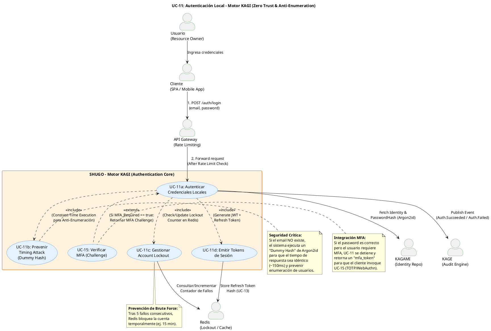

# UC-11: Autenticar Credenciales Locales - Diagrama de Caso de Uso

| Metadatos del Documento | |
| :--- | :--- |
| **Proyecto:** | SHUGO - Identity & Access Platform |
| **Caso de Uso:** | UC-11 - Autenticar Credenciales Locales (Local Authentication) |
| **Documento:** | 02_Use_Case_Diagram.md |
| **Metodología:** | UML 2.5 + ICONIX + Zero Trust Architecture + Security by Design |
| **Autor:** | Gastón Ruiz |
| **Versión Actual:** | 1.0.0 |
| **Fecha:** | 15/09/2026 |

---

## Historial de Versiones

| Versión | Fecha | Autor | Descripción de Cambios | Impacto |
| :--- | :--- | :--- | :--- | :--- |
| **1.0.0** | 15/09/2026 | Gastón Ruiz | **Creación inicial.** Diagrama de Caso de Uso UML para UC-11. Modela la autenticación local como un flujo de alta seguridad, introduciendo actores secundarios críticos (Redis para Lockout, KAGAMI para Identity Repo, KAGE para Auditoría) y resaltando las relaciones de seguridad obligatorias (`<<include>>`) como la prevención de Timing Attacks (Dummy Hash) y la gestión de Account Lockout. | Documento base del paquete de diseño Tier 1 del UC-11. Establece las fronteras del sistema, demostrando cómo la autenticación no es solo una validación de password, sino un proceso de orquestación de seguridad que protege contra enumeración, fuerza bruta y fugas de información. |

---

## 1. Diagrama de Caso de Uso (PlantUML)

A continuación, se presenta el Diagrama de Casos de Uso UML para el UC-11. Este diagrama modela la autenticación local no como una simple validación de credenciales, sino como un **proceso de orquestación de seguridad** que integra criptografía, gestión de estado y prevención de ataques.

---

## 2. Explicación del Diagrama

### 2.1. Límite del Sistema (System Boundary)

El diagrama identifica **tres límites de sistema claramente diferenciados**:

1. **Motor KAGI - Authentication Core (UC-11):** El sistema principal que orquesta la autenticación. Incluye la validación criptográfica, la prevención de ataques de tiempo y la emisión de tokens.
2. **Sistemas de Soporte Crítico (Redis, KAGAMI, KAGE):** 
   - **Redis:** Actúa como la capa de alta velocidad para gestionar el Account Lockout y el conteo de fallos, previniendo que la base de datos principal (KAGAMI) sea saturada por ataques de fuerza bruta.
   - **KAGAMI:** Proporciona la identidad y el hash de la contraseña (Argon2id).
   - **KAGE:** Recibe los eventos de auditoría inmutables.
3. **API Gateway:** Actúa como la primera línea de defensa, aplicando Rate Limiting global por IP antes de que la request llegue al motor KAGI.

**Justificación de los Límites:**
- Separar la **prevención de Timing Attacks (UC-11b)** como un caso de uso incluido (`<<include>>`) resalta que la seguridad no es una característica opcional, sino una dependencia obligatoria de cada intento de login.
- El **Account Lockout (UC-11c)** se modela explícitamente porque su gestión en Redis es crítica para la resiliencia del sistema ante ataques automatizados.

### 2.2. Actores del Sistema

#### Actores Primarios:

*   **Usuario (Resource Owner):** El actor humano que posee las credenciales. Su objetivo es demostrar su identidad para obtener acceso a los recursos.
*   **Cliente (SPA / Mobile App):** El actor técnico que representa al usuario. Es responsable de enviar las credenciales de forma segura (HTTPS) y manejar la respuesta (tokens o challenge de MFA).

#### Actores Secundarios (Sistemas Dependientes):

*   **API Gateway:** Aplica Rate Limiting (ej. 10 requests/minuto por IP) para mitigar ataques de Denegación de Servicio (DoS) y Credential Stuffing a gran escala.
*   **Redis:** Almacena el contador de fallos y el estado de bloqueo de la cuenta. Su baja latencia (<5ms) es crucial para no degradar la experiencia de usuario durante el login.
*   **KAGAMI (Identity Repo):** Sistema de registro de identidades. Proporciona el `PasswordHash` y los parámetros de Argon2id (salt, memory, iterations).
*   **KAGE (Audit Engine):** Sistema de auditoría. Recibe eventos asíncronos (vía Outbox Pattern) para registrar el intento de autenticación sin bloquear la respuesta al cliente.

### 2.3. Relaciones UML

#### Relaciones `<<include>>`: UC-11a → UC-11b, UC-11c, UC-11d

*   **Dirección:** La flecha va **DESDE** el caso de uso base (Autenticar) **HACIA** los casos de uso incluidos.
*   **Semántica:** La autenticación local **depende obligatoriamente** de estos comportamientos de seguridad. No existe un flujo de login que no ejecute estas validaciones.
*   **Justificación Arquitectónica:**
    *   **UC-11a → UC-11b (Prevenir Timing Attack):** Esta es la relación más crítica desde el punto de vista de seguridad. Si el usuario no existe, el sistema *debe* ejecutar un "Dummy Hash" (falso cálculo de Argon2id) para que el tiempo de respuesta sea idéntico (~150ms) al de un login con usuario existente. Esto previene que un atacante sepa qué emails están registrados midiendo milisegundos.
    *   **UC-11a → UC-11c (Gestionar Account Lockout):** Antes de validar el password, el sistema *debe* consultar Redis para ver si la cuenta está bloqueada. Tras un fallo, *debe* incrementar el contador.
    *   **UC-11a → UC-11d (Emitir Tokens):** Solo si el password es correcto y no se requiere MFA, el sistema *debe* generar el par de tokens (JWT Access Token + Refresh Token opaco).

#### Relaciones `<<extend>>`: UC-15 → UC-11a

*   **Dirección:** La flecha va **DESDE** UC-15 (Verificar MFA) **HACIA** UC-11a (Autenticar).
*   **Semántica:** La verificación de MFA es un comportamiento **condicional** que se activa si el usuario tiene MFA obligatorio o si el motor de riesgo (UC-17) lo determina.
*   **Justificación:** En lugar de emitir tokens de sesión completos, UC-11 se "pausa" y retorna un `mfa_token` temporal, delegando el resto del flujo a UC-15.

#### Relaciones con Actores Secundarios

*   **UC-11c → Redis:** Consultas y actualizaciones atómicas del contador de fallos.
*   **UC-11a → KAGAMI:** Búsqueda de la identidad y recuperación del hash de la contraseña.
*   **UC-11a → KAGE:** Publicación de eventos de dominio (`Authentication.Succeeded` / `Authentication.Failed`) para auditoría forense.

---

## 3. Análisis de Coherencia con la Especificación Analítica

Este diagrama es **100% coherente** con el documento `01_Requirements_Specification.md`:

| Elemento del Diagrama | Referencia en Especificación |
| :--- | :--- |
| Actores: Usuario, Cliente, GW, Redis, KAGAMI, KAGE | Sección 2 (Descripción Analítica) - Actores Principales y Secundarios |
| Relación <<include>> con UC-11b (Dummy Hash) | Sección 2.3 (Excepción 4.3) y RN-17 - Prevención de Timing Attack |
| Relación <<include>> con UC-11c (Account Lockout) | Sección 3 (INV-74) y UC-42 - Política de bloqueo tras N fallos |
| Relación <<include>> con UC-11d (Emitir Tokens) | Sección 2.1 (Escenario Principal, Paso 10) - Emisión de JWT y Refresh Token |
| Relación <<extend>> con UC-15 (MFA) | Sección 2.2 (Escenario Alternativo) - Handoff a MFA si es obligatorio |
| Relación con KAGAMI | Sección 6.1 - Recuperación de PasswordHash y parámetros Argon2id |
| Relación con KAGE | Sección 5 - Publicación de eventos `Authentication.Succeeded/Failed` |

---

## 4. Consideraciones de Diseño y Arquitectura (Security by Design)

### 4.1. Prevención de Timing Attacks (Dummy Hash)

La relación `<<include>>` con `UC-11b` representa una de las prácticas de seguridad más avanzadas en sistemas IAM enterprise.

*   **El Problema:** Si el sistema retorna un error en 5ms cuando el usuario no existe, pero tarda 150ms cuando el usuario existe (debido al cálculo de Argon2id), un atacante puede automatizar miles de requests y construir una base de datos de usuarios registrados basándose únicamente en el tiempo de respuesta.
*   **La Solución (Dummy Hash):** Si la consulta a KAGAMI retorna `null` (usuario no encontrado), el motor KAGI **no retorna el error inmediatamente**. En su lugar, ejecuta un cálculo de Argon2id con un salt y password falsos ("Dummy Hash").
*   **Resultado:** El tiempo de respuesta es siempre ~150ms, independientemente de si el usuario existe o no. El atacante no puede distinguir entre "Usuario no encontrado" y "Password incorrecto".

### 4.2. Gestión de Account Lockout en Redis

La relación `<<include>>` con `UC-11c` y su conexión con **Redis** refleja una decisión arquitectónica crítica para la resiliencia.

*   **Por qué Redis y no PostgreSQL:** Un ataque de Credential Stuffing puede generar miles de intentos fallidos por segundo. Si el contador de fallos se guardara en PostgreSQL, saturaríamos la base de datos principal, afectando a todos los usuarios legítimos.
*   **Mecanismo:** Redis utiliza operaciones atómicas (`INCR`) con un TTL (Time-To-Live) automático. Si un usuario falla 5 veces, Redis bloquea la cuenta por 15 minutos. Tras 15 minutos, la clave expira y el contador se resetea automáticamente, sin intervención de la base de datos.

### 4.3. Handoff a MFA (UC-15)

La relación `<<extend>>` con `UC-15` modela el flujo de autenticación en dos pasos (Step-Up Authentication).

*   **Mecanismo:** Si el password es correcto pero `MFA_Required == true`, UC-11 **no emite** el Access Token ni el Refresh Token. En su lugar, genera un `MFA_Session_Token` (un JWT de muy corta duración, ej. 5 minutos, con un claim `auth_level: MFA_PENDING`).
*   **Justificación:** Esto garantiza que un atacante que robe el `MFA_Session_Token` no pueda acceder a recursos protegidos, ya que el motor KIZUNA (Autorización) rechazará cualquier request que no tenga un token con `auth_level: AAL2` o superior.

### 4.4. Auditoría Asíncrona (Outbox Pattern)

La relación con **KAGE** muestra que la auditoría no bloquea el flujo de login.

*   **Mecanismo:** Tras validar las credenciales, UC-11 inserta un evento en una tabla `outbox` dentro de la misma transacción de base de datos (o en memoria si se usa Redis). Un proceso en background lee esta tabla y publica el evento en un bus de mensajes (Kafka/RabbitMQ) para que KAGE lo ingeste.
*   **Justificación:** Garantiza que el login sea rápido (<300ms) y que, incluso si el sistema de auditoría está caído, no se pierda el registro del intento de autenticación.

---

## 5. Trazabilidad con Otros Documentos del Paquete

Este diagrama se relaciona con los siguientes documentos del paquete de diseño:

| Documento | Relación |
| :--- | :--- |
| `01_Requirements_Specification.md` | Define los flujos, invariantes (INV-71 a INV-76) y reglas de negocio (RN-16 a RN-19) que este diagrama visualiza. |
| `03_Activity_Diagram.md` | Mostrará el flujo de trabajo interno, destacando la bifurcación lógica para el Dummy Hash, la validación de Argon2id y el handoff a MFA. |
| `04_Initial_Domain_Model.md` | Definirá el Aggregate Root `AuthenticationSession`, el Domain Service `PasswordHasher` (Argon2id) y el Value Object `Credential`. |
| `05_State_Machine_Diagram.md` | Mostrará la máquina de estados de la sesión de autenticación: `PENDING` → `PASSWORD_VERIFIED` → `MFA_CHALLENGE` → `AUTHENTICATED`. |
| `06_Robustness_Diagram.md` | Mostrará la colaboración entre el Authentication Handler, Redis, KAGAMI y el Password Hasher. |
| `07_Sequence_Diagram.md` | Detallará el orden temporal exacto de las llamadas: Rate Limit Check → Redis Lockout Check → KAGAMI Fetch → Dummy Hash (si aplica) → Argon2id Verify → Token Generation. |
| `08_Final_Class_Design.md` | Definirá las firmas exactas de los métodos: `PasswordHasher.Verify()`, `LockoutManager.CheckStatus()`, `TokenIssuer.Generate()`. |
| `11_UC_Specific_Security_Threats.md` | Analizará las amenazas específicas mitigadas por este diseño: Brute Force, Credential Stuffing, Timing Attacks y User Enumeration. |

---

## 6. Notas de Implementación

### 6.1. Generación del Diagrama
- **Herramienta:** PlantUML (Diagrams as Code).
- **Ventaja:** Versionable en Git, reproducible, sin dependencias de software propietario.
- **Renderizado:** VS Code (extensión PlantUML), GitHub, o Pandoc para exportación a PDF.

### 6.2. Estilos Aplicados
- `<style>` block: Para evitar advertencias de `skinparam` deprecados en versiones modernas de PlantUML.
- `top to bottom direction`: Organiza el flujo de arriba hacia abajo (Actores → Sistema Principal → Sistemas Dependientes).
- `skinparam actorStyle awesome`: Íconos modernos para actores.
- `skinparam usecaseBackgroundColor #E3F2FD`: Color azul claro para casos de uso de KAGI.
- `skinparam systemBackgroundColor #FFF3E0`: Color naranja claro para sistemas secundarios y externos.

### 6.3. Convenciones de Nomenclatura
- **Actores:** Nombres descriptivos que indican su rol y nivel de automatización (Usuario, Cliente, API Gateway, Redis).
- **Casos de Uso:** Verbos en infinitivo que describen la meta del actor o la responsabilidad del sistema (ej. "Autenticar Credenciales Locales", "Prevenir Timing Attack").
- **Sistemas:** Nombres que reflejan el Bounded Context de DDD (ej. "Motor KAGI", "KAGAMI Identity Repo").
- **Relaciones:** Etiquetas descriptivas que explican el propósito de la relación (ej. "<<include>> (Constant-Time Execution para Anti-Enumeración)").

### 6.4. Diferenciación Visual de Seguridad
Para facilitar la comprensión de la arquitectura de seguridad, los casos de uso relacionados con la prevención de ataques (`UC-11b: Prevenir Timing Attack`, `UC-11c: Gestionar Account Lockout`) se modelan como casos de uso independientes incluidos (`<<include>>`) en el flujo principal. Esto comunica visualmente que la seguridad está integrada en el núcleo del proceso de autenticación, no añadida como una capa posterior.

---
*Fin del Documento 02_Use_Case_Diagram para UC-11*