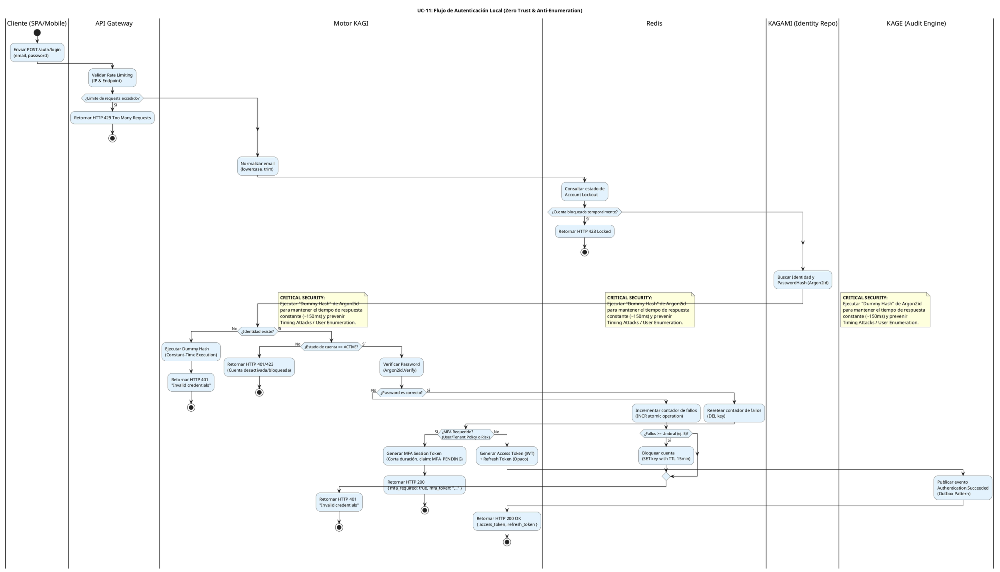

# UC-11: Autenticar Credenciales Locales - Diagrama de Actividades

| Metadatos del Documento | |
| :--- | :--- |
| **Proyecto:** | SHUGO - Identity & Access Platform |
| **Caso de Uso:** | UC-11 - Autenticar Credenciales Locales (Local Authentication) |
| **Documento:** | 03_Activity_Diagram.md |
| **Metodología:** | UML 2.5 + ICONIX + Zero Trust Architecture + Security by Design |
| **Autor:** | Gastón Ruiz |
| **Versión Actual:** | 1.0.0 |
| **Fecha:** | 15/09/2026 |

---

## Historial de Versiones

| Versión | Fecha | Autor | Descripción de Cambios | Impacto |
| :--- | :--- | :--- | :--- | :--- |
| **1.0.0** | 15/09/2026 | Gastón Ruiz | **Creación inicial.** Diagrama de Actividades UML con carriles (swimlanes) para UC-11. Modela el flujo end-to-end de la autenticación local, destacando las bifurcaciones de seguridad críticas: Rate Limiting, Account Lockout en Redis, ejecución de Dummy Hash para prevención de Timing Attacks, verificación de Argon2id, y el handoff condicional a MFA. | Documento base del paquete de diseño Tier 1 del UC-11. Sirve como el "guion de ejecución" exacto para el `AuthenticationHandler`, garantizando que las mitigaciones de seguridad (Anti-Enumeración, Brute Force) se implementen en el orden y contexto correctos. |

---

## 1. Introducción y Propósito

El **Diagrama de Actividades** para el UC-11 materializa la lógica de negocio y las reglas de seguridad definidas en la Especificación de Requisitos (01) y el Diagrama de Casos de Uso (02). Su propósito es:

1. **Definir el Flujo de Control Exacto:** Establecer el orden secuencial de las operaciones desde que el cliente envía las credenciales hasta que recibe los tokens o un error.
2. **Modelar las Bifurcaciones de Seguridad:** Visualizar explícitamente los puntos de decisión críticos (Rate Limit, Lockout, Existencia de Usuario, MFA) y sus caminos alternativos.
3. **Asignar Responsabilidades por Carril (Swimlanes):** Clarificar qué actor o sistema (Cliente, API Gateway, KAGI, Redis, KAGAMI, KAGE) es responsable de cada acción.
4. **Destacar la Prevención de Timing Attacks:** Mostrar visualmente la ejecución del "Dummy Hash" cuando el usuario no existe, una de las prácticas de seguridad más avanzadas del sistema.

---

## 2. Diagrama de Actividades (PlantUML)

A continuación, se presenta el Diagrama de Actividades UML con particiones (swimlanes) para cada actor y sistema involucrado.

---

## 3. Análisis de los Carriles (Swimlanes) y Responsabilidades

El diagrama divide la responsabilidad del flujo de autenticación en 6 carriles claros, reflejando la arquitectura de microservicios y la separación de preocupaciones (SoC):

1. **Cliente (SPA/Mobile):** Responsable de recolectar las credenciales del usuario y enviarlas de forma segura (HTTPS). No realiza lógica de negocio.
2. **API Gateway:** Actúa como el primer filtro de seguridad. Aplica **Rate Limiting** (ej. 10 requests/minuto por IP) para mitigar ataques de Denegación de Servicio (DoS) y Credential Stuffing a gran escala antes de que consuman recursos del motor KAGI.
3. **Motor KAGI (Authentication Core):** El cerebro de la operación. Normaliza los datos, orquesta las llamadas a los sistemas de soporte (Redis, KAGAMI), ejecuta la lógica de seguridad (Dummy Hash, verificación de Argon2id) y genera los tokens.
4. **Redis (Lockout/Cache):** Proporciona operaciones atómicas de alta velocidad (`INCR`, `DEL`, `SET` con TTL) para gestionar el conteo de fallos y el bloqueo temporal de cuentas, protegiendo a la base de datos principal de la saturación.
5. **KAGAMI (Identity Repo):** El sistema de registro. Proporciona la identidad y el hash de la contraseña (junto con los parámetros de Argon2id: salt, memory, iterations).
6. **KAGE (Audit Engine):** Recibe el evento de auditoría de forma asíncrona (Outbox Pattern) para registrar el intento de autenticación sin bloquear la respuesta al cliente.

---

## 4. Puntos Críticos de Seguridad en el Flujo

### 4.1. Prevención de Timing Attacks (El "Dummy Hash")

Este es el punto más crítico y diferenciador del diseño de SHUGO.

*   **El Problema:** Si el sistema retorna un error en 5ms cuando el usuario no existe, pero tarda 150ms cuando el usuario existe (debido al cálculo de Argon2id), un atacante puede automatizar miles de requests y construir una base de datos de usuarios registrados basándose únicamente en el tiempo de respuesta (Timing Attack).
*   **La Solución Modelada:** En el carril de **Motor KAGI**, si la consulta a KAGAMI retorna `null` (usuario no encontrado), el flujo **no termina inmediatamente**. En su lugar, se dirige a la acción `Ejecutar Dummy Hash`.
*   **Mecanismo:** El sistema ejecuta un cálculo de Argon2id con un salt y password falsos. Esto consume exactamente los mismos ciclos de CPU (~150ms) que una verificación real.
*   **Resultado:** El tiempo de respuesta es constante. El atacante no puede distinguir entre "Usuario no encontrado" y "Password incorrecto".

### 4.2. Gestión Atómica de Account Lockout (Redis)

*   **El Problema:** Un ataque de Credential Stuffing puede generar miles de intentos fallidos por segundo. Si el contador de fallos se guardara en PostgreSQL, saturaríamos la base de datos principal, afectando a todos los usuarios legítimos.
*   **La Solución Modelada:** El flujo delega la gestión de fallos a **Redis**.
*   **Mecanismo:** Tras un fallo de password, se ejecuta `INCR` (incremento atómico). Si el valor supera el umbral (ej. 5), se ejecuta `SET` con un TTL (Time-To-Live) de 15 minutos.
*   **Resultado:** El bloqueo es extremadamente rápido (<5ms), se auto-libera tras 15 minutos sin intervención de la DB, y protege la infraestructura principal.

### 4.3. Handoff a MFA (Pausa de Flujo)

*   **El Problema:** Emitir tokens de sesión completos antes de verificar el segundo factor (MFA) es una vulnerabilidad crítica.
*   **La Solución Modelada:** Si el password es correcto pero `MFA_Required == true`, el flujo se desvía.
*   **Mecanismo:** En lugar de generar el Access Token y Refresh Token definitivos, KAGI genera un `MFA Session Token` (un JWT de muy corta duración, ej. 5 minutos, con un claim `auth_level: MFA_PENDING`).
*   **Resultado:** El cliente recibe un HTTP 200, pero no tiene acceso a recursos protegidos. Debe invocar UC-15 (MFA) presentando este token intermedio para completar la autenticación.

### 4.4. Auditoría Asíncrona (Outbox Pattern)

*   **El Problema:** Si la escritura en el log de auditoría (KAGE) falla o es lenta, el login del usuario se retrasa o falla, degradando la experiencia.
*   **La Solución Modelada:** La acción `Publicar evento Authentication.Succeeded` se realiza al final del flujo exitoso, pero de forma asíncrona.
*   **Mecanismo:** KAGI inserta el evento en una tabla `outbox` (o cola en memoria/Redis) dentro de la misma transacción. Un proceso en background lee esta tabla y publica el evento en un bus de mensajes (Kafka/RabbitMQ) para que KAGE lo ingeste.
*   **Resultado:** Garantiza que el login sea rápido (<300ms) y que, incluso si el sistema de auditoría está caído, no se pierda el registro del intento de autenticación (Garantía de entrega eventual).

---

## 5. Trazabilidad con Otros Documentos del Paquete

Este diagrama es **100% coherente** con los documentos previos y sirve de base para los siguientes:

| Documento | Relación |
| :--- | :--- |
| `01_Requirements_Specification.md` | Implementa visualmente los escenarios BDD (4.1 a 4.6), las invariantes (INV-71 a INV-76) y las reglas de negocio (RN-16 a RN-19). |
| `02_Use_Case_Diagram.md` | Materializa las relaciones `<<include>>` (Dummy Hash, Lockout, Token Emission) y `<<extend>>` (MFA) definidas en el diagrama de casos de uso. |
| `04_Initial_Domain_Model.md` | Las acciones en los carriles de KAGI y KAGAMI se mapearán a los métodos de los Aggregate Roots y Domain Services (ej. `PasswordHasher.Verify()`, `LockoutManager.CheckStatus()`). |
| `05_State_Machine_Diagram.md` | Las decisiones "¿Cuenta bloqueada?", "¿MFA Requerido?" y las transiciones de estado de la sesión se detallarán en la máquina de estados. |
| `06_Robustness_Diagram.md` | Los carriles de este diagrama se traducirán en los objetos Boundary (Cliente, GW), Control (KAGI Handler) y Entity (Redis, KAGAMI, KAGE). |
| `07_Sequence_Diagram.md` | Este diagrama define "qué se hace y quién lo hace"; el de secuencia definirá el orden temporal exacto de los mensajes entre estos objetos. |

---

## 6. Notas de Implementación

### 6.1. Sintaxis PlantUML Moderna
- Se utiliza la sintaxis de **Activity Diagram Beta** (`start`, `stop`, `if/then/else/endif`, `note right`) que es más limpia y fácil de leer que la sintaxis legacy.
- Se aplica un bloque `<style>` para definir colores y fondos, evitando advertencias de `skinparam` deprecados en versiones modernas de PlantUML.

### 6.2. Manejo de Errores y "Stop"
- Cada camino alternativo (Rate Limit excedido, Cuenta bloqueada, Usuario no existe, Password incorrecto, MFA requerido) termina con un nodo `stop`. Esto refleja la naturaleza de "falla rápida" (Fail-Fast) del flujo de autenticación. No hay "reintentos" automáticos dentro del mismo request; el cliente debe reenviar la request.

### 6.3. Convenciones de Nomenclatura
- **Acciones:** Verbos en infinitivo que describen la operación técnica (ej. "Normalizar email", "Ejecutar Dummy Hash").
- **Decisiones:** Preguntas claras que resultan en un booleano (Sí/No) (ej. "¿Identidad existe?", "¿Password es correcto?").
- **Notas de Seguridad:** Se utilizan notas con el texto "**CRITICAL SECURITY:**" para resaltar las decisiones de diseño que mitigan vulnerabilidades específicas (OWASP Top 10).

---
*Fin del Documento 03_Activity_Diagram para UC-11*