# UC-11: Autenticar Credenciales Locales - Modelo de Dominio Inicial

| Metadatos del Documento | |
| :--- | :--- |
| **Proyecto:** | SHUGO - Identity & Access Platform |
| **Caso de Uso:** | UC-11 - Autenticar Credenciales Locales (Local Authentication) |
| **Documento:** | 04_Initial_Domain_Model.md |
| **Metodología:** | ICONIX (Modelo de Análisis) + DDD (Domain-Driven Design) + Zero Trust Architecture |
| **Autor:** | Gastón Ruiz |
| **Versión Actual:** | 1.0.0 |
| **Fecha:** | 15/09/2026 |

---

## Historial de Versiones

| Versión | Fecha | Autor | Descripción de Cambios | Impacto |
| :--- | :--- | :--- | :--- | :--- |
| **1.0.0** | 15/09/2026 | Gastón Ruiz | **Creación inicial.** Definición del Modelo de Dominio Conceptual para la autenticación local. Introduce el Aggregate Root `AuthenticationAttempt` para gestionar el estado del flujo (incluyendo el handoff a MFA), el Value Object `PasswordHash` (Argon2id), el Domain Service `PasswordHasher` (con soporte para Dummy Hash), y la Entity `RefreshToken`. Separa claramente el contexto de Autenticación (KAGI) del contexto de Identidad (KAGAMI). | Documento base del paquete de diseño Tier 1 del UC-11. Establece cómo el dominio gestiona la validación criptográfica, la prevención de Timing Attacks y la emisión segura de tokens, garantizando que la lógica de seguridad esté encapsulada en el núcleo del dominio. |

---

## 1. Introducción y Propósito

Este documento presenta el **Modelo de Dominio Inicial** para el Caso de Uso UC-11 (Autenticar Credenciales Locales).

A diferencia de los UCs de gestión de identidad (UC-01 a UC-05) que mutan el estado de la identidad a largo plazo, el UC-11 se centra en un **proceso transitorio de alta seguridad** que culmina en la emisión de credenciales de sesión. Por lo tanto, el modelo de dominio introduce conceptos específicos para orquestar este flujo:

1. **Separación de Contextos (Bounded Contexts):** El motor KAGI (Autenticación) no muta directamente el Aggregate Root `Identity` de KAGAMI durante el login. Solo lo consulta. La actualización de `LastLoginAt` se maneja vía eventos de dominio (consistencia eventual) para no afectar la latencia del login.
2. **Aggregate Root de Flujo (`AuthenticationAttempt`):** Dado que el login puede tener múltiples pasos (Password -> MFA Challenge -> Success), necesitamos un AR que rastree este estado transitorio sin contaminar el AR `Identity`.
3. **Criptografía como Concepto de Dominio:** El hashing de contraseñas (Argon2id) y la prevención de Timing Attacks (Dummy Hash) no son detalles de infraestructura, son reglas de negocio críticas encapsuladas en un Domain Service.
4. **Tokens Opacos vs. JWT:** Modelamos el `RefreshToken` como una Entity con ciclo de vida propio (rotación, revocación), distinto del `AccessToken` (JWT) que es un Value Object autocontenido.

---

## 2. Diagrama de Modelo de Dominio Conceptual (PlantUML)

A continuación, se presenta el diagrama de clases conceptual, enfocándose en los objetos de dominio, servicios y eventos introducidos para UC-11.

```plantuml
@startuml UC-11_DominioConceptual
<style>
diagram {
  BackgroundColor #FFFFFF
}
</style>
skinparam classAttributeIconSize 0
skinparam classBackgroundColor #FFFFFF
skinparam classBorderColor #1565C0
skinparam classHeaderBackgroundColor #E3F2FD

title UC-11: Modelo de Dominio Conceptual - Autenticación Local (Argon2id & Anti-Enumeration)

' ============================================
' AGGREGATE ROOTS
' ============================================
class AuthenticationAttempt <<Aggregate Root>> {
  - id: AttemptId
  - tenantId: TenantId
  - identityId: IdentityId?
  - status: AuthenticationStatus
  - authLevel: AuthLevel
  - mfaToken: string?
  - createdAt: DateTime
  - domainEvents: List<IDomainEvent>
  
  + {static} Initiate(tenantId, identifier): AuthenticationAttempt
  + VerifyPassword(providedCredential: Credential, storedHash: PasswordHash, hasher: IPasswordHasher): void
  + RequireMfa(mfaProvider: IMfaProvider): void
  + CompleteAuthentication(): void
  - ValidateStatusTransition(newStatus: AuthenticationStatus): void
}

class RefreshToken <<Entity>> {
  - id: RefreshTokenId
  - identityId: IdentityId
  - tokenHash: string
  - deviceId: string
  - expiresAt: DateTime
  - isRevoked: bool
  
  + {static} Create(identityId, deviceId, ttl): RefreshToken
  + Revoke(): void
  + IsExpired(): bool
}

' ============================================
' VALUE OBJECTS
' ============================================
class Credential <<Value Object>> {
  - identifier: string
  - rawPassword: SecureString
  + Credential(identifier, rawPassword)
  - NormalizeIdentifier(): string
}

class PasswordHash <<Value Object>> {
  - algorithm: string
  - hash: string
  - salt: string
  - memoryCost: int
  - iterations: int
  - parallelism: int
  + PasswordHash(algorithm, hash, salt, memoryCost, iterations, parallelism)
  + GetParameters(): Argon2Parameters
}

class AuthLevel <<Value Object>> {
  - value: string
  + AAL1: AuthLevel
  + AAL2: AuthLevel
  + AAL3: AuthLevel
  + AuthLevel(value)
}

class AuthenticationStatus <<Value Object>> {
  - value: string
  + PENDING: AuthenticationStatus
  + PASSWORD_VERIFIED: AuthenticationStatus
  + MFA_CHALLENGE: AuthenticationStatus
  + AUTHENTICATED: AuthenticationStatus
  + FAILED: AuthenticationStatus
}

class JwtPayload <<Value Object>> {
  - sub: string
  - tenantId: string
  - authLevel: AuthLevel
  - iat: DateTime
  - exp: DateTime
  + JwtPayload(sub, tenantId, authLevel, iat, exp)
}

' ============================================
' DOMAIN SERVICES
' ============================================
class PasswordHasher <<Domain Service>> {
  + Verify(providedPassword: SecureString, storedHash: PasswordHash): bool
  + GenerateDummyHash(): PasswordHash
  - ExecuteConstantTimeComparison(a, b): bool
}

class TokenIssuer <<Domain Service>> {
  + IssueAccessToken(payload: JwtPayload): string
  + IssueRefreshToken(identityId, deviceId): RefreshToken
}

class LockoutManager <<Domain Service>> {
  - cache: IDistributedCache
  + IsLockedOut(identifier: string): bool
  + RecordFailure(identifier: string): void
  + ResetFailures(identifier: string): void
}

' ============================================
' INTERFACES (PUERTOS)
' ============================================
interface IIdentityRepository {
  + FindByNormalizedEmailAsync(email: string): Task<IdentitySnapshot?>
}

interface IMfaProvider {
  + IsRequired(identityId: IdentityId): Task<bool>
}

interface IAuditPublisher {
  + PublishAsync(event: IDomainEvent): Task
}

' ============================================
' RELACIONES
' ============================================
AuthenticationAttempt ||--o| RefreshToken : "emite (1 a 1 en éxito)"
AuthenticationAttempt *-- AuthenticationStatus : "estado actual"
AuthenticationAttempt *-- AuthLevel : "nivel alcanzado"

Credential ..> PasswordHash : "se compara contra"
PasswordHasher ..> PasswordHash : "valida / genera dummy"

note right of PasswordHasher
  **Seguridad Crítica:**
  Incluye método GenerateDummyHash()
  para ejecutar Argon2id ficticio
  cuando el usuario no existe,
  previniendo Timing Attacks.
end note

note bottom of AuthenticationAttempt
  **Gestión de Estado MFA:**
  Permite pausar el flujo en
  PASSWORD_VERIFIED y emitir
  un token intermedio para UC-15.
end note

@enduml
```



---

## 3. Detalle de Conceptos de Dominio (DDD)

### 3.1. Aggregate Root: `AuthenticationAttempt`

El Aggregate Root `AuthenticationAttempt` encapsula el estado transitorio del proceso de login. Es crucial para manejar el escenario donde el password es correcto pero se requiere MFA.

**Código (C#):**

```csharp
public class AuthenticationAttempt : AggregateRoot
{
    public AttemptId Id { get; private set; }
    public TenantId TenantId { get; private set; }
    public IdentityId? IdentityId { get; private set; }
    public AuthenticationStatus Status { get; private set; }
    public AuthLevel CurrentAuthLevel { get; private set; }
    public string? MfaSessionToken { get; private set; }
    public DateTime CreatedAt { get; private set; }
    
    private readonly List<IDomainEvent> _domainEvents = new();

    private AuthenticationAttempt() { }

    public static AuthenticationAttempt Initiate(TenantId tenantId, string normalizedIdentifier)
    {
        return new AuthenticationAttempt
        {
            Id = new AttemptId(Guid.NewGuid()),
            TenantId = tenantId,
            Status = AuthenticationStatus.PENDING,
            CurrentAuthLevel = AuthLevel.AAL0, // No autenticado aún
            CreatedAt = DateTime.UtcNow
        };
    }

    /// <summary>
    /// Valida la contraseña. Si es correcta, transiciona a PASSWORD_VERIFIED o MFA_CHALLENGE.
    /// Si es incorrecta, lanza DomainException (el manejo de lockout es infraestructura).
    /// </summary>
    public void VerifyPassword(Credential credential, PasswordHash storedHash, IPasswordHasher hasher)
    {
        if (this.Status != AuthenticationStatus.PENDING)
            throw new DomainException("Invalid state transition for password verification.");

        // La comparación segura ocurre dentro del hasher
        bool isValid = hasher.Verify(credential.RawPassword, storedHash);

        if (!isValid)
        {
            this.Status = AuthenticationStatus.FAILED;
            throw new InvalidCredentialException("Invalid credentials."); // Mensaje genérico
        }

        // Password correcto
        this.Status = AuthenticationStatus.PASSWORD_VERIFIED;
        this.CurrentAuthLevel = AuthLevel.AAL1; // Password validated
    }

    /// <summary>
    /// Prepara el intento para el desafío MFA. Genera un token de sesión temporal.
    /// </summary>
    public void RequireMfa(string mfaToken)
    {
        if (this.Status != AuthenticationStatus.PASSWORD_VERIFIED)
            throw new DomainException("Can only require MFA after password verification.");

        this.Status = AuthenticationStatus.MFA_CHALLENGE;
        this.MfaSessionToken = mfaToken; // Token de corta duración (ej. 5 min)
    }

    /// <summary>
    /// Completa la autenticación tras éxito de MFA (o si MFA no es requerido).
    /// </summary>
    public void CompleteAuthentication(AuthLevel finalLevel)
    {
        if (this.Status != AuthenticationStatus.PASSWORD_VERIFIED && 
            this.Status != AuthenticationStatus.MFA_CHALLENGE)
            throw new DomainException("Invalid state for completion.");

        this.Status = AuthenticationStatus.AUTHENTICATED;
        this.CurrentAuthLevel = finalLevel; // AAL2 o AAL3

        AddDomainEvent(new AuthenticationSucceededEvent(
            this.IdentityId!, 
            this.TenantId, 
            this.CurrentAuthLevel
        ));
    }

    public IReadOnlyCollection<IDomainEvent> GetDomainEvents() => _domainEvents.AsReadOnly();
    protected void AddDomainEvent(IDomainEvent evt) => _domainEvents.Add(evt);
}
```

### 3.2. Value Objects de Seguridad

#### **PasswordHash**

Encapsula no solo el hash, sino los parámetros necesarios para que Argon2id funcione. Esto permite la "Agilidad Criptográfica" (actualizar parámetros en el futuro sin romper hashes antiguos).

```csharp
public class PasswordHash : ValueObject
{
    public string Algorithm { get; } // "Argon2id"
    public string Hash { get; }
    public string Salt { get; }
    public int MemoryCost { get; } // En KB
    public int Iterations { get; }
    public int Parallelism { get; }

    public PasswordHash(string algorithm, string hash, string salt, int memoryCost, int iterations, int parallelism)
    {
        if (string.IsNullOrWhiteSpace(hash)) throw new DomainException("Hash cannot be empty.");
        
        Algorithm = algorithm;
        Hash = hash;
        Salt = salt;
        MemoryCost = memoryCost;
        Iterations = iterations;
        Parallelism = parallelism;
    }

    // Método para reconstruir los parámetros para la librería de hashing
    public Argon2Parameters GetParameters() 
    {
        return new Argon2Parameters.Builder(
            Argon2Parameters.ARGON2_id)
            .WithSalt(Encoding.UTF8.GetBytes(Salt))
            .WithMemoryAsKB(MemoryCost)
            .WithIterations(Iterations)
            .WithDegreeOfParallelism(Parallelism)
            .Build();
    }

    protected override IEnumerable<object> GetEqualityComponents()
    {
        yield return Hash;
    }
}
```

#### **Credential**

Representa las credenciales crudas proporcionadas por el usuario.

```csharp
public class Credential : ValueObject
{
    public string NormalizedIdentifier { get; } // Email en lowercase/trim
    public SecureString RawPassword { get; } // Usar SecureString o limpiar memoria manualmente

    public Credential(string identifier, SecureString rawPassword)
    {
        NormalizedIdentifier = NormalizeIdentifier(identifier);
        RawPassword = rawPassword;
    }

    private string NormalizeIdentifier(string id)
    {
        return id?.Trim().ToLowerInvariant() ?? throw new DomainException("Identifier cannot be null.");
    }

    protected override IEnumerable<object> GetEqualityComponents()
    {
        yield return NormalizedIdentifier;
        // No incluir el password en la igualdad por seguridad
    }
}
```

### 3.3. Domain Services Críticos

#### **PasswordHasher (El corazón de la seguridad)**

Este servicio es responsable de la validación y de la generación del "Dummy Hash" para prevenir Timing Attacks.

```csharp
public class PasswordHasher : IPasswordHasher
{
    // Parámetros por defecto para Argon2id (OWASP recommended)
    private const int DefaultMemoryCost = 65536; // 64 MB
    private const int DefaultIterations = 3;
    private const int DefaultParallelism = 4;

    public bool Verify(SecureString providedPassword, PasswordHash storedHash)
    {
        try
        {
            var parameters = storedHash.GetParameters();
            // La librería Konscious.Security.Cryptography o similar maneja SecureString
            var result = Argon2.Verify(parameters, storedHash.Hash, providedPassword);
            return result;
        }
        catch (Exception)
        {
            // Cualquier error (formato inválido, etc.) se trata como fallo de validación
            return false;
        }
    }

    /// <summary>
    /// Genera un hash ficticio utilizando los mismos parámetros de costo.
    /// CRÍTICO: Debe ejecutarse cuando el usuario NO existe para mantener el tiempo constante.
    /// </summary>
    public PasswordHash GenerateDummyHash()
    {
        var salt = RandomNumberGenerator.GetBytes(16);
        var dummyPassword = "DummyPasswordForTimingAttackPrevention";
        
        var parameters = new Argon2Parameters.Builder(Argon2Parameters.ARGON2_id)
            .WithSalt(salt)
            .WithMemoryAsKB(DefaultMemoryCost)
            .WithIterations(DefaultIterations)
            .WithDegreeOfParallelism(DefaultParallelism)
            .Build();

        var hasher = new Argon2id(parameters);
        var hash = hasher.GetBytes(32); // Longitud estándar

        return new PasswordHash(
            "Argon2id",
            Convert.ToBase64String(hash),
            Convert.ToBase64String(salt),
            DefaultMemoryCost,
            DefaultIterations,
            DefaultParallelism
        );
    }
}
```

#### **LockoutManager**

Abstrae la lógica de Redis para el dominio. El dominio no debe saber que se usa Redis, solo que existe un mecanismo de bloqueo.

```csharp
public class LockoutManager : ILockoutManager
{
    private readonly IDistributedCache _cache;
    private readonly int _maxFailures;
    private readonly TimeSpan _lockoutDuration;

    public LockoutManager(IDistributedCache cache, int maxFailures = 5, TimeSpan? lockoutDuration = null)
    {
        _cache = cache;
        _maxFailures = maxFailures;
        _lockoutDuration = lockoutDuration ?? TimeSpan.FromMinutes(15);
    }

    public async Task<bool> IsLockedOutAsync(string normalizedIdentifier)
    {
        var key = $"lockout:{normalizedIdentifier}";
        var status = await _cache.GetStringAsync(key);
        return status == "locked";
    }

    public async Task RecordFailureAsync(string normalizedIdentifier)
    {
        var key = $"failures:{normalizedIdentifier}";
        var count = await _cache.IncrementAsync(key); // Operación atómica
        
        if (count >= _maxFailures)
        {
            var lockKey = $"lockout:{normalizedIdentifier}";
            await _cache.SetStringAsync(lockKey, "locked", new DistributedCacheEntryOptions 
            { 
                AbsoluteExpirationRelativeToNow = _lockoutDuration 
            });
        }
    }

    public async Task ResetFailuresAsync(string normalizedIdentifier)
    {
        var key = $"failures:{normalizedIdentifier}";
        await _cache.RemoveAsync(key);
        
        var lockKey = $"lockout:{normalizedIdentifier}";
        await _cache.RemoveAsync(lockKey);
    }
}
```

---

## 4. Decisiones de Diseño DDD (ADR)

### 4.1. ¿Por qué `AuthenticationAttempt` es un Aggregate Root separado de `Identity`?

**Decisión:** Crear un AR específico para el flujo de autenticación en lugar de mutar `Identity`.

**Justificación:**
- **Aislamiento de Fallos:** Si el proceso de login falla o se cuelga, no queremos dejar el AR `Identity` en un estado inconsistente o bloqueado a nivel de base de datos.
- **Soporte para MFA:** El estado `MFA_CHALLENGE` es transitorio. No tiene sentido persistirlo en la tabla principal de identidades.
- **Rendimiento:** El AR `AuthenticationAttempt` es ligero y de vida corta. `Identity` es pesado y de vida larga.

### 4.2. ¿Por qué `DummyHash` está en el Domain Service y no en la Infraestructura?

**Decisión:** El método `GenerateDummyHash()` vive en `PasswordHasher` (Dominio).

**Justificación:**
- **Regla de Negocio de Seguridad:** La prevención de Timing Attacks es una regla de negocio crítica ("El sistema no debe revelar si un usuario existe"). No es un detalle técnico de implementación.
- **Consistencia de Parámetros:** El Domain Service conoce los parámetros de Argon2id (Memory, Iterations). Al generar el Dummy Hash aquí, garantizamos que el costo computacional sea *exactamente* el mismo que el de un hash real.

### 4.3. ¿Por qué `RefreshToken` es una Entity y no un Value Object?

**Decisión:** `RefreshToken` es una Entity con identidad propia (`RefreshTokenId`) y ciclo de vida.

**Justificación:**
- **Mutabilidad de Estado:** Un Refresh Token cambia de estado (Activo -> Revocado). Los Value Objects deben ser inmutables.
- **Identidad Única:** Necesitamos rastrear tokens individuales para implementar la "Rotación de Tokens" (UC-13) y la "Detección de Reuso".
- **Persistencia:** Se almacenan en una tabla separada (o colección) con su propia estrategia de limpieza (TTL).

### 4.4. Manejo de Memoria para Contraseñas

**Decisión:** Uso de `SecureString` (o limpieza manual de arrays de bytes) en el Value Object `Credential`.

**Justificación:**
- **Mitigación de Dump de Memoria:** Las contraseñas en texto plano no deben permanecer en el heap de .NET más tiempo del necesario. Aunque `SecureString` tiene limitaciones en .NET Core, el concepto de "limpiar la memoria tras el hashing" es una regla de dominio que debe documentarse.

---

## 5. Trazabilidad

| Documento | Relación |
| :--- | :--- |
| `01_Requirements_Specification.md` | Implementa las invariantes INV-71 (Argon2id), INV-72 (Constant Time), INV-73 (Anti-Enumeration) y RN-17 (Dummy Hash). |
| `02_Use_Case_Diagram.md` | Los servicios `PasswordHasher` y `LockoutManager` materializan los casos de uso UC-11b y UC-11c. |
| `03_Activity_Diagram.md` | El Aggregate Root `AuthenticationAttempt` gestiona las transiciones de estado mostradas en el diagrama de actividades (PENDING -> PASSWORD_VERIFIED -> MFA_CHALLENGE). |
| `05_State_Machine_Diagram.md` | Las máquinas de estados del `AuthenticationAttempt` y el `RefreshToken` se detallarán en el próximo documento. |
| `06_Robustness_Diagram.md` | Mostrará cómo el `AuthenticationHandler` (Control) interactúa con estos objetos de dominio y los servicios de infraestructura (Redis, DB). |
| `08_Final_Class_Design.md` | Refinará las firmas de métodos y añadirá detalles de inyección de dependencias. |

---

## 6. Notas para la Implementación

### 6.1. Librerías de Criptografía Recomendadas
Para la implementación de Argon2id en .NET, se recomienda:
- **Konscious.Security.Cryptography:** Soporta `SecureString` y es ampliamente utilizada.
- **Isopoh.Cryptography.Argon2:** Alternativa moderna y mantenida.

### 6.2. Consideraciones de Rendimiento
- El método `Verify` y `GenerateDummyHash` son **CPU-bound** y bloqueantes.
- En un entorno de alta concurrencia, se debe considerar ejecutar estas operaciones en un `Task.Run` para no bloquear el ThreadPool de ASP.NET Core, o usar versiones asíncronas si la librería lo soporta.

### 6.3. Testeo Unitario (Ejemplo)

```csharp
[Test]
public void PasswordHasher_Verify_WithCorrectPassword_ReturnsTrue()
{
    // Arrange
    var hasher = new PasswordHasher();
    var rawPassword = "SecureP@ss123".ToSecureString();
    var salt = RandomNumberGenerator.GetBytes(16);
    
    // Generar hash real (simulado)
    var parameters = new Argon2Parameters.Builder(Argon2Parameters.ARGON2_id)
        .WithSalt(salt).WithMemoryAsKB(65536).WithIterations(3).WithDegreeOfParallelism(4).Build();
    var realHasher = new Argon2id(parameters);
    var hash = Convert.ToBase64String(realHasher.GetBytes(32));
    
    var storedHash = new PasswordHash("Argon2id", hash, Convert.ToBase64String(salt), 65536, 3, 4);

    // Act
    var result = hasher.Verify(rawPassword, storedHash);

    // Assert
    result.Should().BeTrue();
}

[Test]
public void PasswordHasher_GenerateDummyHash_TakesSimilarTimeAsRealHash()
{
    // Arrange
    var hasher = new PasswordHasher();
    var sw = new Stopwatch();

    // Act - Real Hash
    sw.Start();
    // ... ejecutar verify con hash real ...
    var realTime = sw.ElapsedMilliseconds;

    sw.Restart();
    // Act - Dummy Hash
    hasher.GenerateDummyHash();
    var dummyTime = sw.ElapsedMilliseconds;

    // Assert - La diferencia no debe ser significativa (ej. < 20ms)
    Math.Abs(realTime - dummyTime).Should().BeLessThan(20);
}
```

---
*Fin del Documento 04_Initial_Domain_Model para UC-11*