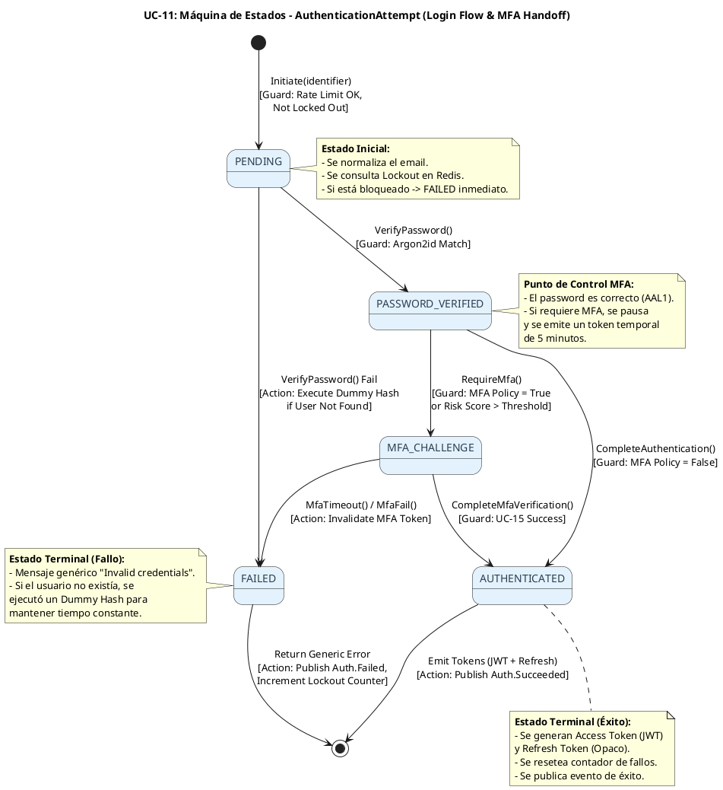
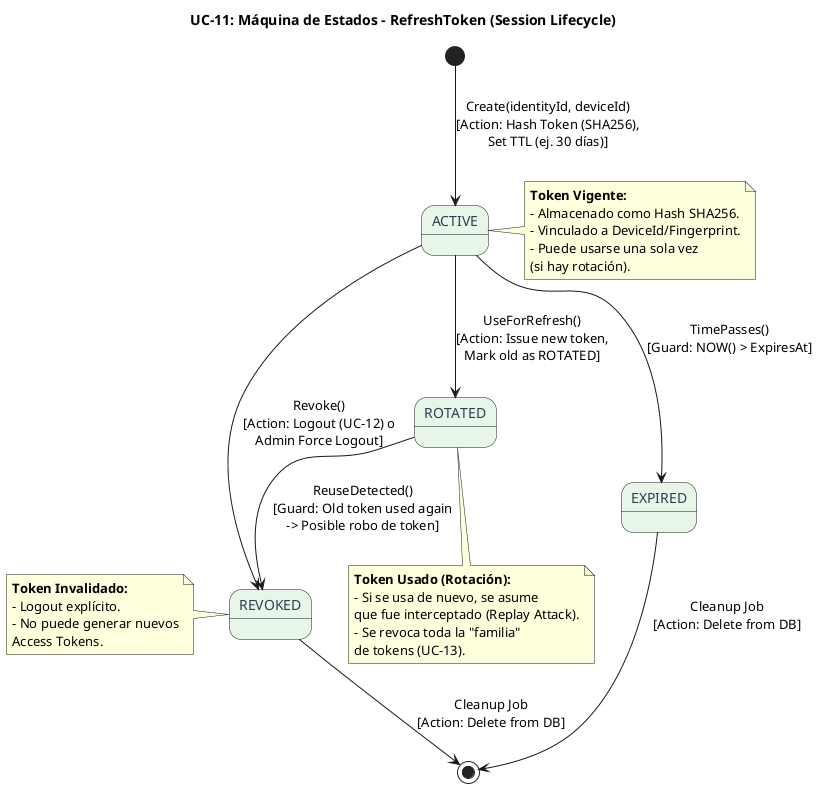

# UC-11: Autenticar Credenciales Locales - Diagrama de Máquina de Estados

| Metadatos del Documento | |
| :--- | :--- |
| **Proyecto:** | SHUGO - Identity & Access Platform |
| **Caso de Uso:** | UC-11 - Autenticar Credenciales Locales (Local Authentication) |
| **Documento:** | 05_State_Machine_Diagram.md |
| **Metodología:** | UML 2.5 + DDD (State Pattern) + Zero Trust Architecture + Temporal State Management |
| **Autor:** | Gastón Ruiz |
| **Versión Actual:** | 1.0.0 |
| **Fecha:** | 15/09/2026 |

---

## Historial de Versiones

| Versión | Fecha | Autor | Descripción de Cambios | Impacto |
| :--- | :--- | :--- | :--- | :--- |
| **1.0.0** | 15/09/2026 | Gastón Ruiz | **Creación inicial.** Definición de las máquinas de estados específicas para la autenticación local. Se modelan dos máquinas críticas: (1) Ciclo de Vida del `AuthenticationAttempt` (flujo transitorio de login con handoff a MFA), y (2) Ciclo de Vida del `RefreshToken` (gestión de sesión a largo plazo). Se abordan las guardas de seguridad (Dummy Hash, Lockout) y las transiciones condicionales. | Documento base del paquete de diseño Tier 1 del UC-11. Establece las reglas de transición, las guardas de seguridad y la lógica temporal que garantiza que no se emitan tokens de sesión sin pasar por todas las validaciones criptográficas y de MFA. |

---

## 1. Introducción y Propósito

El **Diagrama de Máquina de Estados** para el UC-11 visualiza las restricciones de comportamiento temporal y las reglas de transición que gobiernan el proceso de autenticación.

A diferencia de los UCs de gestión de identidad (ciclo de vida largo), el UC-11 maneja **entidades transitorias de alta seguridad** con las siguientes complejidades:

1. **Flujo de Autenticación en Múltiples Pasos:** El login no es atómico si existe MFA. El Aggregate Root `AuthenticationAttempt` debe gestionar estados intermedios (`PASSWORD_VERIFIED`, `MFA_CHALLENGE`) sin emitir tokens de sesión completos prematuramente.
2. **Prevención de Fugas de Estado:** Si un intento falla o expira, debe transicionar a un estado terminal (`FAILED`) y ser descartado, asegurando que no queden sesiones "zombies".
3. **Ciclo de Vida del Refresh Token:** Aunque la rotación completa es UC-13, la emisión inicial y la revocación (Logout - UC-12) deben modelarse aquí para garantizar la integridad de la sesión.

Estas máquinas garantizan:
- **Seguridad por Diseño:** Es imposible transicionar a `AUTHENTICATED` sin pasar por `PASSWORD_VERIFIED`.
- **Integridad de Sesión:** Los tokens solo se emiten en el estado terminal exitoso.
- **Trazabilidad:** Cada transición genera un evento de dominio para KAGE (Auditoría).

---

## 2. Máquina de Estados #1: AuthenticationAttempt (Flujo de Login)

### 2.1. Descripción

Esta máquina modela el ciclo de vida transitorio de un intento de autenticación. Representa el "carrito de compras" de la autenticación, acumulando credenciales validadas hasta que se emiten los tokens finales o se rechaza el intento.

### 2.2. Diagrama de Máquina de Estados (PlantUML)



### 2.3. Descripción de Estados y Transiciones

| Estado | Descripción | Transiciones de Salida | Invariante Clave |
| :--- | :--- | :--- | :--- |
| **PENDING** | El intento ha sido iniciado. Se ha normalizado el identificador y verificado que no esté bloqueado (Lockout). | → `PASSWORD_VERIFIED` (Password correcto), → `FAILED` (Password incorrecto o Lockout activo). | No se ha validado ninguna credencial aún. |
| **PASSWORD_VERIFIED** | La contraseña ha sido validada exitosamente contra el hash Argon2id. Nivel de autenticación: AAL1. | → `MFA_CHALLENGE` (Si MFA es obligatorio), → `AUTHENTICATED` (Si MFA no es requerido). | El password es correcto. No se han emitido tokens de sesión. |
| **MFA_CHALLENGE** | El flujo está pausado esperando el segundo factor. Se ha emitido un `MFA_Session_Token` de corta duración. | → `AUTHENTICATED` (MFA verificado vía UC-15), → `FAILED` (Timeout o fallo de MFA). | El usuario ha probado ser el dueño del password, pero falta el segundo factor. |
| **AUTHENTICATED** | Autenticación completa (AAL2 o AAL3). Listo para emitir tokens. | Ninguna (Estado Terminal). | Se deben emitir Access Token y Refresh Token inmediatamente. |
| **FAILED** | El intento ha fallado (Password incorrecto, Lockout, o MFA fallido). | Ninguna (Estado Terminal). | Se debe retornar un error genérico y registrar el fallo. |

### 2.4. Guardas (Guards) y Acciones Críticas

#### Transición: `PENDING` → `FAILED` (El camino del Dummy Hash)
Esta es la transición más crítica desde el punto de vista de seguridad contra Timing Attacks.

```csharp
public void VerifyPassword(Credential credential, PasswordHash? storedHash, IPasswordHasher hasher)
{
    if (this.Status != AuthenticationStatus.PENDING)
        throw new DomainException("Invalid state transition.");

    // ESCENARIO A: El usuario NO existe en la DB (storedHash es null)
    if (storedHash == null)
    {
        // ACCIÓN DE SEGURIDAD: Ejecutar Dummy Hash para mantener el tiempo constante (~150ms)
        hasher.GenerateDummyHash(); 
        
        this.Status = AuthenticationStatus.FAILED;
        throw new InvalidCredentialException("Invalid credentials.");
    }

    // ESCENARIO B: El usuario existe, validar password
    bool isValid = hasher.Verify(credential.RawPassword, storedHash);

    if (!isValid)
    {
        this.Status = AuthenticationStatus.FAILED;
        throw new InvalidCredentialException("Invalid credentials.");
    }

    // ESCENARIO C: Password correcto
    this.Status = AuthenticationStatus.PASSWORD_VERIFIED;
}
```

#### Transición: `PASSWORD_VERIFIED` → `MFA_CHALLENGE` (Handoff a UC-15)
```csharp
public void RequireMfa(string mfaSessionToken)
{
    if (this.Status != AuthenticationStatus.PASSWORD_VERIFIED)
        throw new DomainException("Can only require MFA after password verification.");

    this.Status = AuthenticationStatus.MFA_CHALLENGE;
    this.MfaSessionToken = mfaSessionToken; // JWT de 5 minutos con claim auth_level: MFA_PENDING
}
```

---

## 3. Máquina de Estados #2: RefreshToken (Ciclo de Vida de Sesión)

### 3.1. Descripción

El `RefreshToken` es una Entity con identidad propia que permite al cliente obtener nuevos Access Tokens sin pedir credenciales al usuario. Su máquina de estados es vital para prevenir robos de sesión y garantizar el Logout (UC-12).

### 3.2. Diagrama de Máquina de Estados (PlantUML)



### 3.3. Descripción de Estados y Transiciones

| Estado | Descripción | Transiciones de Salida | Invariante Clave |
| :--- | :--- | :--- | :--- |
| **ACTIVE** | El token es válido y puede ser usado para obtener un nuevo Access Token. | → `ROTATED` (Uso normal con rotación), → `REVOKED` (Logout), → `EXPIRED` (TTL alcanzado). | El hash del token existe en DB y `IsRevoked == false`. |
| **ROTATED** | El token fue usado exitosamente para refrescar la sesión y fue reemplazado por uno nuevo. | → `REVOKED` (Si se detecta reuso). | El token no debe poder usarse nuevamente. |
| **REVOKED** | El token ha sido invalidado explícitamente (Logout) o por seguridad (Reuso detectado). | Ninguna (Estado Terminal). | `IsRevoked == true`. |
| **EXPIRED** | El token ha superado su tiempo de vida (TTL). | Ninguna (Estado Terminal). | `NOW() > ExpiresAt`. |

---

## 4. Implementación en el Dominio (Código C#)

### 4.1. Aggregate Root `AuthenticationAttempt` con Máquina de Estados

```csharp
public class AuthenticationAttempt : AggregateRoot
{
    // ... Propiedades (Id, TenantId, IdentityId, Status, etc.) ...

    private void ValidateStatusTransition(AuthenticationStatus newStatus)
    {
        var allowedTransitions = new Dictionary<AuthenticationStatus, HashSet<AuthenticationStatus>>
        {
            { AuthenticationStatus.PENDING, new HashSet<AuthenticationStatus> { AuthenticationStatus.PASSWORD_VERIFIED, AuthenticationStatus.FAILED } },
            { AuthenticationStatus.PASSWORD_VERIFIED, new HashSet<AuthenticationStatus> { AuthenticationStatus.MFA_CHALLENGE, AuthenticationStatus.AUTHENTICATED } },
            { AuthenticationStatus.MFA_CHALLENGE, new HashSet<AuthenticationStatus> { AuthenticationStatus.AUTHENTICATED, AuthenticationStatus.FAILED } },
            { AuthenticationStatus.AUTHENTICATED, new HashSet<AuthenticationStatus>() }, // Terminal
            { AuthenticationStatus.FAILED, new HashSet<AuthenticationStatus>() } // Terminal
        };

        if (allowedTransitions.TryGetValue(this.Status, out var allowed))
        {
            if (!allowed.Contains(newStatus))
                throw new DomainException($"Invalid transition from {this.Status} to {newStatus}.");
        }
    }

    public void CompleteAuthentication(AuthLevel finalLevel, RefreshToken refreshToken)
    {
        ValidateStatusTransition(AuthenticationStatus.AUTHENTICATED);

        this.Status = AuthenticationStatus.AUTHENTICATED;
        this.CurrentAuthLevel = finalLevel;
        
        // Asociar el Refresh Token generado (UC-13 manejará su rotación posterior)
        this.AddRefreshToken(refreshToken);

        AddDomainEvent(new AuthenticationSucceededEvent(
            this.IdentityId!, this.TenantId, this.CurrentAuthLevel, refreshToken.Id
        ));
    }
}
```

### 4.2. Entity `RefreshToken` con Detección de Reuso

```csharp
public class RefreshToken : Entity
{
    public RefreshTokenId Id { get; private set; }
    public IdentityId IdentityId { get; private set; }
    public string TokenHash { get; private set; }
    public string DeviceId { get; private set; }
    public DateTime ExpiresAt { get; private set; }
    public bool IsRevoked { get; private set; }
    public RefreshTokenId? ReplacedByTokenId { get; private set; } // Para chain validation

    public bool IsExpired => DateTime.UtcNow > ExpiresAt;

    /// <summary>
    /// Intenta usar el token para refrescar la sesión.
    /// </summary>
    public void UseForRefresh(RefreshTokenId newTokenId)
    {
        if (this.IsRevoked)
            throw new DomainException("Token is revoked.");
        
        if (this.IsExpired)
            throw new DomainException("Token is expired.");

        // Marcar como rotado
        this.ReplacedByTokenId = newTokenId;
        // Nota: En UC-13 se implementará la lógica para marcarlo como REVOKED si se detecta reuso
    }

    public void Revoke()
    {
        this.IsRevoked = true;
    }
}
```

---

## 5. Trazabilidad con Otros Documentos del Paquete

| Documento | Relación |
| :--- | :--- |
| `01_Requirements_Specification.md` | Las invariantes de estado (INV-75, INV-76) y reglas de negocio (RN-19 MFA Enforcement) se definen aquí y se hacen cumplir en estas máquinas. |
| `02_Use_Case_Diagram.md` | Muestra los actores y sistemas; estas máquinas definen cómo el sistema responde a sus acciones de login a lo largo del tiempo. |
| `03_Activity_Diagram.md` | Los carriles de actividad (Motor KAGI, Redis) se implementan aquí como máquinas de estados. |
| `04_Initial_Domain_Model.md` | Los Aggregate Roots `AuthenticationAttempt` y `RefreshToken` son la implementación directa de estas máquinas. |
| `06_Robustness_Diagram.md` | Mostrará cómo los objetos colaboran para ejecutar estas transiciones de estado de forma segura. |
| `07_Sequence_Diagram.md` | Detallará el orden temporal exacto de las llamadas que disparan estas transiciones. |
| `10_UC_Specific_Data_Model.md` | Define las columnas físicas (`status`, `is_revoked`, `expires_at`) que persisten estos estados en PostgreSQL/Redis. |

---

## 6. Notas de Implementación

### 6.1. Testing de Máquinas de Estados

Cada transición y guarda definida en estas máquinas debe tener al menos dos tests unitarios:

```csharp
[Test]
public void AuthenticationAttempt_VerifyPassword_WithDummyHash_TransitionsToFailed()
{
    // Arrange
    var attempt = AuthenticationAttempt.Initiate(new TenantId(Guid.NewGuid()), "user@khcs.com");
    var hasher = new Mock<IPasswordHasher>();
    
    // Simular que el usuario no existe (storedHash = null)
    PasswordHash storedHash = null; 

    // Act
    var act = () => attempt.VerifyPassword(new Credential("user@khcs.com", "pwd".ToSecureString()), storedHash, hasher.Object);

    // Assert
    act.Should().Throw<InvalidCredentialException>();
    attempt.Status.Should().Be(AuthenticationStatus.FAILED);
    
    // Verificar que se ejecutó el Dummy Hash
    hasher.Verify(h => h.GenerateDummyHash(), Times.Once());
}

[Test]
public void RefreshToken_UseForRefresh_WhenRevoked_ThrowsDomainException()
{
    // Arrange
    var token = RefreshToken.Create(new IdentityId(Guid.NewGuid()), "device-123", TimeSpan.FromDays(30));
    token.Revoke();

    // Act
    var act = () => token.UseForRefresh(new RefreshTokenId(Guid.NewGuid()));

    // Assert
    act.Should().Throw<DomainException>().WithMessage("*revoked*");
}
```

### 6.2. Concurrencia y Race Conditions en Refresh Tokens

Dado que un `RefreshToken` puede ser usado solo una vez (en esquemas de rotación estricta), se debe manejar la concurrencia:

- **Problema:** Si un atacante roba un Refresh Token y el usuario legítimo lo usa al mismo tiempo, ambos intentarán transicionar de `ACTIVE` a `ROTATED`.
- **Mitigación (Optimistic Concurrency):** Usar `RowVersion` en la tabla de Refresh Tokens. Si la actualización falla (0 rows affected), significa que el token ya fue usado. En este caso, se asume **Token Theft** y se revoca toda la familia de tokens (UC-13).

---

## 7. Glosario de Términos Específicos de UC-11

| Término | Definición |
| :--- | :--- |
| **AuthenticationAttempt** | Aggregate Root transitorio que gestiona el estado del flujo de login, permitiendo pausas para MFA. |
| **MFA Handoff** | Transición de `PASSWORD_VERIFIED` a `MFA_CHALLENGE`, donde se emite un token temporal en lugar de tokens de sesión completos. |
| **Dummy Hash Execution** | Acción de seguridad ejecutada durante la transición a `FAILED` cuando el usuario no existe, para prevenir Timing Attacks. |
| **Refresh Token Rotation** | Patrón donde un Refresh Token se invalida (`ROTATED`) tras su uso, emitiendo uno nuevo. |
| **Token Family / Chain** | Conjunto de Refresh Tokens vinculados (padre-hijo) usados para detectar robos mediante reuso. |
| **Reuse Detection** | Guarda de seguridad que transiciona un token `ROTATED` a `REVOKED` si se intenta usar nuevamente, indicando un posible robo. |
| **AuthLevel (AAL)** | Authentication Assurance Level (NIST). AAL1: Password, AAL2: Password + MFA. |

---
*Fin del Documento 05_State_Machine_Diagram para UC-11*