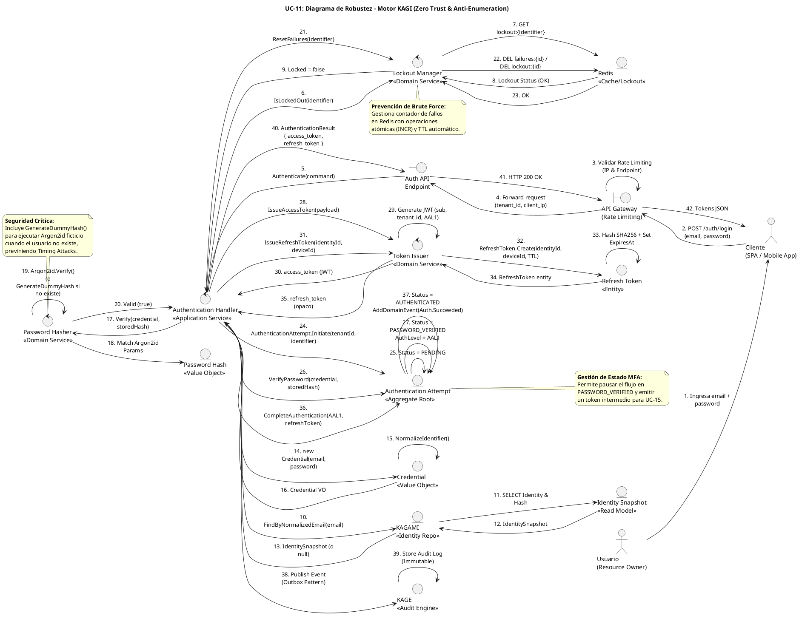

# UC-11: Autenticar Credenciales Locales - Diagrama de Robustez

| Metadatos del Documento | |
| :--- | :--- |
| **Proyecto:** | SHUGO - Identity & Access Platform |
| **Caso de Uso:** | UC-11 - Autenticar Credenciales Locales (Local Authentication) |
| **Documento:** | 06_Robustness_Diagram.md |
| **Metodología:** | ICONIX (Diagrama de Robustez) + DDD + Zero Trust Architecture + Security by Design |
| **Autor:** | Gastón Ruiz |
| **Versión Actual:** | 1.0.0 |
| **Fecha:** | 15/09/2026 |

---

## Historial de Versiones

| Versión | Fecha | Autor | Descripción de Cambios | Impacto |
| :--- | :--- | :--- | :--- | :--- |
| **1.0.0** | 15/09/2026 | Gastón Ruiz | **Creación inicial.** Diagrama de Robustez para UC-11, validando la arquitectura del motor KAGI para autenticación local. Muestra la colaboración estricta entre Boundary Objects (Cliente, API Gateway), Control Objects (AuthenticationHandler, PasswordHasher, LockoutManager, TokenIssuer), y Entity Objects (AuthenticationAttempt, Credential, PasswordHash, RefreshToken, IdentitySnapshot). Valida la prevención de Timing Attacks mediante Dummy Hash, la gestión de Account Lockout en Redis, el handoff a MFA, y la emisión segura de tokens JWT. | Documento base del paquete de diseño Tier 1 del UC-11. Sirve como puente crítico entre el Modelo de Dominio (04) y el Diagrama de Secuencia (07), asegurando que la arquitectura soporta la seguridad criptográfica, la prevención de enumeración, y la resiliencia ante ataques de fuerza bruta antes de codificar. |

---

## 1. Introducción y Propósito

El **Diagrama de Robustez** para el UC-11 valida que el flujo de autenticación local puede ser orquestado respetando las reglas estrictas de acoplamiento de **ICONIX** y los principios de **Domain-Driven Design (DDD)**, **Zero Trust Architecture**, y **Security by Design**.

El desafío específico de este caso de uso es quíntuple:

1. **Prevención de Timing Attacks:** El sistema debe ejecutar un "Dummy Hash" cuando el usuario no existe, manteniendo el tiempo de respuesta constante (~150ms) para prevenir enumeración de usuarios.
2. **Gestión de Account Lockout en Redis:** El conteo de fallos debe ser atómico y de alta velocidad, protegiendo la base de datos principal de saturación por ataques de Credential Stuffing.
3. **Handoff a MFA (UC-15):** Si el password es correcto pero se requiere MFA, el flujo debe pausarse y retornar un token intermedio, sin emitir tokens de sesión completos.
4. **Emisión Segura de Tokens:** Los Access Tokens (JWT) y Refresh Tokens (opacos) deben generarse solo tras validación completa, con claims específicos para autorización (KIZUNA).
5. **Auditoría Asíncrona (Outbox Pattern):** Los eventos de autenticación deben publicarse sin bloquear la respuesta al cliente, garantizando trazabilidad forense.

---

## 2. Diagrama de Robustez (PlantUML)

A continuación, se presenta el Diagrama de Robustez organizado de izquierda a derecha para mostrar el flujo natural: **Actor → Boundary → Control → Entity**.



---

## 3. Explicación Detallada de los Objetos

### 3.1. Boundary Objects (Objetos de Límite)

| Objeto | Responsabilidad | Mapeo a Clean Architecture |
| :--- | :--- | :--- |
| **`API Gateway`** | Valida Rate Limiting (ej. 10 requests/minuto por IP) para mitigar ataques de Credential Stuffing a gran escala. Es la primera línea de defensa antes de que la request llegue al motor KAGI. | Middleware (Kong, AWS API Gateway, Azure API Management). |
| **`Auth API Endpoint`** | Recibe la request HTTP `POST /auth/login`, deserializa el payload a un Command DTO, y lo pasa al Authentication Handler. | Controller (ASP.NET Core Controller). |

### 3.2. Control Objects (Objetos de Control)

| Objeto | Responsabilidad | Mapeo a Clean Architecture |
| :--- | :--- | :--- |
| **`Authentication Handler`** | **Application Service.** Orquesta el flujo de autenticación. Coordina las validaciones de Lockout, la consulta de identidad, la verificación de password (con Dummy Hash si aplica), el handoff a MFA, y la emisión de tokens. | Command Handler / Application Service. |
| **`Password Hasher`** | **Domain Service.** Encapsula la lógica criptográfica de Argon2id. Incluye el método crítico `GenerateDummyHash()` para prevenir Timing Attacks cuando el usuario no existe. | Domain Service (Criptografía). |
| **`Lockout Manager`** | **Domain Service.** Gestiona el conteo de fallos y el bloqueo temporal de cuentas. Abstrae Redis para que el dominio no dependa de la infraestructura. | Domain Service (Seguridad). |
| **`Token Issuer`** | **Domain Service.** Genera Access Tokens (JWT) y Refresh Tokens (opacos) con claims específicos para autorización (KIZUNA). | Domain Service (Tokens). |

### 3.3. Entity Objects (Objetos de Entidad)

| Objeto | Responsabilidad | Mapeo a DDD |
| :--- | :--- | :--- |
| **`Authentication Attempt`** | **Aggregate Root.** Encapsula el estado transitorio del flujo de login (PENDING → PASSWORD_VERIFIED → MFA_CHALLENGE → AUTHENTICATED/FAILED). Permite el handoff a MFA sin emitir tokens prematuramente. | Aggregate Root (Flujo transitorio). |
| **`Credential`** | **Value Object.** Representa las credenciales crudas proporcionadas por el usuario, con normalización de identificador (lowercase, trim) y manejo seguro de password (SecureString). | Value Object (Inmutable). |
| **`Password Hash`** | **Value Object.** Encapsula el hash de la contraseña junto con los parámetros de Argon2id (salt, memory, iterations, parallelism), permitiendo agilidad criptográfica. | Value Object (Inmutable). |
| **`Refresh Token`** | **Entity.** Token opaco de larga duración con identidad propia, ciclo de vida (ACTIVE → ROTATED → REVOKED/EXPIRED), y detección de reuso para prevenir robos de sesión. | Entity (Mutable, con identidad). |
| **`Identity Snapshot`** | **Read Model.** Proyección ligera de la identidad para consultas de autenticación, evitando cargar el Aggregate Root completo de KAGAMI. | Read Model (CQRS Query Side). |
| **`Redis`** | **Infrastructure.** Almacena el contador de fallos y el estado de bloqueo de cuentas con operaciones atómicas (INCR) y TTL automático. | Infrastructure (Cache/Lockout). |
| **`KAGAMI`** | **Infrastructure.** Sistema de registro de identidades. Proporciona el Identity Snapshot con el PasswordHash y parámetros de Argon2id. | Infrastructure (Identity Repo). |
| **`KAGE`** | **Infrastructure.** Motor de auditoría. Recibe eventos de dominio (Authentication.Succeeded/Failed) vía Outbox Pattern para registro forense inmutable. | Infrastructure (Audit Engine). |

---

## 4. Reglas de Robustez de ICONIX (Validación del Diagrama)

Verifiquemos que nuestro diagrama cumple estrictamente las reglas de acoplamiento de ICONIX:

### ✅ Regla 1: Actor → Boundary
- **Cumplida:** El `Usuario` interactúa con el `Cliente` (SPA/Mobile), y el `Cliente` interactúa con el `API Gateway`.

### ✅ Regla 2: Boundary → Boundary
- **Cumplida:** El `API Gateway` forward la request al `Auth API Endpoint` tras validar Rate Limiting.

### ✅ Regla 3: Boundary → Control
- **Cumplida:** El `Auth API Endpoint` envía el command al `Authentication Handler`.

### ✅ Regla 4: Control → Control
- **Cumplida y Crítica:** El `Authentication Handler` delega a controles específicos:
  - `Lockout Manager` para gestionar Account Lockout.
  - `Password Hasher` para verificar credenciales (con Dummy Hash).
  - `Token Issuer` para generar JWT y Refresh Tokens.
- **Validación:** Esto mantiene el Handler delgado y permite que las reglas de seguridad (Dummy Hash, Lockout) sean reutilizables y testeables unitariamente.

### ✅ Regla 5: Control → Entity
- **Cumplida:**
  - `Authentication Handler` crea el Value Object `Credential` y el Aggregate Root `AuthenticationAttempt`.
  - `Password Hasher` valida contra el Value Object `PasswordHash`.
  - `Lockout Manager` consulta y actualiza `Redis`.
  - `Authentication Handler` consulta `KAGAMI` para obtener el `Identity Snapshot`.
  - `Token Issuer` crea la Entity `RefreshToken`.
  - `Authentication Handler` publica eventos en `KAGE`.

### ✅ Regla 6: NO Entity → Control / Boundary
- **Cumplida:** Ninguna entidad (`AuthenticationAttempt`, `Credential`, `PasswordHash`, `RefreshToken`, `IdentitySnapshot`, `Redis`, `KAGAMI`, `KAGE`) envía mensajes de vuelta a los controles o boundaries. Solo retornan datos como respuesta a una invocación.

### ✅ Regla 7: NO Entity → Entity (Directo sin Control)
- **Cumplida:** El `Authentication Handler` es el único que orquesta la interacción entre las entidades. Las entidades no se crean entre sí directamente desde el diagrama de flujo principal.

---

## 5. Consideraciones de Arquitectura (Security & Performance)

### 5.1. Prevención de Timing Attacks (Dummy Hash)

El diagrama valida visualmente uno de los patrones de seguridad más críticos: **la ejecución de un Dummy Hash cuando el usuario no existe**.

**Flujo (Pasos 17-20):**
1. `Authentication Handler` consulta `KAGAMI` para obtener el `IdentitySnapshot`.
2. Si el usuario no existe, `KAGAMI` retorna `null`.
3. `Authentication Handler` invoca `PasswordHasher.Verify()` con `storedHash = null`.
4. `PasswordHasher` detecta que `storedHash` es `null` y ejecuta `GenerateDummyHash()`.
5. El Dummy Hash consume exactamente los mismos ciclos de CPU (~150ms) que un hash real.
6. Retorna `false` (siempre falla).

**Justificación:**
- **Anti-Enumeración:** Un atacante no puede distinguir entre "Usuario no encontrado" (150ms) y "Password incorrecto" (150ms) midiendo el tiempo de respuesta.
- **Seguridad por Diseño:** La prevención de Timing Attacks está integrada en el Domain Service, no es un parche de infraestructura.

### 5.2. Gestión de Account Lockout en Redis

El diagrama muestra cómo el `Lockout Manager` gestiona el conteo de fallos de forma atómica en Redis (Pasos 6-9 y 21-23):

1. Tras un fallo de password, `Lockout Manager` ejecuta `INCR failures:{identifier}` en Redis.
2. Si el contador alcanza el umbral (ej. 5), ejecuta `SET lockout:{identifier} "locked" TTL 15min`.
3. En el próximo intento, `Lockout Manager` consulta `GET lockout:{identifier}` y retorna `Locked = true`.

**Justificación:**
- **Protección de DB Principal:** Un ataque de Credential Stuffing puede generar miles de intentos fallidos por segundo. Si el contador se guardara en PostgreSQL, saturaríamos la base de datos principal.
- **Auto-Liberación:** El TTL de Redis (15 min) libera automáticamente el bloqueo sin intervención de la DB.
- **Atomicidad:** `INCR` es atómico en Redis, previniendo Race Conditions bajo carga concurrente.

### 5.3. Handoff a MFA (UC-15)

El diagrama modela el flujo de autenticación preparado para MFA:

1. Si el password es correcto pero `MFA_Required == true`, el `Authentication Handler` no emite tokens de sesión completos.
2. En su lugar, genera un `MFA Session Token` (JWT de 5 minutos con claim `auth_level: MFA_PENDING`).
3. El `AuthenticationAttempt` transiciona a `MFA_CHALLENGE`.
4. Retorna HTTP 200 con `{ mfa_required: true, mfa_token: "..." }`.

**Justificación:**
- **Seguridad:** Un atacante que robe el `MFA Session Token` no puede acceder a recursos protegidos, ya que el motor KIZUNA (Autorización) rechazará cualquier request que no tenga un token con `auth_level: AAL2` o superior.
- **Separación de Responsabilidades:** UC-11 valida el password; UC-15 valida el segundo factor.

### 5.4. Emisión Segura de Tokens

El diagrama muestra la generación de tokens solo tras validación completa (Pasos 28-35):

1. **Access Token (JWT):** Generado por `Token Issuer` con claims específicos (`sub`, `tenant_id`, `auth_level`, `iat`, `exp`).
2. **Refresh Token (Opaco):** Generado como Entity con identidad propia, almacenado como hash SHA256 en DB, con TTL de 30 días.

**Justificación:**
- **Minimización de Superficie de Ataque:** Los tokens solo se emiten en el estado `AUTHENTICATED`, nunca antes.
- **Rotación Futura:** El `Refresh Token` está diseñado para soportar rotación (UC-13) y detección de reuso.

### 5.5. Auditoría Asíncrona (Outbox Pattern)

El diagrama muestra que la auditoría no bloquea el flujo de login (Pasos 38-39):

1. `Authentication Handler` publica el evento `Authentication.Succeeded` en `KAGE`.
2. `KAGE` almacena el log de auditoría de forma inmutable.

**Justificación:**
- **Rendimiento:** La auditoría no añade latencia al login (<300ms).
- **Resiliencia:** Si `KAGE` está caído, el evento se encola y se procesa cuando se recupere (Garantía de entrega eventual).

---

## 6. Trazabilidad con Otros Documentos del Paquete

| Documento | Relación |
| :--- | :--- |
| `01_Requirements_Specification.md` | Este diagrama valida que los requisitos de prevención de Timing Attacks, Account Lockout, y handoff a MFA pueden ser implementados con los objetos definidos. |
| `02_Use_Case_Diagram.md` | Muestra los actores y sistemas; este diagrama muestra cómo colaboran los objetos internos. |
| `03_Activity_Diagram.md` | Los carriles de actividad (Motor KAGI, Redis, KAGAMI, KAGE) se mapean directamente a los objetos de Control y Entity de este diagrama. |
| `04_Initial_Domain_Model.md` | Los objetos `AuthenticationAttempt`, `Credential`, `PasswordHash`, `RefreshToken`, y los servicios `PasswordHasher`, `LockoutManager`, `TokenIssuer` son exactamente las clases definidas en el modelo de dominio. |
| `05_State_Machine_Diagram.md` | Las máquinas de estados (PENDING → PASSWORD_VERIFIED → MFA_CHALLENGE → AUTHENTICATED) se ejecutan cuando el `Authentication Handler` invoca los métodos de transición del `AuthenticationAttempt`. |
| `07_Sequence_Diagram.md` | Este diagrama define "qué objetos colaboran"; el de secuencia definirá "en qué orden temporal exacto" se envían los mensajes. |
| `08_Final_Class_Design.md` | Definirá las firmas exactas de los métodos mostrados en este diagrama (ej. `PasswordHasher.Verify()`, `LockoutManager.IsLockedOut()`, `TokenIssuer.IssueAccessToken()`). |

---

## 7. Notas de Implementación

### 7.1. Inyección de Dependencias

El `Authentication Handler` debe tener inyectados los servicios de dominio e infraestructura:

```csharp
public class AuthenticationHandler : IAuthenticationHandler
{
    private readonly IPasswordHasher _passwordHasher;
    private readonly ILockoutManager _lockoutManager;
    private readonly ITokenIssuer _tokenIssuer;
    private readonly IIdentityRepository _identityRepository;
    private readonly IAuditPublisher _auditPublisher;
    private readonly IMfaProvider _mfaProvider;
    private readonly ILogger<AuthenticationHandler> _logger;

    public AuthenticationHandler(
        IPasswordHasher passwordHasher,
        ILockoutManager lockoutManager,
        ITokenIssuer tokenIssuer,
        IIdentityRepository identityRepository,
        IAuditPublisher auditPublisher,
        IMfaProvider mfaProvider,
        ILogger<AuthenticationHandler> logger)
    {
        _passwordHasher = passwordHasher;
        _lockoutManager = lockoutManager;
        _tokenIssuer = tokenIssuer;
        _identityRepository = identityRepository;
        _auditPublisher = auditPublisher;
        _mfaProvider = mfaProvider;
        _logger = logger;
    }
}
```

### 7.2. Flujo de Ejecución Simplificado (Código)

```csharp
public async Task<AuthenticationResult> AuthenticateAsync(AuthenticateCommand command, CancellationToken ct)
{
    // 1. Normalizar email
    var normalizedEmail = command.Email.Trim().ToLowerInvariant();

    // 2. Verificar Lockout
    if (await _lockoutManager.IsLockedOutAsync(normalizedEmail))
        throw new AccountLockedException("Account is temporarily locked.");

    // 3. Consultar identidad
    var identity = await _identityRepository.FindByNormalizedEmailAsync(normalizedEmail);

    // 4. Crear Credential VO
    var credential = new Credential(normalizedEmail, command.Password.ToSecureString());

    // 5. Verificar password (con Dummy Hash si identity = null)
    bool isValid = _passwordHasher.Verify(credential.RawPassword, identity?.PasswordHash);

    if (!isValid)
    {
        // 6. Registrar fallo
        await _lockoutManager.RecordFailureAsync(normalizedEmail);
        throw new InvalidCredentialException("Invalid credentials."); // Mensaje genérico
    }

    // 7. Resetear fallos
    await _lockoutManager.ResetFailuresAsync(normalizedEmail);

    // 8. Crear AuthenticationAttempt
    var attempt = AuthenticationAttempt.Initiate(command.TenantId, normalizedEmail);
    attempt.VerifyPassword(credential, identity.PasswordHash, _passwordHasher);

    // 9. Verificar MFA
    bool mfaRequired = await _mfaProvider.IsRequiredAsync(identity.Id);

    if (mfaRequired)
    {
        // 10. Handoff a MFA
        var mfaToken = GenerateMfaSessionToken(identity.Id, command.TenantId);
        attempt.RequireMfa(mfaToken);
        return new AuthenticationResult { MfaRequired = true, MfaToken = mfaToken };
    }

    // 11. Emitir tokens
    var accessToken = _tokenIssuer.IssueAccessToken(new JwtPayload(
        identity.Id.Value.ToString(),
        command.TenantId.Value.ToString(),
        AuthLevel.AAL1,
        DateTime.UtcNow,
        DateTime.UtcNow.AddMinutes(15)
    ));

    var refreshToken = _tokenIssuer.IssueRefreshToken(identity.Id, command.DeviceId);

    // 12. Completar autenticación
    attempt.CompleteAuthentication(AuthLevel.AAL1, refreshToken);

    // 13. Publicar evento de auditoría
    await _auditPublisher.PublishAsync(attempt.GetDomainEvents(), ct);

    return new AuthenticationResult
    {
        AccessToken = accessToken,
        RefreshToken = refreshToken.TokenValue, // Solo se retorna una vez
        ExpiresIn = 900
    };
}
```

---
*Fin del Documento 06_Robustness_Diagram para UC-11*