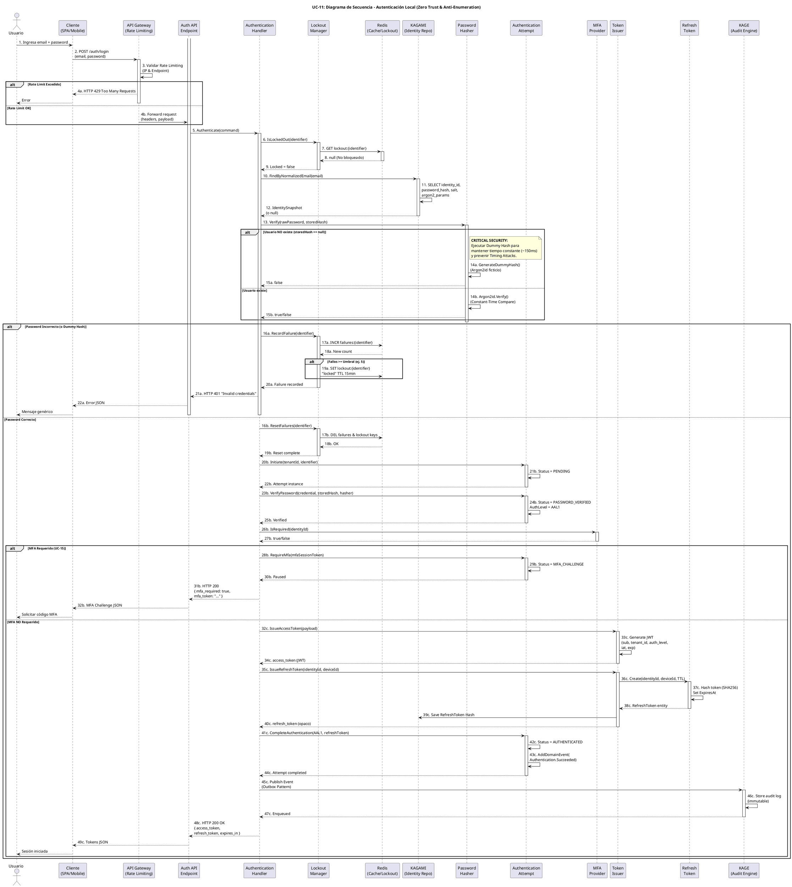

# UC-11: Autenticar Credenciales Locales - Diagrama de Secuencia

| Metadatos del Documento | |
| :--- | :--- |
| **Proyecto:** | SHUGO - Identity & Access Platform |
| **Caso de Uso:** | UC-11 - Autenticar Credenciales Locales (Local Authentication) |
| **Documento:** | 07_Sequence_Diagram.md |
| **Metodología:** | ICONIX (Diagrama de Secuencia) + DDD + Zero Trust Architecture + Security by Design |
| **Autor:** | Gastón Ruiz |
| **Versión Actual:** | 1.0.0 |
| **Fecha:** | 15/09/2026 |

---

## Historial de Versiones

| Versión | Fecha | Autor | Descripción de Cambios | Impacto |
| :--- | :--- | :--- | :--- | :--- |
| **1.0.0** | 15/09/2026 | Gastón Ruiz | **Creación inicial.** Diagrama de Secuencia completo para UC-11. Modela la orquestación temporal exacta de la autenticación local, destacando la ejecución del Dummy Hash para prevención de Timing Attacks, la gestión atómica de Account Lockout en Redis, el handoff condicional a MFA (UC-15), y la emisión segura de tokens con auditoría asíncrona (Outbox Pattern). | Documento base del paquete de diseño Tier 1 del UC-11. Sirve como guion exacto para la codificación del `AuthenticationHandler`, garantizando que las mitigaciones de seguridad se ejecuten en el orden y contexto correctos. |

---

## 1. Introducción y Propósito

El **Diagrama de Secuencia** para el UC-11 materializa temporalmente las colaboraciones definidas en el Diagrama de Robustez. Su propósito es:

1. **Definir el orden exacto de las operaciones de seguridad:** Establecer la secuencia crítica donde Rate Limiting → Lockout Check → Identity Fetch → Dummy Hash/Argon2id Verify ocurre antes de cualquier emisión de tokens.
2. **Modelar la Prevención de Timing Attacks:** Mostrar explícitamente la bifurcación donde se ejecuta el `GenerateDummyHash()` si la identidad no existe, manteniendo el tiempo de respuesta constante (~150ms).
3. **Visualizar el Handoff a MFA:** Demostrar cómo el flujo se "pausa" en el estado `PASSWORD_VERIFIED` para retornar un token intermedio si se requiere el segundo factor.
4. **Demostrar la Auditoría Asíncrona:** Mostrar que la publicación de eventos a KAGE no bloquea la respuesta HTTP al cliente.

---

## 2. Diagrama de Secuencia - Escenario Principal (PlantUML)

A continuación, se presenta el Diagrama de Secuencia para el **Escenario Principal (Login Exitoso sin MFA)** y sus variaciones críticas de seguridad (Dummy Hash, Lockout, MFA Handoff).



---

## 3. Análisis Detallado del Flujo

### 3.1. Fase 1: Ingress & Rate Limiting (Pasos 1-4)

**Participantes:** `Usuario`, `Cliente`, `API Gateway`, `Auth API`

*   **Acción:** El cliente envía las credenciales. El API Gateway intercepta la request.
*   **Seguridad:** El Gateway aplica Rate Limiting (ej. 10 requests/minuto por IP).
*   **Justificación:** Mitiga ataques de Denegación de Servicio (DoS) y Credential Stuffing a gran escala *antes* de que consuman recursos del motor KAGI. Si se excede, retorna HTTP 429 inmediatamente.

### 3.2. Fase 2: Lockout & Identity Fetch (Pasos 5-12)

**Participantes:** `Authentication Handler`, `Lockout Manager`, `Redis`, `KAGAMI`

*   **Acción:** El Handler consulta el estado de bloqueo en Redis y luego busca la identidad en KAGAMI.
*   **Seguridad:** 
    *   **Redis para Lockout:** Usar Redis (operaciones `GET` atómicas y rápidas) en lugar de PostgreSQL protege la base de datos principal de la saturación durante un ataque de fuerza bruta.
    *   **Normalización:** El email se normaliza (lowercase, trim) antes de la búsqueda para evitar errores de "User not found" por mayúsculas.
*   **Justificación:** Separar la consulta de Lockout (alta frecuencia, lectura/escritura rápida) de la consulta de Identidad (lectura pesada) optimiza el rendimiento.

### 3.3. Fase 3: Verificación Criptográfica (Pasos 13-15) - *Ruta Crítica*

**Participantes:** `Authentication Handler`, `Password Hasher`

*   **Acción:** Se valida la contraseña contra el hash almacenado.
*   **Seguridad (Anti-Enumeración):**
    *   **Ruta A (Usuario NO existe):** Si `KAGAMI` retorna `null`, el `Password Hasher` **no retorna el error inmediatamente**. Ejecuta `GenerateDummyHash()`, un cálculo ficticio de Argon2id que consume exactamente los mismos ciclos de CPU (~150ms) que un hash real. Retorna `false`.
    *   **Ruta B (Usuario existe):** Ejecuta `Argon2id.Verify()` usando comparación en tiempo constante (`Constant-Time Compare`).
*   **Justificación:** Un atacante no puede distinguir entre "Usuario no encontrado" y "Password incorrecto" midiendo milisegundos de respuesta (Timing Attack). El tiempo de respuesta es siempre ~150ms.

### 3.4. Fase 4: Gestión de Estado y Handoff a MFA (Pasos 16-32)

**Participantes:** `Lockout Manager`, `Authentication Attempt`, `MFA Provider`

*   **Acción (Fallo):** Si el password es incorrecto, se incrementa el contador en Redis (`INCR`). Si supera el umbral (ej. 5), se bloquea la cuenta (`SET` con TTL 15min). Retorna HTTP 401 con mensaje genérico.
*   **Acción (Éxito):** Se resetean los fallos (`DEL`). Se crea el Aggregate Root `AuthenticationAttempt` y transiciona a `PASSWORD_VERIFIED` (AAL1).
*   **Handoff a MFA:** Se consulta al `MFA Provider`. Si `IsRequired == true`, el Attempt transiciona a `MFA_CHALLENGE`. Se genera un `mfaSessionToken` (JWT de 5 min) y se retorna HTTP 200 con `{ mfa_required: true }`.
*   **Justificación:** **Nunca** se emiten tokens de sesión completos (Access/Refresh) antes de verificar el segundo factor. El `mfaSessionToken` es inútil para acceder a recursos protegidos.

### 3.5. Fase 5: Emisión de Tokens y Auditoría (Pasos 32-49)

**Participantes:** `Token Issuer`, `Refresh Token`, `KAGE`

*   **Acción:** Si MFA no es requerido (o ya fue verificado en un flujo posterior), se emiten los tokens.
    *   **Access Token (JWT):** Generado con claims mínimos (`sub`, `tenant_id`, `auth_level: AAL1/AAL2`, `iat`, `exp`).
    *   **Refresh Token (Opaco):** Generado como Entity, hasheado (SHA256) y persistido en DB con TTL (ej. 30 días). Solo se retorna el valor opaco al cliente *una vez*.
*   **Auditoría:** El `AuthenticationAttempt` genera el evento `Authentication.Succeeded`. El Handler lo publica en `KAGE` vía Outbox Pattern.
*   **Justificación:** La auditoría asíncrona garantiza que el login sea rápido (<300ms) y que, incluso si el sistema de auditoría está caído, no se pierda el registro forense (Garantía de entrega eventual).

---

## 4. Flujos Alternativos y Excepciones

### 4.1. Flujo Alternativo: Cuenta Bloqueada (Account Lockout)

Si el usuario intenta login pero la cuenta está en estado `LOCKED` en Redis:

```
User -> Client -> GW -> API -> Handler -> Lockout (IsLockedOut) -> Redis (GET lockout_key) -> Redis (returns "locked") -> Lockout -> Handler -> Handler -> API -> GW -> Client -> User (HTTP 423 Locked)
```

**Pasos:** 1-9, detección de bloqueo, retorno 423.
**Tiempo total:** ~20ms (Redis es extremadamente rápido).
**Justificación:** Previene que un atacante continúe intentando credenciales en una cuenta ya comprometida o bajo ataque.

### 4.2. Flujo Alternativo: Credential Stuffing / Breached Password

Si el sistema detecta (vía integración con UC-43 o lista local) que el password ha sido comprometido en brechas públicas:

```
... -> Hasher (Argon2id.Verify) -> Hasher (true) -> Handler -> Handler (Check Breach DB) -> Handler (Flag password_compromised) -> Token Issuer (Issue Tokens with flag) -> Client -> User (HTTP 200 OK, but forced password change on next request)
```

**Pasos:** 1-15, 16b, 20b-34c, 48c (con flag especial).
**Justificación:** Permite al usuario entrar para cambiar su password, pero le niega el acceso a operaciones sensibles hasta que lo cambie.

### 4.3. Flujo de Excepción: Error Crítico del Sistema (DB/Redis Caído)

Si Redis o KAGAMI no responden durante el flujo:

```
Handler -> Lockout -> Redis (Timeout/Exception) -> Lockout -> Handler -> Handler (Fail Secure) -> API -> Client -> User (HTTP 503 Service Unavailable)
```

**Pasos:** 1-7, excepción no manejada, retorno 503.
**Justificación:** Principio "Fail Secure". Si no podemos verificar el Lockout o la Identidad, denegamos el acceso por defecto para proteger la plataforma.

---

## 5. Consideraciones de Arquitectura (Security & Performance)

### 5.1. Prevención de Timing Attacks (Dummy Hash)

El diagrama modela explícitamente la **ejecución del Dummy Hash** (Pasos 14a-15a):

1. `KAGAMI` retorna `null` (usuario no encontrado).
2. `Authentication Handler` pasa `storedHash = null` al `Password Hasher`.
3. `Password Hasher` detecta el `null` y ejecuta `GenerateDummyHash()`.
4. El Dummy Hash consume ~150ms.
5. Retorna `false`.

**Justificación:**
- **Anti-Enumeración:** Un atacante no puede construir una base de datos de usuarios registrados midiendo el tiempo de respuesta.
- **Seguridad por Diseño:** La mitigación está integrada en el Domain Service, no es un parche de infraestructura.

### 5.2. Gestión Atómica de Account Lockout (Redis)

El diagrama muestra cómo el `Lockout Manager` gestiona el conteo de fallos de forma atómica en Redis (Pasos 17a-19a):

1. Tras un fallo, ejecuta `INCR failures:{identifier}`.
2. Si `New count >= 5`, ejecuta `SET lockout:{identifier} "locked" TTL 15min`.

**Justificación:**
- **Protección de DB Principal:** Un ataque de Credential Stuffing puede generar miles de intentos fallidos por segundo. Redis maneja esto sin saturar PostgreSQL.
- **Auto-Liberación:** El TTL de Redis libera automáticamente el bloqueo sin intervención de la DB.

### 5.3. Handoff a MFA (UC-15)

El diagrama modela el **flujo de autenticación en dos pasos** (Pasos 28b-32b):

1. Si `MFA_Required == true`, el `AuthenticationAttempt` transiciona a `MFA_CHALLENGE`.
2. Se genera un `mfaSessionToken` (JWT de 5 minutos con claim `auth_level: MFA_PENDING`).
3. Retorna HTTP 200 con `{ mfa_required: true, mfa_token: "..." }`.

**Justificación:**
- **Seguridad:** Un atacante que robe el `mfaSessionToken` no puede acceder a recursos protegidos, ya que el motor KIZUNA (Autorización) rechazará cualquier request que no tenga un token con `auth_level: AAL2` o superior.
- **Separación de Responsabilidades:** UC-11 valida el password; UC-15 valida el segundo factor.

### 5.4. Emisión Segura de Tokens

El diagrama muestra la **generación de tokens solo tras validación completa** (Pasos 32c-40c):

1. **Access Token (JWT):** Generado por `Token Issuer` con claims específicos (`sub`, `tenant_id`, `auth_level`, `iat`, `exp`).
2. **Refresh Token (Opaco):** Generado como Entity con identidad propia, almacenado como hash SHA256 en DB, con TTL de 30 días.

**Justificación:**
- **Minimización de Superficie de Ataque:** Los tokens solo se emiten en el estado `AUTHENTICATED`, nunca antes.
- **Rotación Futura:** El `Refresh Token` está diseñado para soportar rotación (UC-13) y detección de reuso.

### 5.5. Auditoría Asíncrona (Outbox Pattern)

El diagrama muestra que la **auditoría no bloquea el flujo de login** (Pasos 45c-47c):

1. `Authentication Handler` publica el evento `Authentication.Succeeded` en `KAGE`.
2. `KAGE` almacena el log de auditoría de forma inmutable.

**Justificación:**
- **Rendimiento:** La auditoría no añade latencia al login (<300ms).
- **Resiliencia:** Si `KAGE` está caído, el evento se encola y se procesa cuando se recupere (Garantía de entrega eventual).

---

## 6. Trazabilidad con Otros Documentos del Paquete

| Documento | Relación |
| :--- | :--- |
| `01_Requirements_Specification.md` | Este diagrama visualiza los flujos de texto, las invariantes de seguridad (INV-71 a INV-76) y los criterios de aceptación. |
| `02_Use_Case_Diagram.md` | Muestra el límite del sistema y los actores; este diagrama muestra el flujo interno y las decisiones lógicas. |
| `03_Activity_Diagram.md` | Los carriles de actividad se mapean directamente a los participantes de este diagrama. |
| `04_Initial_Domain_Model.md` | Los Aggregate Roots (`AuthenticationAttempt`), Value Objects (`Credential`, `PasswordHash`), y Domain Services (`PasswordHasher`, `LockoutManager`, `TokenIssuer`) de este diagrama son exactamente las clases definidas en el modelo. |
| `05_State_Machine_Diagram.md` | Este diagrama muestra la colaboración de objetos; las máquinas de estados muestran las transiciones internas de cada objeto (ej. `AuthenticationAttempt.Status` transiciona de PENDING a PASSWORD_VERIFIED en el paso 24b). |
| `06_Robustness_Diagram.md` | Este diagrama define "qué objetos colaboran"; el de robustez muestra la colaboración de forma más abstracta. |
| `08_Final_Class_Design.md` | Definirá las firmas exactas de los métodos mostrados en este diagrama (ej. `PasswordHasher.Verify()`, `LockoutManager.IsLockedOut()`, `TokenIssuer.IssueAccessToken()`). |

---

## 7. Notas de Implementación

### 7.1. Inyección de Dependencias y Scope

El `Authentication Handler` debe ser registrado como **Scoped** (por request) en el contenedor de DI, mientras que los Domain Services (`PasswordHasher`, `LockoutManager`, `TokenIssuer`) pueden ser **Singleton** o **Scoped** según su estado interno.

```csharp
// Program.cs / Startup.cs

// Capa de Aplicación (por request)
services.AddScoped<IAuthenticationHandler, AuthenticationHandler>();

// Capa de Dominio (Singleton si no tienen estado, Scoped si necesitan contexto de request)
services.AddSingleton<IPasswordHasher, PasswordHasher>(); // Argon2id es stateless
services.AddScoped<ILockoutManager, LockoutManager>(); // Necesita contexto de request para identifier
services.AddSingleton<ITokenIssuer, TokenIssuer>(); // Generación de JWT es stateless

// Capa de Infraestructura
services.AddScoped<IIdentityRepository, IdentityRepository>();
services.AddSingleton<IDistributedCache>(sp => { ... Redis connection ... });
services.AddScoped<IAuditPublisher, OutboxAuditPublisher>();
services.AddScoped<IMfaProvider, MfaProvider>();
```

### 7.2. Manejo de la Secuencia Crítica (Código)

```csharp
public async Task<AuthenticationResult> AuthenticateAsync(AuthenticateCommand command, CancellationToken ct)
{
    // 1. Normalizar email
    var normalizedEmail = command.Email.Trim().ToLowerInvariant();

    // 2. Verificar Lockout (Redis)
    if (await _lockoutManager.IsLockedOutAsync(normalizedEmail))
        throw new AccountLockedException("Account is temporarily locked.");

    // 3. Consultar identidad (KAGAMI)
    var identity = await _identityRepository.FindByNormalizedEmailAsync(normalizedEmail);

    // 4. Crear Credential VO
    var credential = new Credential(normalizedEmail, command.Password.ToSecureString());

    // 5. Verificar password (con Dummy Hash si identity = null)
    // El PasswordHasher maneja internamente el GenerateDummyHash() si storedHash es null
    bool isValid = _passwordHasher.Verify(credential.RawPassword, identity?.PasswordHash);

    if (!isValid)
    {
        // 6. Registrar fallo (Redis)
        await _lockoutManager.RecordFailureAsync(normalizedEmail);
        throw new InvalidCredentialException("Invalid credentials."); // Mensaje genérico
    }

    // 7. Resetear fallos (Redis)
    await _lockoutManager.ResetFailuresAsync(normalizedEmail);

    // 8. Crear AuthenticationAttempt y transicionar
    var attempt = AuthenticationAttempt.Initiate(command.TenantId, normalizedEmail);
    attempt.VerifyPassword(credential, identity.PasswordHash, _passwordHasher); // Status = PASSWORD_VERIFIED

    // 9. Verificar MFA
    bool mfaRequired = await _mfaProvider.IsRequiredAsync(identity.Id);

    if (mfaRequired)
    {
        // 10. Handoff a MFA (UC-15)
        var mfaToken = GenerateMfaSessionToken(identity.Id, command.TenantId);
        attempt.RequireMfa(mfaToken); // Status = MFA_CHALLENGE
        return new AuthenticationResult { MfaRequired = true, MfaToken = mfaToken };
    }

    // 11. Emitir tokens
    var accessToken = _tokenIssuer.IssueAccessToken(new JwtPayload(
        identity.Id.Value.ToString(),
        command.TenantId.Value.ToString(),
        AuthLevel.AAL1,
        DateTime.UtcNow,
        DateTime.UtcNow.AddMinutes(15)
    ));

    var refreshToken = _tokenIssuer.IssueRefreshToken(identity.Id, command.DeviceId);

    // 12. Completar autenticación y publicar evento
    attempt.CompleteAuthentication(AuthLevel.AAL1, refreshToken); // Status = AUTHENTICATED
    await _auditPublisher.PublishAsync(attempt.GetDomainEvents(), ct); // Outbox Pattern

    return new AuthenticationResult
    {
        AccessToken = accessToken,
        RefreshToken = refreshToken.TokenValue, // Solo se retorna una vez
        ExpiresIn = 900
    };
}
```

### 7.3. Consideraciones de Rendimiento y Concurrencia

*   **Argon2id es CPU-Bound:** La verificación de password (y el Dummy Hash) bloquea el thread. En un entorno de alta concurrencia, se debe considerar ejecutar estas operaciones en un `Task.Run` para no bloquear el ThreadPool de ASP.NET Core, o usar versiones asíncronas si la librería de criptografía lo soporta.
*   **Redis Atomicity:** Las operaciones `INCR` y `SET` en Redis son atómicas, previniendo Race Conditions cuando múltiples requests fallan simultáneamente para la misma cuenta.
*   **Outbox Pattern:** La publicación de eventos a KAGE se realiza insertando en una tabla `outbox` dentro de la misma transacción (si aplica) o en memoria, garantizando que el evento no se pierda si el bus de mensajes está caído.

---
*Fin del Documento 07_Sequence_Diagram para UC-11*