# UC-11: Autenticar Credenciales Locales - Diagrama de Clases de Diseño Final

| Metadatos del Documento | |
| :--- | :--- |
| **Proyecto:** | SHUGO - Identity & Access Platform |
| **Caso de Uso:** | UC-11 - Autenticar Credenciales Locales (Local Authentication) |
| **Documento:** | 08_Final_Class_Design.md |
| **Metodología:** | ICONIX (Modelo de Diseño) + DDD + Clean Architecture + Zero Trust Security |
| **Autor:** | Gastón Ruiz |
| **Versión Actual:** | 1.0.0 |
| **Fecha:** | 15/09/2026 |

---

## Historial de Versiones

| Versión | Fecha | Autor | Descripción de Cambios | Impacto |
| :--- | :--- | :--- | :--- | :--- |
| **1.0.0** | 15/09/2026 | Gastón Ruiz | **Creación inicial.** Definición del Modelo de Diseño (Clases de Implementación) para UC-11. Se detallan las firmas exactas del Application Service (`AuthenticationHandler`), Domain Services (`PasswordHasher`, `LockoutManager`, `TokenIssuer`), Aggregate Root (`AuthenticationAttempt`), Value Objects (`Credential`, `PasswordHash`), y las interfaces de infraestructura. Se incluye la implementación crítica del "Dummy Hash" para prevención de Timing Attacks y el manejo del flujo MFA. | Documento base del paquete de diseño Tier 1 del UC-11. Sirve como plano exacto para la codificación del endpoint de autenticación, garantizando que la seguridad criptográfica, la prevención de enumeración, y la gestión de sesiones se implementen correctamente. |

---

## 1. Introducción y Propósito

Este documento presenta el **Modelo de Diseño** (Diagrama de Clases de Implementación) para el Caso de Uso UC-11 (Autenticar Credenciales Locales).

A diferencia del Modelo de Dominio Inicial (documento 04), que era conceptual, este documento define las **clases concretas con firmas de métodos específicas**, visibilidad, manejo de `CancellationToken`, y patrones de seguridad, listas para implementar en C# / .NET 8. El diseño debe garantizar:

1. **Prevención de Timing Attacks:** Implementación explícita del `GenerateDummyHash()` en el `PasswordHasher`.
2. **Gestión de Lockout Atómica:** Abstracción de Redis mediante `IDistributedCache` en el `LockoutManager`.
3. **Handoff a MFA:** El `AuthenticationResult` debe soportar la devolución de un token intermedio en lugar de tokens de sesión completos.
4. **Seguridad de Memoria:** Uso de tipos seguros para manejar contraseñas en texto plano el menor tiempo posible.
5. **Auditoría Asíncrona:** Integración con el patrón Outbox para no bloquear la respuesta HTTP.

---

## 2. Diagrama de Clases de Diseño (PlantUML)

A continuación, se presenta el diagrama de clases organizado por capas arquitectónicas.

```plantuml
@startuml UC-11_ClasesDiseno
<style>
diagram {
  BackgroundColor #FFFFFF
}
</style>
skinparam classAttributeIconSize 0
skinparam classBackgroundColor #FFFFFF
skinparam classBorderColor #34495E
skinparam classHeaderBackgroundColor #E3F2FD

title UC-11: Diagrama de Clases de Diseño Final - Motor KAGI (Zero Trust & Anti-Enumeration)

' ============================================
' CAPA DE APLICACIÓN (Application Layer)
' ============================================
package "Aplicación (Application Layer)" {

    class AuthenticationHandler <<Application Service>> {
        - identityRepo: IIdentityRepository
        - passwordHasher: IPasswordHasher
        - lockoutManager: ILockoutManager
        - tokenIssuer: ITokenIssuer
        - mfaProvider: IMfaProvider
        - auditPublisher: IAuditPublisher
        - logger: ILogger<AuthenticationHandler>

        + AuthenticateAsync(command: AuthenticateCommand, ct: CancellationToken): Task<AuthenticationResult>
        - NormalizeIdentifier(email: string): string
        - HandleMfaChallenge(attempt: AuthenticationAttempt, identityId: IdentityId): AuthenticationResult
        - HandleSuccessfulAuth(attempt: AuthenticationAttempt, identity: IdentitySnapshot, deviceId: string): AuthenticationResult
    }

    class AuthenticateCommand <<DTO>> {
        + TenantId: Guid
        + Email: string
        + Password: SecureString
        + DeviceId: string
        + IpAddress: string
        + UserAgent: string
    }

    class AuthenticationResult <<DTO>> {
        + Status: AuthResultStatus
        + AccessToken: string
        + RefreshToken: string
        + ExpiresIn: int
        + MfaToken: string
        + MfaMethods: List<string>
    }

    enum AuthResultStatus {
        SUCCESS
        MFA_REQUIRED
        LOCKED
        FAILED
    }
}

' ============================================
' CAPA DE DOMINIO (Domain Layer)
' ============================================
package "Dominio (Domain Layer)" {

    ' Aggregate Root
    class AuthenticationAttempt <<Aggregate Root>> {
        - id: AttemptId
        - tenantId: TenantId
        - identityId: IdentityId?
        - status: AuthenticationStatus
        - authLevel: AuthLevel
        - domainEvents: List<IDomainEvent>

        + {static} Initiate(tenantId: TenantId, identifier: string): AuthenticationAttempt
        + VerifyPassword(credential: Credential, storedHash: PasswordHash?, hasher: IPasswordHasher): void
        + RequireMfa(mfaToken: string): void
        + CompleteAuthentication(level: AuthLevel, refreshToken: RefreshToken): void
        - ValidateTransition(newStatus: AuthenticationStatus): void
    }

    ' Domain Services
    class PasswordHasher <<Domain Service>> {
        + Verify(providedPassword: SecureString, storedHash: PasswordHash?): bool
        + GenerateDummyHash(): PasswordHash
        - ExecuteArgon2id(password: SecureString, parameters: Argon2Parameters): byte[]
    }

    class LockoutManager <<Domain Service>> {
        - cache: IDistributedCache
        - maxFailures: int
        - lockoutDuration: TimeSpan

        + IsLockedOutAsync(identifier: string, ct: CancellationToken): Task<bool>
        + RecordFailureAsync(identifier: string, ct: CancellationToken): Task
        + ResetFailuresAsync(identifier: string, ct: CancellationToken): Task
    }

    class TokenIssuer <<Domain Service>> {
        + IssueAccessToken(payload: JwtPayload): string
        + IssueRefreshToken(identityId: IdentityId, deviceId: string, ct: CancellationToken): Task<RefreshToken>
    }

    ' Value Objects
    class Credential <<Value Object>> {
        - normalizedIdentifier: string
        - rawPassword: SecureString
        + Credential(identifier: string, password: SecureString)
    }

    class PasswordHash <<Value Object>> {
        - algorithm: string
        - hash: string
        - salt: string
        - memoryCost: int
        - iterations: int
        - parallelism: int
        + GetParameters(): Argon2Parameters
    }

    class JwtPayload <<Value Object>> {
        - sub: string
        - tenantId: string
        - authLevel: AuthLevel
        - iat: DateTime
        - exp: DateTime
    }

    ' Interfaces (Puertos de Infraestructura)
    interface IIdentityRepository {
        + FindByNormalizedEmailAsync(email: string, ct: CancellationToken): Task<IdentitySnapshot?>
    }

    interface IMfaProvider {
        + IsRequiredAsync(identityId: IdentityId, ct: CancellationToken): Task<bool>
    }

    interface IAuditPublisher {
        + PublishAsync(events: IReadOnlyCollection<IDomainEvent>, ct: CancellationToken): Task
    }
}

' ============================================
' CAPA DE INFRAESTRUCTURA (Interfaces)
' ============================================
package "Infraestructura (Interfaces)" {
    interface IPasswordHasher {
        + Verify(providedPassword: SecureString, storedHash: PasswordHash?): bool
        + GenerateDummyHash(): PasswordHash
    }

    interface ILockoutManager {
        + IsLockedOutAsync(identifier: string, ct: CancellationToken): Task<bool>
        + RecordFailureAsync(identifier: string, ct: CancellationToken): Task
        + ResetFailuresAsync(identifier: string, ct: CancellationToken): Task
    }

    interface ITokenIssuer {
        + IssueAccessToken(payload: JwtPayload): string
        + IssueRefreshToken(identityId: IdentityId, deviceId: string, ct: CancellationToken): Task<RefreshToken>
    }
}

' ============================================
' RELACIONES
' ============================================
AuthenticationHandler --> IIdentityRepository
AuthenticationHandler --> IPasswordHasher
AuthenticationHandler --> ILockoutManager
AuthenticationHandler --> ITokenIssuer
AuthenticationHandler --> IMfaProvider
AuthenticationHandler --> IAuditPublisher

AuthenticationHandler ..> AuthenticateCommand : "recibe"
AuthenticationHandler ..> AuthenticationResult : "retorna"

AuthenticationHandler --> AuthenticationAttempt : "orquesta"
AuthenticationAttempt --> Credential : "valida contra"
AuthenticationAttempt --> PasswordHash : "compara con"

PasswordHasher ..> IPasswordHasher
LockoutManager ..> ILockoutManager
TokenIssuer ..> ITokenIssuer

note right of PasswordHasher
  **Seguridad Crítica:**
  Implementa GenerateDummyHash()
  para ejecutar Argon2id ficticio
  cuando storedHash es null,
  previniendo Timing Attacks.
end note

note bottom of AuthenticationAttempt
  **Máquina de Estados:**
  Gestiona transiciones:
  PENDING -> PASSWORD_VERIFIED
  -> MFA_CHALLENGE -> AUTHENTICATED
end note

@enduml
```



---

## 3. Detalle de Clases por Capa

### 3.1. Capa de Aplicación (Application Layer)

#### **AuthenticationHandler**

**Responsabilidad:** Orquestar el flujo de autenticación local. Coordina las validaciones de seguridad (Lockout, Dummy Hash), la gestión de estado (MFA Handoff) y la emisión de tokens.

**Firmas de Métodos:**

```csharp
public class AuthenticationHandler : IAuthenticationHandler
{
    private readonly IIdentityRepository _identityRepo;
    private readonly IPasswordHasher _passwordHasher;
    private readonly ILockoutManager _lockoutManager;
    private readonly ITokenIssuer _tokenIssuer;
    private readonly IMfaProvider _mfaProvider;
    private readonly IAuditPublisher _auditPublisher;
    private readonly ILogger<AuthenticationHandler> _logger;

    public AuthenticationHandler(
        IIdentityRepository identityRepo,
        IPasswordHasher passwordHasher,
        ILockoutManager lockoutManager,
        ITokenIssuer tokenIssuer,
        IMfaProvider mfaProvider,
        IAuditPublisher auditPublisher,
        ILogger<AuthenticationHandler> logger)
    {
        _identityRepo = identityRepo;
        _passwordHasher = passwordHasher;
        _lockoutManager = lockoutManager;
        _tokenIssuer = tokenIssuer;
        _mfaProvider = mfaProvider;
        _auditPublisher = auditPublisher;
        _logger = logger;
    }

    /// <summary>
    /// Método principal de autenticación.
    /// </summary>
    public async Task<AuthenticationResult> AuthenticateAsync(AuthenticateCommand command, CancellationToken ct)
    {
        // 1. Normalización (Regla de Negocio RN-16)
        var normalizedEmail = NormalizeIdentifier(command.Email);

        // 2. Verificar Lockout (Prevención de Brute Force)
        if (await _lockoutManager.IsLockedOutAsync(normalizedEmail, ct))
        {
            _logger.LogWarning("Login attempt on locked account: {Email}", normalizedEmail);
            return new AuthenticationResult { Status = AuthResultStatus.LOCKED };
        }

        // 3. Consultar Identidad (KAGAMI)
        var identity = await _identityRepo.FindByNormalizedEmailAsync(normalizedEmail, ct);

        // 4. Crear Credential VO
        var credential = new Credential(normalizedEmail, command.Password);

        // 5. Verificar Password (Incluye Dummy Hash si identity == null)
        // El PasswordHasher maneja internamente la prevención de Timing Attacks
        bool isValid = _passwordHasher.Verify(credential.RawPassword, identity?.PasswordHash);

        if (!isValid)
        {
            // 6. Registrar Fallo (Redis)
            await _lockoutManager.RecordFailureAsync(normalizedEmail, ct);
            
            // Mensaje genérico para prevenir enumeración
            throw new InvalidCredentialException("Invalid credentials.");
        }

        // 7. Resetear Fallos (Éxito)
        await _lockoutManager.ResetFailuresAsync(normalizedEmail, ct);

        // 8. Iniciar Attempt y Transicionar a PASSWORD_VERIFIED
        var attempt = AuthenticationAttempt.Initiate(command.TenantId, normalizedEmail);
        attempt.VerifyPassword(credential, identity!.PasswordHash, _passwordHasher);

        // 9. Verificar MFA
        bool mfaRequired = await _mfaProvider.IsRequiredAsync(identity.Id, ct);

        if (mfaRequired)
        {
            return HandleMfaChallenge(attempt, identity.Id);
        }

        // 10. Emisión de Tokens y Auditoría
        return HandleSuccessfulAuth(attempt, identity, command.DeviceId);
    }

    private AuthenticationResult HandleMfaChallenge(AuthenticationAttempt attempt, IdentityId identityId)
    {
        // Generar token temporal de 5 minutos
        var mfaToken = $"mfa_{Guid.NewGuid():N}"; // Simplificado para el ejemplo
        attempt.RequireMfa(mfaToken);
        
        return new AuthenticationResult 
        { 
            Status = AuthResultStatus.MFA_REQUIRED,
            MfaToken = mfaToken,
            MfaMethods = new List<string> { "totp", "webauthn" }
        };
    }

    private async Task<AuthenticationResult> HandleSuccessfulAuth(
        AuthenticationAttempt attempt, 
        IdentitySnapshot identity, 
        string deviceId)
    {
        // Generar JWT
        var payload = new JwtPayload(
            identity.Id.Value.ToString(),
            attempt.TenantId.Value.ToString(),
            AuthLevel.AAL1,
            DateTime.UtcNow,
            DateTime.UtcNow.AddMinutes(15)
        );
        var accessToken = _tokenIssuer.IssueAccessToken(payload);

        // Generar Refresh Token
        var refreshToken = await _tokenIssuer.IssueRefreshToken(identity.Id, deviceId, CancellationToken.None);

        // Completar Attempt y Publicar Evento
        attempt.CompleteAuthentication(AuthLevel.AAL1, refreshToken);
        await _auditPublisher.PublishAsync(attempt.GetDomainEvents(), CancellationToken.None);

        return new AuthenticationResult
        {
            Status = AuthResultStatus.SUCCESS,
            AccessToken = accessToken,
            RefreshToken = refreshToken.TokenValue, // Solo se expone una vez
            ExpiresIn = 900
        };
    }

    private string NormalizeIdentifier(string email)
    {
        return email?.Trim().ToLowerInvariant() ?? throw new ArgumentException("Identifier cannot be null.");
    }
}
```

### 3.2. Capa de Dominio (Domain Layer)

#### **PasswordHasher (El corazón de la seguridad)**

**Responsabilidad:** Validar contraseñas usando Argon2id y generar hashes ficticios para prevenir Timing Attacks.

```csharp
public class PasswordHasher : IPasswordHasher
{
    // Parámetros recomendados por OWASP para Argon2id
    private const int DefaultMemoryCost = 65536; // 64 MB
    private const int DefaultIterations = 3;
    private const int DefaultParallelism = 4;

    public bool Verify(SecureString providedPassword, PasswordHash? storedHash)
    {
        // ESCENARIO CRÍTICO: Usuario no existe
        if (storedHash == null)
        {
            // Ejecutar Dummy Hash para mantener tiempo constante (~150ms)
            GenerateDummyHash();
            return false;
        }

        try
        {
            var parameters = storedHash.GetParameters();
            // La librería real (ej. Konscious.Security.Cryptography) maneja SecureString
            return Argon2.Verify(parameters, storedHash.Hash, providedPassword);
        }
        catch
        {
            return false; // Cualquier error se trata como fallo de validación
        }
    }

    /// <summary>
    /// Genera un hash ficticio utilizando los mismos parámetros de costo.
    /// </summary>
    public PasswordHash GenerateDummyHash()
    {
        var salt = RandomNumberGenerator.GetBytes(16);
        var dummyPassword = "DummyPasswordForTimingAttackPrevention";
        
        var parameters = new Argon2Parameters.Builder(Argon2Parameters.ARGON2_id)
            .WithSalt(salt)
            .WithMemoryAsKB(DefaultMemoryCost)
            .WithIterations(DefaultIterations)
            .WithDegreeOfParallelism(DefaultParallelism)
            .Build();

        var hasher = new Argon2id(parameters);
        var hash = hasher.GetBytes(32);

        // Retornamos un VO válido para mantener la firma del método, aunque no se use
        return new PasswordHash(
            "Argon2id",
            Convert.ToBase64String(hash),
            Convert.ToBase64String(salt),
            DefaultMemoryCost,
            DefaultIterations,
            DefaultParallelism
        );
    }
}
```

#### **AuthenticationAttempt (Aggregate Root)**

**Responsabilidad:** Gestionar el estado transitorio del login y el handoff a MFA.

```csharp
public class AuthenticationAttempt : AggregateRoot
{
    // ... Propiedades (Id, TenantId, IdentityId, Status, etc.) ...

    public void VerifyPassword(Credential credential, PasswordHash? storedHash, IPasswordHasher hasher)
    {
        if (this.Status != AuthenticationStatus.PENDING)
            throw new DomainException("Invalid state transition for password verification.");

        // La validación real (o Dummy) ya ocurrió en el Handler/Hasher.
        // Aquí asumimos que si llegamos aquí con storedHash != null, fue válido.
        // Si storedHash era null, el Handler ya lanzó la excepción.
        
        this.Status = AuthenticationStatus.PASSWORD_VERIFIED;
        this.CurrentAuthLevel = AuthLevel.AAL1;
    }

    public void RequireMfa(string mfaToken)
    {
        if (this.Status != AuthenticationStatus.PASSWORD_VERIFIED)
            throw new DomainException("Can only require MFA after password verification.");

        this.Status = AuthenticationStatus.MFA_CHALLENGE;
        this.MfaSessionToken = mfaToken;
    }

    public void CompleteAuthentication(AuthLevel finalLevel, RefreshToken refreshToken)
    {
        if (this.Status != AuthenticationStatus.PASSWORD_VERIFIED && 
            this.Status != AuthenticationStatus.MFA_CHALLENGE)
            throw new DomainException("Invalid state for completion.");

        this.Status = AuthenticationStatus.AUTHENTICATED;
        this.CurrentAuthLevel = finalLevel;
        
        AddDomainEvent(new AuthenticationSucceededEvent(
            this.IdentityId!, this.TenantId, this.CurrentAuthLevel
        ));
    }
}
```

---

## 4. Patrones de Diseño Aplicados

### 4.1. Command Pattern
**Dónde se aplica:** `AuthenticateCommand`.
**Beneficio:** Encapsula todos los parámetros de entrada (incluyendo `SecureString` para la password) en un solo objeto, facilitando la validación, el logging (sin loggear la password) y el testing.

### 4.2. Dummy Hash Pattern (Seguridad)
**Dónde se aplica:** `PasswordHasher.Verify()` cuando `storedHash == null`.
**Beneficio:** Mitiga Timing Attacks y User Enumeration. El atacante no puede distinguir entre "Usuario no encontrado" y "Password incorrecto" basándose en el tiempo de respuesta.

### 4.3. Outbox Pattern (Auditoría)
**Dónde se aplica:** `IAuditPublisher.PublishAsync()`.
**Beneficio:** Garantiza que los eventos de autenticación (`Authentication.Succeeded`) se registren de forma fiable sin bloquear la respuesta HTTP ni depender de la disponibilidad inmediata del bus de mensajes.

### 4.4. Factory Method
**Dónde se aplica:** `AuthenticationAttempt.Initiate()`.
**Beneficio:** Asegura que cada intento de autenticación comience en el estado correcto (`PENDING`) con un ID único y timestamp, encapsulando la lógica de creación.

---

## 5. Consideraciones de Concurrencia y Transaccionalidad

### 5.1. Atomicidad en Redis (Lockout)
El `LockoutManager` utiliza operaciones atómicas de Redis (`INCR`, `SET` con TTL). Esto previene Race Conditions cuando múltiples requests fallan simultáneamente para la misma cuenta, asegurando que el bloqueo se aplique correctamente sin sobrescribir contadores.

### 5.2. Manejo de Memoria para Contraseñas
El uso de `SecureString` en el `AuthenticateCommand` y `Credential` es crucial. Aunque .NET Core tiene limitaciones con `SecureString`, el diseño indica que la password en texto plano debe ser limpiada de la memoria (zeroing out) tan pronto como el `PasswordHasher` termine su trabajo, minimizando la ventana de exposición en caso de un Memory Dump.

---

## 6. Manejo de Errores y Mapeo a HTTP

El `AuthenticationHandler` lanza excepciones de dominio que son capturadas por un Middleware global y mapeadas a respuestas HTTP específicas:

| Excepción de Dominio | Código HTTP | Código de Error | Descripción |
| :--- | :--- | :--- | :--- |
| `InvalidCredentialException` | 401 Unauthorized | `INVALID_CREDENTIALS` | Password incorrecto o Usuario no existe (Mensaje genérico). |
| `AccountLockedException` | 423 Locked | `ACCOUNT_LOCKED` | Cuenta bloqueada temporalmente por múltiples fallos. |
| `DomainException` (Estado) | 500 Internal Server Error | `INVALID_STATE` | Error de lógica interna en la máquina de estados del Attempt. |
| `InfrastructureException` | 503 Service Unavailable | `SERVICE_UNAVAILABLE` | Fallo en Redis o KAGAMI (Fail Secure: denegar acceso). |

---

## 7. Trazabilidad con Otros Documentos del Paquete

| Documento | Relación |
| :--- | :--- |
| `01_Requirements_Specification.md` | Define las invariantes (INV-71 a INV-76) y reglas de negocio (RN-16 a RN-19) que este diseño implementa. |
| `02_Use_Case_Diagram.md` | Muestra los actores y sistemas externos; este diseño define las clases internas que interactúan con ellos. |
| `03_Activity_Diagram.md` | Los carriles de actividad se mapean directamente a las clases de este diseño (Handler, Hasher, LockoutManager). |
| `04_Initial_Domain_Model.md` | Este diseño toma las clases conceptuales y les agrega firmas de métodos específicas, visibilidad, y manejo de `CancellationToken`. |
| `05_State_Machine_Diagram.md` | Las máquinas de estados (PENDING → PASSWORD_VERIFIED → MFA_CHALLENGE) se implementan en el Aggregate Root `AuthenticationAttempt`. |
| `06_Robustness_Diagram.md` | Este diseño define las firmas exactas de los métodos mostrados en el diagrama de robustez. |
| `07_Sequence_Diagram.md` | Este diseño define las firmas exactas de los métodos mostrados en el diagrama de secuencia. |
| `09_Modern_Artifacts.md` | Definirá los contratos OpenAPI, las métricas OpenTelemetry, y los patrones de resiliencia que se implementan en estas clases. |

---

## 8. Notas de Implementación

### 8.1. Inyección de Dependencias

```csharp
// Program.cs / Startup.cs

// Capa de Aplicación
services.AddScoped<IAuthenticationHandler, AuthenticationHandler>();

// Capa de Dominio
// PasswordHasher es Stateless y Thread-Safe, puede ser Singleton
services.AddSingleton<IPasswordHasher, PasswordHasher>(); 

// LockoutManager depende de IDistributedCache (Redis), Scoped o Singleton según configuración
services.AddScoped<ILockoutManager, LockoutManager>(); 

// TokenIssuer es Stateless, Singleton
services.AddSingleton<ITokenIssuer, TokenIssuer>(); 

// Capa de Infraestructura
services.AddScoped<IIdentityRepository, IdentityRepository>(); // KAGAMI Client
services.AddScoped<IMfaProvider, MfaProvider>();
services.AddScoped<IAuditPublisher, OutboxAuditPublisher>();
```

### 8.2. Testeo Unitario

```csharp
[Test]
public async Task AuthenticationHandler_WhenUserNotExists_ExecutesDummyHashAndReturnsInvalid()
{
    // Arrange
    var mockRepo = new Mock<IIdentityRepository>();
    mockRepo.Setup(r => r.FindByNormalizedEmailAsync(It.IsAny<string>(), It.IsAny<CancellationToken>()))
            .ReturnsAsync((IdentitySnapshot)null); // Usuario no existe

    var mockHasher = new Mock<IPasswordHasher>();
    mockHasher.Setup(h => h.Verify(It.IsAny<SecureString>(), It.IsAny<PasswordHash>()))
              .Returns(false); // Simula el resultado del Dummy Hash

    var handler = new AuthenticationHandler(
        mockRepo.Object,
        mockHasher.Object,
        Mock.Of<ILockoutManager>(),
        Mock.Of<ITokenIssuer>(),
        Mock.Of<IMfaProvider>(),
        Mock.Of<IAuditPublisher>(),
        Mock.Of<ILogger<AuthenticationHandler>>());

    var command = new AuthenticateCommand { Email = "ghost@khcs.com", Password = "pwd".ToSecureString() };

    // Act & Assert
    var act = () => handler.AuthenticateAsync(command, CancellationToken.None);
    await act.Should().ThrowAsync<InvalidCredentialException>();
    
    // Verificar que se llamó al hasher (que internamente ejecuta el Dummy Hash)
    mockHasher.Verify(h => h.Verify(It.IsAny<SecureString>(), It.IsAny<PasswordHash>()), Times.Once);
}

[Test]
public void PasswordHasher_GenerateDummyHash_TakesSimilarTimeAsRealHash()
{
    // Arrange
    var hasher = new PasswordHasher();
    var sw = new Stopwatch();

    // Act - Real Hash (simulado)
    sw.Start();
    // ... ejecutar verify con hash real ...
    var realTime = sw.ElapsedMilliseconds;

    sw.Restart();
    // Act - Dummy Hash
    hasher.GenerateDummyHash();
    var dummyTime = sw.ElapsedMilliseconds;

    // Assert - La diferencia no debe ser significativa (ej. < 20ms)
    Math.Abs(realTime - dummyTime).Should().BeLessThan(20);
}
```

---
*Fin del Documento 08_Final_Class_Design para UC-11*