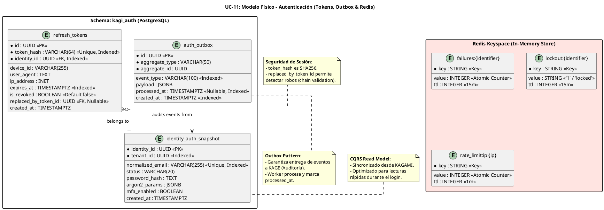

# UC-11: Autenticar Credenciales Locales - Modelo de Datos Físico Específico (Tokens, Outbox & Redis Lockout)

| Metadatos del Documento | |
| :--- | :--- |
| **Proyecto:** | SHUGO - Identity & Access Platform |
| **Caso de Uso:** | UC-11 - Autenticar Credenciales Locales (Local Authentication) |
| **Documento:** | 10_UC_Specific_Data_Model.md |
| **Metodología:** | Physical Data Modeling + CQRS (Read Models) + Outbox Pattern + Redis Data Structuring |
| **Base de Datos:** | PostgreSQL 15+ (Tokens & Outbox) + Redis 7+ (Lockout & Rate Limiting) |
| **Autor:** | Gastón Ruiz |
| **Versión Actual:** | 1.0.0 |
| **Fecha:** | 15/09/2026 |

---

## Historial de Versiones

| Versión | Fecha | Autor | Descripción de Cambios | Impacto |
| :--- | :--- | :--- | :--- | :--- |
| **1.0.0** | 15/09/2026 | Gastón Ruiz | **Creación inicial.** Definición del modelo de datos físico para el contexto de Autenticación (Motor KAGI). Introduce la tabla `refresh_tokens` con hashing SHA256 y soporte para rotación (chain validation), la tabla `auth_outbox` para garantizar la entrega eventual de eventos de auditoría, y el modelo de datos en memoria (Redis) para la gestión atómica de Account Lockout y Rate Limiting. Incluye estrategias de indexación de alta performance y particionamiento. | Documento de referencia para DBAs y desarrolladores backend. Define cómo se persisten las sesiones de forma segura, cómo se garantizan los eventos de auditoría sin bloquear el login, y cómo se protege la plataforma contra fuerza bruta a nivel de infraestructura de datos. |

---

## 1. Introducción y Propósito

Este documento define las extensiones y consideraciones físicas específicas para soportar el **UC-11 (Autenticar Credenciales Locales)**.

A diferencia de los UCs de gestión de identidad (que mutan el estado de la identidad a largo plazo), el UC-11 se centra en la **creación de sesiones transitorias y la emisión de credenciales**. Por lo tanto, su modelo de datos tiene requisitos únicos:

1. **Almacenamiento Seguro de Refresh Tokens:** Los tokens de larga duración nunca se almacenan en texto plano. Se utiliza hashing SHA256 y se modelan para soportar rotación y detección de robo (UC-13).
2. **Garantía de Auditoría (Outbox Pattern):** Los eventos de login (`Authentication.Succeeded`) deben persistirse en la misma transacción que la emisión del token para garantizar que nunca se pierda un log de auditoría, incluso si el bus de mensajes (KAGE) está caído.
3. **Lectura de Alta Velocidad (CQRS):** El motor KAGI no debe consultar las tablas transaccionales pesadas de KAGAMI durante el login. Utiliza un Read Model (`identity_auth_snapshot`) optimizado.
4. **Gestión Atómica en Redis:** El Account Lockout y el Rate Limiting se gestionan en Redis para evitar saturar PostgreSQL con ataques de Credential Stuffing.

---

## 2. Diagrama de Modelo de Datos Físico (ERD Específico)



---

## 3. Scripts DDL: Tablas Específicas para UC-11

### 3.1. Esquema `kagi_auth`

```sql
-- Crear esquema para el motor de autenticación
CREATE SCHEMA IF NOT EXISTS kagi_auth;
SET search_path TO kagi_auth;
```

### 3.2. Tabla `refresh_tokens` (Gestión de Sesiones)

```sql
SET search_path TO kagi_auth;

CREATE TABLE IF NOT EXISTS refresh_tokens (
    id UUID PRIMARY KEY DEFAULT gen_random_uuid(),
    
    -- El hash SHA256 del token opaco. NUNCA almacenar el token completo.
    token_hash VARCHAR(64) NOT NULL,
    
    identity_id UUID NOT NULL,
    tenant_id UUID NOT NULL, -- Desnormalizado para particionamiento futuro y RLS
    
    -- Metadata de seguridad para detección de anomalías
    device_id VARCHAR(255),
    user_agent TEXT,
    ip_address INET,
    
    -- Ciclo de vida
    expires_at TIMESTAMPTZ NOT NULL,
    is_revoked BOOLEAN NOT NULL DEFAULT FALSE,
    
    -- Chain validation para detección de robo (UC-13)
    replaced_by_token_id UUID REFERENCES refresh_tokens(id) ON DELETE SET NULL,
    
    created_at TIMESTAMPTZ NOT NULL DEFAULT NOW(),
    
    -- Restricciones
    CONSTRAINT chk_refresh_token_expiry CHECK (expires_at > created_at)
);

-- Índices Críticos
-- Búsqueda principal por el hash del token (cuando el cliente envía el refresh token)
CREATE UNIQUE INDEX IF NOT EXISTS idx_rt_token_hash ON refresh_tokens(token_hash);

-- Búsqueda para invalidar todas las sesiones de un usuario (Logout / Force Logout)
CREATE INDEX IF NOT EXISTS idx_rt_identity_id ON refresh_tokens(identity_id) WHERE is_revoked = FALSE;

-- Búsqueda para el job de limpieza de tokens expirados
CREATE INDEX IF NOT EXISTS idx_rt_expires_at ON refresh_tokens(expires_at) WHERE is_revoked = FALSE;

-- Búsqueda para Chain Validation (detectar si un token rotado se reutiliza)
CREATE INDEX IF NOT EXISTS idx_rt_replaced_by ON refresh_tokens(replaced_by_token_id) WHERE replaced_by_token_id IS NOT NULL;

COMMENT ON TABLE refresh_tokens IS 'Almacena los hashes de los Refresh Tokens para gestión de sesiones y rotación.';
COMMENT ON COLUMN refresh_tokens.token_hash IS 'SHA256 hash del token opaco. El token real solo se entrega al cliente una vez.';
COMMENT ON COLUMN refresh_tokens.replaced_by_token_id IS 'Referencia al nuevo token emitido durante la rotación. Usado para detectar reuso (robo).';
```

### 3.3. Tabla `auth_outbox` (Patrón Outbox para Auditoría)

```sql
SET search_path TO kagi_auth;

CREATE TABLE IF NOT EXISTS auth_outbox (
    id UUID PRIMARY KEY DEFAULT gen_random_uuid(),
    aggregate_type VARCHAR(50) NOT NULL, -- ej. 'AuthenticationAttempt'
    aggregate_id UUID NOT NULL,
    
    event_type VARCHAR(100) NOT NULL, -- ej. 'Authentication.Succeeded'
    payload JSONB NOT NULL, -- Datos del evento (IdentityId, TenantId, IP, etc.)
    
    processed_at TIMESTAMPTZ, -- Null hasta que el worker lo publica a KAGE
    created_at TIMESTAMPTZ NOT NULL DEFAULT NOW(),
    
    -- Restricciones
    CONSTRAINT chk_outbox_processed CHECK (processed_at IS NULL OR processed_at >= created_at)
) PARTITION BY RANGE (created_at); -- Particionamiento por mes para retención fácil

-- Crear partición inicial (Ejemplo para el mes actual)
-- CREATE TABLE auth_outbox_2026_09 PARTITION OF auth_outbox
--     FOR VALUES FROM ('2026-09-01') TO ('2026-10-01');

-- Índices Críticos
-- El worker de outbox consulta constantemente eventos no procesados
CREATE INDEX IF NOT EXISTS idx_ao_unprocessed ON auth_outbox(created_at) WHERE processed_at IS NULL;

-- Búsqueda por tipo de evento para análisis forense directo en DB
CREATE INDEX IF NOT EXISTS idx_ao_event_type ON auth_outbox(event_type);

COMMENT ON TABLE auth_outbox IS 'Tabla Outbox para garantizar la entrega eventual de eventos de autenticación a KAGE (Auditoría).';
COMMENT ON COLUMN auth_outbox.payload IS 'Contiene datos sensibles como IP y UserAgent. Asegurar encriptación en reposo a nivel de DB.';
```

### 3.4. Read Model: `identity_auth_snapshot` (Sincronizado desde KAGAMI)

*Nota: Esta tabla se actualiza vía CDC (Change Data Capture - Debezium) o eventos de dominio desde el motor KAGAMI. KAGI solo realiza lecturas contra esta tabla.*

```sql
SET search_path TO kagi_auth;

CREATE TABLE IF NOT EXISTS identity_auth_snapshot (
    identity_id UUID PRIMARY KEY,
    tenant_id UUID NOT NULL,
    
    -- Identificador normalizado para búsqueda rápida y case-insensitive
    normalized_email VARCHAR(255) NOT NULL,
    
    status VARCHAR(20) NOT NULL, -- ACTIVE, DEACTIVATED, LOCKED
    
    -- Credenciales (Solo lectura para KAGI)
    password_hash TEXT NOT NULL,
    argon2_params JSONB NOT NULL, -- { "memory": 65536, "iterations": 3, "parallelism": 4 }
    
    -- Configuración de seguridad
    mfa_enabled BOOLEAN NOT NULL DEFAULT FALSE,
    mfa_methods JSONB, -- ["totp", "webauthn"]
    
    created_at TIMESTAMPTZ NOT NULL,
    updated_at TIMESTAMPTZ NOT NULL
);

-- Índice único para la búsqueda principal durante el login
CREATE UNIQUE INDEX IF NOT EXISTS idx_ias_normalized_email ON identity_auth_snapshot(normalized_email);

-- Índice para búsquedas por tenant (ej. auditorías o bloqueos masivos)
CREATE INDEX IF NOT EXISTS idx_ias_tenant_id ON identity_auth_snapshot(tenant_id);

COMMENT ON TABLE identity_auth_snapshot IS 'Read Model CQRS para autenticación. Sincronizado desde KAGAMI. Optimizado para lecturas de alta frecuencia.';
```

---

## 4. Modelo de Datos en Redis (Lockout & Rate Limiting)

Redis se utiliza para operaciones de alta frecuencia que requieren atomicidad y TTL automático, protegiendo a PostgreSQL de ataques de fuerza bruta.

### 4.1. Estructura de Claves

| Patrón de Clave | Tipo de Dato | Descripción | TTL |
| :--- | :--- | :--- | :--- |
| `failures:{normalized_email}` | String (Integer) | Contador de intentos fallidos consecutivos. Se incrementa con `INCR`. | 15 minutos (se resetea si tiene éxito o expira). |
| `lockout:{normalized_email}` | String ("1") | Flag de bloqueo. Si existe, el login se rechaza inmediatamente. | 15 minutos (o configurado por tenant). |
| `rate_limit:ip:{ip_address}` | String (Integer) | Contador de requests por IP al endpoint `/auth/login`. | 1 minuto. |

### 4.2. Operaciones Atómicas (Ejemplos en Pseudocódigo/Redis CLI)

**Registrar un fallo:**
```redis
# Incrementa el contador. Si es el primer fallo, establece el TTL.
INCR failures:user@khcs.com
EXPIRE failures:user@khcs.com 900

# Si el contador llega a 5, crear el bloqueo
IF GET failures:user@khcs.com >= 5 THEN
    SET lockout:user@khcs.com 1 EX 900
ENDIF
```

**Verificar bloqueo (Fail-Secure):**
```redis
# Si la clave existe, la cuenta está bloqueada.
EXISTS lockout:user@khcs.com
```

**Resetear tras éxito:**
```redis
# Elimina ambas claves si el password es correcto.
DEL failures:user@khcs.com
DEL lockout:user@khcs.com
```

---

## 5. Estrategias de Optimización y Seguridad

### 5.1. Seguridad de los Refresh Tokens
1. **Hashing SHA256:** El token opaco de 64 bytes se hashea antes de guardarse en `refresh_tokens.token_hash`. Si la DB es comprometida, el atacante no puede usar los hashes para autenticarse (ya que son unidireccionales y el sistema espera el token plano para hashearlo y comparar).
2. **Chain Validation:** La columna `replaced_by_token_id` crea un enlace entre el token viejo y el nuevo durante la rotación (UC-13). Si un atacante usa el token viejo *después* de que el usuario legítimo lo rotó, el sistema detecta el `replaced_by_token_id` existente y revoca toda la familia de tokens.

### 5.2. Particionamiento de la Tabla Outbox
La tabla `auth_outbox` crece rápidamente (un registro por cada login exitoso o fallido).
- **Estrategia:** Particionamiento por rango (`RANGE`) basado en `created_at` (mensual).
- **Beneficio:** El job de limpieza puede simplemente hacer `DROP TABLE auth_outbox_YYYY_MM` para los meses anteriores al período de retención (ej. 90 días), en lugar de ejecutar `DELETE` masivos que generan bloat en PostgreSQL.

### 5.3. Índices Parciales para Alto Rendimiento
- En `refresh_tokens`, el índice `idx_rt_identity_id` incluye la cláusula `WHERE is_revoked = FALSE`. Esto reduce drásticamente el tamaño del índice y acelera las consultas de "Cerrar todas las sesiones" (Logout), ya que ignora los tokens ya revocados.
- En `auth_outbox`, el índice `idx_ao_unprocessed` solo indexa filas donde `processed_at IS NULL`. Esto hace que el worker de Outbox sea extremadamente rápido, escaneando solo los eventos pendientes.

---

## 6. Políticas de Retención y Limpieza

### 6.1. Limpieza de Refresh Tokens Expirados

```sql
-- Función para eliminar tokens expirados o revocados antiguos
CREATE OR REPLACE FUNCTION kagi_auth.cleanup_refresh_tokens(p_retention_days INT DEFAULT 30)
RETURNS INT AS $$
DECLARE
    v_deleted_count INT;
BEGIN
    DELETE FROM kagi_auth.refresh_tokens
    WHERE expires_at < NOW() - (p_retention_days || ' days')::INTERVAL
       OR (is_revoked = TRUE AND created_at < NOW() - (p_retention_days || ' days')::INTERVAL);
    
    GET DIAGNOSTICS v_deleted_count = ROW_COUNT;
    RETURN v_deleted_count;
END;
$$ LANGUAGE plpgsql;

-- Programar vía pg_cron o similar
-- SELECT cron.schedule('cleanup-refresh-tokens', '0 3 * * *', $$SELECT kagi_auth.cleanup_refresh_tokens(30)$$);
```

### 6.2. Retención de Logs de Outbox
Los eventos en `auth_outbox` deben conservarse al menos 90 días para permitir la reconciliación con KAGE en caso de fallos prolongados del bus de mensajes. Tras ser procesados (`processed_at IS NOT NULL`), pueden eliminarse tras 7 días para ahorrar espacio.

---

## 7. Monitoreo y Diagnóstico

### 7.1. Consultas para Diagnosticar Problemas de Autenticación

```sql
-- 1. Tokens de una identidad específica (para soporte o Force Logout)
SELECT id, device_id, ip_address, expires_at, is_revoked
FROM kagi_auth.refresh_tokens
WHERE identity_id = 'user-uuid-123' AND is_revoked = FALSE;

-- 2. Eventos de auditoría no procesados (Outbox Lag)
SELECT COUNT(*) AS pending_events, MIN(created_at) AS oldest_event
FROM kagi_auth.auth_outbox
WHERE processed_at IS NULL;
-- Si oldest_event > 5 minutos, alerta crítica: KAGE no está consumiendo eventos.

-- 3. Detección de posible robo de Refresh Token (Chain Validation)
-- Busca tokens que fueron rotados (tienen replaced_by_token_id) pero que se usaron después.
-- (Esta lógica se implementa en la aplicación al intentar usar un token, pero esta query ayuda a investigar).
SELECT t1.id AS compromised_token, t2.id AS legitimate_token
FROM kagi_auth.refresh_tokens t1
JOIN kagi_auth.refresh_tokens t2 ON t1.replaced_by_token_id = t2.id
WHERE t1.is_revoked = FALSE AND t1.expires_at > NOW();
```

### 7.2. Métricas de Base de Datos para OpenTelemetry

```csharp
public class AuthDatabaseMetrics
{
    private readonly Meter _meter;
    private readonly Counter<long> _tokensIssued;
    private readonly Counter<long> _tokensRevoked;
    private readonly Histogram<double> _outboxPublishLatency;

    public AuthDatabaseMetrics(IMeterFactory meterFactory)
    {
        _meter = meterFactory.Create("shugo.kagi.database");
        _tokensIssued = _meter.CreateCounter<long>("auth.tokens_issued_total");
        _tokensRevoked = _meter.CreateCounter<long>("auth.tokens_revoked_total");
        _outboxPublishLatency = _meter.CreateHistogram<double>("auth.outbox_publish_latency", "ms");
    }
}
```

---

## 8. Trazabilidad

| Documento | Relación |
| :--- | :--- |
| `04_Initial_Domain_Model.md` | Define las entidades `RefreshToken` y los eventos de dominio que se mapean a `refresh_tokens` y `auth_outbox`. |
| `05_State_Machine_Diagram.md` | Las transiciones de `RefreshToken` (ACTIVE -> ROTATED -> REVOKED) se persisten en la tabla `refresh_tokens` mediante las columnas `is_revoked` y `replaced_by_token_id`. |
| `08_Final_Class_Design.md` | El `TokenIssuer` y el `OutboxAuditPublisher` implementan las inserciones en estas tablas. |
| `11_UC_Specific_Security_Threats.md` | El hashing SHA256 de los tokens mitiga el impacto de una fuga de base de datos (Data Breach). |
| `12_UC_Specific_Performance_Benchmarks.md` | Los índices parciales y el particionamiento de la Outbox son críticos para cumplir el SLO de <300ms en el login. |

---

## 9. Anexos: Glosario de Base de Datos (UC-11)

| Término | Definición en Contexto UC-11 |
| :--- | :--- |
| **Refresh Token Hashing** | Almacenar el hash SHA256 del token en lugar del token plano. Previene el uso de tokens robados de la DB. |
| **Chain Validation** | Mecanismo que vincula un token rotado con su reemplazo (`replaced_by_token_id`) para detectar si un atacante interceptó el token viejo. |
| **Outbox Pattern** | Patrón que guarda eventos de dominio en una tabla local (`auth_outbox`) dentro de la misma transacción de negocio, para ser publicados asíncronamente. |
| **Identity Auth Snapshot** | Read Model (CQRS) que contiene solo los datos necesarios para autenticar (email, hash, params), sincronizado desde el motor KAGAMI. |
| **Partial Index** | Índice de PostgreSQL que solo incluye filas que cumplen una condición (ej. `WHERE is_revoked = FALSE`), mejorando rendimiento y reduciendo tamaño. |
| **Range Partitioning** | División de una tabla (como `auth_outbox`) en particiones basadas en un rango de valores (fechas), facilitando la purga de datos antiguos. |

---
*Fin del Documento 10_UC_Specific_Data_Model para UC-11*