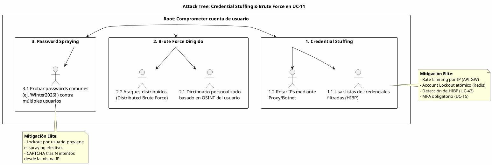

# UC-11: Autenticar Credenciales Locales - Análisis de Amenazas Específico (Security Threat Model)

| Metadatos del Documento | |
| :--- | :--- |
| **Proyecto:** | SHUGO - Identity & Access Platform |
| **Caso de Uso:** | UC-11 - Autenticar Credenciales Locales (Local Authentication) |
| **Documento:** | 11_UC_Specific_Security_Threats.md |
| **Metodología:** | STRIDE + DREAD + Attack Trees + Zero Trust Architecture + Defense-in-Depth |
| **Estándares:** | NIST SP 800-63B (Digital Identity Guidelines), OWASP ASVS 4.0 (V2 Authentication), GDPR Art. 32, SOC 2 CC6.1 |
| **Autor:** | Gastón Ruiz |
| **Versión Actual:** | 1.0.0 |
| **Fecha:** | 15/09/2026 |

---

## Historial de Versiones

| Versión | Fecha | Autor | Descripción de Cambios | Impacto |
| :--- | :--- | :--- | :--- | :--- |
| **1.0.0** | 15/09/2026 | Gastón Ruiz | **Creación inicial.** Análisis exhaustivo de amenazas específicas para el endpoint de autenticación local. Evalúa 8 vectores de ataque críticos usando STRIDE+DREAD, incluyendo Credential Stuffing, Timing Attacks (User Enumeration), DoS vía Exhaustión Criptográfica (Argon2id), y Memory Dumping. Define controles de mitigación de nivel enterprise (Dummy Hash, Redis Atomic Lockout, API Gateway Rate Limiting, SecureString) para garantizar la seguridad de la puerta de entrada del motor KAGI. | Documento crítico de seguridad para el UC-11. Establece los controles obligatorios que deben implementarse antes del go-live, demostrando cómo el diseño arquitectónico mitiga proactivamente los ataques más sofisticados contra sistemas IAM modernos. |

---

## 1. Introducción y Alcance

Este documento presenta el **Análisis de Amenazas Específico** para el UC-11 (Autenticar Credenciales Locales).

El endpoint `/v1/auth/login` es el activo más expuesto y atacado de toda la plataforma SHUGO. A diferencia de los endpoints de gestión de identidad (que requieren autenticación previa), este endpoint es público y anónimo por diseño, lo que lo convierte en el objetivo principal para:
1. **Ataques Automatizados:** Credential Stuffing, Brute Force y Spraying.
2. **Ataques de Información:** User Enumeration para construir bases de datos de usuarios válidos.
3. **Ataques de Infraestructura:** Denegación de Servicio (DoS) aprovechando la naturaleza intencionalmente lenta del hashing criptográfico (Argon2id).

Este documento modela estos vectores y define las mitigaciones de nivel enterprise que SHUGO implementa nativamente en el motor KAGI.

---

## 2. Attack Trees (Árboles de Ataque)

### 2.1. Attack Tree #1: Credential Stuffing & Brute Force

**Objetivo del Atacante:** Obtener acceso no autorizado a cuentas de usuarios mediante la automatización de intentos de login.



### 2.2. Attack Tree #2: User Enumeration & Information Leakage

**Objetivo del Atacante:** Descubrir qué emails/usuarios están registrados en la plataforma SHUGO para dirigir ataques de phishing o spear-phishing.

```text
[Root: Enumerar usuarios válidos en SHUGO]
  |
  +-- [1. Timing Attacks]
  |     +-- 1.1. Medir tiempo de respuesta (ms) entre usuario existente vs inexistente.
  |            (Mitigado: Dummy Hash Execution en PasswordHasher).
  |
  +-- [2. Error Message Analysis]
  |     +-- 2.1. Analizar códigos HTTP (404 vs 401) o mensajes ("User not found" vs "Bad password").
  |            (Mitigado: Generic 401 "Invalid credentials" y consistencia de payload).
  |
  +-- [3. Side-Channel Attacks]
        +-- 3.1. Medir consumo de CPU/Memoria o tamaño de respuesta TLS.
               (Mitigado: Constant-time comparison, TLS padding, Generic responses).
```

### 2.3. Attack Tree #3: Infrastructure & Resource Exhaustion (DoS)

**Objetivo del Atacante:** Degradar o tumbar el servicio de autenticación, impidiendo que los usuarios legítimos accedan.

```text
[Root: Denegar servicio de autenticación (DoS)]
  |
  +-- [1. Crypto Exhaustion (Weaponized Argon2id)]
  |     +-- 1.1. Enviar miles de requests/segundo para saturar la CPU del motor KAGI.
  |            (Argon2id es intencionalmente lento: ~150ms por request).
  |            (Mitigado: API Gateway Rate Limiting, HPA basado en latencia Argon2, CAPTCHA).
  |
  +-- [2. Redis Saturation]
  |     +-- 2.1. Generar millones de claves de lockout para saturar la memoria de Redis.
  |            (Mitigado: TTL estricto en todas las claves de Redis, Maxmemory-policy allkeys-lru).
  |
  +-- [3. Database Connection Pool Exhaustion]
        +-- 3.1. Agotar los pools de conexión hacia KAGAMI (Identity Repo).
               (Mitigado: CQRS Read Model `identity_auth_snapshot` en KAGI, Connection Pooling).
```

---

## 3. Matriz de Amenazas Específicas (STRIDE + DREAD)

| ID | Amenaza | Categoría STRIDE | D | R | E | A | D | Score | Nivel |
| :--- | :--- | :--- | :---: | :---: | :---: | :---: | :---: | :---: | :---: |
| **T-71** | **Credential Stuffing / Brute Force** | Spoofing | 9 | 9 | 8 | 10 | 7 | **8.6** |  |
| **T-72** | **User Enumeration via Timing Attacks** | Information Disclosure | 8 | 7 | 6 | 9 | 5 | **7.0** | 🟠 |
| **T-73** | **DoS via Crypto Exhaustion (Argon2id)** | Denial of Service | 9 | 8 | 7 | 8 | 8 | **8.0** | 🔴 |
| **T-74** | **Memory Dumping / Heap Inspection** | Information Disclosure | 7 | 6 | 4 | 7 | 3 | **5.4** | 🟡 |
| **T-75** | **Database Breach & Offline Cracking** | Information Disclosure | 10 | 8 | 5 | 9 | 6 | **7.6** | 🟠 |
| **T-76** | **Man-in-the-Middle (MitM) / Replay** | Spoofing / Tampering | 9 | 7 | 5 | 8 | 4 | **6.6** | 🟠 |
| **T-77** | **User Enumeration via Error Messages** | Information Disclosure | 8 | 6 | 7 | 9 | 5 | **7.0** | 🟠 |
| **T-78** | **Redis Cache Poisoning / Lockout Bypass** | Tampering | 8 | 5 | 4 | 7 | 3 | **5.4** | 🟡 |

---

## 4. Análisis Detallado de Amenazas Críticas y Mitigaciones

### 4.1. 🔴 T-71: Credential Stuffing / Brute Force

**Descripción:** Uso de bots para probar millones de combinaciones de credenciales (provenientes de brechas de terceros) contra el endpoint de login.

**Mitigaciones Implementadas (Defense-in-Depth):**

1. **Capa 1: API Gateway Rate Limiting (Por IP)**
   ```yaml
   # Configuración API Gateway (ej. Kong / AWS WAF)
   rate_limiting:
     endpoint: /v1/auth/login
     limit: 20 requests
     window: 60 seconds
     policy: local # o redis para clusters
   ```

2. **Capa 2: Account Lockout Atómico (Por Identificador - Redis)**
   Implementado en el `LockoutManager`. Utiliza operaciones atómicas de Redis para prevenir Race Conditions.
   ```csharp
   // Pseudocódigo de la lógica atómica en Redis
   public async Task RecordFailureAsync(string identifier) {
       var key = $"failures:{identifier}";
       var count = await _cache.IncrementAsync(key); // INCR atómico
       
       if (count == 1) await _cache.KeyExpireAsync(key, TimeSpan.FromMinutes(15));
       
       if (count >= _maxFailures) {
           await _cache.SetStringAsync($"lockout:{identifier}", "1", TimeSpan.FromMinutes(15));
       }
   }
   ```

3. **Capa 3: Detección de Brechas (Integración UC-43)**
   Si el password utilizado está en la base de datos de *Have I Been Pwned* (HIBP), el login puede ser permitido pero se fuerza un cambio de password inmediato (flag `password_compromised`).

### 4.2. 🟠 T-72: User Enumeration via Timing Attacks

**Descripción:** El atacante envía requests con emails aleatorios. Si el email existe, el servidor tarda ~150ms (Argon2id). Si no existe, el servidor tarda ~5ms (DB lookup fallido). Esta diferencia permite construir una lista de usuarios válidos.

**Mitigación Elite: Dummy Hash Execution**

Implementado en el `PasswordHasher`. Si el usuario no existe, el sistema **finge** que existe ejecutando un hash criptográfico ficticio.

```csharp
public bool Verify(SecureString providedPassword, PasswordHash? storedHash)
{
    // ESCENARIO CRÍTICO: El usuario NO existe en la base de datos
    if (storedHash == null)
    {
        // MITIGACIÓN: Ejecutar un Dummy Hash con los mismos parámetros de costo
        // Esto consume exactamente los mismos ciclos de CPU (~150ms)
        GenerateDummyHash(); 
        
        // Retorna false de forma segura
        return false; 
    }

    // El usuario existe, verificar password real (Constant-Time Compare)
    return Argon2.Verify(storedHash.GetParameters(), storedHash.Hash, providedPassword);
}
```
*Nota: El `GenerateDummyHash()` utiliza los mismos parámetros de memoria, iteraciones y paralelismo que el hash real.*

### 4.3. 🔴 T-73: DoS via Crypto Exhaustion (Weaponized Argon2id)

**Descripción:** Argon2id es "memory-hard" y "CPU-intensive" por diseño. Un atacante puede enviar 500 requests/segundo desde una botnet. Con un tiempo de hash de 150ms, un solo core de CPU solo puede manejar ~6 requests/segundo. Esto satura la CPU del motor KAGI, denegando el servicio a usuarios legítimos.

**Mitigaciones Implementadas:**

1. **Rate Limiting Estricto en el Edge:** (Ver T-71, Capa 1). Detiene el 99% del tráfico malicioso antes de que toque el motor KAGI.
2. **Challenge-Response (CAPTCHA) Dinámico:**
   Si una IP supera 5 intentos fallidos en 1 minuto (pero no llega al lockout de cuenta), el API Gateway inyecta un requisito de CAPTCHA (ej. Cloudflare Turnstile) antes de permitir que la request llegue al backend.
3. **Auto-Scaling Basado en Latencia Criptográfica (Kubernetes HPA):**
   ```yaml
   metrics:
     - type: Pods
       pods:
         metric:
           name: kagi_crypto_argon2_duration_p95
         target:
           type: AverageValue
           averageValue: "200" # Escalar si el hashing tarda > 200ms
   ```
4. **Fail-Secure en Dependencias:** Si Redis está caído, el `LockoutManager` asume que la cuenta está bloqueada (retorna `true`), protegiendo al usuario a costa de la disponibilidad temporal.

### 4.4. 🟡 T-74: Memory Dumping / Heap Inspection

**Descripción:** Un atacante con acceso al servidor (o mediante una vulnerabilidad de Remote Code Execution) volca la memoria del proceso (Heap Dump) para buscar contraseñas en texto plano.

**Mitigaciones Implementadas:**

1. **Uso de `SecureString` y Limpieza de Memoria:**
   El `AuthenticateCommand` y el `Credential` Value Object reciben la password como `SecureString`.
2. **Zeroing Out (Limpieza Criptográfica):**
   Tras la validación en el `PasswordHasher`, el buffer de memoria que contenía la password en texto plano (si se usó `char[]` o `byte[]` internamente en la librería de Argon2id) es sobrescrito con ceros.
   ```csharp
   // Ejemplo conceptual de limpieza post-verificación
   public void ClearPasswordBuffer(byte[] buffer) {
       if (buffer != null) {
           Array.Clear(buffer, 0, buffer.Length);
       }
   }
   ```
3. **Prohibición de Logging:**
   Reglas estrictas de Serilog/NLog que enmascaran cualquier campo llamado `password`, `secret`, o `token`.

### 4.5.  T-75: Database Breach & Offline Cracking

**Descripción:** El atacante compromete la base de datos de KAGAMI y roba la tabla de identidades, incluyendo los hashes de las contraseñas. Intenta crackearlos offline usando GPUs (Hashcat/John the Ripper).

**Mitigaciones Implementadas:**

1. **Argon2id (Ganador del Password Hashing Competition):**
   A diferencia de bcrypt o PBKDF2, Argon2id es resistente a ataques de GPU y ASICs porque requiere grandes cantidades de memoria RAM (64MB por hash en nuestra configuración).
2. **Salt Único por Usuario:**
   Cada `PasswordHash` Value Object almacena un salt criptográficamente seguro de 16 bytes, generado aleatoriamente durante la creación (UC-01). Esto previene ataques de Rainbow Tables.
3. **Agilidad Criptográfica:**
   Los parámetros de Argon2id (`memoryCost`, `iterations`, `parallelism`) se almacenan junto al hash. Esto permite aumentar la dificultad (ej. subir a 128MB) en el futuro sin invalidar los hashes antiguos; el sistema simplemente usará los nuevos parámetros en el próximo login exitoso (Rehashing).

---

## 5. Compliance y Auditoría (SOC 2 / ISO 27001 / NIST / OWASP)

### 5.1. NIST SP 800-63B (Digital Identity Guidelines)
*   **Requisito (3.1.2):** "Verifiers SHALL require subscriber-chosen memorized secrets to be at least 8 characters in length... Verifiers SHOULD NOT impose other composition rules."
*   **Implementación UC-11:** El endpoint no valida complejidad arbitraria en el login (eso es tarea de UC-01/UC-19), solo verifica el hash.
*   **Requisito (5.2.2):** "Rate limiting mechanisms SHALL be implemented... to mitigate online guessing attacks."
*   **Implementación UC-11:** `LockoutManager` (Redis) y API Gateway Rate Limiting.

### 5.2. OWASP ASVS 4.0
*   **V2.4.2:** "Verify that passwords are stored in a form that is resistant to offline attacks. Passwords SHALL be salted and hashed using a secure one-way key derivation or password hashing function..." -> **Cumplido (Argon2id + Salt).**
*   **V2.4.4:** "Verify that there are no differences in the time taken to respond to a successful or failed authentication attempt, and that error messages do not disclose the reason for failure." -> **Cumplido (Dummy Hash + Generic 401).**

### 5.3. SOC 2 Type II (CC6.1 Logical Access)
*   **Requisito:** Restringir el acceso lógico a los datos según la autorización.
*   **Implementación UC-11:** El endpoint es la única puerta de entrada. La auditoría inmutable (Outbox Pattern a KAGE) registra cada intento (éxito y fallo) con IP y User Agent, permitiendo la detección forense de accesos no autorizados.

---

## 6. Trazabilidad

| Documento | Relación |
| :--- | :--- |
| `01_Requirements_Specification.md` | Las invariantes de seguridad (INV-71 a INV-73) y reglas de negocio (RN-17 Dummy Hash) se mitigan aquí a nivel de infraestructura y dominio. |
| `08_Final_Class_Design.md` | Las clases `PasswordHasher` (Dummy Hash), `LockoutManager` (Redis), y `AuthenticationHandler` (Generic Errors) implementan las mitigaciones de T-71, T-72, T-73 y T-77. |
| `10_UC_Specific_Data_Model.md` | El hashing SHA256 de los Refresh Tokens y el uso de `SecureString` mitigan el impacto de T-74 y T-75. |
| `12_UC_Specific_Performance_Benchmarks.md` | Los SLAs de latencia y las estrategias de HPA mitigan la amenaza T-73 (DoS via Crypto Exhaustion). |
| `SHUGO_Security_Architecture.md` (Transversal) | Este documento aplica los estándares globales de autenticación y prevención de enumeración al contexto específico de UC-11. |

---

## 7. Anexos: Configuración de Seguridad Adicional

### 7.1. Reglas de WAF para el Endpoint de Login

```yaml
# AWS WAF / Cloudflare Rules para /v1/auth/login
Rules:
  - Name: BlockKnownBadIPs
    Priority: 1
    Action: Block
    Statement:
      IPSetReferenceStatement:
        Arn: arn:aws:wafv2:.../ipset/bad-actors/abc123

  - Name: EnforceCAPTCHA
    Priority: 2
    Action: Count (Trigger CAPTCHA)
    Statement:
      RateBasedStatement:
        Limit: 100
        AggregateKeyType: IP
        ScopeDownStatement:
          ByteMatchStatement:
            FieldToMatch: Uri
            SearchString: "/v1/auth/login"

  - Name: BlockMissingUserAgent
    Priority: 3
    Action: Block
    Statement:
      SizeConstraintStatement:
        FieldToMatch:
          SingleHeader:
            Name: User-Agent
        ComparisonOperator: EQ
        Size: 0
```

### 7.2. Alertas de SIEM para UC-11

```json
// Alerta: Posible Credential Stuffing
{
  "alert_name": "High Volume Authentication Failures",
  "condition": "count(Authentication.Failed) > 500 within 5 minutes grouped by ip_address",
  "severity": "Critical",
  "action": "Trigger automated IP block at API Gateway and notify SOC."
}

// Alerta: Anomalía en Timing (Posible fallo en Dummy Hash)
{
  "alert_name": "Argon2 Dummy Hash Latency Deviation",
  "condition": "abs(avg(argon2_duration{type='real'}) - avg(argon2_duration{type='dummy'})) > 50ms",
  "severity": "High",
  "action": "Investigate PasswordHasher implementation. User Enumeration risk."
}
```

---
*Fin del Documento 11_UC_Specific_Security_Threats para UC-11*