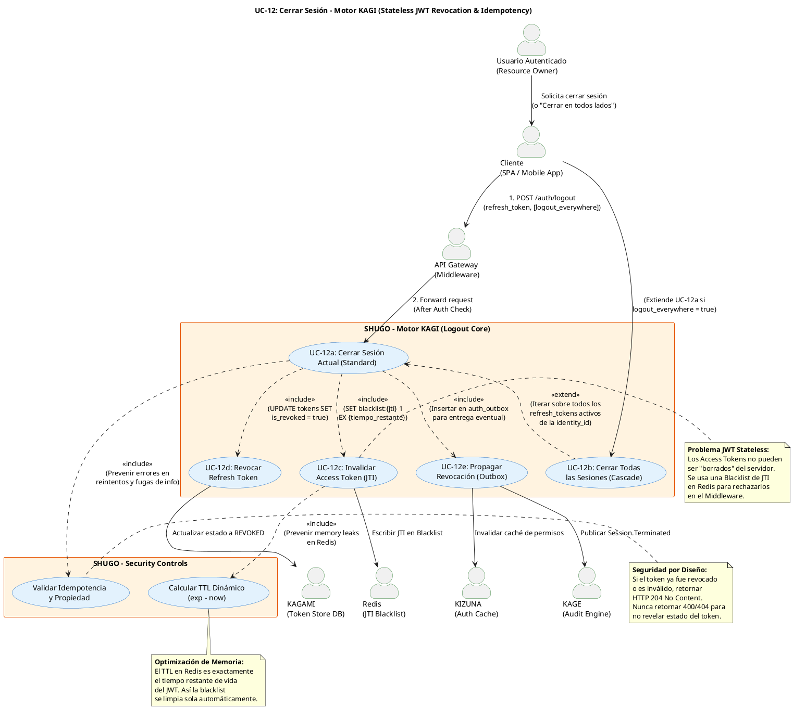

# UC-12: Cerrar Sesión (Logout) - Diagrama de Caso de Uso

| Metadatos del Documento | |
| :--- | :--- |
| **Proyecto:** | SHUGO - Identity & Access Platform |
| **Caso de Uso:** | UC-12 - Cerrar Sesión (Logout & Token Revocation) |
| **Documento:** | 02_Use_Case_Diagram.md |
| **Metodología:** | UML 2.5 + ICONIX + Domain-Driven Design + Security by Design (Stateless JWT Revocation) |
| **Autor:** | Gastón Ruiz |
| **Versión Actual:** | 1.0.0 |
| **Fecha:** | 17/09/2026 |

---

## Historial de Versiones

| Versión | Fecha | Autor | Descripción de Cambios | Impacto |
| :--- | :--- | :--- | :--- | :--- |
| **1.0.0** | [17/09/2026] | Gastón Ruiz | **Creación inicial.** Diagrama de Caso de Uso UML para UC-12. Modela el cierre de sesión no como una simple operación de base de datos, sino como un proceso de orquestación de seguridad distribuida. Introduce la invalidación de Access Tokens (JWT) mediante Blacklist de JTI en Redis con TTL dinámico, la revocación de Refresh Tokens, la idempotencia estricta, y la propagación asíncrona a sistemas downstream (KIZUNA, KAGE) vía Outbox Pattern. | Documento base del paquete de diseño Tier 1 del UC-12. Establece las fronteras del sistema, demostrando cómo se mitigan los riesgos de Session Hijacking y cómo se maneja la revocación en una arquitectura Stateless (JWT) sin comprometer el rendimiento. |

---

## 1. Diagrama de Caso de Uso (PlantUML)

A continuación, se presenta el Diagrama de Casos de Uso UML para el UC-12. Este diagrama modela el logout como un **proceso de revocación distribuida e idempotente**, diferenciando claramente entre la invalidación del token de actualización (DB) y la invalidación del token de acceso (Redis Blacklist).

---

## 2. Explicación del Diagrama

### 2.1. Límite del Sistema (System Boundary)

El diagrama identifica **tres límites de sistema claramente diferenciados**:

1. **Motor KAGI - Logout Core (UC-12):** El sistema principal que orquesta la revocación. Incluye la validación de idempotencia, la gestión de la Blacklist en Redis y la actualización de estado en la base de datos.
2. **Security Controls (Controles Transversales):** Módulos que encapsulan reglas de seguridad obligatorias, como el cálculo de TTL dinámico para Redis y la validación de idempotencia.
3. **Sistemas Downstream (Redis, DB, KAGE, KIZUNA):** Infraestructura crítica. Redis actúa como la capa de alta velocidad para la Blacklist de JWTs, la DB (KAGAMI) como la fuente de verdad para Refresh Tokens, y KAGE/KIZUNA como consumidores de eventos.

**Justificación de los Límites:**
- Separar la **Invalidación de Access Token (UC-12c)** como un caso de uso incluido (`<<include>>`) resalta que, en una arquitectura JWT, el logout no está completo hasta que el token de acceso es inutilizable, no solo el de actualización.
- El **Cálculo de TTL Dinámico (UC_TTL)** se modela explícitamente porque es la solución clave para evitar que la Blacklist de Redis crezca infinitamente y cause un OutOfMemory.

### 2.2. Actores del Sistema

#### Actores Primarios:

*   **Usuario Autenticado (Resource Owner):** El actor humano que desea finalizar su sesión por seguridad, privacidad o porque está usando un dispositivo compartido.
*   **Cliente (SPA / Mobile App):** El actor técnico responsable de enviar el token de revocación y, crucialmente, de **limpiar su almacenamiento local** (localStorage, cookies, Secure Enclave) tras recibir el HTTP 204. El servidor no puede limpiar el cliente remotamente.

#### Actores Secundarios (Sistemas Dependientes):

*   **API Gateway (Middleware):** Intercepta las requests entrantes. Durante el logout, valida que el usuario esté autenticado (para auditoría). En requests futuras, consultará la Blacklist de Redis (UC-12c) para rechazar Access Tokens revocados.
*   **Redis (JTI Blacklist):** Almacena los identificadores únicos (JTI) de los Access Tokens revocados. Su baja latencia (<5ms) es crítica para no degradar el rendimiento de la validación de tokens en cada request.
*   **KAGAMI (Token Store DB):** Base de datos relacional (PostgreSQL) que almacena el estado persistente de los Refresh Tokens.
*   **KAGE (Audit Engine) & KIZUNA (Auth Cache):** Consumidores de eventos que deben ser notificados asíncronamente para registrar el logout y limpiar cachés de permisos, respectivamente.

### 2.3. Relaciones UML

#### Relaciones `<<include>>`: UC-12a → UC-12c, UC-12d, UC-12e, UC_Idempotency

*   **Dirección:** La flecha va **DESDE** el caso de uso base (Cerrar Sesión Actual) **HACIA** los controles de seguridad y revocación.
*   **Semántica:** El logout **depende obligatoriamente** de estos comportamientos. No existe un flujo de logout que no invalide ambos tokens (Access y Refresh) y que no sea idempotente.
*   **Justificación Arquitectónica:**
    *   **UC-12a → UC-12c (Invalidar Access Token):** Mitiga el riesgo de que un Access Token robado siga siendo válido hasta su expiración natural (ej. 15 minutos).
    *   **UC-12a → UC-12d (Revocar Refresh Token):** Previene que el atacante use el Refresh Token robado para generar nuevos Access Tokens (UC-13).
    *   **UC-12a → UC_Idempotency (Validar Idempotencia):** Garantiza que si el cliente envía el logout dos veces (por un timeout de red), no reciba un error 500 ni revele información sobre el estado del token. Siempre retorna 204.

#### Relaciones `<<extend>>`: UC-12b → UC-12a

*   **Dirección:** La flecha va **DESDE** "Cerrar Todas las Sesiones" **HACIA** "Cerrar Sesión Actual".
*   **Semántica:** El Cascade Logout es un comportamiento **condicional** que se activa si el cliente envía `logout_everywhere: true`.
*   **Justificación:** En lugar de duplicar la lógica de revocación, UC-12b reutiliza UC-12a pero itera sobre todos los Refresh Tokens activos asociados a la `identity_id` en la base de datos.

---

## 3. Análisis de Coherencia con la Especificación Analítica

Este diagrama es **100% coherente** con el documento `01_Requirements_Specification.md`:

| Elemento del Diagrama | Referencia en Especificación |
| :--- | :--- |
| Actores: Usuario, Cliente, GW, Redis, DB, KAGE, KIZUNA | Sección 2 (Descripción Analítica) - Actores Principales y Secundarios |
| Relación <<include>> con UC-12c (Blacklist JTI) | Sección 6.1 (El Problema de la Revocación de JWT) - Solución de Blacklist con TTL |
| Relación <<include>> con UC_TTL (TTL Dinámico) | Sección 3 (INV-79) - Blacklist de Access Token (TTL Dinámico) |
| Relación <<include>> con UC_Idempotency | Sección 2.3 (Excepción 4.1) y Sección 6.2 - Idempotencia y Seguridad |
| Relación <<extend>> con UC-12b (Cascade) | Sección 2.2 (Escenario Alternativo) - Logout Everywhere |
| Relación con KAGE/KIZUNA | Sección 2.4 (Postcondiciones) y RN-20 - Propagación Asíncrona (Outbox) |

---

## 4. Consideraciones de Diseño y Arquitectura (Security & Performance)

### 4.1. La Paradoja del JWT Stateless y la Blacklist

El diagrama aborda el mayor desafío de usar JWTs para sesiones: **la imposibilidad de revocarlos matemáticamente**.

*   **El Problema:** Un JWT es un documento firmado. Si el servidor lo emitió, es válido hasta que expire, sin importar si el usuario hizo logout.
*   **La Solución (UC-12c + UC_TTL):** El servidor mantiene una "lista negra" (Blacklist) en Redis de los JTIs (JWT IDs) que han sido revocados antes de tiempo.
*   **Optimización de Memoria (UC_TTL):** Si un JWT expira en 10 minutos, la clave en Redis `blacklist:{jti}` se crea con `EX 600`. Redis elimina la clave automáticamente. Esto garantiza que la memoria de Redis no crezca infinitamente con tokens expirados.

### 4.2. Idempotencia como Mecanismo de Defensa

La relación `<<include>>` con `UC_Idempotency` no es solo una buena práctica de API REST; es un control de seguridad.

*   **Escenario de Ataque:** Un atacante intercepta un token y prueba si está activo enviándolo al endpoint de logout. Si el servidor responde "404 Token not found" o "400 Already revoked", el atacante confirma que el token es inválido o ya fue usado.
*   **Mitigación:** El endpoint **siempre** responde HTTP 204 No Content, sin cuerpo, sin importar si el token era válido, inválido, o ya estaba revocado. El atacante no obtiene información útil (Zero Information Leakage).

### 4.3. Propagación Asíncrona (Outbox Pattern)

La relación con `KAGE` y `KIZUNA` a través de `UC-12e` modela la propagación de eventos sin bloquear el logout.

*   **Mecanismo:** En lugar de hacer llamadas HTTP síncronas a KAGE y KIZUNA durante el logout (lo que aumentaría la latencia y crearía un punto de fallo), el Motor KAGI inserta un evento `Session.Terminated` en la tabla `auth_outbox` en la misma transacción que revoca el Refresh Token.
*   **Justificación:** Garantiza que el logout sea rápido (<100ms) y que, incluso si KAGE está caído, el evento de auditoría no se pierda (Garantía de entrega eventual).

### 4.4. Cascade Logout (Logout Everywhere)

La relación `<<extend>>` con `UC-12b` modela la funcionalidad crítica de seguridad para dispositivos perdidos o robados.

*   **Mecanismo:** El sistema consulta la DB (KAGAMI) buscando todos los Refresh Tokens donde `identity_id = X` y `is_revoked = false`. Itera sobre ellos, marcándolos como revocados y añadiendo sus JTIs asociados a la Blacklist de Redis.
*   **Impacto en Rendimiento:** Dado que un usuario promedio tiene < 5 sesiones activas, el impacto es mínimo. Para usuarios con muchas sesiones, se puede implementar un "Soft Cascade" (marcar la identidad con un flag `force_logout_after` y validar en cada request).

---

## 5. Trazabilidad con Otros Documentos del Paquete

Este diagrama se relaciona con los siguientes documentos del paquete de diseño:

| Documento | Relación |
| :--- | :--- |
| `01_Requirements_Specification.md` | Define los flujos, invariantes (INV-77 a INV-81) y criterios de aceptación que este diagrama visualiza. |
| `03_Activity_Diagram.md` | Mostrará el flujo de trabajo interno, destacando la bifurcación lógica para el Cascade Logout y el manejo de fallos en Redis (Fail-Safe). |
| `04_Initial_Domain_Model.md` | Definirá la entidad `RefreshToken` (con estado `REVOKED`), el Value Object `JTI`, y el Domain Service `TokenRevoker`. |
| `05_State_Machine_Diagram.md` | Mostrará la máquina de estados del `RefreshToken` (ACTIVE → REVOKED) y la lógica de la Blacklist en Redis. |
| `06_Robustness_Diagram.md` | Mostrará la colaboración entre el Logout Handler, Redis, la DB de Tokens y el Outbox. |
| `07_Sequence_Diagram.md` | Detallará el orden temporal exacto: Idempotency Check → DB Revoke → Redis Blacklist → Outbox Insert → 204 Response. |
| `08_Final_Class_Design.md` | Definirá las firmas exactas de los métodos: `TokenRevoker.RevokeAsync()`, `BlacklistManager.AddJtiAsync()`. |
| `10_UC_Specific_Data_Model.md` | Definirá la estructura de la tabla `refresh_tokens` y los índices para búsquedas por `identity_id` (necesarios para Cascade Logout). |

---

## 6. Notas de Implementación

### 6.1. Generación del Diagrama
- **Herramienta:** PlantUML (Diagrams as Code).
- **Ventaja:** Versionable en Git, reproducible, sin dependencias de software propietario.
- **Renderizado:** VS Code (extensión PlantUML), GitHub, o Pandoc para exportación a PDF.

### 6.2. Estilos Aplicados
- `<style>` block: Para evitar advertencias de `skinparam` deprecados en versiones modernas de PlantUML.
- `top to bottom direction`: Organiza el flujo de arriba hacia abajo (Actores → Sistema Principal → Sistemas Dependientes).
- `skinparam actorStyle awesome`: Íconos modernos para actores.
- `skinparam usecaseBackgroundColor #E3F2FD`: Color azul claro para casos de uso de KAGI.
- `skinparam systemBackgroundColor #FFF3E0`: Color naranja claro para sistemas secundarios y controles de seguridad.

### 6.3. Convenciones de Nomenclatura
- **Actores:** Nombres descriptivos que indican su rol y nivel de automatización (Usuario, Cliente, API Gateway, Redis).
- **Casos de Uso:** Verbos en infinitivo que describen la meta del actor o la responsabilidad del sistema (ej. "Cerrar Sesión Actual", "Invalidar Access Token (JTI)").
- **Sistemas:** Nombres que reflejan el Bounded Context de DDD (ej. "Motor KAGI", "Security Controls").
- **Relaciones:** Etiquetas descriptivas que explican el propósito de la relación (ej. "<<include>> (SET blacklist:{jti} 1 EX {tiempo_restante})").

### 6.4. Diferenciación Visual de Controles de Seguridad
Para facilitar la comprensión de la arquitectura de seguridad, los **Security Controls** (Idempotencia, TTL Dinámico) se agrupan en un paquete separado con color de fondo naranja claro. Esto comunica visualmente que estos no son "pasos de negocio" tradicionales, sino **requisitos no funcionales de seguridad** que se inyectan obligatoriamente en el flujo de logout.

### 6.5. Patrones de Seguridad y Operación Visibles
El diagrama modela explícitamente tres patrones críticos:
- **Stateless JWT Revocation:** UC-12c y UC_TTL resuelven el problema de revocar tokens sin estado.
- **Zero Information Leakage:** UC_Idempotency previene la enumeración de estado de tokens.
- **Eventual Consistency:** UC-12e (Outbox) garantiza que el logout no falle si los sistemas de auditoría están caídos.

---
*Fin del Documento 02_Use_Case_Diagram para UC-12*