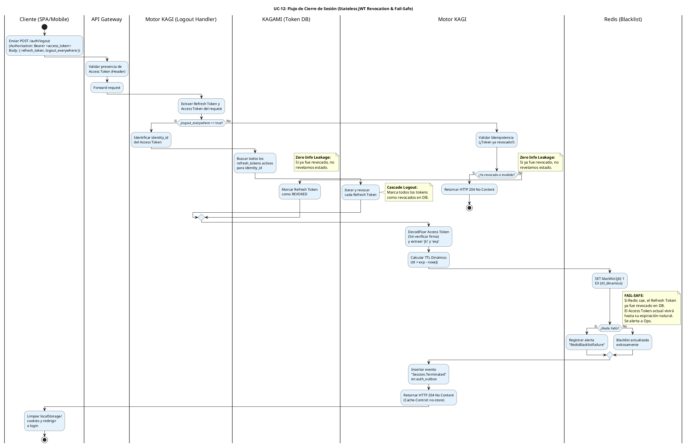

# UC-12: Cerrar Sesión (Logout) - Diagrama de Actividades

| Metadatos del Documento | |
| :--- | :--- |
| **Proyecto:** | SHUGO - Identity & Access Platform |
| **Caso de Uso:** | UC-12 - Cerrar Sesión (Logout & Token Revocation) |
| **Documento:** | 03_Activity_Diagram.md |
| **Metodología:** | UML 2.5 + ICONIX + Domain-Driven Design + Security by Design (Stateless JWT Revocation) |
| **Autor:** | Gastón Ruiz |
| **Versión Actual:** | 1.0.0 |
| **Fecha:** | 17/09/2026 |

---

## Historial de Versiones

| Versión | Fecha | Autor | Descripción de Cambios | Impacto |
| :--- | :--- | :--- | :--- | :--- |
| **1.0.0** | 17/09/2026 | Gastón Ruiz | **Creación inicial.** Diagrama de Actividades UML con carriles (swimlanes) para UC-12. Modela el flujo end-to-end del cierre de sesión, destacando las bifurcaciones de seguridad críticas: Idempotencia (Zero Info Leakage), cálculo de TTL dinámico para la Blacklist de Redis, manejo de fallos de Redis (Fail-Safe), y el flujo de Cascade Logout (Logout Everywhere). | Documento base del paquete de diseño Tier 1 del UC-12. Sirve como el "guion de ejecución" exacto para el `LogoutHandler`, garantizando que la revocación de tokens stateless (JWT) se maneje de forma segura, performante y resiliente a fallos de infraestructura. |

---

## 1. Introducción y Propósito

El **Diagrama de Actividades** para el UC-12 materializa la lógica de negocio y las reglas de seguridad definidas en la Especificación de Requisitos (01) y el Diagrama de Casos de Uso (02). Su propósito es:

1. **Definir el Flujo de Control Exacto:** Establecer el orden secuencial de las operaciones desde que el cliente envía el token hasta que recibe la confirmación de revocación.
2. **Modelar las Bifurcaciones de Seguridad:** Visualizar explícitamente los puntos de decisión críticos (Idempotencia, Cascade Logout, Fallo de Redis).
3. **Asignar Responsabilidades por Carril (Swimlanes):** Clarificar qué actor o sistema (Cliente, API Gateway, KAGI, Redis, KAGAMI, Outbox) es responsable de cada acción.
4. **Destacar la Resiliencia (Fail-Safe):** Mostrar visualmente qué sucede si el componente de Blacklist (Redis) está caído durante el logout, garantizando que la seguridad base (revocación de Refresh Token) no se comprometa.

---

## 2. Diagrama de Actividades (PlantUML)

A continuación, se presenta el Diagrama de Actividades UML con particiones (swimlanes) para cada actor y sistema involucrado.

---

## 3. Análisis de los Carriles (Swimlanes) y Responsabilidades

El diagrama divide la responsabilidad del flujo de logout en 6 carriles claros, reflejando la arquitectura de microservicios y la separación de preocupaciones (SoC):

1. **Cliente (SPA/Mobile):** Responsable de enviar los tokens y, crucialmente, de **limpiar su almacenamiento local** (localStorage, Secure Enclave, cookies) tras recibir el HTTP 204. El servidor no puede limpiar el cliente remotamente.
2. **API Gateway:** Actúa como el primer filtro. Valida que el header `Authorization` esté presente (para asegurar que la request proviene de un contexto autenticado, útil para auditoría) y forward la request.
3. **Motor KAGI (Logout Handler):** El cerebro de la operación. Orquesta las llamadas a los sistemas de soporte (Redis, KAGAMI), calcula el TTL dinámico, maneja la idempotencia y gestiona el flujo de Cascade Logout.
4. **KAGAMI (Token DB):** La fuente de verdad para los Refresh Tokens. Actualiza el estado a `REVOKED`. Esta operación es síncrona y crítica.
5. **Redis (Blacklist):** Proporciona operaciones de alta velocidad (`SET` con TTL) para la invalidación de Access Tokens (JWTs).
6. **Outbox (KAGE):** Recibe el evento de auditoría de forma asíncrona para registrar la finalización de la sesión sin bloquear la respuesta al cliente.

---

## 4. Puntos Críticos de Seguridad en el Flujo

### 4.1. Idempotencia y "Zero Info Leakage"

Este es el primer punto de decisión crítica en el flujo estándar.

*   **El Problema:** Si un cliente envía el logout dos veces (por un timeout de red) o un atacante prueba un token robado en el endpoint de logout, el sistema no debe revelar si el token estaba activo, ya fue revocado, o es completamente inválido.
*   **La Solución Modelada:** En el carril de **Motor KAGI**, se valida la idempotencia. Si el token ya fue revocado (o es inválido), el flujo **termina inmediatamente** retornando HTTP 204 No Content.
*   **Resultado:** El atacante no obtiene información útil. El cliente maneja los reintentos de red de forma transparente sin recibir errores 400 o 500.

### 4.2. Cálculo de TTL Dinámico (Prevención de Memory Leaks)

*   **El Problema:** Si guardamos los JTIs de los Access Tokens en Redis sin un TTL, la memoria de Redis crecerá infinitamente hasta colapsar (Out of Memory).
*   **La Solución Modelada:** Antes de escribir en Redis, KAGI decodifica el Access Token (sin verificar la firma criptográfica completa, solo extrayendo el payload) para obtener el claim `exp` (expiration time).
*   **Mecanismo:** Calcula `ttl_dinamico = exp - now()`. Luego ejecuta `SET blacklist:{jti} 1 EX {ttl_dinamico}`.
*   **Resultado:** Redis elimina la clave automáticamente exactamente cuando el JWT habría expirado de forma natural. La blacklist se autolimpia.

### 4.3. Resiliencia Fail-Safe (Caída de Redis)

*   **El Problema:** Redis es una capa de caché/velocidad. Si se cae, no podemos permitir que el usuario quede "atrapado" sin poder cerrar sesión, ni que la operación de revocación falle por completo.
*   **La Solución Modelada:** El flujo tiene una bifurcación `if (¿Redis Falló?)`.
*   **Mecanismo:** Si Redis no responde, el sistema **no lanza una excepción al cliente**. En su lugar:
    1.  Registra una alerta crítica para el equipo de operaciones (`RedisBlacklistFailure`).
    2.  Continúa el flujo insertando el evento en el Outbox y retornando HTTP 204.
*   **Justificación de Seguridad:** El Refresh Token **ya fue revocado en la base de datos (KAGAMI)** en el paso anterior. Por lo tanto, el atacante no puede generar *nuevos* Access Tokens. El Access Token actual (el que el atacante podría tener) seguirá siendo válido hasta su expiración natural (ej. 15 minutos). Este es un **riesgo aceptado temporalmente** documentado en la especificación, priorizando la disponibilidad del endpoint de logout sobre la invalidación instantánea del JWT en escenarios de fallo catastrófico de Redis.

### 4.4. Cascade Logout (Logout Everywhere)

*   **El Problema:** Un usuario pierde su teléfono o detecta una sesión sospechosa y necesita cerrar sesión en *todos* sus dispositivos simultáneamente.
*   **La Solución Modelada:** Si el cliente envía `logout_everywhere: true`, el flujo se desvía al inicio.
*   **Mecanismo:** KAGI identifica el `identity_id` del usuario, consulta a KAGAMI todos los Refresh Tokens activos (`is_revoked = false`) y los marca como revocados en un lote (batch).
*   **Nota:** En este flujo, la Blacklist de Redis para los Access Tokens asociados a esos otros dispositivos se manejará de forma asíncrona o se confiará en la expiración natural de 15 minutos, ya que iterar sobre todos los JTIs en tiempo real podría degradar la latencia del endpoint. (Esto se detallará en el Diagrama de Secuencia).

---

## 5. Trazabilidad con Otros Documentos del Paquete

Este diagrama es **100% coherente** con los documentos previos y sirve de base para los siguientes:

| Documento | Relación |
| :--- | :--- |
| `01_Requirements_Specification.md` | Implementa visualmente los escenarios BDD (4.1 a 4.5), las invariantes (INV-77 a INV-81) y las reglas de negocio (RN-20 Fail-Safe). |
| `02_Use_Case_Diagram.md` | Materializa las relaciones `<<include>>` (Blacklist JTI, TTL Dinámico, Idempotencia) y `<<extend>>` (Cascade Logout) definidas en el diagrama de casos de uso. |
| `04_Initial_Domain_Model.md` | Las acciones en los carriles de KAGI y KAGAMI se mapearán a los métodos de las entidades y servicios (ej. `TokenRevoker.RevokeAsync()`, `BlacklistManager.AddJtiAsync()`). |
| `05_State_Machine_Diagram.md` | Las decisiones "¿Ya revocado?" y las transiciones de estado del `RefreshToken` (ACTIVE -> REVOKED) se detallarán en la máquina de estados. |
| `06_Robustness_Diagram.md` | Los carriles de este diagrama se traducirán en los objetos Boundary (Cliente, GW), Control (Logout Handler) y Entity (Redis, KAGAMI, Outbox). |
| `07_Sequence_Diagram.md` | Este diagrama define "qué se hace y quién lo hace"; el de secuencia definirá el orden temporal exacto de los mensajes entre estos objetos. |

---

## 6. Notas de Implementación

### 6.1. Sintaxis PlantUML Moderna
- Se utiliza la sintaxis de **Activity Diagram Beta** (`start`, `stop`, `if/then/else/endif`, `note right`) que es más limpia y fácil de leer que la sintaxis legacy.
- Se aplica un bloque `<style>` para definir colores y fondos, evitando advertencias de `skinparam` deprecados en versiones modernas de PlantUML.

### 6.2. Manejo de Errores y "Stop"
- El flujo de idempotencia (token ya revocado) termina con un nodo `stop` temprano. Esto refleja la optimización de recursos: no tiene sentido escribir en DB o Redis si el estado deseado ya está alcanzado.
- El flujo principal termina con el cliente limpiando su almacenamiento local, reflejando que el logout es una operación colaborativa entre servidor y cliente.

### 6.3. Convenciones de Nomenclatura
- **Acciones:** Verbos en infinitivo que describen la operación técnica (ej. "Calcular TTL Dinámico", "Marcar Refresh Token como REVOKED").
- **Decisiones:** Preguntas claras que resultan en un booleano (Sí/No) (ej. "¿logout_everywhere == true?", "¿Redis Falló?").
- **Notas de Seguridad:** Se utilizan notas con textos en negrita (**FAIL-SAFE**, **Zero Info Leakage**) para resaltar las decisiones de diseño que mitigan vulnerabilidades o fallos de infraestructura.

---
*Fin del Documento 03_Activity_Diagram para UC-12*