# UC-12: Cerrar Sesión (Logout) - Modelo de Dominio Inicial

| Metadatos del Documento | |
| :--- | :--- |
| **Proyecto:** | SHUGO - Identity & Access Platform |
| **Caso de Uso:** | UC-12 - Cerrar Sesión (Logout & Token Revocation) |
| **Documento:** | 04_Initial_Domain_Model.md |
| **Metodología:** | ICONIX (Modelo de Análisis) + DDD (Domain-Driven Design) + Event-Driven Architecture |
| **Autor:** | Gastón Ruiz |
| **Versión Actual:** | 1.0.0 |
| **Fecha:** | 17/09/2026 |

---

## Historial de Versiones

| Versión | Fecha | Autor | Descripción de Cambios | Impacto |
| :--- | :--- | :--- | :--- | :--- |
| **1.0.0** | 17/09/2026 | Gastón Ruiz | **Creación inicial.** Definición del Modelo de Dominio Conceptual para el cierre de sesión. Introduce la Entity `RefreshToken` con su transición a estado `REVOKED`, el Value Object `JTI` (JWT ID) para la gestión de la Blacklist, y los Domain Services `TokenRevoker` y `BlacklistManager`. Modela la idempotencia a nivel de dominio y la estrategia Fail-Safe ante fallos de infraestructura (Redis). | Documento base del paquete de diseño Tier 1 del UC-12. Establece cómo el dominio orquesta la revocación de tokens stateful (DB) y stateless (Redis Blacklist), garantizando la seguridad de la sesión y la consistencia eventual de la auditoría. |

---

## 1. Introducción y Propósito

Este documento presenta el **Modelo de Dominio Inicial** para el Caso de Uso UC-12 (Cerrar Sesión).

A diferencia del UC-11 (Login), que se centra en la creación y validación criptográfica, el UC-12 se centra en la **destrucción de estado y la propagación de la revocación**. Dado que SHUGO utiliza JWTs (tokens sin estado) para el Access Token, el modelo de dominio debe abordar una paradoja arquitectónica: *¿Cómo revocamos un token que matemáticamente sigue siendo válido?*

El modelo se centra en:
1. **Gestión de Estado del Refresh Token:** Mutación de la Entity `RefreshToken` en la base de datos.
2. **Abstracción de la Blacklist (JTI):** Tratamiento de la lista negra de Redis como un concepto de dominio (`IBlacklistManager`) para mantener el núcleo de la aplicación agnóstico a la infraestructura.
3. **Idempotencia y Fail-Safe:** Reglas de dominio que permiten que la operación de logout sea segura, repetible y resiliente a fallos de caché.

---

## 2. Diagrama de Modelo de Dominio Conceptual (PlantUML)

A continuación, se presenta el diagrama de clases conceptual, enfocándose en las entidades, value objects y servicios de dominio introducidos para UC-12.

```plantuml
@startuml UC-12_DominioConceptual
<style>
diagram {
  BackgroundColor #FFFFFF
}
</style>
skinparam classAttributeIconSize 0
skinparam classBackgroundColor #FFFFFF
skinparam classBorderColor #1565C0
skinparam classHeaderBackgroundColor #E3F2FD

title UC-12: Modelo de Dominio Conceptual - Logout (Stateless Revocation & Idempotency)

' ============================================
' ENTITIES & AGGREGATE ROOTS
' ============================================
class RefreshToken <<Entity>> {
  - id: RefreshTokenId
  - identityId: IdentityId
  - deviceId: string
  - tokenHash: string
  - status: TokenStatus
  - expiresAt: DateTime
  - revokedAt: DateTime?
  - revocationReason: TokenRevocationReason?
  
  + Revoke(reason: TokenRevocationReason): void
  - EnsureCanBeRevoked(): void
}

enum TokenStatus {
  ACTIVE
  ROTATED
  REVOKED
  EXPIRED
}

enum TokenRevocationReason {
  USER_INITIATED
  ADMIN_FORCED
  SECURITY_COMPROMISE
  CASCADE_LOGOUT
}

' ============================================
' VALUE OBJECTS
' ============================================
class JTI <<Value Object>> {
  - value: string
  + JTI(value: string)
  - ValidateFormat(): void
}

class BlacklistEntry <<Value Object>> {
  - jti: JTI
  - ttl: TimeSpan
  + BlacklistEntry(jti: JTI, ttl: TimeSpan)
  - CalculateTtl(expiration: DateTime): TimeSpan
}

' ============================================
' DOMAIN SERVICES
' ============================================
class TokenRevoker <<Domain Service>> {
  - tokenRepo: IRefreshTokenRepository
  - blacklistManager: IBlacklistManager
  - eventPublisher: IDomainEventPublisher
  
  + RevokeSingleSessionAsync(jti: JTI, refreshTokenId: RefreshTokenId, reason: TokenRevocationReason, ct: CancellationToken): Task<RevocationResult>
  + RevokeAllSessionsAsync(identityId: IdentityId, reason: TokenRevocationReason, ct: CancellationToken): Task<int>
}

class BlacklistManager <<Domain Service>> {
  + AddToBlacklistAsync(entry: BlacklistEntry, ct: CancellationToken): Task<bool>
  + IsBlacklistedAsync(jti: JTI, ct: CancellationToken): Task<bool>
}

class IdempotencyChecker <<Domain Service>> {
  + IsAlreadyRevokedAsync(tokenHash: string, ct: CancellationToken): Task<bool>
}

' ============================================
' DOMAIN EVENTS
' ============================================
class SessionTerminatedEvent <<Domain Event>> {
  + identityId: IdentityId
  + jti: JTI
  + deviceId: string
  + reason: TokenRevocationReason
  + timestamp: DateTime
}

class SessionTerminatedEverywhereEvent <<Domain Event>> {
  + identityId: IdentityId
  + tokensRevokedCount: int
  + reason: TokenRevocationReason
  + timestamp: DateTime
}

' ============================================
' INTERFACES (PUERTOS)
' ============================================
interface IRefreshTokenRepository {
  + GetByIdAsync(id: RefreshTokenId, ct: CancellationToken): Task<RefreshToken?>
  + GetActiveByIdentityIdAsync(identityId: IdentityId, ct: CancellationToken): Task<List<RefreshToken>>
  + SaveChangesAsync(ct: CancellationToken): Task
}

interface IBlacklistManager {
  + AddToBlacklistAsync(entry: BlacklistEntry, ct: CancellationToken): Task<bool>
}

interface IDomainEventPublisher {
  + PublishAsync(event: IDomainEvent, ct: CancellationToken): Task
}

' ============================================
' RELACIONES
' ============================================
TokenRevoker --> IRefreshTokenRepository : "muta estado"
TokenRevoker --> IBlacklistManager : "escribe en Redis"
TokenRevoker --> IDomainEventPublisher : "publica eventos"

RefreshToken *-- TokenStatus : "estado actual"
RefreshToken *-- TokenRevocationReason : "motivo de revocación"

BlacklistEntry *-- JTI : "identificador"

note right of TokenRevoker
  **Orquestador de Revocación:**
  Coordina la mutación en DB
  y la escritura en Redis.
  Implementa la lógica Fail-Safe
  si la Blacklist falla.
end note

note bottom of BlacklistManager
  **Abstracción de Redis:**
  El dominio no conoce Redis.
  Solo conoce el concepto de
  "Lista Negra Temporal".
end note

@enduml
```



---

## 3. Detalle de Conceptos de Dominio (DDD)

### 3.1. Entity: `RefreshToken`

El `RefreshToken` es una Entity con identidad propia (`RefreshTokenId`) y un ciclo de vida claro. Su estado muta de `ACTIVE` a `REVOKED` durante el logout.

**Código (C#):**

```csharp
public class RefreshToken : Entity
{
    public RefreshTokenId Id { get; private set; }
    public IdentityId IdentityId { get; private set; }
    public string DeviceId { get; private set; }
    public string TokenHash { get; private set; }
    public TokenStatus Status { get; private set; }
    public DateTime ExpiresAt { get; private set; }
    public DateTime? RevokedAt { get; private set; }
    public TokenRevocationReason? RevocationReason { get; private set; }

    private RefreshToken() { } // EF Core

    public void Revoke(TokenRevocationReason reason)
    {
        EnsureCanBeRevoked();

        this.Status = TokenStatus.REVOKED;
        this.RevokedAt = DateTime.UtcNow;
        this.RevocationReason = reason;
    }

    private void EnsureCanBeRevoked()
    {
        // Idempotencia a nivel de dominio: Si ya está revocado, no hacemos nada (ni lanzamos excepción).
        if (this.Status == TokenStatus.REVOKED)
            return;

        if (this.Status == TokenStatus.EXPIRED)
            throw new DomainException("Cannot revoke an already expired token.");
    }
}
```

### 3.2. Value Object: `JTI` (JWT ID)

Representa el identificador único del Access Token (JWT). Es crucial para la Blacklist de Redis.

```csharp
public class JTI : ValueObject
{
    public string Value { get; }

    public JTI(string value)
    {
        if (string.IsNullOrWhiteSpace(value))
            throw new DomainException("JTI cannot be empty.");
        
        // Validación básica de formato (ej. UUID)
        if (!Guid.TryParse(value, out _))
            throw new DomainException("JTI must be a valid GUID.");

        Value = value;
    }

    protected override IEnumerable<object> GetEqualityComponents()
    {
        yield return Value;
    }
}
```

### 3.3. Value Object: `BlacklistEntry`

Encapsula la lógica de cálculo del TTL dinámico. El dominio es responsable de calcular *cuánto tiempo* debe vivir la entrada en la caché, basándose en la expiración del JWT.

```csharp
public class BlacklistEntry : ValueObject
{
    public JTI Jti { get; }
    public TimeSpan Ttl { get; }

    public BlacklistEntry(JTI jti, DateTime jwtExpiration)
    {
        Jti = jti ?? throw new ArgumentNullException(nameof(jti));
        
        // Calcular TTL dinámico: exp - now
        var timeLeft = jwtExpiration - DateTime.UtcNow;
        
        // Si el JWT ya expiró, no tiene sentido añadirlo a la blacklist
        if (timeLeft <= TimeSpan.Zero)
            throw new DomainException("Cannot blacklist an already expired JWT.");

        // Añadir un pequeño buffer de seguridad (ej. 1 minuto)
        Ttl = timeLeft.Add(TimeSpan.FromMinutes(1));
    }

    protected override IEnumerable<object> GetEqualityComponents()
    {
        yield return Jti;
    }
}
```

### 3.4. Domain Service: `TokenRevoker`

El servicio que orquesta la revocación. Implementa la lógica Fail-Safe: si la Blacklist (Redis) falla, la revocación del Refresh Token (DB) debe completarse de todos modos.

```csharp
public class TokenRevoker : ITokenRevoker
{
    private readonly IRefreshTokenRepository _tokenRepo;
    private readonly IBlacklistManager _blacklistManager;
    private readonly IDomainEventPublisher _eventPublisher;
    private readonly ILogger<TokenRevoker> _logger;

    public async Task<RevocationResult> RevokeSingleSessionAsync(
        JTI jti, 
        RefreshTokenId refreshTokenId, 
        TokenRevocationReason reason, 
        CancellationToken ct)
    {
        // 1. Revocar Refresh Token en DB (Operación crítica)
        var token = await _tokenRepo.GetByIdAsync(refreshTokenId, ct);
        if (token == null) return RevocationResult.InvalidToken;

        // Idempotencia: Si ya está revocado, retornar éxito silencioso
        if (token.Status == TokenStatus.REVOKED)
            return RevocationResult.IdempotentSuccess;

        token.Revoke(reason);
        await _tokenRepo.SaveChangesAsync(ct);

        // 2. Añadir JTI a la Blacklist (Redis) - Fail-Safe
        bool blacklistSuccess = true;
        try
        {
            // Asumimos que el JTI viene con su fecha de expiración en el contexto o payload
            var entry = new BlacklistEntry(jti, jtiExpiration); 
            await _blacklistManager.AddToBlacklistAsync(entry, ct);
        }
        catch (InfrastructureException ex)
        {
            _logger.LogError(ex, "Fail-Safe triggered: Redis Blacklist failed for JTI {JTI}. Refresh token revoked in DB.", jti.Value);
            blacklistSuccess = false;
            // NO lanzamos excepción. El logout continúa.
        }

        // 3. Publicar Evento de Auditoría (Outbox Pattern)
        await _eventPublisher.PublishAsync(new SessionTerminatedEvent(
            token.IdentityId, jti, token.DeviceId, reason, DateTime.UtcNow), ct);

        return blacklistSuccess ? RevocationResult.Success : RevocationResult.SuccessWithBlacklistFailure;
    }
}

public enum RevocationResult
{
    Success,
    IdempotentSuccess, // Ya estaba revocado
    InvalidToken,      // No existe en DB
    SuccessWithBlacklistFailure // DB OK, Redis Falló (Fail-Safe)
}
```

---

## 4. Decisiones de Diseño DDD (ADR)

### 4.1. ¿Por qué la Blacklist de Redis es un Domain Service (`IBlacklistManager`) y no Infraestructura directa?

**Decisión:** Abstraer la escritura en Redis detrás de una interfaz de dominio `IBlacklistManager`.

**Justificación:**
- **Agnosticismo de Infraestructura:** El núcleo del dominio (la regla de negocio "un token revocado no debe ser usable") no debe depender de la librería `StackExchange.Redis`.
- **Testeabilidad:** Permite mockear la Blacklist en tests unitarios del `TokenRevoker` para verificar el comportamiento Fail-Safe sin levantar un contenedor de Redis.
- **Concepto de Dominio:** La "Lista Negra Temporal" es un concepto de seguridad de negocio, no solo un detalle técnico de caché.

### 4.2. Manejo de la Idempotencia en el Dominio

**Decisión:** El método `RefreshToken.Revoke()` no lanza una excepción si el token ya está revocado. Simplemente retorna silenciosamente.

**Justificación:**
- **Zero Info Leakage:** Si un atacante envía un token robado al endpoint de logout, el sistema no debe responder con "400 Token already revoked". Debe responder con "204 No Content".
- **Resiliencia del Cliente:** Si el cliente envía el logout dos veces por un timeout de red, el servidor no debe fallar. El dominio maneja esto naturalmente sin requerir lógica compleja en la capa de aplicación.

### 4.3. Estrategia Fail-Safe ante Caída de Redis

**Decisión:** Si `IBlacklistManager.AddToBlacklistAsync()` lanza una excepción, el `TokenRevoker` la captura, loguea una alerta crítica, pero **continúa** con la publicación del evento y retorna un estado de éxito parcial.

**Justificación:**
- **Prioridad de Seguridad Base:** La revocación del Refresh Token en la base de datos es la barrera principal. Si Redis está caído, el atacante no podrá generar *nuevos* Access Tokens.
- **Riesgo Aceptado:** El Access Token actual (si fue robado) seguirá siendo válido hasta su expiración natural (ej. 15 minutos). Este es un riesgo temporal aceptado para garantizar la disponibilidad del endpoint de logout (Principio Fail-Safe).

---

## 5. Trazabilidad

| Documento | Relación |
| :--- | :--- |
| `01_Requirements_Specification.md` | Implementa las invariantes INV-77 (Idempotencia), INV-78 (Revocación Inmediata) y RN-20 (Fail-Safe). |
| `02_Use_Case_Diagram.md` | Los servicios `TokenRevoker` y `BlacklistManager` materializan los casos de uso UC-12c y UC-12d. |
| `03_Activity_Diagram.md` | Las decisiones "¿Ya revocado?" y "¿Redis Falló?" se implementan aquí como lógica de dominio (`EnsureCanBeRevoked` y bloques `try/catch` en el servicio). |
| `05_State_Machine_Diagram.md` | La transición de `TokenStatus.ACTIVE` a `TokenStatus.REVOKED` se detalla en la máquina de estados de la Entity `RefreshToken`. |
| `08_Final_Class_Design.md` | Refinará las firmas de métodos, la inyección de dependencias y la integración con el Outbox Pattern. |

---

## 6. Notas para la Implementación

### 6.1. Ubicación en Clean Architecture

- **Dominio (`SHUGO.Domain`):** `RefreshToken`, `JTI`, `BlacklistEntry`, `TokenRevoker`, `IBlacklistManager`, `IRefreshTokenRepository`.
- **Infraestructura (`SHUGO.Infrastructure`):** `RedisBlacklistManager` (implementación de `IBlacklistManager` usando StackExchange.Redis), `RefreshTokenRepository` (EF Core).
- **Aplicación (`SHUGO.Application`):** `LogoutHandler` (Application Service) que recibe el command, extrae el JTI del JWT, y llama a `TokenRevoker`.

### 6.2. Testeo Unitario (Ejemplos)

```csharp
[Test]
public void RefreshToken_Revoke_WhenAlreadyRevoked_DoesNotThrow()
{
    // Arrange
    var token = RefreshToken.Create(/* ... */);
    token.Revoke(TokenRevocationReason.USER_INITIATED);

    // Act
    var act = () => token.Revoke(TokenRevocationReason.USER_INITIATED);

    // Assert
    act.Should().NotThrow(); // Idempotencia de dominio
    token.RevokedAt.Should().NotBeNull();
}

[Test]
public async Task TokenRevoker_RevokeSingleSession_WhenRedisFails_ReturnsSuccessWithBlacklistFailure()
{
    // Arrange
    var mockRepo = new Mock<IRefreshTokenRepository>();
    var mockBlacklist = new Mock<IBlacklistManager>();
    mockBlacklist.Setup(b => b.AddToBlacklistAsync(It.IsAny<BlacklistEntry>(), It.IsAny<CancellationToken>()))
                 .ThrowsAsync(new InfrastructureException("Redis connection failed"));

    var revoker = new TokenRevoker(mockRepo.Object, mockBlacklist.Object, /* ... */);

    // Act
    var result = await revoker.RevokeSingleSessionAsync(/* ... */);

    // Assert
    result.Should().Be(RevocationResult.SuccessWithBlacklistFailure);
    mockRepo.Verify(r => r.SaveChangesAsync(It.IsAny<CancellationToken>()), Times.Once); // DB se actualizó
}
```

---

## 7. Glosario de Términos Específicos de UC-12

| Término | Definición |
| :--- | :--- |
| **JTI (JWT ID)** | Claim estándar de JWT que proporciona un identificador único para el token. Usado como clave en la Blacklist. |
| **BlacklistEntry** | Value Object que encapsula el JTI y el TTL dinámico calculado a partir de la expiración del JWT. |
| **Fail-Safe** | Principio de diseño donde, ante un fallo de componentes secundarios (Redis), la operación principal (Logout DB) sigue completándose para garantizar la seguridad base. |
| **TokenRevoker** | Domain Service que orquesta la revocación de tokens, manejando la idempotencia y la resiliencia de infraestructura. |
| **RevocationResult** | Enumeración que indica el resultado de la revocación, permitiendo distinguir entre éxito total, éxito idempotente y éxito con fallo de Blacklist. |

---
*Fin del Documento 04_Initial_Domain_Model para UC-12*