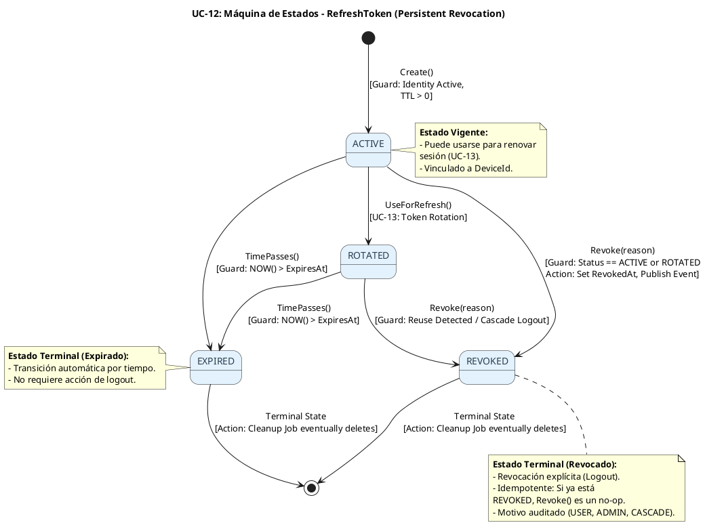
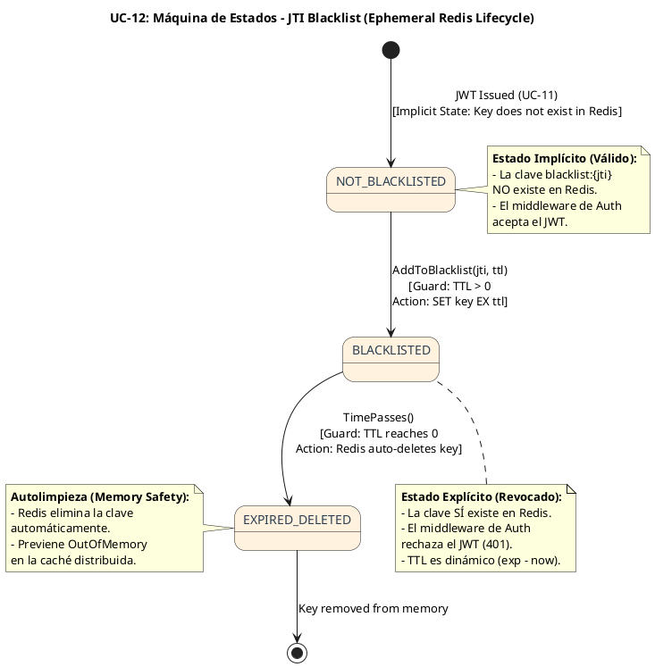

# UC-12: Cerrar Sesión (Logout) - Diagrama de Máquina de Estados

| Metadatos del Documento | |
| :--- | :--- |
| **Proyecto:** | SHUGO - Identity & Access Platform |
| **Caso de Uso:** | UC-12 - Cerrar Sesión (Logout & Token Revocation) |
| **Documento:** | 05_State_Machine_Diagram.md |
| **Metodología:** | UML 2.5 + DDD (State Pattern) + Event-Driven Architecture + Cache Lifecycle Management |
| **Autor:** | Gastón Ruiz |
| **Versión Actual:** | 1.0.0 |
| **Fecha:** | 17/09/2026 |

---

## Historial de Versiones

| Versión | Fecha | Autor | Descripción de Cambios | Impacto |
| :--- | :--- | :--- | :--- | :--- |
| **1.0.0** | 17/09/2026 | Gastón Ruiz | **Creación inicial.** Definición de las máquinas de estados específicas para el cierre de sesión. Se modelan dos máquinas críticas y diferenciadas: (1) El ciclo de vida persistente del `RefreshToken` en base de datos (ACTIVE → REVOKED), y (2) El ciclo de vida efímero del `JTI` (Access Token) en la Blacklist de Redis (VALID → BLACKLISTED → EXPIRED). Se abordan las guardas de idempotencia (Zero Info Leakage) y el cálculo de TTL dinámico. | Documento base del paquete de diseño Tier 1 del UC-12. Establece las reglas de transición, las guardas de seguridad y la lógica temporal que garantiza que los tokens sean inutilizables inmediatamente, previniendo Session Hijacking y optimizando el uso de memoria en caché distribuida. |

---

## 1. Introducción y Propósito

El **Diagrama de Máquina de Estados** para el UC-12 visualiza las restricciones de comportamiento temporal y las reglas de transición que gobiernan la revocación de credenciales.

A diferencia de los UCs de gestión de identidad, el UC-12 introduce una complejidad arquitectónica única debido a la naturaleza híbrida de las sesiones en SHUGO (Stateful Refresh Tokens + Stateless JWT Access Tokens). Por lo tanto, debemos modelar **dos máquinas de estados distintas pero coordinadas**:

1. **Máquina Persistente (Base de Datos):** Gestiona el estado del `RefreshToken`. Sus transiciones son duraderas, auditables y críticas para prevenir la generación de nuevos Access Tokens.
2. **Máquina Efímera (Redis Cache):** Gestiona el estado del `JTI` (JWT ID) en la Blacklist. Sus transiciones son temporales, gobernadas por un TTL dinámico, y críticas para invalidar Access Tokens ya emitidos.

Estas máquinas garantizan:
- **Seguridad por Diseño:** Es imposible usar un token revocado.
- **Idempotencia Robusta:** Las transiciones fallidas o duplicadas no generan errores ni fugas de información.
- **Eficiencia de Memoria:** La máquina de Redis se autolimpia mediante TTLs calculados dinámicamente.

---

## 2. Máquina de Estados #1: RefreshToken (Ciclo de Vida Persistente)

### 2.1. Descripción

Esta máquina modela el estado del `RefreshToken` almacenado en la base de datos (KAGAMI). Representa la capacidad del token para ser utilizado en el flujo de renovación (UC-13).

### 2.2. Diagrama de Máquina de Estados (PlantUML)



### 2.3. Descripción de Estados y Transiciones

| Estado | Descripción | Transiciones de Salida | Invariante Clave |
| :--- | :--- | :--- | :--- |
| **ACTIVE** | El token fue emitido y es válido para renovar la sesión. | → `REVOKED` (Logout explícito), → `ROTATED` (UC-13), → `EXPIRED` (TTL alcanzado). | `RevokedAt == null` AND `NOW() < ExpiresAt`. |
| **ROTATED** | El token fue usado para renovar sesión y fue reemplazado por uno nuevo (UC-13). | → `REVOKED` (Si se detecta reuso/robo o Cascade Logout). | `ReplacedByTokenId != null`. |
| **REVOKED** | El token ha sido invalidado explícitamente por el usuario o administrador. | Ninguna (Estado Terminal). | `RevokedAt != null`. No puede generar nuevos Access Tokens. |
| **EXPIRED** | El token ha superado su tiempo de vida máximo (ej. 30 días). | Ninguna (Estado Terminal). | `NOW() > ExpiresAt`. |

### 2.4. Guardas (Guards) de las Transiciones

#### Transición: `ACTIVE` / `ROTATED` → `REVOKED` (La lógica de Idempotencia)

Esta es la transición más crítica desde el punto de vista de la API y la seguridad (Zero Info Leakage).

```csharp
public void Revoke(TokenRevocationReason reason)
{
    // Guarda 1: Idempotencia de Dominio (Zero Info Leakage)
    // Si ya está revocado, no lanzamos excepción. Simplemente retornamos.
    // Esto permite que el endpoint de logout retorne 204 incluso si el cliente reenvía el request.
    if (this.Status == TokenStatus.REVOKED)
        return; 

    // Guarda 2: No revocar tokens ya expirados (optimización)
    if (this.Status == TokenStatus.EXPIRED)
        throw new DomainException("Cannot revoke an already expired token.");

    // Transición de estado
    this.Status = TokenStatus.REVOKED;
    this.RevokedAt = DateTime.UtcNow;
    this.RevocationReason = reason;
}
```

---

## 3. Máquina de Estados #2: JTI / Access Token (Ciclo de Vida Efímero en Redis)

### 3.1. Descripción

Dado que los Access Tokens (JWTs) son stateless, no tienen una "tabla" de estados en la base de datos. Su "estado" de revocación vive en la **Blacklist de Redis**. Esta máquina modela el ciclo de vida de una clave en Redis.

### 3.2. Diagrama de Máquina de Estados (PlantUML)



### 3.3. Descripción de Estados y Transiciones

| Estado | Descripción | Transiciones de Salida | Invariante Clave |
| :--- | :--- | :--- | :--- |
| **NOT_BLACKLISTED** | El JTI no existe en Redis. El JWT es matemáticamente válido y aceptado por el middleware. | → `BLACKLISTED` (Logout explícito o Force Logout). | `Redis.GET("blacklist:{jti}") == null`. |
| **BLACKLISTED** | El JTI existe en Redis. El middleware rechaza el JWT inmediatamente. | → `EXPIRED_DELETED` (TTL expira). | `Redis.GET("blacklist:{jti}") == "1"`. |
| **EXPIRED_DELETED** | El TTL ha expirado y Redis ha eliminado la clave de la memoria. | Ninguna (Estado Terminal). | La clave ya no ocupa memoria. |

### 3.4. Guardas (Guards) de las Transiciones

#### Transición: `NOT_BLACKLISTED` → `BLACKLISTED` (Cálculo de TTL Dinámico)

Esta transición ocurre en el Domain Service `BlacklistManager` a través del Value Object `BlacklistEntry`.

```csharp
public class BlacklistEntry : ValueObject
{
    public JTI Jti { get; }
    public TimeSpan Ttl { get; }

    public BlacklistEntry(JTI jti, DateTime jwtExpiration)
    {
        Jti = jti ?? throw new ArgumentNullException(nameof(jti));
        
        // Guarda 1: Calcular TTL Dinámico (exp - now)
        var timeLeft = jwtExpiration - DateTime.UtcNow;
        
        // Guarda 2: No blacklisear JWTs ya expirados (no tiene sentido consumir Redis)
        if (timeLeft <= TimeSpan.Zero)
            throw new DomainException("Cannot blacklist an already expired JWT.");

        // Añadir un pequeño buffer de seguridad (ej. 1 minuto) para evitar race conditions en el edge
        Ttl = timeLeft.Add(TimeSpan.FromMinutes(1));
    }
}
```

---

## 4. Implementación en el Dominio (Código C#)

### 4.1. Orquestación de las Dos Máquinas en `TokenRevoker`

El Domain Service `TokenRevoker` es responsable de coordinar ambas máquinas de estados. Aquí es donde se implementa la estrategia **Fail-Safe**.

```csharp
public async Task<RevocationResult> RevokeSingleSessionAsync(
    JTI jti, 
    DateTime jwtExpiration,
    RefreshTokenId refreshTokenId, 
    TokenRevocationReason reason, 
    CancellationToken ct)
{
    // 1. Máquina Persistente: Revocar Refresh Token en DB
    var token = await _tokenRepo.GetByIdAsync(refreshTokenId, ct);
    if (token == null) return RevocationResult.InvalidToken;

    // La entidad maneja su propia máquina de estados (Idempotencia)
    token.Revoke(reason); 
    await _tokenRepo.SaveChangesAsync(ct);

    // 2. Máquina Efímera: Blacklist en Redis (Fail-Safe)
    bool blacklistSuccess = true;
    try
    {
        // El VO calcula el TTL dinámico
        var entry = new BlacklistEntry(jti, jwtExpiration); 
        await _blacklistManager.AddToBlacklistAsync(entry, ct);
    }
    catch (InfrastructureException ex)
    {
        // FAIL-SAFE: Si Redis cae, logueamos alerta crítica pero NO revertimos la DB.
        _logger.LogError(ex, "Fail-Safe: Redis Blacklist failed for JTI {JTI}. DB Revocation stands.", jti.Value);
        blacklistSuccess = false;
    }

    // 3. Publicar Evento (Outbox)
    await _eventPublisher.PublishAsync(new SessionTerminatedEvent(
        token.IdentityId, jti, token.DeviceId, reason, DateTime.UtcNow), ct);

    return blacklistSuccess ? RevocationResult.Success : RevocationResult.SuccessWithBlacklistFailure;
}
```

---

## 5. Trazabilidad con Otros Documentos del Paquete

| Documento | Relación |
| :--- | :--- |
| `01_Requirements_Specification.md` | Las invariantes de estado (INV-78, INV-79) y reglas de negocio (RN-20 Fail-Safe, RN-21 Idempotencia) se definen aquí y se hacen cumplir en estas máquinas. |
| `02_Use_Case_Diagram.md` | Muestra los actores y sistemas; estas máquinas definen cómo el sistema responde a sus acciones de logout a lo largo del tiempo. |
| `03_Activity_Diagram.md` | Las decisiones "¿Ya revocado?" y "¿Redis Falló?" se implementan aquí como máquinas de estados. |
| `04_Initial_Domain_Model.md` | Las entidades `RefreshToken` y los VOs `BlacklistEntry` son la implementación directa de estas máquinas. |
| `06_Robustness_Diagram.md` | Mostrará cómo los objetos colaboran para ejecutar estas transiciones de estado de forma segura. |
| `07_Sequence_Diagram.md` | Detallará el orden temporal exacto de las llamadas que disparan estas transiciones. |
| `10_UC_Specific_Data_Model.md` | Define las columnas físicas (`status`, `revoked_at`) que persisten estos estados en PostgreSQL, y la estructura de claves en Redis. |

---

## 6. Notas de Implementación

### 6.1. Testing de Máquinas de Estados

Cada transición y guarda definida en estas máquinas debe tener al menos dos tests unitarios:

```csharp
[Test]
public void RefreshToken_Revoke_WhenAlreadyRevoked_IsIdempotent()
{
    // Arrange
    var token = RefreshToken.Create(/* ... */);
    token.Revoke(TokenRevocationReason.USER_INITIATED);

    // Act
    var act = () => token.Revoke(TokenRevocationReason.USER_INITIATED);

    // Assert
    act.Should().NotThrow(); // Idempotencia de dominio
    token.RevokedAt.Should().NotBeNull();
}

[Test]
public void BlacklistEntry_WhenJwtAlreadyExpired_ThrowsDomainException()
{
    // Arrange
    var jti = new JTI(Guid.NewGuid().ToString());
    var pastExpiration = DateTime.UtcNow.AddMinutes(-5);

    // Act
    var act = () => new BlacklistEntry(jti, pastExpiration);

    // Assert
    act.Should().Throw<DomainException>().WithMessage("*already expired*");
}

[Test]
public void BlacklistEntry_CalculatesDynamicTtlCorrectly()
{
    // Arrange
    var jti = new JTI(Guid.NewGuid().ToString());
    var futureExpiration = DateTime.UtcNow.AddMinutes(15);

    // Act
    var entry = new BlacklistEntry(jti, futureExpiration);

    // Assert
    entry.Ttl.TotalMinutes.Should().BeGreaterThan(15); // 15 min + 1 min buffer
    entry.Ttl.TotalMinutes.Should().BeLessThan(17);
}
```

### 6.2. Concurrencia y Race Conditions en la Blacklist

Dado que la Blacklist de Redis es efímera, no necesitamos Optimistic Concurrency Control (OCC) como en la base de datos. 
- **Escenario:** Si dos requests de logout llegan simultáneamente para el mismo JTI, ambos ejecutarán `SET blacklist:{jti} 1 EX {ttl}`.
- **Resultado:** Redis sobrescribe la clave con el mismo valor y el mismo TTL. No hay condición de carrera destructiva. La idempotencia está garantizada por la naturaleza de la operación `SET` en Redis.

---

## 7. Glosario de Términos Específicos de UC-12

| Término | Definición |
| :--- | :--- |
| **Persistent State Machine** | Máquina de estados almacenada en base de datos relacional (PostgreSQL). Representa la verdad duradera (Refresh Tokens). |
| **Ephemeral State Machine** | Máquina de estados almacenada en caché distribuida (Redis). Representa un estado temporal con autolimpieza (Blacklist de JWTs). |
| **Dynamic TTL** | Tiempo de vida calculado en tiempo de ejecución (`exp - now`) para garantizar que la caché no crezca infinitamente. |
| **Idempotent Transition** | Transición de estado que, al ejecutarse múltiples veces con los mismos parámetros, no produce efectos secundarios ni lanza errores (ej. `REVOKED` → `REVOKED`). |
| **Fail-Safe Orchestration** | Patrón donde el fallo de una máquina de estados secundaria (Redis) no revierte ni bloquea la máquina de estados primaria (DB). |
| **Zero Info Leakage Guard** | Guarda de seguridad que previene que el sistema revele el estado actual de un token a través de códigos de error HTTP. |

---
*Fin del Documento 05_State_Machine_Diagram para UC-12*