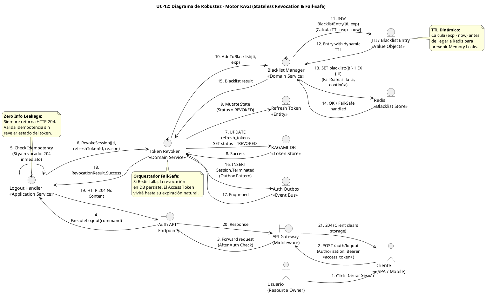

# UC-12: Cerrar Sesión (Logout) - Diagrama de Robustez

| Metadatos del Documento | |
| :--- | :--- |
| **Proyecto:** | SHUGO - Identity & Access Platform |
| **Caso de Uso:** | UC-12 - Cerrar Sesión (Logout & Token Revocation) |
| **Documento:** | 06_Robustness_Diagram.md |
| **Metodología:** | ICONIX (Diagrama de Robustez) + DDD + Security by Design (Fail-Safe Orchestration) |
| **Autor:** | Gastón Ruiz |
| **Versión Actual:** | 1.0.0 |
| **Fecha:** | 17/09/2026 |

---

## Historial de Versiones

| Versión | Fecha | Autor | Descripción de Cambios | Impacto |
| :--- | :--- | :--- | :--- | :--- |
| **1.0.0** | 17/09/2026 | Gastón Ruiz | **Creación inicial.** Diagrama de Robustez para UC-12, validando la arquitectura del motor KAGI para la revocación de sesiones. Muestra la colaboración estricta entre Boundary Objects (API Gateway, Endpoint), Control Objects (Logout Handler, Token Revoker, Blacklist Manager), y Entity Objects (RefreshToken, JTI, Redis Blacklist, Outbox). Valida el patrón Fail-Safe ante caídas de Redis, la idempotencia (Zero Info Leakage), y el cálculo de TTL dinámico. | Documento base del paquete de diseño Tier 1 del UC-12. Sirve como puente crítico entre el Modelo de Dominio (04/05) y el Diagrama de Secuencia (07), asegurando que la orquestación de la revocación híbrida (Stateful DB + Stateless Redis) respete las reglas de acoplamiento y resiliencia antes de codificar. |

---

## 1. Introducción y Propósito

El **Diagrama de Robustez** para el UC-12 valida que el flujo de cierre de sesión puede ser orquestado respetando las reglas estrictas de acoplamiento de **ICONIX** y los principios de **Domain-Driven Design (DDD)**, **Zero Trust**, y **Fail-Safe Resilience**.

El desafío específico de este caso de uso es la **orquestación híbrida de estado**:
1. **Estado Persistente (DB):** Revocar el Refresh Token para evitar la generación de nuevos Access Tokens.
2. **Estado Efímero (Redis):** Invalidar el Access Token actual (JWT) mediante una Blacklist de JTI con TTL dinámico.
3. **Resiliencia (Fail-Safe):** Garantizar que si la capa de caché (Redis) falla, la capa de persistencia (DB) complete la revocación para mantener la seguridad base.

---

## 2. Diagrama de Robustez (PlantUML)

A continuación, se presenta el Diagrama de Robustez organizado de izquierda a derecha para mostrar el flujo natural: **Actor → Boundary → Control → Entity**.



---

## 3. Explicación Detallada de los Objetos

### 3.1. Boundary Objects (Objetos de Límite)

| Objeto | Responsabilidad | Mapeo a Clean Architecture |
| :--- | :--- | :--- |
| **`API Gateway`** | Valida que el request tenga un token válido en el header (para auditoría y contexto), aplica Rate Limiting, y forward la request al endpoint interno. | Middleware (Kong, AWS API Gateway). |
| **`Auth API Endpoint`** | Recibe el `POST /auth/logout`, deserializa el payload (refresh_token, logout_everywhere), y delega al Application Service. | Controller (ASP.NET Core). |

### 3.2. Control Objects (Objetos de Control)

| Objeto | Responsabilidad | Mapeo a Clean Architecture |
| :--- | :--- | :--- |
| **`Logout Handler`** | **Application Service.** Orquesta el flujo de alto nivel. Maneja la idempotencia (Zero Info Leakage) y traduce el resultado del dominio a respuestas HTTP (siempre 204). | Application Service. |
| **`Token Revoker`** | **Domain Service.** El cerebro de la revocación. Coordina la mutación en la base de datos y la escritura en Redis. Implementa la lógica **Fail-Safe** si la infraestructura de caché falla. | Domain Service. |
| **`Blacklist Manager`** | **Domain Service.** Abstrae la interacción con Redis. Recibe un `BlacklistEntry` (VO) y lo persiste en la caché distribuida. | Domain Service (Interface implemented in Infra). |

### 3.3. Entity Objects (Objetos de Entidad y Value Objects)

| Objeto | Responsabilidad | Mapeo a DDD / Infra |
| :--- | :--- | :--- |
| **`Refresh Token`** | **Entity.** Representa el token de larga duración en la base de datos. Su estado muta a `REVOKED`. | Aggregate / Entity (PostgreSQL). |
| **`JTI / Blacklist Entry`** | **Value Objects.** `JTI` es el identificador único del JWT. `BlacklistEntry` encapsula el JTI y calcula el TTL dinámico (`exp - now`). | Value Objects (Inmutables). |
| **`Redis`** | **Infrastructure.** Almacena la Blacklist de JTIs. Operaciones de alta velocidad con TTL automático. | Infrastructure (Cache). |
| **`KAGAMI DB`** | **Infrastructure.** Base de datos relacional que persiste el estado de los Refresh Tokens. | Infrastructure (Persistence). |
| **`Auth Outbox`** | **Infrastructure.** Tabla que garantiza la entrega eventual de eventos de auditoría (`Session.Terminated`) a KAGE/KIZUNA. | Infrastructure (Outbox Pattern). |

---

## 4. Reglas de Robustez de ICONIX (Validación del Diagrama)

Verifiquemos que nuestro diagrama cumple estrictamente las reglas de acoplamiento de ICONIX:

### ✅ Regla 1: Actor → Boundary
- **Cumplida:** El `Usuario` interactúa con el `Cliente`, y el `Cliente` interactúa con el `API Gateway`.

### ✅ Regla 2: Boundary → Boundary
- **Cumplida:** El `API Gateway` forward la request al `Auth API Endpoint`.

### ✅ Regla 3: Boundary → Control
- **Cumplida:** El `Auth API Endpoint` envía el command al `Logout Handler`.

### ✅ Regla 4: Control → Control
- **Cumplida y Crítica:** El `Logout Handler` delega al `Token Revoker`, y este delega al `Blacklist Manager`. Esto mantiene el Handler delgado y encapsula la lógica compleja de Fail-Safe y cálculo de TTL en servicios de dominio especializados.

### ✅ Regla 5: Control → Entity
- **Cumplida:**
  - `Logout Handler` consulta la idempotencia (implícitamente a través del `Token Revoker` o repositorio).
  - `Token Revoker` muta el estado de la Entity `Refresh Token` en la `KAGAMI DB`.
  - `Blacklist Manager` interactúa con el Value Object `Blacklist Entry` y lo persiste en `Redis`.
  - `Token Revoker` inserta el evento en el `Auth Outbox`.

### ✅ Regla 6: NO Entity → Control / Boundary
- **Cumplida:** Ninguna entidad (`Refresh Token`, `Redis`, `DB`, `Outbox`) envía mensajes de vuelta a los controles o boundaries. Solo retornan datos o confirmaciones como respuesta a una invocación.

### ✅ Regla 7: NO Entity → Entity (Directo sin Control)
- **Cumplida:** Los controles (`Token Revoker`, `Blacklist Manager`) orquestan todas las interacciones entre las entidades. Las entidades no se modifican entre sí directamente.

---

## 5. Consideraciones de Arquitectura (Security & Resilience)

### 5.1. Patrón Fail-Safe en la Orquestación

El diagrama valida visualmente la estrategia **Fail-Safe** mediante el bloque `alt Redis Failure`:

1. **El Problema:** Si Redis está caído, un logout tradicional fallaría, dejando al usuario sin poder cerrar sesión (disponibilidad comprometida) o, peor aún, revertiría la transacción de la base de datos (seguridad comprometida).
2. **La Solución (Token Revoker):** El `Token Revoker` captura la `InfrastructureException` lanzada por el `Blacklist Manager`.
3. **Acción:** Registra una alerta crítica (`Log Alert`), pero **NO** lanza la excepción al `Logout Handler`. La revocación en la base de datos (Refresh Token) ya fue exitosa.
4. **Resultado:** El usuario recibe HTTP 204. El Refresh Token está muerto (seguridad base garantizada). El Access Token actual seguirá vivo hasta su expiración natural (riesgo aceptado temporalmente).

### 5.2. Zero Info Leakage (Idempotencia)

El bloque `alt Token ya revocado o inválido` en el `Logout Handler` modela la defensa contra la enumeración de estado:

- Si un atacante envía un token robado al endpoint de logout para probar si está activo, el sistema no responde con "400 Invalid Token" ni "409 Already Revoked".
- El `Logout Handler` intercepta esto y retorna **HTTP 204 No Content** inmediatamente.
- **Justificación:** El atacante no obtiene ninguna información útil sobre el estado del token.

### 5.3. Cálculo de TTL Dinámico (Prevención de Memory Leaks)

El diagrama muestra explícitamente la interacción entre el `Blacklist Manager` y el Value Object `Blacklist Entry` (Pasos 11b-12b):

- Antes de tocar Redis, el dominio calcula el TTL: `TTL = (JWT_Expiration - NOW) + Buffer`.
- **Justificación:** Si guardáramos los JTIs en Redis sin TTL, la memoria crecería infinitamente hasta colapsar el clúster. El dominio se asegura de que cada entrada en la Blacklist sea efímera y se autolimpie exactamente cuando el JWT habría expirado de forma natural.

---

## 6. Trazabilidad con Otros Documentos del Paquete

| Documento | Relación |
| :--- | :--- |
| `01_Requirements_Specification.md` | Valida que los requisitos de Idempotencia (INV-77), Blacklist con TTL (INV-79) y Fail-Safe (RN-20) pueden ser implementados con los objetos definidos. |
| `02_Use_Case_Diagram.md` | Muestra los actores y sistemas; este diagrama muestra cómo colaboran los objetos internos para lograr los casos de uso UC-12c (Blacklist) y UC-12d (DB Revoke). |
| `03_Activity_Diagram.md` | Los carriles de actividad (Motor KAGI, Redis, DB) se mapean directamente a los objetos de Control y Entity de este diagrama. |
| `04_Initial_Domain_Model.md` | Los objetos `RefreshToken`, `JTI`, `BlacklistEntry`, `TokenRevoker` y `BlacklistManager` son exactamente las clases definidas en el modelo de dominio. |
| `05_State_Machine_Diagram.md` | Las máquinas de estados (ACTIVE → REVOKED en DB, NOT_BLACKLISTED → BLACKLISTED en Redis) se ejecutan cuando los Controles invocan los métodos de las Entidades. |
| `07_Sequence_Diagram.md` | Este diagrama define "qué objetos colaboran"; el de secuencia definirá "en qué orden temporal exacto" se envían los mensajes. |
| `08_Final_Class_Design.md` | Definirá las firmas exactas de los métodos mostrados en este diagrama (ej. `TokenRevoker.RevokeSessionAsync()`, `BlacklistManager.AddToBlacklistAsync()`). |

---

## 7. Notas de Implementación

### 7.1. Inyección de Dependencias

El `Token Revoker` debe tener inyectados los repositorios y servicios de infraestructura abstractos:

```csharp
public class TokenRevoker : ITokenRevoker
{
    private readonly IRefreshTokenRepository _tokenRepo;
    private readonly IBlacklistManager _blacklistManager;
    private readonly IOutboxPublisher _outboxPublisher;
    private readonly ILogger<TokenRevoker> _logger;

    public TokenRevoker(
        IRefreshTokenRepository tokenRepo,
        IBlacklistManager blacklistManager,
        IOutboxPublisher outboxPublisher,
        ILogger<TokenRevoker> logger)
    {
        _tokenRepo = tokenRepo;
        _blacklistManager = blacklistManager;
        _outboxPublisher = outboxPublisher;
        _logger = logger;
    }
}
```

### 7.2. Flujo de Ejecución Simplificado (Código)

```csharp
public async Task<RevocationResult> RevokeSessionAsync(RevokeSessionCommand command, CancellationToken ct)
{
    // 1. Mutación en DB (Stateful)
    var token = await _tokenRepo.GetByIdAsync(command.RefreshTokenId, ct);
    if (token == null) return RevocationResult.InvalidToken;
    
    token.Revoke(command.Reason); // Idempotente a nivel de dominio
    await _tokenRepo.SaveChangesAsync(ct);

    // 2. Blacklist en Redis (Stateless) - FAIL-SAFE
    try
    {
        var entry = new BlacklistEntry(command.JTI, command.JwtExpiration);
        await _blacklistManager.AddToBlacklistAsync(entry, ct);
    }
    catch (InfrastructureException ex)
    {
        _logger.LogCritical(ex, "Fail-Safe: Redis Blacklist failed. DB revocation stands.");
        // No re-lanzamos. El logout continúa.
    }

    // 3. Auditoría (Outbox)
    await _outboxPublisher.PublishAsync(new SessionTerminatedEvent(token.IdentityId, command.JTI), ct);

    return RevocationResult.Success;
}
```

---
*Fin del Documento 06_Robustness_Diagram para UC-12*