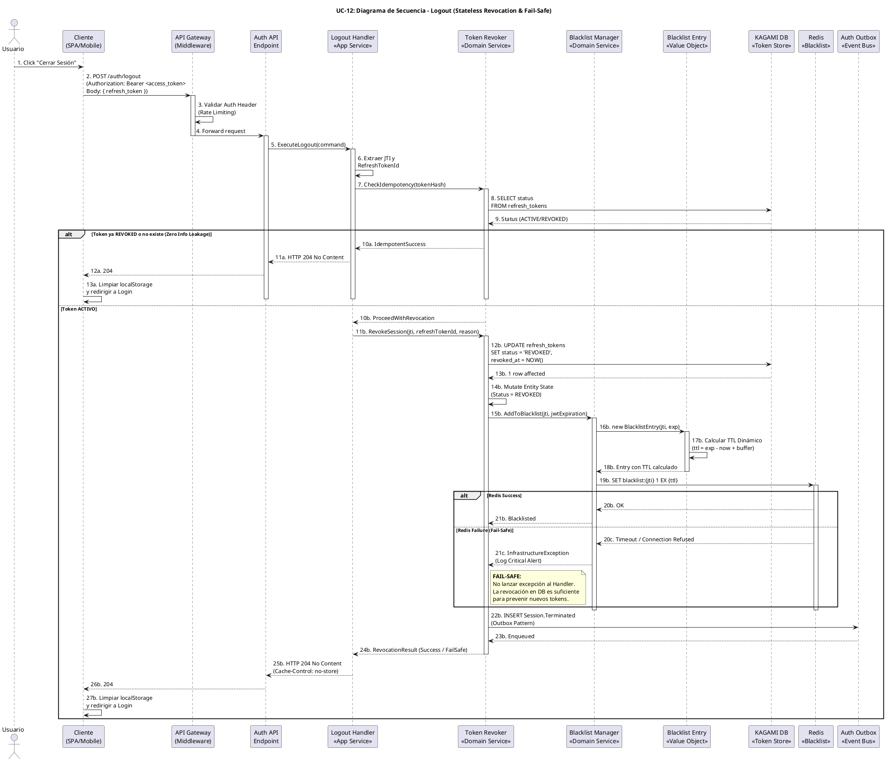

# UC-12: Cerrar Sesión (Logout) - Diagrama de Secuencia

| Metadatos del Documento | |
| :--- | :--- |
| **Proyecto:** | SHUGO - Identity & Access Platform |
| **Caso de Uso:** | UC-12 - Cerrar Sesión (Logout & Token Revocation) |
| **Documento:** | 07_Sequence_Diagram.md |
| **Metodología:** | ICONIX (Diagrama de Secuencia) + DDD + Security by Design (Fail-Safe Orchestration) |
| **Autor:** | Gastón Ruiz |
| **Versión Actual:** | 1.0.0 |
| **Fecha:** | 17/09/2026 |

---

## Historial de Versiones

| Versión | Fecha | Autor | Descripción de Cambios | Impacto |
| :--- | :--- | :--- | :--- | :--- |
| **1.0.0** | 17/09/2026 | Gastón Ruiz | **Creación inicial.** Diagrama de Secuencia completo para UC-12. Modela la orquestación temporal exacta del cierre de sesión, destacando la validación de idempotencia (Zero Info Leakage), la mutación persistente en DB, el cálculo de TTL dinámico en el Value Object `BlacklistEntry`, la escritura en Redis, y la estrategia Fail-Safe ante caídas de infraestructura de caché. | Documento base del paquete de diseño Tier 1 del UC-12. Sirve como guion exacto para la codificación del `LogoutHandler` y `TokenRevoker`, garantizando que la revocación de tokens híbridos (Stateful + Stateless) se ejecute de forma segura, resiliente y sin fugas de información. |

---

## 1. Introducción y Propósito

El **Diagrama de Secuencia** para el UC-12 materializa temporalmente las colaboraciones definidas en el Diagrama de Robustez. Su propósito es:

1. **Definir el orden exacto de la revocación híbrida:** Establecer la secuencia crítica donde la mutación en la base de datos (Refresh Token) precede a la invalidación en caché (Access Token JTI).
2. **Modelar la Idempotencia (Zero Info Leakage):** Mostrar cómo el sistema intercepta requests duplicados o con tokens inválidos para retornar siempre HTTP 204, sin revelar el estado interno del token.
3. **Visualizar el Cálculo de TTL Dinámico:** Demostrar cómo el Value Object `BlacklistEntry` calcula el tiempo de vida exacto antes de tocar Redis, previniendo Memory Leaks.
4. **Demostrar la Estrategia Fail-Safe:** Mostrar explícitamente cómo el flujo continúa y retorna éxito al usuario incluso si la escritura en Redis falla, priorizando la disponibilidad y la seguridad base (DB).

---

## 2. Diagrama de Secuencia - Escenario Principal (PlantUML)

A continuación, se presenta el Diagrama de Secuencia para el **Escenario Principal (Logout Estándar con Fail-Safe)**.



---

## 3. Análisis Detallado del Flujo

### 3.1. Fase 1: Ingress & Idempotencia (Pasos 1-10)

**Participantes:** `Usuario`, `Cliente`, `API Gateway`, `Logout Handler`, `Token Revoker`, `KAGAMI DB`

*   **Acción:** El cliente envía el request de logout. El Handler delega al `Token Revoker` para verificar el estado actual del token.
*   **Seguridad (Zero Info Leakage):** Si el token ya fue revocado (o es completamente inválido), el flujo toma la rama `alt Token ya REVOKED`. El sistema retorna **HTTP 204 No Content** inmediatamente.
*   **Justificación:** Un atacante que intercepte un token y lo envíe al endpoint de logout para probar su validez no obtendrá un error "400 Invalid Token" ni "409 Already Revoked". Obtendrá el mismo 204 que un logout exitoso. Esto previene la enumeración de estado de tokens.

### 3.2. Fase 2: Revocación Persistente (Pasos 11b-14b)

**Participantes:** `Token Revoker`, `KAGAMI DB`

*   **Acción:** El `Token Revoker` ejecuta un `UPDATE` en la tabla `refresh_tokens` para cambiar el estado a `REVOKED` y registrar el `revoked_at`.
*   **Justificación:** Esta es la **barrera de seguridad principal**. Al revocar el Refresh Token en la base de datos, garantizamos que el atacante no pueda usar el flujo de UC-13 (Renovar Sesión) para generar *nuevos* Access Tokens, incluso si logra robar el Refresh Token.

### 3.3. Fase 3: Revocación Efímera y Fail-Safe (Pasos 15b-21c)

**Participantes:** `Token Revoker`, `Blacklist Manager`, `Blacklist Entry (VO)`, `Redis`

*   **Acción (Cálculo de TTL):** Antes de tocar Redis, el `Blacklist Manager` instancia el Value Object `Blacklist Entry`. Este VO calcula el TTL dinámico: `TTL = (JWT_Expiration - NOW) + 1 minuto de buffer`.
*   **Acción (Escritura en Redis):** Se ejecuta `SET blacklist:{jti} 1 EX {ttl}`.
*   **Estrategia Fail-Safe (Rama `alt Redis Failure`):** Si Redis está caído o timeout, el `Blacklist Manager` captura la `InfrastructureException`, loguea una alerta crítica para el equipo de operaciones, pero **NO** lanza la excepción al `Logout Handler`.
*   **Justificación:** Priorizamos la disponibilidad del endpoint de logout. Si Redis falla, el Refresh Token ya fue revocado en DB (Fase 2). El Access Token actual (si fue robado) seguirá siendo válido hasta su expiración natural (ej. 15 minutos). Este es un **riesgo aceptado temporalmente** documentado en la especificación, evitando que un fallo de caché impida al usuario cerrar sesión.

### 3.4. Fase 4: Auditoría y Respuesta (Pasos 22b-27b)

**Participantes:** `Token Revoker`, `Auth Outbox`, `Logout Handler`, `Cliente`

*   **Acción:** Se inserta el evento `Session.Terminated` en la tabla `auth_outbox` (Outbox Pattern).
*   **Justificación:** Garantiza que el evento de auditoría se entregue a KAGE/KIZUNA de forma eventual, incluso si el bus de mensajes (Kafka/RabbitMQ) está caído en ese instante. Finalmente, se retorna HTTP 204 al cliente, quien procede a limpiar su almacenamiento local.

---

## 4. Flujos Alternativos y Excepciones

### 4.1. Flujo Alternativo: Cascade Logout (Logout Everywhere)

Si el cliente envía `logout_everywhere: true` en el payload:

```
Client -> GW -> API -> Handler (Detecta flag logout_everywhere) -> Revoker -> DB (SELECT * FROM refresh_tokens WHERE identity_id = X AND status = 'ACTIVE') -> loop Para cada token -> Revoker (RevokeSession) -> DB (UPDATE) -> Redis (SET Blacklist) -> Outbox (INSERT Event) -> Handler -> API -> Client (204)
```

**Pasos:** 1-6, detección de flag, bucle sobre tokens activos, revocación masiva.
**Tiempo total:** ~200-500ms (dependiendo de la cantidad de sesiones activas).
**Justificación:** Permite al usuario invalidar todas sus sesiones desde un panel de seguridad, crucial en casos de pérdida de dispositivo o compromiso de cuenta.

### 4.2. Flujo de Excepción: Token Malformado o Inválido

Si el cliente envía un `refresh_token` que no es un JWT válido o no existe en la DB:

```
Client -> GW -> API -> Handler -> Revoker (CheckIdempotency) -> DB (SELECT returns null) -> Revoker -> Handler (IdempotentSuccess) -> API -> Client (204 No Content)
```

**Pasos:** 1-10a.
**Tiempo total:** ~20ms.
**Justificación:** Mantiene la consistencia de Zero Info Leakage. El sistema no revela que el token es basura o no existe.

### 4.3. Flujo de Excepción: Fallo en Base de Datos (KAGAMI DB)

Si la base de datos de tokens está caída durante la Fase 2:

```
Handler -> Revoker -> DB (Timeout/Exception) -> Revoker -> Handler (InfrastructureException) -> API -> Client (HTTP 503 Service Unavailable)
```

**Pasos:** 1-12b, excepción no manejada (o manejada como 503).
**Justificación:** Principio **Fail-Secure**. Si no podemos garantizar la revocación en la fuente de verdad (DB), denegamos la operación de logout y alertamos al usuario, en lugar de dar una falsa sensación de seguridad.

---

## 5. Consideraciones de Arquitectura (Security & Resilience)

### 5.1. Zero Info Leakage (Idempotencia)

El diagrama modela explícitamente la bifurcación `alt Token ya REVOKED o no existe`. 

*   **Justificación:** En sistemas de alta seguridad, las respuestas de error son una fuente de información para los atacantes. Al normalizar todas las respuestas de logout a HTTP 204 (sin cuerpo), eliminamos la superficie de ataque basada en enumeración de estado.

### 5.2. Cálculo de TTL Dinámico (Prevención de Memory Leaks)

El diagrama muestra la interacción crítica entre `Blacklist Manager` y `Blacklist Entry` (Pasos 16b-18b).

*   **Justificación:** Si almacenáramos los JTIs en Redis sin un TTL, la memoria crecería infinitamente. Al calcular `exp - now` en el dominio (VO), garantizamos que Redis elimine la clave automáticamente exactamente cuando el JWT habría expirado de forma natural.

### 5.3. Estrategia Fail-Safe ante Caída de Redis

La rama `alt Redis Failure` (Pasos 20c-21c) es una de las decisiones arquitectónicas más importantes del UC-12.

*   **Justificación:** Redis es una capa de caché/velocidad. Si se cae, no podemos permitir que el usuario quede "atrapado" sin poder cerrar sesión. La revocación en DB (Fase 2) es la barrera principal. El Access Token actual vivirá 15 minutos más, pero no podrá renovarse. Este trade-off (Disponibilidad + Seguridad Base vs. Invalidación Instantánea) está documentado y aceptado.

---

## 6. Trazabilidad con Otros Documentos del Paquete

| Documento | Relación |
| :--- | :--- |
| `01_Requirements_Specification.md` | Este diagrama visualiza los flujos de texto, las invariantes de idempotencia (INV-77), TTL dinámico (INV-79) y Fail-Safe (RN-20). |
| `02_Use_Case_Diagram.md` | Muestra el límite del sistema y los actores; este diagrama muestra el flujo interno y las decisiones lógicas. |
| `03_Activity_Diagram.md` | Los carriles de actividad se mapean directamente a los participantes de este diagrama. |
| `04_Initial_Domain_Model.md` | Los Aggregate Roots (`RefreshToken`), Value Objects (`BlacklistEntry`), y Domain Services (`TokenRevoker`, `BlacklistManager`) de este diagrama son exactamente las clases definidas en el modelo. |
| `05_State_Machine_Diagram.md` | Este diagrama muestra la colaboración de objetos; las máquinas de estados muestran las transiciones internas de cada objeto (ej. `RefreshToken.Status` transiciona a `REVOKED` en el paso 14b). |
| `06_Robustness_Diagram.md` | Este diagrama define "qué objetos colaboran"; el de robustez muestra la colaboración de forma más abstracta. |
| `08_Final_Class_Design.md` | Definirá las firmas exactas de los métodos mostrados en este diagrama (ej. `TokenRevoker.RevokeSessionAsync()`, `BlacklistManager.AddToBlacklistAsync()`). |

---

## 7. Notas de Implementación

### 7.1. Inyección de Dependencias y Scope

El `Logout Handler` debe ser registrado como **Scoped** (por request), mientras que los Domain Services (`Token Revoker`, `Blacklist Manager`) pueden ser **Singleton** o **Scoped** según su estado interno.

```csharp
// Program.cs / Startup.cs

// Capa de Aplicación (por request)
services.AddScoped<ILogoutHandler, LogoutHandler>();

// Capa de Dominio (Singleton si no tienen estado, Scoped si necesitan contexto)
services.AddScoped<ITokenRevoker, TokenRevoker>(); 
services.AddScoped<IBlacklistManager, RedisBlacklistManager>(); 

// Capa de Infraestructura
services.AddScoped<IRefreshTokenRepository, RefreshTokenRepository>(); // EF Core
services.AddSingleton<IDistributedCache>(sp => { ... Redis connection ... });
services.AddScoped<IOutboxPublisher, OutboxPublisher>();
```

### 7.2. Manejo de la Secuencia Crítica (Código)

```csharp
public async Task<IActionResult> ExecuteLogoutAsync(LogoutCommand command, CancellationToken ct)
{
    // 1. Extraer JTI del Access Token (del header Authorization)
    var jti = _tokenExtractor.ExtractJti(command.AccessToken);
    var jwtExpiration = _tokenExtractor.ExtractExpiration(command.AccessToken);

    // 2. Delegar al Domain Service (Orquestación Fail-Safe)
    var result = await _tokenRevoker.RevokeSessionAsync(
        jti, 
        jwtExpiration,
        command.RefreshTokenId, 
        TokenRevocationReason.USER_INITIATED, 
        ct);

    // 3. Siempre retornar 204 (Zero Info Leakage)
    // Incluso si result == RevocationResult.SuccessWithBlacklistFailure
    return NoContent(); 
}

// En TokenRevoker.cs
public async Task<RevocationResult> RevokeSessionAsync(...)
{
    // Fase 2: DB
    var token = await _tokenRepo.GetByIdAsync(refreshTokenId, ct);
    if (token == null) return RevocationResult.InvalidToken;
    
    token.Revoke(reason); // Idempotente
    await _tokenRepo.SaveChangesAsync(ct);

    // Fase 3: Redis (Fail-Safe)
    try
    {
        var entry = new BlacklistEntry(jti, jwtExpiration); // Calcula TTL
        await _blacklistManager.AddToBlacklistAsync(entry, ct);
    }
    catch (InfrastructureException ex)
    {
        _logger.LogCritical(ex, "Fail-Safe: Redis Blacklist failed for JTI {JTI}. DB revocation stands.", jti.Value);
        return RevocationResult.SuccessWithBlacklistFailure;
    }

    // Fase 4: Outbox
    await _outboxPublisher.PublishAsync(new SessionTerminatedEvent(...), ct);

    return RevocationResult.Success;
}
```

### 7.3. Consideraciones de Rendimiento y Concurrencia

*   **Idempotencia en DB:** La consulta `SELECT status FROM refresh_tokens` en el paso 8 puede optimizarse verificando primero en Redis si el `refresh_token_hash` está en una lista de "recientemente revocados", pero para mantener la consistencia fuerte, la consulta a DB es necesaria.
*   **Redis Atomicity:** La operación `SET ... EX ...` en Redis es atómica. Si dos requests de logout llegan simultáneamente para el mismo JTI, Redis sobrescribe la clave con el mismo valor y TTL. No hay condición de carrera destructiva.
*   **Outbox Pattern:** La inserción en `auth_outbox` debe ocurrir en la misma transacción de base de datos que la revocación del `RefreshToken` (si están en la misma DB) o mediante el patrón Outbox dual si están en bases separadas, para garantizar la consistencia eventual de la auditoría.

---
*Fin del Documento 07_Sequence_Diagram para UC-12*