# UC-12: Cerrar Sesión (Logout) - Diagrama de Clases de Diseño Final

| Metadatos del Documento | |
| :--- | :--- |
| **Proyecto:** | SHUGO - Identity & Access Platform |
| **Caso de Uso:** | UC-12 - Cerrar Sesión (Logout & Token Revocation) |
| **Documento:** | 08_Final_Class_Design.md |
| **Metodología:** | ICONIX (Modelo de Diseño) + DDD + Clean Architecture + Security by Design (Fail-Safe & Zero Info Leakage) |
| **Autor:** | Gastón Ruiz |
| **Versión Actual:** | 1.0.0 |
| **Fecha:** | 17/09/2026 |

---

## Historial de Versiones

| Versión | Fecha | Autor | Descripción de Cambios | Impacto |
| :--- | :--- | :--- | :--- | :--- |
| **1.0.0** | 17/09/2026 | Gastón Ruiz | **Creación inicial.** Definición del Modelo de Diseño (Clases de Implementación) para UC-12. Se detallan las firmas exactas del Application Service (`LogoutHandler`), Domain Services (`TokenRevoker`, `BlacklistManager`), Entities (`RefreshToken`), y Value Objects (`JTI`, `BlacklistEntry`). Se implementan explícitamente los patrones Fail-Safe, Idempotencia (Zero Info Leakage) y cálculo de TTL dinámico, listos para codificación en C# / .NET 8. | Documento base del paquete de diseño Tier 1 del UC-12. Sirve como plano exacto para la codificación del endpoint de logout, garantizando que la orquestación híbrida (Stateful DB + Stateless Redis) y la resiliencia ante fallos de infraestructura se implementen correctamente. |

---

## 1. Introducción y Propósito

Este documento presenta el **Modelo de Diseño** (Diagrama de Clases de Implementación) para el Caso de Uso UC-12 (Cerrar Sesión).

A diferencia del Modelo de Dominio Inicial (documento 04), que era conceptual, este documento define las **clases concretas con firmas de métodos específicas**, visibilidad, manejo de `CancellationToken`, y patrones de resiliencia. El diseño debe garantizar:

1. **Zero Info Leakage (Idempotencia):** El endpoint siempre retorna HTTP 204, independientemente de si el token era válido, inválido o ya estaba revocado.
2. **Orquestación Fail-Safe:** Si Redis (Blacklist) falla, la revocación en la base de datos (Refresh Token) persiste, priorizando la seguridad base sobre la invalidación instantánea del JWT.
3. **Cálculo de TTL Dinámico:** Encapsulado en un Value Object para prevenir Memory Leaks en Redis.
4. **Auditoría Asíncrona:** Uso del patrón Outbox para no bloquear la respuesta HTTP.

---

## 2. Diagrama de Clases de Diseño (PlantUML)

A continuación, se presenta el diagrama de clases organizado por capas arquitectónicas.

```plantuml
@startuml UC-12_ClasesDiseno
<style>
diagram {
  BackgroundColor #FFFFFF
}
</style>
skinparam classAttributeIconSize 0
skinparam classBackgroundColor #FFFFFF
skinparam classBorderColor #34495E
skinparam classHeaderBackgroundColor #E3F2FD

title UC-12: Diagrama de Clases de Diseño Final - Motor KAGI (Stateless Revocation & Fail-Safe)

' ============================================
' CAPA DE APLICACIÓN (Application Layer)
' ============================================
package "Aplicación (Application Layer)" {

    class LogoutHandler <<Application Service>> {
        - tokenRevoker: ITokenRevoker
        - tokenExtractor: ITokenExtractor
        - logger: ILogger<LogoutHandler>

        + ExecuteLogoutAsync(command: LogoutCommand, ct: CancellationToken): Task<IActionResult>
        - ExtractContext(accessToken: string): Tuple<JTI, DateTime>
    }

    class LogoutCommand <<DTO>> {
        + AccessToken: string
        + RefreshToken: string
        + LogoutEverywhere: bool
    }

    class RevocationResult <<Enum>> {
        Success
        IdempotentSuccess
        InvalidToken
        SuccessWithBlacklistFailure
    }
}

' ============================================
' CAPA DE DOMINIO (Domain Layer)
' ============================================
package "Dominio (Domain Layer)" {

    ' Entities
    class RefreshToken <<Entity>> {
        - id: RefreshTokenId
        - identityId: IdentityId
        - tokenHash: string
        - status: TokenStatus
        - expiresAt: DateTime
        - revokedAt: DateTime?
        
        + Revoke(reason: TokenRevocationReason): void
        - EnsureCanBeRevoked(): void
    }

    ' Domain Services
    class TokenRevoker <<Domain Service>> {
        - tokenRepo: IRefreshTokenRepository
        - blacklistManager: IBlacklistManager
        - outboxPublisher: IOutboxPublisher
        - logger: ILogger<TokenRevoker>

        + RevokeSingleSessionAsync(jti: JTI, jwtExpiration: DateTime, refreshTokenId: RefreshTokenId, reason: TokenRevocationReason, ct: CancellationToken): Task<RevocationResult>
        + RevokeAllSessionsAsync(identityId: IdentityId, reason: TokenRevocationReason, ct: CancellationToken): Task<int>
    }

    class BlacklistManager <<Domain Service>> {
        + AddToBlacklistAsync(entry: BlacklistEntry, ct: CancellationToken): Task
    }

    ' Value Objects
    class JTI <<Value Object>> {
        - value: string
        + JTI(value: string)
    }

    class BlacklistEntry <<Value Object>> {
        - jti: JTI
        - ttl: TimeSpan
        + BlacklistEntry(jti: JTI, jwtExpiration: DateTime)
        - CalculateDynamicTtl(expiration: DateTime): TimeSpan
    }

    ' Interfaces (Puertos)
    interface IRefreshTokenRepository {
        + GetByIdAsync(id: RefreshTokenId, ct: CancellationToken): Task<RefreshToken?>
        + GetActiveByIdentityIdAsync(identityId: IdentityId, ct: CancellationToken): Task<List<RefreshToken>>
        + SaveChangesAsync(ct: CancellationToken): Task
    }

    interface IBlacklistManager {
        + AddToBlacklistAsync(entry: BlacklistEntry, ct: CancellationToken): Task
    }

    interface IOutboxPublisher {
        + PublishAsync(event: IDomainEvent, ct: CancellationToken): Task
    }
}

' ============================================
' CAPA DE INFRAESTRUCTURA (Interfaces)
' ============================================
package "Infraestructura (Interfaces)" {
    interface ITokenExtractor {
        + ExtractJti(token: string): JTI
        + ExtractExpiration(token: string): DateTime
    }
}

' ============================================
' RELACIONES
' ============================================
LogoutHandler --> ITokenRevoker
LogoutHandler --> ITokenExtractor

TokenRevoker --> IRefreshTokenRepository
TokenRevoker --> IBlacklistManager
TokenRevoker --> IOutboxPublisher

RefreshToken *-- TokenStatus
RefreshToken *-- TokenRevocationReason

BlacklistEntry *-- JTI

note right of LogoutHandler
  **Zero Info Leakage:**
  Siempre retorna HTTP 204.
  Ignora el RevocationResult
  para no revelar estado.
end note

note bottom of TokenRevoker
  **Fail-Safe Orchestration:**
  Captura excepciones de
  IBlacklistManager (Redis)
  y continúa con el Outbox.
end note

note left of BlacklistEntry
  **TTL Dinámico:**
  Calcula (exp - now + buffer)
  en el constructor para
  prevenir Memory Leaks.
end note

@enduml
```



---

## 3. Detalle de Clases por Capa

### 3.1. Capa de Aplicación (Application Layer)

#### **LogoutHandler**

**Responsabilidad:** Orquestar el flujo de alto nivel, extraer el contexto del JWT y mapear el resultado del dominio a una respuesta HTTP constante (204 No Content) para garantizar Zero Info Leakage.

**Firmas de Métodos:**

```csharp
public class LogoutHandler : ILogoutHandler
{
    private readonly ITokenRevoker _tokenRevoker;
    private readonly ITokenExtractor _tokenExtractor;
    private readonly ILogger<LogoutHandler> _logger;

    public LogoutHandler(
        ITokenRevoker tokenRevoker,
        ITokenExtractor tokenExtractor,
        ILogger<LogoutHandler> logger)
    {
        _tokenRevoker = tokenRevoker;
        _tokenExtractor = tokenExtractor;
        _logger = logger;
    }

    /// <summary>
    /// Ejecuta el cierre de sesión. 
    /// NOTA DE SEGURIDAD: Siempre retorna 204 No Content para prevenir enumeración de estado.
    /// </summary>
    public async Task<IActionResult> ExecuteLogoutAsync(LogoutCommand command, CancellationToken ct)
    {
        try
        {
            // 1. Extraer contexto del Access Token (JTI y Expiración)
            var (jti, jwtExpiration) = ExtractContext(command.AccessToken);

            // 2. Delegar al Domain Service (Orquestación Fail-Safe)
            // No necesitamos el resultado para la respuesta HTTP, pero lo logueamos para auditoría interna.
            var result = await _tokenRevoker.RevokeSingleSessionAsync(
                jti, 
                jwtExpiration,
                command.RefreshTokenId, 
                TokenRevocationReason.USER_INITIATED, 
                ct);

            if (result == RevocationResult.SuccessWithBlacklistFailure)
            {
                _logger.LogWarning("Logout completed with Fail-Safe: Redis Blacklist failed for JTI {JTI}.", jti.Value);
            }
        }
        catch (Exception ex)
        {
            // Fail-Secure: Si la DB está caída, no podemos garantizar la revocación.
            _logger.LogCritical(ex, "Critical failure during logout. Failing secure.");
            // En un escenario real, podríamos retornar 503, pero para UX a menudo se prefiere 204 
            // y confiar en la expiración natural del JWT si la DB está caída.
        }

        // Zero Info Leakage: Siempre 204, sin cuerpo.
        return new NoContentResult(); 
    }

    private (JTI Jti, DateTime Expiration) ExtractContext(string accessToken)
    {
        var jti = _tokenExtractor.ExtractJti(accessToken);
        var exp = _tokenExtractor.ExtractExpiration(accessToken);
        return (jti, exp);
    }
}
```

### 3.2. Capa de Dominio (Domain Layer)

#### **TokenRevoker (Domain Service)**

**Responsabilidad:** Orquestar la revocación híbrida (DB + Redis). Implementa la lógica **Fail-Safe** y el patrón Outbox.

```csharp
public class TokenRevoker : ITokenRevoker
{
    private readonly IRefreshTokenRepository _tokenRepo;
    private readonly IBlacklistManager _blacklistManager;
    private readonly IOutboxPublisher _outboxPublisher;
    private readonly ILogger<TokenRevoker> _logger;

    // ... Constructor ...

    public async Task<RevocationResult> RevokeSingleSessionAsync(
        JTI jti, 
        DateTime jwtExpiration,
        RefreshTokenId refreshTokenId, 
        TokenRevocationReason reason, 
        CancellationToken ct)
    {
        // 1. Revocación Persistente (DB) - Operación Crítica
        var token = await _tokenRepo.GetByIdAsync(refreshTokenId, ct);
        if (token == null) return RevocationResult.InvalidToken;

        // La entidad maneja su propia idempotencia
        token.Revoke(reason); 
        await _tokenRepo.SaveChangesAsync(ct);

        // 2. Revocación Efímera (Redis) - FAIL-SAFE
        try
        {
            // El VO calcula el TTL dinámico internamente
            var entry = new BlacklistEntry(jti, jwtExpiration); 
            await _blacklistManager.AddToBlacklistAsync(entry, ct);
        }
        catch (InfrastructureException ex)
        {
            // FAIL-SAFE: Si Redis cae, logueamos alerta crítica pero NO revertimos la DB.
            _logger.LogCritical(ex, "Fail-Safe triggered: Redis Blacklist failed for JTI {JTI}. DB Revocation stands.", jti.Value);
            return RevocationResult.SuccessWithBlacklistFailure;
        }

        // 3. Auditoría (Outbox Pattern)
        await _outboxPublisher.PublishAsync(new SessionTerminatedEvent(
            token.IdentityId, jti, token.DeviceId, reason, DateTime.UtcNow), ct);

        return RevocationResult.Success;
    }
}

public enum RevocationResult
{
    Success,
    IdempotentSuccess, // Ya estaba revocado (manejado silenciosamente por la Entity)
    InvalidToken,      // No existe en DB
    SuccessWithBlacklistFailure // DB OK, Redis Falló (Fail-Safe)
}
```

#### **BlacklistEntry (Value Object)**

**Responsabilidad:** Encapsular el JTI y calcular el TTL dinámico para prevenir Memory Leaks en Redis.

```csharp
public class BlacklistEntry : ValueObject
{
    public JTI Jti { get; }
    public TimeSpan Ttl { get; }

    public BlacklistEntry(JTI jti, DateTime jwtExpiration)
    {
        Jti = jti ?? throw new ArgumentNullException(nameof(jti));
        
        // Calcular TTL Dinámico: exp - now
        var timeLeft = jwtExpiration - DateTime.UtcNow;
        
        // Guarda: No blacklisear JWTs ya expirados
        if (timeLeft <= TimeSpan.Zero)
            throw new DomainException("Cannot blacklist an already expired JWT.");

        // Añadir buffer de seguridad de 1 minuto para evitar race conditions en el edge
        Ttl = timeLeft.Add(TimeSpan.FromMinutes(1));
    }

    protected override IEnumerable<object> GetEqualityComponents()
    {
        yield return Jti;
    }
}
```

---

## 4. Patrones de Diseño Aplicados

### 4.1. Fail-Safe Orchestration
**Dónde se aplica:** `TokenRevoker.RevokeSingleSessionAsync()`.
**Beneficio:** Garantiza que un fallo en la capa de caché (Redis) no impida la revocación del Refresh Token en la base de datos. Prioriza la seguridad base y la disponibilidad del endpoint sobre la invalidación instantánea del JWT.

### 4.2. Zero Info Leakage (Idempotencia Silenciosa)
**Dónde se aplica:** `LogoutHandler.ExecuteLogoutAsync()` y `RefreshToken.Revoke()`.
**Beneficio:** El handler ignora el `RevocationResult` para la respuesta HTTP, retornando siempre 204. La entidad `RefreshToken` no lanza excepciones si ya está revocada. Esto previene que un atacante enumere el estado de los tokens.

### 4.3. Dynamic TTL Calculation
**Dónde se aplica:** Constructor de `BlacklistEntry`.
**Beneficio:** Mueve la lógica de cálculo de tiempo de vida a la capa de dominio, asegurando que la infraestructura (Redis) reciba instrucciones precisas para autolimpiarse, previniendo OutOfMemory.

### 4.4. Outbox Pattern
**Dónde se aplica:** `IOutboxPublisher.PublishAsync()` dentro del `TokenRevoker`.
**Beneficio:** Garantiza que el evento `Session.Terminated` se registre de forma fiable para KAGE/KIZUNA sin bloquear la respuesta HTTP ni depender de la disponibilidad inmediata del bus de mensajes.

---

## 5. Consideraciones de Concurrencia y Transaccionalidad

### 5.1. Atomicidad en Redis
La operación `SET blacklist:{jti} 1 EX {ttl}` en Redis es atómica. Si múltiples requests de logout llegan simultáneamente para el mismo JTI, Redis simplemente sobrescribe la clave con el mismo valor y TTL. No hay condiciones de carrera destructivas.

### 5.2. Transaccionalidad en Base de Datos
La actualización del `RefreshToken` y la inserción en la tabla `auth_outbox` (si están en la misma base de datos PostgreSQL) deben ocurrir dentro de la misma transacción de base de datos para garantizar la consistencia entre la revocación y la auditoría.

---

## 6. Manejo de Errores y Mapeo a HTTP

El `LogoutHandler` suprime deliberadamente las excepciones de dominio para mantener el Zero Info Leakage. Solo las excepciones de infraestructura crítica (DB caída) podrían escalar, dependiendo de la política de Fail-Secure.

| Escenario de Dominio/Infra | Resultado Interno | Respuesta HTTP | Justificación |
| :--- | :--- | :--- | :--- |
| Token válido revocado exitosamente | `Success` | **204 No Content** | Logout estándar. |
| Token ya estaba revocado | `IdempotentSuccess` | **204 No Content** | Idempotencia / Zero Info Leakage. |
| Token no existe en DB | `InvalidToken` | **204 No Content** | Zero Info Leakage (no revela que es inválido). |
| Redis Blacklist falla | `SuccessWithBlacklistFailure` | **204 No Content** | Fail-Safe. DB está bien, JWT vive 15 min más. |
| Base de Datos (KAGAMI) caída | `InfrastructureException` | **503 Service Unavailable** | Fail-Secure. No podemos garantizar la revocación. |

---

## 7. Trazabilidad con Otros Documentos del Paquete

| Documento | Relación |
| :--- | :--- |
| `01_Requirements_Specification.md` | Define las invariantes (INV-77 a INV-81) y reglas de negocio (RN-20 Fail-Safe) que este diseño implementa. |
| `04_Initial_Domain_Model.md` | Este diseño toma las clases conceptuales y les agrega firmas de métodos específicas, visibilidad, y manejo de `CancellationToken`. |
| `05_State_Machine_Diagram.md` | Las máquinas de estados (ACTIVE → REVOKED) se implementan en el método `RefreshToken.Revoke()`. |
| `06_Robustness_Diagram.md` | Este diseño define las firmas exactas de los métodos mostrados en el diagrama de robustez. |
| `07_Sequence_Diagram.md` | Este diseño define las firmas exactas de los métodos mostrados en el diagrama de secuencia. |
| `09_Modern_Artifacts.md` | Definirá los contratos OpenAPI (siempre 204), las métricas OpenTelemetry (Fail-Safe triggers), y los patrones de resiliencia. |

---

## 8. Notas de Implementación

### 8.1. Inyección de Dependencias

```csharp
// Program.cs / Startup.cs

// Capa de Aplicación
services.AddScoped<ILogoutHandler, LogoutHandler>();

// Capa de Dominio
services.AddScoped<ITokenRevoker, TokenRevoker>(); 
services.AddScoped<IBlacklistManager, RedisBlacklistManager>(); // Implementación en Infra

// Capa de Infraestructura
services.AddScoped<IRefreshTokenRepository, RefreshTokenRepository>(); // EF Core
services.AddScoped<ITokenExtractor, JwtTokenExtractor>();
services.AddScoped<IOutboxPublisher, OutboxPublisher>();
```

### 8.2. Testeo Unitario (Ejemplos Críticos)

```csharp
[Test]
public async Task LogoutHandler_ExecuteLogout_WhenRedisFails_Returns204()
{
    // Arrange
    var mockRevoker = new Mock<ITokenRevoker>();
    mockRevoker.Setup(r => r.RevokeSingleSessionAsync(It.IsAny<JTI>(), It.IsAny<DateTime>(), It.IsAny<RefreshTokenId>(), It.IsAny<TokenRevocationReason>(), It.IsAny<CancellationToken>()))
               .ReturnsAsync(RevocationResult.SuccessWithBlacklistFailure);

    var handler = new LogoutHandler(mockRevoker.Object, Mock.Of<ITokenExtractor>(), Mock.Of<ILogger<LogoutHandler>>());
    var command = new LogoutCommand { AccessToken = "valid.jwt.token", RefreshToken = "refresh_token" };

    // Act
    var result = await handler.ExecuteLogoutAsync(command, CancellationToken.None);

    // Assert
    result.Should().BeOfType<NoContentResult>(); // Siempre 204, Zero Info Leakage
}

[Test]
public void BlacklistEntry_WhenJwtAlreadyExpired_ThrowsDomainException()
{
    // Arrange
    var jti = new JTI(Guid.NewGuid().ToString());
    var pastExpiration = DateTime.UtcNow.AddMinutes(-5);

    // Act
    var act = () => new BlacklistEntry(jti, pastExpiration);

    // Assert
    act.Should().Throw<DomainException>().WithMessage("*already expired*");
}
```

---
*Fin del Documento 08_Final_Class_Design para UC-12*