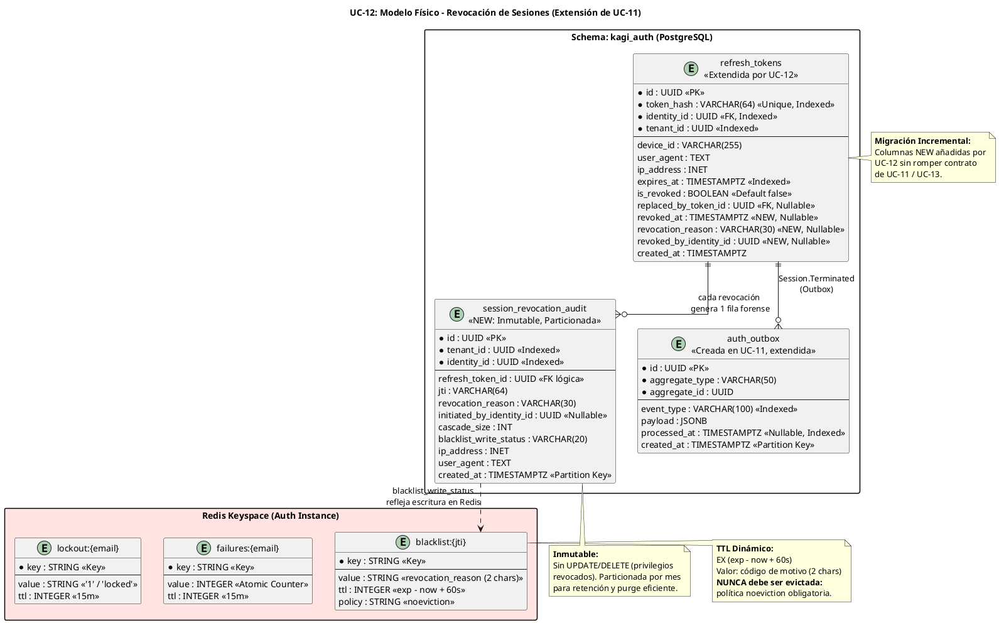

# UC-12: Cerrar Sesión (Logout) - Modelo de Datos Físico Específico (Revocation Metadata, Redis Blacklist & Forensic Audit)

| Metadatos del Documento | |
| :--- | :--- |
| **Proyecto:** | SHUGO - Identity & Access Platform |
| **Caso de Uso:** | UC-12 - Cerrar Sesión (Logout & Token Revocation) |
| **Documento:** | 10_UC_Specific_Data_Model.md |
| **Metodología:** | Physical Data Modeling + Incremental Migrations + Redis Capacity Planning + Immutable Forensic Audit |
| **Base de Datos:** | PostgreSQL 15+ (Revocation & Audit) + Redis 7+ (JTI Blacklist con política `noeviction`) |
| **Autor:** | Gastón Ruiz |
| **Versión Actual:** | 1.0.0 |
| **Fecha:** | 20/09/2026 |

---

## Historial de Versiones

| Versión | Fecha | Autor | Descripción de Cambios | Impacto |
| :--- | :--- | :--- | :--- | :--- |
| **1.0.0** | 20/09/2026 | Gastón Ruiz | **Creación inicial.** Definición del modelo de datos físico para la revocación de sesiones. Extiende la tabla `refresh_tokens` (creada en UC-11) con metadatos forenses de revocación (`revoked_at`, `revocation_reason`, `revoked_by_identity_id`) mediante migración incremental. Introduce la tabla inmutable `session_revocation_audit` particionada por tiempo, define el keyspace de Redis para la Blacklist de JTIs con TTL dinámico y política `noeviction` obligatoria, y establece estrategias de retención, limpieza y diagnóstico forense del modo Fail-Safe. | Documento de referencia para DBAs y SREs. Garantiza que la revocación de sesiones sea auditable a nivel forense (SOC 2, ISO 27001), que la Blacklist de Redis no pueda perder entradas por presión de memoria (lo que re-validaría tokens revocados), y que el Cascade Logout sea eficiente mediante índices parciales. |

---

## 1. Introducción y Propósito

Este documento define las extensiones y consideraciones físicas específicas para soportar el **UC-12 (Cerrar Sesión)**.

A diferencia del UC-11 (Login), que *creó* la tabla `refresh_tokens` y el Read Model de autenticación, el UC-12 es consumidor y mutador de ese estado: su responsabilidad física es **revocar, auditar y limpiar**. Por lo tanto, este modelo de datos se centra en:

1. **Migración Incremental de `refresh_tokens`:** El DDL original de UC-11 definía únicamente el flag booleano `is_revoked`. El Modelo de Dominio del UC-12 (docs 04/05) exige metadatos forenses (`revoked_at`, `revocation_reason`, `revoked_by_identity_id`). Este documento define la migración que alinea el esquema físico con el dominio, sin romper el contrato de UC-11 ni UC-13.
2. **Keyspace de Redis para la Blacklist de JTIs:** Definición exacta de claves, formato de valor, TTL dinámico y —críticamente— la política de memoria `noeviction`, sin la cual una entrada de Blacklist podría ser expulsada por Redis y un Access Token revocado volvería a ser aceptado.
3. **Auditoría Forense Inmutable:** Tabla `session_revocation_audit` que registra cada revocación con su motivo, iniciador, tamaño de cascade y estado de escritura en Blacklist (incluyendo los saltos por Fail-Safe).
4. **Eficiencia de Cascade Logout:** Índices parciales que permiten revocar todas las sesiones activas de una identidad sin escaneos completos.
5. **Retención y Limpieza:** Funciones de purga de tokens revocados/expirados y mantenimiento de particiones del Outbox y de la tabla de auditoría.

---

## 2. Diagrama de Modelo de Datos Físico (ERD Extendido)



---

## 3. Scripts DDL: Migraciones y Nuevas Tablas

### 3.1. Migración 1: Extensión de `refresh_tokens` con Metadatos Forenses

```sql
SET search_path TO kagi_auth;

-- =====================================================================
-- MIGRACIÓN UC-12-001: Metadatos de revocación en refresh_tokens
-- Justificación: El Modelo de Dominio (docs 04/05) exige auditar
-- CUÁNDO, POR QUÉ y POR QUIÉN se revocó cada token.
-- =====================================================================

ALTER TABLE kagi_auth.refresh_tokens
    ADD COLUMN IF NOT EXISTS revoked_at TIMESTAMPTZ,
    ADD COLUMN IF NOT EXISTS revocation_reason VARCHAR(30),
    ADD COLUMN IF NOT EXISTS revoked_by_identity_id UUID;

-- Invariante física: coherencia entre flag y metadatos de revocación
ALTER TABLE kagi_auth.refresh_tokens
    ADD CONSTRAINT chk_rt_revocation_consistency CHECK (
        (is_revoked = FALSE AND revoked_at IS NULL AND revocation_reason IS NULL)
        OR
        (is_revoked = TRUE  AND revoked_at IS NOT NULL AND revocation_reason IS NOT NULL)
    );

-- Catálogo cerrado de motivos de revocación
ALTER TABLE kagi_auth.refresh_tokens
    ADD CONSTRAINT chk_rt_revocation_reason CHECK (
        revocation_reason IS NULL OR revocation_reason IN (
            'USER_INITIATED',        -- Logout estándar del propio usuario
            'CASCADE_LOGOUT',        -- Logout Everywhere
            'ADMIN_FORCED',          -- Force Logout por administrador (UC-21)
            'SECURITY_COMPROMISE',   -- Revocación preventiva por incidente
            'REUSE_DETECTED'         -- Detección de robo de token (UC-13)
        )
    );

COMMENT ON COLUMN kagi_auth.refresh_tokens.revoked_at IS 'Timestamp UTC exacto de la revocación. NULL si el token sigue activo.';
COMMENT ON COLUMN kagi_auth.refresh_tokens.revocation_reason IS 'Motivo cerrado de revocación. Obligatorio si is_revoked = TRUE.';
COMMENT ON COLUMN kagi_auth.refresh_tokens.revoked_by_identity_id IS 'Identidad que ejecutó la revocación. NULL si fue el propio titular o el sistema.';
```

### 3.2. Migración 2: Índices para Cascade Logout y Auditoría de Revocaciones

```sql
SET search_path TO kagi_auth;

-- =====================================================================
-- MIGRACIÓN UC-12-002: Índices parciales de alta selectividad
-- =====================================================================

-- Cascade Logout: obtener todos los tokens ACTIVOS de una identidad.
-- Índice parcial: solo filas no revocadas entran al índice.
-- (El filtro expires_at > NOW() se aplica en query: NOW() no es inmutable
--  y no puede usarse en el predicado de un índice parcial.)
CREATE INDEX IF NOT EXISTS idx_rt_identity_active
    ON kagi_auth.refresh_tokens (identity_id, expires_at DESC)
    WHERE is_revoked = FALSE;

-- Auditoría: revocaciones recientes por motivo (forense / SOC 2)
CREATE INDEX IF NOT EXISTS idx_rt_revoked_recent
    ON kagi_auth.refresh_tokens (revoked_at DESC)
    WHERE is_revoked = TRUE;

-- Limpieza: candidatos a purge (revocados o expirados hace > N días)
CREATE INDEX IF NOT EXISTS idx_rt_cleanup_candidates
    ON kagi_auth.refresh_tokens (created_at)
    WHERE is_revoked = TRUE;
```

### 3.3. Tabla `session_revocation_audit` (Forense Inmutable)

```sql
SET search_path TO kagi_auth;

-- =====================================================================
-- Tabla de auditoría forense de revocaciones (UC-12)
-- Inmutable: sin UPDATE ni DELETE. Particionada por mes.
-- =====================================================================
CREATE TABLE IF NOT EXISTS session_revocation_audit (
    id UUID PRIMARY KEY DEFAULT gen_random_uuid(),
    tenant_id UUID NOT NULL,
    identity_id UUID NOT NULL,

    -- Contexto de la revocación
    refresh_token_id UUID NOT NULL,
    jti VARCHAR(64),                          -- JTI blacklisteado (NULL si no aplicaba)
    revocation_reason VARCHAR(30) NOT NULL,
    initiated_by_identity_id UUID,            -- NULL = propio titular o sistema
    cascade_size INT NOT NULL DEFAULT 1,      -- Tokens revocados en la misma operación

    -- Estado de la escritura en Redis Blacklist (visibilidad del Fail-Safe)
    blacklist_write_status VARCHAR(20) NOT NULL DEFAULT 'SUCCESS',

    -- Contexto de seguridad del request
    ip_address INET,
    user_agent TEXT,

    created_at TIMESTAMPTZ NOT NULL DEFAULT NOW(),

    CONSTRAINT chk_sra_blacklist_status CHECK (
        blacklist_write_status IN ('SUCCESS', 'FAILSAFE_SKIPPED', 'NOT_APPLICABLE')
    ),
    CONSTRAINT chk_sra_reason CHECK (
        revocation_reason IN (
            'USER_INITIATED','CASCADE_LOGOUT','ADMIN_FORCED',
            'SECURITY_COMPROMISE','REUSE_DETECTED'
        )
    ),
    CONSTRAINT chk_sra_cascade_size CHECK (cascade_size >= 1)
) PARTITION BY RANGE (created_at);

-- Particiones iniciales (ejemplo)
CREATE TABLE session_revocation_audit_2026_09 PARTITION OF session_revocation_audit
    FOR VALUES FROM ('2026-09-01') TO ('2026-10-01');
CREATE TABLE session_revocation_audit_2026_10 PARTITION OF session_revocation_audit
    FOR VALUES FROM ('2026-10-01') TO ('2026-11-01');
CREATE TABLE session_revocation_audit_default PARTITION OF session_revocation_audit DEFAULT;

-- Índices forenses
CREATE INDEX IF NOT EXISTS idx_sra_identity_time
    ON session_revocation_audit (identity_id, created_at DESC);

CREATE INDEX IF NOT EXISTS idx_sra_tenant_time
    ON session_revocation_audit (tenant_id, created_at DESC);

-- Índice crítico de operaciones: revocaciones donde la Blacklist NO se escribió
-- (seguimiento operativo del riesgo residual del Fail-Safe)
CREATE INDEX IF NOT EXISTS idx_sra_failsafe_skipped
    ON session_revocation_audit (created_at DESC)
    WHERE blacklist_write_status = 'FAILSAFE_SKIPPED';

COMMENT ON TABLE session_revocation_audit IS 'Registro forense inmutable de cada revocación de sesión. Base de evidencia para SOC 2 CC6.1 e ISO 27001 A.5.18.';
COMMENT ON COLUMN session_revocation_audit.blacklist_write_status IS 'SUCCESS: JTI escrito en Redis. FAILSAFE_SKIPPED: Redis caído, el Access Token pudo seguir vivo hasta su expiración natural. NOT_APPLICABLE: sin Access Token en el request.';
```

### 3.4. Row-Level Security y Privilegios (Inmutabilidad Forzada)

```sql
-- RLS en refresh_tokens: aislamiento por tenant
ALTER TABLE kagi_auth.refresh_tokens ENABLE ROW LEVEL SECURITY;
ALTER TABLE kagi_auth.refresh_tokens FORCE ROW LEVEL SECURITY;

CREATE POLICY rt_tenant_isolation ON kagi_auth.refresh_tokens
    FOR ALL
    USING (tenant_id = current_setting('app.current_tenant_id', true)::uuid)
    WITH CHECK (tenant_id = current_setting('app.current_tenant_id', true)::uuid);

-- RLS en session_revocation_audit: lectura por tenant, escritura solo servicio
ALTER TABLE kagi_auth.session_revocation_audit ENABLE ROW LEVEL SECURITY;
ALTER TABLE kagi_auth.session_revocation_audit FORCE ROW LEVEL SECURITY;

CREATE POLICY sra_tenant_read ON session_revocation_audit
    FOR SELECT
    USING (tenant_id = current_setting('app.current_tenant_id', true)::uuid);

CREATE POLICY sra_service_insert ON session_revocation_audit
    FOR INSERT
    WITH CHECK (
        tenant_id = current_setting('app.current_tenant_id', true)::uuid
        AND current_setting('app.service_role', true) = 'kagi_auth_service'
    );

-- INMUTABILIDAD FORZADA: el rol de aplicación no puede UPDATE/DELETE la auditoría
REVOKE UPDATE, DELETE ON kagi_auth.session_revocation_audit FROM app_kagi_auth_operations;

-- El rol de compliance puede leer todo (cross-tenant) pero nunca escribir
GRANT SELECT ON kagi_auth.session_revocation_audit TO app_compliance_admin;
```

---

## 4. Modelo de Datos en Redis (JTI Blacklist)

### 4.1. Estructura de Claves

| Patrón de Clave | Tipo | Valor | TTL | Creada por |
| :--- | :--- | :--- | :--- | :--- |
| `blacklist:{jti}` | String | Código de motivo (2 chars: `UI`, `CL`, `AF`, `SC`, `RD`) | **Dinámico:** `(exp - now) + 60s` | UC-12 (`BlacklistManager`) |
| `failures:{email}` | String (Integer) | Contador de fallos de login | 15 min | UC-11 (`LockoutManager`) |
| `lockout:{email}` | String ("1") | Flag de bloqueo | 15 min | UC-11 (`LockoutManager`) |

**Justificación del valor compacto:** El middleware de autorización solo necesita verificar **existencia** (`EXISTS blacklist:{jti}`). Almacenar un código de motivo de 2 caracteres (en lugar de JSON) reduce ~80% la memoria por entrada sin sacrificar trazabilidad operativa básica (un operador puede ver *por qué* se revocó con un `GET` puntual).

### 4.2. Requisito Crítico de Seguridad: `maxmemory-policy noeviction`

> **⚠️ PUNTO CRÍTICO:** Si Redis expulsa (evicta) una entrada de `blacklist:{jti}` por presión de memoria, **el Access Token revocado vuelve a ser aceptado por el middleware**. Esto convierte un incidente de capacidad en una vulnerabilidad de seguridad activa (Token Replay post-logout).

Por lo tanto, la instancia de Redis del motor KAGI **debe** configurarse con:

```ini
# redis.conf - Instancia Auth (KAGI)
# NO usar allkeys-lru ni volatile-lru: una entrada de blacklist
# o de lockout evictada es una vulnerabilidad de seguridad.
maxmemory-policy noeviction

# Dimensionamiento con headroom (ver sección 4.3)
maxmemory 2gb
```

**Consecuencia operativa aceptada:** Con `noeviction`, si la memoria se agota, Redis rechaza escrituras nuevas (error OOM). Esto es **preferible** a evictar entradas de seguridad: el `BlacklistManager` lo tratará como `InfrastructureException` y activará el **Fail-Safe** documentado (revocación en DB persiste, alerta crítica se emite). La seguridad base nunca se degrada silenciosamente.

### 4.3. Capacity Planning de la Blacklist

Las entradas de Blacklist son **efímeras por diseño** (TTL ≤ TTL del Access Token + 60s ≈ 16 min máx.), por lo que la memoria concurrente depende de la *tasa* de logouts, no del volumen diario acumulado.

**Cálculo:**
1. **Tamaño por entrada:** clave (`blacklist:` 10 B + JTI 36 B) + valor (2 B) + overhead interno de Redis (dictEntry, robj, SDS ≈ 70 B) ≈ **~120 bytes**.
2. **Ventana de concurrencia:** 16 minutos = 960 segundos.
3. **Escenario de pico:** 500 logouts/segundo (fin de turno enterprise).
4. **Entradas concurrentes:** 500 × 960 = **480.000 entradas**.
5. **Memoria requerida:** 480.000 × 120 B ≈ **57.6 MB**.

**Conclusión:** Incluso bajo picos extremos, la Blacklist consume < 60 MB. Una instancia de 2 GB tiene headroom de ~30x, haciendo prácticamente imposible un escenario OOM con `noeviction`. Las claves de lockout (UC-11) añaden unos pocos MB adicionales.

### 4.4. Monitoreo de Integridad de la Blacklist

| Métrica Redis | Valor Esperado | Alerta si |
| :--- | :--- | :--- |
| `redis_evicted_keys_total` | **0 (siempre)** | > 0 → **CRÍTICO**: política de memoria mal configurada. |
| `redis_memory_used_bytes / maxmemory` | < 0.5 | > 0.8 → Alta: acercándose a OOM con noeviction. |
| `redis_rejected_connections_total` | 0 | > 0 → Alta. |

---

## 5. Estrategias de Optimización y Seguridad

### 5.1. Eficiencia del Cascade Logout

El Cascade Logout (`logout_everywhere = true`) ejecuta:

```sql
-- Un solo scan indexado por identidad (índice parcial idx_rt_identity_active)
UPDATE kagi_auth.refresh_tokens
SET is_revoked = TRUE,
    revoked_at = NOW(),
    revocation_reason = 'CASCADE_LOGOUT',
    revoked_by_identity_id = :initiated_by
WHERE identity_id = :identity_id
  AND is_revoked = FALSE
  AND expires_at > NOW()
RETURNING id, replaced_by_token_id;
```

- **Índice parcial:** Solo las filas activas están indexadas, por lo que el UPDATE es un range scan acotado, no un sequential scan.
- **Límite de seguridad:** El `TokenRevoker` aplica `max_tokens_per_operation = 100` (Feature Flag) para prevenir que una identidad con miles de sesiones degeneradas sature la transacción.
- **RETURNING:** Permite al servicio conocer exactamente cuántos tokens se revocaron (`cascade_size`) y cuáles JTIs asociados deben blacklistearse, sin una segunda consulta.

### 5.2. Escritura Atómica de Revocación + Auditoría

La mutación de `refresh_tokens`, la inserción en `session_revocation_audit` y la inserción en `auth_outbox` ocurren en la **misma transacción de PostgreSQL**:

```csharp
await using var tx = await _dbContext.Database.BeginTransactionAsync(ct);

// 1. Revocación (UPDATE ... RETURNING)
var revoked = await RevokeTokensAsync(...);

// 2. Auditoría forense (INSERT)
await InsertRevocationAuditAsync(revoked, blacklistStatus, ct);

// 3. Outbox (INSERT) para Session.Terminated / TerminatedEverywhere
await InsertOutboxEventsAsync(revoked, ct);

await tx.CommitAsync(ct);
```

**Justificación:** Garantiza que no exista una revocación sin su evidencia forense ni sin su evento de propagación, incluso ante crashes del proceso.

### 5.3. Visibilidad del Riesgo Residual del Fail-Safe

Cuando el `BlacklistManager` no puede escribir en Redis, la fila de auditoría se inserta con `blacklist_write_status = 'FAILSAFE_SKIPPED'`. Esto crea una **lista operativa de riesgo residual**: JTIs que no fueron blacklisteados y cuyos Access Tokens pudieron seguir siendo válidos hasta su expiración natural.

El índice parcial `idx_sra_failsafe_skipped` hace que esta consulta sea instantánea para el equipo de operaciones y para el SOC.

---

## 6. Políticas de Retención y Limpieza

### 6.1. Limpieza de Refresh Tokens Revocados/Expirados

```sql
CREATE OR REPLACE FUNCTION kagi_auth.cleanup_revoked_tokens(p_retention_days INT DEFAULT 30)
RETURNS INT AS $$
DECLARE v_deleted INT;
BEGIN
    DELETE FROM kagi_auth.refresh_tokens
    WHERE is_revoked = TRUE
      AND revoked_at < NOW() - (p_retention_days || ' days')::INTERVAL;

    GET DIAGNOSTICS v_deleted = ROW_COUNT;

    DELETE FROM kagi_auth.refresh_tokens
    WHERE is_revoked = FALSE
      AND expires_at < NOW() - (p_retention_days || ' days')::INTERVAL;

    GET DIAGNOSTICS v_deleted = v_deleted + ROW_COUNT;
    RETURN v_deleted;
END;
$$ LANGUAGE plpgsql;

-- Programación: diaria a las 03:00
-- SELECT cron.schedule('cleanup-revoked-tokens', '0 3 * * *',
--        $$SELECT kagi_auth.cleanup_revoked_tokens(30)$$);
```

**Nota de retención:** Los tokens revocados se conservan 30 días en la tabla transaccional para soportar investigaciones de corto plazo y la lógica de *Reuse Detection* de UC-13. La evidencia de largo plazo (7 años, SOC 2) vive en `session_revocation_audit`, no en la tabla transaccional.

### 6.2. Retención de la Auditoría Forense

- **Retención:** 7 años (SOC 2 / ISO 27001), gestionada por **drop de particiones mensuales**, no por `DELETE`:

```sql
-- Ejemplo de purge de partición antigua (operación instantánea, sin bloat)
-- DROP TABLE kagi_auth.session_revocation_audit_2019_09;
```

- **Archivado previo:** Antes del drop, la partición se exporta a almacenamiento frío (S3 Glacier / Azure Archive) mediante `COPY ... TO PROGRAM` o pg_dump de tabla única.

### 6.3. Mantenimiento del Outbox

Las particiones de `auth_outbox` (creadas en UC-11) siguen la misma estrategia: eventos procesados se purgan a los 7 días; particiones completas se dropean a los 90 días.

---

## 7. Monitoreo y Diagnóstico

### 7.1. Consultas Forenses y Operativas

```sql
-- 1. Riesgo residual del Fail-Safe (últimas 24h):
--    JTIs que NO fueron blacklisteados y pudieron seguir vivos ≤ 15 min
SELECT identity_id, jti, revocation_reason, cascade_size, ip_address, created_at
FROM kagi_auth.session_revocation_audit
WHERE blacklist_write_status = 'FAILSAFE_SKIPPED'
  AND created_at > NOW() - INTERVAL '24 hours'
ORDER BY created_at DESC;

-- 2. Sesiones activas actuales de una identidad (base para UC-20 / UC-23)
SELECT id, device_id, ip_address, user_agent, expires_at, created_at
FROM kagi_auth.refresh_tokens
WHERE identity_id = :identity_id
  AND is_revoked = FALSE
  AND expires_at > NOW()
ORDER BY created_at DESC;

-- 3. Distribución de motivos de revocación (detección de incidentes)
SELECT revocation_reason, COUNT(*) AS total, SUM(cascade_size) AS tokens_revoked
FROM kagi_auth.session_revocation_audit
WHERE created_at > NOW() - INTERVAL '7 days'
GROUP BY revocation_reason
ORDER BY total DESC;

-- 4. Cascade Logouts anómalos (posible incidente de seguridad percibido)
SELECT identity_id, cascade_size, ip_address, created_at
FROM kagi_auth.session_revocation_audit
WHERE revocation_reason = 'CASCADE_LOGOUT'
  AND cascade_size > 5
  AND created_at > NOW() - INTERVAL '24 hours'
ORDER BY cascade_size DESC;

-- 5. Lag del Outbox (salud de propagación a KAGE/KIZUNA)
SELECT COUNT(*) AS pending, MIN(created_at) AS oldest_event
FROM kagi_auth.auth_outbox
WHERE processed_at IS NULL;
```

### 7.2. Métricas de Base de Datos para OpenTelemetry

```csharp
public class RevocationDatabaseMetrics
{
    private readonly Meter _meter;
    private readonly Counter<long> _revocations;
    private readonly Histogram<double> _cascadeSize;
    private readonly Counter<long> _failsafeSkips;
    private readonly Histogram<double> _revokeTxDuration;

    public RevocationDatabaseMetrics(IMeterFactory meterFactory)
    {
        _meter = meterFactory.Create("shugo.kagi.revocation.database");
        _revocations = _meter.CreateCounter<long>("revocation.tokens_revoked_total");
        _cascadeSize = _meter.CreateHistogram<double>("revocation.cascade_size", "tokens");
        _failsafeSkips = _meter.CreateCounter<long>("revocation.failsafe_skips_total");
        _revokeTxDuration = _meter.CreateHistogram<double>("revocation.transaction_duration", "ms");
    }

    public void RecordRevocation(string tenantId, string reason, int cascadeSize, string blacklistStatus, double txMs)
    {
        var tags = new TagList
        {
            { "tenant_id", tenantId },
            { "reason", reason },
            { "blacklist_status", blacklistStatus }
        };
        _revocations.Add(cascadeSize, tags);
        _cascadeSize.Record(cascadeSize, tags);
        _revokeTxDuration.Record(txMs, tags);

        if (blacklistStatus == "FAILSAFE_SKIPPED")
            _failsafeSkips.Add(1, tags);
    }
}
```

---

## 8. Trazabilidad

| Documento | Relación |
| :--- | :--- |
| `04_Initial_Domain_Model.md` | Los atributos `RevokedAt`, `RevocationReason` de la Entity `RefreshToken` se persisten en las columnas añadidas por la Migración UC-12-001. |
| `05_State_Machine_Diagram.md` | La transición `ACTIVE → REVOKED` se materializa en el UPDATE con índice parcial; la máquina efímera (`BLACKLISTED`) vive en el keyspace `blacklist:{jti}`. |
| `07_Sequence_Diagram.md` | La transacción atómica (revocación + auditoría + outbox) implementa los pasos 12b-23b del diagrama de secuencia. |
| `08_Final_Class_Design.md` | `TokenRevoker` y `BlacklistManager` son los únicos escritores de estas estructuras; `blacklist_write_status` refleja su resultado Fail-Safe. |
| `09_Modern_Artifacts.md` | Las métricas `blacklist.failures_total` y `outbox.lag_seconds` se alimentan de las columnas e índices definidos aquí. |
| `11_UC_Specific_Security_Threats.md` | La política `noeviction` y la inmutabilidad de la auditoría mitigan "Blacklist Eviction Attack" y "Audit Tampering". |
| `12_UC_Specific_Performance_Benchmarks.md` | El capacity planning de Redis (sección 4.3) y los índices parciales soportan los SLOs de latencia y las olas de logout de fin de turno. |
| `UC-11/10_UC_Specific_Data_Model.md` | Documento hermano que creó `refresh_tokens`, `auth_outbox` y el Read Model; este documento los extiende sin romper su contrato. |

---

## 9. Anexos: Glosario de Base de Datos (UC-12)

| Término | Definición en Contexto UC-12 |
| :--- | :--- |
| **Revocation Metadata** | Columnas forenses (`revoked_at`, `revocation_reason`, `revoked_by_identity_id`) que responden cuándo, por qué y por quién se revocó un token. |
| **Blacklist Eviction Attack** | Vulnerabilidad emergente si Redis evicta entradas de `blacklist:{jti}` por presión de memoria: un token revocado vuelve a ser aceptado. Mitigada con `maxmemory-policy noeviction`. |
| **Fail-Safe Skip** | Revocación donde la escritura en Redis no ocurrió (Redis caído/OOM). Queda registrada como `FAILSAFE_SKIPPED` para visibilidad del riesgo residual. |
| **Cascade Size** | Cantidad de Refresh Tokens revocados en una sola operación de Cascade Logout. Auditado por fila en `session_revocation_audit`. |
| **Partial Index** | Índice que solo incluye filas que cumplen un predicado inmutable (ej. `WHERE is_revoked = FALSE`), acelerando Cascade Logout y limpieza. |
| **Immutable Forensic Table** | Tabla sin privilegios de UPDATE/DELETE para el rol de aplicación; la evidencia solo puede añadirse, nunca alterarse (SOC 2, ISO 27001). |
| **Partition Drop Purge** | Estrategia de retención que elimina datos antiguos dropeando particiones completas en lugar de ejecutar DELETE masivos (sin bloat, instantáneo). |
| **Dynamic TTL** | Tiempo de vida de una entrada de Blacklist calculado como `(exp - now) + buffer`, garantizando autolimpieza sincronizada con la expiración natural del JWT. |

---
*Fin del Documento 10_UC_Specific_Data_Model para UC-12*