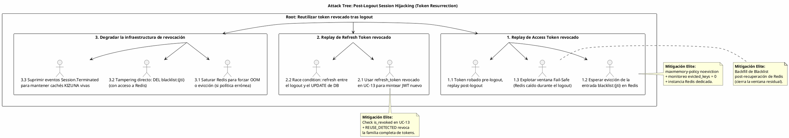

# UC-12: Cerrar Sesión (Logout) - Análisis de Amenazas Específico (Security Threat Model)

| Metadatos del Documento | |
| :--- | :--- |
| **Proyecto:** | SHUGO - Identity & Access Platform |
| **Caso de Uso:** | UC-12 - Cerrar Sesión (Logout & Token Revocation) |
| **Documento:** | 11_UC_Specific_Security_Threats.md |
| **Metodología:** | STRIDE + DREAD + Attack Trees + Defense-in-Depth + Residual Risk Management |
| **Estándares:** | NIST SP 800-63B (Session Management), OWASP ASVS 4.0 (V3.3 Session Logout), GDPR Art. 32, SOC 2 CC6.1 & CC7.2, ISO 27001:2022 A.5.18 & A.8.15 |
| **Autor:** | Gastón Ruiz |
| **Versión Actual:** | 1.0.0 |
| **Fecha:** | 20/09/2026 |

---

## Historial de Versiones

| Versión | Fecha | Autor | Descripción de Cambios | Impacto |
| :--- | :--- | :--- | :--- | :--- |
| **1.0.0** | 20/09/2026 | Gastón Ruiz | **Creación inicial.** Análisis exhaustivo de amenazas específicas para la revocación de sesiones. Evalúa 9 vectores de ataque usando STRIDE+DREAD, incluyendo Token Replay post-logout, Blacklist Eviction/Tampering en Redis, Reuse de Refresh Tokens revocados, Forced Logout CSRF, Cascade Logout Abuse, Audit Tampering, explotación de la ventana Fail-Safe, enumeración de estado de sesiones y supresión de eventos de terminación. Introduce la mitigación elite de **Backfill de Blacklist post-recuperación** para cerrar el riesgo residual del Fail-Safe. | Documento crítico de seguridad para el UC-12. Establece los controles obligatorios que garantizan que un logout sea *realmente* efectivo: que ningún token revocado pueda reutilizarse, que la evidencia forense sea inmutable, y que los modos degradados (Fail-Safe) tengan ventanas de riesgo acotadas, monitoreadas y recuperables. |

---

## 1. Introducción y Alcance

Este documento presenta el **Análisis de Amenazas Específico** para el UC-12 (Cerrar Sesión).

El logout es frecuentemente tratado como una operación trivial ("borrar la cookie"), pero en una arquitectura **Stateless JWT + Stateful Refresh Tokens**, es uno de los flujos con mayor superficie de ataque residual del sistema. La razón es estructural: **revocar un JWT emitido va contra su naturaleza matemática**. Todo el diseño del UC-12 (Blacklist de JTI, TTL dinámico, Fail-Safe) existe para cerrar esa brecha, y cada decisión introduce nuevos vectores que este documento modela:

1. **La Blacklist como nuevo punto crítico:** Si una entrada de `blacklist:{jti}` desaparece (evicción, tampering, caída de Redis), un token revocado **resucita**.
2. **La ventana Fail-Safe como riesgo residual aceptado:** Cuando Redis cae durante un logout, el Access Token vive hasta su expiración natural (≤15 min). Esa ventana es explotable y debe ser acotada, monitoreada y **recuperable**.
3. **El logout como arma:** Un endpoint de logout mal protegido permite ataques de DoS contra sesiones (Forced Logout CSRF), acoso mediante Cascade Logout, o enumeración de estado de tokens.
4. **La auditoría como objetivo:** Un atacante con acceso interno puede intentar borrar la evidencia de sus propias revocaciones o logouts maliciosos.

Este documento modela estos vectores y define las mitigaciones de nivel enterprise que SHUGO implementa nativamente en el motor KAGI.

---

## 2. Attack Trees (Árboles de Ataque)

### 2.1. Attack Tree #1: Post-Logout Session Hijacking (Resurrección de Tokens)

**Objetivo del Atacante:** Reutilizar un Access Token o Refresh Token que ya fue revocado por un logout legítimo.



### 2.2. Attack Tree #2: Weaponizing the Logout Endpoint

**Objetivo del Atacante:** Usar el propio endpoint de logout como arma contra usuarios legítimos o como fuente de información.

```text
[Root: Armar el endpoint de logout contra usuarios o el sistema]
  |
  +-- [1. Forced Logout (Session DoS)]
  |     +-- 1.1. CSRF: img/src o fetch cross-origin a /auth/logout con cookies de sesión.
  |     |        (Mitigado: Logout exige Bearer header; cookies SameSite=Strict; CSRF token si aplica).
  |     +-- 1.2. Automatización: script que loguea y desloguea a la víctima en bucle.
  |            (Mitigado: Rate Limiting por identidad en API Gateway).
  |
  +-- [2. Cascade Logout Abuse]
  |     +-- 2.1. Con sesión robada, invocar logout_everywhere en bucle para acosar al titular.
  |     |        (Mitigado: Rate limit de 3 cascades/hora por identidad + auditoría forense).
  |     +-- 2.2. Admin malicioso revoca sesiones masivamente sin justificación.
  |            (Mitigado: permiso explícito session:force_logout + auditoría inmutable con initiated_by).
  |
  +-- [3. Session State Enumeration]
        +-- 3.1. Probar tokens robados contra /auth/logout y observar diferencias de respuesta.
        |        (Mitigado: Zero Info Leakage — siempre HTTP 204, sin cuerpo ni headers diferenciales).
        +-- 3.2. Medir latencia para distinguir "revocado" (early-exit) de "activo" (revocación completa).
               (Mitigado: camino de procesamiento de tiempo constante para tokens inválidos/revocados).
```

### 2.3. Attack Tree #3: Repudiation & Audit Tampering

**Objetivo del Atacante:** Negar o borrar la evidencia de revocaciones y logouts maliciosos.

```text
[Root: Eliminar o alterar evidencia forense de revocación]
  |
  +-- [1. Tampering directo en DB]
  |     +-- 1.1. UPDATE/DELETE en session_revocation_audit.
  |     |        (Mitigado: REVOKE UPDATE, DELETE al rol de aplicación; RLS; inmutabilidad forzada).
  |     +-- 1.2. Modificar revoked_at/reason en refresh_tokens para ocultar línea de tiempo.
  |            (Mitigado: CHECK constraints de coherencia + auditoría cruzada con outbox).
  |
  +-- [2. Destrucción de particiones]
  |     +-- 2.1. DROP TABLE de particiones antiguas de auditoría antes del plazo legal.
  |            (Mitigado: DROP restringido al rol compliance_admin + archivado previo a WORM/S3 Object Lock).
  |
  +-- [3. Supresión de eventos]
        +-- 3.1. Impedir la publicación de Session.Terminated para que KAGE no registre el logout.
               (Mitigado: Outbox en la MISMA transacción que la revocación; lag monitoreado; replay de outbox).
```

---

## 3. Matriz de Amenazas Específicas (STRIDE + DREAD)

| ID | Amenaza | Categoría STRIDE | D | R | E | A | D | Score | Nivel |
| :--- | :--- | :--- | :---: | :---: | :---: | :---: | :---: | :---: | :---: |
| **T-79** | **Token Replay post-logout (Access Token revocado)** | Spoofing | 10 | 8 | 7 | 9 | 6 | **8.0** | 🔴 |
| **T-80** | **Blacklist Eviction / Tampering en Redis** | Tampering | 10 | 4 | 3 | 9 | 3 | **5.8** | 🟡 |
| **T-81** | **Reuse de Refresh Token revocado (bypass de rotación)** | Spoofing | 9 | 8 | 7 | 8 | 5 | **7.4** | 🟠 |
| **T-82** | **Forced Logout vía CSRF (Session DoS)** | DoS / Tampering | 5 | 8 | 7 | 6 | 6 | **6.4** | 🟠 |
| **T-83** | **Cascade Logout Abuse (acoso / self-DoS masivo)** | DoS | 6 | 7 | 6 | 5 | 5 | **5.8** | 🟡 |
| **T-84** | **Audit Tampering / Repudiación de revocaciones** | Repudiation | 8 | 4 | 3 | 7 | 3 | **5.0** | 🟡 |
| **T-85** | **Explotación de la Ventana Fail-Safe (Redis caído)** | Spoofing | 8 | 5 | 4 | 7 | 4 | **5.6** | 🟡 |
| **T-86** | **Enumeración de Estado de Sesiones vía Logout** | Information Disclosure | 6 | 8 | 7 | 7 | 7 | **7.0** | 🟠 |
| **T-87** | **Supresión de Eventos de Terminación (cachés KIZUNA obsoletas)** | Tampering | 8 | 4 | 4 | 8 | 3 | **5.4** | 🟡 |

---

## 4. Análisis Detallado de Amenazas Críticas y Mitigaciones

### 4.1. 🔴 T-79: Token Replay post-logout (Access Token Revocado)

**Descripción:** Un atacante roba un Access Token válido (XSS, proxy malicioso, malware) *antes* de que la víctima haga logout. Tras el logout, la víctima cree que su sesión está muerta, pero el atacante intenta reutilizar el token robado.

**Escenario de Ataque:**
```bash
# Atacante replayea un JWT cuyo JTI ya fue blacklisteado por el logout de la víctima
curl -X GET https://api.shugo.io/v1/identities/me \
  -H "Authorization: Bearer <jwt_robado_pre_logout>"
# Expectativa del atacante: 200 OK. Expectativa de SHUGO: 401 Unauthorized.
```

**Mitigaciones Implementadas:**

1. **Verificación de Blacklist en el Middleware de Autorización (Fail-Configurable):**
```csharp
public class JtiBlacklistMiddleware
{
    public async Task InvokeAsync(HttpContext context, IDistributedCache cache, ILogger<JtiBlacklistMiddleware> logger)
    {
        var jti = context.User.FindFirst("jti")?.Value;
        if (string.IsNullOrEmpty(jti))
        {
            context.Response.StatusCode = 401;
            return;
        }

        try
        {
            var isBlacklisted = await cache.GetStringAsync($"blacklist:{jti}", context.RequestAborted);
            if (isBlacklisted != null)
            {
                // Token revocado: rechazo inmediato
                context.Response.StatusCode = 401;
                context.Response.Headers["WWW-Authenticate"] = "Bearer error=\"invalid_token\", error_description=\"revoked\"";
                return;
            }
        }
        catch (Exception ex) when (ex is RedisConnectionException or RedisTimeoutException)
        {
            // DECISIÓN DE DISEÑO DOCUMENTADA:
            // Modo default "open": ante Redis caído en VALIDACIÓN, se acepta el token
            // (riesgo acotado al TTL ≤15min) para no causar outage total de la plataforma.
            // Tenants enterprise pueden configurar fail_mode=closed (rechazo total).
            var failMode = _tenantPolicy.GetBlacklistFailMode(context);
            logger.LogCritical(ex, "Blacklist unavailable during validation. FailMode={FailMode}", failMode);

            if (failMode == BlacklistFailMode.Closed)
            {
                context.Response.StatusCode = 401;
                return;
            }
            // fail_mode=open: continuar (riesgo residual monitoreado)
        }

        await _next(context);
    }
}
```

2. **TTL de Access Token Corto (15 min):** Acota matemáticamente la ventana de replay incluso en el peor caso.
3. **Backfill de Blacklist post-recuperación (ver T-85):** Cierra la ventana Fail-Safe retroactivamente.

**Justificación:**
- **Defensa proporcionada:** El replay de un token revocado es la amenaza central del logout (D=10). La Blacklist es la única barrera; por eso su integridad (T-80) y disponibilidad (T-85) son amenazas de primer orden.
- **Fail-Configurable:** Documentar explícitamente el trade-off fail-open/fail-closed en *validación* (no en revocación) es una decisión arquitectónica consciente, no un accidente.

### 4.2. 🟡 T-80: Blacklist Eviction / Tampering en Redis

**Descripción:** Dos sub-ataques: (a) Redis evicta entradas `blacklist:{jti}` por presión de memoria (si la política fuera LRU), resucitando tokens revocados; (b) un atacante con acceso a Redis ejecuta `DEL blacklist:{jti}` o `FLUSHDB`.

**Mitigaciones Implementadas:**

1. **Política `noeviction` Obligatoria (definida en Doc 10):**
```ini
# redis.conf - Instancia Auth (KAGI)
maxmemory-policy noeviction
maxmemory 2gb
```

2. **Monitoreo de Integridad (evicted_keys debe ser SIEMPRE 0):**
```yaml
# Prometheus Alert
- alert: RedisBlacklistEvictionDetected
  expr: increase(redis_evicted_keys_total{instance=~"redis-auth.*"}[5m]) > 0
  for: 0m
  labels:
    severity: critical
  annotations:
    summary: "Entradas de seguridad evictadas de Redis Auth. Tokens revocados pueden resucitar."
    runbook: "Verificar maxmemory-policy=noeviction inmediatamente. Rotar claves de firma JWT si la evicción fue sostenida."
```

3. **Endurecimiento de Acceso a Redis:**
```yaml
# Kubernetes NetworkPolicy: solo pods de KAGI tocan Redis Auth
apiVersion: networking.k8s.io/v1
kind: NetworkPolicy
metadata:
  name: redis-auth-access
spec:
  podSelector:
    matchLabels: { app: redis-auth }
  ingress:
    - from:
        - podSelector: { matchLabels: { app: kagi-auth } }
      ports: [{ port: 6379 }]
```
```ini
# redis.conf
requirepass ${REDIS_AUTH_PASSWORD}
rename-command FLUSHDB ""
rename-command FLUSHALL ""
rename-command CONFIG ""
rename-command DEBUG ""
# ACLs: el usuario de KAGI solo puede GET/SET/EXISTS/SET EX sobre prefijos autorizados
user kagi_auth on >${PASSWORD} ~blacklist:* ~failures:* ~lockout:* +get +set +exists +del +incr +expire
```

**Justificación:** Una entrada de Blacklist evictada o borrada convierte un incidente de capacidad o un acceso indebido a Redis en una **vulnerabilidad de autenticación activa**. La combinación noeviction + ACLs + NetworkPolicy + alerta de evicción convierte esta amenaza en detectable y prevenible.

### 4.3. 🟠 T-81: Reuse de Refresh Token Revocado (Bypass de Rotación)

**Descripción:** El atacante roba un Refresh Token y, tras el logout de la víctima, intenta usarlo en UC-13 para mintear Access Tokens nuevos indefinidamente.

**Mitigaciones Implementadas:**

1. **Check de Revocación en UC-13 (Consumer-Side Validation):**
```csharp
public async Task<TokenPair> RefreshAsync(RefreshCommand command, CancellationToken ct)
{
    var tokenHash = Hash(command.RefreshToken);
    var token = await _repo.GetByHashAsync(tokenHash, ct);

    // Guarda 1: existencia
    if (token == null) throw new InvalidGrantException("invalid_grant");

    // Guarda 2: revocación explícita (UC-12)
    if (token.IsRevoked)
    {
        // Detección de robo: un token revocado NUNCA debería presentarse de nuevo.
        // Revocación de la familia completa (chain) como contención.
        await _familyRevoker.RevokeFamilyAsync(token.IdentityId, TokenRevocationReason.REUSE_DETECTED, ct);
        _logger.LogCritical("Refresh token reuse detected for identity {IdentityId}. Family revoked.", token.IdentityId);
        throw new InvalidGrantException("invalid_grant");
    }

    // Guarda 3: expiración
    if (token.IsExpired) throw new InvalidGrantException("invalid_grant");

    // ... rotación normal (UC-13) ...
}
```

2. **Auditoría del Motivo `REUSE_DETECTED`:** Cada detección genera una fila en `session_revocation_audit` con motivo `REUSE_DETECTED`, alimentando alertas de SIEM de posible robo de sesión.

**Justificación:** El reuse de un token revocado es una **señal de compromiso confirmado** (el token legítimo ya fue rotado o revocado). Tratarlo como simple error 400 desperdiciaría inteligencia de seguridad; SHUGO lo convierte en un evento de contención (revocación de familia) y alerta.

### 4.4. 🟠 T-82: Forced Logout vía CSRF (Session DoS)

**Descripción:** Un atacante induce al navegador de la víctima a enviar requests de logout (ej. `` o un `fetch` cross-origin), cerrando sus sesiones repetidamente (nuisance DoS) o interrumpiendo operaciones críticas (ej. una transferencia en curso).

**Mitigaciones Implementadas:**

1. **Logout Exige Bearer Header (No Cookies Solas):**
```csharp
// El endpoint NO acepta la sesión desde cookies para la revocación del refresh token.
// El refresh_token viaja en el BODY y el access_token en el header Authorization.
// Un  o form cross-origin no puede adjuntar headers Bearer ni leer el body requerido.
if (string.IsNullOrWhiteSpace(command.RefreshToken))
    return BadRequest(new ErrorResponse("INVALID_REQUEST", "Refresh token is required in the request body."));
```

2. **Cookies de Sesión (si existen para SPA) con SameSite=Strict + CSRF Token:**
```csharp
services.AddAntiforgery(options =>
{
    options.Cookie.SameSite = SameSiteMode.Strict;
    options.Cookie.HttpOnly = true;
    options.Cookie.SecurePolicy = CookieSecurePolicy.Always;
});
```

3. **Rate Limiting por Identidad en el Endpoint de Logout:**
```yaml
# API Gateway
rate_limiting:
  endpoint: /v1/auth/logout
  key: identity_id   # no solo IP: protege contra bucles automatizados por usuario
  limit: 30
  window: 300s
```

**Justificación:** El logout es idempotente y "silencioso" (204), lo que lo hace atractivo para abuso CSRF: el atacante no necesita leer la respuesta. Exigir el refresh_token en el body y el Bearer en el header elimina la vectores CSRF clásicos de raíz.

### 4.5. 🟡 T-85: Explotación de la Ventana Fail-Safe (Redis Caído)

**Descripción:** Un atacante sofisticado monitorea la salud de Redis (status pages públicas, latencia observable) y, al detectar una caída, ejecuta logouts maliciosos o aprovecha que los logouts legítimos durante la ventana no blacklistean JTIs. Los Access Tokens revocados en esa ventana siguen vivos ≤15 min.

**Mitigaciones Implementadas:**

1. **Backfill de Blacklist Post-Recuperación (Mitigación Elite):**
Al detectarse la recuperación de Redis (Circuit Breaker → CLOSED), un job de reconciliación cierra la ventana retroactivamente:
```csharp
public class BlacklistReconciliationJob : BackgroundService
{
    protected override async Task ExecuteAsync(CancellationToken stoppingToken)
    {
        // Se dispara cuando el Circuit Breaker de Redis transiciona a CLOSED
        await foreach (var trigger in _circuitMonitor.OnRedisRecovered(stoppingToken))
        {
            // JTIs no blacklisteados en los últimos 20 min (ventana máx: 15 min TTL + margen)
            var skipped = await _auditRepo.GetFailsafeSkippedAsync(
                since: DateTime.UtcNow.AddMinutes(-20), stoppingToken);

            foreach (var entry in skipped)
            {
                if (entry.Jti is null || entry.JwtExpiration <= DateTime.UtcNow) continue;

                var ttl = entry.JwtExpiration - DateTime.UtcNow + TimeSpan.FromMinutes(1);
                await _blacklistManager.AddToBlacklistAsync(new BlacklistEntry(entry.Jti, entry.JwtExpiration, ttl), stoppingToken);
            }

            _logger.LogInformation("Blacklist reconciliation completed: {Count} JTIs backfilled.", skipped.Count);
        }
    }
}
```
```sql
-- Consulta base del job de reconciliación (usa el índice parcial idx_sra_failsafe_skipped)
SELECT jti, created_at, identity_id
FROM kagi_auth.session_revocation_audit
WHERE blacklist_write_status = 'FAILSAFE_SKIPPED'
  AND created_at > NOW() - INTERVAL '20 minutes';
```

2. **Alerta Inmediata de Riesgo Residual:**
```yaml
- alert: FailSafeWindowOpen
  expr: rate(kagi.auth.blacklist.failures_total[2m]) > 0
  for: 1m
  labels: { severity: critical }
  annotations:
    summary: "Ventana Fail-Safe abierta: JTIs revocados sin blacklistear."
    runbook: "El job de reconciliación cerrará la ventana al recuperar Redis. Si la caída supera 15 min, el riesgo residual expira naturalmente."
```

3. **Modo Estricto Opcional por Tenant:** `kagi.auth.logout.failsafe_mode = strict` convierte el Fail-Safe en Fail-Secure (503) para tenants con requisitos regulatorios que prefieren indisponibilidad sobre riesgo residual.

**Justificación:** El Fail-Safe es una decisión correcta de disponibilidad, pero **un riesgo residual no documentado ni recuperable es una deuda de seguridad**. El backfill convierte la ventana de 15 minutos en una ventana de *minutos hasta la recuperación de Redis*, y la alerta la hace visible para el SOC en tiempo real.

### 4.6. 🟠 T-86: Enumeración de Estado de Sesiones vía Logout

**Descripción:** Un atacante con un token de origen dudoso lo envía a `/auth/logout` y observa la respuesta para determinar si el token estaba activo, revocado o era basura — información útil para priorizar ataques.

**Mitigaciones Implementadas:**

1. **Respuesta Constante HTTP 204 (Zero Info Leakage):** Definida en el contrato OpenAPI (Doc 09) e implementada en `LogoutHandler` (Doc 08): todos los caminos de negocio retornan 204 sin cuerpo.
2. **Camino de Tiempo Constante para Tokens Inválidos:**
```csharp
// En LogoutHandler: si el token no existe o ya está revocado,
// se ejecuta un "dummy revoke path" (hash + lookup Redis) para igualar latencia.
if (result is RevocationResult.InvalidToken or RevocationResult.IdempotentSuccess)
{
    await _timingNormalizer.ConsumeConstantTimeAsync(ct); // alinea p50/p95 con el camino feliz
}
return new NoContentResult();
```
3. **Headers Idénticos:** `Cache-Control: no-store` y `Pragma: no-cache` se emiten en **todos** los 204, sin headers condicionales que filtren estado.

**Justificación:** La idempotencia del logout no es solo una comodidad de cliente: es un control anti-enumeración. Sin normalización de latencia, un atacante con instrumentos de medición podría distinguir caminos por timing (side-channel), igual que en el login (UC-11).

### 4.7. 🟡 T-84: Audit Tampering / Repudiación de Revocaciones

**Descripción:** Un atacante con credenciales de DB comprometidas (o un insider malicioso) intenta borrar o alterar filas de `session_revocation_audit` o los metadatos de `refresh_tokens` para negar que una revocación ocurrió (repudiación) u ocultar un Cascade Logout malicioso.

**Mitigaciones Implementadas:**

1. **Inmutabilidad Forzada por Privilegios (Doc 10):**
```sql
REVOKE UPDATE, DELETE ON kagi_auth.session_revocation_audit FROM app_kagi_auth_operations;
-- Solo INSERT para el servicio; SELECT para tenant y compliance.
```
2. **Archivado WORM Previo al Drop de Particiones:**
```yaml
# Política S3 Object Lock para archivos de auditoría exportados
s3_bucket: shugo-compliance-archive
object_lock:
  mode: COMPLIANCE
  retain_days: 2555   # 7 años
```
3. **Detección de Anomalías de Acceso a DB:**
```yaml
- alert: PrivilegedDbAccessToAuditTables
  expr: increase(pg_stat_user_tables_seq_scan{table="session_revocation_audit"}[10m]) > 0
    and ON() (time() - process_start_time_seconds{job="postgres-exporter"} < 86400)
  labels: { severity: high }
  annotations:
    summary: "Acceso no habitual a tablas de auditoría de revocación. Verificar si es un job de compliance legítimo."
```

**Justificación:** La auditoría de revocación es la **evidencia primaria** para responder "¿quién cerró esta sesión y cuándo?" en un incidente. Su inmutabilidad debe garantizarse en la capa de privilegios de la base de datos, no por convención de la aplicación.

### 4.8. 🟡 T-87: Supresión de Eventos de Terminación (Cachés KIZUNA Obsoletas)

**Descripción:** Si el evento `Session.Terminated` no llega a KIZUNA, las cachés de autorización asociadas a la sesión pueden seguir sirviendo permisos tras el logout, creando una ventana de acceso indebido.

**Mitigaciones Implementadas:**

1. **Outbox en la Misma Transacción que la Revocación (Doc 10, §5.2):** Imposible revocar sin encolar el evento.
2. **TTL de Caché KIZUNA ≤ TTL del Access Token:** Incluso sin evento, la caché de autorización expira antes que el token que la originó (defensa por doble acotación temporal).
3. **Monitoreo de Lag del Outbox (Doc 09):** Alerta crítica si `outbox.lag_seconds > 300`, con replay automático de eventos pendientes.

**Justificación:** La propagación asíncrona es necesaria para no bloquear el logout, pero introduce consistencia eventual. Acotar temporalmente las cachés downstream convierte un fallo de propagación en una ventana finita y conocida, no indefinida.

---

## 5. Compliance y Auditoría (SOC 2 / ISO 27001 / GDPR / NIST / OWASP)

### 5.1. NIST SP 800-63B (Session Management)
*   **Requisito:** El verificador debe permitir al suscriptor terminar sus sesiones activas.
*   **Implementación UC-12:** Revocación inmediata de Refresh Tokens + Blacklist de JTIs + Cascade Logout para terminación masiva.

### 5.2. OWASP ASVS 4.0 - V3.3 (Session Logout and Timeout)
*   **Requisito 3.3.1:** Las sesiones deben invalidarse en el servidor al hacer logout.
*   **Implementación UC-12:** Revocación dual (DB + Redis) con verificación en middleware y en UC-13.

### 5.3. SOC 2 Type II - CC6.1 & CC7.2
*   **Requisito:** El acceso lógico debe terminar cuando ya no es autorizado; los eventos de seguridad deben monitorearse.
*   **Implementación UC-12:** `session_revocation_audit` inmutable (evidencia CC6.1) + alertas de Fail-Safe, evicción y reuse detection (CC7.2).

### 5.4. ISO 27001:2022 - A.5.18 & A.8.15
*   **Requisito:** Retiro de derechos de acceso; logging protegido contra tampering.
*   **Implementación UC-12:** Motivos de revocación cerrados y auditados; tabla forense sin privilegios de UPDATE/DELETE; archivado WORM.

### 5.5. GDPR - Art. 32 (Security of Processing)
*   **Requisito:** Medidas técnicas para garantizar confidencialidad e integridad continuas.
*   **Implementación UC-12:** Backfill de Blacklist (integridad continua de la revocación), noeviction (integridad de caché), y Fail-Safe documentado con riesgo residual acotado.

---

## 6. Trazabilidad

| Documento | Relación |
| :--- | :--- |
| `01_Requirements_Specification.md` | Las invariantes INV-77 a INV-81 y la regla RN-20 (Fail-Safe) se mitigan y monitorean aquí. |
| `08_Final_Class_Design.md` | `LogoutHandler`, `TokenRevoker`, `ResilientBlacklistManager` y `JtiBlacklistMiddleware` implementan las mitigaciones de T-79, T-82, T-85 y T-86. |
| `09_Modern_Artifacts.md` | Las métricas `blacklist.failures_total`, `circuit_breaker_state` y las alertas de Fail-Safe/Cascade detectan T-85 y T-83 en producción. |
| `10_UC_Specific_Data_Model.md` | La política `noeviction`, la inmutabilidad de `session_revocation_audit` y el índice `idx_sra_failsafe_skipped` son la base física de las mitigaciones de T-80, T-84 y T-85. |
| `12_UC_Specific_Performance_Benchmarks.md` | Los tests de Chaos Engineering (caída de Redis) validan que T-85 mantiene su ventana acotada bajo fuego. |
| `UC-13/01_Requirements_Specification.md` | La detección de reuse (T-81) y la revocación de familia se especifican conjuntamente entre UC-12 y UC-13. |
| `UC-21_Force_Logout` | El motivo `ADMIN_FORCED` y el permiso `session:force_logout` mitigan el abuso de T-83 por insiders. |

---

## 7. Anexos: Configuración de Seguridad Adicional

### 7.1. Reglas de WAF para el Endpoint de Logout

```yaml
Rules:
  - Name: LogoutRequiresBearerHeader
    Priority: 1
    Action: Block
    Statement:
      NotStatement:
        Statement:
          ByteMatchStatement:
            FieldToMatch:
              SingleHeader: { Name: Authorization }
            SearchString: "Bearer "
            PositionalConstraint: STARTS_WITH
    # Bloquea intents CSRF vía /<form>: sin header Bearer no hay logout.

  - Name: CascadeLogoutRateLimit
    Priority: 2
    Action: Block
    Statement:
      RateBasedStatement:
        Limit: 3
        AggregateKeyType: CUSTOM_KEYS
        CustomKeys:
          - Header: { Name: "X-Identity-Id" }
        ScopeDownStatement:
          ByteMatchStatement:
            FieldToMatch: Body
            SearchString: "\"logout_everywhere\":true"
            PositionalConstraint: CONTAINS
```

### 7.2. Alertas de SIEM para UC-12

```json
[
  {
    "alert_name": "RefreshTokenReuseDetected",
    "condition": "count(Authentication events with reason=REUSE_DETECTED) >= 1",
    "severity": "Critical",
    "action": "Token theft confirmado. Notificar al usuario, forzar MFA re-enrollment y revisar IP/device del reuse."
  },
  {
    "alert_name": "CascadeLogoutAnomaly",
    "condition": "count(Session.TerminatedEverywhere) > 3x baseline por tenant en 10 min",
    "severity": "High",
    "action": "Posible incidente percibido por usuarios o acoso. Correlacionar con alertas de credential stuffing y brechas."
  },
  {
    "alert_name": "BlacklistIntegrityViolation",
    "condition": "redis_evicted_keys_total{db=auth} > 0 OR unexpected DEL commands on blacklist:* prefix",
    "severity": "Critical",
    "action": "Tokens revocados pueden resucitar. Rotar claves de firma JWT y auditar acceso a Redis inmediatamente."
  }
]
```

---
*Fin del Documento 11_UC_Specific_Security_Threats para UC-12*