# UC-13: Renovar Sesión (Refresh Token) - Diagrama de Caso de Uso

| Metadatos del Documento | |
| :--- | :--- |
| **Proyecto:** | SHUGO - Identity & Access Platform |
| **Caso de Uso:** | UC-13 - Renovar Sesión (Refresh Token Rotation & Reuse Detection) |
| **Documento:** | 02_Use_Case_Diagram.md |
| **Metodología:** | UML 2.5 + ICONIX + DDD + Security by Design (Token Family Chain Validation) |
| **Autor:** | Gastón Ruiz |
| **Versión Actual:** | 1.0.0 |
| **Fecha:** | 20/09/2026 |

---

## Historial de Versiones

| Versión | Fecha | Autor | Descripción de Cambios | Impacto |
| :--- | :--- | :--- | :--- | :--- |
| **1.0.0** | 20/09/2026 | Gastón Ruiz | **Creación inicial.** Diagrama de Caso de Uso UML para UC-13. Modela la renovación de sesión como un proceso de **rotación de familia de tokens** con tres caminos mutuamente excluyentes: Rotación Estándar, Rotación Idempotente (Grace Window) y Detección de Reuso con Revocación de Familia. Introduce las validaciones obligatorias de cadena (`<<include>>`), el hook de riesgo contextual y el step-up de MFA (`<<extend>>`), y las integraciones con KAGAMI (lock de fila), Redis (Grace Cache cifrada + Blacklist de JTIs) y el Notification Service. | Documento base del paquete de diseño Tier 1 del UC-13. Establece las fronteras del sistema y demuestra cómo la rotación convierte el robo de un refresh token en un evento detectable con contención automática, sin sacrificar la concurrencia legítima multi-tab. |

---

## 1. Diagrama de Caso de Uso (PlantUML)

A continuación, se presenta el Diagrama de Casos de Uso UML para el UC-13. Este diagrama modela la renovación no como un "refresh" trivial, sino como una **operación de cadena con tres destinos posibles**: rotar, responder idempotentemente, o contener un compromiso confirmado.

```plantuml
@startuml UC-13_CasoDeUso
<style>
diagram {
  BackgroundColor #FFFFFF
}
</style>
top to bottom direction
skinparam packageStyle rectangle
skinparam actorStyle awesome
skinparam usecaseBackgroundColor #E3F2FD
skinparam usecaseBorderColor #1565C0
skinparam actorBorderColor #2E7D32
skinparam rectangleBackgroundColor #FFF3E0
skinparam rectangleBorderColor #E65100

title UC-13: Renovar Sesión - Motor KAGI (Token Family Rotation & Reuse Detection)

' ============================================
' ACTORES PRIMARIOS
' ============================================
actor "Cliente\n(SPA / Mobile App)" as Client

' ============================================
' ACTORES SECUNDARIOS (SISTEMAS)
' ============================================
actor "API Gateway\n(Rate Limiting)" as GW
actor "KAGAMI\n(Token Store DB)" as DB
actor "Redis\n(Grace Cache + Blacklist)" as Redis
actor "UC-17\nRisk Engine" as Risk
actor "UC-15\nMFA" as MFA
actor "KAGE\n(Audit / Outbox)" as KAGE
actor "Notification\nService" as Notif

' ============================================
' SISTEMA PRINCIPAL: KAGI REFRESH CORE
' ============================================
rectangle "SHUGO - Motor KAGI (Refresh Core)" as KAGI {
  usecase "UC-13a: Renovar Sesión\n(Rotación Estándar)" as UC13a
  usecase "UC-13b: Rotación Idempotente\n(Grace Window 60s)" as UC13b
  usecase "UC-13c: Detección de Reuso y\nRevocación de Familia" as UC13c
  usecase "UC-13d: Emitir Par de Tokens\n(JWT 15min + Sucesor Opaco)" as UC13d
  usecase "UC-13e: Evaluar Delta de\nContexto (Risk Hook)" as UC13e

  usecase "UC-V1: Validar Cadena de Familia\n(existe, no revocado, no expirado,\nvida absoluta ≤ 30d)" as UCV1
  usecase "UC-V2: Blacklistear JTIs de\nFamilia (issued_jti)" as UCV2
  usecase "UC-V3: Notificar al Usuario\n(alerta de seguridad)" as UCV3
}

' ============================================
' RELACIONES DE INICIO
' ============================================
Client --> GW : 1. POST /auth/refresh\n{ refresh_token }
GW --> UC13a : 2. Forward request\n(After Rate Limit por identidad)

' ============================================
' RELACIONES <<include>> (OBLIGATORIAS)
' ============================================
' Toda renovación DEBE validar la cadena antes de tocar cualquier estado
UC13a ..> UCV1 : <<include>>\n(SELECT ... FOR UPDATE\nlock de fila anti-bifurcación)

' Toda rotación exitosa DEBE emitir el par nuevo
UC13a ..> UC13d : <<include>>\n(INSERT sucesor +\nUPDATE presentado = ROTATED)

' Toda renovación DEBA auditarse vía Outbox
UC13a ..> KAGE : <<include>>\n(Session.Refreshed)

' La contención por reuso DEBE blacklistear JTIs y notificar
UC13c ..> UCV2 : <<include>>\n(SET blacklist:{jti}\nEX ttl_residual)
UC13c ..> UCV3 : <<include>>\n(email/push con contexto\nIP, geo, tiempo)

' ============================================
' RELACIONES <<extend>> (CONDICIONALES)
' ============================================
' Token presentado ya ROTADO pero dentro de la ventana de 60s
UC13b .up.> UC13a : <<extend>>\n(Grace Window vigente:\nresponde con el sucesor\nexistente, SIN bifurcar)

' Token presentado ROTADO fuera de la ventana: compromiso confirmado
UC13c .up.> UC13a : <<extend>>\n(Reuse Detection:\nrevoca familia completa\nmotivo REUSE_DETECTED)

' Política de contexto del tenant habilitada
UC13e .up.> UC13a : <<extend>>\n(delta IP/UA/geo →\nscore UC-17)

' Frescura de MFA expirada o score de riesgo alto
MFA .up.> UC13a : <<extend>>\n(step-up: retorna\nmfa_required, NUNCA\neleva auth_level)

' ============================================
' RELACIONES CON ACTORES SECUNDARIOS
' ============================================
UCV1 --> DB : Consultar fila + familia\n(family_root_id, generation,\nabsolute_expires_at)
UC13b --> Redis : GET rotgrace:{hash}\n(decrypt AES-256-GCM)
UC13d --> DB : Transacción de rotación\n(commit atómico)
UC13c --> DB : UPDATE familia = REVOKED\n(REUSE_DETECTED)
UCV2 --> Redis : Escritura de JTIs\nen Blacklist
UC13e --> Risk : Evaluar score\n(delta de contexto)
UCV3 --> Notif : Dispatch de alerta\nal titular

' ============================================
' NOTAS EXPLICATIVAS
' ============================================
note right of UC13b
  **Grace Window (INV-84):**
  Cache efímera cifrada
  rotgrace:{hash} → AES-GCM(sucesor)
  TTL = 60s. Absorbe concurrencia
  multi-tab sin bifurcar la cadena
  y sin ampliar superficie de ataque.
end note

note left of UC13c
  **Contención (INV-83):**
  Reuso fuera de ventana =
  robo confirmado. Se revoca
  family_root_id completo y se
  blacklistean issued_jti vivos.
end note

note bottom of UCV1
  **Guardas de Cadena:**
  1. Existe (hash único)
  2. No REVOKED
  3. No expirado (sliding)
  4. absolute_expires_at > NOW()
  Fallo → invalid_grant genérico
  (Zero Info Leakage, RN-25).
end note

note right of UC13d
  **Preservación (INV-88):**
  El JWT sucesor hereda
  auth_level y amr.
  sid = family_root_id.
  La renovación NUNCA eleva
  privilegios.
end note

@enduml
```

---

## 2. Explicación del Diagrama

### 2.1. Límite del Sistema (System Boundary)

El diagrama identifica **dos límites claramente diferenciados**:

1. **Motor KAGI - Refresh Core (UC-13):** El sistema principal que orquesta la rotación. Contiene los tres caminos mutuamente excluyentes (UC-13a, UC-13b, UC-13c), la emisión del par de tokens (UC-13d), el hook de riesgo (UC-13e) y las validaciones/contenciones obligatorias (UC-V1, UC-V2, UC-V3).
2. **Sistemas de Soporte Crítico:** KAGAMI (fuente de verdad de la cadena con lock de fila), Redis (Grace Cache cifrada y Blacklist de JTIs), UC-17 (Risk Engine), UC-15 (MFA step-up), KAGE (Outbox/auditoría) y Notification Service (alertas al titular).

**Justificación de los Límites:**
- Separar **UC-13b (Grace Window)** y **UC-13c (Reuse Detection)** como extensiones de UC-13a —y no como casos de uso independientes— refleja que ambos son *ramas del mismo proceso de decisión*: el estado `ROTATED` del token presentado determina cuál se activa. Son mutuamente excluyentes y nunca coexisten.
- Las validaciones de cadena (**UC-V1**) se modelan como `<<include>>` porque **no existe renovación válida que no las ejecute**: son la puerta de entrada de seguridad del flujo.

### 2.2. Actores del Sistema

#### Actores Primarios:

*   **Cliente (SPA / Mobile App):** Actor técnico que posee el Refresh Token opaco y solicita la renovación. Actúa en nombre del Usuario Autenticado pero no requiere interacción humana: es un flujo de máquina a máquina.

#### Actores Secundarios (Sistemas Dependientes):

*   **API Gateway:** Aplica Rate Limiting **por identidad** (no solo por IP): un atacante con un token robado no debe poder sondear el endpoint de refresh a volumen ilimitado.
*   **KAGAMI (Token Store DB):** Fuente de verdad de la cadena de familia. Ejecuta el `SELECT ... FOR UPDATE` que serializa rotaciones concurrentes y previene la bifurcación de la cadena.
*   **Redis (Grace Cache + Blacklist):** Doble rol: (a) almacena la Grace Cache cifrada `rotgrace:{hash}` con TTL de 60s; (b) recibe los `issued_jti` blacklisteados durante una contención por reuso.
*   **UC-17 (Risk Engine):** Evalúa el delta de contexto (IP, User-Agent, device fingerprint, geolocalización) en cada renovación cuando la política del tenant lo exige.
*   **UC-15 (MFA):** Destino del step-up cuando la frescura de MFA expiró o el score de riesgo supera el umbral.
*   **KAGE (Audit / Outbox):** Recibe `Session.Refreshed`, `Session.ReuseDetected` y `Session.FamilyRevoked` con garantía de entrega eventual.
*   **Notification Service:** Canal humano de la contención: avisa al titular con contexto (IP, geo, tiempo) cuando se detecta reuso.

### 2.3. Relaciones UML

#### Relaciones `<<include>>`: UC-13a → UC-V1, UC-13d, KAGE

*   **Dirección:** Desde el caso de uso base hacia las validaciones y acciones obligatorias.
*   **Semántica:** Toda renovación, sin excepción, valida la cadena (UC-V1), y toda rotación exitosa emite el par (UC-13d) y audita (KAGE).
*   **Justificación Arquitectónica:**
    *   **UC-V1 (Validar Cadena):** Centraliza las cuatro guardas (existe, no revocado, no expirado sliding, vida absoluta vigente) en un único punto de control, garantizando que ningún camino alternativo las omita.
    *   **UC-13d (Emitir Par):** Aísla la transacción de rotación (INSERT sucesor + UPDATE presentado) como unidad atómica reutilizable por UC-13a y, en variante idempotente, por UC-13b.

#### Relaciones `<<include>>`: UC-13c → UC-V2, UC-V3

*   **Semántica:** La contención por reuso **no está completa** sin blacklisteado de JTIs vivos y notificación al titular.
*   **Justificación:** Revocar la familia detiene renovaciones futuras, pero los Access Tokens ya emitidos (≤15 min de vida) seguirían siendo aceptados sin el blacklisteado de sus `issued_jti`. Y sin notificación, el usuario legítimo no sabría que su sesión fue comprometida.

#### Relaciones `<<extend>>`: UC-13b, UC-13c, UC-13e, MFA → UC-13a

*   **Dirección:** Desde el comportamiento condicional hacia el caso de uso base.
*   **Semántica y Disparadores:**
    *   **UC-13b (Grace Window):** Se activa si el token presentado está `ROTATED` **y** `rotated_at + 60s > NOW()` **y** existe `rotgrace:{hash}`. Responde con el sucesor existente **sin crear una nueva rotación** (la cadena no se bifurca, `generation` no incrementa).
    *   **UC-13c (Reuse Detection):** Se activa si el token está `ROTATED` y la Grace Window **no** aplica. Es la única extensión con efecto destructivo: revocación de familia + blacklisteado + notificación.
    *   **UC-13e (Risk Hook):** Se activa si la política del tenant habilita re-evaluación de contexto. Su resultado puede derivar en step-up (MFA) o revocación preventiva.
    *   **MFA (Step-up):** Se activa si la frescura de MFA expiró o el score de UC-17 supera el umbral. Retorna `mfa_required` **sin emitir tokens**.
*   **Justificación:** Modelar estos caminos como extensiones (y no como casos de uso independientes) comunica que son **ramas condicionales del mismo flujo de decisión**, no operaciones que el cliente pueda invocar por separado.

---

## 3. Análisis de Coherencia con la Especificación Analítica

Este diagrama es **100% coherente** con el documento `01_Requirements_Specification.md`:

| Elemento del Diagrama | Referencia en Especificación |
| :--- | :--- |
| UC-13a (Rotación Estándar) | Escenario 2.1 (Happy Path) e INV-82 (Rotación Obligatoria Single-Use) |
| UC-13b (Grace Window) | Escenario 2.2 y 4.2, INV-84 (Ventana de 60s con cache cifrada) |
| UC-13c (Reuse Detection) | Escenario 2.3 y 4.3, INV-83 (Revocación de Familia), RN-26 (Notificación) |
| UC-V1 (Validar Cadena) | Escenarios 4.4, 4.5, 4.6 y guardas del paso 5; INV-85 (Vida Absoluta), RN-25 (Zero Info Leakage) |
| UC-13d (Emitir Par) | Paso 6-7 del Happy Path; INV-87 (Opacidad 256 bits), INV-88 (Preservación de auth_level), RN-23 (Sliding con tope absoluto) |
| UC-13e (Risk Hook) | Escenario 4.7 y excepción 4.4; INV-86 (Binding de Contexto) |
| Extensión MFA (Step-up) | Escenario 4.8 y excepción 4.5; INV-88 (degradación controlada, nunca elevación) |
| UC-V2 (Blacklistear JTIs) | Paso 7b del escenario 2.3; integración con UC-12 (Blacklist Redis) |
| Relación con KAGE (Outbox) | RN-24 (Auditoría de cada Rotación) y eventos de la sección 5 |

---

## 4. Consideraciones de Diseño y Arquitectura (Security by Design)

### 4.1. Lock de Fila como Prevención de Bifurcación de Cadena

La relación `UC-V1 → KAGAMI` con la nota `SELECT ... FOR UPDATE` modela la decisión concurrencia-crítica del UC-13:

*   **El Problema:** Dos pestañas que renuevan simultáneamente con el mismo token ACTIVE. Sin serialización, ambas crearían sucesores distintos (bifurcación), y la segunda en commit marcaría el token como ROTATED dos veces, generando un falso positivo de robo en la siguiente presentación.
*   **La Solución:** El lock de fila serializa ambas transacciones. La primera rota normalmente; la segunda espera, observa `ROTATED` y entra al camino de **UC-13b (Grace Window)**, respondiendo idempotentemente con el sucesor de la primera.
*   **Resultado:** La cadena permanece lineal bajo concurrencia legítima.

### 4.2. Grace Window como Extensión No-Destructiva

UC-13b es la única extensión que **no muta la cadena**: no crea sucesor, no incrementa `generation`, no revoca nada. Solo lee la Grace Cache cifrada (`rotgrace:{hash}` → AES-256-GCM) y emite un Access Token fresco vinculado al sucesor existente.

*   **Justificación de Seguridad:** El valor en cache vive cifrado y solo 60 segundos. Un atacante con el token rotado en mano ya disponía de esa misma ventana antes de la rotación: la Grace Window **no amplía la superficie de ataque original**, solo absorbe concurrencia legítima.

### 4.3. Reuse Detection como Contención, no como Error

UC-13c no es un "camino de error": es un **protocolo de contención de incidente**. Por eso incluye dos acciones obligatorias (`UC-V2`, `UC-V3`) además de la revocación de familia:

1. **Blacklisteado de `issued_jti`:** Cierra los Access Tokens vivos de la familia (≤15 min) que de otro modo seguirían siendo aceptados.
2. **Notificación al titular:** Convierte un evento silencioso de infraestructura en una alerta humana accionable ("¿No fuiste tú? Cambia tu contraseña").

### 4.4. Vida Absoluta como Guarda Inextensible

La guarda `absolute_expires_at > NOW()` dentro de UC-V1 es **inmune a la rotación**: ninguna renovación la mueve. Esto elimina la clase de ataque de *Zombie Sessions* (atacante que rota periódicamente un token robado para vivir para siempre).

*   **Consecuencia de diseño:** El cliente debe estar preparado para que un refresh válidamente rotado durante 29 días falle al día 30 con `invalid_grant` + `Session.AbsoluteLifetimeExceeded`, redirigiendo a login interactivo (UC-11).

### 4.5. Step-up como Única Transformación de Privilegios

Las extensiones `UC-13e` y `MFA` solo pueden **degradar o pausar** la renovación, nunca elevarla:

*   El JWT sucesor hereda `auth_level` y `amr` (INV-88).
*   Si el riesgo o la frescura lo exigen, no se emiten tokens: se retorna `mfa_required` y la renovación se reanuda tras UC-15.
*   **Justificación:** Cierra la clase de ataques de "escalada por renovación", donde un atacante con un token AAL1 intentaría obtener tokens AAL2 renovando tras comprometer un segundo factor.

### 4.6. Caminos Fail-Safe y Fail-Secure (No Dibujados, pero Gobernados)

Aunque no son casos de uso visibles, el diagrama gobierna dos comportamientos de degradación documentados en la especificación:

*   **KAGAMI caído → Fail-Secure (503):** Sin fuente de verdad no hay rotación válida. Nunca se emiten tokens sin validar y rotar en DB.
*   **Redis de Grace Cache caído → Rechazo conservador:** Un token `ROTADO` dentro de la ventana teórica pero sin cache legible se rechaza con `invalid_grant` **sin revocar la familia**, evitando falsos positivos destructivos durante el outage. La pestaña que posee el sucesor legítimo continúa normalmente.

---

## 5. Trazabilidad con Otros Documentos del Paquete

Este diagrama se relaciona con los siguientes documentos del paquete de diseño:

| Documento | Relación |
| :--- | :--- |
| `01_Requirements_Specification.md` | Define los escenarios, invariantes (INV-82 a INV-88) y reglas (RN-23 a RN-26) que este diagrama visualiza. |
| `03_Activity_Diagram.md` | Mostrará el flujo de trabajo interno con los tres caminos (rotación, grace, reuso) y las bifurcaciones de guardas de UC-V1. |
| `04_Initial_Domain_Model.md` | Definirá la Entity `RefreshToken` extendida (family_root_id, generation, absolute_expires_at, issued_jti) y el Domain Service `TokenRotator` que materializa UC-13a/13d. |
| `05_State_Machine_Diagram.md` | Modelará la cadena de estados ACTIVE → ROTATED → REVOKED/EXPIRED y la máquina de la familia (incluida la transición de contención REUSE_DETECTED). |
| `06_Robustness_Diagram.md` | Mostrará la colaboración entre Refresh Handler, TokenRotator, GraceCacheManager, FamilyRevoker y los sistemas externos. |
| `07_Sequence_Diagram.md` | Detallará el orden temporal exacto: lock de fila → INSERT sucesor → UPDATE presentado → escritura de Grace Cache → emisión JWT → Outbox. |
| `08_Final_Class_Design.md` | Definirá las firmas exactas: `TokenRotator.RotateAsync()`, `GraceWindowResolver.TryResolveAsync()`, `FamilyRevoker.RevokeAsync()`. |
| `UC-11/02_Use_Case_Diagram.md` | Documento hermano que crea la familia raíz (`family_root_id`) que UC-13 rota. |
| `UC-12/02_Use_Case_Diagram.md` | Documento hermano cuya Blacklist de JTIs (UC-12c) es consumida por UC-V2 durante la contención. |

---

## 6. Notas de Implementación

### 6.1. Generación del Diagrama
- **Herramienta:** PlantUML (Diagrams as Code).
- **Ventaja:** Versionable en Git, reproducible, sin dependencias de software propietario.
- **Renderizado:** VS Code (extensión PlantUML), GitHub, o Pandoc para exportación a PDF.

### 6.2. Estilos Aplicados
- `<style>` block: Para evitar advertencias de `skinparam` deprecados en versiones modernas de PlantUML.
- `top to bottom direction`: Organiza el flujo de arriba hacia abajo (Cliente → Gateway → Refresh Core → Sistemas de Soporte).
- `skinparam actorStyle awesome`: Íconos modernos para actores.
- `skinparam usecaseBackgroundColor #E3F2FD`: Azul claro para casos de uso de KAGI.
- `skinparam rectangleBackgroundColor #FFF3E0`: Naranja claro para el boundary del Refresh Core.

### 6.3. Convenciones de Nomenclatura
- **Casos de uso base:** `UC-13x` con verbo en infinitivo y calificativo de camino (Rotación Estándar, Rotación Idempotente, Detección de Reuso).
- **Validaciones obligatorias:** Prefijo `UC-V` para distinguirlas visualmente de los caminos de negocio (UC-V1, UC-V2, UC-V3).
- **Extensiones:** Etiquetadas con su **disparador exacto** (estado del token + condición de ventana o política), no con descripciones genéricas.
- **Notas:** Cada nota cita la invariante que justifica la decisión (INV-83, INV-84, INV-85, INV-88), manteniendo trazabilidad directa con la especificación.

### 6.4. Diferenciación Visual de Caminos Mutuamente Excluyentes
UC-13b y UC-13c se dibujan como extensiones **simétricas pero opuestas** de UC-13a: una es no-destructiva (grace), la otra es de contención (reuse). Las notas laterales contrastan explícitamente sus efectos ("SIN bifurcar" vs. "revoca familia completa"), evitando que un lector interprete la Grace Window como una debilidad de la Reuse Detection.

---
*Fin del Documento 02_Use_Case_Diagram para UC-13*