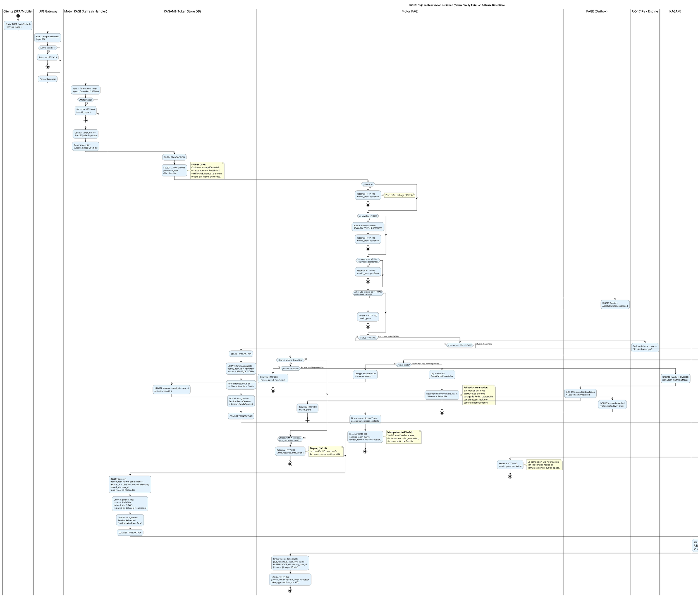

# UC-13: Renovar Sesión (Refresh Token) - Diagrama de Actividades

| Metadatos del Documento | |
| :--- | :--- |
| **Proyecto:** | SHUGO - Identity & Access Platform |
| **Caso de Uso:** | UC-13 - Renovar Sesión (Refresh Token Rotation & Reuse Detection) |
| **Documento:** | 03_Activity_Diagram.md |
| **Metodología:** | UML 2.5 + ICONIX + DDD + Security by Design (Token Family Chain Validation) |
| **Autor:** | Gastón Ruiz |
| **Versión Actual:** | 1.0.0 |
| **Fecha:** | 21/09/2026 |

---

## Historial de Versiones

| Versión | Fecha | Autor | Descripción de Cambios | Impacto |
| :--- | :--- | :--- | :--- | :--- |
| **1.0.0** | 21/05/2026 | Gastón Ruiz | **Creación inicial.** Diagrama de Actividades UML con carriles (swimlanes) para UC-13. Modela el flujo end-to-end de renovación con sus tres caminos mutuamente excluyentes (Rotación Estándar, Rotación Idempotente por Grace Window, y Detección de Reuso con Revocación de Familia), el orden fail-fast de las guardas de cadena, los límites transaccionales con lock de fila, y los caminos degradados (Fail-Secure ante caída de DB, rechazo conservador ante caída de Grace Cache). | Documento base del paquete de diseño Tier 1 del UC-13. Sirve como el "guion de ejecución" exacto del `TokenRotator`, garantizando que la cadena de familia permanezca lineal bajo concurrencia legítima y que cualquier reuso anómalo desencadene contención automática sin falsos positivos destructivos. |

---

## 1. Introducción y Propósito

El **Diagrama de Actividades** para el UC-13 materializa la lógica de negocio y las reglas de seguridad definidas en la Especificación de Requisitos (01) y el Diagrama de Casos de Uso (02). Su propósito es:

1. **Definir el Flujo de Control Exacto:** Establecer el orden secuencial desde que el cliente envía el Refresh Token hasta que recibe el par renovado, un step-up de MFA, o un rechazo genérico.
2. **Modelar los Tres Caminos Mutuamente Excluyentes:** Visualizar la bifurcación central según el estado del token presentado (`ACTIVE` → Rotación Estándar; `ROTATED` + ventana → Rotación Idempotente; `ROTATED` fuera de ventana → Reuse Detection).
3. **Ordenar las Guardas Fail-Fast:** Mostrar que las validaciones de cadena (UC-V1) se ejecutan de la más barata a la más costosa, y que la vida absoluta se evalúa **antes** del enrutamiento por estado.
4. **Delimitar las Transacciones:** Dejar explícito qué operaciones ocurren dentro del lock de fila (`SELECT ... FOR UPDATE` → `COMMIT`) y cuáles fuera (Redis Grace Cache, firma JWT, notificación).
5. **Documentar los Caminos Degradados:** Mostrar el comportamiento Fail-Secure ante caída de KAGAMI y el rechazo conservador ante caída de la Grace Cache de Redis.

---

## 2. Diagrama de Actividades (PlantUML)

A continuación, se presenta el Diagrama de Actividades UML con particiones (swimlanes) para cada actor y sistema involucrado.



---

## 3. Análisis de los Carriles (Swimlanes) y Responsabilidades

El diagrama divide la responsabilidad del flujo en 8 carriles claros:

1. **Cliente (SPA/Mobile):** Envía el Refresh Token opaco. No ejecuta lógica de negocio; solo reacciona a la respuesta (renueva almacenamiento, redirige a login, o inicia step-up MFA).
2. **API Gateway:** Aplica Rate Limiting **por identidad** (no solo por IP): un atacante con un token robado no debe poder sondear el endpoint de refresh a volumen ilimitado.
3. **Motor KAGI (Refresh Handler / TokenRotator):** El orquestador. Valida formato, calcula el hash, genera `new_jti` y `sucesor_opaco` **antes** de la transacción, enruta por estado, firma el JWT y decide las respuestas.
4. **KAGAMI (Token Store DB):** Fuente de verdad de la cadena. Ejecuta el `SELECT ... FOR UPDATE` que serializa rotaciones concurrentes y las transacciones de rotación, revocación de familia y outbox.
5. **Redis (Grace Cache + Blacklist):** Doble rol: almacena la Grace Cache cifrada (`rotgrace:{hash}`, TTL 60s) y recibe los `issued_jti` blacklisteados durante una contención.
6. **UC-17 (Risk Engine):** Evalúa el delta de contexto en cada renovación cuando la política del tenant lo exige.
7. **KAGE (Outbox):** Recibe todos los eventos (`Session.Refreshed`, `Session.ReuseDetected`, `Session.FamilyRevoked`, `Session.AbsoluteLifetimeExceeded`, `Session.RiskEscalation`) dentro de la misma transacción que los produce.
8. **Notification Service:** Canal humano de la contención: alerta al titular con contexto cuando se detecta reuso.

---

## 4. Puntos Críticos de Seguridad en el Flujo

### 4.1. Orden Fail-Fast de las Guardas de Cadena (UC-V1)

Las guardas se evalúan de la más barata a la más costosa, y en un orden deliberado:

1. **Formato** (sin tocar DB): rechaza basura antes de consumir un lock de fila.
2. **Existencia** (SELECT por hash único).
3. **No revocado** (respeta UC-12).
4. **Expiración deslizante** (`expires_at`).
5. **Vida absoluta** (`absolute_expires_at`) — **antes** del enrutamiento por estado: un token ACTIVE de una familia de 30 días + 2h muere aquí, sin importar cuán válido parezca su estado individual.
6. **Enrutamiento por estado** (`ACTIVE` vs `ROTATED`).

**Justificación:** Cada guarda que falla retorna `invalid_grant` genérico (RN-25). El orden garantiza que el camino más transitado (renovación válida) pague el mínimo costo, y que la vida absoluta —la guarda anti *Zombie Sessions*— no pueda ser evadida por ningún camino.

### 4.2. Límite Transaccional de la Rotación (Anti-Bifurcación)

Dentro del Camino A, **tres escrituras comparten una transacción** bajo el lock de fila:
1. `INSERT` del sucesor (con `issued_jti = new_jti` pre-generado).
2. `UPDATE` del presentado a `ROTATED` con `replaced_by_token_id`.
3. `INSERT` del evento `Session.Refreshed` en el Outbox.

El `COMMIT` ocurre **antes** de tocar Redis. La escritura de la Grace Cache (`SET rotgrace ... EX 60`) es post-commit y **no transaccional**: si Redis falla en ese punto, la rotación ya es duradera y la concurrencia legítima caerá al rechazo conservador (Escenario 4.7), nunca a una bifurcación de cadena.

**Justificación:** El lock `FOR UPDATE` serializa dos renovaciones simultáneas del mismo token: la segunda espera, observa `ROTATED` y entra al Camino B. Sin este lock, dos pestañas crearían dos sucesores distintos y la cadena se bifurcaría, generando falsos positivos de robo.

### 4.3. Grace Window como Camino Idempotente (No Destructivo)

El Camino B es el único que **no muta la cadena**: no inserta sucesor, no incrementa `generation`, no revoca nada. Solo:
1. Lee y descifra la Grace Cache (`AES-256-GCM`).
2. Actualiza `successor.issued_jti` al nuevo JWT emitido (para que una futura revocación de familia blacklistee el JTI **más reciente**, no uno ya sustituido).
3. Emite un Access Token fresco vinculado al sucesor existente.
4. Retorna **el mismo** `refresh_token` sucesor que la otra pestaña ya posee.

**Justificación:** Dos pestañas que renuevan a la vez no deben destruir la sesión del usuario. La ventana de 60s absorbe la concurrencia legítima sin ampliar la superficie de ataque original (el atacante con el token rotado ya tenía esa misma ventana antes de la rotación).

### 4.4. Reuse Detection como Protocolo de Contención (Camino C)

Fuera de la ventana, un token `ROTADO` presentado es **evidencia de compromiso confirmado**. El camino C no es un error: es un incidente con cuatro acciones coordinadas:
1. **Revocación de familia** (`UPDATE ... WHERE family_root_id = ...`, motivo `REUSE_DETECTED`) en transacción con el Outbox.
2. **Blacklisteado quirúrgico** de los `issued_jti` vivos (pipeline Redis con TTL residual) — cierra los Access Tokens ≤15 min que de otro modo seguirían siendo aceptados.
3. **Eventos de seguridad** (`Session.ReuseDetected` + `Session.FamilyRevoked`) para KAGE y SIEM.
4. **Notificación al titular** con contexto (IP, geo, UA, hora).

La respuesta al cliente sigue siendo `invalid_grant` genérico: la contención y la notificación son los canales reales de comunicación.

### 4.5. Mapa de Comportamientos Degradados (Fail-Safe / Fail-Secure)

| Fallo de Infraestructura | Punto del Flujo | Comportamiento | Justificación |
| :--- | :--- | :--- | :--- |
| **KAGAMI DB caída / timeout** | Cualquier punto transaccional | `ROLLBACK` + HTTP 503 | Fail-Secure: sin fuente de verdad no hay rotación válida. Nunca emitir tokens a ciegas. |
| **Redis caído (escritura Grace Cache)** | Post-commit del Camino A | WARNING log; rotación válida continúa | La Grace Cache es una optimización de concurrencia, no una barrera de seguridad. |
| **Redis caído (lectura Grace Cache)** | Camino B con token ROTADO en ventana | `invalid_grant` **sin** revocar familia | Rechazo conservador: evita falsos positivos destructivos durante el outage. |
| **Redis caído (Blacklist de JTIs)** | Post-commit del Camino C | Fail-Safe con alerta crítica; familia ya revocada en DB | La barrera principal (revocación de refresh) persiste; los Access Tokens vivirán ≤15 min (riesgo aceptado y alertado). |

### 4.6. Orden de los Step-Up (Riesgo antes que Frescura)

El hook de UC-17 se evalúa **antes** que la frescura de MFA:
- Si el riesgo es alto y la política es `step-up`, se retorna `mfa_required` inmediatamente (sin gastar la evaluación de frescura).
- Si el riesgo es alto y la política es `revoke`, se revoca la familia con `SECURITY_COMPROMISE` y se audita `Session.RiskEscalation`.
- Solo con riesgo aceptable se evalúa frescura de MFA; si expiró, `mfa_required` **sin rotar aún**: la rotación se reanuda tras completar UC-15, preservando el token ACTIVE para el flujo de reanudación.

**Justificación:** Ninguno de los dos step-up emite tokens ni rota la cadena: la renovación **nunca eleva privilegios** (INV-88), y pausar antes de rotar evita dejar un sucesor huérfano si el usuario abandona el step-up.

---

## 5. Trazabilidad con Otros Documentos del Paquete

Este diagrama es **100% coherente** con los documentos previos y sirve de base para los siguientes:

| Documento | Relación |
| :--- | :--- |
| `01_Requirements_Specification.md` | Implementa visualmente los escenarios 2.1-2.3 y 4.1-4.8, las invariantes INV-82 a INV-88 y las reglas RN-23 a RN-26. |
| `02_Use_Case_Diagram.md` | Los caminos A, B y C del diagrama materializan UC-13a/13d, UC-13b y UC-13c; las guardas materializan UC-V1; el blacklisteado materializa UC-V2 y la alerta UC-V3. |
| `04_Initial_Domain_Model.md` | Las acciones en los carriles de KAGI y KAGAMI se mapearán a los métodos de la Entity `RefreshToken` y del Domain Service `TokenRotator`. |
| `05_State_Machine_Diagram.md` | Las decisiones "¿status == ACTIVE?" y "¿rotated_at + 60s > NOW?" son las guardas de las transiciones ACTIVE → ROTATED y ROTATED → (grace | REUSE_DETECTED). |
| `06_Robustness_Diagram.md` | Los carriles se traducirán en objetos Boundary (Cliente, GW), Control (RefreshHandler, TokenRotator, GraceWindowResolver, FamilyRevoker) y Entity (RefreshToken, Redis, DB, Outbox). |
| `07_Sequence_Diagram.md` | Este diagrama define "qué se hace y quién lo hace"; el de secuencia definirá el orden temporal exacto de los mensajes, incluido el lock de fila y el pipeline de Blacklist. |

---

## 6. Notas de Implementación

### 6.1. Sintaxis PlantUML Moderna
- Se utiliza la sintaxis de **Activity Diagram Beta** (`start`, `stop`, `if/then/else/endif`, `note right`) con carriles (`|Lane|`).
- Bloque `<style>` para colores y fondos, evitando `skinparam` deprecados.
- Cada camino terminal finaliza con `stop`, reflejando la naturaleza **fail-fast** del flujo: no hay reintentos automáticos dentro del mismo request.

### 6.2. Esqueleto de Código del Enrutamiento por Estado

```csharp
public async Task<RefreshResult> RefreshAsync(RefreshCommand cmd, CancellationToken ct)
{
    var hash = Sha256(cmd.RefreshToken);
    var newJti = Guid.NewGuid().ToString("N");
    var successorOpaque = TokenGenerator.GenerateOpaque256();

    await using var tx = await _db.BeginTransactionAsync(ct);
    var token = await _repo.GetForUpdateAsync(hash, ct);   // SELECT ... FOR UPDATE

    // Guardas fail-fast (UC-V1) — todas retornan invalid_grant genérico
    if (token is null)                 return Reject(RefreshRejection.NotFound);
    if (token.IsRevoked)               return Reject(RefreshRejection.Revoked);
    if (token.IsSlidingExpired)        return Reject(RefreshRejection.SlidingExpired);
    if (token.IsAbsoluteExpired)       return Reject(RefreshRejection.AbsoluteExpired);

    if (token.Status == TokenStatus.ACTIVE)
        return await RotateStandardAsync(token, newJti, successorOpaque, tx, ct);   // Camino A

    if (token.IsWithinGraceWindow())
        return await ResolveGraceWindowAsync(token, tx, ct);                          // Camino B

    return await ContainReuseAsync(token, tx, ct);                                    // Camino C
}
```

### 6.3. Convenciones de Nomenclatura
- **Caminos:** A (Rotación Estándar), B (Grace Window), C (Reuse Detection), alineados con UC-13a/b/c del diagrama de casos de uso.
- **Decisiones:** Preguntas booleanas explícitas que reflejan guardas de dominio (`¿status == ACTIVE?`, `¿rotated_at + 60s > NOW()?`).
- **Notas de seguridad:** Texto en negrita (**FAIL-SECURE**, **Idempotencia**, **Fallback conservador**) para resaltar decisiones arquitectónicas no obvias del flujo.

---
*Fin del Documento 03_Activity_Diagram para UC-13*