# UC-13: Renovar Sesión (Refresh Token) - Modelo de Dominio Inicial

| Metadatos del Documento | |
| :--- | :--- |
| **Proyecto:** | SHUGO - Identity & Access Platform |
| **Caso de Uso:** | UC-13 - Renovar Sesión (Refresh Token Rotation & Reuse Detection) |
| **Documento:** | 04_Initial_Domain_Model.md |
| **Metodología:** | ICONIX (Modelo de Análisis) + DDD (Domain-Driven Design) + Event-Driven Architecture + Security by Design |
| **Autor:** | Gastón Ruiz |
| **Versión Actual:** | 1.0.0 |
| **Fecha:** | 07/10/2026 |

---

## Historial de Versiones

| Versión | Fecha | Autor | Descripción de Cambios | Impacto |
| :--- | :--- | :--- | :--- | :--- |
| **1.0.0** | 07/10/2026 | Gastón Ruiz | **Creación inicial.** Definición del Modelo de Dominio Conceptual para la renovación de sesiones. Extiende la Entity `RefreshToken` con los atributos de cadena de familia (`FamilyRootId`, `Generation`, `AbsoluteExpiresAt`, `IssuedJti`, `RotatedAt`, `ReplacedByTokenId`), introduce el método de intención explícita `RotateTo()` que retorna el sucesor, y define los Value Objects `OpaqueRefreshToken`, `GraceWindowEntry` (con sellado AEAD), `SessionContext` y `RefreshPolicy`. Modela los Domain Services `TokenRotator`, `GraceWindowResolver` y `FamilyRevoker`, junto con los cinco eventos de dominio del ciclo de renovación. | Documento base del paquete de diseño Tier 1 del UC-13. Establece cómo el dominio encapsula las invariantes de la cadena de tokens (rotación single-use, vida absoluta inextensible, preservación de `auth_level`) y cómo la contención por reuso se expresa como operación de dominio de primer nivel, no como lógica de aplicación. |

---

## 1. Introducción y Propósito

Este documento presenta el **Modelo de Dominio Inicial** para el Caso de Uso UC-13 (Renovar Sesión).

La renovación de sesiones en SHUGO no es un "refresh" trivial: es una **operación sobre una cadena de tokens con identidad propia** (la familia). El modelo de dominio debe capturar tres verdades de negocio:

1. **Un Refresh Token es de un solo uso:** Rotar significa mutar el presentado a `ROTATED` y crear su sucesor **en el mismo acto atómico**. Esa atomicidad de par (mutación + creación) vive dentro de la Entity, no en la aplicación.
2. **La familia es la unidad de contención, no de carga:** Cuando se detecta reuso, se revoca la familia completa. Pero una familia puede tener cientos de rotaciones acumuladas; cargarla como Aggregate Root sería un error de rendimiento y de concurrencia. Por tanto, la familia se modela como **identidad conceptual** (`TokenFamilyId` = claim `sid`) y la contención como **operación set-based** de un Domain Service.
3. **La Grace Window es un contrato de seguridad, no un cache:** El sucesor opaco viaja cifrado (AEAD) con TTL de 60 segundos. El dominio define *qué* se sella y *cuánto vive*; la infraestructura provee *cómo* se cifra (AES-256-GCM con clave KMS).

El modelo se centra en:
- **Entity rica:** `RefreshToken` con guardas internas (`EnsureRotatable`) que hacen imposible rotar un token revocado, expirado o fuera de vida absoluta.
- **Política como Value Object:** `RefreshPolicy` encapsula vidas deslizante/absoluta, Grace Window y frescura de MFA, permitiendo configuración por tenant sin tocar el dominio.
- **Servicios de dominio especializados:** `TokenRotator` (orquestación de rotación), `GraceWindowResolver` (resolución idempotente), `FamilyRevoker` (contención por reuso).
- **Eventos de dominio:** Cinco eventos que alimentan auditoría (KAGE), SIEM y notificaciones al titular.

---

## 2. Diagrama de Modelo de Dominio Conceptual (PlantUML)

```plantuml
@startuml UC-13_DominioConceptual
<style>
diagram {
  BackgroundColor #FFFFFF
}
</style>
skinparam classAttributeIconSize 0
skinparam classBackgroundColor #FFFFFF
skinparam classBorderColor #1565C0
skinparam classHeaderBackgroundColor #E3F2FD

title UC-13: Modelo de Dominio Conceptual - Refresh Token Rotation (Token Family Chain)

' ============================================
' ENTITY (con comportamiento de Aggregate)
' ============================================
class RefreshToken <<Entity>> {
  - id: RefreshTokenId
  - tokenHash: RefreshTokenHash
  - identityId: IdentityId
  - tenantId: TenantId
  - familyRootId: TokenFamilyId
  - generation: int
  - status: TokenStatus
  - expiresAt: DateTime
  - absoluteExpiresAt: DateTime
  - issuedJti: string
  - rotatedAt: DateTime?
  - replacedByTokenId: RefreshTokenId?
  - revokedAt: DateTime?
  - revocationReason: RevocationReason?
  - context: SessionContext
  - createdAt: DateTime

  + {static} CreateRoot(tenant, identity, hash, context, policy, jti, now): RefreshToken
  + RotateTo(successorHash, successorJti, policy, now): RefreshToken
  + MarkRevoked(reason, revokedBy, now): void
  + IsWithinGraceWindow(now, window): bool
  + IsSlidingExpired(now): bool
  + IsAbsoluteExpired(now): bool
  - EnsureRotatable(now): void
}

enum TokenStatus {
  ACTIVE
  ROTATED
  REVOKED
  EXPIRED
}

enum RevocationReason {
  USER_INITIATED
  CASCADE_LOGOUT
  ADMIN_FORCED
  SECURITY_COMPROMISE
  REUSE_DETECTED
}

' ============================================
' VALUE OBJECTS
' ============================================
class OpaqueRefreshToken <<Value Object>> {
  - value: string
  + {static} Generate(): OpaqueRefreshToken
  + ComputeHash(): RefreshTokenHash
}

class RefreshTokenHash <<Value Object>> {
  - value: string
  + RefreshTokenHash(value: string)
}

class TokenFamilyId <<Value Object>> {
  - value: Guid
  + {static} New(): TokenFamilyId
  + ToSidClaim(): string
}

class GraceWindowEntry <<Value Object>> {
  - presentedHash: RefreshTokenHash
  - ciphertext: string
  - ttl: TimeSpan
  + {static} Seal(presented, successor, cipher, ttl): GraceWindowEntry
  + Unseal(cipher): OpaqueRefreshToken
}

class SessionContext <<Value Object>> {
  - deviceId: string
  - userAgent: string
  - ipAddress: string
  + SessionContext(deviceId, userAgent, ipAddress)
  + Delta(other: SessionContext): ContextDelta
}

class RefreshPolicy <<Value Object>> {
  - slidingLifetime: TimeSpan
  - absoluteLifetime: TimeSpan
  - graceWindow: TimeSpan
  - mfaFreshness: TimeSpan?
  + {static} Default: RefreshPolicy
  + FromTenantConfig(config: JsonDocument): RefreshPolicy
}

class RevocationReport <<Value Object>> {
  - familyRootId: TokenFamilyId
  - tokensRevoked: int
  - activeJtis: List<JtiWithExpiration>
  + RevocationReport(family, count, jtis)
}

' ============================================
' DOMAIN SERVICES
' ============================================
class TokenRotator <<Domain Service>> {
  - repo: IRefreshTokenRepository
  - graceCache: IGraceWindowCache
  - cipher: IAeadCipher
  - tokenIssuer: ITokenIssuer
  - outbox: IOutboxPublisher
  - clock: IClock

  + RefreshAsync(attempt: RefreshAttempt, policy: RefreshPolicy, ct): Task<RefreshOutcome>
}

class GraceWindowResolver <<Domain Service>> {
  - graceCache: IGraceWindowCache
  - cipher: IAeadCipher

  + TryResolveAsync(presentedHash, ct): Task<GraceResolution>
}

class FamilyRevoker <<Domain Service>> {
  - repo: IRefreshTokenRepository
  - jtiBlacklist: IJtiBlacklist
  - outbox: IOutboxPublisher
  - notifications: INotificationDispatcher
  - clock: IClock

  + ContainReuseAsync(presented: RefreshToken, attempt: RefreshAttempt, now, ct): Task<RefreshOutcome>
}

' ============================================
' DOMAIN EVENTS
' ============================================
class SessionRefreshed <<Domain Event>> {
  + familyRootId: TokenFamilyId
  + oldTokenId / newTokenId
  + generation: int
  + viaGraceWindow: bool
  + context: SessionContext
}

class SessionReuseDetected <<Domain Event>> {
  + familyRootId: TokenFamilyId
  + reusedTokenId: RefreshTokenId
  + attackerContext: SessionContext
  + legitimateDeviceId: string
}

class SessionFamilyRevoked <<Domain Event>> {
  + familyRootId: TokenFamilyId
  + tokensRevoked: int
  + jtisBlacklisted: List<string>
  + reason: RevocationReason
}

class SessionAbsoluteLifetimeExceeded <<Domain Event>> {
  + familyRootId: TokenFamilyId
  + familyCreatedAt: DateTime
}

' ============================================
' PUERTOS (Interfaces de Infraestructura)
' ============================================
interface IRefreshTokenRepository {
  + GetForUpdateAsync(hash, ct): Task<RefreshToken?>
  + SaveRotationAsync(presented, successor, ct): Task
  + RevokeFamilyAsync(family, reason, revokedBy, now, ct): Task<RevocationReport>
  + RebindIssuedJtiAsync(tokenId, newJti, ct): Task
  + CommitAsync(ct): Task
}

interface IGraceWindowCache {
  + SealAsync(entry: GraceWindowEntry, ct): Task
  + TryFetchAsync(hash, ct): Task<GraceWindowEntry?>
}

interface IAeadCipher {
  + Encrypt(plaintext: string): string
  + Decrypt(ciphertext: string): string
}

interface IJtiBlacklist {
  + BlacklistAsync(jtis: List<JtiWithExpiration>, now, ct): Task
}

interface ITokenIssuer {
  + IssueRefreshAccessToken(sub, tenant, sid, jti, authLevel, amr, ttl): string
}

' ============================================
' RELACIONES
' ============================================
RefreshToken *-- TokenStatus
RefreshToken *-- RevocationReason
RefreshToken *-- TokenFamilyId : "familia (sid)"
RefreshToken *-- RefreshTokenHash
RefreshToken *-- SessionContext
RefreshToken o-- RefreshToken : "sucesor via\nreplaced_by_token_id"

OpaqueRefreshToken --> RefreshTokenHash : ComputeHash()
GraceWindowEntry *-- RefreshTokenHash
GraceWindowEntry --> OpaqueRefreshToken : Unseal()

TokenRotator --> IRefreshTokenRepository
TokenRotator --> IGraceWindowCache
TokenRotator --> ITokenIssuer
TokenRotator --> IOutboxPublisher
TokenRotator --> RefreshToken : RotateTo()

GraceWindowResolver --> IGraceWindowCache
GraceWindowResolver --> IAeadCipher

FamilyRevoker --> IRefreshTokenRepository
FamilyRevoker --> IJtiBlacklist
FamilyRevoker --> RevocationReport : "consume"

note right of RefreshToken
  **Atomicidad de Par:**
  RotateTo() muta self a ROTATED
  y RETORNA el sucesor ACTIVE.
  Imposible rotar sin crear sucesor,
  imposible crear sucesor sin rotar.
end note

note bottom of FamilyRevoker
  **Contención Set-Based:**
  La familia NO se carga como
  Aggregate: se revoca con un
  UPDATE por family_root_id y
  se reportan los issued_jti vivos.
end note

note left of GraceWindowEntry
  **Sellado AEAD:**
  El sucesor opaco viaja cifrado
  (AES-256-GCM) con TTL 60s.
  El dominio define el contrato;
  la infraestructura pone la clave KMS.
end note

@enduml
```



---

## 3. Detalle de Conceptos de Dominio (DDD)

### 3.1. Entity: `RefreshToken` (con comportamiento de Aggregate)

La Entity encapsula **todas** las invariantes de la cadena. El método `RotateTo` es el corazón del UC-13: garantiza que rotación y creación del sucesor sean un solo acto de dominio.

```csharp
public class RefreshToken : Entity
{
    public RefreshTokenId Id { get; private set; }
    public RefreshTokenHash TokenHash { get; private set; }
    public IdentityId IdentityId { get; private set; }
    public TenantId TenantId { get; private set; }
    public TokenFamilyId FamilyRootId { get; private set; }
    public int Generation { get; private set; }
    public TokenStatus Status { get; private set; }
    public DateTime ExpiresAt { get; private set; }          // Expiración deslizante
    public DateTime AbsoluteExpiresAt { get; private set; }  // Vida absoluta INEXTENSIBLE
    public string IssuedJti { get; private set; }            // JTI del Access Token emitido con este refresh
    public DateTime? RotatedAt { get; private set; }
    public RefreshTokenId? ReplacedByTokenId { get; private set; }
    public DateTime? RevokedAt { get; private set; }
    public RevocationReason? RevocationReason { get; private set; }
    public IdentityId? RevokedByIdentityId { get; private set; }
    public SessionContext Context { get; private set; }
    public DateTime CreatedAt { get; private set; }

    private RefreshToken() { }

    /// <summary>
    /// Fábrica para el token raíz de una familia (emitido por UC-11 en el login).
    /// </summary>
    public static RefreshToken CreateRoot(
        TenantId tenant, IdentityId identity, RefreshTokenHash hash,
        SessionContext context, RefreshPolicy policy, string jti, DateTime now)
    {
        return new RefreshToken
        {
            Id = new RefreshTokenId(Guid.NewGuid()),
            TokenHash = hash,
            IdentityId = identity,
            TenantId = tenant,
            FamilyRootId = TokenFamilyId.New(),   // La raíz define la familia (= claim sid)
            Generation = 1,
            Status = TokenStatus.ACTIVE,
            ExpiresAt = now.Add(policy.SlidingLifetime),
            AbsoluteExpiresAt = now.Add(policy.AbsoluteLifetime),
            IssuedJti = jti,
            Context = context,
            CreatedAt = now
        };
    }

    /// <summary>
    /// Rotación atómica: muta self a ROTATED y retorna el sucesor ACTIVE.
    /// INV-82: Un token ACTIVE se rota exactamente una vez.
    /// INV-85: El sucesor hereda la vida absoluta; NUNCA la extiende.
    /// </summary>
    public RefreshToken RotateTo(
        RefreshTokenHash successorHash, string successorJti,
        RefreshPolicy policy, DateTime now)
    {
        EnsureRotatable(now);

        var successor = new RefreshToken
        {
            Id = new RefreshTokenId(Guid.NewGuid()),
            TokenHash = successorHash,
            IdentityId = this.IdentityId,
            TenantId = this.TenantId,
            FamilyRootId = this.FamilyRootId,      // Hereda familia
            Context = this.Context,                // Hereda binding de contexto
            Generation = this.Generation + 1,
            Status = TokenStatus.ACTIVE,
            // RN-23: deslizante topada por la vida absoluta de la familia
            ExpiresAt = Min(now.Add(policy.SlidingLifetime), this.AbsoluteExpiresAt),
            AbsoluteExpiresAt = this.AbsoluteExpiresAt,
            IssuedJti = successorJti,
            CreatedAt = now
        };

        this.Status = TokenStatus.ROTATED;
        this.RotatedAt = now;
        this.ReplacedByTokenId = successor.Id;

        return successor;
    }

    /// <summary>
    /// Revocación idempotente (UC-12 / contención UC-13).
    /// </summary>
    public void MarkRevoked(RevocationReason reason, IdentityId? revokedBy, DateTime now)
    {
        if (this.Status == TokenStatus.REVOKED) return; // Idempotencia de dominio
        this.Status = TokenStatus.REVOKED;
        this.RevokedAt = now;
        this.RevocationReason = reason;
        this.RevokedByIdentityId = revokedBy;
    }

    /// <summary>
    /// INV-84: ¿El token ROTADO está dentro de la Grace Window?
    /// </summary>
    public bool IsWithinGraceWindow(DateTime now, TimeSpan window) =>
        this.Status == TokenStatus.ROTATED &&
        this.RotatedAt.HasValue &&
        this.RotatedAt.Value.Add(window) > now;

    public bool IsSlidingExpired(DateTime now) => now >= this.ExpiresAt;
    public bool IsAbsoluteExpired(DateTime now) => now >= this.AbsoluteExpiresAt;

    private void EnsureRotatable(DateTime now)
    {
        if (this.Status != TokenStatus.ACTIVE)
            throw new DomainException($"Cannot rotate a token in status {this.Status}.");
        if (IsAbsoluteExpired(now))
            throw new DomainException("Family absolute lifetime exceeded.");
        if (IsSlidingExpired(now))
            throw new DomainException("Refresh token sliding expiration exceeded.");
    }

    private static DateTime Min(DateTime a, DateTime b) => a < b ? a : b;
}
```

### 3.2. Value Objects de Seguridad

#### **OpaqueRefreshToken y RefreshTokenHash**

```csharp
public class OpaqueRefreshToken : ValueObject
{
    public string Value { get; }

    private OpaqueRefreshToken(string value) => Value = value;

    /// <summary>INV-87: 256 bits de entropía, Base64url. Nunca JWT.</summary>
    public static OpaqueRefreshToken Generate()
    {
        var bytes = RandomNumberGenerator.GetBytes(32);
        return new OpaqueRefreshToken(Base64Url.Encode(bytes));
    }

    public RefreshTokenHash ComputeHash() =>
        new(Convert.ToBase64String(SHA256.HashData(Encoding.UTF8.GetBytes(Value))));
}
```

#### **GraceWindowEntry (Sellado AEAD)**

```csharp
public class GraceWindowEntry : ValueObject
{
    public RefreshTokenHash PresentedHash { get; }
    public string Ciphertext { get; }   // AES-256-GCM(sucesor_opaco)
    public TimeSpan Ttl { get; }

    private GraceWindowEntry(RefreshTokenHash presented, string ciphertext, TimeSpan ttl)
    {
        PresentedHash = presented;
        Ciphertext = ciphertext;
        Ttl = ttl;
    }

    /// <summary>Sella el sucesor opaco para concurrencia legítima (INV-84).</summary>
    public static GraceWindowEntry Seal(
        RefreshTokenHash presented, OpaqueRefreshToken successor,
        IAeadCipher cipher, TimeSpan ttl) =>
        new(presented, cipher.Encrypt(successor.Value), ttl);

    public OpaqueRefreshToken Unseal(IAeadCipher cipher)
    {
        try { return new OpaqueRefreshToken(cipher.Decrypt(Ciphertext)); }
        catch (CryptographicException)
        {
            // Ciphertext manipulado o clave rotada: tratar como ausencia de grace
            return null;
        }
    }
}
```

#### **RefreshPolicy (Política como Value Object)**

```csharp
public class RefreshPolicy : ValueObject
{
    public TimeSpan SlidingLifetime { get; }    // ej. 30 días
    public TimeSpan AbsoluteLifetime { get; }   // ej. 30 días desde la raíz
    public TimeSpan GraceWindow { get; }        // ej. 60 segundos
    public TimeSpan? MfaFreshness { get; }      // ej. 12 horas (null = sin step-up programado)

    public static RefreshPolicy Default =>
        new(TimeSpan.FromDays(30), TimeSpan.FromDays(30), TimeSpan.FromSeconds(60), TimeSpan.FromHours(12));

    public RefreshPolicy(TimeSpan sliding, TimeSpan absolute, TimeSpan grace, TimeSpan? mfaFreshness)
    {
        if (grace > TimeSpan.FromMinutes(5))
            throw new DomainException("Grace window above 5 minutes widens the attack surface.");
        if (absolute < sliding)
            throw new DomainException("Absolute lifetime must be >= sliding lifetime.");
        SlidingLifetime = sliding;
        AbsoluteLifetime = absolute;
        GraceWindow = grace;
        MfaFreshness = mfaFreshness;
    }
}
```

### 3.3. Domain Services

#### **TokenRotator (Orquestador de los Tres Caminos)**

```csharp
public class TokenRotator : ITokenRotator
{
    private readonly IRefreshTokenRepository _repo;
    private readonly IGraceWindowCache _graceCache;
    private readonly IAeadCipher _cipher;
    private readonly ITokenIssuer _tokenIssuer;
    private readonly IOutboxPublisher _outbox;
    private readonly IClock _clock;
    private readonly ILogger<TokenRotator> _logger;

    public async Task<RefreshOutcome> RefreshAsync(
        RefreshAttempt attempt, RefreshPolicy policy, CancellationToken ct)
    {
        var now = _clock.UtcNow;

        // Lock de fila: serializa rotaciones concurrentes (anti-bifurcación)
        var token = await _repo.GetForUpdateAsync(attempt.PresentedHash, ct);

        // Guardas fail-fast de UC-V1 (todas → invalid_grant genérico)
        if (token is null) return RefreshOutcome.Reject(RefreshRejection.NotFound);
        if (token.Status == TokenStatus.REVOKED) return RefreshOutcome.Reject(RefreshRejection.Revoked);
        if (token.IsSlidingExpired(now)) return RefreshOutcome.Reject(RefreshRejection.SlidingExpired);
        if (token.IsAbsoluteExpired(now))
        {
            await _outbox.PublishAsync(new SessionAbsoluteLifetimeExceeded(
                token.FamilyRootId, token.CreatedAt, now), ct);
            return RefreshOutcome.Reject(RefreshRejection.AbsoluteExpired);
        }

        // CAMINO A: Rotación estándar
        if (token.Status == TokenStatus.ACTIVE)
            return await RotateStandardAsync(token, policy, now, ct);

        // CAMINO B: Grace Window (rotación idempotente)
        if (token.IsWithinGraceWindow(now, policy.GraceWindow))
            return await ResolveGraceAsync(token, policy, now, ct);

        // CAMINO C: Reuse Detection (contención)
        return await _familyRevoker.ContainReuseAsync(token, attempt, now, ct);
    }

    private async Task<RefreshOutcome> RotateStandardAsync(
        RefreshToken token, RefreshPolicy policy, DateTime now, CancellationToken ct)
    {
        var successorOpaque = OpaqueRefreshToken.Generate();
        var newJti = Guid.NewGuid().ToString("N");

        // Atomicidad de par dentro de la Entity
        var successor = token.RotateTo(successorOpaque.ComputeHash(), newJti, policy, now);

        // Misma transacción: rotación + outbox
        await _repo.SaveRotationAsync(token, successor, ct);
        await _outbox.PublishAsync(new SessionRefreshed(
            token.FamilyRootId, token.Id, successor.Id, successor.Generation,
            viaGraceWindow: false, token.Context, now), ct);
        await _repo.CommitAsync(ct);

        // Post-commit: Grace Cache cifrada (no transaccional; fail-safe con warning)
        try
        {
            await _graceCache.SealAsync(
                GraceWindowEntry.Seal(token.TokenHash, successorOpaque, _cipher, policy.GraceWindow), ct);
        }
        catch (Exception ex)
        {
            _logger.LogWarning(ex, "Grace cache seal failed for token {TokenId}. Concurrency will use conservative reject.", token.Id);
        }

        // INV-88: el JWT sucesor PRESERVA auth_level y amr; sid = familia
        var jwt = _tokenIssuer.IssueRefreshAccessToken(
            token.IdentityId, token.TenantId, token.FamilyRootId.ToSidClaim(),
            newJti, attempt.PreservedAuthLevel, attempt.PreservedAmr, TimeSpan.FromMinutes(15));

        return RefreshOutcome.Rotated(jwt, successorOpaque);
    }

    private async Task<RefreshOutcome> ResolveGraceAsync(
        RefreshToken token, RefreshPolicy policy, DateTime now, CancellationToken ct)
    {
        var entry = await _graceCache.TryFetchAsync(token.TokenHash, ct);
        if (entry is null)
        {
            // Fallback conservador: rechazar SIN revocar familia (evita falsos positivos)
            _logger.LogWarning("GraceCacheUnavailable for rotated token {TokenId}.", token.Id);
            return RefreshOutcome.Reject(RefreshRejection.GraceUnavailable);
        }

        var successorOpaque = entry.Unseal(_cipher);
        if (successorOpaque is null)
            return RefreshOutcome.Reject(RefreshRejection.GraceUnavailable);

        var newJti = Guid.NewGuid().ToString("N");
        await _repo.RebindIssuedJtiAsync(token.ReplacedByTokenId!.Value, newJti, ct);
        await _outbox.PublishAsync(new SessionRefreshed(
            token.FamilyRootId, token.Id, token.ReplacedByTokenId.Value, token.Generation,
            viaGraceWindow: true, token.Context, now), ct);
        await _repo.CommitAsync(ct);

        var jwt = _tokenIssuer.IssueRefreshAccessToken(/* ... sid, newJti, auth_level preservado ... */);
        return RefreshOutcome.GraceResolved(jwt, successorOpaque);
    }
}
```

#### **FamilyRevoker (Contención por Reuso)**

```csharp
public class FamilyRevoker : IFamilyRevoker
{
    private readonly IRefreshTokenRepository _repo;
    private readonly IJtiBlacklist _jtiBlacklist;
    private readonly IOutboxPublisher _outbox;
    private readonly INotificationDispatcher _notifications;
    private readonly IClock _clock;
    private readonly ILogger<FamilyRevoker> _logger;

    public async Task<RefreshOutcome> ContainReuseAsync(
        RefreshToken presented, RefreshAttempt attempt, DateTime now, CancellationToken ct)
    {
        // Revocación set-based de la familia + reporte de JTIs vivos (misma transacción)
        var report = await _repo.RevokeFamilyAsync(
            presented.FamilyRootId, RevocationReason.REUSE_DETECTED, presented.IdentityId, now, ct);

        await _outbox.PublishAsync(new SessionReuseDetected(
            presented.FamilyRootId, presented.Id, attempt.Context,
            legitimateDeviceId: presented.Context.DeviceId, now), ct);
        await _outbox.PublishAsync(new SessionFamilyRevoked(
            presented.FamilyRootId, report.TokensRevoked,
            report.ActiveJtis.Select(j => j.Jti).ToList(), RevocationReason.REUSE_DETECTED, now), ct);
        await _repo.CommitAsync(ct);

        // Post-commit: blacklisteado quirúrgico de Access Tokens vivos (Fail-Safe)
        try
        {
            await _jtiBlacklist.BlacklistAsync(report.ActiveJtis, now, ct);
        }
        catch (Exception ex)
        {
            _logger.LogCritical(ex,
                "Fail-Safe: JTI blacklist failed during family revocation {Family}. Refresh tokens are revoked in DB.",
                presented.FamilyRootId);
        }

        // Canal humano de la contención (RN-26)
        await _notifications.DispatchReuseAlertAsync(presented.IdentityId, attempt.Context, now, ct);

        return RefreshOutcome.Reject(RefreshRejection.ReuseDetected);
    }
}
```

### 3.4. Domain Events

| Evento | Disparador | Consumidores |
| :--- | :--- | :--- |
| `Session.Refreshed` | Cada rotación (estándar o grace) | KAGE (audit), KIZUNA (refresco de caché por `sid`), métricas de generation |
| `Session.ReuseDetected` | Reuso fuera de Grace Window | KAGE (forense), SIEM (alerta crítica), TORII (webhook de seguridad) |
| `Session.FamilyRevoked` | Contención por reuso o revocación preventiva por riesgo | KIZUNA (invalidar cachés por `sid`), KAGE, métricas de contención |
| `Session.AbsoluteLifetimeExceeded` | Renovación rechazada por vida absoluta | KAGE, métricas de re-auth interactivo |
| `Session.RiskEscalation` | Score de UC-17 sobre umbral durante renovación | SIEM, KAGE, Notification Service |

---

## 4. Decisiones de Diseño DDD (ADR)

### 4.1. ¿Por qué la Familia NO es un Aggregate Root?

**Decisión:** `TokenFamilyId` es un Value Object identificador (mapeado al claim `sid`), y la revocación de familia es una operación **set-based** del repositorio (`RevokeFamilyAsync`), no una carga de Aggregate.

**Justificación:**
- **Tamaño de la cadena:** Una sesión activa de 30 días con renovaciones cada ~8h acumula ~90 rotaciones; una sesión móvil agresiva puede superar las 500. Cargar la familia como Aggregate en cada rotación sería O(N) en memoria y en locks.
- **Concurrencia:** Un Aggregate de familia obligaría a serializar todas las rotaciones de todas las pestañas sobre una misma raíz de agregado. El lock de fila sobre el token presentado (`SELECT ... FOR UPDATE`) es suficiente y más fino.
- **La contención es set-based por naturaleza:** Revocar la familia es un `UPDATE ... WHERE family_root_id = X`, no un recorrido de entidades. El `RevocationReport` devuelve los `issued_jti` vivos para el blacklisteado quirúrgico sin cargar filas en el dominio.

### 4.2. ¿Por qué `RotateTo()` retorna el sucesor en lugar de dos métodos separados?

**Decisión:** Un único método de intención explícita que muta `self` a `ROTATED` y retorna la nueva Entity sucesora.

**Justificación:**
- **Atomicidad de par como invariante de Entity:** Hace estructuralmente imposible (a) rotar sin crear sucesor (sesión muerta silenciosa) y (b) crear sucesor sin rotar (token de dos usos, violando INV-82).
- **Herencia correcta garantizada:** El sucesor hereda familia, contexto, tenant e identidad **desde el propio padre**, no desde parámetros externos que podrían divergir.
- **Tope de vida absoluta en el punto correcto:** `ExpiresAt = min(now + sliding, absoluteExpiresAt)` se calcula dentro del método, haciendo imposible que una política mal configurada extienda la familia (INV-85).

### 4.3. ¿Por qué `GraceWindowEntry` sella con un puerto `IAeadCipher`?

**Decisión:** El Value Object define el contrato de sellado/desellado; la implementación AES-256-GCM con clave KMS vive en infraestructura.

**Justificación:**
- **El plaintext del sucesor nunca toca Redis:** Solo el ciphertext. Un compromiso de Redis durante los 60s de la ventana entrega ciphertext inútil sin la clave KMS.
- **Testeabilidad:** En tests unitarios se inyecta un cipher determinista; en producción, uno respaldado por KMS con rotación de claves.
- **Fallo seguro del desellado:** Si el ciphertext no autentica (manipulación o rotación de clave), `Unseal` retorna `null` y el flujo cae al rechazo conservador, **nunca** a una revocación de familia por falso positivo.

### 4.4. ¿Por qué `IssuedJti` vive en la fila del Refresh Token?

**Decisión:** Cada fila de `refresh_tokens` conserva el JTI del Access Token emitido junto a ella.

**Justificación:**
- **Blacklisteado quirúrgico:** Al revocar una familia, el `RevocationReport` entrega exactamente los JTIs de los Access Tokens **vivos**, sin escanear logs ni reconstruir historia. Es la diferencia entre cerrar una sesión en 1 round-trip de Redis o dejarla viva 15 minutos.
- **Rebinding en Grace Window:** Cuando el Camino B emite un Access Token fresco para el sucesor existente, `RebindIssuedJtiAsync` actualiza la fila del sucesor para que una contención futura blacklistee el JTI **más reciente**, no uno ya sustituido.

### 4.5. ¿Por qué `RefreshPolicy` es un Value Object y no configuración estática?

**Decisión:** La política (vidas deslizante/absoluta, Grace Window, frescura MFA) viaja como VO construido desde la configuración del tenant.

**Justificación:**
- **Multi-tenancy real:** Un banco puede exigir vida absoluta de 12h y Grace Window de 15s; una startup, 30d y 60s. El dominio no cambia.
- **Guardas de sanidad en el constructor:** El VO rechaza Grace Windows > 5 minutos (ampliarían la superficie de ataque) y vidas absolutas menores que la deslizante (contradicción lógica).
- **Agilidad operativa:** Cambiar política es cambiar configuración, no redeployar código de dominio.

---

## 5. Trazabilidad

| Documento | Relación |
| :--- | :--- |
| `01_Requirements_Specification.md` | Implementa INV-82 (RotateTo single-use), INV-83 (FamilyRevoker), INV-84 (GraceWindowEntry), INV-85 (tope en RotateTo), INV-86 (SessionContext), INV-87 (OpaqueRefreshToken), INV-88 (preservación en IssueRefreshAccessToken), RN-23 a RN-26. |
| `02_Use_Case_Diagram.md` | `TokenRotator` materializa UC-13a/13d; `GraceWindowResolver`/Camino B materializa UC-13b; `FamilyRevoker` materializa UC-13c + UC-V2 + UC-V3; las guardas de `RefreshAsync` materializan UC-V1. |
| `03_Activity_Diagram.md` | Los caminos A, B y C del diagrama de actividades corresponden exactamente a `RotateStandardAsync`, `ResolveGraceAsync` y `ContainReuseAsync`. |
| `05_State_Machine_Diagram.md` | Las guardas `EnsureRotatable`, `IsWithinGraceWindow` y `MarkRevoked` son las transiciones ACTIVE → ROTATED → REVOKED/EXPIRED de la máquina de estados. |
| `08_Final_Class_Design.md` | Refinará las firmas aquí presentadas con manejo completo de `CancellationToken`, resultados tipados y mapeo a HTTP. |
| `10_UC_Specific_Data_Model.md` | `FamilyRootId`, `Generation`, `AbsoluteExpiresAt`, `IssuedJti`, `RotatedAt` y `ReplacedByTokenId` se persisten en las columnas de `refresh_tokens` definidas por migración. |
| `11_UC_Specific_Security_Threats.md` | El sellado AEAD de `GraceWindowEntry` mitiga el abuso de Grace Cache; el `RevocationReport` mitiga el replay post-contención. |

---

## 6. Notas para la Implementación

### 6.1. Ubicación en Clean Architecture

- **Dominio (`SHUGO.Domain`):** `RefreshToken`, `OpaqueRefreshToken`, `RefreshTokenHash`, `TokenFamilyId`, `GraceWindowEntry`, `SessionContext`, `RefreshPolicy`, `RevocationReport`, `TokenRotator`, `GraceWindowResolver`, `FamilyRevoker`, eventos y puertos (`IRefreshTokenRepository`, `IGraceWindowCache`, `IAeadCipher`, `IJtiBlacklist`, `ITokenIssuer`, `IOutboxPublisher`, `IClock`).
- **Infraestructura (`SHUGO.Infrastructure`):** `RefreshTokenRepository` (EF Core + `FOR UPDATE`), `RedisGraceWindowCache`, `AesGcmCipher` (KMS), `RedisJtiBlacklist`, `JwtTokenIssuer`, `OutboxPublisher`.
- **Aplicación (`SHUGO.Application`):** `RefreshHandler` (Application Service) que valida formato, resuelve `RefreshPolicy` del tenant, invoca `TokenRotator` y mapea `RefreshOutcome` a HTTP (200 / 200-mfa / 400 / 503).

### 6.2. Testeo Unitario (Invariantes de la Cadena)

```csharp
[Test]
public void RotateTo_WhenTokenAlreadyRotated_ThrowsDomainException()
{
    var root = RefreshToken.CreateRoot(/* ... */);
    var s1 = root.RotateTo(Hash1(), "jti-2", Policy, Now);
    var act = () => root.RotateTo(Hash2(), "jti-3", Policy, Now);
    act.Should().Throw<DomainException>().WithMessage("*ROTATED*");
}

[Test]
public void RotateTo_CapsSlidingExpirationByAbsoluteLifetime()
{
    var root = RefreshToken.CreateRoot(/* absolute = now + 30d */);
    // Simular token cerca del fin absoluto: sliding pedido 30d, quedan 2h
    var successor = root.RotateTo(Hash1(), "jti-2", Policy, Now.AddDays(30).AddHours(-2));
    successor.ExpiresAt.Should().Be(successor.AbsoluteExpiresAt);
    successor.AbsoluteExpiresAt.Should().Be(root.AbsoluteExpiresAt); // Inextensible
}

[Test]
public void IsWithinGraceWindow_AtExactBoundary_ReturnsFalse()
{
    var root = RefreshToken.CreateRoot(/* ... */);
    root.RotateTo(Hash1(), "jti-2", Policy, Now);
    root.IsWithinGraceWindow(Now.AddSeconds(60), TimeSpan.FromSeconds(60)).Should().BeFalse();
    root.IsWithinGraceWindow(Now.AddSeconds(59), TimeSpan.FromSeconds(60)).Should().BeTrue();
}

[Test]
public async Task FamilyRevoker_WhenBlacklistFails_StillReturnsRejectionAndLogsCritical()
{
    mockBlacklist.Setup(b => b.BlacklistAsync(It.IsAny<List<JtiWithExpiration>>(), It.IsAny<DateTime>(), It.IsAny<CancellationToken>()))
                 .ThrowsAsync(new RedisConnectionException(ConnectionFailureType.SocketFailure, "down"));

    var outcome = await revoker.ContainReuseAsync(presentedRotatedToken, attempt, Now, CancellationToken.None);

    outcome.Rejection.Should().Be(RefreshRejection.ReuseDetected); // Contención comunicada
    mockRepo.Verify(r => r.CommitAsync(It.IsAny<CancellationToken>()), Times.Once); // Familia revocada en DB
}
```

---

## 7. Glosario de Términos Específicos de UC-13

| Término | Definición |
| :--- | :--- |
| **Atomicidad de Par** | Garantía de dominio de que rotar un token y crear su sucesor ocurren en un solo acto (`RotateTo`), haciendo imposibles los estados intermedios inseguros. |
| **TokenFamilyId** | Value Object identificador de la cadena de rotación; se materializa como `family_root_id` en DB y como claim `sid` en el JWT. |
| **Generation** | Profundidad de un token dentro de su familia (1 = raíz emitida por UC-11). Métrica de salud de sesión y de detección de anomalías. |
| **IssuedJti** | JTI del Access Token emitido junto a cada Refresh Token; habilita el blacklisteado quirúrgico durante contenciones. |
| **GraceWindowEntry** | Value Object que sella cifrado (AEAD) el sucesor opaco con TTL de 60s para absorber concurrencia legítima multi-tab. |
| **RevocationReport** | Value Object resultado de la revocación set-based de una familia: conteo de tokens revocados y lista de `issued_jti` vivos con su expiración residual. |
| **RefreshPolicy** | Value Object de política por tenant: vidas deslizante y absoluta, Grace Window y frescura de MFA, con guardas de sanidad en el constructor. |
| **RefreshOutcome** | Resultado tipado de la renovación: Rotated, GraceResolved, o Reject(motivo interno), que la capa de aplicación mapea a HTTP sin fugas de información. |
| **Fallback Conservador** | Comportamiento ante Grace Cache ilegible: rechazar el refresh **sin** revocar la familia, evitando falsos positivos destructivos. |

---
*Fin del Documento 04_Initial_Domain_Model para UC-13*