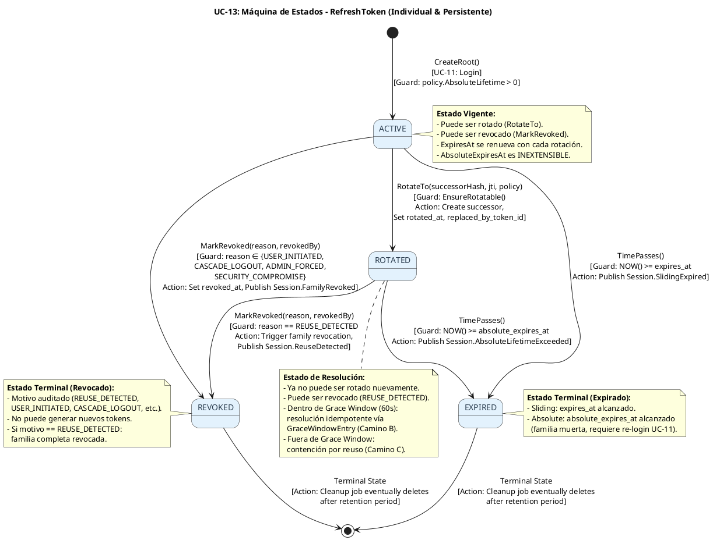
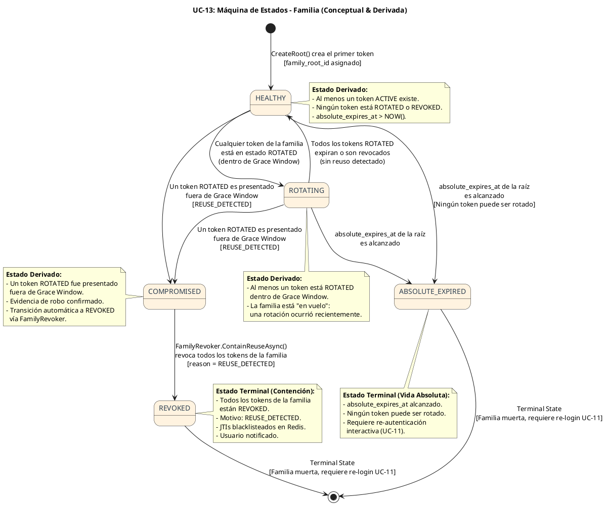

# UC-13: Renovar Sesión (Refresh Token) - Diagrama de Máquina de Estados

| Metadatos del Documento | |
| :--- | :--- |
| **Proyecto:** | SHUGO - Identity & Access Platform |
| **Caso de Uso:** | UC-13 - Renovar Sesión (Refresh Token Rotation & Reuse Detection) |
| **Documento:** | 05_State_Machine_Diagram.md |
| **Metodología:** | UML 2.5 + DDD (State Pattern) + Event-Driven State Transitions + Security by Design |
| **Autor:** | Gastón Ruiz |
| **Versión Actual:** | 1.0.0 |
| **Fecha:** | 07/10/2026 |

---

## Historial de Versiones

| Versión | Fecha | Autor | Descripción de Cambios | Impacto |
| :--- | :--- | :--- | :--- | :--- |
| **1.0.0** | 07/10/2026 | Gastón Ruiz | **Creación inicial.** Definición de dos máquinas de estados diferenciadas y complementarias para el UC-13: (1) la máquina de estados del `RefreshToken` individual (ACTIVE → ROTATED → REVOKED/EXPIRED) con resolución idempotente vía Grace Window; y (2) la máquina de estados **derivada** de la Familia (HEALTHY → ROTATING → COMPROMISED → REVOKED / ABSOLUTE_EXPIRED), que no se persiste explícitamente sino que se calcula a partir del estado agregado de sus tokens miembros. Se modelan las guardas críticas (`EnsureRotatable`, `IsWithinGraceWindow`, `IsAbsoluteExpired`), las transiciones que disparan eventos de dominio, y las condiciones de carrera que el lock de fila previene. | Documento base del paquete de diseño Tier 1 del UC-13. Establece las reglas de transición que gobiernan la rotación de tokens, la detección de reuso, la vida absoluta inextensible y la concurrencia legítima, garantizando que el dominio sea la única fuente de verdad sobre el estado de sesiones y familias. |

---

## 1. Introducción y Propósito

El **Diagrama de Máquina de Estados** para el UC-13 visualiza las restricciones de comportamiento temporal y las reglas de transición que gobiernan la rotación y contención de sesiones.

A diferencia de los UCs de gestión de identidad (ciclo de vida largo y lineal), el UC-13 introduce una complejidad arquitectónica única: **dos máquinas de estados acopladas pero no equivalentes**:

1. **Máquina del RefreshToken (Individual, Persistente):** Modela el ciclo de vida de un token específico: `ACTIVE` → `ROTATED` → `REVOKED` o `EXPIRED`. Es persistente, auditable y la fuente primaria de verdad para cada token.
2. **Máquina de la Familia (Conceptual, Derivada):** Modela el estado agregado de la cadena de tokens (`HEALTHY` → `ROTATING` → `COMPROMISED` → `REVOKED` / `ABSOLUTE_EXPIRED`). **No se persiste explícitamente** en base de datos; se deriva en tiempo de consulta a partir del estado de los tokens miembros. Esta decisión arquitectónica evita inconsistencias entre el estado declarado y el estado real de los tokens.

Estas máquinas garantizan:
- **Atomicidad de par:** Rotación y creación del sucesor son una sola transición de dominio.
- **Idempotencia bajo concurrencia:** La Grace Window permite múltiples presentaciones legítimas del mismo token ROTADO sin bifurcar la cadena.
- **Contención automática:** Un reuso fuera de ventana desencadena la transición a `COMPROMISED` y `REVOKED` de toda la familia.
- **Vida absoluta inextensible:** Ninguna transición de rotación puede mover `absolute_expires_at`.

---

## 2. Máquina de Estados #1: RefreshToken (Individual, Persistente)

### 2.1. Descripción

Esta máquina modela el ciclo de vida de un token específico en la base de datos. Cada transición es persistente, auditable y disparada por una operación de dominio (`RotateTo`, `MarkRevoked`, expiración temporal).

### 2.2. Diagrama de Máquina de Estados (PlantUML)



### 2.3. Descripción de Estados y Transiciones

| Estado | Descripción | Transiciones de Salida | Invariante Clave |
| :--- | :--- | :--- | :--- |
| **ACTIVE** | El token fue emitido (raíz por UC-11 o sucesor por UC-13) y es válido para renovar sesión. | → `ROTATED` (RotateTo), → `REVOKED` (MarkRevoked), → `EXPIRED` (tiempo). | `Status == ACTIVE` AND `NOW() < expires_at` AND `NOW() < absolute_expires_at`. |
| **ROTATED** | El token fue usado para rotar y crear un sucesor. Ya no puede ser usado como credencial primaria, pero puede ser presentado dentro de la Grace Window para resolución idempotente. | → `REVOKED` (REUSE_DETECTED), → `EXPIRED` (tiempo). | `RotatedAt != null` AND `ReplacedByTokenId != null`. |
| **REVOKED** | El token ha sido invalidado explícitamente (logout, contención por reuso, admin force, riesgo). | Ninguna (Estado Terminal). | `RevokedAt != null` AND `RevocationReason != null`. |
| **EXPIRED** | El token ha superado su tiempo de vida (sliding o absolute). | Ninguna (Estado Terminal). | `NOW() >= expires_at` O `NOW() >= absolute_expires_at`. |

### 2.4. Guardas (Guards) de las Transiciones

#### Transición: `ACTIVE` → `ROTATED` (La Atomicidad de Par)

Esta es la transición más crítica del UC-13. La guarda `EnsureRotatable()` verifica múltiples condiciones antes de permitir la rotación:

```csharp
private void EnsureRotatable(DateTime now)
{
    // Guarda 1: Estado actual debe ser ACTIVE
    if (this.Status != TokenStatus.ACTIVE)
        throw new DomainException($"Cannot rotate a token in status {this.Status}.");
    
    // Guarda 2: Vida absoluta de la familia no superada (INV-85)
    if (IsAbsoluteExpired(now))
        throw new DomainException("Family absolute lifetime exceeded.");
    
    // Guarda 3: Expiración deslizante no superada
    if (IsSlidingExpired(now))
        throw new DomainException("Refresh token sliding expiration exceeded.");
}

public RefreshToken RotateTo(
    RefreshTokenHash successorHash, string successorJti,
    RefreshPolicy policy, DateTime now)
{
    EnsureRotatable(now);

    var successor = new RefreshToken
    {
        Id = new RefreshTokenId(Guid.NewGuid()),
        TokenHash = successorHash,
        IdentityId = this.IdentityId,
        TenantId = this.TenantId,
        FamilyRootId = this.FamilyRootId,      // Hereda familia
        Context = this.Context,                // Hereda binding de contexto
        Generation = this.Generation + 1,
        Status = TokenStatus.ACTIVE,
        // RN-23: deslizante topada por la vida absoluta de la familia
        ExpiresAt = Min(now.Add(policy.SlidingLifetime), this.AbsoluteExpiresAt),
        AbsoluteExpiresAt = this.AbsoluteExpiresAt, // INEXTENSIBLE
        IssuedJti = successorJti,
        CreatedAt = now
    };

    // Mutación atómica: self pasa a ROTATED
    this.Status = TokenStatus.ROTATED;
    this.RotatedAt = now;
    this.ReplacedByTokenId = successor.Id;

    return successor;
}
```

**Justificación:** La atomicidad de par (mutación de self + creación de sucesor en un solo método) hace estructuralmente imposible:
- Rotar sin crear sucesor (sesión muerta silenciosa).
- Crear sucesor sin rotar (token de dos usos, violando INV-82).

#### Transición: `ROTATED` → `REVOKED` (Contención por Reuso)

Esta transición se dispara cuando un token `ROTATED` se presenta **fuera** de la Grace Window:

```csharp
public void MarkRevoked(RevocationReason reason, IdentityId? revokedBy, DateTime now)
{
    // Idempotencia de dominio: si ya está revocado, no hacer nada
    if (this.Status == TokenStatus.REVOKED) return;

    this.Status = TokenStatus.REVOKED;
    this.RevokedAt = now;
    this.RevocationReason = reason;
    this.RevokedByIdentityId = revokedBy;
}
```

**Nota:** La contención por reuso (`REUSE_DETECTED`) no solo revoca este token, sino que desencadena la revocación de **toda la familia** vía `FamilyRevoker.ContainReuseAsync()`.

#### Transición: `ACTIVE` / `ROTATED` → `EXPIRED` (Transiciones Temporales)

Estas transiciones no son disparadas por operaciones de dominio, sino por el paso del tiempo. Se evalúan en cada consulta:

```csharp
public bool IsSlidingExpired(DateTime now) => now >= this.ExpiresAt;
public bool IsAbsoluteExpired(DateTime now) => now >= this.AbsoluteExpiresAt;
```

**Justificación:** No se ejecuta un job que marque tokens como `EXPIRED` en la base de datos. En su lugar, la expiración se evalúa en tiempo de consulta (`EnsureRotatable` la verifica antes de permitir rotación). Esto evita jobs masivos de actualización y garantiza que la expiración sea siempre precisa.

---

## 3. Máquina de Estados #2: Familia (Conceptual, Derivada)

### 3.1. Descripción

A diferencia de la máquina del `RefreshToken`, la máquina de la **Familia** no se persiste explícitamente. El estado de la familia se **deriva** en tiempo de consulta a partir del estado agregado de sus tokens miembros. Esta decisión arquitectónica (ADR 4.1 del documento 04) evita inconsistencias entre el estado declarado y el estado real.

### 3.2. Diagrama de Máquina de Estados (PlantUML)



### 3.3. Descripción de Estados y Transiciones

| Estado | Descripción | Cómo se Deriva | Transiciones de Salida |
| :--- | :--- | :--- | :--- |
| **HEALTHY** | La familia está sana: al menos un token ACTIVE existe, ninguno está ROTATED o REVOKED, y la vida absoluta no ha expirado. | `COUNT(*) WHERE family_root_id = X AND status = ACTIVE > 0` AND `COUNT(*) WHERE status IN (ROTATED, REVOKED) == 0` AND `absolute_expires_at > NOW()`. | → `ROTATING` (rotación ocurre), → `COMPROMISED` (reuso detectado), → `ABSOLUTE_EXPIRED` (tiempo). |
| **ROTATING** | La familia está "en vuelo": al menos un token está ROTATED dentro de la Grace Window. Es un estado transitorio de concurrencia legítima. | `COUNT(*) WHERE status = ROTATED AND rotated_at + 60s > NOW() > 0`. | → `HEALTHY` (grace window expira sin reuso), → `COMPROMISED` (reuso detectado). |
| **COMPROMISED** | Evidencia de robo confirmado: un token ROTATED fue presentado fuera de la Grace Window. | `COUNT(*) WHERE status = ROTATED AND rotated_at + 60s <= NOW() > 0` AND ese token fue presentado nuevamente. | → `REVOKED` (contención automática). |
| **REVOKED** | Todos los tokens de la familia están REVOKED (por reuso, logout cascade, admin force, o riesgo). | `COUNT(*) WHERE status = ACTIVE == 0` AND `COUNT(*) WHERE status = REVOKED > 0`. | Ninguna (Estado Terminal). |
| **ABSOLUTE_EXPIRED** | La vida absoluta de la familia (30 días desde la raíz) ha expirado. Ningún token puede ser rotado. | `absolute_expires_at <= NOW()` en la fila raíz de la familia. | Ninguna (Estado Terminal). |

### 3.4. Lógica de Derivación (Código)

```csharp
public class FamilyStateCalculator
{
    public FamilyState DeriveState(
        DateTime absoluteExpiresAt,
        IEnumerable<RefreshToken> tokens,
        DateTime now,
        TimeSpan graceWindow)
    {
        // Guarda 1: Vida absoluta
        if (now >= absoluteExpiresAt)
            return FamilyState.ABSOLUTE_EXPIRED;

        var activeTokens = tokens.Where(t => t.Status == TokenStatus.ACTIVE).ToList();
        var rotatedTokens = tokens.Where(t => t.Status == TokenStatus.ROTATED).ToList();
        var revokedTokens = tokens.Where(t => t.Status == TokenStatus.REVOKED).ToList();

        // Guarda 2: Todos revocados
        if (activeTokens.Count == 0 && rotatedTokens.Count == 0 && revokedTokens.Count > 0)
            return FamilyState.REVOKED;

        // Guarda 3: Al menos un token ROTATED dentro de Grace Window
        var rotatingTokens = rotatedTokens.Where(t => t.IsWithinGraceWindow(now, graceWindow)).ToList();
        if (rotatingTokens.Count > 0)
            return FamilyState.ROTATING;

        // Guarda 4: Al menos un token ACTIVE
        if (activeTokens.Count > 0)
            return FamilyState.HEALTHY;

        // Caso borde: todos expirados (sliding) pero no revocados
        return FamilyState.ABSOLUTE_EXPIRED; // O un estado EXPIRED si se desea distinguirlo
    }
}

public enum FamilyState
{
    HEALTHY,
    ROTATING,
    COMPROMISED, // No se deriva directamente; se infiere cuando un token ROTATED se presenta fuera de grace
    REVOKED,
    ABSOLUTE_EXPIRED
}
```

---

## 4. Implementación en el Dominio (Código C#)

### 4.1. Aggregate Root `RefreshToken` con Máquina de Estados

```csharp
public class RefreshToken : Entity
{
    // ... Propiedades (Id, TokenHash, IdentityId, TenantId, FamilyRootId, Generation, Status, etc.) ...

    /// <summary>
    /// Transición ACTIVE → ROTATED (Atomicidad de Par)
    /// </summary>
    public RefreshToken RotateTo(
        RefreshTokenHash successorHash, string successorJti,
        RefreshPolicy policy, DateTime now)
    {
        EnsureRotatable(now);

        var successor = new RefreshToken
        {
            Id = new RefreshTokenId(Guid.NewGuid()),
            TokenHash = successorHash,
            IdentityId = this.IdentityId,
            TenantId = this.TenantId,
            FamilyRootId = this.FamilyRootId,
            Context = this.Context,
            Generation = this.Generation + 1,
            Status = TokenStatus.ACTIVE,
            ExpiresAt = Min(now.Add(policy.SlidingLifetime), this.AbsoluteExpiresAt),
            AbsoluteExpiresAt = this.AbsoluteExpiresAt,
            IssuedJti = successorJti,
            CreatedAt = now
        };

        this.Status = TokenStatus.ROTATED;
        this.RotatedAt = now;
        this.ReplacedByTokenId = successor.Id;

        return successor;
    }

    /// <summary>
    /// Transición ACTIVE/ROTATED → REVOKED (Idempotente)
    /// </summary>
    public void MarkRevoked(RevocationReason reason, IdentityId? revokedBy, DateTime now)
    {
        if (this.Status == TokenStatus.REVOKED) return; // Idempotencia

        this.Status = TokenStatus.REVOKED;
        this.RevokedAt = now;
        this.RevocationReason = reason;
        this.RevokedByIdentityId = revokedBy;
    }

    /// <summary>
    /// Guarda para transiciones ACTIVAS
    /// </summary>
    private void EnsureRotatable(DateTime now)
    {
        if (this.Status != TokenStatus.ACTIVE)
            throw new DomainException($"Cannot rotate a token in status {this.Status}.");
        if (IsAbsoluteExpired(now))
            throw new DomainException("Family absolute lifetime exceeded.");
        if (IsSlidingExpired(now))
            throw new DomainException("Refresh token sliding expiration exceeded.");
    }

    /// <summary>
    /// Evaluación de expiración (no muta estado, solo consulta)
    /// </summary>
    public bool IsWithinGraceWindow(DateTime now, TimeSpan window) =>
        this.Status == TokenStatus.ROTATED &&
        this.RotatedAt.HasValue &&
        this.RotatedAt.Value.Add(window) > now;

    public bool IsSlidingExpired(DateTime now) => now >= this.ExpiresAt;
    public bool IsAbsoluteExpired(DateTime now) => now >= this.AbsoluteExpiresAt;
}
```

### 4.2. Domain Service `FamilyRevoker` (Contención por Reuso)

```csharp
public class FamilyRevoker : IFamilyRevoker
{
    private readonly IRefreshTokenRepository _repo;
    private readonly IJtiBlacklist _jtiBlacklist;
    private readonly IOutboxPublisher _outbox;
    private readonly INotificationDispatcher _notifications;
    private readonly IClock _clock;

    public async Task<RefreshOutcome> ContainReuseAsync(
        RefreshToken presented, RefreshAttempt attempt, DateTime now, CancellationToken ct)
    {
        // 1. Marcar el token presentado como REVOKED (motivo REUSE_DETECTED)
        presented.MarkRevoked(RevocationReason.REUSE_DETECTED, presented.IdentityId, now);

        // 2. Revocar TODOS los tokens de la familia (set-based)
        var report = await _repo.RevokeFamilyAsync(
            presented.FamilyRootId, RevocationReason.REUSE_DETECTED,
            presented.IdentityId, now, ct);

        // 3. Publicar eventos de dominio
        await _outbox.PublishAsync(new SessionReuseDetected(
            presented.FamilyRootId, presented.Id, attempt.Context,
            legitimateDeviceId: presented.Context.DeviceId, now), ct);

        await _outbox.PublishAsync(new SessionFamilyRevoked(
            presented.FamilyRootId, report.TokensRevoked,
            report.ActiveJtis.Select(j => j.Jti).ToList(),
            RevocationReason.REUSE_DETECTED, now), ct);

        await _repo.CommitAsync(ct);

        // 4. Blacklistear JTIs vivos (Fail-Safe)
        try
        {
            await _jtiBlacklist.BlacklistAsync(report.ActiveJtis, now, ct);
        }
        catch (Exception ex)
        {
            // Log crítico, pero la familia ya está revocada en DB
        }

        // 5. Notificar al titular
        await _notifications.DispatchReuseAlertAsync(presented.IdentityId, attempt.Context, now, ct);

        return RefreshOutcome.Reject(RefreshRejection.ReuseDetected);
    }
}
```

---

## 5. Trazabilidad con Otros Documentos del Paquete

| Documento | Relación |
| :--- | :--- |
| `01_Requirements_Specification.md` | Las invariantes INV-82 (Rotación Single-Use), INV-83 (Reuse Detection), INV-84 (Grace Window), INV-85 (Vida Absoluta) se implementan como guardas y transiciones en estas máquinas. |
| `02_Use_Case_Diagram.md` | Las transiciones ACTIVE → ROTATED materializan UC-13a (Rotación Estándar); la transición ROTATED → REVOKED (fuera de grace) materializa UC-13c (Reuse Detection). |
| `03_Activity_Diagram.md` | Las decisiones "¿status == ACTIVE?" y "¿rotated_at + 60s > NOW?" son las guardas de las transiciones mostradas aquí. |
| `04_Initial_Domain_Model.md` | Los métodos `RotateTo()`, `MarkRevoked()`, `EnsureRotatable()`, `IsWithinGraceWindow()` son la implementación directa de estas máquinas. |
| `06_Robustness_Diagram.md` | Mostrará cómo los objetos colaboran para ejecutar estas transiciones de estado de forma segura. |
| `07_Sequence_Diagram.md` | Detallará el orden temporal exacto de las llamadas que disparan estas transiciones. |
| `10_UC_Specific_Data_Model.md` | Define las columnas físicas (`status`, `rotated_at`, `revoked_at`, `absolute_expires_at`) que persisten estos estados en PostgreSQL. |

---

## 6. Notas de Implementación

### 6.1. Testing de Máquinas de Estados

Cada transición y guarda definida en estas máquinas debe tener al menos dos tests unitarios:

```csharp
[Test]
public void RefreshToken_RotateTo_WhenAlreadyRotated_ThrowsDomainException()
{
    // Arrange
    var root = RefreshToken.CreateRoot(/* ... */);
    var s1 = root.RotateTo(Hash1(), "jti-2", Policy, Now);

    // Act
    var act = () => root.RotateTo(Hash2(), "jti-3", Policy, Now);

    // Assert
    act.Should().Throw<DomainException>().WithMessage("*ROTATED*");
}

[Test]
public void RefreshToken_RotateTo_CapsSlidingExpirationByAbsoluteLifetime()
{
    // Arrange
    var root = RefreshToken.CreateRoot(/* absolute = now + 30d */);
    
    // Act: Simular token cerca del fin absoluto (quedan 2h)
    var successor = root.RotateTo(Hash1(), "jti-2", Policy, Now.AddDays(30).AddHours(-2));

    // Assert
    successor.ExpiresAt.Should().Be(successor.AbsoluteExpiresAt); // Topada
    successor.AbsoluteExpiresAt.Should().Be(root.AbsoluteExpiresAt); // Inextensible
}

[Test]
public void RefreshToken_IsWithinGraceWindow_AtExactBoundary_ReturnsFalse()
{
    // Arrange
    var root = RefreshToken.CreateRoot(/* ... */);
    root.RotateTo(Hash1(), "jti-2", Policy, Now);

    // Act & Assert
    root.IsWithinGraceWindow(Now.AddSeconds(60), TimeSpan.FromSeconds(60)).Should().BeFalse();
    root.IsWithinGraceWindow(Now.AddSeconds(59), TimeSpan.FromSeconds(60)).Should().BeTrue();
}

[Test]
public void RefreshToken_MarkRevoked_WhenAlreadyRevoked_IsIdempotent()
{
    // Arrange
    var token = RefreshToken.CreateRoot(/* ... */);
    token.MarkRevoked(RevocationReason.USER_INITIATED, null, Now);

    // Act
    token.MarkRevoked(RevocationReason.USER_INITIATED, null, Now);

    // Assert
    token.Status.Should().Be(TokenStatus.REVOKED);
    token.RevokedAt.Should().Be(Now); // No se sobreescribe
}

[Test]
public void FamilyStateCalculator_WhenAllTokensRevoked_ReturnsREVOKED()
{
    // Arrange
    var tokens = new[]
    {
        CreateRevokedToken(),
        CreateRevokedToken()
    };

    // Act
    var state = calculator.DeriveState(absoluteExpiresAt: Now.AddDays(30), tokens, Now, graceWindow: TimeSpan.FromSeconds(60));

    // Assert
    state.Should().Be(FamilyState.REVOKED);
}

[Test]
public void FamilyStateCalculator_WhenRotatedTokenWithinGrace_ReturnsROTATING()
{
    // Arrange
    var tokens = new[]
    {
        CreateRotatedToken(rotatedAt: Now.AddSeconds(-30)) // Dentro de grace
    };

    // Act
    var state = calculator.DeriveState(absoluteExpiresAt: Now.AddDays(30), tokens, Now, graceWindow: TimeSpan.FromSeconds(60));

    // Assert
    state.Should().Be(FamilyState.ROTATING);
}
```

### 6.2. Concurrencia y Race Conditions

Dado que múltiples pestañas pueden rotar el mismo token simultáneamente, se debe manejar la concurrencia:

- **Problema:** Dos requests llegan al mismo tiempo con el mismo token ACTIVE. Ambas intentan transicionar a ROTATED y crear sucesores distintos.
- **Mitigación (Lock de Fila):** El repositorio usa `SELECT ... FOR UPDATE` para serializar las rotaciones. La primera request rota normalmente; la segunda espera, observa `ROTATED` y entra al Camino B (Grace Window).
- **Resultado:** La cadena permanece lineal bajo concurrencia legítima.

---

## 7. Glosario de Términos Específicos de UC-13

| Término | Definición |
| :--- | :--- |
| **Atomicidad de Par** | Garantía de que rotar un token y crear su sucesor ocurren en una sola transición de dominio (`RotateTo`), haciendo imposibles los estados intermedios inseguros. |
| **Estado Derivado** | Estado de la familia que no se persiste explícitamente, sino que se calcula en tiempo de consulta a partir del estado agregado de sus tokens miembros. |
| **Grace Window Resolution** | Transición idempotente donde un token ROTADO dentro de la ventana de 60s responde con el sucesor existente sin bifurcar la cadena. |
| **Reuse Detection Transition** | Transición de contención donde un token ROTADO fuera de la ventana de grace desencadena la revocación de toda la familia. |
| **Absolute Expiration Guard** | Guarda que previene cualquier rotación cuando `absolute_expires_at` ha sido alcanzado, eliminando la clase de ataque de Zombie Sessions. |
| **Family State Calculator** | Servicio que deriva el estado conceptual de la familia (HEALTHY, ROTATING, COMPROMISED, REVOKED, ABSOLUTE_EXPIRED) a partir del estado de sus tokens. |
| **Lock de Fila (FOR UPDATE)** | Mecanismo de serialización que previene la bifurcación de la cadena bajo concurrencia legítima multi-tab. |

---
*Fin del Documento 05_State_Machine_Diagram para UC-13*