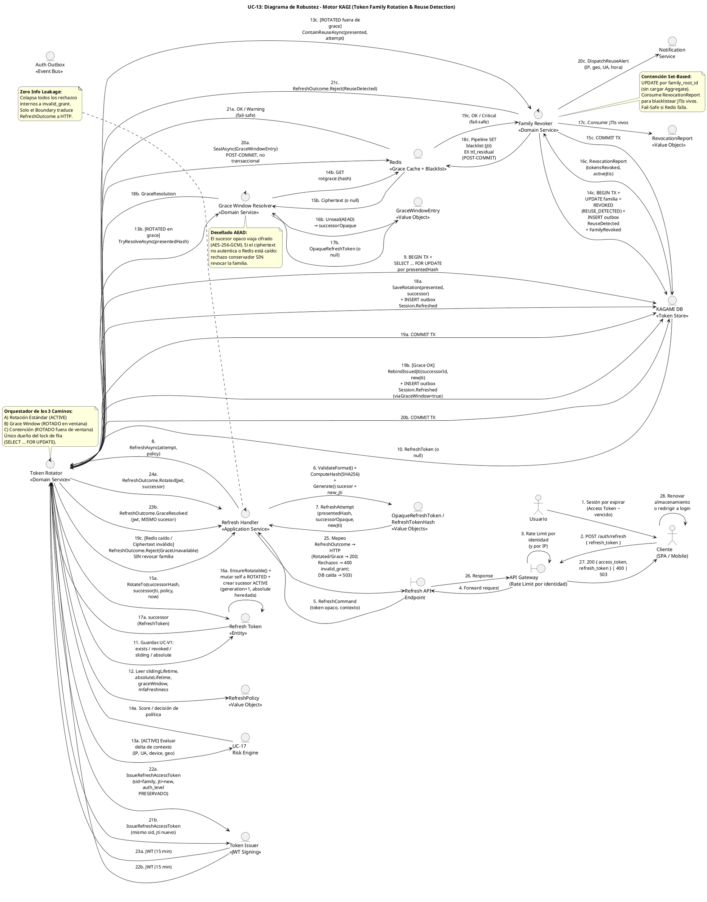

# UC-13: Renovar Sesión (Refresh Token) - Diagrama de Robustez

| Metadatos del Documento | |
| :--- | :--- |
| **Proyecto:** | SHUGO - Identity & Access Platform |
| **Caso de Uso:** | UC-13 - Renovar Sesión (Refresh Token Rotation & Reuse Detection) |
| **Documento:** | 06_Robustness_Diagram.md |
| **Metodología:** | ICONIX (Diagrama de Robustez) + DDD + Security by Design (Token Family Chain Validation) |
| **Autor:** | Gastón Ruiz |
| **Versión Actual:** | 1.0.0 |
| **Fecha:** | 07/10/2026 |

---

## Historial de Versiones

| Versión | Fecha | Autor | Descripción de Cambios | Impacto |
| :--- | :--- | :--- | :--- | :--- |
| **1.0.0** | 07/10/2026 | Gastón Ruiz | **Creación inicial.** Diagrama de Robustez para UC-13, validando la arquitectura del motor KAGI para la rotación de Refresh Tokens. Muestra la colaboración estricta entre Boundary Objects (API Gateway, Refresh Endpoint), Control Objects (RefreshHandler, TokenRotator, GraceWindowResolver, FamilyRevoker) y Entity Objects (RefreshToken, GraceWindowEntry, RefreshPolicy, RevocationReport, KAGAMI DB, Redis, Outbox). Valida el lock de fila anti-bifurcación, el sellado post-commit de la Grace Cache, el fallback conservador ante Redis caído, y la contención set-based por reuso con blacklisteado quirúrgico de JTIs. | Documento base del paquete de diseño Tier 1 del UC-13. Sirve como puente crítico entre el Modelo de Dominio (04/05) y el Diagrama de Secuencia (07), asegurando que la orquestación de los tres caminos (rotación, grace, contención) respete las reglas de acoplamiento de ICONIX y los límites transaccionales antes de codificar. |

---

## 1. Introducción y Propósito

El **Diagrama de Robustez** para el UC-13 valida que el flujo de renovación de sesiones puede ser orquestado respetando las reglas estrictas de acoplamiento de **ICONIX** y los principios de **Domain-Driven Design (DDD)**, **Zero Trust**, y **Fail-Safe Resilience**.

El desafío específico de este caso de uso es séxtuple:

1. **Atomicidad de Par bajo Concurrencia:** La rotación (mutar presentado + crear sucesor) debe ocurrir bajo un lock de fila que prevenga la bifurcación de la cadena cuando dos pestañas renuevan simultáneamente.
2. **Tres Caminos con Límites Transaccionales Distintos:** La rotación estándar committea antes de sellar la Grace Cache; la resolución de grace rebinding el JTI en una mini-transacción; la contención por reuso committea la revocación de familia antes del blacklisteado en Redis.
3. **Resolución Idempotente Cifrada:** El `GraceWindowResolver` debe desellar un sucesor opaco cifrado (AEAD) sin que el plaintext toque jamás Redis.
4. **Contención Set-Based sin Carga de Aggregate:** El `FamilyRevoker` revoca familias completas con un UPDATE por `family_root_id` y consume un `RevocationReport` para el blacklisteado quirúrgico de JTIs vivos.
5. **Degradaciones Diferenciadas:** Cuatro fallos de infraestructura distintos (DB en transacción, seal de grace, lectura de grace, blacklist en contención) con comportamientos y severidades diferentes.
6. **Zero Info Leakage en el Boundary:** Todos los rechazos internos (not found, revoked, sliding, absolute, grace unavailable, reuse) se colapsan a `invalid_grant` genérico en la capa de aplicación.

---

## 2. Diagrama de Robustez (PlantUML)

A continuación, se presenta el Diagrama de Robustez organizado de izquierda a derecha para mostrar el flujo natural: **Actor → Boundary → Control → Entity**.



---

## 3. Explicación Detallada de los Objetos

### 3.1. Boundary Objects (Objetos de Límite)

| Objeto | Responsabilidad | Mapeo a Clean Architecture |
| :--- | :--- | :--- |
| **`API Gateway`** | Aplica Rate Limiting **por identidad** (no solo por IP): un atacante con un token robado no debe poder sondear el endpoint de refresh a volumen ilimitado. Primera línea contra abuso del endpoint. | Middleware (Kong, AWS API Gateway). |
| **`Refresh API Endpoint`** | Recibe `POST /auth/refresh`, deserializa el payload a `RefreshCommand`, y es el **único lugar** donde un `RefreshOutcome` se traduce a un código HTTP. | Controller (ASP.NET Core). |

### 3.2. Control Objects (Objetos de Control)

| Objeto | Responsabilidad | Mapeo a Clean Architecture |
| :--- | :--- | :--- |
| **`Refresh Handler`** | **Application Service.** Prepara el intento (valida formato, computa hash, genera sucesor y JTI), delega al `TokenRotator`, y colapsa todos los rechazos internos a `invalid_grant` genérico (Zero Info Leakage). Decide entre 200, 400 y 503. | Application Service. |
| **`Token Rotator`** | **Domain Service.** Orquestador de los tres caminos. Único dueño del lock de fila (`SELECT ... FOR UPDATE`), de las guardas UC-V1, del orden transaccional (commit antes de Redis) y de la emisión del JWT con `auth_level` preservado. | Domain Service. |
| **`Grace Window Resolver`** | **Domain Service.** Encapsula la lectura y el desellado AEAD de la Grace Cache. Aísla al Rotator de los detalles criptográficos y del fallback conservador cuando el ciphertext no autentica. | Domain Service. |
| **`Family Revoker`** | **Domain Service.** Ejecuta la contención por reuso: revocación set-based de la familia, consumo del `RevocationReport`, blacklisteado fail-safe de JTIs y dispatch de la alerta al titular. | Domain Service. |

### 3.3. Entity Objects (Objetos de Entidad y Value Objects)

| Objeto | Responsabilidad | Mapeo a DDD / Infra |
| :--- | :--- | :--- |
| **`Refresh Token`** | **Entity.** Encapsula las invariantes de la cadena: `RotateTo()` (atomicidad de par), `MarkRevoked()` (idempotente), `EnsureRotatable()`, `IsWithinGraceWindow()`. | Entity (PostgreSQL `refresh_tokens`). |
| **`OpaqueRefreshToken / RefreshTokenHash`** | **Value Objects.** Generación de 256 bits de entropía y cómputo SHA256. El plaintext nunca se persiste. | Value Objects (Inmutables). |
| **`GraceWindowEntry`** | **Value Object.** Sella/desella el sucesor opaco con AEAD (AES-256-GCM) y TTL de 60s. | Value Object + puerto `IAeadCipher`. |
| **`RefreshPolicy`** | **Value Object.** Vidas deslizante/absoluta, Grace Window y frescura MFA por tenant, con guardas de sanidad en el constructor. | Value Object (config-driven). |
| **`RevocationReport`** | **Value Object.** Resultado de la revocación set-based: conteo y lista de `issued_jti` vivos con expiración residual. | Value Object (resultado de repositorio). |
| **`KAGAMI DB`** | **Infrastructure.** Fuente de verdad de la cadena. Ejecuta lock de fila, rotación atómica, revocación de familia y outbox en las mismas transacciones. | Infrastructure (PostgreSQL + EF Core). |
| **`Redis`** | **Infrastructure.** Doble rol: Grace Cache cifrada (`rotgrace:{hash}`) y Blacklist de JTIs (`blacklist:{jti}`). | Infrastructure (Cache distribuida). |
| **`Auth Outbox`** | **Infrastructure.** Tabla que garantiza entrega eventual de `Session.Refreshed`, `Session.ReuseDetected` y `Session.FamilyRevoked` a KAGE/KIZUNA. | Infrastructure (Outbox Pattern). |
| **`UC-17 Risk Engine`** | **Sistema Externo (Dominio hermano).** Evalúa el delta de contexto y devuelve score/decisión de política (step-up o revocación preventiva). | Domain Service de UC-17 (puerto). |
| **`Token Issuer`** | **Infrastructure/Dominio.** Firma el JWT sucesor con `sid = family_root_id`, `jti` nuevo y `auth_level`/`amr` preservados. | Domain Service (puerto `ITokenIssuer`). |
| **`Notification Service`** | **Infrastructure.** Canal humano de la contención: alerta al titular con contexto del reuso. | Infrastructure (puerto `INotificationDispatcher`). |

---

## 4. Reglas de Robustez de ICONIX (Validación del Diagrama)

Verifiquemos que nuestro diagrama cumple estrictamente las reglas de acoplamiento de ICONIX:

### ✅ Regla 1: Actor → Boundary
- **Cumplida:** El `Usuario` interactúa con el `Cliente`, y el `Cliente` interactúa con el `API Gateway`.

### ✅ Regla 2: Boundary → Boundary
- **Cumplida:** El `API Gateway` forward la request al `Refresh API Endpoint` tras aplicar Rate Limiting por identidad.

### ✅ Regla 3: Boundary → Control
- **Cumplida:** El `Refresh API Endpoint` envía el `RefreshCommand` al `Refresh Handler`. Ningún Boundary toca directamente un Domain Service.

### ✅ Regla 4: Control → Control
- **Cumplida y Crítica:** El `Refresh Handler` delega al `Token Rotator`; el `Token Rotator` delega al `Grace Window Resolver` (Camino B) y al `Family Revoker` (Camino C).
- **Validación:** Esto mantiene al Handler delgado (solo preparación criptográfica y mapeo HTTP) y encapsula cada estrategia de renovación/contención en un servicio de dominio especializado y testeable.

### ✅ Regla 5: Control → Entity
- **Cumplida:**
  - `Refresh Handler` crea/consume `OpaqueRefreshToken` y `RefreshTokenHash`.
  - `Token Rotator` invoca `RotateTo()` sobre `RefreshToken`, lee `RefreshPolicy`, persiste vía `KAGAMI DB`, sella `GraceWindowEntry` en `Redis`, y firma vía `Token Issuer`.
  - `Grace Window Resolver` desella `GraceWindowEntry` leyendo de `Redis`.
  - `Family Revoker` consume `RevocationReport`, escribe en `Redis` (Blacklist) y despacha vía `Notification Service`.

### ✅ Regla 6: NO Entity → Control / Boundary
- **Cumplida:** Ninguna entidad (`RefreshToken`, VOs, DB, Redis, Outbox, Risk, Issuer, Notif) envía mensajes de vuelta a controles o boundaries por iniciativa propia. Solo retornan datos como respuesta a una invocación.

### ✅ Regla 7: NO Entity → Entity (Directo sin Control)
- **Cumplida:** Todas las interacciones entre entidades están orquestadas por controles. Ejemplo: `RefreshToken` no escribe directamente en `Redis`; el `Token Rotator` coordina la persistencia en DB y el sellado en Grace Cache en el orden transaccional correcto.

---

## 5. Consideraciones de Arquitectura (Security & Resilience)

### 5.1. Lock de Fila como Responsabilidad Exclusiva del Token Rotator

El diagrama muestra que **solo el `Token Rotator`** ejecuta `BEGIN TX + SELECT ... FOR UPDATE` (pasos 9-10).

*   **Justificación:** Centralizar el lock en un único control evita que dos servicios distintos adquieran locks en órdenes diferentes (riesgo de deadlock) y garantiza que la serialización de rotaciones concurrentes —la que previene la bifurcación de la cadena— ocurra exactamente una vez por intento de renovación.
*   **Consecuencia de diseño:** El `Grace Window Resolver` y el `Family Revoker` **no** adquieren locks de fila: el primero solo lee Redis (estado ya serializado por la rotación previa), el segundo opera set-based sobre la familia (UPDATE por `family_root_id`), donde la contención es deseable y única.

### 5.2. Orden Transaccional: Commit Antes de Redis (Siempre)

Los tres caminos respetan el mismo principio: **la fuente de verdad (PostgreSQL) committea antes de tocar Redis**.

| Camino | Dentro de la TX | Post-Commit (Redis) |
| :--- | :--- | :--- |
| **A (Rotación)** | INSERT sucesor + UPDATE presentado + INSERT outbox | Seal de Grace Cache (warning si falla) |
| **B (Grace)** | Rebind de `issued_jti` + INSERT outbox | — (solo lectura previa de Redis) |
| **C (Contención)** | UPDATE familia + INSERT outbox ×2 | Pipeline de Blacklist de JTIs (critical si falla) |

*   **Justificación:** Si Redis cae después del commit, el estado de la cadena ya es duradero y correcto; solo se degrada una optimización (grace) o se abre una ventana acotada y alertada (blacklist). Si Redis se escribiera dentro de la TX, una caída de Redis abortaría rotaciones legítimas o dejaría transacciones colgadas sosteniendo locks de fila.

### 5.3. Fallback Conservador del Grace Window Resolver

El paso 19c del Camino B modela la decisión más sutil del UC-13:

*   **Escenario:** Un token `ROTADO` se presenta dentro de la ventana teórica de 60s, pero `rotgrace:{hash}` no existe o su ciphertext no autentica (Redis caído, clave KMS rotada, manipulación).
*   **Comportamiento:** `Reject(GraceUnavailable)` → HTTP 400 `invalid_grant`, **sin revocar la familia**.
*   **Justificación:** Revocar la familia ante una indisponibilidad de cache convertiría un outage de infraestructura en un bloqueo masivo de usuarios legítimos (falsos positivos destructivos). La pestaña que posee el sucesor legítimo continúa normalmente; la pestaña concurrente simplemente reintenta tras el próximo refresh exitoso.

### 5.4. Contención Set-Based y Blacklisteado Quirúrgico

El `Family Revoker` no carga la familia como Aggregate (ADR 4.1 del documento 04):

1. **Revocación:** Un único `UPDATE ... WHERE family_root_id = X` (set-based, O(1) round-trips).
2. **Reporte:** El repositorio retorna un `RevocationReport` con los `issued_jti` de las filas que estaban activas.
3. **Blacklist:** Pipeline de Redis con TTL residual por JTI, cerrando los Access Tokens vivos (≤15 min) que de otro modo seguirían siendo aceptados.
4. **Fail-Safe:** Si el pipeline falla, se loguea `LogCritical` y la contención **ya es efectiva** en la fuente de verdad (no se pueden generar nuevos Access Tokens).

### 5.5. Zero Info Leakage como Responsabilidad del Boundary

El diagrama concentra el mapeo `RefreshOutcome → HTTP` en el `Refresh Handler` y el `Refresh API Endpoint` (pasos 25-27):

*   Siete rechazos internos distintos (`NotFound`, `Revoked`, `SlidingExpired`, `AbsoluteExpired`, `GraceUnavailable`, `ReuseDetected`, `RiskRevoked`) se colapsan a **un solo** código y mensaje: `400 invalid_grant`.
*   Las únicas excepciones son `400 invalid_request` (formato malformado, detectado antes de tocar DB) y `503 service_unavailable` (Fail-Secure ante caída de KAGAMI).
*   **Justificación:** Cualquier diferenciación en códigos, mensajes o tiempos permitiría a un atacante con un token robado sondear el estado de la familia (enumeración de estado de sesiones).

### 5.6. Risk Hook y Step-Up como Colaboración Condicional

La interacción `Rotator → Risk` (pasos 13a-14a) es condicional por política de tenant:

*   Si el score supera el umbral y la política es `step-up`, el Rotator retorna un outcome de MFA **sin rotar la cadena** (evita sucesores huérfanos si el usuario abandona el step-up).
*   Si la política es `revoke`, el Rotator delega la revocación preventiva al mismo `Family Revoker` con motivo `SECURITY_COMPROMISE`, reutilizando el mecanismo de contención ya validado.

---

## 6. Trazabilidad con Otros Documentos del Paquete

| Documento | Relación |
| :--- | :--- |
| `01_Requirements_Specification.md` | Valida que los escenarios 2.1-2.3 y 4.1-4.8, las invariantes INV-82 a INV-88 y las reglas RN-23 a RN-26 pueden implementarse con los objetos definidos. |
| `02_Use_Case_Diagram.md` | Los controles `TokenRotator`, `GraceWindowResolver` y `FamilyRevoker` materializan UC-13a/13d, UC-13b y UC-13c + UC-V2/V3; las guardas del Rotator materializan UC-V1. |
| `03_Activity_Diagram.md` | Los carriles de actividad (KAGI, KAGAMI, Redis, UC-17, KAGE, Notification) se mapean directamente a los controles y entidades de este diagrama. |
| `04_Initial_Domain_Model.md` | `RefreshToken`, `OpaqueRefreshToken`, `GraceWindowEntry`, `RefreshPolicy`, `RevocationReport`, `TokenRotator`, `GraceWindowResolver` y `FamilyRevoker` son exactamente las clases definidas en el modelo de dominio. |
| `05_State_Machine_Diagram.md` | Las transiciones ACTIVE → ROTATED → REVOKED/EXPIRED se ejecutan cuando el `TokenRotator` invoca `RotateTo()` / `MarkRevoked()` sobre la Entity. |
| `07_Sequence_Diagram.md` | Este diagrama define "qué objetos colaboran"; el de secuencia definirá "en qué orden temporal exacto" se envían los mensajes, incluidos los commits y los seals post-commit. |
| `08_Final_Class_Design.md` | Definirá las firmas exactas de los métodos mostrados aquí (ej. `TokenRotator.RefreshAsync()`, `GraceWindowResolver.TryResolveAsync()`, `FamilyRevoker.ContainReuseAsync()`). |
| `10_UC_Specific_Data_Model.md` | Las columnas `family_root_id`, `generation`, `issued_jti`, `rotated_at` y `replaced_by_token_id` soportan las operaciones set-based y el rebind de JTI modelados aquí. |

---

## 7. Notas de Implementación

### 7.1. Inyección de Dependencias

```csharp
// Program.cs / Startup.cs

// Capa de Aplicación (por request)
services.AddScoped<IRefreshHandler, RefreshHandler>();

// Capa de Dominio (Scoped: comparten UoW/transacción del request)
services.AddScoped<ITokenRotator, TokenRotator>();
services.AddScoped<IGraceWindowResolver, GraceWindowResolver>();
services.AddScoped<IFamilyRevoker, FamilyRevoker>();

// Puertos de Infraestructura
services.AddScoped<IRefreshTokenRepository, RefreshTokenRepository>();   // EF Core + FOR UPDATE
services.AddScoped<IGraceWindowCache, RedisGraceWindowCache>();
services.AddScoped<IJtiBlacklist, RedisJtiBlacklist>();
services.AddScoped<IOutboxPublisher, OutboxPublisher>();
services.AddScoped<INotificationDispatcher, NotificationDispatcher>();

// Singletons stateless
services.AddSingleton<IAeadCipher, KmsAesGcmCipher>();       // Clave en KMS, rotación automática
services.AddSingleton<ITokenIssuer, JwtTokenIssuer>();
services.AddSingleton<IClock, SystemClock>();
```

### 7.2. Mapeo de Outcome a HTTP (Zero Info Leakage)

```csharp
public async Task<IActionResult> RefreshAsync(RefreshCommand command, CancellationToken ct)
{
    // 1. Validación de formato ANTES de tocar dominio (único 400 diferenciado)
    if (!OpaqueRefreshToken.TryNormalize(command.RefreshToken, out var presented))
        return BadRequest(new ErrorResponse("invalid_request", "Malformed refresh token."));

    var attempt = RefreshAttempt.Create(presented, ExtractContext(HttpContext));
    var policy  = await _policyResolver.ResolveForTenantAsync(attempt.TenantId, ct);

    // 2. Delegación al dominio
    RefreshOutcome outcome;
    try
    {
        outcome = await _tokenRotator.RefreshAsync(attempt, policy, ct);
    }
    catch (InfrastructureException)
    {
        // Fail-Secure: sin fuente de verdad no hay rotación válida
        return StatusCode(503, new ErrorResponse("service_unavailable", "Session service temporarily unavailable."));
    }

    // 3. Colapso de rechazos: UN solo código y mensaje para todos
    return outcome.Match(
        rotated:   r => Ok(new RefreshResponse(r.AccessToken, r.SuccessorOpaque.Value, 900)),
        grace:     g => Ok(new RefreshResponse(g.AccessToken, g.SuccessorOpaque.Value, 900)),
        mfaStepUp: m => Ok(new MfaRequiredResponse(m.MfaToken, m.AllowedMethods)),
        reject:    _ => BadRequest(new ErrorResponse("invalid_grant", "The provided refresh token is not valid."))
    );
}
```

### 7.3. Convenciones de Nomenclatura del Diagrama

- **Controles:** Sufijo por rol (`Handler` = aplicación, `Rotator`/`Resolver`/`Revoker` = dominio), comunicando inmediatamente la capa y la responsabilidad.
- **Entidades:** Los VOs se agrupan visualmente cuando comparten propósito criptográfico (`OpaqueRefreshToken / RefreshTokenHash`), reduciendo ruido sin perder precisión.
- **Notas:** Cada nota cita el mecanismo de seguridad que justifica la colaboración (lock de fila, AEAD, set-based, Zero Info Leakage), manteniendo el diagrama autoexplicativo para revisores de seguridad.

---
*Fin del Documento 06_Robustness_Diagram para UC-13*