# UC-13: Renovar Sesión (Refresh Token) - Diagrama de Secuencia

| Metadatos del Documento | |
| :--- | :--- |
| **Proyecto:** | SHUGO - Identity & Access Platform |
| **Caso de Uso:** | UC-13 - Renovar Sesión (Refresh Token Rotation & Reuse Detection) |
| **Documento:** | 07_Sequence_Diagram.md |
| **Metodología:** | ICONIX (Diagrama de Secuencia) + DDD + Security by Design (Token Family Chain Validation) |
| **Autor:** | Gastón Ruiz |
| **Versión Actual:** | 1.0.0 |
| **Fecha:** | 07/10/2026 |

---

## Historial de Versiones

| Versión | Fecha | Autor | Descripción de Cambios | Impacto |
| :--- | :--- | :--- | :--- | :--- |
| **1.0.0** | 07/10/2026 | Gastón Ruiz | **Creación inicial.** Diagrama de Secuencia completo para UC-13. Modela el orden temporal exacto de la renovación: preparación criptográfica pre-transacción, lock de fila con guardas de cadena (UC-V1), los tres caminos mutuamente excluyentes (Rotación Estándar, Grace Window, Reuse Detection) con sus límites transaccionales y operaciones post-commit, y el colapso final de rechazos a `invalid_grant` (Zero Info Leakage). Incluye el ordenamiento estricto "commit antes de Redis" y la emisión de JWT únicamente sobre rotaciones commiteadas. | Documento base del paquete de diseño Tier 1 del UC-13. Sirve como guion temporal exacto para la codificación del `TokenRotator`, garantizando que los locks se sostengan el mínimo tiempo, que ningún Access Token se emita sobre estado no duradero, y que cada degradación de infraestructura tenga un comportamiento definido y alertado. |

---

## 1. Introducción y Propósito

El **Diagrama de Secuencia** para el UC-13 materializa temporalmente las colaboraciones definidas en el Diagrama de Robustez. Su propósito es:

1. **Definir el orden exacto de las operaciones criptográficas y transaccionales:** Establecer que el hash, el sucesor opaco y el `new_jti` se generan **antes** de adquirir el lock de fila, minimizando el tiempo de sostenimiento del lock.
2. **Modelar los límites transaccionales por camino:** Mostrar qué escrituras ocurren dentro de cada transacción y cuáles son post-commit (seal de Grace Cache, pipeline de Blacklist), con sus comportamientos de fallo diferenciados.
3. **Visualizar la serialización de concurrencia:** Demostrar cómo dos pestañas que renuevan simultáneamente se serializan en el lock: la primera rota (Camino A), la segunda observa `ROTATED` y resuelve vía Grace Window (Camino B).
4. **Garantizar emisión de JWT sobre estado duradero:** El Access Token sucesor solo se firma **después** del `COMMIT` de la rotación, nunca sobre estado transaccional pendiente.
5. **Documentar el colapso Zero Info Leakage:** Siete rechazos internos distintos convergen en un único `400 invalid_grant` en el boundary.

---

## 2. Diagrama de Secuencia - Escenario Principal (PlantUML)

```plantuml
@startuml UC-13_Secuencia
<style>
diagram {
  BackgroundColor #FEFEFE
}
sequence {
  ArrowThickness 2
  ArrowColor #2C3E50
  ParticipantPadding 12
  BoxPadding 10
}
</style>

title UC-13: Diagrama de Secuencia - Refresh Token Rotation (Family Chain & Reuse Detection)

' ============================================
' PARTICIPANTES (Lifelines)
' ============================================
actor "Usuario" as User
participant "Cliente\n(SPA/Mobile)" as Client
participant "API Gateway\n(Rate Limit)" as GW
participant "Refresh API\nEndpoint" as API
participant "Refresh Handler\n<<App Service>>" as Handler
participant "Token Rotator\n<<Domain Service>>" as Rotator
participant "Grace Window\nResolver" as GraceResolver
participant "Family Revoker\n<<Domain Service>>" as Revoker
participant "KAGAMI DB\n<<Token Store>>" as DB
participant "Redis\n<<Grace+Blacklist>>" as Redis
participant "UC-17\nRisk Engine" as Risk
participant "Token Issuer\n<<JWT>>" as Issuer
participant "Auth Outbox\n<<KAGE>>" as Outbox
participant "Notification\nService" as Notif

' ============================================
' FASE 1: INGRESS Y PREPARACIÓN CRIPTOGRÁFICA
' ============================================
User -> Client : 1. Access Token por expirar
Client -> GW : 2. POST /auth/refresh\n{ refresh_token }
activate GW
GW -> GW : 3. Rate Limit por identidad y por IP
GW -> API : 4. Forward request
deactivate GW
activate API
API -> Handler : 5. RefreshCommand(token, contexto)
activate Handler

Handler -> Handler : 6. ValidateFormat()\n(malformado → 400 invalid_request)
Handler -> Handler : 7. presentedHash = SHA256(token)\nsuccessorOpaque = Generate256()\nnewJti = UUID()
note right of Handler
  **Pre-transacción:**
  Todo el trabajo criptográfico
  se hace ANTES del lock de fila
  para minimizar su duración.
end note

' ============================================
' FASE 2: LOCK DE FILA Y GUARDAS DE CADENA (UC-V1)
' ============================================
Handler -> Rotator : 8. RefreshAsync(attempt, policy)
activate Rotator

Rotator -> DB : 9. BEGIN TX +\nSELECT ... FOR UPDATE\nWHERE token_hash = presentedHash
activate DB

alt Excepción de infraestructura (DB caída / timeout)
  DB --> Rotator : 10a. InfrastructureException
  Rotator --> Handler : 11a. Propaga excepción
  Handler --> API : 12a. HTTP 503 service_unavailable\n(FAIL-SECURE: sin fuente de verdad no hay rotación)
  API --> Client : 13a. 503 + Retry-After
else DB disponible
  DB --> Rotator : 10b. RefreshToken | null
  deactivate DB

  alt Token NO existe
    Rotator --> Handler : 11b. Reject(NotFound)
  else Token REVOKED
    Rotator --> Handler : 11c. Reject(Revoked)
  else Expiración deslizante superada
    Rotator --> Handler : 11d. Reject(SlidingExpired)
  else Vida absoluta superada (INV-85)
    Rotator -> Outbox : 11e. INSERT Session.\nAbsoluteLifetimeExceeded
    Rotator -> DB : 12e. COMMIT TX
    Rotator --> Handler : 13e. Reject(AbsoluteExpired)
  else Cadena válida (ACTIVE o ROTATED)

    ' ============================================
    ' CAMINO A: ROTACIÓN ESTÁNDAR (status == ACTIVE)
    ' ============================================
    alt status == ACTIVE
      opt Política de contexto habilitada
        Rotator -> Risk : 14a. Evaluar delta de contexto\n(IP, UA, device, geo)
        activate Risk
        Risk --> Rotator : 15a. Score / decisión
        deactivate Risk
        alt Score > umbral AND política == revoke
          Rotator -> Revoker : 16a. Revocación preventiva\n(SECURITY_COMPROMISE)
          Revoker --> Rotator : 17a. Outcome.Reject(RiskRevoked)
        else Score > umbral AND política == step-up
          Rotator --> Handler : 16b. Outcome.MfaStepUp\n(SIN rotar la cadena)
        end
      end

      opt Frescura de MFA expirada
        Rotator --> Handler : 18a. Outcome.MfaStepUp\n(SIN rotar la cadena)
      end

      Rotator -> Rotator : 19a. token.RotateTo(successorHash,\nsuccessorJti, policy, now)
      note right of Rotator
        **Atomicidad de Par:**
        self → ROTATED (rotated_at,
        replaced_by) y sucesor ACTIVE
        (generation+1, absolute heredada,
        sliding topada) en un solo acto.
      end note

      Rotator -> DB : 20a. INSERT sucesor +\nUPDATE presentado = ROTATED +\nINSERT outbox Session.Refreshed
      Rotator -> DB : 21a. COMMIT TX
      note right of DB
        **Lock liberado aquí.**
        Nada de Redis ni firma JWT
        ocurre dentro de la TX.
      end note

      Rotator -> Redis : 22a. SealAsync(GraceWindowEntry)\n[AES-256-GCM, TTL 60s] POST-COMMIT
      activate Redis
      Redis --> Rotator : 23a. OK | Warning (fail-safe)
      deactivate Redis

      Rotator -> Issuer : 24a. IssueRefreshAccessToken\n(sid = family, jti = new,\nauth_level/amr PRESERVADOS)
      activate Issuer
      Issuer --> Rotator : 25a. access_token (15 min)
      deactivate Issuer

      Rotator --> Handler : 26a. Outcome.Rotated(jwt, successorOpaque)

    ' ============================================
    ' CAMINO B: GRACE WINDOW (ROTADO en ventana)
    ' ============================================
    else status == ROTATED y dentro de grace (60s)
      Rotator -> GraceResolver : 14b. TryResolveAsync(presentedHash)
      activate GraceResolver
      GraceResolver -> Redis : 15b. GET rotgrace:{hash}
      activate Redis
      Redis --> GraceResolver : 16b. ciphertext | null
      deactivate Redis
      GraceResolver -> GraceResolver : 17b. Unseal(AEAD)\n(no autentica → null)
      GraceResolver --> Rotator : 18b. GraceResolution
      deactivate GraceResolver

      alt Grace disponible
        Rotator -> DB : 19b. UPDATE successor.issued_jti = newJti +\nINSERT outbox Session.Refreshed\n(viaGraceWindow = true)
        Rotator -> DB : 20b. COMMIT TX
        Rotator -> Issuer : 21b. IssueRefreshAccessToken\n(mismo sid, jti nuevo)
        Issuer --> Rotator : 22b. access_token (15 min)
        Rotator --> Handler : 23b. Outcome.GraceResolved\n(jwt, MISMO sucesor opaco)
        note right of Handler
          **Idempotencia (INV-84):**
          Sin bifurcación de cadena,
          sin incremento de generation,
          sin revocación de familia.
        end note
      else Redis caído o ciphertext inválido
        Rotator --> Handler : 19c. Reject(GraceUnavailable)\nSIN revocar familia\n(fallback conservador)
      end

    ' ============================================
    ' CAMINO C: REUSE DETECTION (ROTADO fuera de ventana)
    ' ============================================
    else status == ROTATED y fuera de grace
      Rotator -> Revoker : 14c. ContainReuseAsync(presented, attempt)
      activate Revoker
      Revoker -> DB : 15c. BEGIN TX +\nUPDATE familia = REVOKED\n(REUSE_DETECTED) +\nINSERT outbox ReuseDetected\n+ FamilyRevoked
      Revoker -> DB : 16c. COMMIT TX
      DB --> Revoker : 17c. RevocationReport\n(tokensRevoked, activeJtis)
      Revoker -> Redis : 18c. Pipeline SET blacklist:{jti}\nEX ttl_residual [POST-COMMIT]
      activate Redis
      Redis --> Revoker : 19c. OK | CRITICAL (fail-safe)
      deactivate Redis
      note right of Revoker
        **Fail-Safe:**
        Si Redis falla, la familia
        YA está revocada en DB.
        Los Access Tokens vivirán
        ≤15 min (riesgo alertado).
      end note
      Revoker -> Notif : 20c. DispatchReuseAlert\n(IP, geo, UA, hora del reuso)
      Revoker --> Rotator : 21c. Outcome.Reject(ReuseDetected)
      deactivate Revoker
    end
  end
end
deactivate Rotator

' ============================================
' FASE 4: MAPEO A HTTP (ZERO INFO LEAKAGE)
' ============================================
Handler -> Handler : 27. Colapsar rechazos:\nNotFound | Revoked | Sliding |\nAbsolute | GraceUnavailable |\nReuseDetected | RiskRevoked\n→ invalid_grant genérico
Handler --> API : 28. IActionResult\n(200 tokens | 200 mfa | 400 | 503)
deactivate Handler
API --> GW : 29. Response
deactivate API
GW --> Client : 30. 200 { access_token, refresh_token }\n| 200 { mfa_required } | 400 | 503
Client -> Client : 31. Renovar almacenamiento\no redirigir a login (UC-11)

@enduml
```



---

## 3. Análisis Detallado del Flujo

### 3.1. Fase 1: Ingress y Preparación Criptográfica (Pasos 1-7)

**Participantes:** `Usuario`, `Cliente`, `API Gateway`, `Refresh Handler`

*   **Acción:** El Gateway aplica Rate Limiting **por identidad** (un token robado no debe permitir sondeo ilimitado). El Handler valida formato, computa `SHA256(token)`, genera el sucesor opaco de 256 bits y el `new_jti`.
*   **Justificación de Orden:** Toda la criptografía ocurre **antes** de adquirir el lock de fila. Generar el sucesor dentro de la transacción extendería innecesariamente la duración del lock bajo concurrencia multi-tab.

### 3.2. Fase 2: Lock de Fila y Guardas de Cadena (Pasos 8-13)

**Participantes:** `Token Rotator`, `KAGAMI DB`, `Auth Outbox`

*   **Acción:** `BEGIN TX + SELECT ... FOR UPDATE` por `token_hash`. Las cuatro guardas de UC-V1 se evalúan en orden fail-fast: existencia → revocación → expiración deslizante → vida absoluta.
*   **Fail-Secure (Paso 12a):** Una excepción de infraestructura en este punto propaga a HTTP 503. **Nunca** se emiten tokens sin validar y rotar contra la fuente de verdad.
*   **Vida Absoluta (Pasos 11e-13e):** Es la única guarda que publica evento (`Session.AbsoluteLifetimeExceeded`) antes de rechazar, porque representa el fin natural de la familia y debe ser visible para métricas de re-autenticación.

### 3.3. Camino A: Rotación Estándar (Pasos 14a-26a)

**Participantes:** `Token Rotator`, `UC-17 Risk Engine`, `RefreshToken`, `KAGAMI DB`, `Redis`, `Token Issuer`

*   **Orden crítico:**
    1. Risk hook y frescura MFA **antes** de rotar (un step-up no debe dejar sucesores huérfanos).
    2. `RotateTo()` muta el par atómicamente en memoria de dominio.
    3. **Una sola transacción:** INSERT sucesor + UPDATE presentado + INSERT outbox `Session.Refreshed`.
    4. `COMMIT` → **liberación del lock**.
    5. Seal de Grace Cache **post-commit** (fail-safe con warning).
    6. Firma del JWT **post-commit** (nunca sobre estado no duradero).
*   **Justificación:** El Access Token sucesor solo existe después de que la rotación es duradera. Si el proceso cae entre el commit y la firma, el cliente simplemente reintenta con el sucesor ya persistido (que está ACTIVE): el sistema es auto-recuperable.

### 3.4. Camino B: Grace Window (Pasos 14b-23b / 19c)

**Participantes:** `Token Rotator`, `Grace Window Resolver`, `Redis`, `KAGAMI DB`, `Token Issuer`

*   **Acción:** Lectura y desellado AEAD del sucesor existente; mini-transacción para re-vincular `issued_jti` del sucesor al nuevo JWT y auditar `viaGraceWindow = true`; firma de JWT; retorno del **mismo** sucesor opaco.
*   **Fallback Conservador (Paso 19c):** Si Redis está caído o el ciphertext no autentica, se rechaza **sin revocar la familia**. La pestaña que posee el sucesor legítimo continúa normalmente.

### 3.5. Camino C: Reuse Detection (Pasos 14c-21c)

**Participantes:** `Token Rotator`, `Family Revoker`, `KAGAMI DB`, `Redis`, `Notification Service`

*   **Acción:** Transacción única con UPDATE set-based de la familia + dos eventos de outbox; commit; pipeline de Blacklist post-commit con TTL residual; alerta al titular; rechazo opaco.
*   **Justificación del Orden:** El blacklisteado de JTIs es post-commit porque depende del `RevocationReport` producido por el commit. Si fallara, la contención principal (no más renovaciones) ya es duradera; solo queda abierta la ventana residual de Access Tokens (≤15 min), alertada como `LogCritical`.

### 3.6. Fase 4: Colapso Zero Info Leakage (Pasos 27-31)

**Participantes:** `Refresh Handler`, `Refresh API Endpoint`, `API Gateway`, `Cliente`

*   **Acción:** Siete rechazos internos distintos se colapsan a un único `400 invalid_grant`. Las únicas respuestas diferenciadas son `200` (tokens o step-up), `400 invalid_request` (formato, pre-dominio) y `503` (Fail-Secure).
*   **Justificación:** Un atacante con un token robado no debe poder distinguir "token revocado" de "token de otra familia" de "reuse detectado": la contención y la notificación al titular son los canales reales de comunicación, no los códigos HTTP.

---

## 4. Flujos Alternativos y Excepciones

### 4.1. Concurrencia Legítima: Dos Pestañas Renuevan Simultáneamente

```text
T0:   Pestaña 1: SELECT ... FOR UPDATE (adquiere lock)
T0+ε: Pestaña 2: SELECT ... FOR UPDATE (BLOQUEADA esperando lock)
T1:   Pestaña 1: RotateTo → COMMIT (libera lock) → seal grace → 200 con sucesor S
T2:   Pestaña 2: lock adquirido; observa status = ROTATED, rotated_at ≈ ahora
T3:   Pestaña 2: entra al Camino B → GET rotgrace → desella S → 200 con el MISMO S
```

**Resultado:** La cadena permanece lineal (un solo sucesor S), ambas pestañas quedan consistentes, y `generation` no se bifurca. Sin el lock de fila, Pestaña 2 habría creado un sucesor S' paralelo y la siguiente presentación de S o S' habría disparado una contención por falso positivo.

### 4.2. Caída de KAGAMI DB durante la Rotación

```
Rotator -> DB (BEGIN/SELECT) -> InfrastructureException -> Handler -> API -> Client (503 + Retry-After)
```

**Comportamiento:** Fail-Secure. No hay rotación parcial, no hay tokens emitidos, no hay grace sellada. El cliente reintenta con backoff; el token original permanece ACTIVE y reutilizable hasta que la DB recupere.

### 4.3. Caída de Redis en los Tres Puntos de Contacto

| Punto | Camino | Comportamiento | Severidad de Log |
| :--- | :--- | :--- | :--- |
| Seal de Grace Cache (paso 22a) | A | Rotación válida continúa; concurrencia futura caerá al rechazo conservador | Warning |
| Lectura de Grace Cache (paso 15b) | B | `Reject(GraceUnavailable)` sin revocar familia | Warning |
| Pipeline de Blacklist (paso 18c) | C | Contención ya duradera en DB; ventana residual ≤15 min alertada | **Critical** |

### 4.4. Step-Up por Riesgo o Frescura de MFA

```
Rotator -> Risk (score alto, política step-up) -> Handler -> Client (200 { mfa_required, mfa_token })
```

**Comportamiento:** La cadena **no se rota**. El token presentado permanece ACTIVE para que, tras completar UC-15, la renovación se reanude normalmente. Esto evita sucesores huérfanos si el usuario abandona el step-up.

### 4.5. Reuse Detection con Notificación al Titular

```
Rotator -> Revoker -> DB (familia REVOKED + outbox ×2) -> Redis (blacklist JTIs) -> Notif (alerta con IP/geo/UA/hora) -> Handler -> Client (400 invalid_grant)
```

**Comportamiento:** El atacante recibe un 400 opaco; el titular recibe una alerta accionable; el SOC recibe `Session.ReuseDetected` con contexto forense del atacante y `deviceId` legítimo.

---

## 5. Consideraciones de Arquitectura (Security & Performance)

### 5.1. Duración del Lock de Fila Acotada por Diseño

El lock (`SELECT ... FOR UPDATE`) se sostiene **únicamente** durante: evaluación de guardas + `RotateTo()` en memoria + escrituras de la transacción + `COMMIT`. Ni el seal de Redis, ni la firma JWT, ni la notificación ocurren dentro de la TX.

*   **Métrica objetivo:** Duración de lock p99 < 15 ms (medible como `kagi_refresh_tx_duration`).
*   **Consecuencia:** Cientos de rotaciones concurrentes por segundo no generan colas de lock perceptibles.

### 5.2. JWT Emitido Solo Post-Commit

Ningún `IssueRefreshAccessToken` aparece antes de un `COMMIT` en ninguno de los tres caminos.

*   **Justificación:** Emitir un JWT sobre una rotación no commiteada crearía tokens huérfanos si la TX abortara (Access Tokens válidos sin sucesor persistido), rompiendo la correspondencia 1:1 entre `issued_jti` y filas de `refresh_tokens` que el blacklisteado quirúrgico depende.

### 5.3. Simetría Temporal de Rechazos (Anti-Timing-Side-Channel)

Todos los rechazos de UC-V1 (NotFound, Revoked, Sliding, Absolute) ejecutan el **mismo** `SELECT ... FOR UPDATE` antes de divergir. Los caminos que no tocan Redis (rechazos) y los que sí (rotación) difieren en latencia, pero esa diferencia no revela existencia de tokens: la respuesta es idéntica (`400 invalid_grant`) y el costo del SELECT es común a todos.

### 5.4. Outbox Dentro de Cada Transacción

Cada camino inserta sus eventos en `auth_outbox` **dentro** de su transacción:

*   Camino A: `Session.Refreshed` junto a la rotación.
*   Camino B: `Session.Refreshed(viaGraceWindow=true)` junto al rebind de JTI.
*   Camino C: `Session.ReuseDetected` + `Session.FamilyRevoked` junto a la revocación de familia.

**Justificación:** Garantiza que no exista rotación ni contención sin su evidencia de auditoría, incluso ante caídas del bus de mensajes (entrega eventual vía worker de outbox).

### 5.5. Idempotencia de Reintentos del Cliente

Si el cliente reintenta un refresh tras un timeout de red donde la rotación **sí** commiteó:

*   El token presentado ahora está `ROTATED`.
*   Si está dentro de la Grace Window → Camino B devuelve el mismo sucesor: el reintento es transparente.
*   Si está fuera → Camino C revocaría la familia. **Mitigación:** la Grace Window de 60s cubre con holgura los reintentos con backoff de cualquier cliente razonable; los timeouts más largos indican anomalía y la contención es el comportamiento correcto.

---

## 6. Trazabilidad con Otros Documentos del Paquete

| Documento | Relación |
| :--- | :--- |
| `01_Requirements_Specification.md` | Este diagrama visualiza los escenarios 2.1-2.3 y 4.1-4.8, las invariantes INV-82 a INV-88 y las reglas RN-23 a RN-26 en orden temporal exacto. |
| `02_Use_Case_Diagram.md` | Los caminos A, B y C materializan UC-13a/13d, UC-13b y UC-13c + UC-V2/V3; las guardas de Fase 2 materializan UC-V1. |
| `03_Activity_Diagram.md` | Cada carril de actividad (KAGI, KAGAMI, Redis, UC-17, KAGE, Notification) corresponde a un participante de este diagrama. |
| `04_Initial_Domain_Model.md` | Las llamadas `RotateTo()`, `MarkRevoked()`, `IsWithinGraceWindow()`, `Seal/Unseal` y `RevokeFamilyAsync` son exactamente los métodos del modelo de dominio. |
| `05_State_Machine_Diagram.md` | Las transiciones ACTIVE → ROTATED → REVOKED/EXPIRED ocurren en los pasos 19a (Camino A), 15c (Camino C) y 11e (vida absoluta). |
| `06_Robustness_Diagram.md` | Este diagrama define el orden temporal de las colaboraciones que el de robustez define estructuralmente. |
| `08_Final_Class_Design.md` | Definirá las firmas exactas de los métodos mostrados aquí, con manejo completo de `CancellationToken` y resultados tipados. |
| `12_UC_Specific_Performance_Benchmarks.md` | La duración del lock (5.1) y el orden post-commit (5.2) son los sujetos de los SLOs de latencia y los scripts de k6 de concurrencia. |

---

## 7. Notas de Implementación

### 7.1. Esqueleto Temporal del TokenRotator (C#)

```csharp
public async Task<RefreshOutcome> RefreshAsync(RefreshAttempt attempt, RefreshPolicy policy, CancellationToken ct)
{
    var now = _clock.UtcNow;

    // FASE 2: Lock de fila (duración acotada)
    RefreshToken token;
    try
    {
        token = await _repo.GetForUpdateAsync(attempt.PresentedHash, ct);
    }
    catch (InfrastructureException)
    {
        throw; // Handler mapea a 503 Fail-Secure
    }

    // Guardas UC-V1 (fail-fast, mismo costo de SELECT para todas)
    if (token is null)                              return RefreshOutcome.Reject(RefreshRejection.NotFound);
    if (token.Status == TokenStatus.REVOKED)        return RefreshOutcome.Reject(RefreshRejection.Revoked);
    if (token.IsSlidingExpired(now))                return RefreshOutcome.Reject(RefreshRejection.SlidingExpired);
    if (token.IsAbsoluteExpired(now))
    {
        await _outbox.PublishAsync(new SessionAbsoluteLifetimeExceeded(token.FamilyRootId, token.CreatedAt, now), ct);
        await _repo.CommitAsync(ct);
        return RefreshOutcome.Reject(RefreshRejection.AbsoluteExpired);
    }

    // CAMINO A
    if (token.Status == TokenStatus.ACTIVE)
        return await RotateStandardAsync(token, attempt, policy, now, ct);

    // CAMINO B
    if (token.IsWithinGraceWindow(now, policy.GraceWindow))
        return await ResolveGraceAsync(token, attempt, policy, now, ct);

    // CAMINO C
    return await _familyRevoker.ContainReuseAsync(token, attempt, now, ct);
}

private async Task<RefreshOutcome> RotateStandardAsync(/* ... */)
{
    // Risk hook y frescura MFA ANTES de rotar (sin sucesores huérfanos)
    var stepUp = await EvaluateStepUpAsync(token, attempt, policy, ct);
    if (stepUp is not null) return stepUp;

    var successor = token.RotateTo(attempt.SuccessorHash, attempt.NewJti, policy, now);

    await _repo.SaveRotationAsync(token, successor, ct);                 // INSERT + UPDATE
    await _outbox.PublishAsync(new SessionRefreshed(/* viaGraceWindow: false */), ct); // mismo TX
    await _repo.CommitAsync(ct);                                          // lock liberado

    TrySealGraceWindow(token.TokenHash, attempt.SuccessorOpaque, policy); // post-commit, fail-safe

    var jwt = _tokenIssuer.IssueRefreshAccessToken(/* sid, jti, auth_level preservados */);
    return RefreshOutcome.Rotated(jwt, attempt.SuccessorOpaque);
}
```

### 7.2. Verificación de Orden en Tests de Integración

```csharp
[Test]
public async Task Refresh_NeverIssuesJwt_BeforeCommit()
{
    // Arrange: interceptor que aborta el proceso justo después del COMMIT simulado
    // Assert: si el proceso muere pre-commit, NO existe JWT emitido ni fila sucesora
    using var harness = new RotationCrashHarness(crashPoint: CrashPoint.AfterInsertBeforeCommit);
    var outcome = await harness.RunRefreshAsync();
    outcome.Should().Be(RefreshOutcome.None);           // proceso muerto
    harness.IssuedJwtCount.Should().Be(0);               // ningún JWT firmado
    harness.SuccessorRows.Should().Be(0);                // ninguna fila huérfana
}

[Test]
public async Task ConcurrentRefresh_SecondTab_ResolvesViaGraceWindow_SameSuccessor()
{
    var (first, second) = await Task.WhenAll(
        _harness.RefreshAsync(token),   // Pestaña 1
        _harness.RefreshAsync(token));  // Pestaña 2 (misma token, simultáneo)

    first.Successor.Should().NotBeNull();
    second.Successor.Should().Be(first.Successor);       // mismo sucesor, cadena lineal
    second.ViaGraceWindow.Should().BeTrue();
    await _harness.AssertFamilyGenerationCountAsync(expected: 2); // raíz + 1 sucesor
}
```

### 7.3. Convenciones de Numeración de Mensajes

- Los sufijos alfabéticos (`11a`, `11b`, `19c`) indican ramas mutuamente excluyentes dentro de un mismo `alt`, manteniendo la numeración base alineada con el Diagrama de Actividades (doc 03) para trazabilidad cruzada.
- Los pasos post-commit se marcan explícitamente con la etiqueta `[POST-COMMIT]` en el mensaje, haciendo auditable el principio "commit antes de Redis" directamente sobre el diagrama.

---
*Fin del Documento 07_Sequence_Diagram para UC-13*