# UC-13: Renovar Sesión (Refresh Token) - Diagrama de Clases de Diseño Final

| Metadatos del Documento | |
| :--- | :--- |
| **Proyecto:** | SHUGO - Identity & Access Platform |
| **Caso de Uso:** | UC-13 - Renovar Sesión (Refresh Token Rotation & Reuse Detection) |
| **Documento:** | 08_Final_Class_Design.md |
| **Metodología:** | ICONIX (Modelo de Diseño) + DDD + Clean Architecture + Hexagonal (Ports & Adapters) + Typed Results |
| **Autor:** | Gastón Ruiz |
| **Versión Actual:** | 1.0.0 |
| **Fecha:** | 07/10/2026 |

---

## Historial de Versiones

| Versión | Fecha | Autor | Descripción de Cambios | Impacto |
| :--- | :--- | :--- | :--- | :--- |
| **1.0.0** | 07/10/2026 | Gastón Ruiz | **Creación inicial.** Definición del Modelo de Diseño (Clases de Implementación) para UC-13. Se detallan las firmas exactas del Application Service (`RefreshHandler` con mapeo exhaustivo de `RefreshOutcome`), los Domain Services (`TokenRotator`, `GraceWindowResolver`, `FamilyRevoker`), la Entity `RefreshToken` con atomicidad de par, los Value Objects criptográficos (`OpaqueRefreshToken`, `GraceWindowEntry` con AEAD), el Typed Result `RefreshOutcome` con `Match` exhaustivo, y los puertos de infraestructura (`IRefreshTokenRepository` con lock de fila, `IGraceWindowCache`, `IAeadCipher`, `IJtiBlacklist`). | Documento base del paquete de diseño Tier 1 del UC-13. Sirve como plano exacto de codificación: hace ilegal representar estados inválidos (Typed Result), fuerza el manejo exhaustivo de los siete rechazos en el boundary (Zero Info Leakage compilable), y fija los límites transaccionales "commit antes de Redis" como contrato de implementación. |

---

## 1. Introducción y Propósito

Este documento presenta el **Modelo de Diseño** (Diagrama de Clases de Implementación) para el Caso de Uso UC-13 (Renovar Sesión).

A diferencia del Modelo de Dominio Inicial (documento 04), que era conceptual, este documento define las **clases concretas con firmas de métodos específicas**, visibilidad, manejo de `CancellationToken`, y contratos de fallo, listas para implementar en C# / .NET 8. El diseño debe garantizar:

1. **Estados Ilegales Irrepresentables:** El resultado de una renovación es un Typed Result (`RefreshOutcome`) con cuatro casos exactos; no existen combinaciones inválidas (ej. "rotado sin sucesor").
2. **Zero Info Leakage Compilable:** El `Match` exhaustivo del outcome obliga al boundary a tratar explícitamente cada caso; los siete rechazos convergen a un único mapeo HTTP, y agregar un octavo rechazo rompe compilación hasta que se maneje.
3. **Límites Transaccionales como Contrato:** Los puertos del repositorio exponen `CommitAsync` explícito, haciendo visible en la firma qué escrituras comparten transacción y cuáles son post-commit.
4. **Criptografía como Puerto:** AEAD, hashing y firma JWT son puertos (`IAeadCipher`, `ITokenIssuer`), permitiendo rotación de claves KMS y testeabilidad sin tocar el dominio.
5. **Degradaciones Tipadas:** Cada fallo de infraestructura tiene un comportamiento definido en el tipo de resultado o en una excepción documentada (`InfrastructureException` → 503 Fail-Secure).

---

## 2. Diagrama de Clases de Diseño (PlantUML)

```plantuml
@startuml UC-13_ClasesDiseno
<style>
diagram {
  BackgroundColor #FFFFFF
}
</style>
skinparam classAttributeIconSize 0
skinparam classBackgroundColor #FFFFFF
skinparam classBorderColor #34495E
skinparam classHeaderBackgroundColor #E3F2FD

title UC-13: Diagrama de Clases de Diseño Final - Motor KAGI (Rotation, Grace & Contention)

' ============================================
' CAPA DE APLICACIÓN (Application Layer)
' ============================================
package "Aplicación (Application Layer)" {

    class RefreshHandler <<Application Service>> {
        - rotator: ITokenRotator
        - policyResolver: IRefreshPolicyResolver
        - logger: ILogger<RefreshHandler>
        + ExecuteAsync(command: RefreshCommand, ct: CancellationToken): Task<IActionResult>
        - ExtractContext(command: RefreshCommand): SessionContext
    }

    class RefreshCommand <<DTO>> {
        + RefreshToken: string
        + TenantId: Guid
        + DeviceId: string
        + IpAddress: string
        + UserAgent: string
        + PreservedAuthLevel: string
        + PreservedAmr: List<string>
    }

    class RefreshResponse <<DTO>> {
        + TokenType: string
        + AccessToken: string
        + RefreshToken: string
        + ExpiresIn: int
    }

    class MfaRequiredResponse <<DTO>> {
        + MfaRequired: bool
        + MfaToken: string
        + AllowedMethods: List<string>
    }

    class RefreshAttempt <<DTO de Dominio>> {
        + TenantId: TenantId
        + PresentedHash: RefreshTokenHash
        + SuccessorHash: RefreshTokenHash
        + SuccessorOpaque: OpaqueRefreshToken
        + NewJti: string
        + Context: SessionContext
        + PreservedAuthLevel: AuthLevel
        + PreservedAmr: IReadOnlyList<string>
        + {static} Create(presented: OpaqueRefreshToken, command: RefreshCommand): RefreshAttempt
    }

    enum RefreshRejection {
        NotFound
        Revoked
        SlidingExpired
        AbsoluteExpired
        GraceUnavailable
        ReuseDetected
        RiskRevoked
    }

    class RefreshOutcome <<Typed Result>> {
        + {static} Rotated(jwt: string, successor: OpaqueRefreshToken): RefreshOutcome
        + {static} GraceResolved(jwt: string, successor: OpaqueRefreshToken): RefreshOutcome
        + {static} MfaStepUp(mfaToken: string, methods: IReadOnlyList<string>): RefreshOutcome
        + {static} Reject(reason: RefreshRejection): RefreshOutcome
        + Match<T>(rotated, grace, mfa, reject): T
    }
}

' ============================================
' CAPA DE DOMINIO (Domain Layer)
' ============================================
package "Dominio (Domain Layer)" {

    class RefreshToken <<Entity>> {
        - id: RefreshTokenId
        - tokenHash: RefreshTokenHash
        - familyRootId: TokenFamilyId
        - generation: int
        - status: TokenStatus
        - expiresAt: DateTime
        - absoluteExpiresAt: DateTime
        - issuedJti: string
        - rotatedAt: DateTime?
        - replacedByTokenId: RefreshTokenId?
        + {static} CreateRoot(tenant, identity, hash, context, policy, jti, now): RefreshToken
        + RotateTo(successorHash, successorJti, policy, now): RefreshToken
        + MarkRevoked(reason, revokedBy, now): void
        + IsWithinGraceWindow(now, window): bool
        + IsSlidingExpired(now): bool
        + IsAbsoluteExpired(now): bool
        - EnsureRotatable(now): void
    }

    class TokenRotator <<Domain Service>> {
        - repo: IRefreshTokenRepository
        - graceResolver: IGraceWindowResolver
        - familyRevoker: IFamilyRevoker
        - riskEvaluator: IRiskEvaluator
        - graceCache: IGraceWindowCache
        - cipher: IAeadCipher
        - tokenIssuer: ITokenIssuer
        - outbox: IOutboxPublisher
        - clock: IClock
        + RefreshAsync(attempt: RefreshAttempt, policy: RefreshPolicy, ct): Task<RefreshOutcome>
        - RotateStandardAsync(token, attempt, policy, now, ct): Task<RefreshOutcome>
        - ResolveGraceAsync(token, attempt, policy, now, ct): Task<RefreshOutcome>
        - EvaluateStepUpAsync(token, attempt, policy, ct): Task<RefreshOutcome?>
        - TrySealGraceWindow(presentedHash, successor, successorId, policy): void
    }

    class GraceWindowResolver <<Domain Service>> {
        - graceCache: IGraceWindowCache
        - cipher: IAeadCipher
        + TryResolveAsync(presentedHash, ct): Task<GraceResolution>
    }

    class FamilyRevoker <<Domain Service>> {
        - repo: IRefreshTokenRepository
        - jtiBlacklist: IJtiBlacklist
        - outbox: IOutboxPublisher
        - notifications: INotificationDispatcher
        - clock: IClock
        + ContainReuseAsync(presented, attempt, now, ct): Task<RefreshOutcome>
        + RevokePreventiveAsync(family, reason, revokedBy, now, ct): Task<RevocationReport>
    }

    class GraceWindowEntry <<Value Object>> {
        - presentedHash: RefreshTokenHash
        - successorTokenId: RefreshTokenId
        - ciphertext: string
        - ttl: TimeSpan
        + {static} Seal(presented, successorId, successorOpaque, cipher, ttl): GraceWindowEntry
        + Unseal(cipher): OpaqueRefreshToken?
    }

    class GraceResolution <<Value Object>> {
        + IsResolved: bool
        + SuccessorOpaque: OpaqueRefreshToken?
        + SuccessorTokenId: RefreshTokenId?
        + {static} Resolved(opaque, tokenId): GraceResolution
        + {static} Unavailable(): GraceResolution
    }

    class RefreshPolicy <<Value Object>> {
        + SlidingLifetime: TimeSpan
        + AbsoluteLifetime: TimeSpan
        + GraceWindow: TimeSpan
        + MfaFreshness: TimeSpan?
        + {static} Default: RefreshPolicy
    }

    class RevocationReport <<Value Object>> {
        + FamilyRootId: TokenFamilyId
        + TokensRevoked: int
        + ActiveJtis: IReadOnlyList<JtiWithExpiration>
    }

    interface ITokenRotator {
        + RefreshAsync(attempt, policy, ct): Task<RefreshOutcome>
    }
    interface IGraceWindowResolver {
        + TryResolveAsync(presentedHash, ct): Task<GraceResolution>
    }
    interface IFamilyRevoker {
        + ContainReuseAsync(presented, attempt, now, ct): Task<RefreshOutcome>
    }
    interface IRefreshTokenRepository {
        + GetForUpdateAsync(hash, ct): Task<RefreshToken?>
        + SaveRotationAsync(presented, successor, ct): Task
        + RebindIssuedJtiAsync(successorId, newJti, ct): Task
        + RevokeFamilyAsync(family, reason, revokedBy, now, ct): Task<RevocationReport>
        + CommitAsync(ct): Task
    }
    interface IGraceWindowCache {
        + SealAsync(entry, ct): Task
        + TryFetchAsync(hash, ct): Task<GraceWindowEntry?>
    }
    interface IAeadCipher {
        + Encrypt(plaintext: string): string
        + Decrypt(ciphertext: string): string?
    }
    interface IJtiBlacklist {
        + BlacklistAsync(jtis: IReadOnlyList<JtiWithExpiration>, now, ct): Task
    }
    interface ITokenIssuer {
        + IssueRefreshAccessToken(sub, tenant, sid, jti, level, amr, ttl): string
    }
}

' ============================================
' CAPA DE INFRAESTRUCTURA (Implementaciones)
' ============================================
package "Infraestructura (Adapters)" {
    class RefreshTokenRepository <<EF Core>> {
        + GetForUpdateAsync(hash, ct): Task<RefreshToken?>
        ' SELECT ... FOR UPDATE vía raw SQL interpolado
    }
    class RedisGraceWindowCache <<StackExchange.Redis>> {
        + SealAsync(entry, ct): Task
        + TryFetchAsync(hash, ct): Task<GraceWindowEntry?>
    }
    class KmsAesGcmCipher <<AES-256-GCM + KMS>> {
        + Encrypt(plaintext): string
        + Decrypt(ciphertext): string?
    }
    class RedisJtiBlacklist <<Pipeline Redis>> {
        + BlacklistAsync(jtis, now, ct): Task
    }
    class JwtTokenIssuer <<EdDSA/RS256>> {
        + IssueRefreshAccessToken(...): string
    }
}

' ============================================
' RELACIONES
' ============================================
RefreshHandler --> ITokenRotator
RefreshHandler ..> RefreshCommand
RefreshHandler ..> RefreshOutcome
RefreshOutcome ..> RefreshRejection

TokenRotator ..|> ITokenRotator
TokenRotator --> IRefreshTokenRepository
TokenRotator --> IGraceWindowResolver
TokenRotator --> IFamilyRevoker
TokenRotator --> IGraceWindowCache
TokenRotator --> IAeadCipher
TokenRotator --> ITokenIssuer
TokenRotator --> IOutboxPublisher
TokenRotator --> RefreshToken : RotateTo()

GraceWindowResolver ..|> IGraceWindowResolver
GraceWindowResolver --> IGraceWindowCache
GraceWindowResolver --> IAeadCipher
GraceWindowResolver ..> GraceResolution
GraceWindowResolver ..> GraceWindowEntry : Unseal()

FamilyRevoker ..|> IFamilyRevoker
FamilyRevoker --> IRefreshTokenRepository
FamilyRevoker --> IJtiBlacklist
FamilyRevoker --> INotificationDispatcher
FamilyRevoker ..> RevocationReport

RefreshTokenRepository ..|> IRefreshTokenRepository
RedisGraceWindowCache ..|> IGraceWindowCache
KmsAesGcmCipher ..|> IAeadCipher
RedisJtiBlacklist ..|> IJtiBlacklist
JwtTokenIssuer ..|> ITokenIssuer

note right of RefreshOutcome
  **Typed Result:**
  Cuatro casos exactos.
  Match<T> exhaustivo:
  agregar un caso rompe
  compilación en el boundary.
end note

note bottom of TokenRotator
  **Contrato Transaccional:**
  COMMIT antes de Redis y
  JWT post-commit en los
  tres caminos.
end note

@enduml
```



---

## 3. Detalle de Clases por Capa

### 3.1. Capa de Aplicación (Application Layer)

#### **RefreshHandler**

**Responsabilidad:** Preparar el intento criptográfico, delegar al dominio, y colapsar el Typed Result a HTTP con Zero Info Leakage. Es el **único** lugar donde un `RefreshRejection` se convierte en código HTTP.

```csharp
public class RefreshHandler : IRefreshHandler
{
    private readonly ITokenRotator _rotator;
    private readonly IRefreshPolicyResolver _policyResolver;
    private readonly ILogger<RefreshHandler> _logger;

    public RefreshHandler(
        ITokenRotator rotator,
        IRefreshPolicyResolver policyResolver,
        ILogger<RefreshHandler> logger)
    {
        _rotator = rotator;
        _policyResolver = policyResolver;
        _logger = logger;
    }

    public async Task<IActionResult> ExecuteAsync(RefreshCommand command, CancellationToken ct)
    {
        // 1. Validación de formato ANTES de tocar dominio (único 400 diferenciado)
        if (!OpaqueRefreshToken.TryParse(command.RefreshToken, out var presented) || presented is null)
            return new BadRequestObjectResult(ErrorResponse.InvalidRequest);

        // 2. Preparación criptográfica pre-transacción
        var attempt = RefreshAttempt.Create(presented, command);
        var policy = await _policyResolver.ResolveForTenantAsync(attempt.TenantId, ct);

        // 3. Delegación al dominio
        RefreshOutcome outcome;
        try
        {
            outcome = await _rotator.RefreshAsync(attempt, policy, ct);
        }
        catch (InfrastructureException ex)
        {
            // Fail-Secure: sin fuente de verdad no hay rotación válida
            _logger.LogCritical(ex, "Token store unavailable during refresh for tenant {Tenant}.", attempt.TenantId);
            return new ObjectResult(ErrorResponse.ServiceUnavailable) { StatusCode = 503 };
        }

        // 4. Mapeo EXHAUSTIVO y colapso Zero Info Leakage
        return outcome.Match<IActionResult>(
            rotated: r => new OkObjectResult(new RefreshResponse("Bearer", r.AccessToken, r.Successor.Value, r.ExpiresIn)),
            grace:   g => new OkObjectResult(new RefreshResponse("Bearer", g.AccessToken, g.Successor.Value, g.ExpiresIn)),
            mfa:     m => new OkObjectResult(new MfaRequiredResponse(true, m.MfaToken, m.AllowedMethods)),
            reject:  reason =>
            {
                // Los siete rechazos convergen aquí. El motivo interno
                // solo vive en logs/métricas, NUNCA en la respuesta.
                _logger.LogInformation("Refresh rejected: {Reason}", reason);
                return new BadRequestObjectResult(ErrorResponse.InvalidGrant);
            });
    }
}
```

#### **RefreshOutcome (Typed Result con Match Exhaustivo)**

```csharp
public sealed record RotatedPayload(string AccessToken, OpaqueRefreshToken Successor, int ExpiresIn);
public sealed record GracePayload(string AccessToken, OpaqueRefreshToken Successor, int ExpiresIn);
public sealed record MfaStepUpPayload(string MfaToken, IReadOnlyList<string> AllowedMethods);

public sealed class RefreshOutcome
{
    private enum Kind { Rotated, GraceResolved, MfaStepUp, Rejected }

    private readonly Kind _kind;
    private readonly RotatedPayload? _rotated;
    private readonly GracePayload? _grace;
    private readonly MfaStepUpPayload? _mfa;
    private readonly RefreshRejection _rejection;

    private RefreshOutcome(Kind kind, RotatedPayload? rotated, GracePayload? grace,
                           MfaStepUpPayload? mfa, RefreshRejection rejection)
    { (_kind, _rotated, _grace, _mfa, _rejection) = (kind, rotated, grace, mfa, rejection); }

    public static RefreshOutcome Rotated(string jwt, OpaqueRefreshToken successor) =>
        new(Kind.Rotated, new RotatedPayload(jwt, successor, 900), null, null, default);

    public static RefreshOutcome GraceResolved(string jwt, OpaqueRefreshToken successor) =>
        new(Kind.GraceResolved, null, new GracePayload(jwt, successor, 900), null, default);

    public static RefreshOutcome MfaStepUp(string mfaToken, IReadOnlyList<string> methods) =>
        new(Kind.MfaStepUp, null, null, new MfaStepUpPayload(mfaToken, methods), default);

    public static RefreshOutcome Reject(RefreshRejection reason) =>
        new(Kind.Rejected, null, null, null, reason);

    /// <summary>
    /// Plegado exhaustivo: agregar un Kind nuevo rompe compilación
    /// de todos los callers hasta manejarlo (Zero Info Leakage compilable).
    /// </summary>
    public T Match<T>(
        Func<RotatedPayload, T> rotated,
        Func<GracePayload, T> grace,
        Func<MfaStepUpPayload, T> mfa,
        Func<RefreshRejection, T> reject) =>
        _kind switch
        {
            Kind.Rotated       => rotated(_rotated!),
            Kind.GraceResolved => grace(_grace!),
            Kind.MfaStepUp     => mfa(_mfa!),
            Kind.Rejected      => reject(_rejection),
            _ => throw new InvalidOperationException($"Unhandled outcome kind {_kind}.")
        };
}
```

### 3.2. Capa de Dominio (Domain Layer)

#### **TokenRotator (Orquestador de los Tres Caminos)**

```csharp
public class TokenRotator : ITokenRotator
{
    private static readonly TimeSpan AccessTokenTtl = TimeSpan.FromMinutes(15);

    private readonly IRefreshTokenRepository _repo;
    private readonly IGraceWindowResolver _graceResolver;
    private readonly IFamilyRevoker _familyRevoker;
    private readonly IRiskEvaluator _riskEvaluator;
    private readonly IGraceWindowCache _graceCache;
    private readonly IAeadCipher _cipher;
    private readonly ITokenIssuer _tokenIssuer;
    private readonly IOutboxPublisher _outbox;
    private readonly IClock _clock;
    private readonly ILogger<TokenRotator> _logger;

    public async Task<RefreshOutcome> RefreshAsync(
        RefreshAttempt attempt, RefreshPolicy policy, CancellationToken ct)
    {
        var now = _clock.UtcNow;

        // FASE 2: Lock de fila + guardas UC-V1 (fail-fast, costo común)
        var token = await _repo.GetForUpdateAsync(attempt.PresentedHash, ct);

        if (token is null)                        return RefreshOutcome.Reject(RefreshRejection.NotFound);
        if (token.Status == TokenStatus.REVOKED)  return RefreshOutcome.Reject(RefreshRejection.Revoked);
        if (token.IsSlidingExpired(now))          return RefreshOutcome.Reject(RefreshRejection.SlidingExpired);
        if (token.IsAbsoluteExpired(now))
        {
            await _outbox.PublishAsync(
                new SessionAbsoluteLifetimeExceeded(token.FamilyRootId, token.CreatedAt, now), ct);
            await _repo.CommitAsync(ct);
            return RefreshOutcome.Reject(RefreshRejection.AbsoluteExpired);
        }

        // ENRUTAMIENTO POR ESTADO (máquina de estados del doc 05)
        return token.Status switch
        {
            TokenStatus.ACTIVE =>
                await RotateStandardAsync(token, attempt, policy, now, ct),

            TokenStatus.ROTATED when token.IsWithinGraceWindow(now, policy.GraceWindow) =>
                await ResolveGraceAsync(token, attempt, policy, now, ct),

            TokenStatus.ROTATED =>
                await _familyRevoker.ContainReuseAsync(token, attempt, now, ct),

            _ => RefreshOutcome.Reject(RefreshRejection.Revoked)
        };
    }

    private async Task<RefreshOutcome> RotateStandardAsync(
        RefreshToken token, RefreshAttempt attempt, RefreshPolicy policy, DateTime now, CancellationToken ct)
    {
        // Step-up ANTES de rotar: nunca dejar sucesores huérfanos
        var stepUp = await EvaluateStepUpAsync(token, attempt, policy, ct);
        if (stepUp is not null) return stepUp;

        // Atomicidad de Par dentro de la Entity
        var successor = token.RotateTo(attempt.SuccessorHash, attempt.NewJti, policy, now);

        // UNA transacción: rotación + outbox
        await _repo.SaveRotationAsync(token, successor, ct);
        await _outbox.PublishAsync(new SessionRefreshed(
            token.FamilyRootId, token.Id, successor.Id, successor.Generation,
            viaGraceWindow: false, token.Context, now), ct);
        await _repo.CommitAsync(ct);   // lock liberado aquí

        // POST-COMMIT: Grace Cache cifrada (fail-safe con warning)
        TrySealGraceWindow(token.TokenHash, successor.Id, attempt.SuccessorOpaque, policy);

        // JWT SOLO post-commit (INV-88: auth_level/amr preservados)
        var jwt = _tokenIssuer.IssueRefreshAccessToken(
            token.IdentityId, token.TenantId, token.FamilyRootId.ToSidClaim(),
            attempt.NewJti, attempt.PreservedAuthLevel, attempt.PreservedAmr, AccessTokenTtl);

        return RefreshOutcome.Rotated(jwt, attempt.SuccessorOpaque);
    }

    private async Task<RefreshOutcome> ResolveGraceAsync(
        RefreshToken token, RefreshAttempt attempt, RefreshPolicy policy, DateTime now, CancellationToken ct)
    {
        var resolution = await _graceResolver.TryResolveAsync(token.TokenHash, ct);
        if (!resolution.IsResolved)
        {
            // Fallback conservador: rechazar SIN revocar familia
            _logger.LogWarning("GraceCacheUnavailable for rotated token {TokenId}.", token.Id);
            return RefreshOutcome.Reject(RefreshRejection.GraceUnavailable);
        }

        // Mini-transacción: rebind de JTI del sucesor + outbox
        await _repo.RebindIssuedJtiAsync(resolution.SuccessorTokenId!, attempt.NewJti, ct);
        await _outbox.PublishAsync(new SessionRefreshed(
            token.FamilyRootId, token.Id, resolution.SuccessorTokenId!, token.Generation,
            viaGraceWindow: true, token.Context, now), ct);
        await _repo.CommitAsync(ct);

        var jwt = _tokenIssuer.IssueRefreshAccessToken(
            token.IdentityId, token.TenantId, token.FamilyRootId.ToSidClaim(),
            attempt.NewJti, attempt.PreservedAuthLevel, attempt.PreservedAmr, AccessTokenTtl);

        return RefreshOutcome.GraceResolved(jwt, resolution.SuccessorOpaque!);
    }

    private async Task<RefreshOutcome?> EvaluateStepUpAsync(
        RefreshToken token, RefreshAttempt attempt, RefreshPolicy policy, CancellationToken ct)
    {
        var risk = await _riskEvaluator.EvaluateContextDeltaAsync(token.Context, attempt.Context, ct);

        if (risk.ScoreExceedsThreshold)
        {
            await _outbox.PublishAsync(new SessionRiskEscalation(
                token.FamilyRootId, risk.Score, risk.Factors, _clock.UtcNow), ct);

            if (risk.PolicyDecision == RiskDecision.Revoke)
            {
                await _familyRevoker.RevokePreventiveAsync(
                    token.FamilyRootId, RevocationReason.SECURITY_COMPROMISE, token.IdentityId, _clock.UtcNow, ct);
                return RefreshOutcome.Reject(RefreshRejection.RiskRevoked);
            }
            return RefreshOutcome.MfaStepUp(risk.MfaToken!, risk.AllowedMethods);
        }

        if (policy.MfaFreshness.HasValue && token.IsMfaStale(policy.MfaFreshness.Value, _clock.UtcNow))
            return RefreshOutcome.MfaStepUp(await _mfaSessions.BeginStepUpAsync(token, ct), MfaMethods.All);

        return null; // Sin step-up: continuar rotación
    }

    private void TrySealGraceWindow(
        RefreshTokenHash presentedHash, RefreshTokenId successorId,
        OpaqueRefreshToken successor, RefreshPolicy policy)
    {
        try
        {
            var entry = GraceWindowEntry.Seal(presentedHash, successorId, successor, _cipher, policy.GraceWindow);
            // Fire-and-forget consciente: la rotación ya es duradera.
            _ = _graceCache.SealAsync(entry, CancellationToken.None)
                .ContinueWith(t => _logger.LogWarning(t.Exception,
                    "Grace seal failed for {Hash}. Concurrency will use conservative reject.", presentedHash),
                    TaskContinuationOptions.OnlyOnFaulted);
        }
        catch (Exception ex)
        {
            _logger.LogWarning(ex, "Grace seal skipped for {Hash}.", presentedHash);
        }
    }
}
```

#### **GraceWindowResolver y FamilyRevoker**

```csharp
public class GraceWindowResolver : IGraceWindowResolver
{
    private readonly IGraceWindowCache _graceCache;
    private readonly IAeadCipher _cipher;

    public async Task<GraceResolution> TryResolveAsync(RefreshTokenHash presentedHash, CancellationToken ct)
    {
        GraceWindowEntry? entry;
        try
        {
            entry = await _graceCache.TryFetchAsync(presentedHash, ct);
        }
        catch (InfrastructureException ex)
        {
            // Redis caído: indisponibilidad, no evidencia de abuso
            return GraceResolution.Unavailable();
        }

        if (entry is null) return GraceResolution.Unavailable();

        var successor = entry.Unseal(_cipher);   // null si el ciphertext no autentica
        return successor is null
            ? GraceResolution.Unavailable()
            : GraceResolution.Resolved(successor, entry.SuccessorTokenId);
    }
}

public class FamilyRevoker : IFamilyRevoker
{
    public async Task<RefreshOutcome> ContainReuseAsync(
        RefreshToken presented, RefreshAttempt attempt, DateTime now, CancellationToken ct)
    {
        presented.MarkRevoked(RevocationReason.REUSE_DETECTED, presented.IdentityId, now);

        var report = await _repo.RevokeFamilyAsync(
            presented.FamilyRootId, RevocationReason.REUSE_DETECTED, presented.IdentityId, now, ct);

        await _outbox.PublishAsync(new SessionReuseDetected(
            presented.FamilyRootId, presented.Id, attempt.Context,
            presented.Context.DeviceId, now), ct);
        await _outbox.PublishAsync(new SessionFamilyRevoked(
            presented.FamilyRootId, report.TokensRevoked,
            report.ActiveJtis.Select(j => j.Jti).ToList(), RevocationReason.REUSE_DETECTED, now), ct);
        await _repo.CommitAsync(ct);

        // POST-COMMIT: blacklisteado quirúrgico (Fail-Safe con LogCritical)
        try
        {
            await _jtiBlacklist.BlacklistAsync(report.ActiveJtis, now, ct);
        }
        catch (InfrastructureException ex)
        {
            _logger.LogCritical(ex,
                "Fail-Safe: JTI blacklist failed during family revocation {Family}. Refresh revocation stands in DB.",
                presented.FamilyRootId);
        }

        await _notifications.DispatchReuseAlertAsync(presented.IdentityId, attempt.Context, now, ct);
        return RefreshOutcome.Reject(RefreshRejection.ReuseDetected);
    }
}
```

### 3.3. Capa de Infraestructura (Adapters)

#### **RefreshTokenRepository (Lock de Fila con EF Core)**

```csharp
public class RefreshTokenRepository : IRefreshTokenRepository
{
    private readonly AppDbContext _db;

    public async Task<RefreshToken?> GetForUpdateAsync(RefreshTokenHash hash, CancellationToken ct)
    {
        // EF Core no expone FOR UPDATE de forma first-class: raw SQL interpolado (parametrizado)
        return await _db.RefreshTokens
            .FromSqlInterpolated(
                $"""
                 SELECT * FROM kagi_auth.refresh_tokens
                 WHERE token_hash = {hash.Value}
                 FOR UPDATE
                 """)
            .FirstOrDefaultAsync(ct);
    }

    public async Task<RevocationReport> RevokeFamilyAsync(
        TokenFamilyId family, RevocationReason reason, IdentityId? revokedBy, DateTime now, CancellationToken ct)
    {
        // Set-based: un solo UPDATE + RETURNING para construir el reporte sin cargar filas
        var rows = await _db.Database
            .SqlQueryRaw<JtiRow>(
                """
                UPDATE kagi_auth.refresh_tokens
                SET is_revoked = TRUE, revoked_at = {0}, revocation_reason = {1}, revoked_by_identity_id = {2}
                WHERE family_root_id = {3} AND is_revoked = FALSE
                RETURNING issued_jti, expires_at
                """, now, reason.ToString(), (object?)revokedBy?.Value ?? DBNull.Value, family.Value)
            .ToListAsync(ct);

        return new RevocationReport(family, rows.Count,
            rows.Select(r => new JtiWithExpiration(r.issued_jti, r.expires_at)).ToList());
    }
}
```

---

## 4. Patrones de Diseño Aplicados

### 4.1. Typed Result (Discriminated Union) con Match Exhaustivo
**Dónde se aplica:** `RefreshOutcome` + `RefreshHandler.ExecuteAsync`.
**Beneficio:** Hace ilegal representar estados inválidos ("rotado sin sucesor", "rechazo sin motivo"). El `Match` fuerza al boundary a manejar explícitamente los cuatro casos; agregar un quinto caso rompe compilación en todos los callers, convirtiendo el Zero Info Leakage en una propiedad **verificable en compile-time**, no una convención.

### 4.2. Lock Pessimista Deliberado (ADR de Concurrencia)
**Dónde se aplica:** `IRefreshTokenRepository.GetForUpdateAsync` (`SELECT ... FOR UPDATE`).
**Decisión:** Se elige lock pessimista sobre Optimistic Concurrency Control para la rotación.
**Justificación:** Bajo concurrencia legítima multi-tab, los conflictos son *esperados*, no excepcionales. Con OCC, la segunda pestaña fallaría el check de `RowVersion` y requeriría reintentos que re-dispararían guardas y podrían cascadaar a falsos positivos de reuso. Un lock de fila sostenido <15ms serializa limpiamente y envía a la segunda pestaña al camino correcto (Grace Window).

### 4.3. Ports & Adapters para Criptografía
**Dónde se aplica:** `IAeadCipher` (KMS AES-256-GCM), `ITokenIssuer` (EdDSA/RS256), hashing en `OpaqueRefreshToken`.
**Beneficio:** Rotación de claves KMS y cambio de algoritmo de firma sin tocar el dominio; testes unitarios con ciphers deterministas.

### 4.4. Commit-Before-Cache como Contrato de Puerto
**Dónde se aplica:** `IRefreshTokenRepository.CommitAsync` explícito en las firmas.
**Beneficio:** El orden transaccional (PostgreSQL committea antes de Redis) queda visible en el contrato de la interfaz, no escondido en la implementación. Un reviewer puede verificar el principio leyendo solo las firmas.

### 4.5. Outbox Pattern por Camino
**Dónde se aplica:** Inserción de eventos dentro de cada transacción (rotación, grace rebind, contención).
**Beneficio:** No existe rotación ni contención sin su evidencia de auditoría, incluso ante caídas del bus de mensajes.

---

## 5. Consideraciones de Concurrencia y Transaccionalidad

### 5.1. Tabla de Límites Transaccionales por Camino

| Camino | Dentro de la TX | Post-Commit | Lock sostenido |
| :--- | :--- | :--- | :--- |
| **A (Rotación)** | INSERT sucesor + UPDATE presentado + outbox `Session.Refreshed` | Seal Grace Cache + firma JWT | Guardas + escrituras + commit (<15ms p99) |
| **B (Grace)** | UPDATE `issued_jti` sucesor + outbox `Refreshed(viaGrace=true)` | Firma JWT | Mini-TX (<5ms) |
| **C (Contención)** | UPDATE familia + outbox ×2 | Pipeline Blacklist + notificación | UPDATE set-based (<20ms) |

### 5.2. Race Condition: Rotación vs. Logout Concurrente

*   **Escenario:** El usuario hace logout (UC-12 revoca el token) mientras una pestaña renueva.
*   **Resolución:** Ambas operaciones adquieren locks de fila sobre la misma tabla. Si logout committea primero, la rotación observa `is_revoked = TRUE` en su guarda y rechaza (`Reject(Revoked)` → 400 genérico). Si la rotación committea primero, el logout revoca presentado **y sucesor** (por `family_root_id` o por id explícito), y el JWT del sucesor vive ≤15 min o es blacklisteado por UC-12.
*   **Garantía:** No existe interleaving que produzca un sucesor ACTIVE de una familia revocada.

### 5.3. Reintentos del Cliente y Grace Window

Un reintento post-timeout donde la rotación sí commiteó cae en el Camino B (dentro de 60s) y recibe el mismo sucesor: el reintento es transparente. Timeouts >60s indican anomalía y la contención (Camino C) es el comportamiento correcto y deseado.

---

## 6. Manejo de Errores y Mapeo a HTTP

| Origen | Tipo Interno | HTTP | Cuerpo | Justificación |
| :--- | :--- | :--- | :--- | :--- |
| Formato malformado | `TryParse = false` | **400** | `invalid_request` | Detectado pre-dominio; no revela estado de tokens. |
| NotFound / Revoked / SlidingExpired / AbsoluteExpired / GraceUnavailable / ReuseDetected / RiskRevoked | `RefreshOutcome.Reject(reason)` | **400** | `invalid_grant` (genérico) | Zero Info Leakage: colapso exhaustivo en `Match`. |
| Step-up por riesgo o frescura MFA | `RefreshOutcome.MfaStepUp` | **200** | `{ mfa_required, mfa_token }` | Pausa controlada, no error. |
| Rotación / Grace exitosos | `Rotated` / `GraceResolved` | **200** | Tokens | Camino feliz. |
| KAGAMI DB caída | `InfrastructureException` | **503** | `service_unavailable` + `Retry-After` | Fail-Secure: sin fuente de verdad no hay rotación. |
| Redis caído (seal / grace read / blacklist) | Degradación interna | **No altera HTTP** | — | Fail-Safe: warning / rechazo conservador / critical log según punto de contacto. |

---

## 7. Trazabilidad con Otros Documentos del Paquete

| Documento | Relación |
| :--- | :--- |
| `01_Requirements_Specification.md` | Implementa INV-82 a INV-88 y RN-23 a RN-26; los siete rechazos corresponden a los escenarios BDD 4.1-4.8. |
| `04_Initial_Domain_Model.md` | Este diseño toma las clases conceptuales y les agrega firmas exactas, visibilidad, `CancellationToken` y el Typed Result `RefreshOutcome`. |
| `05_State_Machine_Diagram.md` | El `switch` sobre `token.Status` en `RefreshAsync` es la máquina de estados ejecutable; `EnsureRotatable` implementa las guardas de transición. |
| `06_Robustness_Diagram.md` | Las colaboraciones Boundary→Control→Entity se materializan en `RefreshHandler` → `TokenRotator`/`GraceWindowResolver`/`FamilyRevoker` → puertos de infraestructura. |
| `07_Sequence_Diagram.md` | El orden temporal (preparación pre-lock, commit antes de Redis, JWT post-commit) se refleja exactamente en el orden de llamadas de `RotateStandardAsync` y `ResolveGraceAsync`. |
| `09_Modern_Artifacts.md` | Definirá el contrato OpenAPI (200/400/503), las métricas (`refresh_tx_duration`, `grace_resolutions_total`, `reuse_detections_total`) y los Feature Flags de política. |
| `10_UC_Specific_Data_Model.md` | `GetForUpdateAsync` y `RevokeFamilyAsync` consumen los índices `idx_rt_token_hash` (único) y `idx_rt_identity_active` / familia definidos allí. |

---

## 8. Notas de Implementación

### 8.1. Inyección de Dependencias

```csharp
// Aplicación
services.AddScoped<IRefreshHandler, RefreshHandler>();
services.AddScoped<IRefreshPolicyResolver, TenantPolicyResolver>();

// Dominio (Scoped: comparten UoW/transacción del request)
services.AddScoped<ITokenRotator, TokenRotator>();
services.AddScoped<IGraceWindowResolver, GraceWindowResolver>();
services.AddScoped<IFamilyRevoker, FamilyRevoker>();

// Puertos / Adapters
services.AddScoped<IRefreshTokenRepository, RefreshTokenRepository>();
services.AddScoped<IGraceWindowCache, RedisGraceWindowCache>();
services.AddScoped<IJtiBlacklist, RedisJtiBlacklist>();
services.AddScoped<IOutboxPublisher, OutboxPublisher>();
services.AddScoped<INotificationDispatcher, NotificationDispatcher>();
services.AddScoped<IRiskEvaluator, RiskEngineClient>();          // UC-17

// Singletons stateless
services.AddSingleton<IAeadCipher, KmsAesGcmCipher>();
services.AddSingleton<ITokenIssuer, JwtTokenIssuer>();
services.AddSingleton<IClock, SystemUtcClock>();
```

### 8.2. Testeo Unitario (Exhaustividad y Seguridad)

```csharp
[Test]
public void RefreshOutcome_Match_IsExhaustive_AndCollapsesRejections()
{
    var outcomes = new[]
    {
        RefreshOutcome.Reject(RefreshRejection.NotFound),
        RefreshOutcome.Reject(RefreshRejection.Revoked),
        RefreshOutcome.Reject(RefreshRejection.ReuseDetected),
        RefreshOutcome.Reject(RefreshRejection.GraceUnavailable),
    };

    var mapped = outcomes.Select(o => o.Match(
        rotated: _ => 200, grace: _ => 200, mfa: _ => 200, reject: _ => 400)).ToList();

    mapped.Should().AllBeEquivalentTo(400); // Colapso Zero Info Leakage
}

[Test]
public async Task TokenRotator_WhenRotatedWithinGrace_ResolvesSameSuccessor_WithoutNewGeneration()
{
    // Arrange: rotación previa commiteada y grace sellada
    var (first, _) = await Harness.RotateOnceAsync();
    
    // Act: segunda presentación del MISMO token rotado
    var outcome = await Rotator.RefreshAsync(Harness.AttemptFor(first.Presented), Policy, CT);

    // Assert
    var grace = outcome.Match(
        rotated: _ => (Ok: false, Successor: (OpaqueRefreshToken?)null),
        grace:   g => (Ok: true,  Successor: (OpaqueRefreshToken?)g.Successor),
        mfa:     _ => (Ok: false, Successor: null),
        reject:  _ => (Ok: false, Successor: null));

    grace.Ok.Should().BeTrue();
    grace.Successor!.Value.Should().Be(first.SuccessorValue);   // mismo sucesor
    await Harness.AssertGenerationCountAsync(first.FamilyRootId, expected: 2); // raíz + 1
}

[Test]
public async Task FamilyRevoker_WhenBlacklistFails_StillRejectsAndKeepsFamilyRevoked()
{
    MockBlacklist.Setup(b => b.BlacklistAsync(It.IsAny<IReadOnlyList<JtiWithExpiration>>(), It.IsAny<DateTime>(), It.IsAny<CancellationToken>()))
                 .ThrowsAsync(new InfrastructureException("redis down"));

    var outcome = await Revoker.ContainReuseAsync(rotatedToken, attempt, Now, CT);

    outcome.Match(rotated: _ => false, grace: _ => false, mfa: _ => false, reject: r => r == RefreshRejection.ReuseDetected)
           .Should().BeTrue();
    MockRepo.Verify(r => r.CommitAsync(CT), Times.Once);  // Familia revocada en DB
}
```

---
*Fin del Documento 08_Final_Class_Design para UC-13*