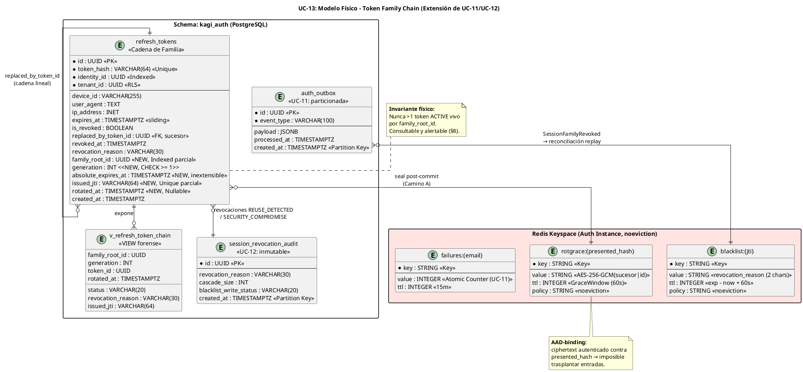

# UC-13: Renovar Sesión (Refresh Token) - Modelo de Datos Físico Específico (Token Family Chain, Grace Cache & Reconciliación)

| Metadatos del Documento | |
| :--- | :--- |
| **Proyecto:** | SHUGO - Identity & Access Platform |
| **Caso de Uso:** | UC-13 - Renovar Sesión (Refresh Token Rotation & Reuse Detection) |
| **Documento:** | 10_UC_Specific_Data_Model.md |
| **Metodología:** | Physical Data Modeling + Incremental Migrations con Backfill Recursivo + Redis Capacity Planning + Event-Sourced Reconciliation |
| **Base de Datos:** | PostgreSQL 15+ (Cadena de Tokens) + Redis 7+ (Grace Cache cifrada + Blacklist, política `noeviction`) |
| **Autor:** | Gastón Ruiz |
| **Versión Actual:** | 1.0.0 |
| **Fecha:** | 07/10/2026 |

---

## Historial de Versiones

| Versión | Fecha | Autor | Descripción de Cambios | Impacto |
| :--- | :--- | :--- | :--- | :--- |
| **1.0.0** | 07/10/2026 | Gastón Ruiz | **Creación inicial.** Definición del modelo de datos físico para la rotación de Refresh Tokens. Extiende `refresh_tokens` (creada en UC-11, extendida en UC-12) con las columnas de cadena de familia (`family_root_id`, `generation`, `absolute_expires_at`, `issued_jti`, `rotated_at`) mediante migración incremental con **backfill recursivo (CTE)** que reconstruye las familias preexistentes a partir de `replaced_by_token_id`. Define el keyspace Redis de la Grace Cache (`rotgrace:*`) con formato de ciphertext AEAD versionado y AAD-binding, los índices de familia para revocación set-based y detección de bifurcación, la vista forense de cadena, y la estrategia de reconciliación de Blacklist por replay idempotente desde el Outbox. | Documento de referencia para DBAs y SREs. Garantiza que la cadena de tokens sea consultable, revocable y forensemente auditable en O(1) round-trips, que la Grace Cache no pueda ser trasplantada entre claves ni sobrevivir a rotaciones de clave KMS sin invalidarse, y que la migración de datos legacy sea segura y reversible por pasos. |

---

## 1. Introducción y Propósito

Este documento define las extensiones y consideraciones físicas específicas para soportar el **UC-13 (Renovar Sesión)**.

La rotación de Refresh Tokens convierte a la tabla `refresh_tokens` de un **registro plano de sesiones** (UC-11/UC-12) en una **estructura de cadena (linked chain)** con identidad de familia. Los desafíos físicos que este modelo resuelve:

1. **Migración de Datos Legacy sin Downtime:** Las filas creadas por UC-11/UC-12 no tienen `family_root_id` ni `generation`. La migración debe **reconstruir las cadenas** a partir de `replaced_by_token_id` mediante CTE recursiva, antes de imponer NOT NULL.
2. **Revocación de Familia en O(1) Round-Trips:** La contención por reuso (UC-13c) revoca toda la familia con un único `UPDATE ... WHERE family_root_id = X ... RETURNING`, soportado por índice parcial.
3. **Detección de Bifurcación de Cadena:** Un invariante físico (nunca dos tokens ACTIVE vivos en la misma familia) debe ser **consultable y alertable** directamente en SQL.
4. **Grace Cache Segura en Redis:** El ciphertext del sucesor debe estar versionado por clave KMS y **vinculado (AAD) a la clave de presentación**, imposibilitando trasplantes entre entradas.
5. **Reconciliación sin Estado Adicional:** El cierre de la ventana residual del Fail-Safe se implementa como **replay idempotente por ventana de tiempo** desde el Outbox, sin tablas de ack nuevas.

---

## 2. Diagrama de Modelo de Datos Físico (ERD Extendido)



---

## 3. Scripts DDL: Migraciones de la Cadena de Familia

### 3.1. Migración UC-13-001: Columnas de Familia + Backfill Recursivo

```sql
SET search_path TO kagi_auth;

-- =====================================================================
-- PASO 1: Añadir columnas como NULLables (safe deploy, sin lock pesado)
-- =====================================================================
ALTER TABLE kagi_auth.refresh_tokens
    ADD COLUMN IF NOT EXISTS family_root_id UUID,
    ADD COLUMN IF NOT EXISTS generation INT,
    ADD COLUMN IF NOT EXISTS absolute_expires_at TIMESTAMPTZ,
    ADD COLUMN IF NOT EXISTS issued_jti VARCHAR(64),
    ADD COLUMN IF NOT EXISTS rotated_at TIMESTAMPTZ;

-- =====================================================================
-- PASO 2: Backfill recursivo de cadenas legacy.
-- Reconstruye family_root_id y generation siguiendo
-- replaced_by_token_id desde cada raíz (token que no es sucesor de nadie).
-- Ejecutar en lotes por rango de created_at en producción (>1M filas).
-- =====================================================================
WITH RECURSIVE chain AS (
    -- Raíces: tokens que NO aparecen como sucesor de ningún otro
    SELECT r.id AS root_id,
           r.id AS token_id,
           1    AS gen,
           r.created_at AS root_created
    FROM kagi_auth.refresh_tokens r
    WHERE NOT EXISTS (
        SELECT 1 FROM kagi_auth.refresh_tokens p
        WHERE p.replaced_by_token_id = r.id
    )
    UNION ALL
    -- Descenso: el sucesor de cada token de la cadena
    SELECT c.root_id,
           s.id,
           c.gen + 1,
           c.root_created
    FROM chain c
    JOIN kagi_auth.refresh_tokens p ON p.id = c.token_id
    JOIN kagi_auth.refresh_tokens s ON s.id = p.replaced_by_token_id
)
UPDATE kagi_auth.refresh_tokens rt
SET family_root_id     = c.root_id,
    generation         = c.gen,
    absolute_expires_at = c.root_created + INTERVAL '30 days',
    -- Aproximación legacy: rotated_at ≈ created_at del sucesor
    rotated_at = CASE
        WHEN rt.replaced_by_token_id IS NOT NULL THEN
            (SELECT s.created_at FROM kagi_auth.refresh_tokens s
              WHERE s.id = rt.replaced_by_token_id)
        ELSE NULL
    END
FROM chain c
WHERE c.token_id = rt.id
  AND rt.family_root_id IS NULL;

-- =====================================================================
-- PASO 3: Endurecer contraintes una vez el backfill completó
-- =====================================================================
ALTER TABLE kagi_auth.refresh_tokens
    ALTER COLUMN family_root_id SET NOT NULL,
    ALTER COLUMN generation SET NOT NULL,
    ALTER COLUMN absolute_expires_at SET NOT NULL;

ALTER TABLE kagi_auth.refresh_tokens
    ADD CONSTRAINT chk_rt_generation CHECK (generation >= 1),
    ADD CONSTRAINT chk_rt_absolute_after_created CHECK (absolute_expires_at > created_at);

COMMENT ON COLUMN kagi_auth.refresh_tokens.family_root_id IS 'Identidad de la cadena de rotación (= claim sid del JWT). Heredada por todos los sucesores.';
COMMENT ON COLUMN kagi_auth.refresh_tokens.generation IS 'Profundidad en la cadena (1 = raíz emitida por UC-11). Métrica de salud de sesión.';
COMMENT ON COLUMN kagi_auth.refresh_tokens.absolute_expires_at IS 'Vida absoluta de la familia. INEXTENSIBLE por rotación (INV-85).';
COMMENT ON COLUMN kagi_auth.refresh_tokens.issued_jti IS 'JTI del Access Token emitido junto a este refresh. Habilita blacklisteado quirúrgico en contenciones.';
COMMENT ON COLUMN kagi_auth.refresh_tokens.rotated_at IS 'Timestamp de la rotación. Base del cálculo de Grace Window (rotated_at + grace).';
```

### 3.2. Migración UC-13-002: Índices de Familia, JTI y Expiración Absoluta

```sql
SET search_path TO kagi_auth;

-- Revocación set-based de familia (Camino C) y derivación de estado:
-- solo filas no revocadas entran al índice.
CREATE INDEX IF NOT EXISTS idx_rt_family_active
    ON kagi_auth.refresh_tokens (family_root_id)
    WHERE is_revoked = FALSE;

-- Recorrido forense de cadena ordenado por profundidad:
CREATE INDEX IF NOT EXISTS idx_rt_family_chain
    ON kagi_auth.refresh_tokens (family_root_id, generation DESC);

-- Unicidad de JTI vivo: dos filas jamás comparten el mismo JTI activo.
-- (Los JTI son UUID v4; la unicidad parcial permite historial revocado.)
CREATE UNIQUE INDEX IF NOT EXISTS idx_rt_issued_jti
    ON kagi_auth.refresh_tokens (issued_jti)
    WHERE issued_jti IS NOT NULL;

-- Limpieza y métricas de familias que alcanzaron vida absoluta:
CREATE INDEX IF NOT EXISTS idx_rt_absolute_expiry
    ON kagi_auth.refresh_tokens (absolute_expires_at)
    WHERE is_revoked = FALSE;
```

### 3.3. Vista Forense de Cadena

```sql
CREATE OR REPLACE VIEW kagi_auth.v_refresh_token_chain AS
SELECT family_root_id,
       generation,
       id                    AS token_id,
       status,
       is_revoked,
       revocation_reason,
       rotated_at,
       replaced_by_token_id,
       issued_jti,
       expires_at,
       absolute_expires_at,
       created_at
FROM kagi_auth.refresh_tokens;

COMMENT ON VIEW kagi_auth.v_refresh_token_chain IS
    'Vista forense ordenable por (family_root_id, generation). Uso exclusivo de roles compliance/SOC; RLS heredado de refresh_tokens.';
```

---

## 4. Modelo de Datos en Redis (Grace Cache Cifrada)

### 4.1. Estructura de Claves

| Patrón de Clave | Tipo | Valor | TTL | Creada por |
| :--- | :--- | :--- | :--- | :--- |
| `rotgrace:{presented_hash}` | String | Ciphertext AEAD (formato §4.2) | `policy.GraceWindow` (default 60s, `PX` en ms) | UC-13 Camino A (post-commit) |
| `blacklist:{jti}` | String | Código de motivo (2 chars) | `(exp - now) + 60s` | UC-12 / UC-13 Camino C |
| `failures:{email}` / `lockout:{email}` | String | Contador / flag | 15 min | UC-11 |

### 4.2. Formato del Ciphertext (Versionado y AAD-Bound)

```text
valor = Base64Url( keyVersion:1 byte || nonce:12 bytes || ciphertext || tag:16 bytes )

plaintext  = "{successor_opaque}|{successor_token_id}"   (~80 bytes)
AAD        = presented_hash                              (vincula entrada a su clave)
keyVersion = versión activa de la clave KMS AES-256-GCM
```

**Propiedades de seguridad del formato:**
1. **AAD-Binding:** El ciphertext autentica contra el `presented_hash` de su propia clave. Copiar el valor de una entrada `rotgrace:A` a `rotgrace:B` falla el desellado (tag mismatch) → `GraceResolution.Unavailable()` → rechazo conservador. **Imposible trasplantar sucesores entre cadenas.**
2. **Versionado de Clave:** El prefijo `keyVersion` permite rotación de claves KMS sin invalidar el keyspace: entradas con versión retirada fallan el desellado y caen al rechazo conservador (comportamiento seguro por diseño).
3. **Compacidad:** Plaintext pipe-delimited (~80 B) en lugar de JSON (~150 B), reduciendo ~45% la memoria por entrada bajo olas de rotación.

### 4.3. Requisito Crítico Reafirmado: `maxmemory-policy noeviction`

La instancia Redis Auth es **compartida** por `blacklist:*` (UC-12), `rotgrace:*` (UC-13) y `lockout:*` (UC-11). La política `noeviction` definida en UC-12 protege también a la Grace Cache: una entrada `rotgrace` evictada no resucita tokens (impacto menor que en Blacklist), pero convertiría concurrencia legítima en rechazos conservadores masivos durante presión de memoria.

### 4.4. Capacity Planning de la Grace Cache

| Parámetro | Cálculo | Resultado |
| :--- | :--- | :--- |
| Tamaño por entrada | clave (`rotgrace:` 10 B + hash 44 B) + valor (~150 B ciphertext Base64Url) + overhead Redis (~70 B) | **~275 bytes** |
| Ventana de concurrencia | TTL = 60 s | — |
| Entradas concurrentes (pico 800 rot/seg) | 800 × 60 | 48.000 |
| Memoria en pico | 48.000 × 275 B | **~13.2 MB** |

**Conclusión:** La Grace Cache es un orden de magnitud más liviana que la Blacklist de UC-12. El headroom de la instancia (2 GB, `noeviction`) absorbe ambos keyspaces simultáneamente incluso bajo ola combinada de login + refresh + logout.

---

## 5. Eventos de Outbox y Reconciliación de Blacklist

### 5.1. Catálogo de Event Types de UC-13 (payload JSONB)

| event_type | Payload clave | Consumidores |
| :--- | :--- | :--- |
| `Session.Refreshed` | `familyRootId, oldTokenId, newTokenId, generation, viaGraceWindow, context` | KAGE, KIZUNA, métricas |
| `Session.ReuseDetected` | `familyRootId, reusedTokenId, attackerContext, legitimateDeviceId` | KAGE, SIEM, TORII |
| `Session.FamilyRevoked` | `familyRootId, tokensRevoked, jtisBlacklisted[], reason` | KIZUNA, KAGE, **Reconciliation Job** |
| `Session.AbsoluteLifetimeExceeded` | `familyRootId, familyCreatedAt, absoluteExpiresAt` | KAGE, métricas de re-auth |
| `Session.RiskEscalation` | `familyRootId, score, factors[]` | SIEM, KAGE |

### 5.2. Estrategia de Reconciliación: Replay Idempotente por Ventana (ADR)

**Decisión:** El `FamilyBlacklistReconciliationJob` (doc 09) **no** mantiene una tabla de acknowledgements por evento. En su lugar, tras la recuperación de Redis, replayea todos los `Session.FamilyRevoked` del Outbox dentro de una ventana de 20 minutos y re-ejecuta los `SET blacklist:{jti}` con TTL residual.

**Justificación:**
- **Idempotencia nativa:** `SET ... EX` sobre una clave existente con el mismo TTL residual es inofensivo; el replay no requiere estado de "ya procesado".
- **Ventana acotada por diseño:** Solo interesan JTIs cuyo Access Token sigue vivo (`expires_at > NOW()`); el filtro descarta el resto del payload sin tocar Redis.
- **Cero estado nuevo:** Evita una tabla de acks que habría que limpiar, particionar y monitorear; el Outbox ya es la fuente duradera.
- **Costo acotado:** Incluso una contención masiva (100 familias × 3 JTIs) son 300 SETs en pipeline (< 50 ms).

```sql
-- Consulta base del job de reconciliación (post-recuperación de Redis)
SELECT payload->>'familyRootId' AS family,
       payload->'jtisBlacklisted' AS jtis,
       created_at
FROM kagi_auth.auth_outbox
WHERE event_type = 'Session.FamilyRevoked'
  AND created_at > NOW() - INTERVAL '20 minutes'
  AND processed_at IS NOT NULL          -- el evento ya fue publicado al bus
ORDER BY created_at DESC;
-- El job filtra en memoria los JTIs con expiración viva y ejecuta pipeline SET.
```

---

## 6. Seguridad y Row-Level Security

### 6.1. Privilegios sobre las Nuevas Columnas

Las columnas de familia heredan las políticas RLS de `refresh_tokens` definidas en UC-12 (`rt_tenant_isolation`). Se añaden precisiones de privilegio:

```sql
-- El rol de aplicación solo puede UPDATEar columnas de ciclo de vida,
-- NUNCA reasignar familia o generation (integridad de cadena):
REVOKE UPDATE ON kagi_auth.refresh_tokens FROM app_kagi_auth_operations;
GRANT UPDATE (is_revoked, revoked_at, revocation_reason, revoked_by_identity_id,
              status, rotated_at, replaced_by_token_id, issued_jti, expires_at)
    ON kagi_auth.refresh_tokens TO app_kagi_auth_operations;

-- family_root_id, generation y absolute_expires_at son INMUTABLES post-INSERT
-- para el rol de aplicación (solo INSERT las define, una vez):
GRANT INSERT ON kagi_auth.refresh_tokens TO app_kagi_auth_operations;

-- Rol compliance: lectura forense de la vista de cadena
GRANT SELECT ON kagi_auth.v_refresh_token_chain TO app_compliance_admin;
```

**Justificación:** Un compromiso del rol de aplicación no puede **reasignar un token a otra familia** ni **extender su vida absoluta**: esas columnas son escribibles solo en el `INSERT` original (rotación), que a su vez está gobernado por el lock de fila y las guardas de dominio.

### 6.2. Integridad Referencial de la Cadena

```sql
-- El sucesor referenciado debe existir (integridad de linked chain)
ALTER TABLE kagi_auth.refresh_tokens
    ADD CONSTRAINT fk_rt_successor
    FOREIGN KEY (replaced_by_token_id)
    REFERENCES kagi_auth.refresh_tokens (id)
    ON DELETE RESTRICT;   -- la limpieza nunca puede romper una cadena auditable
```

---

## 7. Retención y Limpieza

### 7.1. Limpieza Extendida con Conciencia de Familia

```sql
CREATE OR REPLACE FUNCTION kagi_auth.cleanup_refresh_tokens_v2(p_retention_days INT DEFAULT 30)
RETURNS INT AS $$
DECLARE v_deleted INT := 0; v_batch INT;
BEGIN
    LOOP
        -- Lote 1: revocados antiguos
        DELETE FROM kagi_auth.refresh_tokens
        WHERE ctid IN (
            SELECT ctid FROM kagi_auth.refresh_tokens
            WHERE is_revoked = TRUE
              AND COALESCE(revoked_at, created_at) < NOW() - (p_retention_days || ' days')::INTERVAL
            LIMIT 5000
        );
        GET DIAGNOSTICS v_batch = ROW_COUNT;
        v_deleted := v_deleted + v_batch;
        EXIT WHEN v_batch = 0;

        -- Lote 2: familias con vida absoluta ampliamente superada y sin filas revocadas recientes
        DELETE FROM kagi_auth.refresh_tokens
        WHERE ctid IN (
            SELECT ctid FROM kagi_auth.refresh_tokens
            WHERE is_revoked = FALSE
              AND absolute_expires_at < NOW() - (p_retention_days || ' days')::INTERVAL
            LIMIT 5000
        );
        GET DIAGNOSTICS v_batch = ROW_COUNT;
        v_deleted := v_deleted + v_batch;
        EXIT WHEN v_batch = 0;
    END LOOP;
    RETURN v_deleted;
END;
$$ LANGUAGE plpgsql;
```

**Nota de integridad forense:** La evidencia de largo plazo (7 años) de revocaciones por `REUSE_DETECTED` / `SECURITY_COMPROMISE` vive en `session_revocation_audit` (UC-12), no en `refresh_tokens`. La limpieza de la tabla transaccional nunca destruye evidencia de contención.

---

## 8. Monitoreo y Diagnóstico

### 8.1. Consultas Forenses y de Integridad

```sql
-- 1. INVARIANTE DE BIFURCACIÓN: nunca debe retornar filas.
--    Dos tokens ACTIVE vivos en la misma familia = bug de serialización.
SELECT family_root_id, COUNT(*) AS active_vivos
FROM kagi_auth.refresh_tokens
WHERE is_revoked = FALSE AND status = 'ACTIVE' AND expires_at > NOW()
GROUP BY family_root_id
HAVING COUNT(*) > 1;

-- 2. Recorrido forense de una cadena (SOC / incidente de robo)
SELECT generation, token_id, status, revocation_reason, rotated_at, issued_jti, created_at
FROM kagi_auth.v_refresh_token_chain
WHERE family_root_id = :family
ORDER BY generation;

-- 3. Profundidad de cadena (health de sesiones largas)
SELECT percentile_cont(0.99) WITHIN GROUP (ORDER BY generation) AS p99_generation
FROM (
    SELECT family_root_id, MAX(generation) AS generation
    FROM kagi_auth.refresh_tokens
    WHERE created_at > NOW() - INTERVAL '7 days'
    GROUP BY family_root_id
) g;

-- 4. Contenciones por reuso con tamaño de familia (últimas 24h)
SELECT identity_id, cascade_size, blacklist_write_status, ip_address, created_at
FROM kagi_auth.session_revocation_audit
WHERE revocation_reason IN ('REUSE_DETECTED', 'SECURITY_COMPROMISE')
  AND created_at > NOW() - INTERVAL '24 hours'
ORDER BY created_at DESC;

-- 5. Ventanas residuales abiertas (Fail-Safe de contención sin blacklist)
SELECT family_root_id, cascade_size, created_at
FROM kagi_auth.session_revocation_audit
WHERE blacklist_write_status = 'FAILSAFE_SKIPPED'
  AND created_at > NOW() - INTERVAL '20 minutes';
```

### 8.2. Métricas de Base de Datos para OpenTelemetry

```csharp
public class FamilyChainDatabaseMetrics
{
    private readonly Meter _meter;
    private readonly Counter<long> _rotations;          // INSERT sucesor + UPDATE presentado
    private readonly Counter<long> _graceRebinds;       // UPDATE issued_jti (Camino B)
    private readonly Counter<long> _familyRevocations;  // UPDATE set-based (Camino C)
    private readonly Histogram<double> _familyRevokedRows; // filas afectadas por contención
    private readonly Histogram<double> _lockHoldDuration;  // BEGIN→COMMIT del FOR UPDATE

    public FamilyChainDatabaseMetrics(IMeterFactory mf)
    {
        _meter = mf.Create("shugo.kagi.family.database");
        _rotations = _meter.CreateCounter<long>("family.rotations_total");
        _graceRebinds = _meter.CreateCounter<long>("family.grace_rebinds_total");
        _familyRevocations = _meter.CreateCounter<long>("family.revocations_total");
        _familyRevokedRows = _meter.CreateHistogram<double>("family.revoked_rows", "rows");
        _lockHoldDuration = _meter.CreateHistogram<double>("family.lock_hold_duration", "ms");
    }
}
```

### 8.3. Alertas de Integridad de Cadena

| Alerta | Condición | Severidad | Acción |
| :--- | :--- | :--- | :--- |
| **Chain Bifurcation Detected** | Consulta §8.1.1 retorna ≥1 fila | **Crítica** | Bug de serialización o compromiso del lock. Congelar rotaciones del tenant afectado (`kagi.auth.refresh.enabled=false` por tenant) y abrir incidente de plataforma. |
| **Family Revocation Rowcount Anomaly** | `family.revoked_rows_p99 > 100` | Alta | Familias anormalmente grandes: revisar cliente que renueva en exceso o bug de generación. |
| **Grace Cache Memory Drift** | Memoria `rotgrace:*` diverge >20% de la curva teórica (rot/s × 60s × 275B) | Media | Fugas de TTL o keyspace contaminado. Auditar `PX` del seal. |
| **Legacy Backfill Incomplete** | `COUNT(*) WHERE family_root_id IS NULL > 0` post-migración | Alta | Re-ejecutar Paso 2 de la migración antes del Paso 3 (NOT NULL). |

---

## 9. Trazabilidad

| Documento | Relación |
| :--- | :--- |
| `04_Initial_Domain_Model.md` | Los atributos `FamilyRootId`, `Generation`, `AbsoluteExpiresAt`, `IssuedJti`, `RotatedAt` de la Entity `RefreshToken` se persisten en las columnas de la Migración UC-13-001. |
| `05_State_Machine_Diagram.md` | La máquina de la familia (HEALTHY/ROTATING/REVOKED/ABSOLUTE_EXPIRED) se deriva de consultas sobre `status`, `rotated_at` y `absolute_expires_at` indexadas aquí. |
| `07_Sequence_Diagram.md` | `GetForUpdateAsync` usa `idx_rt_token_hash`; `RevokeFamilyAsync` usa `idx_rt_family_active` con `RETURNING issued_jti`; `RebindIssuedJtiAsync` usa `idx_rt_issued_jti`. |
| `08_Final_Class_Design.md` | Las firmas del repositorio (`SaveRotationAsync`, `RevokeFamilyAsync`, `RebindIssuedJtiAsync`) mapean 1:1 a las sentencias SQL de este documento. |
| `09_Modern_Artifacts.md` | Las métricas `family.*` y el `FamilyBlacklistReconciliationJob` consumen las columnas, el Outbox y las consultas definidas aquí. |
| `UC-11/10_UC_Specific_Data_Model.md` | Documento abuelo: creó `refresh_tokens`, `auth_outbox` y el Read Model de autenticación. |
| `UC-12/10_UC_Specific_Data_Model.md` | Documento padre: añadió metadatos de revocación, `session_revocation_audit`, `noeviction` y la Blacklist de JTIs que UC-13 alimenta en contenciones. |

---

## 10. Anexos: Glosario de Base de Datos (UC-13)

| Término | Definición en Contexto UC-13 |
| :--- | :--- |
| **Family Root ID** | Identidad de la cadena de rotación (`family_root_id`), igual al claim `sid` del JWT. Heredada inmutablemente por todos los sucesores. |
| **Generation** | Profundidad de un token en su cadena (1 = raíz). Métrica de salud de sesión y detección de clientes que renuevan en exceso. |
| **Backfill Recursivo** | Migración que reconstruye `family_root_id` y `generation` de filas legacy siguiendo `replaced_by_token_id` mediante CTE recursiva, antes de imponer NOT NULL. |
| **AAD-Binding** | Vinculación del ciphertext de la Grace Cache al `presented_hash` mediante Additional Authenticated Data de AES-256-GCM, imposibilitando trasplantes entre entradas. |
| **Chain Bifurcation** | Violación del invariante "nunca >1 token ACTIVE vivo por familia". Detectable por consulta SQL y alertable como incidente de plataforma. |
| **Replay Idempotente** | Estrategia de reconciliación que re-ejecuta `SET blacklist:{jti}` desde eventos del Outbox dentro de una ventana de tiempo, sin estado de acknowledgement adicional. |
| **Issued JTI Unique Parcial** | Índice único sobre `issued_jti` para filas no-NULL, garantizando que dos filas jamás compartan el mismo JTI activo y habilitando lookup forense JTI→token. |
| **Inmutabilidad Post-INSERT** | Restricción de privilegios que hace `family_root_id`, `generation` y `absolute_expires_at` escribibles solo durante el INSERT de rotación, nunca por UPDATE posterior. |

---
*Fin del Documento 10_UC_Specific_Data_Model para UC-13*