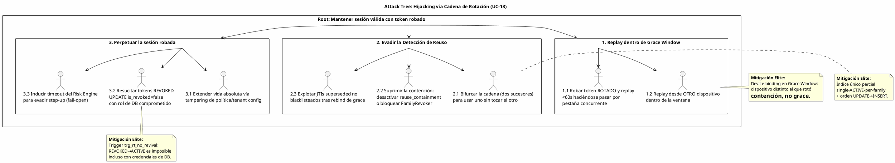

# UC-13: Renovar Sesión (Refresh Token) - Análisis de Amenazas Específico (Security Threat Model)

| Metadatos del Documento | |
| :--- | :--- |
| **Proyecto:** | SHUGO - Identity & Access Platform |
| **Caso de Uso:** | UC-13 - Renovar Sesión (Refresh Token Rotation & Reuse Detection) |
| **Documento:** | 11_UC_Specific_Security_Threats.md |
| **Metodología:** | STRIDE + DREAD + Attack Trees + Defense-in-Depth + Threat-Driven Hardening |
| **Estándares:** | RFC 6819 §5.2.2.3 (Refresh Token Reuse), NIST SP 800-63B (Session Binding & Re-Authentication), OWASP ASVS 4.0 (V3 Session Management), SOC 2 CC6.1/CC7.2, ISO 27001:2022 A.5.18/A.8.15, GDPR Art. 32 |
| **Autor:** | Gastón Ruiz |
| **Versión Actual:** | 1.0.0 |
| **Fecha:** | 07/10/2026 |

---

## Historial de Versiones

| Versión | Fecha | Autor | Descripción de Cambios | Impacto |
| :--- | :--- | :--- | :--- | :--- |
| **1.0.0** | 07/10/2026 | Gastón Ruiz | **Creación inicial.** Análisis exhaustivo de amenazas específicas para la rotación de Refresh Tokens. Evalúa 9 vectores usando STRIDE+DREAD: secuestro paralelo explotando la Grace Window, Zombie Sessions por tampering de política, bifurcación de cadena, trasplante de ciphertext AEAD, resurrección de tokens revocados vía rol comprometido, oráculos de estado, griefing por contención forzada, abuso de fail-open del Risk Engine, y ventana residual de JTIs superseded. Introduce **hardening threat-driven**: índice único parcial de single-ACTIVE-per-family, trigger de no-resurrección e inmutabilidad de cadena a nivel de DB, device-binding en la Grace Window, y tracking de JTIs superseded. | Documento crítico de seguridad del UC-13. Convierte cada amenaza identificada en un control concreto (migración, trigger, guarda de dominio o alerta), cerrando la rotación de tokens como un sistema donde el robo es detectable, la perpetuación es imposible y la degradación es siempre hacia el lado seguro. |

---

## 1. Introducción y Alcance

Este documento presenta el **Análisis de Amenazas Específico** para el UC-13 (Renovar Sesión).

La rotación de Refresh Tokens es el mecanismo que convierte el robo de sesiones en un evento **detectable**, pero cada pieza del diseño introduce su propia superficie de ataque:

1. **La Grace Window como ventana de oportunidad:** 60 segundos durante los cuales un token ROTADO aún produce efectos (resolución idempotente). Un atacante con un token robado en ese instante podría intentar hacerse pasar por una "pestaña concurrente".
2. **La cadena como estructura atacable:** Si un adversario puede bifurcar la cadena, revocar resurrecciones o extender vidas absolutas, la detección de reuso deja de ser confiable.
3. **La Grace Cache como infraestructura crítica:** Un ciphertext trasplantable, un oracle de desellado, o una Redis degradada usada como arma de griefing serían fallas del diseño criptográfico u operativo.
4. **Los modos de fallo como arma:** El fail-open del Risk Engine o el rechazo conservador de la Grace Cache pueden ser inducidos deliberadamente (DoS a dependencias) para evadir step-ups o contenciones.
5. **La contención como vector de griefing:** Revocar la familia de la víctima replaysando un token rotado es un DoS de sesión que el diseño debe aceptar, detectar y hacer recuperable.

Este documento modela estos vectores y define las mitigaciones —varias de ellas como **migraciones y triggers threat-driven** que endurecen el esquema físico más allá de lo que la aplicación puede garantizar.

---

## 2. Attack Trees (Árboles de Ataque)

### 2.1. Attack Tree #1: Session Hijacking a través de la Cadena de Rotación

**Objetivo del Atacante:** Obtener o mantener una sesión válida usando tokens robados, sin disparar la contención por reuso.



### 2.2. Attack Tree #2: Armar la Infraestructura de Grace Cache

**Objetivo del Atacante:** Usar Redis o sus contenidos como arma contra la disponibilidad o la integridad de la rotación.

```text
[Root: Armar la Grace Cache contra usuarios o cadenas]
  |
  +-- [1. Manipulación de contenidos]
  |     +-- 1.1 Trasplantar ciphertext de rotgrace:A a rotgrace:B
  |     |        (Mitigado: AAD-binding al presented_hash → tag mismatch → Unseal=null).
  |     +-- 1.2 Oracle de desellado: sondear Unseal con ciphertexts mutados
  |     |        (Mitigado: AES-256-GCM es AEAD; sin padding oracle; fallos → métrica y rechazo conservador).
  |     +-- 1.3 Robo de ciphertext para recuperación offline del sucesor
  |            (Mitigado: AES-256-GCM con clave KMS; ciphertext inútil sin clave; TTL 60s acota exposición).
  |
  +-- [2. Degradación inducida (griefing)]
  |     +-- 2.1 DoS a Redis para forzar rechazos conservadores masivos
  |     |        (Mitigado: rechazo conservador NO revoca familias; pestaña con sucesor sigue viva; alerta de spike).
  |     +-- 2.2 Presión de memoria para provocar evicción de rotgrace/blacklist
  |            (Mitigado: maxmemory-policy noeviction en instancia Auth; evicted_keys=0 alertado como CRÍTICO).
  |
  +-- [3. Contención forzada como DoS]
        +-- 3.1 Replay deliberado del token ROTADO de la víctima (fuera de ventana)
               para revocarle la familia (griefing).
               (Mitigado: aceptado como trade-off security>availability; notificación al titular
                + re-login rápido + alerta de revocaciones por identidad).
```

### 2.3. Attack Tree #3: Oráculos y Fugas de Información del Endpoint

**Objetivo del Atacante:** Extraer estado de familias o tokens mediante respuestas o timings del endpoint de refresh.

```text
[Root: Convertir /auth/refresh en oráculo de estado]
  |
  +-- [1. Oráculo por código de respuesta]
  |     +-- 1.1 Distinguir "revocado" vs "expirado" vs "reuse" por mensajes
  |            (Mitigado: colapso Zero Info Leakage — todos → 400 invalid_grant idéntico).
  |
  +-- [2. Oráculo por timing]
  |     +-- 2.1 Medir diferencia entre caminos (grace con Redis vs rechazo sin Redis)
  |     |        (Mitigado: todas las ramas ejecutan el mismo SELECT FOR UPDATE;
  |         monitoreo de divergencia p50 por label result como detección de drift).
  |     +-- 2.2 Medir latencia de contención (Camino C es más lento) para confirmar revocación
  |            (Mitigado: contención ya es visible para el atacante por el 400; sin ganancia adicional).
  |
  +-- [3. Oráculo por headers o cuerpo]
        +-- 3.1 Headers condicionales o cuerpos con detalle en 400/503
               (Mitigado: cuerpo de error único; 503 solo para InfrastructureException de DB).
```

---

## 3. Matriz de Amenazas Específicas (STRIDE + DREAD)

| ID | Amenaza | Categoría STRIDE | D | R | E | A | D | Score | Nivel |
| :--- | :--- | :--- | :---: | :---: | :---: | :---: | :---: | :---: | :---: |
| **T-88** | **Hijack paralelo vía Grace Window (replay <60s)** | Spoofing | 10 | 7 | 6 | 9 | 7 | **7.8** | 🔴 |
| **T-89** | **Zombie Sessions por tampering de política/vida absoluta** | Tampering | 9 | 4 | 3 | 9 | 3 | **5.6** | 🟡 |
| **T-90** | **Bifurcación de cadena (dos sucesores de un token)** | Tampering | 9 | 4 | 4 | 9 | 4 | **6.0** | 🟠 |
| **T-91** | **Trasplante / oracle de ciphertext de Grace Cache** | Tampering / Info Disclosure | 8 | 3 | 3 | 7 | 3 | **4.8** | 🟡 |
| **T-92** | **Resurrección de tokens REVOKED vía rol de DB comprometido** | Tampering | 9 | 4 | 4 | 8 | 4 | **5.8** | 🟡 |
| **T-93** | **Oráculo de estado de familia vía refresh** | Information Disclosure | 6 | 7 | 6 | 7 | 6 | **6.4** | 🟠 |
| **T-94** | **Griefing por contención forzada (revocar familia de víctima)** | Denial of Service | 5 | 6 | 6 | 5 | 6 | **5.6** | 🟡 |
| **T-95** | **Abuso de fail-open del Risk Engine (DoS inducido)** | Elevation of Privilege | 7 | 5 | 4 | 8 | 4 | **5.6** | 🟡 |
| **T-96** | **Ventana residual de JTIs superseded (rebind de grace)** | Spoofing | 7 | 4 | 3 | 7 | 3 | **4.8** | 🟡 |

---

## 4. Análisis Detallado de Amenazas Críticas y Mitigaciones

### 4.1. 🔴 T-88: Hijack Paralelo vía Grace Window

**Descripción:** Un atacante roba un Refresh Token que **acaba de ser rotado** (ej. XSS que exfiltra el token del almacenamiento local justo antes de una renovación) y lo replaya dentro de los 60s de Grace Window, intentando pasar como una "pestaña concurrente legítima" y obtener el sucesor.

**Mitigaciones Implementadas:**

1. **Device-Binding en la Resolución de Grace (Control Elite):**
La Grace Window existe para absorber concurrencia del **mismo dispositivo** (multi-tab). Un dispositivo distinto presentando un token ROTADO dentro de la ventana no es concurrencia legítima: es evidencia de robo.

```csharp
private async Task<RefreshOutcome> ResolveGraceAsync(
    RefreshToken token, RefreshAttempt attempt, RefreshPolicy policy, DateTime now, CancellationToken ct)
{
    // ANTI-HIJACK: grace solo para el dispositivo que ejecutó la rotación original
    if (!token.Context.SameDeviceAs(attempt.Context))
    {
        _metrics.GraceContextMismatch.Add(1, Tags(token.TenantId));
        _logger.LogCritical(
            "Grace resolution attempted from different device for token {TokenId}. Treating as reuse.", token.Id);
        // No es concurrencia: es robo. Contención completa.
        return await _familyRevoker.ContainReuseAsync(token, attempt, now, ct);
    }

    var resolution = await _graceResolver.TryResolveAsync(token.TokenHash, ct);
    // ... camino idempotente normal ...
}
```

2. **Ventana Mínima Viable:** `RefreshPolicy` valida en constructor que `GraceWindow ≤ 5 minutos`; el default es 60s y los SREs no pueden aumentarla por encima del rango sin romper la validación del VO.
3. **AAD-Binding del Ciphertext:** Incluso dentro del mismo dispositivo, el atacante no puede fabricar ni trasplantar una entrada `rotgrace` (ver T-91).
4. **Métrica y Alerta de Mismatch:** `grace_context_mismatch_total` con alerta Alta: un mismatch es un intento de hijack frustrado y debe investigarse como incidente.

**Justificación:** Sin device-binding, la Grace Window sería una ventana de 60s donde el robo es indistinguible de la concurrencia. Con binding, la ventana solo beneficia al dispositivo legítimo; cualquier otro contexto la convierte en **contención inmediata**.

### 4.2. 🟠 T-90: Bifurcación de Cadena

**Descripción:** Un bug de serialización (lock omitido, isolation level incorrecto, retry mal ubicado) permite que dos rotaciones del mismo token ACTIVE commiteen dos sucesores distintos. Consecuencias: (a) dos sesiones paralelas indetectables como reuso (cada rama rota limpiamente), (b) falsos positivos de contención contra usuarios legítimos cuando las ramas se cruzan.

**Mitigaciones Implementadas:**

1. **Hardening Threat-Driven: Índice Único Parcial Single-ACTIVE-per-Family:**

```sql
-- MIGRACIÓN DE HARDENING UC-13-S01
-- Pre-check obligatorio: resolver duplicados legacy antes de crear el índice
-- (la consulta de bifurcación del doc 10 §8.1 debe retornar 0 filas)

-- Orden de escrituras en SaveRotationAsync: UPDATE presentado → INSERT sucesor.
-- Con ese orden, el índice único parcial es aplicable SIN ser deferrable:
CREATE UNIQUE INDEX uq_rt_single_active_per_family
    ON kagi_auth.refresh_tokens (family_root_id)
    WHERE status = 'ACTIVE' AND is_revoked = FALSE;
```

*   **Por qué funciona con orden UPDATE→INSERT:** Dentro de la transacción de rotación, el presentado deja de ser ACTIVE antes de que el sucesor nazca ACTIVE; el índice nunca observa dos ACTIVE simultáneos en la misma familia. Un bug que invirtiera el orden fallaría ruidosamente (unique violation) en lugar de bifurcar silenciosamente.
*   **Por qué no DEFERRABLE:** Un índice diferido movería la detección al commit, permitiendo ventanas donde dos ramas coexisten en memoria de otros transactions; el chequeo inmediato por statement es más estricto y más simple de razonar.

2. **Lock de Fila como Primera Línea:** `SELECT ... FOR UPDATE` serializa rotaciones concurrentes legítimas; el índice único es la **segunda línea** que captura bugs que omitan el lock.
3. **Alerta de Bifurcación:** La consulta forense del doc 10 (§8.1) ejecutada cada 5 minutos como alerta CRÍTICA de integridad.

### 4.3. 🟡 T-92: Resurrección de Tokens REVOKED vía Rol de DB Comprometido

**Descripción:** Un atacante con credenciales del rol de aplicación de DB (o un insider) ejecuta `UPDATE refresh_tokens SET is_revoked = FALSE WHERE ...` para resucitar tokens revocados —incluidos los de familias revocadas por REUSE_DETECTED— evadiendo toda contención.

**Mitigaciones Implementadas:**

1. **Trigger de No-Resurrección e Inmutabilidad de Cadena (Hardening UC-13-S02):**

```sql
CREATE OR REPLACE FUNCTION kagi_auth.trg_fn_chain_integrity() RETURNS trigger AS $$
BEGIN
    -- Prohibido resucitar tokens revocados (máquina de estados en DB)
    IF OLD.is_revoked AND NOT NEW.is_revoked THEN
        RAISE EXCEPTION 'TOKEN_REVIVAL_FORBIDDEN token_id=%', OLD.id;
    END IF;
    -- Prohibido reasignar familia, generación o vida absoluta (integridad de cadena)
    IF OLD.family_root_id IS DISTINCT FROM NEW.family_root_id
       OR OLD.generation <> NEW.generation
       OR OLD.absolute_expires_at <> NEW.absolute_expires_at THEN
        RAISE EXCEPTION 'CHAIN_IMMUTABILITY_VIOLATION token_id=%', OLD.id;
    END IF;
    RETURN NEW;
END;
$$ LANGUAGE plpgsql;

CREATE TRIGGER trg_rt_chain_integrity
    BEFORE UPDATE ON kagi_auth.refresh_tokens
    FOR EACH ROW EXECUTE FUNCTION kagi_auth.trg_fn_chain_integrity();
```

2. **Complemento de Privilegios (doc 10 §6.1):** El rol de aplicación ya no puede UPDATEar `family_root_id`, `generation` ni `absolute_expires_at`; el trigger hace que incluso un rol con privilegios elevados **dentro de la aplicación** no pueda resucitar ni reasignar.
3. **Detección:** Las excepciones `TOKEN_REVIVAL_FORBIDDEN` / `CHAIN_IMMUTABILITY_VIOLATION` se capturan en los logs de error de PostgreSQL y alimentan una alerta SIEM de integridad (ver §7.2).

**Justificación:** La máquina de estados del doc 05 declara `REVOKED` como estado terminal. Un trigger de base de datos convierte esa declaración de dominio en una **ley física del esquema**, independiente de cualquier bug o compromiso de la capa de aplicación.

### 4.4. 🟡 T-95: Abuso de Fail-Open del Risk Engine (DoS Inducido)

**Descripción:** Un atacante que puede degradar o tumbar el Risk Engine (UC-17) —o inducir timeouts saturándolo— hace que todas las renovaciones de tenants con `risk_fail_mode=open` omitan la evaluación de contexto, evadiendo step-ups y revocaciones preventivas justo cuando más se necesitan.

**Mitigaciones Implementadas:**

1. **Fail-Mode por Tenant con Default Seguro para Strict:** Tenants con datos sensibles configuran `risk_fail_mode=stepup`: ante timeout del Risk Engine, la renovación **degrada a step-up MFA** en lugar de fail-open. El atacante que DoS-ea el Risk Engine convierte el robo de tokens en sesiones que exigen MFA que no posee.
2. **Aislamiento de Disponibilidad:** El Risk Engine tiene su propio rate limit, pool de conexiones y HPA; un pico de refresh no comparte cuota con la evaluación de riesgo.
3. **Alerta de Correlación:** `risk_evaluator_timeouts_total` correlacionado con `refresh.total{result=rotated}`: un aumento simultáneo de timeouts y rotaciones sin step-up en tenants strict es indicador de ataque inducido.

### 4.5. 🟡 T-96: Ventana Residual de JTIs Superseded

**Descripción:** En el Camino B (grace), cada resolución re-vincula `issued_jti` del sucesor a un JWT nuevo. Si dos resoluciones de grace ocurren en secuencia rápida, el JTI del primer JWT fresc0 queda **superseded** y fuera de la fila; una contención posterior blacklistearía solo el último JTI, dejando al primero vivo ≤15 min.

**Mitigaciones Implementadas:**

1. **Tracking de Superseded en Redis con Drain en Contención:**

```csharp
// En ResolveGraceAsync, ANTES del rebind:
var supersededJti = await _repo.GetIssuedJtiAsync(resolution.SuccessorTokenId, ct);
if (supersededJti is not null)
    await _supersededStore.TrackAsync(token.FamilyRootId, supersededJti, residualTtl, ct);
    // SADD superseded:{family_root_id} + EXPIRE 16m (idempotente)

// En FamilyRevoker.ContainReuseAsync, al blacklistear:
var superseded = await _supersededStore.DrainAsync(report.FamilyRootId, ct); // SMEMBERS + DEL
await _jtiBlacklist.BlacklistAsync(report.ActiveJtis.Concat(superseded), now, ct);
```

2. **Serialización del Rebind:** El rebind de `issued_jti` se ejecuta bajo lock de la fila del sucesor, evitando lecturas perdidas entre resoluciones concurrentes.
3. **Acotación Natural:** Aún sin tracking, un JTI superseded vive ≤15 min (TTL del Access Token); el tracking reduce esa ventana a cero en el momento de la contención.

### 4.6. 🟠 T-93: Oráculo de Estado de Familia vía Refresh

**Descripción:** Un atacante con tokens de procedencia dudosa sondea `/auth/refresh` para distinguir familias revocadas, expiradas o vivas.

**Mitigaciones Implementadas:**
1. **Colapso Zero Info Leakage (RN-25):** Siete rechazos → un único `400 invalid_grant` con cuerpo idéntico (doc 09 §2.2).
2. **Costo Común de Guardas:** Todas las ramas de rechazo ejecutan el mismo `SELECT ... FOR UPDATE` antes de divergir; no hay camino "barato" que delate existencia.
3. **Monitoreo de Divergencia de Latencia:** Histogramas `refresh.duration` segmentados por label `result`; una divergencia sostenida p50 entre labels de rechazo indica un side-channel emergente (regresión de código) y dispara alerta Media.

### 4.7. 🟡 T-94: Griefing por Contención Forzada

**Descripción:** Un atacante que posee un token ROTADO de la víctima (ej. exfiltrado horas antes y aún conservado) lo replaya fuera de la Grace Window **deliberadamente**, sabiendo que disparará la revocación de la familia: un DoS de sesión contra la víctima.

**Mitigaciones y Trade-Off Documentado:**
1. **Aceptación Consciente:** La contención prioriza seguridad sobre disponibilidad de una sesión ya comprometida. Un token robado que puede forzar revocación es un token que **ya estaba robado**: el griefing no crea el compromiso, solo lo revela.
2. **Recuperación Rápida:** La víctima recibe notificación inmediata (RN-26) con contexto y un flujo de re-login acelerado (UC-11 con step-up pre-autorizado desde la notificación).
3. **Detección de Campañas:** Alerta sobre `family_revocations_total` agrupado por `identity_id`: múltiples familias de un mismo usuario revocadas por reuse en 24h indica exfiltración sistémica (ej. malware en dispositivo), no griefing puntual.

### 4.8. 🟡 T-89: Zombie Sessions por Tampering de Política

**Descripción:** Un atacante con acceso a configuración de tenant (o un operador error) establece `absolute_lifetime` enorme o `grace_window` desmedido, creando sesiones perpetuas o ventanas de hijack amplias.

**Mitigaciones Implementadas:**
1. **Guardas en el Value Object:** `RefreshPolicy` rechaza en constructor `grace_window > 5min` y `absolute < sliding`; configuración inválida falla al arranque o al resolve, nunca en runtime silencioso.
2. **Inmutabilidad Física:** `absolute_expires_at` es inmutable post-INSERT por privilegios (doc 10) **y** por trigger (T-92): ni siquiera cambiar la política retroactivamente extiende familias existentes.
3. **Alerta de Edad de Familia:** Familias con `NOW() - created_at > absolute_lifetime_policy + 1h` y filas ACTIVE vivas indican desviación entre política y datos → alerta Alta de integridad.

---

## 5. Compliance y Auditoría (SOC 2 / ISO 27001 / GDPR / NIST / RFC)

### 5.1. RFC 6819 §5.2.2.3 (Refresh Token Reuse Detection)
*   **Requisito:** Ante reuso de un refresh token, el servidor debe revocar el token y el contexto asociado.
*   **Implementación UC-13:** Contención por familia completa + blacklisteado de JTIs + notificación. El flag `reuse_containment_enabled` es **no-desactivable** por diseño.

### 5.2. NIST SP 800-63B (Binding y Re-autenticación)
*   **Requisito:** Los refresh tokens deben vincularse al contexto del suscriptor y exigirse re-autenticación periódica.
*   **Implementación UC-13:** `SessionContext` binding evaluado en cada rotación y en la Grace Window (device-binding anti-hijack), más vida absoluta inextensible que fuerza re-login interactivo.

### 5.3. OWASP ASVS 4.0 - V3 (Session Management)
*   **Requisitos:** Binding de sesión (V3.2), ciclo de vida y timeout (V3.3), invalidación efectiva.
*   **Implementación UC-13:** Rotación single-use, trigger de no-resurrección, índice único single-ACTIVE, invalidación en cascada por familia.

### 5.4. SOC 2 CC6.1 / CC7.2 e ISO 27001 A.5.18 / A.8.15
*   **Requisito:** Retiro de derechos de acceso y monitoreo de anomalías.
*   **Implementación UC-13:** Revocaciones auditadas inmutablemente (`session_revocation_audit`), alertas de bifurcación, resurrección intentada y mismatch de contexto conectadas al SIEM.

### 5.5. GDPR Art. 32 (Security of Processing)
*   **Requisito:** Resiliencia y confidencialidad continuas del tratamiento.
*   **Implementación UC-13:** Degradaciones diferenciadas y siempre hacia el lado seguro (Fail-Secure en DB, rechazo conservador en grace, Fail-Safe con reconciliación en blacklist), más cifrado AEAD versionado de la Grace Cache.

---

## 6. Trazabilidad

| Documento | Relación |
| :--- | :--- |
| `01_Requirements_Specification.md` | Las invariantes INV-82 a INV-88 y reglas RN-23 a RN-26 se endurecen aquí con controles físicos y criptográficos. |
| `04_Initial_Domain_Model.md` | El device-binding de T-88 se implementa en `ResolveGraceAsync`; las guardas de `RefreshPolicy` mitigan T-89. |
| `05_State_Machine_Diagram.md` | El trigger `trg_rt_chain_integrity` (T-92) es la máquina de estados ejecutada por el motor de base de datos. |
| `08_Final_Class_Design.md` | `TokenRotator`, `GraceWindowResolver` y `FamilyRevoker` incorporan las guardas anti-hijack y el tracking de superseded JTIs. |
| `10_UC_Specific_Data_Model.md` | Las migraciones de hardening (índice único parcial, trigger) extienden el esquema definido allí; la consulta de bifurcación se convierte en alerta. |
| `12_UC_Specific_Performance_Benchmarks.md` | Los escenarios de chaos y concurrencia validan que los controles (índice único, device-binding) no degradan los SLOs bajo fuego. |

---

## 7. Anexos: Configuración de Seguridad Adicional

### 7.1. Reglas de WAF / API Gateway para /auth/refresh

```yaml
Rules:
  - Name: RefreshRequiresOpaqueFormat
    Priority: 1
    Action: Block
    Statement:
      SizeConstraintStatement:
        FieldToMatch: { JsonBody: { MatchPattern: { All: {} }, MatchScope: VALUE,
                     OverrideText: MATCH } }
        ComparisonOperator: GT
        Size: 512   # un refresh token opaco es ~43 chars; payloads grandes = abuso

  - Name: RefreshRateLimitPerIdentity
    Priority: 2
    Action: Block
    Statement:
      RateBasedStatement:
        Limit: 120            # ~1 refresh/min por sesión con margen multi-tab
        AggregateKeyType: CUSTOM_KEYS
        CustomKeys:
          - Header: { Name: "X-Identity-Id" }   # resuelto post-auth en edge
```

### 7.2. Alertas de SIEM para UC-13

```json
[
  {
    "alert_name": "GraceContextMismatch",
    "condition": "count(grace_context_mismatch_total) >= 1",
    "severity": "High",
    "action": "Intento de hijack dentro de Grace Window desde dispositivo distinto. Familia ya contenida. Investigar origen del token exfiltrado."
  },
  {
    "alert_name": "ChainBifurcationIntegrity",
    "condition": "query(bifurcation_check) > 0",
    "severity": "Critical",
    "action": "Invariante single-ACTIVE violado. Congelar rotaciones del tenant, preservar forense de v_refresh_token_chain, abrir incidente de plataforma."
  },
  {
    "alert_name": "TokenRevivalAttempt",
    "condition": "postgres logs contain 'TOKEN_REVIVAL_FORBIDDEN' or 'CHAIN_IMMUTABILITY_VIOLATION'",
    "severity": "Critical",
    "action": "Intento de resurrección o reasignación de cadena a nivel de DB. Compromiso de credenciales de DB probable: rotar secretos y auditar sesiones de DB."
  },
  {
    "alert_name": "ReuseDetectionCampaign",
    "condition": "count(Session.ReuseDetected por identity_id) > 2 en 24h",
    "severity": "Critical",
    "action": "Posible exfiltración sistémica (malware de dispositivo). Forzar re-autenticación MFA del titular y revocar todos sus dispositivos (UC-21)."
  },
  {
    "alert_name": "RiskEvaluatorTimeoutCorrelation",
    "condition": "rate(risk_evaluator_timeouts_total[5m]) > 0.2 * rate(refresh_total[5m])",
    "severity": "High",
    "action": "Posible DoS inducido al Risk Engine para evadir step-ups. Verificar tenants con risk_fail_mode=open y evaluar cambio a stepup."
  }
]
```

---
*Fin del Documento 11_UC_Specific_Security_Threats para UC-13*