# UC-14: Autenticar Federada (SSO) - Diagrama de Caso de Uso

| Metadatos del Documento | |
| :--- | :--- |
| **Proyecto:** | SHUGO - Identity & Access Platform |
| **Caso de Uso:** | UC-14 - Autenticar Federada (SSO - OIDC/OAuth2 + SAML 2.0) |
| **Documento:** | 02_Use_Case_Diagram.md |
| **Metodología:** | UML 2.5 + ICONIX + Federation Security (NIST SP 800-63C) + Security by Design |
| **Autor:** | Gastón Ruiz |
| **Versión Actual:** | 1.0.0 |
| **Fecha:** | 22/10/2026 |

---

## Historial de Versiones

| Versión | Fecha | Autor | Descripción de Cambios | Impacto |
| :--- | :--- | :--- | :--- | :--- |
| **1.0.0** | 22/10/2026 | Gastón Ruiz | **Creación inicial.** Diagrama de Caso de Uso UML para UC-14. Modela a SHUGO como Relying Party / Service Provider con seis casos de uso núcleo (Inicio con Home Realm Discovery y Transaction State, Procesamiento de Callback, Validación de Artefacto IdP, Resolución de Identidad Local, Emisión de Sesión Federada, y Recepción de Back-Channel Logout), cuatro validaciones obligatorias (`<<include>>`: Transaction State single-use, Redirect URI whitelist, Metadata/JWKS con rollover, y Política de Linking/JIT), y extensiones condicionales (`<<extend>>`: JIT Provisioning, Account Linking, Conflicto de Linking, IdP-Initiated SAML default-deny, Step-Up MFA por acr insuficiente, y Fallback Local ante caída de IdP). | Documento base del paquete de diseño Tier 1 del UC-14. Establece las fronteras de confianza de la federación: el IdP como actor externo cuya confianza está delimitada por validaciones obligatorias, y la sesión local como resultado soberano de SHUGO con proveniencia federada auditable. |

---

## 1. Diagrama de Caso de Uso (PlantUML)

A continuación, se presenta el Diagrama de Casos de Uso UML para el UC-14. Este diagrama modela la federación no como un "login delegado" trivial, sino como un **protocolo de confianza delimitada**: cada artefacto del IdP pasa por validaciones obligatorias antes de que SHUGO emita su propia sesión soberana.

```plantuml
@startuml UC-14_CasoDeUso
<style>
diagram {
  BackgroundColor #FFFFFF
}
</style>
top to bottom direction
skinparam packageStyle rectangle
skinparam actorStyle awesome
skinparam usecaseBackgroundColor #E3F2FD
skinparam usecaseBorderColor #1565C0
skinparam actorBorderColor #2E7D32
skinparam rectangleBackgroundColor #FFF3E0
skinparam rectangleBorderColor #E65100

title UC-14: Autenticar Federada - Motor KAGI (Relying Party / Service Provider)

' ============================================
' ACTORES PRIMARIOS
' ============================================
actor "Usuario\n(Resource Owner)" as User
actor "Cliente\n(SPA / Mobile)" as Client

' ============================================
' ACTOR EXTERNO (RAÍZ DE CONFIANZA DELIMITADA)
' ============================================
actor "Identity Provider\n(Okta, Entra ID, Google,\nGitHub / ADFS-SAML)" as IdP

' ============================================
' ACTORES SECUNDARIOS (SISTEMAS)
' ============================================
actor "API Gateway\n(WAF / Rate Limit)" as GW
actor "KAGAMI\n(Identity Repo)" as KAGAMI
actor "Redis\n(Tx State + Replay Cache)" as Redis
actor "UC-17\nRisk Engine" as Risk
actor "UC-15\nMFA" as MFA
actor "UC-12 Logout\n(Family Revocation)" as UC12
actor "KAGE\n(Audit / Outbox)" as KAGE

' ============================================
' SISTEMA PRINCIPAL: KAGI FEDERATION CORE
' ============================================
rectangle "SHUGO - Motor KAGI (Federation Core: RP / SP)" as KAGI {
  usecase "UC-14a: Iniciar Autenticación\nFederada (Home Realm +\nTx State + Redirect a IdP)" as UC14a
  usecase "UC-14b: Procesar Callback\ndel IdP (code / SAMLResponse)" as UC14b
  usecase "UC-14c: Validar Artefacto IdP\n(id_token / SAML Assertion)" as UC14c
  usecase "UC-14d: Resolver Identidad\nLocal (Link / JIT / Conflicto)" as UC14d
  usecase "UC-14e: Emitir Sesión Federada\n(familia + federate_code)" as UC14e
  usecase "UC-14f: Recibir Back-Channel\nLogout (logout_token / SLO)" as UC14f

  usecase "UC-V1: Validar Transaction State\n(state/nonce/PKCE single-use)" as UCV1
  usecase "UC-V2: Validar Redirect URI\n(whitelist exacta)" as UCV2
  usecase "UC-V3: Resolver Metadata/JWKS\n(cache + 1 refetch en rollover)" as UCV3
  usecase "UC-V4: Aplicar Política de\nLinking/JIT (email verificado,\ndominios, mapeo de roles)" as UCV4
}

' ============================================
' RELACIONES DE INICIO
' ============================================
User --> Client : Selecciona "Continuar con {IdP}"\no ingresa email corporativo
Client --> GW : 1. POST /auth/federate/start\n(email | connection_id, redirect_uri)
GW --> UC14a : 2. Forward request

' ============================================
' FLUJO PRINCIPAL (Secuencia de inclusión)
' ============================================
UC14a ..> UCV2 : <<include>>\n(Whitelist exacta:\nsin wildcards)
UC14a --> Redis : 3. Store Tx State\n(state, nonce, verifier,\nredirect_uri) TTL 10m
UC14a --> IdP : 4. 302 authorize (OIDC+PKCE)\no SAMLRequest (SAML)\n[vía browser del usuario]

IdP --> UC14b : 5. Callback: code+state\no SAMLResponse (ACS)
UC14b ..> UCV1 : <<include>>\n(Consumo single-use:\nCSRF/replay/open-redirect)
UC14b --> IdP : 6. Token exchange\n(code + code_verifier)\n[back-channel TLS]
UC14b ..> UC14c : <<include>>
UC14c ..> UCV3 : <<include>>\n(JWKS/metadata pineada;\nunknown kid → 1 refetch)
UC14c --> Redis : 7. Replay cache:\nnonce / AssertionID / code
UC14c ..> UC14d : <<include>>
UC14d ..> UCV4 : <<include>>\n(Mapeo declarativo cerrado;\nsin roles admin vía JIT)
UC14d --> KAGAMI : 8. Lookup/Create link\n(issuer, sub) → identity
UC14d ..> UC14e : <<include>>
UC14e --> KAGAMI : 9. CreateRoot familia\n(auth_method=federated,\nidp, idp_session_id, acr/amr)
UC14e --> Risk : 10. Evaluar delta contexto\n+ acr del IdP
UC14e --> KAGE : 11. Outbox: FederatedSucceeded\n+ JitProvisioned/Linked
UC14e --> Client : 12. 302 redirect_uri?\ncode=federate_code\n→ POST /federate/token\n→ tokens locales

' ============================================
' RELACIONES <<extend>> (CONDICIONALES)
' ============================================
usecase "JIT Provisioning\n(crear identidad + roles mapeados)" as EXT_JIT
usecase "Account Linking\n(email_verified → link automático)" as EXT_LINK
usecase "Conflicto de Linking\n(consentimiento / admin)" as EXT_CONFLICT
usecase "SAML IdP-Initiated\n(unsolicited, default DENY)" as EXT_IDPINIT
usecase "Fallback Local\n(UC-11, política default deny)" as EXT_FALLBACK

EXT_JIT .down.> UC14d : <<extend>>\n(sin link existente y\npolítica JIT habilitada)
EXT_LINK .down.> UC14d : <<extend>>\n(sin link, email verificado\ny política lo permite)
EXT_CONFLICT .down.> UC14d : <<extend>>\n(email no verificado o\ndominio no permitido)
EXT_IDPINIT .down.> UC14b : <<extend>>\n(SAMLResponse sin InResponseTo;\nsolo si allow_idp_initiated=true)
EXT_FALLBACK .down.> UC14b : <<extend>>\n(IdP caído Y local_fallback=true\nY credencial local existe)
MFA .up.> UC14e : <<extend>>\n(acr del IdP no satisface\npolítica del tenant → step-up)

' ============================================
' BACK-CHANNEL LOGOUT (IdP → SHUGO)
' ============================================
IdP --> UC14f : POST /federate/backchannel-logout\n(logout_token OIDC / LogoutRequest SAML)
UC14f --> UC12 : Revocar familias por\nidp_session_id\n(motivo IDP_SESSION_TERMINATED)
UC14f --> KAGE : Outbox: IdpBackchannel\nLogoutReceived
UC14f --> IdP : 200 OK (siempre,\ntras validación de firma)

' ============================================
' NOTAS EXPLICATIVAS
' ============================================
note right of UCV1
  **Transaction State single-use:**
  state + nonce + code_verifier +
  redirect_uri viven en Redis 10 min.
  Cierra CSRF, replay de id_token
  y open-redirect con un mecanismo.
end note

note left of UC14c
  **Confianza delimitada:**
  Allowlist de algoritmos (nunca none/HS256),
  iss/aud/exp/nonce/InResponseTo/Recipient,
  skew ≤ 60s, replay cache.
  El IdP autentica; SHUGO autoriza y sesiona.
end note

note bottom of EXT_JIT
  **Superficie de privilegios:**
  Solo grupos mapeados otorgan roles.
  Roles admin NO asignables vía JIT.
  Dominios restringidos por conexión.
end note

note right of UC14f
  **Círculo de federación de sesiones:**
  El logout del IdP termina las
  familias locales; el logout de
  UC-12 propaga al end_session/SLO.
end note

@enduml
```

---

## 2. Explicación del Diagrama

### 2.1. Límite del Sistema (System Boundary)

El diagrama identifica **tres zonas de confianza claramente diferenciadas**:

1. **Motor KAGI - Federation Core (RP/SP):** El sistema principal que orquesta la federación. Contiene los seis casos de uso núcleo (UC-14a a UC-14f) y las cuatro validaciones obligatorias (UC-V1 a UC-V4). Todo artefacto externo pasa por este núcleo antes de producir efecto local.
2. **Identity Provider (Actor Externo):** La raíz de confianza **delimitada**. El IdP autentica al usuario y emite aserciones, pero nunca recibe tokens de sesión local, nunca decide autorización, y nunca extiende o acorta la vida de las familias de SHUGO (salvo vía Back-Channel Logout, que SHUGO valida y ejecuta con sus propios mecanismos).
3. **Sistemas de Soporte Crítico:** Redis (Transaction State single-use y Replay Cache), KAGAMI (links, identidades y familias), UC-17 (riesgo con acr como evidencia), UC-15 (step-up), UC-12 (revocación de familias por logout del IdP) y KAGE (auditoría con hash de payload).

**Justificación de los Límites:**
- Separar **UC-14c (Validar Artefacto)** como caso de uso incluido —y no como un paso interno de UC-14b— hace visible que la validación criptográfica y semántica es una **responsabilidad de primer nivel**, revisable y testeable de forma aislada.
- **UC-14f (Back-Channel Logout)** se modela como caso de uso independiente porque su actor iniciador es el **IdP**, no el usuario ni el cliente: es un flujo server-to-server con sus propias reglas de validación y su propia respuesta contractual (200 OK siempre).

### 2.2. Actores del Sistema

#### Actores Primarios:

*   **Usuario (Resource Owner):** Autentica contra su IdP corporativo o social. Nunca entrega credenciales a SHUGO en este flujo.
*   **Cliente (SPA / Mobile App):** Inicia la federación (`/federate/start`), sigue las redirecciones, y canjea el `federate_code` por tokens locales (`/federate/token`).

#### Actor Externo:

*   **Identity Provider (Okta, Entra ID, Google, GitHub, ADFS/SAML):** Emite authorization codes, id_tokens y SAML Assertions; y notifica logout vía Back-Channel. Su confianza está **pineada por conexión** (issuer/EntityID inmutables, JWKS/metadata cacheada con rollover controlado).

#### Actores Secundarios (Sistemas Dependientes):

*   **API Gateway:** WAF y Rate Limiting sobre los endpoints de federación (el callback es público y atacable).
*   **Redis:** Almacena el Transaction State single-use y las Replay Caches (nonce, AssertionID, code). Su caída degrada a fail-secure en callback.
*   **KAGAMI:** Fuente de verdad de identidades, links federados y familias de tokens.
*   **UC-17 Risk Engine:** Consume el delta de contexto y el `acr/amr` del IdP como evidencia para step-up o revocación preventiva.
*   **UC-15 MFA:** Destino del step-up cuando el assurance del IdP no satisface la política del tenant.
*   **UC-12 Logout:** Mecanismo de revocación de familias consumido por UC-14f con motivo `IDP_SESSION_TERMINATED`.
*   **KAGE:** Recibe todos los eventos de federación vía Outbox, con `payloadHash` del artefacto IdP (forense sin PII).

### 2.3. Relaciones UML

#### Relaciones `<<include>>`: UC-14b → UC-V1, UC-14c, UC-14d, UC-14e; UC-14a → UC-V2; UC-14c → UC-V3; UC-14d → UC-V4

*   **Dirección:** Desde el caso de uso base hacia las validaciones y fases obligatorias.
*   **Semántica:** No existe procesamiento de callback que no consuma el Transaction State (UC-V1), valide el artefacto (UC-14c con UC-V3), resuelva identidad bajo política (UC-14d con UC-V4) y emita sesión con proveniencia (UC-14e). No existe inicio que no valide el redirect_uri (UC-V2).
*   **Justificación Arquitectónica:**
    *   **UC-V1 (Transaction State):** Centraliza la defensa contra CSRF, replay de id_token y open-redirect en un único control single-use, en lugar de dispersar checks en cada paso.
    *   **UC-V3 (Metadata/JWKS):** Aísla la política de cache y rollover (un único refetch ante `unknown kid`) como responsabilidad propia, testeable frente a ataques de inyección de claves.
    *   **UC-V4 (Política Linking/JIT):** Convierte el mapeo declarativo de grupos→roles y las reglas de email verificado/dominios en un punto de control único, que es exactamente la superficie de privilegios que el threat model (doc 11) atacará.

#### Relaciones `<<extend>>`: JIT, Linking, Conflicto, IdP-Initiated, Fallback, Step-Up

*   **Dirección:** Desde el comportamiento condicional hacia el caso de uso base.
*   **Semántica y Disparadores:**
    *   **EXT_JIT / EXT_LINK / EXT_CONFLICT → UC-14d:** Tres resoluciones mutuamente excluyentes de la misma condición (sin link existente): crear, linkear por email verificado, o entrar en conflicto.
    *   **EXT_IDPINIT → UC-14b:** Solo si la conexión declara `allow_idp_initiated=true`; default deny (RN-30).
    *   **EXT_FALLBACK → UC-14b:** Solo si el IdP está caído **y** `local_fallback=true` **y** la identidad tiene credencial local; default deny (RN-31).
    *   **MFA → UC-14e:** Step-up cuando el `acr` del IdP no satisface la política; la sesión federada se pausa, no se emite con assurance insuficiente.
*   **Justificación:** Modelar estas ramas como extensiones comunica que son **decisiones de política por conexión/tenant**, no caminos que el cliente pueda invocar directamente.

#### Relaciones con Actores Secundarios

*   **UC-14a → Redis / IdP:** Persiste Transaction State y redirige al `authorization_endpoint` o `SingleSignOnService`.
*   **UC-14b → IdP:** Canje de code con `code_verifier` por back-channel TLS (PKCE).
*   **UC-14c → Redis:** Escritura en Replay Cache tras validación exitosa.
*   **UC-14d/14e → KAGAMI:** Lookup/creación de link, JIT, y `CreateRoot` de la familia con proveniencia.
*   **UC-14f → UC-12 / KAGE / IdP:** Revocación de familias por `idp_session_id`, auditoría, y respuesta 200 contractual al IdP.

---

## 3. Análisis de Coherencia con la Especificación Analítica

Este diagrama es **100% coherente** con el documento `01_Requirements_Specification.md`:

| Elemento del Diagrama | Referencia en Especificación |
| :--- | :--- |
| UC-14a (Inicio + Home Realm + Tx State) | Escenario 2.1 pasos 1-5; RN-27 (Home Realm sin fugas); INV-89 (PKCE+State) |
| UC-V2 (Redirect URI whitelist) | INV-95 y excepción 4.6 (match exacto, sin wildcards) |
| UC-14b (Callback + exchange) | Escenario 2.1 pasos 7-9; excepción 4.5 (IdP caído) |
| UC-V1 (Transaction State single-use) | Sección 6.2 (state/nonce/verifier/redirect en Redis 10 min); excepción 4.1 |
| UC-14c + UC-V3 (Validación + JWKS) | INV-90, INV-91, RN-28; escenarios 4.3, 4.5, 4.6; excepciones 4.2, 4.3 |
| UC-14d + UC-V4 (Resolución + política) | INV-92, INV-93; escenarios 4.1, 4.2, 4.7; excepción 4.4 |
| EXT_JIT / EXT_LINK / EXT_CONFLICT | Escenarios 2.2.3, 4.1, 4.7 y excepción 4.4 |
| EXT_IDPINIT (default deny) | Escenario 2.2.2, 4.4 y RN-30 |
| EXT_FALLBACK (default deny) | Excepción 4.5 y RN-31 |
| UC-14e (Sesión con proveniencia) | INV-94; escenario 2.1 pasos 13-16; step-up MFA (UC-15) |
| UC-14f (Back-Channel Logout) | INV-96, escenario 2.2.4 y 4.8; motivo `IDP_SESSION_TERMINATED` en UC-12 |
| Relación con KAGE (payloadHash) | RN-29 (minimización de claims, forense sin PII) |

---

## 4. Consideraciones de Diseño y Arquitectura (Security by Design)

### 4.1. El IdP como Actor Externo con Confianza Delimitada

El diagrama posiciona al IdP **fuera** del boundary de SHUGO, con exactamente cuatro puntos de contacto: redirect de inicio (salida), callback (entrada), token exchange (salida back-channel), y back-channel logout (entrada). Esta delimitación visual refleja el principio de confianza del UC:

*   El IdP **autentica**; SHUGO **autoriza, sesiona y audita**.
*   Ningún token local viaja al IdP; ningún token del IdP vale como acceso a APIs de SHUGO.
*   La única capacidad del IdP sobre sesiones locales es el Back-Channel Logout, y solo tras validación de firma y audiencia (UC-14f).

### 4.2. Transaction State como Control Único de Cuatro Ataques

UC-V1 concentra en un solo mecanismo single-use la defensa contra cuatro vectores distintos:
1. **CSRF de callback:** `state` vincula la respuesta a la transacción iniciada.
2. **Replay de id_token:** `nonce` vincula el token a la transacción.
3. **Interceptación de code:** `code_verifier` server-side (PKCE) hace inútil un code robado.
4. **Open-redirect:** el `redirect_uri` final se recupera del Transaction State, nunca del callback.

Modelarlo como `<<include>>` obligatorio garantiza que ningún camino alternativo (IdP-initiated, fallback) lo omita: incluso EXT_IDPINIT exige replay cache y audiencia, y EXT_FALLBACK ni siquiera pasa por callback.

### 4.3. JIT y Linking como Extensiones de Política, no de Cliente

Las tres resoluciones de UC-14d (JIT, Linking, Conflicto) son extensiones disparadas por **estado y política**, no por parámetros del cliente. Esto comunica visualmente que:
*   Un atacante no puede "pedir JIT" ni "pedir link": la decisión emerge de `(issuer, sub)`, `email_verified`, dominios permitidos y mapeo declarativo.
*   La superficie de privilegios (grupos→roles) vive en UC-V4, un punto de control único y auditable.

### 4.4. Back-Channel Logout como Caso de Uso con Actor IdP

UC-14f es el único caso de uso iniciado por el IdP. Su modelado independiente destaca tres contratos:
1. **Validación propia:** firma/iss/aud del `logout_token` o `LogoutRequest` contra la metadata pineada.
2. **Revocación delegada:** consume UC-12 con motivo `IDP_SESSION_TERMINATED`, reutilizando el mecanismo de contención ya validado.
3. **Respuesta contractual:** 200 OK siempre tras validación (OIDC Back-Channel lo exige), evitando que el IdP reintente o marque la federación como insalubre.

### 4.5. Step-Up y Fallback como Degradaciones Controladas

*   **MFA → UC-14e (step-up):** El `acr/amr` del IdP es **evidencia**, no permiso. Si no satisface la política del tenant, la sesión federada se pausa en step-up local; nunca se emite con assurance insuficiente.
*   **EXT_FALLBACK → UC-14b:** La caída del IdP no abre un camino silencioso a credenciales locales: requiere política explícita (`local_fallback=true`) y credencial local preexistente. Default deny preserva la postura de seguridad del tenant federado.

### 4.6. Replay Cache como Escritura Explícita post-Validación

La flecha `UC-14c → Redis` (paso 7) ocurre **después** de la validación exitosa, no antes. Esto garantiza que un artefacto inválido no contamine la replay cache (lo que podría usarse como DoS: "quemar" nonces/assertions legítimos con payloads falsos). Solo los artefactos válidos consumen su propia ventana de replay.

---

## 5. Trazabilidad con Otros Documentos del Paquete

Este diagrama se relaciona con los siguientes documentos del paquete de diseño:

| Documento | Relación |
| :--- | :--- |
| `01_Requirements_Specification.md` | Define los escenarios 2.1-2.2.4 y 4.1-4.9, invariantes INV-89 a INV-96 y reglas RN-27 a RN-31 que este diagrama visualiza. |
| `03_Activity_Diagram.md` | Mostrará el flujo interno con swimlanes: inicio, redirect, callback, validación por protocolo (OIDC vs SAML), resolución de identidad y emisión de sesión. |
| `04_Initial_Domain_Model.md` | Definirá `FederatedConnection`, `FederatedIdentityLink`, `FederationTransaction`, `IdpArtifact` y los services `OidcRelyingParty`, `SamlServiceProvider`, `AccountLinker`, `JitProvisioner`. |
| `05_State_Machine_Diagram.md` | Modelará la máquina de `FederationTransaction` (INITIATED → AWAITING_CALLBACK → EXCHANGED → VALIDATED → RESOLVED → SESSION_ISSUED / FAILED). |
| `06_Robustness_Diagram.md` | Mostrará la colaboración Boundary→Control→Entity entre FederationHandler, OidcRelyingParty/SamlServiceProvider, AccountLinker, JitProvisioner y los sistemas externos. |
| `07_Sequence_Diagram.md` | Detallará el orden temporal exacto incluyendo los round-trips al IdP (authorize, token exchange, JWKS refetch) y el back-channel logout. |
| `10_UC_Specific_Data_Model.md` | Definirá `federated_connections`, `federated_identity_links`, replay caches Redis y columnas de proveniencia en `refresh_tokens`. |
| `11_UC_Specific_Security_Threats.md` | Analizará token/assertion injection, key injection vía JWKS, open-redirect, JIT privilege escalation y IdP impersonation sobre estas fronteras. |
| `UC-12/02_Use_Case_Diagram.md` | Documento hermano cuyo mecanismo de revocación de familias consume UC-14f con el motivo `IDP_SESSION_TERMINATED`. |

---

## 6. Notas de Implementación

### 6.1. Generación del Diagrama
- **Herramienta:** PlantUML (Diagrams as Code).
- **Ventaja:** Versionable en Git, reproducible, sin dependencias de software propietario.
- **Renderizado:** VS Code (extensión PlantUML), GitHub, o Pandoc para exportación a PDF.

### 6.2. Estilos Aplicados
- `<style>` block: Para evitar advertencias de `skinparam` deprecados en versiones modernas de PlantUML.
- `top to bottom direction`: Organiza el flujo de arriba hacia abajo (Usuario/Cliente → Federation Core → IdP y Sistemas de Soporte), reflejando el viaje de redirección del browser.
- `skinparam actorStyle awesome`: Íconos modernos para actores, destacando visualmente al IdP como actor externo.
- `skinparam usecaseBackgroundColor #E3F2FD`: Azul claro para casos de uso de KAGI.
- `skinparam rectangleBackgroundColor #FFF3E0`: Naranja claro para el boundary del Federation Core.

### 6.3. Convenciones de Nomenclatura
- **Casos de uso núcleo:** `UC-14a` a `UC-14f` con verbo en infinitivo y calificativo de fase (Iniciar, Procesar Callback, Validar Artefacto, Resolver Identidad, Emitir Sesión, Recibir Back-Channel Logout).
- **Validaciones obligatorias:** Prefijo `UC-V` (UC-V1 a UC-V4) para distinguirlas visualmente de los caminos de negocio, alineado con la convención establecida en UC-13.
- **Extensiones:** Nombres `EXT_*` con su disparador de política explícito en la etiqueta (ej. "solo si allow_idp_initiated=true"), evitando extensiones opacas.
- **Notas:** Cada nota cita el mecanismo de seguridad que justifica la relación (Transaction State, allowlist de algoritmos, mapeo declarativo, círculo de logout), manteniendo el diagrama autoexplicativo para revisores de seguridad.

### 6.4. Diferenciación Visual de Zonas de Confianza
El IdP se dibuja como actor externo con **cuatro flechas contadas** (dos salidas hacia él: redirect y token exchange; dos entradas desde él: callback y back-channel logout). Esta restricción visual es una herramienta de revisión: cualquier quinta flecha hacia/desde el IdP en futuras iteraciones del diagrama indicaría una fuga de acoplamiento o confianza no deliberada.

---
*Fin del Documento 02_Use_Case_Diagram para UC-14*