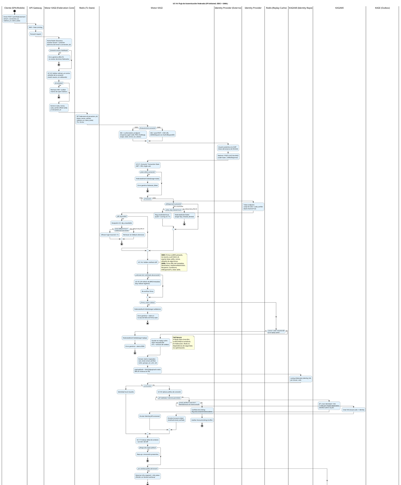
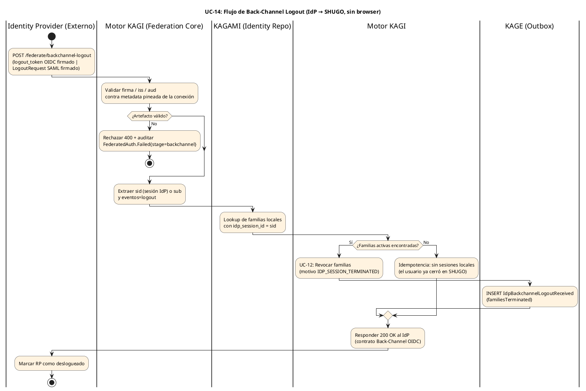

# UC-14: Autenticar Federada (SSO) - Diagrama de Actividades

| Metadatos del Documento | |
| :--- | :--- |
| **Proyecto:** | SHUGO - Identity & Access Platform |
| **Caso de Uso:** | UC-14 - Autenticar Federada (SSO - OIDC/OAuth2 + SAML 2.0) |
| **Documento:** | 03_Activity_Diagram.md |
| **Metodología:** | UML 2.5 + ICONIX + Federation Security (NIST SP 800-63C) + Security by Design |
| **Autor:** | Gastón Ruiz |
| **Versión Actual:** | 1.0.0 |
| **Fecha:** | 22/10/2026 |

---

## Historial de Versiones

| Versión | Fecha | Autor | Descripción de Cambios | Impacto |
| :--- | :--- | :--- | :--- | :--- |
| **1.0.0** | 22/10/2026 | Gastón Ruiz | **Creación inicial.** Diagrama de Actividades UML con carriles (swimlanes) para UC-14. Modela el flujo SP-initiated completo (OIDC y SAML) con Home Realm Discovery, Transaction State single-use, viaje de redirección por el browser, validación de artefactos con rollover de claves controlado, replay cache post-validación, resolución de identidad por política (JIT/Linking/Conflicto), step-up por assurance insuficiente, y emisión de sesión federada vía `federate_code` de un solo uso. Incluye un segundo diagrama para el flujo server-to-server de Back-Channel Logout / SAML SLO. | Documento base del paquete de diseño Tier 1 del UC-14. Sirve como el "guion de ejecución" del Federation Core, dejando explícito que Redis es dependencia **fail-secure** en federación (a diferencia de la Grace Cache de UC-13), que el replay cache se escribe solo post-validación, y que ninguna familia de tokens se emite sin proveniencia y assurance evaluados. |

---

## 1. Introducción y Propósito

El **Diagrama de Actividades** para el UC-14 materializa la lógica de negocio y las reglas de seguridad definidas en la Especificación de Requisitos (01) y el Diagrama de Casos de Uso (02). Su propósito es:

1. **Modelar el Viaje de Redirección:** Visualizar que la federación es un flujo interrumpido: SHUGI inicia (start), el **browser del usuario viaja al IdP y regresa** (callback), y SHUGO completa (token exchange + sesión). Cada segmento tiene sus propias amenazas y controles.
2. **Diferenciar Protocolos sin Duplicar Lógica:** Mostrar las bifurcaciones OIDC vs SAML (authorize vs SAMLRequest, code exchange vs parse de SAMLResponse, InResponseTo vs nonce) convergiendo en una validación semántica común.
3. **Ordenar los Controles Anti-Replay:** Dejar explícito que el Transaction State se consume **antes** de tocar el IdP, y que la Replay Cache se escribe **después** de validar el artefacto (nunca antes).
4. **Modelar las Ramas de Política:** IdP-Initiated default-deny, fallback local default-deny, JIT/Linking/Conflicto como ramas mutuamente excluyentes bajo UC-V4, y step-up por `acr` insuficiente **antes** de emitir familia.
5. **Documentar el Flujo Server-to-Server:** El Back-Channel Logout no pasa por el browser ni por el cliente: es un contrato directo IdP→SHUGO con respuesta 200 y revocación por `idp_session_id`.

---

## 2. Diagrama de Actividades #1: Flujo SP-Initiated (OIDC / SAML)



---

## 3. Diagrama de Actividades #2: Back-Channel Logout / SAML SLO (Server-to-Server)



---

## 4. Análisis de los Carriles (Swimlanes) y Responsabilidades

### 4.1. Diagrama #1 (SP-Initiated)

1. **Cliente (SPA/Mobile):** Inicia la federación y completa el canje del `federate_code`. Nunca ve ni manipula artefactos del IdP: el callback aterriza en KAGI, no en el cliente.
2. **API Gateway:** WAF y Rate Limiting sobre endpoints públicos de federación (el callback es anónimo y atacable).
3. **Motor KAGI (Federation Core):** Orquestador completo: Home Realm Discovery, validación de whitelist, generación criptográfica de Transaction State, enrutamiento por protocolo, validación de artefactos, resolución de identidad por política, evaluación de riesgo/assurance, emisión de familia con proveniencia y canje de `federate_code`.
4. **Redis (Tx State + Replay Cache):** Dos keyspaces con roles de seguridad distintos: el Transaction State (single-use, 10 min) y la Replay Cache (nonce/code/AssertionID con TTL de ventana).
5. **Identity Provider (Externo):** Autentica al usuario y emite artefactos. En OIDC además opera el token endpoint por back-channel TLS.
6. **KAGAMI (Identity Repo):** Fuente de verdad de links federados, identidades (JIT) y familias de tokens.
7. **KAGE (Outbox):** Auditoría con `payloadHash` (forense sin PII) y eventos de federación.

### 4.2. Diagrama #2 (Back-Channel)

Solo tres carriles: **IdP** (iniciador), **Motor KAGI** (validador y orquestador de revocación) y **KAGAMI/KAGE** (estado y auditoría). El cliente y el browser **no participan**: es un contrato server-to-server con respuesta 200 contractual.

---

## 5. Puntos Críticos de Seguridad en el Flujo

### 5.1. Consumo Single-Use del Transaction State ANTES del Token Exchange

El `GET + DEL` de `federate:tx:{transaction_id}` ocurre inmediatamente al recibir el callback, **antes** de cualquier round-trip al IdP.

*   **Justificación:** Un callback duplicado o replaysado falla en el primer control (state ausente), sin consumir cuota del token endpoint del IdP ni exponer el `code_verifier`. El consumo single-use cierra CSRF, replay de id_token y open-redirect con un solo mecanismo (UC-V1).

### 5.2. Replay Cache Escrita POST-Validación (Anti Nonce-Burning)

La escritura en Replay Cache ocurre **después** de que firma y claims validan, nunca antes.

*   **El Ataque que Previene:** Si la cache se escribiera al recibir el callback, un atacante podría "quemar" nonces o AssertionIDs legítimos enviando artefactos falsos con esos identificadores, causando DoS contra usuarios reales (su artefacto válido posterior caería como "replay").
*   **Comportamiento:** Solo artefactos **válidos** consumen su propia ventana de replay.

### 5.3. Redis como Dependencia Fail-Secure en Federación

A diferencia de la Grace Cache de UC-13 (fail-open conservador), en UC-14 una falla de Redis al escribir la Replay Cache **rechaza el artefacto**.

*   **Justificación del Asimétrico:** En UC-13, el fail-open de grace solo degrada concurrencia (la pestaña con el sucesor sigue viva). En UC-14, aceptar un artefacto sin garantía anti-replay habilita **forgery de sesión** reutilizando assertions/id_tokens interceptados: catastrófico vs. inconveniente. Por tanto, la instancia Redis Auth debe operarse como infraestructura de seguridad (HA con réplicas + sentinel), no como caché best-effort.

### 5.4. Rollover de Claves con UN Refetch

Ante `unknown kid` (OIDC) o certificado desconocido (SAML), el flujo realiza **exactamente un** refetch de JWKS/metadata y re-verifica.

*   **Segundo Fallo = Rechazo + Alerta:** Dos fallos consecutivos de firma tras refetch indican inyección de claves o IdP comprometido, no rollover legítimo. La tasa de `FederatedAuth.Failed{stage=validation}` es métrica de salud de la federación.

### 5.5. JIT / Linking / Conflicto como Ramas de Política Exclusivas

Las tres resoluciones de identidad emergen exclusivamente de UC-V4 (política de conexión): dominio permitido, `email_verified`, flag de auto-link y mapeo declarativo de grupos.

*   **Invariante Visualizada:** El nodo JIT incluye la restricción "NUNCA admin vía JIT" directamente en el carril, haciendo auditable en el diagrama que la superficie de privilegios es cerrada (INV-93).

### 5.6. Step-Up y Riesgo ANTES de la Familia

Tanto la evaluación de riesgo (UC-17) como el chequeo de `acr` ocurren **antes** de `CreateRoot`.

*   **Justificación:** Coherente con el principio de UC-13: ninguna pausa de step-up debe dejar familias huérfanas. Si el assurance del IdP no satisface la política, no se emite familia alguna; el usuario completa UC-15 y el flujo se reanuda desde el transaction state vigente.

### 5.7. `federate_code`: Tokens Fuera de la URL de Redirección

El callback nunca responde con tokens en el fragment o la query. Emite un `federate_code` de **60s y un solo uso**, vinculado al transaction, que el cliente canjea por back-channel (`POST /federate/token`).

*   **Justificación:** Evita tokens en historiales de browser, logs de proxy y referers; limita la ventana de interceptación del código a 60s single-use; y mantiene el canje final autenticable y rate-limitable como cualquier endpoint de token.

### 5.8. Back-Channel: Idempotencia y Contrato 200

En el Diagrama #2, la ausencia de familias locales no es error: es **idempotencia** (el usuario pudo haber cerrado sesión en SHUGO antes de que el IdP notificara). La respuesta 200 OK se emite siempre tras validación de firma, cumpliendo el contrato OIDC Back-Channel Logout y evitando reintentos agresivos del IdP.

---

## 6. Trazabilidad con Otros Documentos del Paquete

| Documento | Relación |
| :--- | :--- |
| `01_Requirements_Specification.md` | Implementa visualmente los escenarios 2.1-2.2.4 y 4.1-4.9, las invariantes INV-89 a INV-96 y las reglas RN-27 a RN-31. |
| `02_Use_Case_Diagram.md` | Los carriles y bifurcaciones materializan UC-14a a UC-14f, UC-V1 a UC-V4 y las extensiones EXT_JIT/LINK/CONFLICT/IDPINIT/FALLBACK. |
| `04_Initial_Domain_Model.md` | Las acciones en los carriles de KAGI y KAGAMI se mapearán a `FederationTransaction`, `OidcRelyingParty`, `SamlServiceProvider`, `AccountLinker` y `JitProvisioner`. |
| `05_State_Machine_Diagram.md` | Las decisiones "¿state válido?", "¿firma válida?", "¿link existe?" son guardas de la máquina de `FederationTransaction`. |
| `07_Sequence_Diagram.md` | Este diagrama define "qué se hace y quién lo hace"; el de secuencia ordenará los round-trips al IdP (authorize, token exchange, refetch JWKS) y el back-channel. |
| `10_UC_Specific_Data_Model.md` | Los keyspaces `federate:tx:*` y replay cache, y las tablas `federated_connections` / `federated_identity_links` soportan los carriles de Redis y KAGAMI. |
| `11_UC_Specific_Security_Threats.md` | El orden post-validación de la replay cache (§5.2) y el fail-secure de Redis (§5.3) mitigan nonce-burning y assertion replay. |
| `UC-12/03_Activity_Diagram.md` | El Diagrama #2 delega la revocación de familias al mecanismo de UC-12 con motivo `IDP_SESSION_TERMINATED`. |

---

## 7. Notas de Implementación

### 7.1. Sintaxis PlantUML Moderna
- Sintaxis **Activity Diagram Beta** con carriles (`|Lane|`), `if/then/else/endif` y `note right`.
- Dos diagramas separados: el flujo SP-initiated (interrumpido por el browser) y el back-channel (server-to-server), porque comparten actores pero **no** comparten trigger ni contrato de respuesta.
- Bloques `<style>` con colores semánticos: azul para el flujo de federación, naranja para el flujo de logout (alineado con la convención de UC-12/UC-13).

### 7.2. Esqueleto de Enrutamiento del Callback

```csharp
public async Task<IActionResult> CallbackAsync(CancellationToken ct)
{
    // 1. Consumir Transaction State ANTES de cualquier round-trip (single-use)
    var tx = await _txStore.ConsumeAsync(Request.Query["state"], ct);
    if (tx is null) return Fail(FederateStage.State);

    // 2. Enrutamiento por protocolo con replay cache post-validación
    IdpArtifact artifact = tx.Protocol switch
    {
        FederationProtocol.OIDC => await _oidcRp.ExchangeAndValidateAsync(tx, Request, ct),
        FederationProtocol.SAML => await _samlSp.ParseAndValidateAsync(tx, Request, ct),
        _ => throw new InvalidOperationException("Unsupported protocol")
    };

    // 3. Replay check + write post-validación (fail-secure si Redis cae)
    if (!await _replayCache.TryRegisterAsync(artifact.ReplayKey, artifact.ValidUntil, ct))
        return Fail(FederateStage.Replay);

    // 4. Resolución de identidad por política (JIT / Link / Conflicto)
    var resolution = await _identityResolver.ResolveAsync(tx, artifact, ct);
    if (resolution.IsConflict) return Conflict(resolution);

    // 5. Riesgo + assurance ANTES de emitir familia
    var stepUp = await _assuranceEvaluator.EvaluateAsync(tx, artifact, resolution, ct);
    if (stepUp is not null) return MfaRequired(stepUp);

    // 6. Familia con proveniencia + federate_code single-use
    var family = await _sessionIssuer.IssueFederatedFamilyAsync(tx, artifact, resolution, ct);
    return Redirect($"{tx.RedirectUri}?code={family.FederateCode}&state={tx.ClientState}");
}
```

### 7.3. Convenciones de Nomenclatura
- **Etapas de fallo:** `FederateStage.{State, Validation, Replay, IdpInitiated, Backchannel}` alineadas con el payload `stage` del evento `FederatedAuth.Failed` (doc 01, §5).
- **Flags de auditoría:** `unsolicited=true` para IdP-initiated habilitado; `jitProvisioned` y `linked` en `FederatedSucceeded`; `familiesTerminated` en back-channel.
- **Notas de seguridad:** Texto en negrita (**Fail-Secure**, **POST-VALIDACIÓN**) para resaltar decisiones no obvias del orden de controles.

---
*Fin del Documento 03_Activity_Diagram para UC-14*