# UC-14: Autenticar Federada (SSO) - Modelo de Dominio Inicial

| Metadatos del Documento | |
| :--- | :--- |
| **Proyecto:** | SHUGO - Identity & Access Platform |
| **Caso de Uso:** | UC-14 - Autenticar Federada (SSO - OIDC/OAuth2 + SAML 2.0) |
| **Documento:** | 04_Initial_Domain_Model.md |
| **Metodología:** | ICONIX (Modelo de Análisis) + DDD (Domain-Driven Design) + Federation Security (NIST SP 800-63C) + Hexagonal Architecture |
| **Autor:** | Gastón Ruiz |
| **Versión Actual:** | 1.0.0 |
| **Fecha:** | 22/10/2026 |

---

## Historial de Versiones

| Versión | Fecha | Autor | Descripción de Cambios | Impacto |
| :--- | :--- | :--- | :--- | :--- |
| **1.0.0** | 22/10/2026 | Gastón Ruiz | **Creación inicial.** Definición del Modelo de Dominio Conceptual para la autenticación federada. Introduce el Aggregate Root transitorio `FederationTransaction` (state/nonce/PKCE single-use, con fábrica para flujos unsolicited), la Entity `FederatedIdentityLink`, el Value Object protocol-neutral `IdpArtifact` (normalización de id_token OIDC y Assertion SAML), los VOs de política (`FederatedConnectionSnapshot`, `JitPolicy`, `LinkingPolicy`, `RoleMapping`), de seguridad (`AssuranceLevel`, `PkcePair`, `FederateCode`) y de resolución (`IdentityResolution`, `MappedClaims`). Define los Domain Services `OidcRelyingParty`, `SamlServiceProvider`, `AccountLinker`, `JitProvisioner`, `AssuranceEvaluator` y `FederationSessionIssuer`, con puertos hexagonales para metadata, replay cache y provisioning cruzado a KAGAMI. | Documento base del paquete de diseño Tier 1 del UC-14. Establece cómo el dominio absorbe la complejidad de dos protocolos heterogéneos (OIDC y SAML) en un artefacto canónico único, y cómo las políticas de federación (linking, JIT, fallback, assurance) viajan como Value Objects inmutables pineados al inicio de cada transacción. |

---

## 1. Introducción y Propósito

Este documento presenta el **Modelo de Dominio Inicial** para el Caso de Uso UC-14 (Autenticar Federada).

La federación impone un desafío de modelado poco común: **dos protocolos radicalmente distintos** (OIDC con JSON/JWT/JWKS, SAML con XML/firmas exclusivas-c14n/metadata) deben converger en **un único flujo de decisión de dominio** (resolver identidad → evaluar assurance → emitir sesión federada). El modelo responde con tres decisiones estructurales:

1. **`FederationTransaction` como Aggregate Root transitorio:** El estado de la transacción (state, nonce, PKCE verifier, redirect_uri validado, snapshot de conexión) es un AR con identidad propia y consumo single-use, persistido en Redis vía puerto. Incluso el flujo SAML IdP-initiated (que carece de `/start`) se modela con una fábrica `InitiateUnsolicited` que sintetiza la transacción en el callback, unificando el flujo downstream.
2. **`IdpArtifact` como normalización protocol-neutral:** Los servicios `OidcRelyingParty` y `SamlServiceProvider` traducen sus artefactos nativos a un VO canónico (subject, email, email_verified, groups, acr/amr, idpSessionId, replayKey, validUntil, payloadHash). Todo lo posterior al artefacto es agnóstico al protocolo.
3. **Política como snapshot inmutable:** La configuración de la conexión (UC-25) se captura como `FederatedConnectionSnapshot` al iniciar la transacción. Un cambio de política del tenant **a mitad de un vuelo de federación** no puede alterar las reglas con las que ese vuelo se valida: la transacción completa se rige por el snapshot pineado.

El modelo se centra en:
- **Consumo single-use como invariante de AR:** `Consume()` lanza si la transacción ya fue consumida o expiró (INV-89).
- **Superficie de privilegios cerrada:** `RoleMapping.Map()` filtra roles administrativos por construcción, no por convención (INV-93).
- **Assurance derivada, no confiada:** `AssuranceLevel.DeriveFrom()` exige evidencia en `acr/amr` para AAL2; sin evidencia, AAL1 + step-up según política (INV-94).
- **Separación de contextos:** El JIT no crea identidades directamente: delega en un gateway hacia KAGAMI (UC-01), preservando la soberanía del contexto de Identity Lifecycle.

---

## 2. Diagrama de Modelo de Dominio Conceptual (PlantUML)

```plantuml
@startuml UC-14_DominioConceptual
<style>
diagram {
  BackgroundColor #FFFFFF
}
</style>
skinparam classAttributeIconSize 0
skinparam classBackgroundColor #FFFFFF
skinparam classBorderColor #1565C0
skinparam classHeaderBackgroundColor #E3F2FD

title UC-14: Modelo de Dominio Conceptual - Federación (RP/SP con Artefacto Canónico)

' ============================================
' AGGREGATE ROOTS & ENTITIES
' ============================================
class FederationTransaction <<Aggregate Root>> {
  - id: TransactionId
  - tenantId: TenantId
  - connection: FederatedConnectionSnapshot
  - protocol: FederationProtocol
  - state: string
  - nonce: string
  - pkce: PkcePair
  - authnRequestId: string?
  - redirectUri: RedirectUri
  - clientState: string?
  - isUnsolicited: bool
  - createdAt: DateTime
  - expiresAt: DateTime
  - consumedAt: DateTime?

  + {static} Initiate(snapshot, protocol, redirectUri, clientState, now): FederationTransaction
  + {static} InitiateUnsolicited(snapshot, authnRequestIdNull, now): FederationTransaction
  + Consume(presentedState: string, now: DateTime): void
  + IsExpired(now: DateTime): bool
  + BuildAuthorizeParams(): AuthorizeParams
}

class FederatedIdentityLink <<Entity>> {
  - id: LinkId
  - issuer: string
  - subject: string
  - identityId: IdentityId
  - method: LinkMethod
  - createdAt: DateTime
  + {static} Create(issuer, subject, identityId, method): FederatedIdentityLink
}

class FederatedConnection <<Aggregate Root\n(contexto UC-25 Tenant Mgmt)>> {
  - id: ConnectionId
  - tenantId: TenantId
  - protocol / issuer / clientId
  - metadataRef / redirectWhitelist
  - políticas: JIT, Linking, Fallback, Roles
  + ToSnapshot(now): FederatedConnectionSnapshot
}

enum FederationProtocol {
  OIDC
  SAML
}

enum LinkMethod {
  JIT
  EMAIL_VERIFIED
  ADMIN
  USER_CONSENT
}

' ============================================
' VALUE OBJECTS
' ============================================
class FederatedConnectionSnapshot <<Value Object>> {
  - connectionId: ConnectionId
  - protocol: FederationProtocol
  - issuer: string
  - clientIdOrEntityId: string
  - metadataRef: string
  - redirectWhitelist: IReadOnlyList<RedirectUri>
  - jit: JitPolicy
  - linking: LinkingPolicy
  - fallback: FallbackPolicy
  - roleMapping: RoleMapping
  - assuranceMapping: AssuranceMapping
  + ValidateRedirectUri(uri: RedirectUri): bool
  + AllowsIdpInitiated: bool
}

class JitPolicy <<Value Object>> {
  - enabled: bool
  - allowedDomains: IReadOnlyList<string>
  - allowAdminRoles: bool = false
  + AllowsDomain(email: string): bool
}

class LinkingPolicy <<Value Object>> {
  - autoLinkByEmailVerified: bool
}

class RoleMapping <<Value Object>> {
  - mappings: IReadOnlyDictionary<string, string>
  + Map(idpGroups: IReadOnlyList<string>): IReadOnlyList<string>
}

class PkcePair <<Value Object>> {
  - verifier: string
  - challenge: string
  + {static} Generate(): PkcePair
}

class IdpArtifact <<Value Object>> {
  - protocol: FederationProtocol
  - issuer: string
  - subject: string
  - email: string
  - emailVerified: bool
  - displayName: string
  - groups: IReadOnlyList<string>
  - acr: string?
  - amr: IReadOnlyList<string>
  - idpSessionId: string?
  - replayKey: string
  - validUntil: DateTime
  - payloadHash: string
  + {static} FromOidcIdToken(token, claims): IdpArtifact
  + {static} FromSamlAssertion(assertion): IdpArtifact
}

class AssuranceLevel <<Value Object>> {
  - value: string
  + AAL1: AssuranceLevel
  + AAL2: AssuranceLevel
  + {static} DeriveFrom(acr, amr, mapping): AssuranceLevel
  + Satisfies(required: AssuranceLevel): bool
}

class MappedClaims <<Value Object>> {
  - displayName: string
  - department: string?
  - roles: IReadOnlyList<string>
}

class FederateCode <<Value Object>> {
  - value: string
  - expiresAt: DateTime
  + {static} Issue(now): FederateCode
  + IsExpired(now): bool
}

class IdentityResolution <<Value Object>> {
  - kind: ResolutionKind
  - identityId: IdentityId?
  - linkMethod: LinkMethod?
  - conflictReason: string?
  + {static} Linked(id) / JitProvisioned(id) / Conflict(reason)
}

class StepUpRequirement <<Value Object>> {
  - mfaToken: string
  - allowedMethods: IReadOnlyList<string>
}

class FederatedSession <<Value Object>> {
  - familyRootId: TokenFamilyId
  - federateCode: FederateCode
  - authLevel: AssuranceLevel
  - provenance: SessionProvenance
}

class SessionProvenance <<Value Object>> {
  - authMethod: "federated"
  - idp: string
  - idpSessionId: string?
  - acr: string?
  - amr: IReadOnlyList<string>
}

' ============================================
' DOMAIN SERVICES
' ============================================
class OidcRelyingParty <<Domain Service>> {
  + BuildAuthorizeRedirectAsync(tx, ct): Task<RedirectInstruction>
  + ExchangeAndValidateAsync(tx, callback, ct): Task<IdpArtifact>
}

class SamlServiceProvider <<Domain Service>> {
  + BuildAuthnRequestAsync(tx, ct): Task<RedirectInstruction>
  + ParseAndValidateAsync(tx, response, ct): Task<IdpArtifact>
}

class AccountLinker <<Domain Service>> {
  + ResolveAsync(tx, artifact, ct): Task<IdentityResolution>
}

class JitProvisioner <<Domain Service>> {
  + ProvisionAsync(tx, artifact, claims, ct): Task<IdentityResolution>
}

class AssuranceEvaluator <<Domain Service>> {
  + EvaluateAsync(tx, artifact, resolution, ct): Task<StepUpRequirement?>
}

class FederationSessionIssuer <<Domain Service>> {
  + IssueAsync(tx, artifact, resolution, assurance, ct): Task<FederatedSession>
}

' ============================================
' PUERTOS (Interfaces)
' ============================================
interface IFederationTransactionStore {
  + SaveAsync(tx, ct): Task
  + ConsumeAsync(transactionId, ct): Task<FederationTransaction?>
}
interface IReplayCache {
  + TryRegisterAsync(replayKey, validUntil, ct): Task<bool>
}
interface IMetadataResolver {
  + ResolveJwksAsync(snapshot, ct): Task<JwksSet>
  + ResolveSamlMetadataAsync(snapshot, ct): Task<SamlMetadata>
  + RefetchOnceAsync(snapshot, ct): Task
}
interface IFederatedConnectionResolver {
  + ResolveByRealmAsync(email, ct): Task<FederatedConnectionSnapshot?>
  + ResolveByIdAsync(connectionId, ct): Task<FederatedConnectionSnapshot?>
}
interface IIdentityLinkRepository {
  + FindAsync(issuer, subject, ct): Task<FederatedIdentityLink?>
  + FindIdentityByEmailAsync(email, ct): Task<IdentityId?>
  + SaveAsync(link, ct): Task
}
interface IJitProvisioningGateway {
  + ProvisionIdentityAsync(command, ct): Task<IdentityId>
}
interface ITokenFamilyFactory {
  + CreateFederatedRootAsync(identityId, provenance, assurance, ct): Task<TokenFamilyId>
}
interface IFederateCodeStore {
  + IssueAsync(code, sessionPayload, ct): Task
  + RedeemAsync(code, ct): Task<FederatedSessionPayload?>
}

' ============================================
' RELACIONES
' ============================================
FederationTransaction *-- FederatedConnectionSnapshot : "política pineada"
FederationTransaction *-- PkcePair
FederationTransaction *-- FederationProtocol

FederatedConnection --> FederatedConnectionSnapshot : ToSnapshot()
FederatedConnectionSnapshot *-- JitPolicy
FederatedConnectionSnapshot *-- LinkingPolicy
FederatedConnectionSnapshot *-- RoleMapping

FederatedIdentityLink *-- LinkMethod

OidcRelyingParty ..> IdpArtifact : FromOidcIdToken()
SamlServiceProvider ..> IdpArtifact : FromSamlAssertion()
OidcRelyingParty --> IMetadataResolver
SamlServiceProvider --> IMetadataResolver
OidcRelyingParty --> IFederationTransactionStore

AccountLinker --> IIdentityLinkRepository
AccountLinker ..> IdentityResolution
JitProvisioner --> IJitProvisioningGateway
JitProvisioner ..> MappedClaims : RoleMapping.Map()
JitProvisioner ..> IdentityResolution

AssuranceEvaluator ..> AssuranceLevel : DeriveFrom()
AssuranceEvaluator ..> StepUpRequirement

FederationSessionIssuer --> ITokenFamilyFactory
FederationSessionIssuer --> IFederateCodeStore
FederationSessionIssuer ..> FederatedSession
FederationSession *-- FederateCode
FederationSession *-- SessionProvenance
FederationSession *-- AssuranceLevel

note right of FederationTransaction
  **Single-Use (INV-89):**
  Consume() marca consumedAt y
  lanza si ya consumida o expirada.
  InitiateUnsolicited() sintetiza
  tx para SAML IdP-initiated.
end note

note bottom of IdpArtifact
  **Artefacto Canónico:**
  Todo lo posterior a la validación
  es agnóstico al protocolo.
  replayKey = jti (OIDC) o
  AssertionID (SAML).
end note

note left of RoleMapping
  **Superficie cerrada (INV-93):**
  Map() ignora grupos no mapeados
  y filtra roles admin por
  construcción, no por convención.
end note

@enduml
```



---

## 3. Detalle de Conceptos de Dominio (DDD)

### 3.1. Aggregate Root: `FederationTransaction`

Encapsula el estado server-side de un vuelo de federación. Su invariante central es el **consumo single-use**: una transacción produce exactamente un callback válido.

```csharp
public class FederationTransaction : AggregateRoot
{
    public TransactionId Id { get; private set; }
    public TenantId TenantId { get; private set; }
    public FederatedConnectionSnapshot Connection { get; private set; }
    public FederationProtocol Protocol { get; private set; }
    public string State { get; private set; }
    public string Nonce { get; private set; }
    public PkcePair Pkce { get; private set; }
    public string? AuthnRequestId { get; private set; }      // SAML: para InResponseTo
    public RedirectUri RedirectUri { get; private set; }    // ya validada contra whitelist
    public string? ClientState { get; private set; }
    public bool IsUnsolicited { get; private set; }
    public DateTime CreatedAt { get; private set; }
    public DateTime ExpiresAt { get; private set; }
    public DateTime? ConsumedAt { get; private set; }

    private FederationTransaction() { }

    /// <summary>Flujo SP-initiated (OIDC o SAML).</summary>
    public static FederationTransaction Initiate(
        FederatedConnectionSnapshot snapshot,
        FederationProtocol protocol,
        RedirectUri redirectUri,
        string? clientState,
        TimeSpan ttl,
        DateTime now)
    {
        if (!snapshot.ValidateRedirectUri(redirectUri))
            throw new DomainException("Redirect URI not in connection whitelist."); // INV-95

        return new FederationTransaction
        {
            Id = new TransactionId(Guid.NewGuid()),
            TenantId = snapshot.TenantId,
            Connection = snapshot,                 // snapshot pineado: la política no cambia en vuelo
            Protocol = protocol,
            State = TokenGenerator.GenerateOpaque(32),
            Nonce = TokenGenerator.GenerateOpaque(32),
            Pkce = PkcePair.Generate(),            // RFC 7636 S256
            AuthnRequestId = protocol == FederationProtocol.SAML
                ? "_" + TokenGenerator.GenerateOpaque(16)   // SAML ID requiere NCName
                : null,
            RedirectUri = redirectUri,
            ClientState = clientState,
            IsUnsolicited = false,
            CreatedAt = now,
            ExpiresAt = now.Add(ttl)               // default 10 min
        };
    }

    /// <summary>
    /// Flujo SAML IdP-initiated (unsolicited): no hubo /start.
    /// Se sintetiza la transacción EN el callback para unificar el flujo downstream.
    /// </summary>
    public static FederationTransaction InitiateUnsolicited(
        FederatedConnectionSnapshot snapshot, DateTime now, TimeSpan ttl)
    {
        if (!snapshot.AllowsIdpInitiated)
            throw new DomainException("IdP-initiated flow denied by connection policy."); // RN-30

        var tx = new FederationTransaction
        {
            Id = new TransactionId(Guid.NewGuid()),
            TenantId = snapshot.TenantId,
            Connection = snapshot,
            Protocol = FederationProtocol.SAML,
            State = string.Empty,          // sin state: el control anti-replay lo asume la Replay Cache
            Nonce = string.Empty,
            Pkce = PkcePair.Generate(),
            AuthnRequestId = null,         // sin InResponseTo esperado
            RedirectUri = snapshot.DefaultRedirectUri,
            IsUnsolicited = true,
            CreatedAt = now,
            ExpiresAt = now.Add(ttl)
        };
        tx.MarkConsumed(now);              // se consume en el acto: solo valida UN assertion
        return tx;
    }

    /// <summary>INV-89: consumo single-use. Segundo callback con el mismo state = rechazo.</summary>
    public void Consume(string presentedState, DateTime now)
    {
        if (IsExpired(now))
            throw new FederationException(FederateStage.State, "Transaction expired.");

        if (ConsumedAt.HasValue)
            throw new FederationException(FederateStage.State, "Transaction already consumed.");

        if (!IsUnsolicited && !CryptographicOperations.FixedTimeEquals(
                Encoding.UTF8.GetBytes(State), Encoding.UTF8.GetBytes(presentedState)))
            throw new FederationException(FederateStage.State, "State mismatch.");

        MarkConsumed(now);
    }

    public bool IsExpired(DateTime now) => now >= ExpiresAt;

    private void MarkConsumed(DateTime now) => ConsumedAt = now;
}
```

### 3.2. Value Object: `IdpArtifact` (Artefacto Canónico Protocol-Neutral)

```csharp
public class IdpArtifact : ValueObject
{
    public FederationProtocol Protocol { get; }
    public string Issuer { get; }
    public string Subject { get; }
    public string Email { get; }
    public bool EmailVerified { get; }
    public string DisplayName { get; }
    public IReadOnlyList<string> Groups { get; }
    public string? Acr { get; }
    public IReadOnlyList<string> Amr { get; }
    public string? IdpSessionId { get; }       // OIDC sid / SAML SessionIndex
    public string ReplayKey { get; }           // OIDC: jti del id_token | SAML: AssertionID
    public DateTime ValidUntil { get; }        // OIDC: exp | SAML: NotOnOrAfter
    public string PayloadHash { get; }         // SHA256 del payload crudo (RN-29)

    public static IdpArtifact FromOidcIdToken(JsonWebToken token, ValidatedClaims claims) =>
        new(
            Protocol: FederationProtocol.OIDC,
            Issuer: token.Issuer,
            Subject: token.Subject,
            Email: claims.Email,
            EmailVerified: claims.EmailVerified,
            DisplayName: claims.Name,
            Groups: claims.Groups,
            Acr: claims.Acr,
            Amr: claims.Amr,
            IdpSessionId: claims.Sid,
            ReplayKey: token.Id ?? throw new FederationException(FederateStage.Validation, "id_token without jti"),
            ValidUntil: token.ValidTo,
            PayloadHash: Sha256(token.EncodedPayload));

    public static IdpArtifact FromSamlAssertion(SamlAssertion assertion) =>
        new(
            Protocol: FederationProtocol.SAML,
            Issuer: assertion.Isser,             // EntityID del IdP
            Subject: assertion.NameId,
            Email: assertion.Attribute("email"),
            EmailVerified: assertion.Attribute("email_verified") == "true",
            DisplayName: assertion.Attribute("displayName"),
            Groups: assertion.AttributeValues("groups"),
            Acr: assertion.AuthnContextClassRef,
            Amr: assertion.AuthnContextDeclRefs,
            IdpSessionId: assertion.SessionIndex,
            ReplayKey: assertion.Id,             // AssertionID
            ValidUntil: assertion.NotOnOrAfter,
            PayloadHash: Sha256(assertion.CanonicalXml));
}
```

**Justificación:** El `ReplayKey` unifica el concepto anti-replay de ambos protocolos (jti / AssertionID) y el `ValidUntil` unifica la ventana de la Replay Cache (exp / NotOnOrAfter). Todo el flujo posterior —linking, JIT, assurance, sesión— opera sobre el artefacto canónico.

### 3.3. Value Objects de Política: Superficie de Privilegios Cerrada

```csharp
public class RoleMapping : ValueObject
{
    private readonly IReadOnlyDictionary<string, string> _mappings; // grupo IdP → rol SHUGO
    private static readonly HashSet<string> AdminRoles = new() { "super_admin", "tenant_admin" };

    public RoleMapping(IReadOnlyDictionary<string, string> mappings, bool allowAdminRoles)
    {
        // INV-93: los roles admin se excluyen POR CONSTRUCCIÓN salvo flag explícito de compliance
        _mappings = allowAdminRoles
            ? mappings
            : mappings.Where(kv => !AdminRoles.Contains(kv.Value))
                      .ToDictionary(kv => kv.Key, kv => kv.Value);
    }

    /// <summary>Solo grupos explícitamente mapeados otorgan roles; el resto se ignora.</summary>
    public IReadOnlyList<string> Map(IReadOnlyList<string> idpGroups) =>
        idpGroups.Where(g => _mappings.ContainsKey(g))
                 .Select(g => _mappings[g])
                 .Distinct()
                 .ToList();
}

public class JitPolicy : ValueObject
{
    public bool Enabled { get; }
    public IReadOnlyList<string> AllowedDomains { get; }
    public bool AllowAdminRoles { get; }   // siempre false salvo aprobación de compliance

    public bool AllowsDomain(string email) =>
        AllowedDomains.Count == 0 ||
        AllowedDomains.Contains(email.Split('@')[1], StringComparer.OrdinalIgnoreCase);
}

public class AssuranceLevel : ValueObject
{
    public string Value { get; }
    public static AssuranceLevel AAL1 => new("AAL1");
    public static AssuranceLevel AAL2 => new("AAL2");

    /// <summary>INV-94: el assurance se DERIVA de evidencia (acr/amr), nunca se asume.</summary>
    public static AssuranceLevel DeriveFrom(string? acr, IReadOnlyList<string> amr, AssuranceMapping mapping)
    {
        bool mfaEvidenced =
            amr.Any(m => m is "mfa" or "otp" or "hwk" or "webauthn") ||
            (acr is not null && mapping.AcrImpliesMfa(acr));

        return mfaEvidenced ? AAL2 : AAL1;
    }

    public bool Satisfies(AssuranceLevel required) =>
        (Value, required.Value) switch
        {
            ("AAL2", "AAL2") => true,
            ("AAL2", "AAL1") => true,
            ("AAL1", "AAL1") => true,
            _ => false
        };
}
```

### 3.4. Domain Services

#### **AccountLinker (Resolución de Identidad por Política)**

```csharp
public class AccountLinker : IAccountLinker
{
    private readonly IIdentityLinkRepository _links;

    public async Task<IdentityResolution> ResolveAsync(
        FederationTransaction tx, IdpArtifact artifact, CancellationToken ct)
    {
        // 1. Link explícito por (issuer, sub): la vía primaria
        var link = await _links.FindAsync(artifact.Issuer, artifact.Subject, ct);
        if (link is not null)
            return IdentityResolution.Linked(link.IdentityId);

        var policy = tx.Connection;

        // 2. JIT Provisioning (prioridad sobre linking por email: evita secuestro de cuentas preexistentes)
        if (policy.Jit.Enabled && policy.Jit.AllowsDomain(artifact.Email))
            return IdentityResolution.NeedsJit();

        // 3. Auto-linking por email verificado (INV-92)
        if (policy.Linking.AutoLinkByEmailVerified && artifact.EmailVerified)
        {
            var existing = await _links.FindIdentityByEmailAsync(artifact.Email, ct);
            if (existing is not null)
                return IdentityResolution.LinkableByEmail(existing.Value);
        }

        // 4. Conflicto: sin link, sin JIT, sin email verificado o sin identidad previa
        return IdentityResolution.Conflict(
            artifact.EmailVerified ? "NO_LOCAL_IDENTITY" : "EMAIL_NOT_VERIFIED");
    }
}
```

#### **JitProvisioner (Delegación Cross-Context a KAGAMI)**

```csharp
public class JitProvisioner : IJitProvisioner
{
    private readonly IJitProvisioningGateway _kagami;      // comando interno de UC-01
    private readonly IIdentityLinkRepository _links;
    private readonly IOutboxPublisher _outbox;

    public async Task<IdentityResolution> ProvisionAsync(
        FederationTransaction tx, IdpArtifact artifact, CancellationToken ct)
    {
        var mapping = tx.Connection.RoleMapping;
        var claims = new MappedClaims(
            DisplayName: artifact.DisplayName,
            Department: artifact.Groups.FirstOrDefault(),
            Roles: mapping.Map(artifact.Groups));          // filtrado admin por construcción

        // El contexto de Identity Lifecycle (KAGAMI) es el único que crea identidades
        var identityId = await _kagami.ProvisionIdentityAsync(new JitProvisionCommand(
            tx.TenantId, artifact.Email, claims, Source: $"federated:{artifact.Issuer}"), ct);

        var link = FederatedIdentityLink.Create(artifact.Issuer, artifact.Subject, identityId, LinkMethod.JIT);
        await _links.SaveAsync(link, ct);

        await _outbox.PublishAsync(new IdentityJitProvisioned(
            identityId, artifact.Issuer, artifact.Subject, claims.Roles, DateTime.UtcNow), ct);

        return IdentityResolution.JitProvisioned(identityId);
    }
}
```

#### **FederationSessionIssuer (Proveniencia + Federate Code)**

```csharp
public class FederationSessionIssuer : IFederationSessionIssuer
{
    private readonly ITokenFamilyFactory _families;     // UC-11 CreateRoot con proveniencia
    private readonly IFederateCodeStore _codes;         // Redis single-use 60s
    private readonly IOutboxPublisher _outbox;

    public async Task<FederatedSession> IssueAsync(
        FederationTransaction tx, IdpArtifact artifact,
        IdentityResolution resolution, AssuranceLevel assurance, CancellationToken ct)
    {
        var provenance = new SessionProvenance(
            AuthMethod: "federated",
            Idp: artifact.Issuer,
            IdpSessionId: artifact.IdpSessionId,
            Acr: artifact.Acr,
            Amr: artifact.Amr);

        // Familia local soberana: el IdP autentica; SHUGO sesiona (INV-94)
        var familyId = await _families.CreateFederatedRootAsync(
            resolution.IdentityId!.Value, provenance, assurance, ct);

        var code = FederateCode.Issue(DateTime.UtcNow);   // TTL 60s, single-use
        await _codes.IssueAsync(code, new FederatedSessionPayload(familyId, provenance, assurance), ct);

        await _outbox.PublishAsync(new AuthenticationFederatedSucceeded(
            resolution.IdentityId.Value, tx.Connection.ConnectionId, tx.Protocol,
            artifact.Issuer, artifact.IdpSessionId, artifact.Acr, artifact.Amr,
            assurance, jitProvisioned: resolution.Kind == ResolutionKind.JitProvisioned,
            linked: resolution.Kind == ResolutionKind.Linked,
            unsolicited: tx.IsUnsolicited, artifact.PayloadHash, DateTime.UtcNow), ct);

        return new FederatedSession(familyId, code, assurance, provenance);
    }
}
```

### 3.5. Domain Events

| Evento | Disparador | Consumidores |
| :--- | :--- | :--- |
| `Authentication.FederatedSucceeded` | Emisión de familia federada | KAGE, KIZUNA (proveniencia), UC-17 (baseline), TORII |
| `Identity.JitProvisioned` | Creación JIT vía gateway KAGAMI | KAGE, KIZUNA (cache de roles), TORII (HRIS), Notification |
| `Account.Linked` | Creación de link (EMAIL_VERIFIED / ADMIN / USER_CONSENT) | KAGE, KIZUNA |
| `FederatedAuth.Failed` | Cualquier stage de rechazo (state, validation, replay, idp_initiated, backchannel) | KAGE, SIEM, métricas de salud de federación |
| `IdpBackchannelLogoutReceived` | Logout token / LogoutRequest válido del IdP | KAGE, UC-12 (revocación por `idp_session_id`) |

---

## 4. Decisiones de Diseño DDD (ADR)

### 4.1. ¿Por qué `FederationTransaction` es un Aggregate Root persistido en Redis?

**Decisión:** Modelar la transacción como AR con identidad (`TransactionId`) y consumo single-use, persistido vía puerto `IFederationTransactionStore` (Redis), no en base de datos.

**Justificación:**
- **Tiene invariantes propias:** expiración (10 min), single-use, state binding, redirect_uri ya validado. No es un DTO: es un objeto con comportamiento (`Consume`, `IsExpired`, `BuildAuthorizeParams`).
- **Vida corta y alto volumen:** Una transacción por intento de login federado, con TTL natural. Redis con TTL es el almacenamiento correcto; la DB añadiría churn sin valor forense (el forense vive en KAGE vía `payloadHash`).
- **Unsolicited unificado:** La fábrica `InitiateUnsolicited` permite que el flujo SAML IdP-initiated pase por los mismos servicios downstream con una transacción sintetizada y auto-consumida, eliminando bifurcaciones de código especiales.

### 4.2. ¿Por qué la conexión se consume como Snapshot inmutable y no como referencia viva?

**Decisión:** `FederatedConnection` es un AR del contexto de Tenant Management (UC-25). KAGI lo consume como `FederatedConnectionSnapshot` pineado al inicio de la transacción.

**Justificación:**
- **Consistencia del vuelo:** Si un admin modifica la whitelist, el mapeo de roles o `allow_idp_initiated` mientras un usuario está autenticando en el IdP, el callback debe validarse contra **las reglas vigentes al inicio**, no contra reglas mutadas a mitad de camino (que podrían aceptar o rechazar artefactos de forma impredecible).
- **Separación de contextos:** KAGI no muta configuración; solo la lee. El snapshot es el contrato de lectura entre contextos (Published Language).

### 4.3. ¿Por qué `IdpArtifact` canónico en lugar de dos flujos paralelos?

**Decisión:** `OidcRelyingParty` y `SamlServiceProvider` traducen a un VO canónico; todo lo posterior es protocol-agnostic.

**Justificación:**
- **Duplicación eliminada:** Linking, JIT, assurance, emisión de sesión y auditoría existirían por duplicado (×2 protocolos) sin el artefacto canónico.
- **Superficie de seguridad concentrada:** Las validaciones específicas (JWKS vs firma XML, nonce vs InResponseTo) viven en sus servicios expertos; las reglas comunes (replay cache, minimización, proveniencia) viven una sola vez sobre el artefacto.
- **Extensibilidad:** Un futuro protocolo (ej. WS-Fed) añade un traductor, no un flujo nuevo.

### 4.4. ¿Por qué el JIT delega en un Gateway hacia KAGAMI?

**Decisión:** `JitProvisioner` no crea identidades: emite un comando interno hacia el contexto de Identity Lifecycle (UC-01) vía `IJitProvisioningGateway`.

**Justificación:**
- **Soberanía del contexto:** Las invariantes de creación de identidad (unicidad de email, políticas de password, cuotas de tenant) viven en KAGAMI. Duplicarlas en KAGI crearía divergencia.
- **Auditabilidad:** El evento `Identity.JitProvisioned` marca `initiatedBy=FEDERATED_JIT`, distinguiendo provisiones federadas de administrativas en el mismo pipeline de UC-01.

### 4.5. ¿Por qué `AssuranceLevel` se deriva con mapping declarativo?

**Decisión:** `AssuranceLevel.DeriveFrom(acr, amr, AssuranceMapping)` con mapping por conexión; sin evidencia de MFA en `acr/amr`, el resultado es AAL1.

**Justificación:**
- **INV-94:** Un IdP que no evidencia MFA no puede elevar el assurance local. El mapping declarativo (`AssuranceMapping.AcrImpliesMfa`) permite que cada tenant declare qué contextos de su IdP equivalen a MFA (ej. `urn:oasis:...:TimeSyncToken`), sin hardcodear URNs de vendors en el dominio.
- **Step-up como consecuencia:** `AssuranceEvaluator` compara el nivel derivado contra el requerido por política y produce `StepUpRequirement` si falta evidencia — degradación controlada, nunca elevación por confianza.

### 4.6. ¿Por qué `FederateCode` y no tokens en el redirect?

**Decisión:** El issuer emite un `FederateCode` de 60s single-use vinculado al transaction; los tokens se entregan solo en el canje back-channel (`POST /federate/token`).

**Justificación:** Los tokens en URLs de redirección quedan en historiales, logs de proxy y referers. El código acota la ventana de interceptación a 60s y convierte el canje en un endpoint autenticable, rate-limitable y auditable como cualquier endpoint de token.

---

## 5. Trazabilidad

| Documento | Relación |
| :--- | :--- |
| `01_Requirements_Specification.md` | Implementa INV-89 (Consume single-use), INV-90/91 (replayKey/validUntil del artefacto), INV-92 (LinkingPolicy), INV-93 (RoleMapping cerrado), INV-94 (AssuranceLevel + SessionProvenance), INV-95 (ValidateRedirectUri), INV-96 (IdpSessionId para back-channel), RN-27 a RN-31. |
| `02_Use_Case_Diagram.md` | `OidcRelyingParty`/`SamlServiceProvider` materializan UC-14a/b/c; `AccountLinker`+`JitProvisioner` materializan UC-14d + UC-V4; `FederationSessionIssuer` materializa UC-14e; el back-channel consume UC-12. |
| `03_Activity_Diagram.md` | Cada nodo del flujo (consumo de tx, replay post-validación, ramas JIT/Link/Conflicto, step-up pre-familia) corresponde a un método de los servicios aquí definidos. |
| `05_State_Machine_Diagram.md` | La máquina de `FederationTransaction` (INITIATED → AWAITING_CALLBACK → CONSUMED / EXPIRED) se deriva de `Consume()` e `IsExpired()`. |
| `08_Final_Class_Design.md` | Refinará firmas con `CancellationToken`, resultados tipados y el orquestador `FederationHandler` que encadena los seis servicios. |
| `10_UC_Specific_Data_Model.md` | `FederatedIdentityLink` se persiste en `federated_identity_links`; la transacción y el federate_code viven en keyspaces Redis definidos allí. |
| `11_UC_Specific_Security_Threats.md` | El filtrado de admin en `RoleMapping` y el derivation de assurance mitigan JIT privilege escalation y assurance spoofing. |

---

## 6. Notas para la Implementación

### 6.1. Ubicación en Clean Architecture

- **Dominio (`SHUGO.Domain.Federation`):** `FederationTransaction`, `FederatedIdentityLink`, todos los VOs, los seis Domain Services y los puertos (`IFederationTransactionStore`, `IReplayCache`, `IMetadataResolver`, `IJitProvisioningGateway`, `ITokenFamilyFactory`, `IFederateCodeStore`).
- **Infraestructura:** `RedisFederationTransactionStore`, `RedisReplayCache`, `OidcMetadataResolver`/`SamlMetadataResolver` (cache + ETag + refetch once), `KagamiJitProvisioningGateway` (HTTP interno mTLS), `RedisFederateCodeStore`.
- **Aplicación:** `FederationHandler` (orquestador de start/callback/token/backchannel) y `FederationPolicyResolver` (snapshot desde UC-25).

### 6.2. Testeo Unitario (Invariantes de Federación)

```csharp
[Test]
public void FederationTransaction_Consume_Twice_ThrowsStateStage()
{
    var tx = FederationTransaction.Initiate(Snapshot, FederationProtocol.OIDC, RedirectUri, null, Ttl10m, Now);
    tx.Consume(tx.State, Now);
    var act = () => tx.Consume(tx.State, Now.AddSeconds(1));
    act.Should().Throw<FederationException>().Where(e => e.Stage == FederateStage.State);
}

[Test]
public void FederationTransaction_InitiateUnsolicited_WhenPolicyDenies_Throws()
{
    var snapshot = Snapshot.WithIdpInitiated(allowed: false);
    var act = () => FederationTransaction.InitiateUnsolicited(snapshot, Now, Ttl10m);
    act.Should().Throw<DomainException>().WithMessage("*IdP-initiated*"); // RN-30 default deny
}

[Test]
public void RoleMapping_Map_FiltersAdminRoles_ByConstruction()
{
    var mapping = new RoleMapping(
        new Dictionary<string, string> { ["engineering"] = "engineer", ["platform-admins"] = "tenant_admin" },
        allowAdminRoles: false);

    var roles = mapping.Map(new[] { "engineering", "platform-admins", "unknown-group" });

    roles.Should().BeEquivalentTo("engineer");   // admin filtrado, grupo no mapeado ignorado
}

[Test]
public void AssuranceLevel_DeriveFrom_WithoutMfaEvidence_ReturnsAAL1()
{
    var level = AssuranceLevel.DeriveFrom(acr: null, amr: new[] { "pwd" }, Mapping);
    level.Should().Be(AssuranceLevel.AAL1);
    level.Satisfies(AssuranceLevel.AAL2).Should().BeFalse();   // dispara step-up
}

[Test]
public void AccountLinker_WhenEmailNotVerified_AndNoJit_ReturnsConflict()
{
    var artifact = ArtifactWith(emailVerified: false);
    var resolution = await linker.ResolveAsync(TxWithJitDisabled, artifact, CT);
    resolution.Kind.Should().Be(ResolutionKind.Conflict);
    resolution.ConflictReason.Should().Be("EMAIL_NOT_VERIFIED"); // INV-92
}
```

---

## 7. Glosario de Términos Específicos de UC-14

| Término | Definición |
| :--- | :--- |
| **FederationTransaction** | Aggregate Root transitorio que encapsula state, nonce, PKCE, redirect_uri validado y snapshot de conexión; consumo single-use garantizado por `Consume()`. |
| **Connection Snapshot** | Copia inmutable de la configuración de federación pineada al inicio del vuelo; garantiza que la política no mute a mitad de transacción. |
| **IdpArtifact** | Value Object canónico protocol-neutral que normaliza id_token OIDC y Assertion SAML en un único conjunto de claims, replayKey y validUntil. |
| **ReplayKey** | Identificador anti-replay unificado: `jti` del id_token en OIDC, `AssertionID` en SAML; clave de la Replay Cache con TTL = ventana de validez. |
| **Assurance Derivation** | Cálculo de `AssuranceLevel` local a partir de evidencia `acr/amr` del IdP mediante mapping declarativo por conexión; sin evidencia, AAL1. |
| **JIT Gateway** | Puerto que delega la creación de identidades al contexto de Identity Lifecycle (KAGAMI/UC-01), preservando la soberanía de sus invariantes. |
| **FederateCode** | Código local de 60s single-use que reemplaza a los tokens en la URL de redirección; se canjea por back-channel en `/federate/token`. |
| **Unsolicited Synthesis** | Fábrica `InitiateUnsolicited` que sintetiza y auto-consume una transacción para flujos SAML IdP-initiated habilitados por política. |
| **SessionProvenance** | Value Object de origen federado (auth_method, idp, idp_session_id, acr, amr) persistido en la familia de tokens para autorización y back-channel logout. |

---
*Fin del Documento 04_Initial_Domain_Model para UC-14*