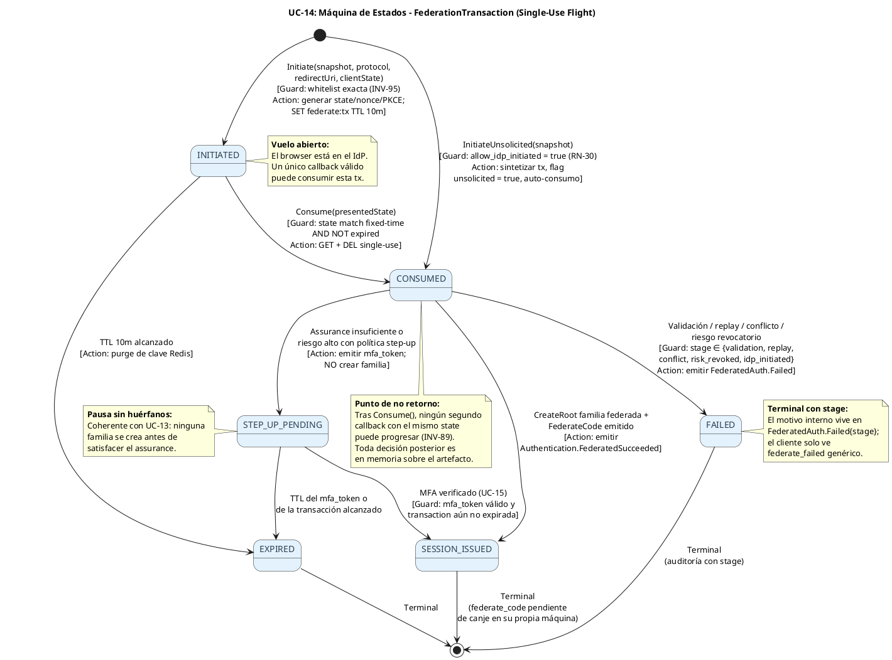
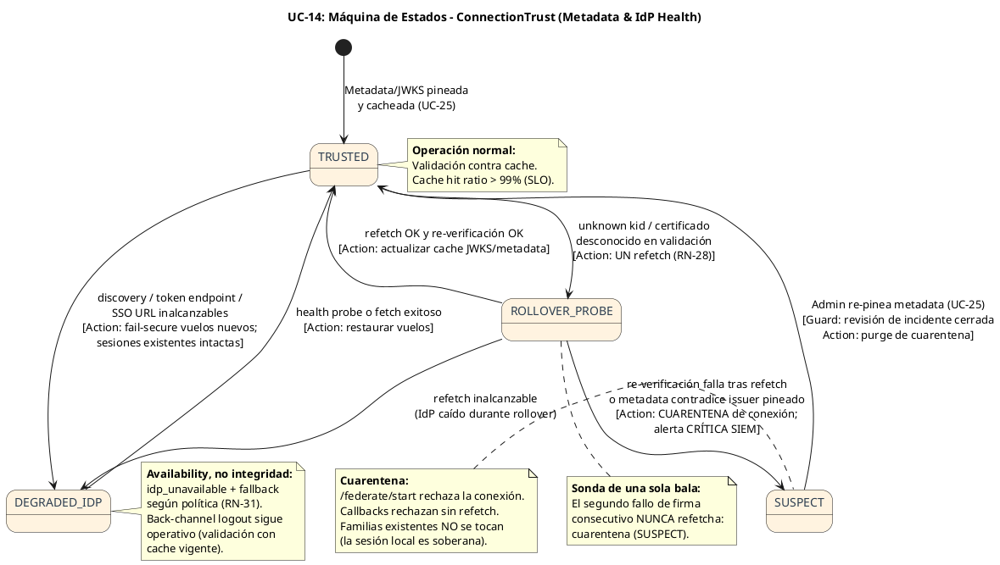
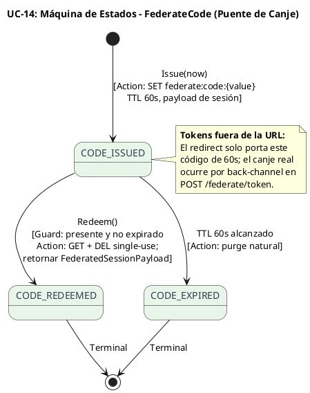

# UC-14: Autenticar Federada (SSO) - Diagrama de Máquina de Estados

| Metadatos del Documento | |
| :--- | :--- |
| **Proyecto:** | SHUGO - Identity & Access Platform |
| **Caso de Uso:** | UC-14 - Autenticar Federada (SSO - OIDC/OAuth2 + SAML 2.0) |
| **Documento:** | 05_State_Machine_Diagram.md |
| **Metodología:** | UML 2.5 + DDD (State Pattern) + Federation Security (NIST SP 800-63C) + Operational Trust Modeling |
| **Autor:** | Gastón Ruiz |
| **Versión Actual:** | 1.0.0 |
| **Fecha:** | 22/10/2026 |

---

## Historial de Versiones

| Versión | Fecha | Autor | Descripción de Cambios | Impacto |
| :--- | :--- | :--- | :--- | :--- |
| **1.0.0** | 22/10/2026 | Gastón Ruiz | **Creación inicial.** Definición de tres máquinas de estados para el UC-14: (1) `FederationTransaction` (INITIATED → CONSUMED → SESSION_ISSUED / STEP_UP_PENDING / FAILED / EXPIRED, con síntesis unsolicited que aterriza directamente en CONSUMED); (2) `ConnectionTrust` (TRUSTED → ROLLOVER_PROBE → TRUSTED / SUSPECT / DEGRADED_IDP), la máquina operacional que gobierna el refetch de JWKS, la cuarentena ante inyección de claves y el fail-secure ante IdP caído; y (3) `FederateCode` (ISSUED → REDEEMED / EXPIRED). Se documenta además por qué las familias federadas y el Back-Channel Logout **no** requieren máquinas nuevas: reutilizan las de UC-12/UC-13 con proveniencia como dato, no como estado. | Documento base del paquete de diseño Tier 1 del UC-14. Convierte las reglas de federación en transiciones ejecutables: consumo single-use, pausas de step-up sin familias huérfanas, rollover de claves con conteo estricto y cuarentena de conexión como estado de primer nivel ante sospecha de compromiso del IdP. |

---

## 1. Introducción y Propósito

El **Diagrama de Máquina de Estados** para el UC-14 visualiza las restricciones de comportamiento temporal de tres sujetos con naturalezas distintas:

1. **`FederationTransaction` (transitoria, single-use):** El vuelo de federación tiene una vida corta (10 min) y una propiedad absoluta: **produce exactamente un callback válido**. Su máquina debe hacer imposible el doble consumo, el consumo post-expiración y la emisión de sesión sin validación previa.
2. **`ConnectionTrust` (operacional, derivada):** La confianza en un IdP no es binaria ni estática: degrada por indisponibilidad (DEGRADED_IDP), entra en sonda por rollover de claves (ROLLOVER_PROBE) y se cuarentena ante sospecha de inyección (SUSPECT). Esta máquina gobierna **qué hace el sistema cuando la metadata miente o el IdP cae**, y es la que convierte el "unknown kid" de un ataque en un estado observable y alertable.
3. **`FederateCode` (efímera, single-use):** El puente de 60 segundos entre el redirect y el canje de tokens, con la misma disciplina de consumo único que el Transaction State.

Además, el documento justifica explícitamente qué **no** necesita máquina propia: las familias de tokens federadas reutilizan la máquina de `RefreshToken` de UC-13 (la proveniencia es un dato de la fila, no un estado), y el Back-Channel Logout es una **transición disparada externamente** sobre esa máquina (ACTIVE/ROTATED → REVOKED con motivo `IDP_SESSION_TERMINATED`).

---

## 2. Máquina de Estados #1: FederationTransaction (Transitoria, Single-Use)

### 2.1. Descripción

Modela el ciclo de vida de un vuelo de federación desde `/federate/start` (o síntesis unsolicited) hasta su resolución terminal. Persiste en Redis como payload del keyspace `federate:tx:{transaction_id}`; el campo `status` viaja en ese payload.

### 2.2. Diagrama de Máquina de Estados (PlantUML)



### 2.3. Descripción de Estados y Transiciones

| Estado | Descripción | Transiciones de Salida | Invariante Clave |
| :--- | :--- | :--- | :--- |
| **INITIATED** | Transacción persistida en Redis; redirect al IdP emitido; browser en vuelo. | → `CONSUMED` (callback válido), → `EXPIRED` (TTL). | `ConsumedAt == null`; `redirect_uri` ya validado contra whitelist. |
| **CONSUMED** | Transaction State consumido single-use; artefacto IdP en proceso de validación/resolución en memoria. | → `FAILED`, → `STEP_UP_PENDING`, → `SESSION_ISSUED`. | `ConsumedAt != null`; ningún otro callback puede progresar. |
| **STEP_UP_PENDING** | Pausa por assurance insuficiente o riesgo; `mfa_token` emitido; **sin familia creada**. | → `SESSION_ISSUED` (MFA verificado), → `EXPIRED`. | `FamilyRootId == null` mientras esté en pausa. |
| **SESSION_ISSUED** | Familia federada creada con proveniencia y `FederateCode` emitido. | Ninguna (Terminal). | Evento `FederatedSucceeded` publicado; tx puede purgarse. |
| **FAILED** | Rechazo con stage tipado (validation, replay, conflict, risk_revoked, idp_initiated). | Ninguna (Terminal). | Evento `FederatedAuth.Failed{stage}` publicado; respuesta al cliente genérica. |
| **EXPIRED** | TTL de transacción o de mfa_token alcanzado. | Ninguna (Terminal). | Purge natural de Redis; sin efecto sobre identidades ni familias. |

### 2.4. Guardas (Guards) Críticas

#### Transición: `INITIATED` → `CONSUMED` (Consume single-use)

```csharp
public void Consume(string presentedState, DateTime now)
{
    ValidateTransition(FederationTransactionStatus.Consumed);

    if (IsExpired(now))
        throw new FederationException(FederateStage.State, "Transaction expired.");

    if (ConsumedAt.HasValue)
        throw new FederationException(FederateStage.State, "Transaction already consumed.");

    if (!IsUnsolicited && !CryptographicOperations.FixedTimeEquals(
            Encoding.UTF8.GetBytes(State), Encoding.UTF8.GetBytes(presentedState)))
        throw new FederationException(FederateStage.State, "State mismatch.");

    ConsumedAt = now;
    Status = FederationTransactionStatus.Consumed;
}
```

#### Transición: `[*]` → `CONSUMED` (Síntesis Unsolicited)

La fábrica `InitiateUnsolicited` aterriza **directamente** en CONSUMED: un flujo IdP-initiated no tiene vuelo abierto que proteger con state; su protección anti-replay la asume la Replay Cache del AssertionID. El auto-consumo garantiza que la tx sintetizada valide **exactamente un** assertion.

#### Transiciones desde `CONSUMED` (Decisión triaria)

La salida de CONSUMED es mutuamente excluyente y se decide en este orden (coherente con el Activity Diagram):
1. **FAILED** si validación/replay/conflicto/riesgo revocatorio.
2. **STEP_UP_PENDING** si el assurance derivado no satisface la política o el riesgo exige step-up.
3. **SESSION_ISSUED** en otro caso (familia + federate_code + eventos).

---

## 3. Máquina de Estados #2: ConnectionTrust (Operacional, Derivada)

### 3.1. Descripción

Esta máquina no persiste por transacción: es un **estado operacional por conexión** (Redis key `federate:trust:{connection_id}` + métricas), mantenido por el `ConnectionTrustManager`. Distingue dos naturalezas de fallo que exigen respuestas opuestas:

*   **Indisponibilidad (DEGRADED_IDP):** El IdP no responde. Es un problema de **availability**: fail-secure para vuelos nuevos, sesiones existentes intactas.
*   **Sospecha de integridad (SUSPECT):** La metadata/JWKS no valida artefactos tras un refetch. Es un posible **ataque de inyección de claves o IdP comprometido**: cuarentena inmediata de la conexión, alerta crítica, y remediación manual por admin (UC-25).

### 3.2. Diagrama de Máquina de Estados (PlantUML)



### 3.3. Descripción de Estados y Transiciones

| Estado | Descripción | Efecto en Operación | Transiciones de Salida |
| :--- | :--- | :--- | :--- |
| **TRUSTED** | Metadata/JWKS cacheada y vigente; validación normal. | Vuelos nuevos permitidos; cache hit >99%. | → `ROLLOVER_PROBE`, → `DEGRADED_IDP`. |
| **ROLLOVER_PROBE** | Se detectó `unknown kid`/certificado desconocido; un único refetch en curso. | El callback en curso espera el refetch; nuevos callbacks con el mismo kid esperan o fallan rápido. | → `TRUSTED`, → `SUSPECT`, → `DEGRADED_IDP`. |
| **DEGRADED_IDP** | Endpoints del IdP inalcanzables (TLS/timeout/5xx). | `/start` retorna `idp_unavailable`; fallback local solo si política lo permite; **back-channel logout sigue operativo** con cache vigente. | → `TRUSTED`. |
| **SUSPECT** | Sospecha de integridad: firma inválida tras refetch, o metadata que contradice el issuer pineado. | **Cuarentena:** start y callbacks de la conexión se rechazan; alerta SIEM crítica; familias existentes intactas. | → `TRUSTED` (solo por re-pin administrativo). |

### 3.4. Guardas y Acciones del ConnectionTrustManager

```csharp
public class ConnectionTrustManager : IConnectionTrustManager
{
    public async Task<JwksSet> ResolveForValidationAsync(
        FederatedConnectionSnapshot snapshot, string? kidHint, CancellationToken ct)
    {
        var state = await GetStateAsync(snapshot.ConnectionId, ct);

        // Cuarentena: ni siquiera se intenta validar
        if (state == ConnectionTrustState.Suspect)
            throw new ConnectionQuarantinedException(snapshot.ConnectionId);

        var jwks = await _cache.GetJwksAsync(snapshot, ct);

        if (kidHint is not null && !jwks.Contains(kidHint))
        {
            if (state == ConnectionTrustState.RolloverProbe)
            {
                // Segunda bala ya usada: cuarentena (T-?? key injection)
                await TransitionAsync(snapshot.ConnectionId, ConnectionTrustState.Suspect,
                    reason: "SECOND_SIGNATURE_FAILURE_AFTER_REFETCH", ct);
                throw new ConnectionQuarantinedException(snapshot.ConnectionId);
            }

            await TransitionAsync(snapshot.ConnectionId, ConnectionTrustState.RolloverProbe,
                reason: "UNKNOWN_KID", ct);

            try
            {
                jwks = await _metadata.RefetchOnceAsync(snapshot, ct);   // UN refetch
                if (!jwks.Contains(kidHint))
                {
                    await TransitionAsync(snapshot.ConnectionId, ConnectionTrustState.Suspect,
                        reason: "KEY_NOT_PRESENT_AFTER_REFETCH", ct);
                    throw new ConnectionQuarantinedException(snapshot.ConnectionId);
                }
                await TransitionAsync(snapshot.ConnectionId, ConnectionTrustState.Trusted,
                    reason: "ROLLOVER_CONFIRMED", ct);
            }
            catch (InfrastructureException)
            {
                await TransitionAsync(snapshot.ConnectionId, ConnectionTrustState.DegradedIdp,
                    reason: "REFETCH_UNREACHABLE", ct);
                throw;
            }
        }

        return jwks;
    }
}
```

**Justificación de la cuarentena asimétrica:** En DEGRADED_IDP el sistema **espera y recupera solo** (health probe). En SUSPECT el sistema **no recupera solo**: requiere re-pin administrativo (UC-25) con revisión de incidente cerrada. Una conexión que vuelve a confiar automáticamente en una metadata que falló dos veces es una conexión atacable.

---

## 4. Máquina de Estados #3: FederateCode (Efímera, Single-Use)



---

## 5. Lo que NO Necesita Máquina Propia (Decisiones Documentadas)

### 5.1. Familias de Tokens Federadas

Las familias creadas por `FederationSessionIssuer` reutilizan **exactamente** la máquina de `RefreshToken` de UC-13 (`ACTIVE → ROTATED → REVOKED/EXPIRED`). La proveniencia federada (`auth_method`, `idp`, `idp_session_id`, `acr/amr`) son **columnas de dato**, no estados: una familia federada rota, expira y se revoca con las mismas guardas que una local.

*   **Beneficio:** UC-13 (rotación/reuse detection) y UC-12 (logout/cascade) operan sobre familias federadas sin código especial ni estados paralelos que divergirían.

### 5.2. Back-Channel Logout como Transición Externa

El flujo UC-14f no introduce estados nuevos: es un **disparador externo** que invoca la transición `ACTIVE/ROTATED → REVOKED` de UC-12/UC-13 con motivo `IDP_SESSION_TERMINATED`, seleccionando las filas por `idp_session_id`. La máquina de la familia no distingue quién ordenó la revocación; el motivo queda auditado.

### 5.3. Step-Up como Pausa de la Transacción, no de la Familia

`STEP_UP_PENDING` vive en la máquina de la transacción porque la pausa ocurre **antes** de que exista familia. Tras UC-15, la transición `STEP_UP_PENDING → SESSION_ISSUED` crea la familia una única vez, con el assurance elevado registrado en la proveniencia. Coherente con el principio de UC-13: ninguna pausa deja sucesores ni familias huérfanas.

---

## 6. Implementación en el Dominio (Código C#)

### 6.1. Validación de Transiciones de la FederationTransaction

```csharp
public enum FederationTransactionStatus
{
    Initiated, Consumed, StepUpPending, SessionIssued, Failed, Expired
}

public partial class FederationTransaction
{
    public FederationTransactionStatus Status { get; private set; }
    public FederateStage? FailureStage { get; private set; }

    public void Fail(FederateStage stage, DateTime now)
    {
        ValidateTransition(FederationTransactionStatus.Failed);
        Status = FederationTransactionStatus.Failed;
        FailureStage = stage;
    }

    public void PauseForStepUp(string mfaToken, DateTime now)
    {
        ValidateTransition(FederationTransactionStatus.StepUpPending);
        Status = FederationTransactionStatus.StepUpPending;
        MfaToken = mfaToken;
    }

    public void ResumeFromStepUp(DateTime now)
    {
        if (Status != FederationTransactionStatus.StepUpPending)
            throw new DomainException("Cannot resume a transaction not in step-up.");
        Status = FederationTransactionStatus.Consumed;   // re-entra al punto de decisión
        MfaVerifiedAt = now;
    }

    public void MarkSessionIssued(TokenFamilyId familyId, FederateCode code)
    {
        ValidateTransition(FederationTransactionStatus.SessionIssued);
        Status = FederationTransactionStatus.SessionIssued;
        FamilyRootId = familyId;
        FederateCodeValue = code.Value;
    }

    private void ValidateTransition(FederationTransactionStatus next)
    {
        var allowed = Status switch
        {
            FederationTransactionStatus.Initiated      => new[] { FederationTransactionStatus.Consumed, FederationTransactionStatus.Expired },
            FederationTransactionStatus.Consumed       => new[] { FederationTransactionStatus.Failed, FederationTransactionStatus.StepUpPending, FederationTransactionStatus.SessionIssued },
            FederationTransactionStatus.StepUpPending  => new[] { FederationTransactionStatus.Consumed, FederationTransactionStatus.Expired },
            _ => Array.Empty<FederationTransactionStatus>()   // terminales
        };

        if (!allowed.Contains(next))
            throw new DomainException($"Invalid federation transition {Status} → {next}.");
    }
}
```

**Nota de diseño:** `ResumeFromStepUp` retorna a `Consumed` (no salta directo a `SessionIssued`) para que el punto de decisión triario (fail / step-up / issue) se re-evalúe con el assurance ahora satisfecho — evitando un segundo camino de emisión que bypassaría guardas.

### 6.2. Testing de Máquinas de Estados

```csharp
[Test]
public void Transaction_Consume_Twice_ThrowsStateStage()
{
    var tx = FederationTransaction.Initiate(Snapshot, Protocol.OIDC, RedirectUri, null, Ttl, Now);
    tx.Consume(tx.State, Now);
    var act = () => tx.Consume(tx.State, Now.AddSeconds(1));
    act.Should().Throw<FederationException>().Where(e => e.Stage == FederateStage.State);
}

[Test]
public void Transaction_Unsolicited_IsBornConsumed()
{
    var tx = FederationTransaction.InitiateUnsolicited(SnapshotWithIdpInitiated, Now, Ttl);
    tx.Status.Should().Be(FederationTransactionStatus.Consumed);
    tx.IsUnsolicited.Should().BeTrue();
}

[Test]
public void Transaction_IssueSession_FromInitiated_ThrowsInvalidTransition()
{
    var tx = FederationTransaction.Initiate(Snapshot, Protocol.OIDC, RedirectUri, null, Ttl, Now);
    var act = () => tx.MarkSessionIssued(FamilyId, Code);
    act.Should().Throw<DomainException>().WithMessage("*Initiated → SessionIssued*");
    // Imposible emitir sesión sin consumir y validar: el orden es ley.
}

[Test]
public void Transaction_StepUp_Then_Resume_Then_Issue_IsLegal()
{
    var tx = FederationTransaction.Initiate(Snapshot, Protocol.OIDC, RedirectUri, null, Ttl, Now);
    tx.Consume(tx.State, Now);
    tx.PauseForStepUp("mfa-token", Now);
    tx.ResumeFromStepUp(Now.AddMinutes(2));
    tx.MarkSessionIssued(FamilyId, Code);
    tx.Status.Should().Be(FederationTransactionStatus.SessionIssued);
}

[Test]
public async Task TrustManager_SecondUnknownKidAfterRefetch_QuarantinesConnection()
{
    // Primer unknown kid → ROLLOVER_PROBE con refetch OK
    await Manager.ResolveForValidationAsync(Snapshot, kid: "key-2", CT);
    // Simular que key-2 desaparece del JWKS refetchado (inyección sospechosa)
    SecondFetchReturnsWithout("key-2");

    var act = () => Manager.ResolveForValidationAsync(Snapshot, kid: "key-2", CT);
    await act.Should().ThrowAsync<ConnectionQuarantinedException>();
    (await Manager.GetStateAsync(Snapshot.ConnectionId, CT)).Should().Be(ConnectionTrustState.Suspect);
}

[Test]
public async Task TrustManager_DegradedIdp_RecoversAutomatically_ButSuspectDoesNot()
{
    await Manager.RecordEndpointUnreachableAsync(Snapshot.ConnectionId, CT);
    (await Manager.GetStateAsync(Snapshot.ConnectionId, CT)).Should().Be(ConnectionTrustState.DegradedIdp);

    await Manager.RecordFetchSuccessAsync(Snapshot.ConnectionId, CT);
    (await Manager.GetStateAsync(Snapshot.ConnectionId, CT)).Should().Be(ConnectionTrustState.Trusted);

    // SUSPECT no auto-recupera:
    await Manager.TransitionAsync(Snapshot.ConnectionId, ConnectionTrustState.Suspect, "test", CT);
    var act = () => Manager.RecordFetchSuccessAsync(Snapshot.ConnectionId, CT);
    await act.Should().ThrowAsync<DomainException>();   // solo re-pin administrativo (UC-25)
}
```

---

## 7. Trazabilidad con Otros Documentos del Paquete

| Documento | Relación |
| :--- | :--- |
| `01_Requirements_Specification.md` | INV-89 (single-use) = guarda de `Consume()`; RN-28 (un refetch) = transiciones de `ROLLOVER_PROBE`; RN-30 (default deny) = guarda de `InitiateUnsolicited`; RN-31 (fallback) = efecto de `DEGRADED_IDP`; INV-94 (assurance) = guarda de `STEP_UP_PENDING`. |
| `02_Use_Case_Diagram.md` | UC-14a = `Initiate`; UC-14b/c = `Consume` + validación; UC-14e = `SESSION_ISSUED`; UC-14f = transición externa sobre familias UC-12/13; EXT_IDPINIT = `InitiateUnsolicited`. |
| `03_Activity_Diagram.md` | Cada bifurcación del flujo (state inválido, replay, conflicto, step-up, emisión) corresponde a una transición de la máquina #1; el refetch y el fail-secure a la máquina #2. |
| `04_Initial_Domain_Model.md` | `Consume()`, `InitiateUnsolicited()` y los enums de status son los métodos y atributos del AR `FederationTransaction`; `ConnectionTrustManager` consume `IMetadataResolver`. |
| `07_Sequence_Diagram.md` | El orden temporal (consumo antes de exchange, replay post-validación, step-up pre-familia) es la proyección en secuencia de estas guardas de transición. |
| `10_UC_Specific_Data_Model.md` | El `status` de la tx y el estado de `ConnectionTrust` persisten en keyspaces Redis (`federate:tx:*`, `federate:trust:*`) con TTLs definidos allí. |
| `11_UC_Specific_Security_Threats.md` | `SUSPECT` es la materialización operacional de la amenaza de inyección de claves; `DEGRADED_IDP` de la de DoS al IdP; `FAILED{stage=replay}` de assertion replay. |
| `UC-12/UC-13 (05_State_Machine)` | Las familias federadas reutilizan la máquina de `RefreshToken`; el back-channel logout es un disparador externo con motivo `IDP_SESSION_TERMINATED`. |

---

## 8. Glosario de Términos Específicos de UC-14

| Término | Definición |
| :--- | :--- |
| **Single-Use Flight** | Propiedad de la `FederationTransaction` de producir exactamente un callback válido; el segundo consumo falla con `FederateStage.State`. |
| **Unsolicited Synthesis** | Creación y auto-consumo atómico de una transacción para flujos SAML IdP-initiated habilitados por política; su anti-replay lo asume la Replay Cache. |
| **ConnectionTrust** | Estado operacional por conexión que distingue indisponibilidad (DEGRADED_IDP, recuperación automática) de sospecha de integridad (SUSPECT, cuarentena con remediación manual). |
| **Rollover Probe** | Estado de sonda con **un único** refetch de JWKS/metadata permitido; el segundo fallo consecutivo cuarentena la conexión. |
| **Quarantine** | Efecto del estado SUSPECT: start y callbacks de la conexión se rechazan; familias existentes intactas; salida solo por re-pin administrativo. |
| **Step-Up Pending** | Pausa de la transacción sin familia creada, a la espera de verificación MFA local que eleve el assurance derivado del IdP. |
| **FederateCode Lifecycle** | Máquina efímera de 60s single-use que mantiene los tokens fuera de las URLs de redirección. |
| **Provenance-as-Data** | Decisión de modelar el origen federado como columnas de dato en la familia (no como estados), permitiendo que UC-12/UC-13 operen sin código especial. |

---
*Fin del Documento 05_State_Machine_Diagram para UC-14*