# UC-14: Autenticar Federada (SSO) - Diagrama de Robustez

| Metadatos del Documento | |
| :--- | :--- |
| **Proyecto:** | SHUGO - Identity & Access Platform |
| **Caso de Uso:** | UC-14 - Autenticar Federada (SSO - OIDC/OAuth2 + SAML 2.0) |
| **Documento:** | 06_Robustness_Diagram.md |
| **Metodología:** | ICONIX (Diagrama de Robustez) + DDD + Federation Security (NIST SP 800-63C) + Hexagonal Architecture |
| **Autor:** | Gastón Ruiz |
| **Versión Actual:** | 1.0.0 |
| **Fecha:** | 22/10/2026 |

---

## Historial de Versiones

| Versión | Fecha | Autor | Descripción de Cambios | Impacto |
| :--- | :--- | :--- | :--- | :--- |
| **1.0.0** | 22/10/2026 | Gastón Ruiz | **Creación inicial.** Diagrama de Robustez para UC-14, validando la arquitectura del Federation Core de KAGI como Relying Party / Service Provider. Muestra la colaboración estricta entre tres Boundary Objects (Gateway, Federation API, Back-Channel Endpoint), nueve Control Objects (FederationHandler, BackChannelLogoutHandler, OidcRelyingParty, SamlServiceProvider, ConnectionTrustManager, AccountLinker, JitProvisioner, AssuranceEvaluator, FederationSessionIssuer) y los Entity Objects (FederationTransaction, IdpArtifact, FederatedIdentityLink, FederateCode, Redis, KAGAMI, Outbox, UC-17, UC-12). Valida el consumo single-use pre-round-trip, la replay cache post-validación, el gatekeeper único de metadata con cuarentena, y el punto único de emisión de sesión con proveniencia. | Documento base del paquete de diseño Tier 1 del UC-14. Sirve como puente crítico entre el Modelo de Dominio (04/05) y el Diagrama de Secuencia (07), asegurando que la complejidad de dos protocolos heterogéneos se aísle en servicios expertos sin contaminar el flujo de decisión común, y que cada control de seguridad tenga un único responsable colaborativo. |

---

## 1. Introducción y Propósito

El **Diagrama de Robustez** para el UC-14 valida que el flujo de federación puede ser orquestado respetando las reglas estrictas de acoplamiento de **ICONIX** y los principios de **DDD**, **Zero Trust** y **Separación de Contextos**.

El desafío específico de este caso de uso es óctuple:

1. **Dos protocolos, un flujo de decisión:** OIDC y SAML deben divergir solo en sus servicios expertos (RP/SP) y converger inmediatamente en un artefacto canónico (`IdpArtifact`) que el resto del sistema consume sin conocer el protocolo.
2. **Confianza operacional centralizada:** Toda validación de firma pasa por un único gatekeeper (`ConnectionTrustManager`) que posee las máquinas de rollover y cuarentena; ningún servicio toca JWKS/metadata directamente.
3. **Orden de consumo como seguridad:** El Transaction State se consume (GET+DEL) **antes** de cualquier round-trip al IdP, y la Replay Cache se escribe **después** de validar el artefacto.
4. **Superficie de privilegios delegada:** El JIT no crea identidades: colabora con un gateway cross-context hacia KAGAMI (UC-01), preservando la soberanía del contexto de Identity Lifecycle.
5. **Punto único de emisión:** Solo el `FederationSessionIssuer` toca la fábrica de familias, el store de `FederateCode` y el Outbox — garantizando que ninguna sesión federada exista sin proveniencia ni auditoría.
6. **Back-Channel como frontera independiente:** El logout IdP→SHUGO tiene su propio Boundary, su propio Handler y su propio contrato de respuesta (200), sin compartir camino con el flujo de browser.
7. **Redis como dependencia fail-secure:** En federación, la indisponibilidad de Tx State o Replay Cache rechaza el vuelo; no existe modo degradado que acepte artefactos sin garantías anti-replay.
8. **Colapso Zero Info Leakage:** Todos los stages de fallo internos convergen en un único error genérico en el Boundary.

---

## 2. Diagrama de Robustez (PlantUML)

A continuación, se presenta el Diagrama de Robustez organizado de izquierda a derecha para mostrar el flujo natural: **Actor → Boundary → Control → Entity**.

```plantuml
@startuml UC-14_Robustez
<style>
diagram {
  BackgroundColor #FEFEFE
}
</style>
left to right direction
skinparam roundcorner 20
skinparam maxMessageSize 170

title UC-14: Diagrama de Robustez - Motor KAGI (Federation Core: RP / SP)

' ============================================
' ACTORES
' ============================================
actor "Usuario" as User
actor "Cliente\n(SPA / Mobile)" as Client
actor "Identity Provider\n(Okta / Entra / Google /\nGitHub / ADFS-SAML)" as IdP

' ============================================
' BOUNDARY OBJECTS (UI / API)
' ============================================
boundary "API Gateway\n(WAF / Rate Limit)" as GW
boundary "Federation API\n(start / callback / token)" as FedAPI
boundary "Back-Channel Endpoint\n(IdP → SHUGO, server-to-server)" as BCApi

' ============================================
' CONTROL OBJECTS (Aplicación / Dominio)
' ============================================
control "Federation Handler\n<<Application Service>>" as Handler
control "BackChannel Logout Handler\n<<Application Service>>" as BCHandler
control "OIDC Relying Party\n<<Domain Service>>" as OidcRP
control "SAML Service Provider\n<<Domain Service>>" as SamlSP
control "Connection Trust Manager\n<<Domain Service>>" as Trust
control "Account Linker\n<<Domain Service>>" as Linker
control "JIT Provisioner\n<<Domain Service>>" as Jit
control "Assurance Evaluator\n<<Domain Service>>" as Assurance
control "Federation Session Issuer\n<<Domain Service>>" as Issuer

' ============================================
' ENTITY OBJECTS (Dominio / Persistencia)
' ============================================
entity "Federation Transaction\n<<Aggregate Root>>" as Tx
entity "FederatedConnectionSnapshot\n<<Value Object>>" as Snapshot
entity "IdpArtifact\n<<Value Object>>" as Artifact
entity "FederatedIdentityLink\n<<Entity>>" as Link
entity "FederateCode /\nFederatedSession\n<<Value Objects>>" as Code
entity "Redis\n(Tx State + Replay Cache\n+ Trust State)" as Redis
entity "KAGAMI\n(Links / Identidades /\nFamilias)" as Kagami
entity "JIT Provisioning Gateway\n<<Comando interno UC-01>>" as JitGw
entity "Auth Outbox\n<<KAGE>>" as Outbox
entity "UC-17\nRisk Engine" as Risk
entity "UC-12\nFamily Revoker" as Revoker

' ============================================
' NOTAS EXPLICATIVAS
' ============================================
note top of Handler
  **Orden como seguridad:**
  1) Consume tx (GET+DEL) ANTES
  de round-trips al IdP.
  2) Replay cache POST-validación.
  3) Colapsa stages a error genérico.
end note

note bottom of Trust
  **Gatekeeper único de metadata:**
  Un refetch ante unknown kid;
  segundo fallo → SUSPECT (cuarentena).
  IdP caído → DEGRADED_IDP (fail-secure).
  Ningún servicio toca JWKS directamente.
end note

note right of Jit
  **Superficie cerrada (INV-93):**
  RoleMapping filtra admin
  por construcción.
  La identidad la crea KAGAMI,
  no KAGI.
end note

note left of Issuer
  **Punto único de emisión:**
  Familia con proveniencia +
  federate_code 60s + Outbox.
  Ninguna sesión federada
  existe sin los tres.
end note

' ============================================
' FLUJO START (SP-Initiated)
' ============================================
User --> Client : 1. "Continuar con {IdP}"\no email corporativo
Client --> GW : 2. POST /federate/start
GW --> FedAPI : 3. Forward (WAF + rate limit)
FedAPI --> Handler : 4. StartCommand

Handler --> Snapshot : 5. Resolve por realm\no connection_id (UC-25)
Handler --> Tx : 6. Initiate(snapshot, protocol,\nredirectUri validada)
Handler --> Redis : 7. Save tx\n(TTL 10 min)

Handler --> OidcRP : 8a. BuildAuthorizeRedirect(tx)
Handler --> SamlSP : 8b. BuildAuthnRequest(tx)
OidcRP --> Trust : 9. ResolveJwks / Metadata\n(cache TRUSTED)
SamlSP --> Trust : 9. ResolveJwks / Metadata
Trust --> Redis : 10. Lee cache JWKS/metadata\n+ estado de confianza

Handler --> FedAPI : 11. RedirectInstruction\n(302 authorize / SAMLRequest)
FedAPI --> Client : 12. 302
Client --> IdP : 13. Browser redirect\n(viaje externo)

' ============================================
' FLUJO CALLBACK (Validación y Resolución)
' ============================================
IdP --> FedAPI : 14. Callback: code+state\no SAMLResponse (ACS)
FedAPI --> Handler : 15. CallbackContext

Handler --> Redis : 16. Consume tx\n(GET + DEL single-use)
Handler --> OidcRP : 17a. ExchangeAndValidate(tx, cb)
OidcRP --> IdP : 18a. Token exchange\n(code + verifier, TLS)
OidcRP --> Trust : 19a. JWKS para validación\n(refetch once si unknown kid)
Handler --> SamlSP : 17b. ParseAndValidate(tx, cb)
SamlSP --> Trust : 19b. Certificados metadata\n(InResponseTo, Audience)

OidcRP --> Artifact : 20a. FromOidcIdToken()
SamlSP --> Artifact : 20b. FromSamlAssertion()
Artifact --> Handler : 21. Artefacto canónico\n(replayKey, validUntil, payloadHash)

Handler --> Redis : 22. Replay check +\nwrite POST-VALIDACIÓN\n(fail-secure si Redis cae)

Handler --> Linker : 23. Resolve(tx, artifact)
Linker --> Kagami : 24. Lookup link (issuer, sub)\no identidad por email
Linker --> Handler : 25. IdentityResolution\n(Linked / NeedsJit / Linkable / Conflict)

Handler --> Jit : 26. ProvisionAsync(tx, artifact)\n[solo si NeedsJit]
Jit --> JitGw : 27. Comando interno UC-01\n(creación soberana de identidad)
Jit --> Kagami : 28. Save link (issuer,sub)
Jit --> Handler : 29. Resolution.JitProvisioned

Handler --> Assurance : 30. Evaluate(tx, artifact, resolution)
Assurance --> Risk : 31. Delta de contexto + acr/amr
Assurance --> Handler : 32. StepUpRequirement?\n(o null: continuar)

Handler --> Issuer : 33. Issue(tx, artifact, resolution, assurance)
Issuer --> Kagami : 34. CreateFederatedRoot\n(proveniencia: idp, sid, acr/amr)
Issuer --> Redis : 35. Store federate_code\n(single-use, 60s)
Issuer --> Outbox : 36. FederatedSucceeded\n(+ JitProvisioned / Linked)
Issuer --> Handler : 37. FederatedSession\n(familyId, federateCode)

Handler --> FedAPI : 38. 302 redirect_uri(whitelist)\n?code=federate_code&state=client_state
FedAPI --> Client : 39. Redirect

' ============================================
' FLUJO REDEEM (Canje de tokens)
' ============================================
Client --> FedAPI : 40. POST /federate/token {code}
FedAPI --> Handler : 41. RedeemCommand
Handler --> Redis : 42. Redeem code\n(GET + DEL single-use)
Handler --> FedAPI : 43. Tokens de familia federada
FedAPI --> Client : 44. 200 { access, refresh }

' ============================================
' FLUJO BACK-CHANNEL LOGOUT (IdP → SHUGO)
' ============================================
IdP --> BCApi : 45. POST /federate/backchannel-logout\n(logout_token / LogoutRequest)
BCApi --> BCHandler : 46. BackChannelContext
BCHandler --> Trust : 47. Validar firma contra\nmetadata pineada
BCHandler --> Kagami : 48. Lookup familias por\nidp_session_id (sid)
BCHandler --> Revoker : 49. Revoke(IDP_SESSION_TERMINATED)\n[mecanismo UC-12]
BCHandler --> Outbox : 50. IdpBackchannelLogoutReceived
BCHandler --> BCApi : 51. 200 OK (contrato\nBack-Channel OIDC)
BCApi --> IdP : 52. Ack

@enduml
```



---

## 3. Explicación Detallada de los Objetos

### 3.1. Boundary Objects (Objetos de Límite)

| Objeto | Responsabilidad | Mapeo a Clean Architecture |
| :--- | :--- | :--- |
| **`API Gateway`** | WAF y Rate Limiting sobre endpoints públicos de federación. El callback es anónimo y atacable: es la primera línea contra flooding de artefactos falsos. | Middleware (Kong, AWS WAF). |
| **`Federation API`** | Expone `/federate/start`, `/federate/callback` (ACS unificado OIDC/SAML) y `/federate/token`. Es el **único** lugar donde los stages de fallo se colapsan a `federate_failed` genérico. | Controllers (ASP.NET Core). |
| **`Back-Channel Endpoint`** | Boundary server-to-server exclusivo para logout iniciado por el IdP. No comparte camino, autenticación ni contrato con el flujo de browser: su "autenticación" es la firma del artefacto contra metadata pineada. | Controller dedicado con pipeline de validación propio. |

### 3.2. Control Objects (Objetos de Control)

| Objeto | Responsabilidad | Mapeo a Clean Architecture |
| :--- | :--- | :--- |
| **`Federation Handler`** | **Application Service.** Orquesta start/callback/redeem: consume la tx, enruta por protocolo, ordena replay post-validación, decide entre Linker/JitProvisioner, pausa en step-up, y delega emisión al Issuer. Colapsa stages a error genérico. | Application Service. |
| **`BackChannel Logout Handler`** | **Application Service.** Valida el artefacto de logout del IdP, localiza familias por `idp_session_id`, delega revocación a UC-12 y responde 200 contractual. | Application Service. |
| **`OIDC Relying Party`** | **Domain Service experto.** Construye authorize redirect con PKCE, canjea code con verifier, valida id_token (firma, iss/aud/exp/nonce, allowlist de algoritmos) y traduce a `IdpArtifact`. | Domain Service. |
| **`SAML Service Provider`** | **Domain Service experto.** Construye AuthnRequest, parsea SAMLResponse, valida firma XML, Destination, Audience, Recipient, Conditions, InResponseTo, y traduce a `IdpArtifact`. | Domain Service. |
| **`Connection Trust Manager`** | **Domain Service gatekeeper.** Único punto de acceso a JWKS/metadata. Posee la máquina `ConnectionTrust`: refetch once, cuarentena SUSPECT, fail-secure DEGRADED_IDP. | Domain Service. |
| **`Account Linker`** | **Domain Service.** Resuelve identidad por link existente, elegibilidad JIT, auto-link por email verificado, o conflicto — siempre bajo el snapshot de política. | Domain Service. |
| **`JIT Provisioner`** | **Domain Service.** Mapea claims/grupos (filtrado admin por construcción) y delega la creación de identidad al gateway cross-context de KAGAMI; crea el link y emite evento. | Domain Service. |
| **`Assurance Evaluator`** | **Domain Service.** Deriva `AssuranceLevel` de acr/amr con mapping declarativo, consulta UC-17, y produce `StepUpRequirement` si el assurance no satisface la política. | Domain Service. |
| **`Federation Session Issuer`** | **Domain Service.** Punto único de emisión: familia con proveniencia (UC-11 CreateRoot), `FederateCode` single-use, y eventos de Outbox. | Domain Service. |

### 3.3. Entity Objects (Objetos de Entidad e Infraestructura)

| Objeto | Responsabilidad | Mapeo a DDD / Infra |
| :--- | :--- | :--- |
| **`Federation Transaction`** | **Aggregate Root.** State/nonce/PKCE/redirect validado/snapshot pineado; consumo single-use; síntesis unsolicited. | AR persistido en Redis vía puerto. |
| **`FederatedConnectionSnapshot`** | **Value Object.** Política inmutable del vuelo: whitelist, JIT, linking, fallback, role/assurance mappings. | VO snapshot desde UC-25. |
| **`IdpArtifact`** | **Value Object.** Artefacto canónico protocol-neutral con replayKey, validUntil y payloadHash. | VO producido por RP/SP. |
| **`FederatedIdentityLink`** | **Entity.** Asociación `(issuer, sub) → identity_id` con método de link auditable. | Entity (PostgreSQL). |
| **`FederateCode / FederatedSession`** | **Value Objects.** Código de canje 60s single-use y payload de sesión con proveniencia. | VOs persistidos en Redis. |
| **`Redis`** | **Infrastructure.** Tres keyspaces de seguridad: Tx State, Replay Cache, Trust State + FederateCode store. | Infraestructura crítica fail-secure. |
| **`KAGAMI`** | **Infrastructure / Contexto hermano.** Links, identidades (vía gateway JIT) y familias de tokens. | Infraestructura + Published Language. |
| **`JIT Provisioning Gateway`** | **Puerto cross-context.** Comando interno hacia UC-01; KAGI no crea identidades directamente. | Puerto hexagonal (adapter HTTP mTLS). |
| **`Auth Outbox`** | **Infrastructure.** Eventos de federación con garantía de entrega eventual a KAGE/KIZUNA/TORII. | Outbox Pattern. |
| **`UC-17 Risk Engine`** | **Sistema hermano.** Evidencia de riesgo para step-up o revocación preventiva. | Puerto `IRiskEvaluator`. |
| **`UC-12 Family Revoker`** | **Sistema hermano.** Mecanismo de revocación de familias consumido por el Back-Channel Handler. | Puerto hacia Domain Service de UC-12. |

---

## 4. Reglas de Robustez de ICONIX (Validación del Diagrama)

### ✅ Regla 1: Actor → Boundary
- **Cumplida:** `Usuario → Cliente → API Gateway`; y el actor externo `IdP → Federation API` (callback) e `IdP → Back-Channel Endpoint` (logout). El IdP es actor iniciador de exactamente dos boundaries, ambos públicos y validados.

### ✅ Regla 2: Boundary → Boundary
- **Cumplida:** `API Gateway → Federation API`. El Back-Channel Endpoint no encadena hacia la Federation API: son fronteras independientes con contratos independientes.

### ✅ Regla 3: Boundary → Control
- **Cumplida:** `Federation API → Federation Handler` y `Back-Channel Endpoint → BackChannel Logout Handler`. Ningún boundary toca Domain Services expertos directamente: el Handler es el único punto de entrada de aplicación.

### ✅ Regla 4: Control → Control
- **Cumplida y Crítica:** El `Federation Handler` delega en `OidcRelyingParty`/`SamlServiceProvider` (expertos de protocolo), `ConnectionTrustManager` (vía RP/SP), `AccountLinker`, `JitProvisioner`, `AssuranceEvaluator` y `FederationSessionIssuer`.
- **Validación:** Esta delegación en cadena mantiene al Handler como orquestador delgado: cada regla de seguridad vive en exactamente un control experto, testeable y reemplazable de forma aislada.

### ✅ Regla 5: Control → Entity
- **Cumplida:**
  - `Handler` consume/persiste `FederationTransaction` y escribe/lee `Redis` (Tx State, Replay Cache, FederateCode).
  - `RP/SP` producen `IdpArtifact` y consultan `Trust` (que lee `Redis` de metadata).
  - `Linker`/`Jit` leen y escriben `FederatedIdentityLink` en `KAGAMI`; `Jit` cruza el gateway `JitGw`.
  - `Issuer` escribe familia en `KAGAMI`, código en `Redis`, y eventos en `Outbox`.
  - `BCHandler` lee familias en `KAGAMI` y delega en `Revoker` (UC-12).

### ✅ Regla 6: NO Entity → Control / Boundary
- **Cumplida:** Ninguna entidad (`Tx`, `Artifact`, `Link`, `Redis`, `KAGAMI`, `Outbox`) inicia interacciones. El IdP (actor) inicia callback y back-channel, pero nunca interactúa con controles: siempre entra por un boundary que valida primero.

### ✅ Regla 7: NO Entity → Entity (Directo sin Control)
- **Cumplida:** Todas las interacciones entre entidades están orquestadas por controles. Ejemplo: `FederationTransaction` no escribe directamente en `Redis`; el `Handler` coordina persistencia y consumo. `JitProvisioner` (control) es el único que cruza `KAGAMI`↔`JitGw`↔`Link`.

---

## 5. Consideraciones de Arquitectura (Security & Resilience)

### 5.1. Servicios Expertos de Protocolo detrás de un Orquestador Único

El diagrama aísla la heterogeneidad OIDC/SAML en `OidcRelyingParty` y `SamlServiceProvider`, que convergen en `IdpArtifact`.

*   **Justificación:** El `Federation Handler` toma decisiones de negocio (linking, JIT, step-up, emisión) sobre un artefacto canónico. Añadir un tercer protocolo futuro (ej. WS-Fed) implica un nuevo control experto y cero cambios en el flujo de decisión.
*   **Consecuencia de seguridad:** Las reglas comunes (replay, minimización, proveniencia) existen **una sola vez**, eliminando divergencias entre implementaciones por protocolo.

### 5.2. ConnectionTrustManager como Gatekeeper Único de Metadata

Ningún control valida firmas contra JWKS/metadata por su cuenta: todos pasan por `Trust` (pasos 9, 19a, 19b, 47).

*   **Justificación:** La máquina `ConnectionTrust` (TRUSTED → ROLLOVER_PROBE → SUSPECT/DEGRADED_IDP) es estado operacional compartido. Si cada servicio refetcheara metadata por su lado, el conteo de "una sola bala" del rollover se rompería y la cuarentena nunca se activaría de forma consistente.
*   **Consecuencia:** Un ataque de inyección de claves cuarentena la conexión **una vez**, en un solo lugar, con una sola alerta crítica.

### 5.3. Consumo de Transaction State antes de Round-Trips al IdP

El paso 16 (`Consume tx` vía GET+DEL en Redis) precede a los pasos 17-19 (exchange/parse y validación).

*   **Justificación:** Un callback duplicado o replaysado muere en el primer control sin consumir cuota del token endpoint del IdP ni exponer el `code_verifier`. El orden es una propiedad de seguridad visible en el diagrama, no un detalle de implementación.

### 5.4. Replay Cache como Escritura Post-Validación con Fail-Secure

El paso 22 ocurre **después** de que RP/SP retornan un `IdpArtifact` válido (pasos 20-21).

*   **Justificación doble:** (a) Escribir pre-validación permitiría quemar nonces/AssertionIDs legítimos con artefactos falsos (nonce-burning DoS); (b) si Redis falla al escribir post-validación, el Handler **rechaza** el artefacto (fail-secure), porque aceptar sin garantía anti-replay habilita forgery de sesión. En federación, Redis es infraestructura de seguridad, no caché best-effort.

### 5.5. JIT Provisioner y el Gateway Cross-Context

El `JitProvisioner` no crea identidades: emite un comando hacia `JitGw` (UC-01/KAGAMI) y luego crea el `FederatedIdentityLink` (pasos 27-28).

*   **Justificación:** Las invariantes de creación de identidad (unicidad de email, cuotas, políticas de password) son soberanía de KAGAMI. Duplicarlas en KAGI crearía divergencia regulatoria y de negocio. El gateway hace explícita la frontera de contextos en el diagrama.

### 5.6. FederationSessionIssuer como Punto Único de Emisión

Solo el `Issuer` toca las tres entidades que constituyen una sesión federada: familia en KAGAMI (34), `FederateCode` en Redis (35), y eventos en Outbox (36).

*   **Justificación:** Garantiza por construcción que **no existe** sesión federada sin proveniencia (`SessionProvenance`), sin puente de canje seguro, y sin auditoría (`payloadHash` incluido). Cualquier camino alternativo de emisión sería una violación visible del diagrama.

### 5.7. Back-Channel como Frontera Independiente

El flujo 45-52 no comparte boundary, handler ni contrato con el flujo de browser:

*   **Autenticación distinta:** La firma del `logout_token`/`LogoutRequest` contra metadata pineada (vía `Trust`) reemplaza al session token.
*   **Contrato distinto:** 200 OK siempre tras validación (OIDC lo exige), idempotente si no hay familias locales.
*   **Reuso de mecanismo:** La revocación efectiva se delega al `Family Revoker` de UC-12 con motivo `IDP_SESSION_TERMINATED` — no se duplica lógica de revocación.

### 5.8. Colapso Zero Info Leakage en el Boundary

Todos los stages internos (`state`, `validation`, `replay`, `conflict`, `idp_initiated`, `risk_revoked`) convergen en el `Federation API` como un único `federate_failed` genérico. Los motivos reales viven en `FederatedAuth.Failed{stage}` (Outbox/SIEM) y en métricas segmentadas — nunca en la respuesta HTTP.

---

## 6. Trazabilidad con Otros Documentos del Paquete

| Documento | Relación |
| :--- | :--- |
| `01_Requirements_Specification.md` | Valida que los escenarios 2.1-2.2.4 y 4.1-4.9, INV-89 a INV-96 y RN-27 a RN-31 pueden implementarse con los objetos y colaboraciones definidos. |
| `02_Use_Case_Diagram.md` | Los controles materializan UC-14a a UC-14f y UC-V1 a UC-V4; las extensiones EXT_JIT/LINK/CONFLICT viven en `AccountLinker`/`JitProvisioner`; EXT_IDPINIT en la guarda de `InitiateUnsolicited`. |
| `03_Activity_Diagram.md` | Cada carril de actividad (KAGI, Redis, IdP, KAGAMI, KAGE) se mapea a los controles y entidades de este diagrama; los pasos numerados 1-52 corresponden a los nodos del flujo. |
| `04_Initial_Domain_Model.md` | `FederationTransaction`, `IdpArtifact`, `FederatedIdentityLink`, `FederateCode` y los seis Domain Services son exactamente las clases del modelo de dominio. |
| `05_State_Machine_Diagram.md` | Las transiciones de `FederationTransaction` y `ConnectionTrust` se ejecutan cuando los controles invocan `Consume()`, `Fail()`, `PauseForStepUp()`, `MarkSessionIssued()` y los métodos del TrustManager. |
| `07_Sequence_Diagram.md` | Este diagrama define "qué objetos colaboran"; el de secuencia definirá el orden temporal exacto, incluidos los viajes del browser y los timeouts por round-trip. |
| `08_Final_Class_Design.md` | Definirá las firmas exactas de los métodos mostrados aquí (ej. `OidcRelyingParty.ExchangeAndValidateAsync()`, `ConnectionTrustManager.ResolveForValidationAsync()`). |
| `10_UC_Specific_Data_Model.md` | Los keyspaces Redis (`federate:tx:*`, replay, `federate:trust:*`, `federate:code:*`) y las tablas `federated_connections` / `federated_identity_links` soportan las entidades de este diagrama. |
| `UC-12/06_Robustness_Diagram.md` | El `Family Revoker` consumido por el Back-Channel Handler es el mismo control de contención/revocación validado en UC-12. |

---

## 7. Notas de Implementación

### 7.1. Inyección de Dependencias

```csharp
// Aplicación (por request)
services.AddScoped<IFederationHandler, FederationHandler>();
services.AddScoped<IBackChannelLogoutHandler, BackChannelLogoutHandler>();

// Dominio: expertos de protocolo y servicios de decisión
services.AddScoped<IOidcRelyingParty, OidcRelyingParty>();
services.AddScoped<ISamlServiceProvider, SamlServiceProvider>();
services.AddScoped<IConnectionTrustManager, ConnectionTrustManager>();
services.AddScoped<IAccountLinker, AccountLinker>();
services.AddScoped<IJitProvisioner, JitProvisioner>();
services.AddScoped<IAssuranceEvaluator, AssuranceEvaluator>();
services.AddScoped<IFederationSessionIssuer, FederationSessionIssuer>();

// Puertos / Adapters
services.AddScoped<IFederationTransactionStore, RedisFederationTransactionStore>();
services.AddScoped<IReplayCache, RedisReplayCache>();
services.AddScoped<IFederateCodeStore, RedisFederateCodeStore>();
services.AddScoped<IMetadataResolver, CachedMetadataResolver>();      // cache + ETag + refetch once
services.AddScoped<IFederatedConnectionResolver, TenantConfigResolver>(); // snapshot desde UC-25
services.AddScoped<IIdentityLinkRepository, FederatedLinkRepository>();   // EF Core
services.AddScoped<IJitProvisioningGateway, KagamiJitGateway>();          // HTTP interno mTLS
services.AddScoped<ITokenFamilyFactory, TokenFamilyFactory>();            // UC-11 CreateRoot
services.AddScoped<IRiskEvaluator, RiskEngineClient>();                   // UC-17
services.AddScoped<IOutboxPublisher, OutboxPublisher>();
services.AddSingleton<IClock, SystemUtcClock>();
```

### 7.2. Esqueleto de Orquestación del Callback (Control → Control → Entity)

```csharp
public async Task<IActionResult> CallbackAsync(CancellationToken ct)
{
    // Boundary → Control: el Handler consume ANTES de cualquier round-trip (paso 16)
    var tx = await _txStore.ConsumeAsync(Request, ct);
    if (tx is null) return Fail(FederateStage.State);

    // Control → Control: experto de protocolo produce artefacto canónico (pasos 17-21)
    IdpArtifact artifact = tx.Protocol switch
    {
        FederationProtocol.OIDC => await _oidcRp.ExchangeAndValidateAsync(tx, Request, ct),
        FederationProtocol.SAML => await _samlSp.ParseAndValidateAsync(tx, Request, ct),
        _ => throw new InvalidOperationException("Unsupported protocol")
    };

    // Control → Entity: replay POST-validación, fail-secure (paso 22)
    if (!await _replayCache.TryRegisterAsync(artifact.ReplayKey, artifact.ValidUntil, ct))
        return Fail(FederateStage.Replay);

    // Control → Control: resolución de identidad por política (pasos 23-29)
    var resolution = await _linker.ResolveAsync(tx, artifact, ct);
    if (resolution.Kind == ResolutionKind.NeedsJit)
        resolution = await _jit.ProvisionAsync(tx, artifact, ct);
    if (resolution.Kind == ResolutionKind.Conflict)
        return Conflict(resolution);

    // Control → Control: assurance y riesgo ANTES de emitir familia (pasos 30-32)
    var stepUp = await _assurance.EvaluateAsync(tx, artifact, resolution, ct);
    if (stepUp is not null) return MfaRequired(stepUp);

    // Control → Control: punto único de emisión (pasos 33-37)
    var session = await _issuer.IssueAsync(tx, artifact, resolution, stepUp is null ? artifact.DerivedAssurance : stepUp.ElevatedAssurance, ct);

    return Redirect($"{tx.RedirectUri}?code={session.FederateCode.Value}&state={tx.ClientState}");
}
```

### 7.3. Convenciones de Nomenclatura del Diagrama

- **Controles expertos por protocolo:** Sufijo del rol federativo (`RelyingParty`, `ServiceProvider`) para que la revisión de seguridad identifique inmediatamente dónde viven las validaciones específicas de cada estándar.
- **Gatekeepers con nombre de responsabilidad:** `ConnectionTrustManager` comunica que gestiona confianza operacional, no solo cache — su máquina de estados (doc 05) es parte de su contrato.
- **Gateways cross-context:** Sufijo `Gateway` (`JitProvisioningGateway`) reserva el nombre para puertos que cruzan fronteras de bounded contexts, distinguibles de repositorios internos.
- **Notas con invariante citada:** Cada nota referencia la invariante o regla que justifica la colaboración (INV-89, INV-93, RN-28, RN-30), manteniendo el diagrama autoexplicativo para auditores.

---
*Fin del Documento 06_Robustness_Diagram para UC-14*