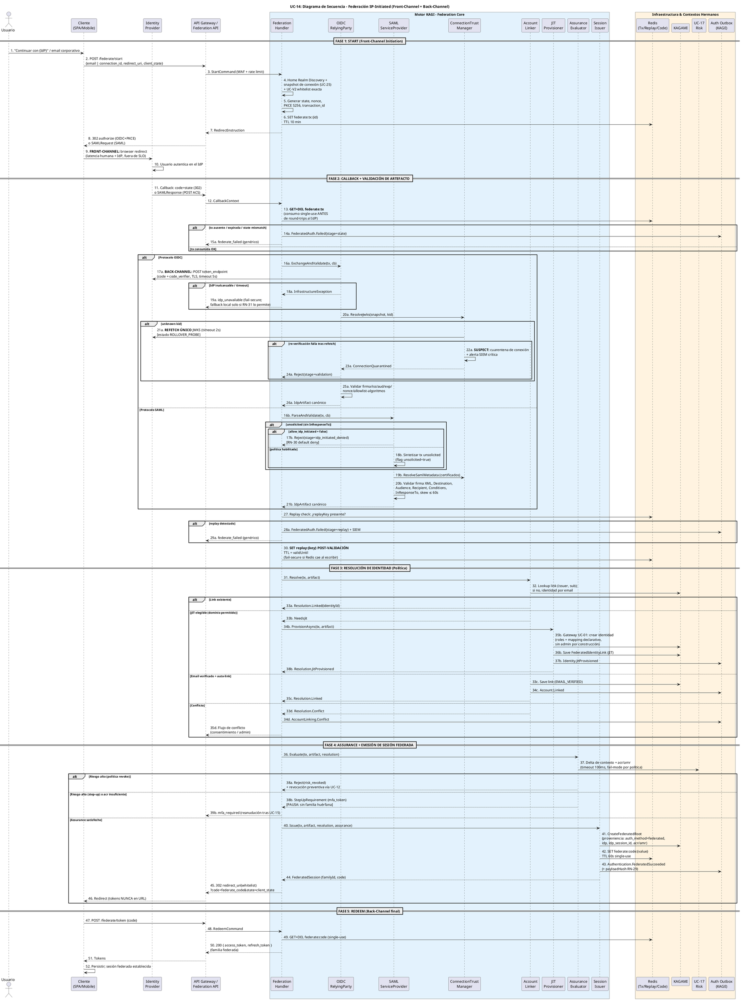
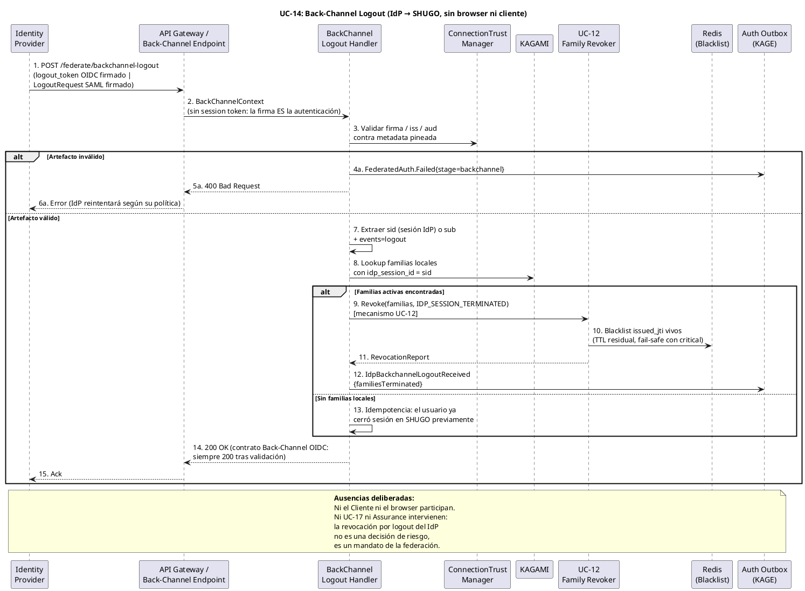

# UC-14: Autenticar Federada (SSO) - Diagrama de Secuencia

| Metadatos del Documento | |
| :--- | :--- |
| **Proyecto:** | SHUGO - Identity & Access Platform |
| **Caso de Uso:** | UC-14 - Autenticar Federada (SSO - OIDC/OAuth2 + SAML 2.0) |
| **Documento:** | 07_Sequence_Diagram.md |
| **Metodología:** | ICONIX (Diagrama de Secuencia) + DDD + Federation Security (NIST SP 800-63C) + Temporal Boundary Analysis |
| **Autor:** | Gastón Ruiz |
| **Versión Actual:** | 1.0.0 |
| **Fecha:** | 22/10/2026 |

---

## Historial de Versiones

| Versión | Fecha | Autor | Descripción de Cambios | Impacto |
| :--- | :--- | :--- | :--- | :--- |
| **1.0.0** | 22/10/2026 | Gastón Ruiz | **Creación inicial.** Diagrama de Secuencia completo para UC-14 en dos partes: (1) el flujo SP-initiated con sus cinco fases temporales (Start, Callback+Validación, Resolución de Identidad, Assurance+Emisión, Redeem), diferenciando explícitamente los tramos **front-channel** (mediados por el browser del usuario) de los **back-channel** (server-to-server TLS); y (2) el flujo server-to-server de Back-Channel Logout / SAML SLO. Modela el orden exacto de los controles: consumo single-use de Transaction State antes de cualquier round-trip al IdP, refetch único de JWKS con cuarentena al segundo fallo, replay cache post-validación con fail-secure, JIT/Linking/Conflicto como ramas mutuamente excluyentes, step-up pre-familia, y emisión de sesión con proveniencia vía `federate_code`. | Documento base del paquete de diseño Tier 1 del UC-14. Sirve como guion temporal exacto para la codificación del `FederationHandler`, con presupuesto de timeouts por dependencia y trazas OpenTelemetry por fase, garantizando que ningún control de seguridad dependa del orden de llegada de mensajes asíncronos. |

---

## 1. Introducción y Propósito

El **Diagrama de Secuencia** para el UC-14 materializa temporalmente las colaboraciones definidas en el Diagrama de Robustez. Su propósito es:

1. **Distinguir canales temporales:** La federación mezcla tramos **front-channel** (el browser viaja al IdP y regresa; latencia dominada por el humano y el IdP, fuera de nuestro control) con tramos **back-channel** (token exchange, refetch de JWKS, back-channel logout; latencia server-to-server bajo nuestro SLO). Confundirlos es la causa raíz de timeouts mal dimensionados y de ataques de confusión de canales.
2. **Fijar el orden de los controles de seguridad:** Consumo de Transaction State **antes** del token exchange; validación de artefacto **antes** de la replay cache; replay cache **antes** de la resolución de identidad; assurance y riesgo **antes** de la emisión de familia; y canje de `federate_code` **después** del redirect.
3. **Modelar las ramas mutuamente excluyentes:** OIDC vs SAML, link existente vs JIT vs linking por email vs conflicto, y los cuatro modos de fallo (state, validation, replay, idp_initiated) con sus eventos de auditoría.
4. **Documentar el presupuesto de timeouts:** Cada dependencia externa tiene un timeout explícito y una política de fallo (fail-secure, cuarentena, fallback por política), de modo que una degradación del IdP no se convierta en una degradación indeterminada de SHUGO.
5. **Cerrar el círculo de sesiones:** El flujo de Back-Channel Logout se secuencia aparte, con su contrato 200 y su idempotencia cuando no hay familias locales.

---

## 2. Diagrama de Secuencia #1: Flujo SP-Initiated (OIDC / SAML)



---

## 3. Diagrama de Secuencia #2: Back-Channel Logout / SAML SLO (Server-to-Server)



---

## 4. Análisis Detallado del Flujo

### 4.1. Fase 1: Start (Pasos 1-10) — Front-Channel Initiation

**Participantes:** `Usuario`, `Cliente`, `Gateway`, `Handler`, `Redis`, `IdP`.

*   **Acción:** Home Realm Discovery + validación de whitelist + generación criptográfica (state/nonce/PKCE) + persistencia de Transaction State + redirect.
*   **Frontera temporal:** El paso 9 es el **único** punto donde la latencia queda fuera del control de SHUGO (browser + IdP). Todo lo anterior es local y debe cumplir el SLO de `/federate/start` (<50ms p95).
*   **Justificación de seguridad:** El `redirect_uri` se valida en el paso 4 y se **pinea dentro de la tx**; el callback nunca puede cambiarlo (anti open-redirect).

### 4.2. Fase 2: Callback y Validación (Pasos 11-30) — El Núcleo de Confianza

**Orden crítico de controles:**
1. **Consumo de tx (13)** antes de cualquier round-trip al IdP: un callback duplicado muere aquí sin consumir cuota del token endpoint ni exponer el verifier.
2. **Token exchange back-channel (17a)** con timeout de 5s y **sin retries**: reintentar un canje de code podría duplicar efectos en IdPs no idempotentes; el fail-secure (`idp_unavailable`) es la respuesta correcta.
3. **Refetch único de JWKS (21a)**: el segundo fallo de firma tras refetch activa `SUSPECT` (cuarentena) — un ataque de inyección de claves no obtiene segunda bala.
4. **Replay check (27) y write post-validación (30)**: quemar nonces con artefactos falsos es imposible; y si Redis cae al escribir, se **rechaza** el artefacto (fail-secure), porque aceptar sin garantía anti-replay habilita forgery de sesión.

### 4.3. Fase 3: Resolución de Identidad (Pasos 31-35) — Política como Decisión

Las cuatro ramas (Linked / NeedsJit / LinkableByEmail / Conflict) son **mutuamente excluyentes** y emergen del snapshot pineado, no de parámetros del cliente. El JIT cruza la frontera de contextos vía gateway hacia KAGAMI (UC-01): KAGI nunca inserta identidades directamente.

### 4.4. Fase 4: Assurance y Emisión (Pasos 36-46) — Proveniencia o Nada

*   **Step-up pre-familia (38b-39b):** Si el `acr` no satisface la política o el riesgo es alto con política step-up, se pausa **sin crear familia** (coherente con UC-13: ninguna pausa deja huérfanos).
*   **Emisión atómica de tres artefactos (41-43):** familia con proveniencia + `federate_code` 60s + evento de auditoría con `payloadHash`. No existe camino que emita familia sin proveniencia ni auditoría.
*   **Tokens fuera de la URL (45-46):** el redirect porta solo el código de canje; los tokens viajan únicamente por back-channel en la Fase 5.

### 4.5. Fase 5: Redeem (Pasos 47-52) — Cierre Back-Channel

Canje single-use del `federate_code` (GET+DEL). Un segundo canje falla silenciosamente como `invalid_grant`-equivalente de federación; el cliente legítimo ya tiene sus tokens.

### 4.6. Diagrama #2: Back-Channel Logout (Pasos 1-15)

*   **La firma es la autenticación:** no hay session token ni cliente; el `logout_token` se valida contra metadata pineada vía `ConnectionTrustManager` (reutilizando el gatekeeper y su estado de confianza).
*   **Idempotencia como camino normal (13):** ausencia de familias locales no es error; el contrato 200 OK se cumple siempre tras validación, evitando reintentos agresivos del IdP.
*   **Revocación delegada (9-10):** el mecanismo es el de UC-12 con motivo `IDP_SESSION_TERMINATED`, incluyendo blacklisteado fail-safe de JTIs vivos.

---

## 5. Presupuesto de Timeouts y Comportamientos de Fallo por Dependencia

| Dependencia | Operación | Timeout | Reintentos | Comportamiento de Fallo |
| :--- | :--- | :--- | :--- | :--- |
| **IdP token endpoint** | Canje de code (OIDC) | 5 s | **0** (fail-secure) | `idp_unavailable`; fallback local solo si RN-31 lo permite |
| **IdP JWKS/metadata** | Refetch en ROLLOVER_PROBE | 2 s | **1** (la sonda) | Si inalcanzable → `DEGRADED_IDP`; si falla re-validación → `SUSPECT` (cuarentena) |
| **Redis (Tx State)** | GET+DEL de consumo | 50 ms | 0 | **Fail-secure:** callback rechazado (sin tx no hay vuelo) |
| **Redis (Replay Cache)** | SET post-validación | 50 ms | 0 | **Fail-secure:** artefacto rechazado |
| **Redis (FederateCode)** | GET+DEL de canje | 50 ms | 0 | Canje falla; usuario re-inicia federación (tx original puede seguir viva) |
| **KAGAMI** | Lookup link / JIT / familia | 200 ms c/u | 0 | Error de federación genérico + alerta; JIT parcial se revierte con transacción |
| **UC-17 Risk** | Evaluación de delta + acr | 100 ms | 0 | Fail-mode por política: `open` (continúa) o `stepup` (degrada a MFA) |
| **Outbox (KAGE)** | INSERT de eventos | misma TX | n/a (transaccional) | Si la TX cae, todo el vuelo cae coherente; nada queda semi-auditado |

**Justificación del "0 reintentos" generalizado:** En federación, un retry server-side sobre operaciones no idempotentes (canje de code, consumo de tx, emisión de familia) crea efectos duplicados o ventanas de replay. El reintento correcto vive en el **cliente** (con backoff) o en el **IdP** (back-channel), nunca en el servidor de KAGI.

---

## 6. Flujos Alternativos y Excepciones (Resumen Temporal)

| # | Escenario | Secuencia abreviada | Resultado |
| :--- | :--- | :--- | :--- |
| 6.1 | **State reutilizado** (callback duplicado) | 11→13 (DEL ya ocurrió) → 14a/15a | `FederatedAuth.Failed{stage=state}`; 2º callback nunca toca al IdP |
| 6.2 | **IdP caído en token exchange** | 17a timeout → 18a → 19a | `idp_unavailable`; fallback local solo con política explícita |
| 6.3 | **Key rollover legítimo** | 20a unknown kid → 21a refetch OK → 25a valida | Vuelo continúa; cache actualizada; métrica `rollover_confirmed` |
| 6.4 | **Inyección de claves** | 21a refetch → 22a re-validación falla → SUSPECT | Cuarentena de conexión; vuelos nuevos rechazados; familias existentes intactas |
| 6.5 | **Assertion replay** | 27 replayKey presente → 28a/29a | Rechazo + alerta SIEM; replay cache no se re-escribe |
| 6.6 | **SAML unsolicited con política deny** | 16b → 17b | `stage=idp_initiated_denied`; default RN-30 |
| 6.7 | **Conflicto de linking** | 32 → 33d → 34d → 35d | Sin identidad nueva, sin link; flujo de consentimiento/admin |
| 6.8 | **Redeem duplicado** | 47 → 49 (DEL ya ocurrió) | Rechazo genérico; sesión legítima intacta |
| 6.9 | **Back-channel sin familias** | 8 → 13 → 14 | 200 OK idempotente; sin revocaciones ni errores |

---

## 7. Consideraciones de Arquitectura (Security & Performance)

### 7.1. Trazas OpenTelemetry por Canal

```text
FRONT-CHANNEL (sin SLO propio: mediado por humano/IdP)
  federate.redirect_out (302) ────────────► federate.callback_in
  (span de "user journey" correlacionado por transaction_id)

BACK-CHANNEL (SLO estricto, callback processing < 200ms p95 local)
POST /federate/callback (Root Span) [Total: 85ms local]
├── redis.tx.consume [2ms]
├── idp.token_exchange [45ms]          ← único round-trip IdP en SLO observacional
├── trust.jwks.resolve [3ms]           ← cache hit; refetch añadiría ~200ms
├── oidc.id_token.validate [1ms]
├── redis.replay.check_write [4ms]
├── kagami.link_lookup [8ms]
├── risk.evaluate [30ms]
├── kagami.family_create [12ms]
├── redis.federate_code.set [2ms]
└── outbox.insert [6ms]                ← misma TX que family_create
```

### 7.2. Clock Skew y Ventanas de Validez

*   **Skew tolerado:** ≤60s para `exp/iat` (OIDC) y `NotBefore/NotOnOrAfter` (SAML), alineado con prácticas de IdPs enterprise.
*   **Replay TTL:** `validUntil + skew` para garantizar que un artefacto no pueda replayarse justo después de expirar por diferencia de relojes.
*   **NTP como dependencia operativa:** Los pods de KAGI deben sincronizar reloj (alerta si `node_time_offset > 5s`), porque toda la lógica de validez temporal depende de ello.

### 7.3. Atomicidad entre Familia y Outbox

Los pasos 41 y 43 comparten transacción en KAGAMI/outbox: si el INSERT del evento falla, la familia **no** se committea. No existe sesión federada sin su `FederatedSucceeded` auditable — la misma garantía que UC-12/UC-13 aplican a sus eventos.

### 7.4. Idempotencia del Redeem frente a Reintentos de Cliente

Un cliente que reintenta `POST /federate/token` tras un timeout donde el canje **sí** ocurrió recibe un rechazo genérico, pero su sesión ya establecida (tokens en memoria) sigue viva. El diseño acepta este comportamiento porque el alternative (reemitir tokens) rompería el single-use del código.

---

## 8. Trazabilidad con Otros Documentos del Paquete

| Documento | Relación |
| :--- | :--- |
| `01_Requirements_Specification.md` | Los escenarios 2.1-2.2.4 y 4.1-4.9 se secuencian aquí paso a paso; las excepciones 4.1-4.6 corresponden a las ramas alt del Diagrama #1. |
| `03_Activity_Diagram.md` | Cada carril de actividad se convierte en lifeline; los pasos numerados 1-52 mantienen alineación con los nodos del diagrama de actividades. |
| `05_State_Machine_Diagram.md` | Las transiciones INITIATED→CONSUMED (paso 13), CONSUMED→FAILED (14a/28a), CONSUMED→STEP_UP_PENDING (38b) y CONSUMED→SESSION_ISSUED (40-44) ocurren exactamente en estos mensajes. |
| `06_Robustness_Diagram.md` | Este diagrama define el orden temporal de las 52 colaboraciones que el de robustez define estructuralmente. |
| `08_Final_Class_Design.md` | Definirá las firmas exactas con `CancellationToken` y los timeouts de la tabla §5 como configuración tipada. |
| `10_UC_Specific_Data_Model.md` | Los keyspaces Redis (`federate:tx:*`, `replay:*`, `federate:code:*`) y las tablas de KAGAMI soportan los mensajes de persistencia de este diagrama. |
| `11_UC_Specific_Security_Threats.md` | El orden consumo→exchange→validación→replay→resolución es la mitigación ejecutable de assertion replay, nonce-burning y key injection. |
| `12_UC_Specific_Performance_Benchmarks.md` | El presupuesto de timeouts (§5) y la traza back-channel (§7.1) son la base de los SLOs de callback y de los scripts de k6 con latencia inyectada al IdP. |

---

## 9. Notas de Implementación

### 9.1. Configuración Tipada de Timeouts (C#)

```csharp
public sealed record FederationTimeouts
{
    public TimeSpan IdpTokenExchange { get; init; } = TimeSpan.FromSeconds(5);
    public TimeSpan MetadataRefetch { get; init; } = TimeSpan.FromSeconds(2);
    public TimeSpan RedisOperation { get; init; } = TimeSpan.FromMilliseconds(50);
    public TimeSpan KagamiOperation { get; init; } = TimeSpan.FromMilliseconds(200);
    public TimeSpan RiskEvaluation { get; init; } = TimeSpan.FromMilliseconds(100);
    public int Retries { get; init; } = 0;   // Política global: cero reintentos server-side
}
```

### 9.2. Verificación de Orden en Tests de Integración

```csharp
[Test]
public async Task Callback_ConsumesTx_Before_IdpRoundTrip()
{
    var order = new List<string>();
    TxStore.Setup(s => s.ConsumeAsync(It.IsAny<HttpRequest>(), It.IsAny<CancellationToken>()))
           .Callback(() => order.Add("tx_consume"))
           .ReturnsAsync(ValidTx);
    OidcRp.Setup(r => r.ExchangeAndValidateAsync(It.IsAny<FederationTransaction>(), It.IsAny<HttpRequest>(), It.IsAny<CancellationToken>()))
           .Callback(() => order.Add("idp_exchange"))
           .ReturnsAsync(Artifact);

    await Handler.CallbackAsync(CT);

    order.Should().StartWith(new[] { "tx_consume", "idp_exchange" });
    // Un callback duplicado jamás reaching idp_exchange:
    // el segundo consumo retornaría null y fallaría en stage=state.
}

[Test]
public async Task ReplayCache_IsWritten_OnlyAfter_ArtifactValidation()
{
    OidcRp.Setup(r => r.ExchangeAndValidateAsync(...)).ThrowsAsync(new ValidationException());

    var act = () => Handler.CallbackAsync(CT);
    await act.Should().ThrowAsync<FederationException>();

    ReplayCache.Verify(c => c.TryRegisterAsync(It.IsAny<string>(), It.IsAny<DateTime>(), It.IsAny<CancellationToken>()),
        Times.Never);   // nonce-burning imposible
}
```

### 9.3. Convenciones de Numeración

- Los sufijos `a/b/c/d` denotan ramas mutuamente excluyentes dentro de un mismo `alt`, manteniendo la numeración base alineada con el Diagrama de Robustez (pasos 1-52) y el de Actividades.
- Los mensajes **FRONT-CHANNEL** y **BACK-CHANNEL** se marcan en negrita sobre la flecha, haciendo auditable en el propio diagrama qué tramos están dentro del SLO local y cuáles dependen de terceros.

---
*Fin del Documento 07_Sequence_Diagram para UC-14*