# UC-14: Autenticar Federada (SSO) - Diagrama de Clases de Diseño Final

| Metadatos del Documento | |
| :--- | :--- |
| **Proyecto:** | SHUGO - Identity & Access Platform |
| **Caso de Uso:** | UC-14 - Autenticar Federada (SSO - OIDC/OAuth2 + SAML 2.0) |
| **Documento:** | 08_Final_Class_Design.md |
| **Metodología:** | ICONIX (Modelo de Diseño) + DDD + Clean Architecture + Hexagonal (Ports & Adapters) + Strategy Pattern + Typed Results |
| **Autor:** | Gastón Ruiz |
| **Versión Actual:** | 1.0.0 |
| **Fecha:** | 22/10/2026 |

---

## Historial de Versiones

| Versión | Fecha | Autor | Descripción de Cambios | Impacto |
| :--- | :--- | :--- | :--- | :--- |
| **1.0.0** | 22/10/2026 | Gastón Ruiz | **Creación inicial.** Definición del Modelo de Diseño (Clases de Implementación) para UC-14. Se detallan las firmas exactas del Application Service orquestador (`FederationHandler` con `FederateOutcome` tipado y colapso Zero Info Leakage compilable), el handler server-to-server (`BackChannelLogoutHandler` con contrato 200 idempotente), la abstracción de protocolo (`IProtocolAdapter` con implementaciones `OidcRelyingParty` y `SamlServiceProvider`), el gatekeeper de confianza (`ConnectionTrustManager` con transiciones CAS y cuarentena), y los servicios de decisión (`AccountLinker`, `JitProvisioner` con gateway transaccional, `AssuranceEvaluator`, `FederationSessionIssuer`). Se refinan dos decisiones del modelo inicial: creación del link **dentro** del comando JIT de KAGAMI (atomicidad identidad+link) y persistencia de la pausa de step-up en la transacción. | Documento base del paquete de diseño Tier 1 del UC-14. Sirve como plano exacto de codificación: aísla la heterogeneidad OIDC/SAML detrás de una Strategy, convierte el colapso de stages de fallo en una propiedad verificable en compile-time, y fija los límites transaccionales y fail-secure como contratos de implementación. |

---

## 1. Introducción y Propósito

Este documento presenta el **Modelo de Diseño** (Diagrama de Clases de Implementación) para el Caso de Uso UC-14 (Autenticar Federada).

A diferencia del Modelo de Dominio Inicial (documento 04), que era conceptual, este documento define las **clases concretas con firmas de métodos específicas**, visibilidad, manejo de `CancellationToken`, presupuestos de timeout tipados y contratos de fallo, listas para implementar en C# / .NET 8. El diseño debe garantizar:

1. **Heterogeneidad de Protocolos Aislada (Strategy):** OIDC y SAML divergen solo en adaptadores expertos que convergen en `IdpArtifact`; el orquestador nunca pregunta "¿qué protocolo eres?" fuera de la resolución del adaptador.
2. **Zero Info Leakage Compilable:** El resultado del flujo es un Typed Result (`FederateOutcome`) con siete casos exactos; el boundary colapsa todos los stages de fallo a un único error genérico, y agregar un octavo caso rompe compilación hasta manejarlo.
3. **Confianza Operacional Centralizada (Gatekeeper):** Ningún servicio valida firmas contra JWKS/metadata por su cuenta; `ConnectionTrustManager` posee la máquina de estados (TRUSTED → ROLLOVER_PROBE → SUSPECT / DEGRADED_IDP) y las transiciones atómicas.
4. **Fail-Secure por Construcción:** Consumo single-use de Transaction State, replay cache post-validación con rechazo ante caída de Redis, y cero reintentos server-side sobre operaciones no idempotentes.
5. **Fronteras de Contexto Explícitas:** El JIT cruza hacia KAGAMI (UC-01) vía gateway con transacción identidad+link atómica; la emisión de sesión vive en un único punto (`FederationSessionIssuer`).

---

## 2. Diagrama de Clases de Diseño (PlantUML)

```plantuml
@startuml UC-14_ClasesDiseno
<style>
diagram {
  BackgroundColor #FFFFFF
}
</style>
skinparam classAttributeIconSize 0
skinparam classBackgroundColor #FFFFFF
skinparam classBorderColor #34495E
skinparam classHeaderBackgroundColor #E3F2FD

title UC-14: Diagrama de Clases de Diseño Final - Federation Core (RP / SP)

' ============================================
' CAPA DE APLICACIÓN (Application Layer)
' ============================================
package "Aplicación (Application Layer)" {

    class FederationHandler <<Application Service>> {
        - connections: IFederatedConnectionResolver
        - txStore: IFederationTransactionStore
        - adapters: IReadOnlyDictionary<FederationProtocol, IProtocolAdapter>
        - replayCache: IReplayCache
        - linker: IAccountLinker
        - jit: IJitProvisioner
        - assurance: IAssuranceEvaluator
        - issuer: IFederationSessionIssuer
        - codes: IFederateCodeStore
        - minter: ITokenPairMinter
        - clock: IClock
        - timeouts: FederationTimeouts
        + StartAsync(command: StartCommand, ct): Task<FederateOutcome>
        + CallbackAsync(context: CallbackContext, ct): Task<FederateOutcome>
        + RedeemAsync(command: RedeemCommand, ct): Task<FederateOutcome>
    }

    class BackChannelLogoutHandler <<Application Service>> {
        - validator: IBackChannelTokenValidator
        - families: ITokenFamilyQuery
        - familyRevoker: IFamilyRevoker
        - outbox: IOutboxPublisher
        + HandleAsync(context: BackChannelContext, ct): Task<IActionResult>
    }

    class FederationController <<Boundary / Controller>> {
        + Start(cmd): IActionResult
        + Callback(): IActionResult
        + Redeem(cmd): IActionResult
        - Map(outcome: FederateOutcome): IActionResult
    }

    class FederateOutcome <<Typed Result>> {
        + {static} RedirectToIdp(instruction: RedirectInstruction): FederateOutcome
        + {static} RedirectToClient(session: ClientRedirect): FederateOutcome
        + {static} TokensIssued(pair: TokenPair): FederateOutcome
        + {static} MfaStepUp(req: StepUpRequirement): FederateOutcome
        + {static} LinkingConflict(resolution: IdentityResolution): FederateOutcome
        + {static} IdpUnavailable(): FederateOutcome
        + {static} Failed(stage: FederateStage): FederateOutcome
        + Match<T>(toIdp, toClient, tokens, mfa, conflict, unavailable, failed): T
    }

    enum FederateStage {
        RealmResolution
        State
        Validation
        Replay
        IdpInitiated
        Conflict
        RiskRevoked
        Redeem
        Backchannel
        Internal
    }

    class StartCommand <<DTO>> {
        + Email: string?
        + ConnectionId: Guid?
        + RedirectUri: string
        + ClientState: string?
    }

    class CallbackContext <<DTO>> {
        + TransactionId: string?
        + PresentedState: string?
        + Code: string?
        + SamlResponse: string?
        + SamlIssuer: string?
        + IsUnsolicitedSaml: bool
    }

    class FederationTimeouts <<Record>> {
        + IdpTokenExchange: TimeSpan = 5s
        + MetadataRefetch: TimeSpan = 2s
        + RedisOperation: TimeSpan = 50ms
        + KagamiOperation: TimeSpan = 200ms
        + RiskEvaluation: TimeSpan = 100ms
        + Retries: int = 0
    }

    class FederationMetrics <<Telemetry>> {
        + FailedTotal: Counter<long>   {stage}
        + RolloverConfirmed: Counter<long>
        + QuarantineTotal: Counter<long>
        + ReplayRejected: Counter<long>
        + JitProvisioned: Counter<long>
        + StepUpTotal: Counter<long>
        + BackchannelReceived: Counter<long>
    }
}

' ============================================
' CAPA DE DOMINIO (Domain Layer)
' ============================================
package "Dominio (Domain Layer)" {

    class FederationTransaction <<Aggregate Root>> {
        - id / tenantId / connection: Snapshot
        - protocol / state / nonce / pkce
        - authnRequestId: string?
        - redirectUri / clientState
        - isUnsolicited: bool
        - status: FederationTransactionStatus
        + {static} Initiate(snapshot, protocol, redirectUri, clientState, ttl, now): FederationTransaction
        + {static} InitiateUnsolicited(snapshot, now, ttl): FederationTransaction
        + Consume(presentedState, now): void
        + Fail(stage, now): void
        + PauseForStepUp(mfaToken, now): void
        + ResumeFromStepUp(now): void
        + MarkSessionIssued(familyId, code): void
        - ValidateTransition(next): void
    }

    class FederatedIdentityLink <<Entity>> {
        + {static} Create(issuer, subject, identityId, method): FederatedIdentityLink
    }

    interface IProtocolAdapter <<Strategy>> {
        + Protocol: FederationProtocol
        + BuildAuthorizeRedirectAsync(tx, ct): Task<RedirectInstruction>
        + ExchangeAndValidateAsync(tx, callback, ct): Task<IdpArtifact>
    }

    class OidcRelyingParty <<Domain Service>> {
        - trust: IConnectionTrustManager
        - http: IIdpHttpClient
        - validator: IIdTokenValidator
        + Protocol: OIDC
        + BuildAuthorizeRedirectAsync(tx, ct): Task<RedirectInstruction>
        + ExchangeAndValidateAsync(tx, cb, ct): Task<IdpArtifact>
    }

    class SamlServiceProvider <<Domain Service>> {
        - trust: IConnectionTrustManager
        - validator: ISamlAssertionValidator
        + Protocol: SAML
        + BuildAuthorizeRedirectAsync(tx, ct): Task<RedirectInstruction>
        + ExchangeAndValidateAsync(tx, cb, ct): Task<IdpArtifact>
    }

    class ConnectionTrustManager <<Domain Service\n(Gatekeeper)>> {
        - cache: IMetadataCache
        - metadata: IMetadataResolver
        - stateStore: ITrustStateStore
        - metrics: FederationMetrics
        + ResolveJwksAsync(snapshot, kidHint, ct): Task<JwksSet>
        + ResolveSamlMetadataAsync(snapshot, ct): Task<SamlMetadata>
        + RecordEndpointUnreachableAsync(connectionId, ct): Task
        + RecordFetchSuccessAsync(connectionId, ct): Task
        + GetStateAsync(connectionId, ct): Task<ConnectionTrustState>
        - TransitionAsync(connectionId, from, to, reason, ct): Task
    }

    class AccountLinker <<Domain Service>> {
        + ResolveAsync(tx, artifact, ct): Task<IdentityResolution>
    }

    class JitProvisioner <<Domain Service>> {
        - gateway: IJitProvisioningGateway
        - outbox: IOutboxPublisher
        + ProvisionAsync(tx, artifact, ct): Task<IdentityResolution>
    }

    class AssuranceEvaluator <<Domain Service>> {
        - risk: IRiskEvaluator
        - mfaSessions: IStepUpSessionBroker
        - revoker: IFamilyRevoker
        + EvaluateAsync(tx, artifact, resolution, ct): Task<StepUpRequirement?>
    }

    class FederationSessionIssuer <<Domain Service>> {
        - families: ITokenFamilyFactory
        - codes: IFederateCodeStore
        - outbox: IOutboxPublisher
        + IssueAsync(tx, artifact, resolution, ct): Task<FederatedSession>
    }

    class IdpArtifact <<Value Object>> {
        + Protocol / Issuer / Subject / Email
        + EmailVerified / DisplayName / Groups
        + Acr / Amr / IdpSessionId
        + ReplayKey / ValidUntil / PayloadHash
        + {static} FromOidcIdToken(jwt, claims): IdpArtifact
        + {static} FromSamlAssertion(assertion): IdpArtifact
    }

    class FederatedConnectionSnapshot <<Value Object>> {
        + ValidateRedirectUri(uri): bool
        + AllowsIdpInitiated: bool
        + Jit / Linking / Fallback / RoleMapping / AssuranceMapping
    }

    class RoleMapping <<Value Object>> {
        + Map(idpGroups): IReadOnlyList<string>
    }

    class AssuranceLevel <<Value Object>> {
        + {static} DeriveFrom(acr, amr, mapping): AssuranceLevel
        + Satisfies(required): bool
    }

    class FederateCode <<Value Object>> {
        + {static} Issue(now): FederateCode
        + IsExpired(now): bool
    }

    class IdentityResolution <<Value Object>> {
        + Kind / IdentityId? / LinkMethod? / ConflictReason?
    }

    class FederatedSession <<Value Object>> {
        + FamilyRootId / FederateCode / AuthLevel / Provenance
    }

    interface IFederationTransactionStore {
        + SaveAsync(tx, ct): Task
        + ConsumeAsync(txId, presentedState, now, ct): Task<FederationTransaction?>
    }
    interface IReplayCache {
        + TryRegisterAsync(replayKey, validUntil, ct): Task<bool>
    }
    interface IFederateCodeStore {
        + IssueAsync(code, payload, ct): Task
        + RedeemAsync(code, ct): Task<FederatedSessionPayload?>
    }
    interface IConnectionTrustManager {
        + ResolveJwksAsync(snapshot, kidHint, ct): Task<JwksSet>
        + ResolveSamlMetadataAsync(snapshot, ct): Task<SamlMetadata>
        + GetStateAsync(connectionId, ct): Task<ConnectionTrustState>
    }
    interface IMetadataResolver {
        + RefetchJwksOnceAsync(snapshot, ct): Task<JwksSet>
        + RefetchSamlMetadataOnceAsync(snapshot, ct): Task<SamlMetadata>
    }
    interface IJitProvisioningGateway {
        + ProvisionIdentityAndLinkAsync(command, ct): Task<IdentityId>
    }
    interface ITokenFamilyFactory {
        + CreateFederatedRootAsync(identityId, provenance, assurance, ct): Task<TokenFamilyId>
    }
    interface ITokenPairMinter {
        + MintForFamilyAsync(familyId, provenance, ct): Task<TokenPair>
    }
}

' ============================================
' CAPA DE INFRAESTRUCTURA (Adapters)
' ============================================
package "Infraestructura (Adapters)" {
    class RedisFederationTransactionStore <<GETDEL atómico>>
    class RedisReplayCache <<SET NX + PX>>
    class RedisFederateCodeStore <<GETDEL atómico>>
    class RedisTrustStateStore <<Lua CAS>>
    class CachedMetadataResolver <<Cache 1h + ETag>>
    class KagamiJitGateway <<HTTP interno mTLS>>
    class IdpHttpClient <<TLS, timeout tipado>>
}

' ============================================
' RELACIONES
' ============================================
FederationController --> FederationHandler
FederationController ..> FederateOutcome : Match<T> (colapso ZIL)
FederateOutcome ..> FederateStage

FederationHandler --> IFederationTransactionStore
FederationHandler --> IProtocolAdapter : adapters[tx.Protocol]
FederationHandler --> IReplayCache
FederationHandler --> IAccountLinker
FederationHandler --> IJitProvisioner
FederationHandler --> IAssuranceEvaluator
FederationHandler --> IFederationSessionIssuer
FederationHandler --> IFederateCodeStore
FederationHandler --> ITokenPairMinter
FederationHandler --> FederationTransaction

OidcRelyingParty ..|> IProtocolAdapter
SamlServiceProvider ..|> IProtocolAdapter
OidcRelyingParty --> IConnectionTrustManager
SamlServiceProvider --> IConnectionTrustManager
OidcRelyingParty ..> IdpArtifact : FromOidcIdToken()
SamlServiceProvider ..> IdpArtifact : FromSamlAssertion()

ConnectionTrustManager ..|> IConnectionTrustManager
ConnectionTrustManager --> IMetadataResolver
ConnectionTrustManager --> ITrustStateStore

JitProvisioner --> IJitProvisioningGateway
AssuranceEvaluator --> IRiskEvaluator
FederationSessionIssuer --> ITokenFamilyFactory
FederationSessionIssuer --> IFederateCodeStore

BackChannelLogoutHandler --> IBackChannelTokenValidator
BackChannelLogoutHandler --> IFamilyRevoker

RedisFederationTransactionStore ..|> IFederationTransactionStore
RedisReplayCache ..|> IReplayCache
RedisFederateCodeStore ..|> IFederateCodeStore
RedisTrustStateStore ..|> ITrustStateStore
CachedMetadataResolver ..|> IMetadataResolver
KagamiJitGateway ..|> IJitProvisioningGateway

note right of FederateOutcome
  **Typed Result:**
  Siete casos exactos.
  Match<T> exhaustivo: el stage
  NUNCA llega al HTTP; solo
  a logs y métricas.
end note

note bottom of ConnectionTrustManager
  **Gatekeeper único:**
  Un refetch ante unknown kid;
  segundo fallo → SUSPECT (CAS).
  Ningún servicio toca JWKS
  ni metadata directamente.
end note

note left of IProtocolAdapter
  **Strategy:**
  Heterogeneidad OIDC/SAML
  aislada; convergencia en
  IdpArtifact canónico.
end note

@enduml
```



---

## 3. Detalle de Clases por Capa

### 3.1. Capa de Aplicación (Application Layer)

#### **FederationHandler (Orquestador de los Tres Flujos)**

**Responsabilidad:** Orquestar start/callback/redeem consumiendo servicios expertos en el orden de seguridad fijado por el Diagrama de Secuencia, y producir un `FederateOutcome` tipado. **Nunca** traduce a HTTP: esa es la responsabilidad del boundary.

```csharp
public class FederationHandler : IFederationHandler
{
    private readonly IFederatedConnectionResolver _connections;
    private readonly IFederationTransactionStore _txStore;
    private readonly IReadOnlyDictionary<FederationProtocol, IProtocolAdapter> _adapters;
    private readonly IReplayCache _replayCache;
    private readonly IAccountLinker _linker;
    private readonly IJitProvisioner _jit;
    private readonly IAssuranceEvaluator _assurance;
    private readonly IFederationSessionIssuer _issuer;
    private readonly IFederateCodeStore _codes;
    private readonly ITokenPairMinter _minter;
    private readonly IClock _clock;
    private readonly FederationTimeouts _timeouts;
    private readonly FederationMetrics _metrics;
    private readonly ILogger<FederationHandler> _logger;

    public FederationHandler(
        IFederatedConnectionResolver connections,
        IFederationTransactionStore txStore,
        IEnumerable<IProtocolAdapter> adapters,   // Strategy: inyección de colección
        IReplayCache replayCache,
        IAccountLinker linker,
        IJitProvisioner jit,
        IAssuranceEvaluator assurance,
        IFederationSessionIssuer issuer,
        IFederateCodeStore codes,
        ITokenPairMinter minter,
        IClock clock,
        IOptions<FederationTimeouts> timeouts,
        FederationMetrics metrics,
        ILogger<FederationHandler> logger)
    {
        _connections = connections;
        _txStore = txStore;
        _adapters = adapters.ToDictionary(a => a.Protocol);  // OIDC y SAML registrados
        _replayCache = replayCache;
        _linker = linker;
        _jit = jit;
        _assurance = assurance;
        _issuer = issuer;
        _codes = codes;
        _minter = minter;
        _clock = clock;
        _timeouts = timeouts.Value;
        _metrics = metrics;
        _logger = logger;
    }

    /// <summary>Fase 1: inicio SP-initiated con snapshot pineado y redirect validado.</summary>
    public async Task<FederateOutcome> StartAsync(StartCommand command, CancellationToken ct)
    {
        var snapshot = command.ConnectionId is not null
            ? await _connections.ResolveByIdAsync(command.ConnectionId.Value, ct)
            : await _connections.ResolveByRealmAsync(command.Email, ct);

        // RN-27: error genérico; no revela qué dominios tienen federación
        if (snapshot is null)
            return FederateOutcome.Failed(FederateStage.RealmResolution);

        var redirectUri = new RedirectUri(command.RedirectUri);
        var tx = FederationTransaction.Initiate(
            snapshot, snapshot.Protocol, redirectUri, command.ClientState,
            TxTtl, _clock.UtcNow);                       // lanza si redirect no está en whitelist (INV-95)

        await _txStore.SaveAsync(tx, ct);

        var instruction = await _adapters[snapshot.Protocol]
            .BuildAuthorizeRedirectAsync(tx, ct);        // gatekeeper valida estado TRUSTED

        return FederateOutcome.RedirectToIdp(instruction);
    }

    /// <summary>Fases 2-4: callback con orden de controles fijado (consumo → validación → replay → resolución → assurance → emisión).</summary>
    public async Task<FederateOutcome> CallbackAsync(CallbackContext context, CancellationToken ct)
    {
        var now = _clock.UtcNow;

        // (1) CONSUMO SINGLE-USE ANTES DE CUALQUIER ROUND-TRIP AL IdP
        FederationTransaction? tx;
        if (context.IsUnsolicitedSaml)
        {
            var snapshot = await _connections.ResolveByIssuerAsync(context.SamlIssuer!, ct);
            if (snapshot is null || !snapshot.AllowsIdpInitiated)
                return FederateOutcome.Failed(FederateStage.IdpInitiated);   // RN-30 default deny
            tx = FederationTransaction.InitiateUnsolicited(snapshot, now, TxTtl);
        }
        else
        {
            tx = await _txStore.ConsumeAsync(context.TransactionId, context.PresentedState, now, ct);
        }

        if (tx is null)
            return FederateOutcome.Failed(FederateStage.State);

        // (2) ADAPTADOR DE PROTOCOLO PRODUCE ARTEFACTO CANÓNICO
        IdpArtifact artifact;
        try
        {
            artifact = await _adapters[tx.Protocol].ExchangeAndValidateAsync(tx, context, ct);
        }
        catch (ConnectionQuarantinedException ex)
        {
            _metrics.QuarantineTotal.Add(1, Tag(tx));
            _logger.LogCritical(ex, "Connection {Connection} quarantined during callback.", tx.Connection.ConnectionId);
            return FederateOutcome.Failed(FederateStage.Validation);
        }
        catch (InfrastructureException ex)
        {
            _logger.LogWarning(ex, "IdP unreachable during callback for {Connection}.", tx.Connection.ConnectionId);
            return FederateOutcome.IdpUnavailable();     // fail-secure; fallback solo si RN-31 lo permite (boundary decide)
        }
        catch (FederationException fex)
        {
            return FederateOutcome.Failed(fex.Stage);    // validation / idp_initiated / etc.
        }

        // (3) REPLAY CACHE POST-VALIDACIÓN, FAIL-SECURE
        if (!await _replayCache.TryRegisterAsync(artifact.ReplayKey, artifact.ValidUntil, ct))
        {
            _metrics.ReplayRejected.Add(1, Tag(tx));
            return FederateOutcome.Failed(FederateStage.Replay);
        }

        // (4) RESOLUCIÓN DE IDENTIDAD POR POLÍTICA (JIT / LINK / CONFLICTO)
        var resolution = await _linker.ResolveAsync(tx, artifact, ct);
        if (resolution.Kind == ResolutionKind.NeedsJit)
            resolution = await _jit.ProvisionAsync(tx, artifact, ct);
        if (resolution.Kind == ResolutionKind.Conflict)
            return FederateOutcome.LinkingConflict(resolution);

        // (5) ASSURANCE + RIESGO ANTES DE CUALQUIER FAMILIA
        StepUpRequirement? stepUp;
        try
        {
            stepUp = await _assurance.EvaluateAsync(tx, artifact, resolution, ct);
        }
        catch (FederationException fex) when (fex.Stage == FederateStage.RiskRevoked)
        {
            return FederateOutcome.Failed(FederateStage.RiskRevoked);
        }

        if (stepUp is not null)
        {
            tx.PauseForStepUp(stepUp.MfaToken, now);     // pausa persistida para reanudación
            await _txStore.SaveAsync(tx, ct);
            _metrics.StepUpTotal.Add(1, Tag(tx));
            return FederateOutcome.MfaStepUp(stepUp);    // SIN familia huérfana
        }

        // (6) PUNTO ÚNICO DE EMISIÓN: familia + proveniencia + federate_code + outbox
        var session = await _issuer.IssueAsync(tx, artifact, resolution, ct);
        tx.MarkSessionIssued(session.FamilyRootId, session.FederateCode);

        return FederateOutcome.RedirectToClient(new ClientRedirect(
            tx.RedirectUri, tx.ClientState, session.FederateCode));
    }

    /// <summary>Fase 5: canje single-use del federate_code por tokens de la familia.</summary>
    public async Task<FederateOutcome> RedeemAsync(RedeemCommand command, CancellationToken ct)
    {
        var payload = await _codes.RedeemAsync(command.Code, ct);   // GETDEL atómico
        if (payload is null)
            return FederateOutcome.Failed(FederateStage.Redeem);

        var pair = await _minter.MintForFamilyAsync(
            payload.FamilyRootId, payload.Provenance, ct);          // UC-11/13: misma maquinaria de emisión

        return FederateOutcome.TokensIssued(pair);
    }

    private static TimeSpan TxTtl => TimeSpan.FromMinutes(10);
    private TagList Tag(FederationTransaction tx) => new() { { "tenant_id", tx.TenantId.Value }, { "protocol", tx.Protocol.ToString() } };
}
```

#### **FederateOutcome (Typed Result con Match Exhaustivo)**

```csharp
public sealed class FederateOutcome
{
    private enum Kind { RedirectToIdp, RedirectToClient, TokensIssued, MfaStepUp, LinkingConflict, IdpUnavailable, Failed }

    private readonly Kind _kind;
    private readonly RedirectInstruction? _toIdp;
    private readonly ClientRedirect? _toClient;
    private readonly TokenPair? _tokens;
    private readonly StepUpRequirement? _mfa;
    private readonly IdentityResolution? _conflict;
    private readonly FederateStage _stage;

    private FederateOutcome(Kind kind, RedirectInstruction? toIdp, ClientRedirect? toClient,
                            TokenPair? tokens, StepUpRequirement? mfa, IdentityResolution? conflict,
                            FederateStage stage)
        => (_kind, _toIdp, _toClient, _tokens, _mfa, _conflict, _stage) =
           (kind, toIdp, toClient, tokens, mfa, conflict, stage);

    public static FederateOutcome RedirectToIdp(RedirectInstruction i) => new(Kind.RedirectToIdp, i, null, null, null, null, default);
    public static FederateOutcome RedirectToClient(ClientRedirect r)   => new(Kind.RedirectToClient, null, r, null, null, null, default);
    public static FederateOutcome TokensIssued(TokenPair p)            => new(Kind.TokensIssued, null, null, p, null, null, default);
    public static FederateOutcome MfaStepUp(StepUpRequirement s)       => new(Kind.MfaStepUp, null, null, null, s, null, default);
    public static FederateOutcome LinkingConflict(IdentityResolution r)=> new(Kind.LinkingConflict, null, null, null, null, r, default);
    public static FederateOutcome IdpUnavailable()                     => new(Kind.IdpUnavailable, null, null, null, null, null, default);
    public static FederateOutcome Failed(FederateStage stage)          => new(Kind.Failed, null, null, null, null, null, stage);

    /// <summary>
    /// Plegado exhaustivo: agregar un Kind nuevo rompe compilación de todos los
    /// callers (TreatWarningsAsErrors + CS8509), haciendo el colapso Zero Info
    /// Leakage una propiedad verificable en compile-time.
    /// </summary>
    public T Match<T>(
        Func<RedirectInstruction, T> redirectToIdp,
        Func<ClientRedirect, T> redirectToClient,
        Func<TokenPair, T> tokensIssued,
        Func<StepUpRequirement, T> mfaStepUp,
        Func<IdentityResolution, T> linkingConflict,
        Func<T> idpUnavailable,
        Func<FederateStage, T> failed) =>
        _kind switch
        {
            Kind.RedirectToIdp   => redirectToIdp(_toIdp!),
            Kind.RedirectToClient=> redirectToClient(_toClient!),
            Kind.TokensIssued    => tokensIssued(_tokens!),
            Kind.MfaStepUp       => mfaStepUp(_mfa!),
            Kind.LinkingConflict => linkingConflict(_conflict!),
            Kind.IdpUnavailable  => idpUnavailable(),
            Kind.Failed          => failed(_stage),
        };
}
```

#### **FederationController (Boundary: Colapso Zero Info Leakage)**

```csharp
[ApiController]
[Route("v1/auth/federate")]
public class FederationController : ControllerBase
{
    private readonly IFederationHandler _handler;
    private readonly FederationMetrics _metrics;
    private readonly ILogger<FederationController> _logger;

    [HttpPost("start")]
    public async Task<IActionResult> Start([FromBody] StartCommand cmd, CancellationToken ct)
        => Map(await _handler.StartAsync(cmd, ct));

    [HttpGet("callback")]   // OIDC redirect
    [HttpPost("callback")]  // SAML ACS (POST binding)
    public async Task<IActionResult> Callback(CancellationToken ct)
        => Map(await _handler.CallbackAsync(CallbackContext.From(Request), ct));

    [HttpPost("token")]
    public async Task<IActionResult> Redeem([FromBody] RedeemCommand cmd, CancellationToken ct)
        => Map(await _handler.RedeemAsync(cmd, ct));

    /// <summary>
    /// ÚNICO lugar donde un FederateStage se convierte en HTTP.
    /// Todos los stages de fallo convergen a un cuerpo idéntico: el motivo
    /// interno vive solo en logs/métricas/eventos de auditoría.
    /// </summary>
    private IActionResult Map(FederateOutcome outcome) => outcome.Match(
        redirectToIdp: i => Redirect(i.Location),

        redirectToClient: r => Redirect(
            $"{r.RedirectUri}?code={Uri.EscapeDataString(r.FederateCode.Value)}" +
            (r.ClientState is null ? "" : $"&state={Uri.EscapeDataString(r.ClientState)}")),

        tokensIssued: p => Ok(new TokenResponse("Bearer", p.AccessToken, p.RefreshToken, p.ExpiresIn)),

        mfaStepUp: m => Ok(new MfaRequiredResponse(true, m.MfaToken, m.AllowedMethods)),

        // Neutro: no confirma ni niega existencia de cuenta local (anti-oracle)
        linkingConflict: _ => StatusCode(403, new ErrorResponse(
            "linking_requires_verification",
            "Additional verification is required to complete sign-in. Contact your administrator.")),

        idpUnavailable: () => StatusCode(503, new ErrorResponse(
            "idp_unavailable", "The identity provider is temporarily unavailable."))
            .WithRetryAfter(5),

        failed: stage =>
        {
            _logger.LogInformation("Federate failed at stage {Stage}.", stage);
            _metrics.FailedTotal.Add(1, new TagList { { "stage", stage.ToString() } });
            return BadRequest(new ErrorResponse(
                "federate_failed", "Federated authentication could not be completed."));
        });
}
```

#### **BackChannelLogoutHandler (Contrato 200 Idempotente)**

```csharp
public class BackChannelLogoutHandler : IBackChannelLogoutHandler
{
    private readonly IBackChannelTokenValidator _validator;   // valida firma/iss/aud vía TrustManager
    private readonly ITokenFamilyQuery _families;
    private readonly IFamilyRevoker _familyRevoker;           // mecanismo UC-12
    private readonly IOutboxPublisher _outbox;
    private readonly IClock _clock;

    public async Task<IActionResult> HandleAsync(BackChannelContext context, CancellationToken ct)
    {
        BackChannelToken token;
        try
        {
            token = await _validator.ValidateAsync(context, ct);
        }
        catch (FederationException fex)
        {
            await _outbox.PublishAsync(new FederatedAuthFailed(
                context.ConnectionId, FederateStage.Backchannel, fex.Reason,
                context.PayloadHash, _clock.UtcNow), ct);
            return new BadRequestResult();          // artefacto inválido: el IdP reintentará
        }

        var families = await _families.FindActiveByIdpSessionAsync(
            token.Issuer, token.IdpSessionId, ct);

        if (families.Count > 0)
        {
            var report = await _familyRevoker.RevokeAsync(
                families, RevocationReason.IDP_SESSION_TERMINATED, ct);

            await _outbox.PublishAsync(new IdpBackchannelLogoutReceived(
                token.Issuer, token.IdpSessionId, report.TokensRevoked, _clock.UtcNow), ct);
        }
        // Idempotencia: sin familias locales NO es error (el usuario ya cerró en SHUGO).

        return new OkResult();   // Contrato OIDC Back-Channel: 200 siempre tras validación
    }
}
```

### 3.2. Capa de Dominio (Domain Layer)

#### **IProtocolAdapter + OidcRelyingParty (Strategy de Protocolo)**

```csharp
public interface IProtocolAdapter
{
    FederationProtocol Protocol { get; }
    Task<RedirectInstruction> BuildAuthorizeRedirectAsync(FederationTransaction tx, CancellationToken ct);
    Task<IdpArtifact> ExchangeAndValidateAsync(FederationTransaction tx, CallbackContext callback, CancellationToken ct);
}

public class OidcRelyingParty : IProtocolAdapter
{
    private static readonly string[] AllowedAlgorithms = { "RS256", "ES256", "EdDSA" }; // nunca none/HS256

    private readonly IConnectionTrustManager _trust;
    private readonly IIdpHttpClient _http;
    private readonly IIdTokenValidator _validator;
    private readonly FederationTimeouts _timeouts;

    public FederationProtocol Protocol => FederationProtocol.OIDC;

    public async Task<RedirectInstruction> BuildAuthorizeRedirectAsync(
        FederationTransaction tx, CancellationToken ct)
    {
        var md = await _trust.ResolveOidcMetadataAsync(tx.Connection, ct);  // gate TRUSTED

        return RedirectInstruction.To(QueryBuilder.Create(md.AuthorizationEndpoint)
            .Add("response_type", "code")
            .Add("client_id", tx.Connection.ClientIdOrEntityId)
            .Add("redirect_uri", AcsUrl)
            .Add("scope", "openid profile email groups")
            .Add("state", tx.State)
            .Add("nonce", tx.Nonce)
            .Add("code_challenge", tx.Pkce.Challenge)
            .Add("code_challenge_method", "S256")
            .Add("acr_values", tx.Connection.AssuranceMapping.RequestedAcr));
    }

    public async Task<IdpArtifact> ExchangeAndValidateAsync(
        FederationTransaction tx, CallbackContext callback, CancellationToken ct)
    {
        using var cts = CancellationTokenSource.CreateLinkedTokenSource(ct);
        cts.CancelAfter(_timeouts.IdpTokenExchange);        // 5s, CERO reintentos

        TokenEndpointResponse response;
        try
        {
            response = await _http.PostTokenEndpointAsync(
                tx.Connection, callback.Code!, tx.Pkce.Verifier, cts.Token);
        }
        catch (OperationCanceledException) when (!ct.IsCancellationRequested)
        {
            throw new InfrastructureException("IdP token endpoint timeout.");
        }

        var jwt = new JsonWebToken(response.IdToken);
        var jwks = await _trust.ResolveJwksAsync(tx.Connection, jwt.Kid, cts.Token); // refetch once / cuarentena

        var result = _validator.Validate(jwt, jwks, new IdTokenValidationRules(
            ExpectedIssuer: tx.Connection.Issuer,
            ExpectedAudience: tx.Connection.ClientIdOrEntityId,
            ExpectedNonce: tx.Nonce,
            AllowedAlgorithms: AllowedAlgorithms,
            ClockSkew: TimeSpan.FromSeconds(60)));

        if (!result.Succeeded)
            throw new FederationException(FederateStage.Validation, result.FailureReason);

        return IdpArtifact.FromOidcIdToken(jwt, result.Claims);
    }
}
```

#### **ConnectionTrustManager (Gatekeeper con Transiciones CAS)**

```csharp
public class ConnectionTrustManager : IConnectionTrustManager
{
    // Compare-And-Swap en Redis: evita que dos probes simultáneos
    // lleven la conexión a estados contradictorios (TRUSTED vs SUSPECT).
    private const string CasTransitionLua = """
        local current = redis.call('GET', KEYS[1])
        if current == ARGV[1] then
            redis.call('SET', KEYS[1], ARGV[2], 'EX', ARGV[3])
            return 1
        end
        return 0
        """;

    public async Task<JwksSet> ResolveJwksAsync(
        FederatedConnectionSnapshot snapshot, string? kidHint, CancellationToken ct)
    {
        var state = await GetStateAsync(snapshot.ConnectionId, ct);

        if (state == ConnectionTrustState.Suspect)
            throw new ConnectionQuarantinedException(snapshot.ConnectionId);

        if (state == ConnectionTrustState.DegradedIdp)
            throw new InfrastructureException("IdP degraded; validation not possible.");

        var jwks = await _cache.GetJwksAsync(snapshot, ct);

        if (kidHint is null || jwks.Contains(kidHint))
            return jwks;

        // UNKNOWN KID: sonda de UNA sola bala
        if (state == ConnectionTrustState.RolloverProbe)
        {
            await TransitionAsync(snapshot.ConnectionId,
                ConnectionTrustState.RolloverProbe, ConnectionTrustState.Suspect,
                "SECOND_SIGNATURE_FAILURE_AFTER_REFETCH", ct);
            throw new ConnectionQuarantinedException(snapshot.ConnectionId);
        }

        await TransitionAsync(snapshot.ConnectionId,
            ConnectionTrustState.Trusted, ConnectionTrustState.RolloverProbe,
            "UNKNOWN_KID", ct);

        try
        {
            jwks = await _metadata.RefetchJwksOnceAsync(snapshot, ct);   // timeout 2s
        }
        catch (InfrastructureException)
        {
            await TransitionAsync(snapshot.ConnectionId,
                ConnectionTrustState.RolloverProbe, ConnectionTrustState.DegradedIdp,
                "REFETCH_UNREACHABLE", ct);
            throw;
        }

        if (!jwks.Contains(kidHint))
        {
            await TransitionAsync(snapshot.ConnectionId,
                ConnectionTrustState.RolloverProbe, ConnectionTrustState.Suspect,
                "KEY_NOT_PRESENT_AFTER_REFETCH", ct);
            throw new ConnectionQuarantinedException(snapshot.ConnectionId);
        }

        await TransitionAsync(snapshot.ConnectionId,
            ConnectionTrustState.RolloverProbe, ConnectionTrustState.Trusted,
            "ROLLOVER_CONFIRMED", ct);
        _metrics.RolloverConfirmed.Add(1);
        return jwks;
    }

    private async Task TransitionAsync(
        ConnectionId id, ConnectionTrustState from, ConnectionTrustState to,
        string reason, CancellationToken ct)
    {
        var swapped = await _stateStore.CompareAndSetAsync(id, from, to, Ttl, ct); // Lua CAS
        if (swapped)
        {
            _logger.LogWarning("ConnectionTrust {Connection}: {From} → {To} ({Reason}).", id, from, to, reason);
            if (to == ConnectionTrustState.Suspect)
                _metrics.QuarantineTotal.Add(1);   // alimenta alerta SIEM crítica
        }
        // Si el CAS falló, otro probe ya movió el estado: el lector
        // re-evalúa y obtiene el estado ganador. Sin condiciones de carrera.
    }
}
```

#### **JitProvisioner (Refinado: Link dentro del Comando de KAGAMI)**

```csharp
public class JitProvisioner : IJitProvisioner
{
    private readonly IJitProvisioningGateway _gateway;
    private readonly IOutboxPublisher _outbox;
    private readonly IClock _clock;

    public async Task<IdentityResolution> ProvisionAsync(
        FederationTransaction tx, IdpArtifact artifact, CancellationToken ct)
    {
        var claims = new MappedClaims(
            DisplayName: artifact.DisplayName,
            Department: artifact.Groups.FirstOrDefault(),
            Roles: tx.Connection.RoleMapping.Map(artifact.Groups));  // admin filtrado por construcción

        // REFINAMIENTO ADR-14-01: identidad Y link se crean en UNA transacción
        // dentro de KAGAMI. Elimina la ventana de identidad huérfana sin link
        // que existiría si el link se guardara desde KAGI tras el gateway.
        var identityId = await _gateway.ProvisionIdentityAndLinkAsync(new JitProvisionCommand(
            TenantId: tx.TenantId,
            Email: artifact.Email,
            Claims: claims,
            Issuer: artifact.Issuer,
            Subject: artifact.Subject,
            LinkMethod: LinkMethod.JIT,
            Source: "FEDERATED_JIT"), ct);

        await _outbox.PublishAsync(new IdentityJitProvisioned(
            identityId, artifact.Issuer, artifact.Subject, claims.Roles, _clock.UtcNow), ct);

        return IdentityResolution.JitProvisioned(identityId);
    }
}
```

#### **AssuranceEvaluator (Derivación + Fail-Mode de Riesgo)**

```csharp
public class AssuranceEvaluator : IAssuranceEvaluator
{
    public async Task<StepUpRequirement?> EvaluateAsync(
        FederationTransaction tx, IdpArtifact artifact,
        IdentityResolution resolution, CancellationToken ct)
    {
        // 1. Assurance derivado de evidencia acr/amr (INV-94)
        var derived = AssuranceLevel.DeriveFrom(
            artifact.Acr, artifact.Amr, tx.Connection.AssuranceMapping);

        // 2. Riesgo de contexto con timeout estricto y fail-mode por política
        RiskEvaluation risk;
        try
        {
            risk = await _risk.EvaluateFederatedContextAsync(tx, artifact, ct);
        }
        catch (OperationCanceledException)
        {
            _metrics.RiskTimeouts.Add(1);
            risk = tx.Connection.Fallback.RiskFailMode == RiskFailMode.StepUp
                ? RiskEvaluation.ForceStepUp()
                : RiskEvaluation.Pass();
        }

        // 3. Decisión triaria: revocar / step-up / continuar
        if (risk.Decision == RiskDecision.Revoke)
        {
            await _revoker.RevokeFamilyAsync(resolution.IdentityId!.Value,
                RevocationReason.SECURITY_COMPROMISE, ct);
            throw new FederationException(FederateStage.RiskRevoked, "risk_policy_revoke");
        }

        if (risk.Decision == RiskDecision.StepUp)
            return BeginStepUp(tx);

        if (!derived.Satisfies(tx.Connection.AssuranceMapping.RequiredLevel))
            return BeginStepUp(tx);          // acr del IdP insuficiente: step-up local

        tx.RecordDerivedAssurance(derived);  // se persiste en la proveniencia de la familia
        return null;
    }

    private StepUpRequirement BeginStepUp(FederationTransaction tx) =>
        new(_mfaSessions.BeginStepUp(tx), MfaMethods.All);
}
```

### 3.3. Capa de Infraestructura (Adapters Clave)

```csharp
public class RedisFederationTransactionStore : IFederationTransactionStore
{
    /// <summary>Consumo atómico GETDEL: dos callbacks simultáneos → uno gana, el otro null.</summary>
    public async Task<FederationTransaction?> ConsumeAsync(
        string transactionId, string? presentedState, DateTime now, CancellationToken ct)
    {
        var payload = await _redis.StringGetDeleteAsync($"federate:tx:{transactionId}");
        if (payload.IsNullOrEmpty) return null;

        var tx = FederationTransactionSerializer.Deserialize(payload);
        tx.Consume(presentedState ?? string.Empty, now);   // lanza FederationException(stage=state) si mismatch
        return tx;
    }
}

public class RedisReplayCache : IReplayCache
{
    /// <summary>SET NX + PX: false si ya existe (replay) o si Redis falla (fail-secure).</summary>
    public async Task<bool> TryRegisterAsync(string replayKey, DateTime validUntil, CancellationToken ct)
    {
        try
        {
            var ttl = validUntil.Add(ClockSkew) - DateTime.UtcNow;
            if (ttl <= TimeSpan.Zero) return false;
            return await _redis.StringSetAsync($"replay:{replayKey}", "1", ttl, When.NotExists);
        }
        catch (RedisException)
        {
            return false;   // FAIL-SECURE: sin garantía anti-replay no se acepta el artefacto
        }
    }
}
```

---

## 4. Patrones de Diseño Aplicados

### 4.1. Strategy Pattern para Heterogeneidad de Protocolo
**Dónde se aplica:** `IProtocolAdapter` con `OidcRelyingParty` y `SamlServiceProvider`, resueltos por diccionario `_adapters[tx.Protocol]` construido desde inyección de colección.
**Beneficio:** El orquestador toma decisiones de negocio sobre `IdpArtifact` sin conocer el protocolo. Un tercer protocolo futuro (WS-Fed, OIDC-FC) añade un adaptador registrado, con cero cambios en el flujo de decisión ni en el boundary.

### 4.2. Typed Result con Match Exhaustivo (Zero Info Leakage Compilable)
**Dónde se aplica:** `FederateOutcome` + `FederationController.Map`.
**Beneficio:** Siete casos exactos; el stage de fallo es **dato** (logs/métricas/auditoría), nunca respuesta HTTP. Agregar un octavo caso o un nuevo `Kind` rompe compilación (CS8509 con `TreatWarningsAsErrors`), convirtiendo la opacidad del contrato en propiedad verificada en build, no en convención de code review.

### 4.3. Gatekeeper Pattern para Metadata y Confianza
**Dónde se aplica:** `ConnectionTrustManager` como único punto de acceso a JWKS/metadata, poseyendo la máquina `ConnectionTrust` y las transiciones CAS.
**Beneficio:** El conteo de "un solo refetch" y la cuarentena SUSPECT son propiedades del sistema: un ataque de inyección de claves cuarentena la conexión una vez, en un solo lugar, con una sola alerta crítica.

### 4.4. Snapshot Pattern para Política en Vuelo
**Dónde se aplica:** `FederatedConnectionSnapshot` pineado en `FederationTransaction.Initiate`.
**Beneficio:** Un admin que modifica whitelist, mapeo de roles o `allow_idp_initiated` durante un vuelo en curso no altera las reglas con las que ese callback se valida: consistencia del vuelo garantizada por construcción.

### 4.5. Ports & Adapters Cross-Context (JIT Gateway)
**Dónde se aplica:** `IJitProvisioningGateway` → `KagamiJitGateway` (HTTP interno mTLS).
**Beneficio:** KAGI no crea identidades: las invariantes de Identity Lifecycle (unicidad de email, cuotas, políticas) permanecen soberanas en KAGAMI (UC-01). El refinamiento ADR-14-01 mueve la creación del link dentro del comando para eliminar identidades huérfanas sin link.

### 4.6. Fail-Secure por Construcción
**Dónde se aplica:** `ConsumeAsync` (GETDEL atómico), `TryRegisterAsync` (false ante Redis caído), cero reintentos server-side (`FederationTimeouts.Retries = 0`).
**Beneficio:** Ninguna degradación de infraestructura produce aceptación de artefactos sin garantías anti-replay ni efectos duplicados en operaciones no idempotentes.

### 4.7. Single-Use Bridge (FederateCode)
**Dónde se aplica:** `IFederateCodeStore` con GETDEL atómico y TTL 60s.
**Beneficio:** Los tokens nunca viajan en URLs de redirección (historiales, proxies, referers); la ventana de interceptación se acota a 60s y el canje es un endpoint autenticable y rate-limitable.

### 4.8. Constant-Time Comparison para State
**Dónde se aplica:** `FederationTransaction.Consume` con `CryptographicOperations.FixedTimeEquals`.
**Beneficio:** Elimina side-channel de timing en la comparación del state, coherente con la postura anti-oracle del UC.

---

## 5. Consideraciones de Concurrencia y Transaccionalidad

### 5.1. Atomicidad del Consumo de Transaction State

Dos callbacks simultáneos con el mismo `state` (ej. doble submit del browser o replay): `GETDEL` en Redis es atómico; exactamente uno obtiene el payload, el otro recibe `null` → `FederateStage.State`. No existe interleaving que produzca dos vuelos válidos.

### 5.2. Transiciones de Confianza sin Carreras (Lua CAS)

Dos probes simultáneos de `unknown kid` sobre la misma conexión: el script CAS garantiza que solo uno ejecuta `ROLLOVER_PROBE → SUSPECT`; el perdedor re-lee el estado ganador y actúa en consecuencia (cuarentena). Sin CAS, un probe podría "resucitar" la conexión a TRUSTED mientras el otro la cuarentena.

### 5.3. Límites Transaccionales por Fase

| Fase | Dentro de TX | Post-Commit / Externo | Fallo |
| :--- | :--- | :--- | :--- |
| **Callback: emisión** | `CreateFederatedRoot` + INSERT outbox `FederatedSucceeded` (KAGAMI) | SET `federate:code` en Redis | Code store caído → 503 (sin puente no hay sesión) |
| **JIT** | Identidad + link + roles (TX única **dentro de KAGAMI**) | INSERT outbox `JitProvisioned` (KAGI) | Gateway falla → vuelo falla coherente; sin identidad huérfana |
| **Back-Channel** | Revocación de familias + blacklist JTIs (UC-12) | INSERT outbox `IdpBackchannelLogoutReceived` | Blacklist fail-safe con critical; revocación persiste |
| **Replay cache** | — (Redis, fuera de TX) | SET NX post-validación | Redis caído → **rechazo** (fail-secure) |

### 5.4. Pausa de Step-Up Persistida y Reanudable

`PauseForStepUp` + `SaveAsync` persisten la transacción en estado `StepUpPending` con su `mfa_token`. Tras UC-15, `ResumeFromStepUp` re-entra al punto de decisión triario (fail / step-up / issue) — no existe un segundo camino de emisión que bypassaría guardas. Si el TTL expira antes de la verificación, la transacción muere en `EXPIRED` sin familia huérfana.

### 5.5. Race Condition: Callback vs Back-Channel Logout Concurrentes

*   **Escenario:** El IdP notifica logout (back-channel) mientras un callback legítimo está en vuelo.
*   **Resolución:** El back-channel revoca familias por `idp_session_id`; el callback aún no ha creado familia (emisión es el último paso), por lo que no hay nada que revocar: el usuario simplemente deberá re-autenticar. Si la familia ya fue creada, el lookup del back-channel la encuentra y la revoca; el cliente recibirá 401 en su próximo uso del Access Token (o al renovar). Ningún interleaving produce una familia activa de una sesión IdP terminada.

---

## 6. Manejo de Errores y Mapeo a HTTP

| Origen | Tipo Interno | HTTP | Cuerpo | Justificación |
| :--- | :--- | :--- | :--- | :--- |
| Realm/conexión no resuelta | `Failed(RealmResolution)` | **400** | `federate_failed` | RN-27: no revela dominios federados. |
| State ausente/reutilizado/expirado | `Failed(State)` | **400** | `federate_failed` | INV-89; anti-CSRF/replay. |
| Firma/claims/InResponseTo inválidos | `Failed(Validation)` | **400** | `federate_failed` | INV-90; motivo interno solo en auditoría. |
| Replay de code/nonce/AssertionID | `Failed(Replay)` | **400** | `federate_failed` | INV-91; alerta SIEM paralela. |
| SAML unsolicited con política deny | `Failed(IdpInitiated)` | **400** | `federate_failed` | RN-30 default deny. |
| Conflicto de linking | `LinkingConflict` | **403** | `linking_requires_verification` (neutro) | No confirma ni niega cuenta local (anti-oracle). |
| Riesgo con política revoke | `Failed(RiskRevoked)` | **400** | `federate_failed` | Contención preventiva auditada. |
| Redeem duplicado/expirado | `Failed(Redeem)` | **400** | `federate_failed` | Single-use del federate_code. |
| IdP inalcanzable (exchange/refetch) | `IdpUnavailable` | **503** | `idp_unavailable` + `Retry-After` | Fail-secure; fallback local solo si RN-31 lo permite (decide boundary por política). |
| Code store / infraestructura local caída | `Failed(Internal)` | **503** | `service_unavailable` | Sin puente de canje no hay sesión emitible. |
| Step-up por assurance/riesgo | `MfaStepUp` | **200** | `{ mfa_required, mfa_token }` | Pausa controlada, no error. |
| Inicio / emisión exitosos | `RedirectToIdp` / `RedirectToClient` | **302** | Location | Viaje front-channel. |
| Canje exitoso | `TokensIssued` | **200** | Tokens | Cierre back-channel. |
| Back-channel con artefacto inválido | `FederationException` | **400** | — | El IdP reintentará según su política. |
| Back-channel válido (con o sin familias) | — | **200** | — | Contrato OIDC + idempotencia. |

---

## 7. Trazabilidad con Otros Documentos del Paquete

| Documento | Relación |
| :--- | :--- |
| `01_Requirements_Specification.md` | Implementa INV-89 a INV-96 y RN-27 a RN-31; los diez stages de `FederateStage` corresponden a las excepciones 4.1-4.6 y escenarios BDD 4.1-4.9. |
| `04_Initial_Domain_Model.md` | Este diseño toma las clases conceptuales y les agrega firmas exactas, `CancellationToken`, timeouts tipados y el refinamiento ADR-14-01 (link dentro del comando JIT). |
| `05_State_Machine_Diagram.md` | `Consume/Fail/PauseForStepUp/ResumeFromStepUp/MarkSessionIssued` ejecutan la máquina de `FederationTransaction`; `TransitionAsync` con CAS ejecuta la máquina de `ConnectionTrust`. |
| `06_Robustness_Diagram.md` | Las colaboraciones Boundary→Control→Entity se materializan en `FederationController` → `FederationHandler`/adaptadores/servicios → puertos de infraestructura. |
| `07_Sequence_Diagram.md` | El orden de `CallbackAsync` (consumo → adaptador → replay → resolución → assurance → emisión → redeem) refleja exactamente los pasos 13-52 del diagrama de secuencia, incluidos los timeouts de la tabla §5. |
| `09_Modern_Artifacts.md` | Definirá el OpenAPI de los cuatro endpoints, las métricas `FederationMetrics` como catálogo OTel, y los Feature Flags de política por conexión. |
| `10_UC_Specific_Data_Model.md` | `RedisFederationTransactionStore`, `RedisReplayCache`, `RedisFederateCodeStore` y `RedisTrustStateStore` consumen los keyspaces definidos allí; `FederatedIdentityLink` se persiste en `federated_identity_links`. |
| `11_UC_Specific_Security_Threats.md` | El gatekeeper con CAS mitiga key injection; el colapso ZIL mitiga oráculos; el JIT gateway con mapping cerrado mitiga privilege escalation. |

---

## 8. Notas de Implementación

### 8.1. Inyección de Dependencias

```csharp
// Aplicación (por request)
services.AddScoped<IFederationHandler, FederationHandler>();
services.AddScoped<IBackChannelLogoutHandler, BackChannelLogoutHandler>();

// Dominio: Strategy de protocolos (inyección de colección → diccionario en handler)
services.AddScoped<IProtocolAdapter, OidcRelyingParty>();
services.AddScoped<IProtocolAdapter, SamlServiceProvider>();

// Dominio: servicios de decisión y gatekeeper
services.AddScoped<IConnectionTrustManager, ConnectionTrustManager>();
services.AddScoped<IAccountLinker, AccountLinker>();
services.AddScoped<IJitProvisioner, JitProvisioner>();
services.AddScoped<IAssuranceEvaluator, AssuranceEvaluator>();
services.AddScoped<IFederationSessionIssuer, FederationSessionIssuer>();

// Puertos / Adapters
services.AddScoped<IFederationTransactionStore, RedisFederationTransactionStore>();
services.AddScoped<IReplayCache, RedisReplayCache>();
services.AddScoped<IFederateCodeStore, RedisFederateCodeStore>();
services.AddScoped<ITrustStateStore, RedisTrustStateStore>();
services.AddScoped<IMetadataResolver, CachedMetadataResolver>();       // cache 1h + ETag
services.AddScoped<IFederatedConnectionResolver, TenantConfigResolver>(); // snapshot UC-25
services.AddScoped<IIdentityLinkRepository, FederatedLinkRepository>();
services.AddScoped<IJitProvisioningGateway, KagamiJitGateway>();       // HTTP interno mTLS
services.AddScoped<ITokenFamilyFactory, TokenFamilyFactory>();         // UC-11 CreateRoot
services.AddScoped<ITokenPairMinter, TokenPairMinter>();               // UC-11/13
services.AddScoped<IFamilyRevoker, FamilyRevoker>();                   // UC-12
services.AddScoped<IRiskEvaluator, RiskEngineClient>();                // UC-17
services.AddScoped<IOutboxPublisher, OutboxPublisher>();

// Singletons stateless y configuración
services.AddSingleton<IIdTokenValidator, JwtIdTokenValidator>();
services.AddSingleton<ISamlAssertionValidator, XmlDsigAssertionValidator>();
services.AddSingleton<IClock, SystemUtcClock>();
services.AddSingleton<FederationMetrics>();
services.Configure<FederationTimeouts>(config.GetSection("kagi:federation:timeouts"));
```

### 8.2. Testeo Unitario (Exhaustividad, Gatekeeper y Política)

```csharp
[Test]
public void FederateOutcome_Match_CollapsesAllFailureStages_ToSameResponse()
{
    var stages = Enum.GetValues<FederateStage>();
    var bodies = stages.Select(s => FederateOutcome.Failed(s).Match(
        redirectToIdp: _ => "302", redirectToClient: _ => "302", tokensIssued: _ => "200",
        mfaStepUp: _ => "200-mfa", linkingConflict: _ => "403", idpUnavailable: () => "503",
        failed: _ => "400-generic")).Distinct().ToList();

    bodies.Should().BeEquivalentTo("400-generic");   // Zero Info Leakage por construcción
}

[Test]
public async Task Callback_WhenRedisReplayWriteFails_RejectsArtifact_FailSecure()
{
    ReplayCache.Setup(c => c.TryRegisterAsync(It.IsAny<string>(), It.IsAny<DateTime>(), It.IsAny<CancellationToken>()))
               .ReturnsAsync(false);   // simulación de Redis caído

    var outcome = await Handler.CallbackAsync(ValidCallbackContext, CT);

    outcome.Match(redirectToIdp: _ => false, redirectToClient: _ => false, tokensIssued: _ => false,
                  mfaStepUp: _ => false, linkingConflict: _ => false, idpUnavailable: () => false,
                  failed: s => s == FederateStage.Replay).Should().BeTrue();
}

[Test]
public async Task TrustManager_ConcurrentProbes_OnlyOneQuarantines_ViaCas()
{
    StateStore.SetupCasFailsOnSecondCaller();

    var results = await Task.WhenAll(
        Manager.ResolveJwksAsync(Snapshot, "evil-kid", CT),   // probe 1: refetch falla → SUSPECT
        Manager.ResolveJwksAsync(Snapshot, "evil-kid", CT));  // probe 2: CAS falla → re-lee SUSPECT

    results.Should().AllSatisfy(r => r.Should().BeNull());    // ambos terminan en cuarentena
    StateStore.Verify(s => s.CompareAndSetAsync(It.IsAny<ConnectionId>(),
        ConnectionTrustState.RolloverProbe, ConnectionTrustState.Suspect,
        It.IsAny<TimeSpan>(), It.IsAny<CancellationToken>()), Times.Once);
}

[Test]
public void RoleMapping_Constructor_StripsAdminRoles_EvenIfConfigured()
{
    var mapping = new RoleMapping(
        new Dictionary<string, string> { ["ops"] = "tenant_admin", ["dev"] = "engineer" },
        allowAdminRoles: false);

    mapping.Map(new[] { "ops", "dev" }).Should().BeEquivalentTo("engineer");
}

[Test]
public async Task BackChannel_WithoutLocalFamilies_Returns200_Idempotent()
{
    Families.Setup(f => f.FindActiveByIdpSessionAsync(It.IsAny<string>(), It.IsAny<string>(), It.IsAny<CancellationToken>()))
            .ReturnsAsync(new List<TokenFamilyId>());

    var result = await BCHandler.HandleAsync(ValidBackChannelContext, CT);

    result.Should().BeOfType<OkResult>();
    FamilyRevoker.VerifyNoOtherCalls();   // nada que revocar; contrato 200 cumplido
}
```

---
*Fin del Documento 08_Final_Class_Design para UC-14*