# UC-14: Autenticar Federada (SSO) - Modelo de Datos Físico Específico (Conexiones, Links, Proveniencia y Keyspaces de Federación)

| Metadatos del Documento | |
| :--- | :--- |
| **Proyecto:** | SHUGO - Identity & Access Platform |
| **Caso de Uso:** | UC-14 - Autenticar Federada (SSO - OIDC/OAuth2 + SAML 2.0) |
| **Documento:** | 10_UC_Specific_Data_Model.md |
| **Metodología:** | Physical Data Modeling + Cross-Context Integrity (Logical FKs) + Redis Capacity Planning + Encryption at Rest for Transient Secrets |
| **Base de Datos:** | PostgreSQL 15+ (Conexiones, Links, Proveniencia) + Redis 7+ (Tx State cifrado, Replay, FederateCode, Trust State con CAS) |
| **Autor:** | Gastón Ruiz |
| **Versión Actual:** | 1.0.0 |
| **Fecha:** | 22/10/2026 |

---

## Historial de Versiones

| Versión | Fecha | Autor | Descripción de Cambios | Impacto |
| :--- | :--- | :--- | :--- | :--- |
| **1.0.0** | 22/10/2026 | Gastón Ruiz | **Creación inicial.** Definición del modelo de datos físico para federación: tabla `federated_connections` (schema `tenant_mgmt`, políticas JSONB validadas por función CHECK, dominios con índice GIN para Home Realm Discovery), tabla `federated_identity_links` (inmutable para el rol de aplicación, unicidad `(issuer, subject)` y `(identity_id, issuer)`), migración de **proveniencia federada** en `refresh_tokens` (`auth_method`, `idp_issuer`, `idp_session_id`, `acr`, `amr`) con índice parcial para Back-Channel Logout, vistas operativas (`v_federated_sessions`, `v_link_integrity_issues`), y los cuatro keyspaces Redis de federación con **payload de Transaction State cifrado AEAD** (contiene `code_verifier` y `nonce`) y transiciones de confianza por Lua CAS. | Documento de referencia para DBAs y SREs. Garantiza que la configuración de federación sea soberana de Tenant Management con lectura inmutable para KAGI, que los links federados no puedan reasignarse ni resucitarse, que el Back-Channel Logout localice familias por `idp_session_id` en un index scan, y que un compromiso de Redis no exponga los secretos criptográficos de los vuelos en curso. |

---

## 1. Introducción y Propósito

Este documento define las extensiones y consideraciones físicas específicas para soportar el **UC-14 (Autenticar Federada)**.

A diferencia de los UCs de sesión (UC-11 a UC-13), cuyo modelo físico era monolítico en `kagi_auth`, la federación introduce **tres jurisdicciones de datos** con dueños distintos:

1. **Configuración de Conexiones (soberanía de Tenant Management / UC-25):** `federated_connections` vive en `tenant_mgmt` con políticas JSONB validadas por función CHECK. KAGI solo **lee** snapshots; nunca muta configuración.
2. **Vínculos y Proveniencia (soberanía de KAGI):** `federated_identity_links` y las columnas de proveniencia en `refresh_tokens` son el registro de *qué identidad local corresponde a qué sujeto federado* y *de qué IdP proviene cada sesión*.
3. **Estado Transitorio de Vuelos (Redis, efímero y cifrado):** Transaction State, Replay Cache, FederateCode y Trust State. El payload de la transacción contiene secretos criptográficos (`code_verifier`, `nonce`), por lo que se cifra AEAD en reposo.

Además, el modelo establece **integridad cross-context por FKs lógicas** (links → identidades de KAGAMI) con jobs de detección de orfanos, en lugar de FKs físicas entre schemas de contextos distintos — coherente con la separación de bounded contexts de DDD.

---

## 2. Diagrama de Modelo de Datos Físico (ERD de Federación)

```plantuml
@startuml UC-14_Physical_ERD
skinparam linetype ortho
skinparam defaultFontName Consolas
skinparam packageStyle rectangle

title UC-14: Modelo Físico - Federación (Conexiones, Links, Proveniencia, Redis)

package "Schema: tenant_mgmt (Soberanía UC-25)" {
  entity "federated_connections\n<<Config, KAGI read-only>>" as FC {
    * id : UUID <<PK>>
    * tenant_id : UUID <<Indexed parcial>>
    * protocol : VARCHAR(10) <<OIDC|SAML>>
    * issuer : VARCHAR(500) <<PINEADO, inmutable>>
    * client_id_or_entity_id : VARCHAR(255)
    * acs_url : VARCHAR(500)
    --
    redirect_whitelist : TEXT[]
    allowed_domains : TEXT[] <<GIN index>>
    policies : JSONB <<CHECK validate_federation_policies>>
    admin_roles_approved : BOOLEAN
    enabled : BOOLEAN <<Default true>>
    updated_at : TIMESTAMPTZ
  }
}

package "Schema: kagi_auth (Soberanía KAGI)" {
  entity "federated_identity_links\n<<Inmutable p/ rol de app>>" as FIL {
    * id : UUID <<PK>>
    * tenant_id : UUID
    * issuer : VARCHAR(500) <<Unique c/ subject>>
    * subject : VARCHAR(500)
    * identity_id : UUID <<FK LÓGICA → KAGAMI>>
    * method : VARCHAR(20) <<JIT|EMAIL_VERIFIED|ADMIN|USER_CONSENT>>
    created_at : TIMESTAMPTZ
  }

  entity "refresh_tokens\n<<Extendida: proveniencia>>" as RT {
    * id : UUID <<PK>>
    * token_hash : VARCHAR(64) <<Unique>>
    * family_root_id : UUID
    --
    **auth_method : VARCHAR(20) <<'local'|'federated'>>**
    **idp_issuer : VARCHAR(500) <<NEW>>**
    **idp_session_id : VARCHAR(255) <<NEW, Indexed parcial>>**
    **acr : VARCHAR(255) <<NEW>>**
    **amr : TEXT[] <<NEW>>**
    is_revoked : BOOLEAN
    expires_at : TIMESTAMPTZ
  }

  entity "v_federated_sessions\n<<VIEW operacional>>" as VFS
  entity "v_link_integrity_issues\n<<VIEW de integridad>>" as VLI
}

package "Schema: kagami (Contexto Identity)" {
  entity "identities\n<<FK LÓGICA destino>>" as IDN
}

package "Redis Keyspace (Auth Instance, noeviction)" #FFE4E1 {
  entity "federate:tx:{transaction_id}" as TX {
    * key : STRING <<Key>>
    --
    value : STRING <<AES-256-GCM(payload)>>
    ttl : INTEGER <<10m, GETDEL>>
    policy : STRING <<noeviction>>
  }

  entity "replay:{replay_key}" as RP {
    * key : STRING <<Key>>
    --
    value : STRING <<'1', SET NX>>
    ttl : INTEGER <<validUntil + skew>>
    policy : STRING <<noeviction>>
  }

  entity "federate:code:{value}" as CD {
    * key : STRING <<Key>>
    --
    value : JSONB <<session_payload>>
    ttl : INTEGER <<60s, GETDEL>>
    policy : STRING <<noeviction>>
  }

  entity "federate:trust:{connection_id}" as TR {
    * key : STRING <<Key>>
    --
    value : STRING <<TRUSTED|PROBE|SUSPECT|DEGRADED>>
    ttl : INTEGER <<EX 300 solo PROBE>>
    op : STRING <<Lua CAS>>
  }
}

FC ||..o{ RT : "issuer → idp_issuer\n(snapshot pineado)"
FIL }o..|| IDN : "FK LÓGICA\n(integridad por job)"
FIL }o--|| FC : "issuer coincide\n(conexión habilitada)"
RT ||--o{ VFS : "expone"
FIL ||--o{ VLI : "detecta huérfanos"
TX ..> RT : "al emitir:\nproveniencia desde artifact"
TR ..> FC : "estado de confianza\npor conexión"

note right of FC
  **Políticas como JSONB validado:**
  jit / linking / fallback / risk /
  assurance / saml / algorithms.
  'none' y HS256 rechazados
  por función CHECK al escribir.
end note

note bottom of TX
  **Secretos en vuelo:**
  payload incluye code_verifier
  y nonce → cifrado AES-256-GCM
  con AAD = transaction_id.
end note

note left of RT
  **Back-Channel Logout:**
  índice parcial (idp_issuer,
  idp_session_id) WHERE federated
  AND no revocado → lookup O(log n).
end note

@enduml
```



---

## 3. Scripts DDL: Tablas, Migración y Vistas

### 3.1. Tabla `federated_connections` (Configuración, Schema `tenant_mgmt`)

```sql
-- =====================================================================
-- Función de validación de políticas JSONB (rechaza configuraciones
-- inseguras EN EL MOMENTO DE ESCRITURA, no en runtime)
-- =====================================================================
CREATE OR REPLACE FUNCTION tenant_mgmt.validate_federation_policies(p JSONB)
RETURNS BOOLEAN AS $$
BEGIN
    -- Algoritmos: allowlist cerrada; 'none' y HS256 prohibidos siempre
    IF NOT (p->'algorithms') @> '["RS256"]'::jsonb
       AND (p->'algorithms') <@ '["RS256","ES256","EdDSA"]'::jsonb THEN
        RETURN FALSE;
    END IF;
    -- Roles admin vía JIT: solo con aprobación explícita de compliance
    IF (p->'jit'->>'allow_admin_roles') = 'true' THEN
        RETURN FALSE;   -- se valida contra columna admin_roles_approved en trigger
    END IF;
    -- Grace de skew y TTLs dentro de rangos seguros
    IF COALESCE((p->>'max_clock_skew_seconds')::int, 60) > 120 THEN RETURN FALSE; END IF;
    RETURN TRUE;
END;
$$ LANGUAGE plpgsql IMMUTABLE;

CREATE TABLE tenant_mgmt.federated_connections (
    id UUID PRIMARY KEY DEFAULT gen_random_uuid(),
    tenant_id UUID NOT NULL,
    name VARCHAR(100) NOT NULL,
    protocol VARCHAR(10) NOT NULL CHECK (protocol IN ('OIDC', 'SAML')),

    -- Raíz de confianza PINEADA: inmutable post-INSERT (trigger abajo)
    issuer VARCHAR(500) NOT NULL,
    client_id_or_entity_id VARCHAR(255) NOT NULL,
    metadata_ref VARCHAR(500),
    acs_url VARCHAR(500) NOT NULL,

    redirect_whitelist TEXT[] NOT NULL,
    allowed_domains TEXT[] NOT NULL DEFAULT '{}',

    policies JSONB NOT NULL DEFAULT '{
        "jit":       {"enabled": false, "allow_admin_roles": false},
        "linking":   {"auto_link_email_verified": true},
        "fallback":  {"local_fallback": false, "risk_fail_mode": "open"},
        "risk":      {"policy": "stepup"},
        "assurance": {"required_level": "AAL1", "acr_mfa_map": {}, "requested_acr": null},
        "saml":      {"allow_idp_initiated": false},
        "algorithms": ["RS256", "ES256", "EdDSA"]
    }'::jsonb,

    admin_roles_approved BOOLEAN NOT NULL DEFAULT FALSE,
    enabled BOOLEAN NOT NULL DEFAULT TRUE,
    created_at TIMESTAMPTZ NOT NULL DEFAULT NOW(),
    updated_at TIMESTAMPTZ NOT NULL DEFAULT NOW(),

    CONSTRAINT uq_fc_tenant_protocol_issuer UNIQUE (tenant_id, protocol, issuer),
    CONSTRAINT chk_fc_policies CHECK (tenant_mgmt.validate_federation_policies(policies)),
    CONSTRAINT chk_fc_admin_roles CHECK (
        (policies->'jit'->>'allow_admin_roles') IS NULL
        OR (policies->'jit'->>'allow_admin_roles') = 'false'
        OR admin_roles_approved = TRUE
    )
);

-- Home Realm Discovery: resolución por dominio de email en un index scan GIN
CREATE INDEX idx_fc_allowed_domains
    ON tenant_mgmt.federated_connections USING GIN (allowed_domains);

-- Snapshot de conexiones habilitadas por tenant (camino caliente de /start)
CREATE INDEX idx_fc_tenant_enabled
    ON tenant_mgmt.federated_connections (tenant_id)
    WHERE enabled = TRUE;

-- Inmutabilidad de la raíz de confianza: issuer/EntityID nunca se "actualiza";
-- un cambio de IdP es una conexión NUEVA (los links y proveniencias históricas
-- permanecen vinculados al issuer antiguo).
CREATE OR REPLACE FUNCTION tenant_mgmt.trg_fn_fc_issuer_immutable() RETURNS trigger AS $$
BEGIN
    IF OLD.issuer IS DISTINCT FROM NEW.issuer
       OR OLD.protocol IS DISTINCT FROM NEW.protocol THEN
        RAISE EXCEPTION 'FC_ROOT_IMMUTABLE connection_id=% (create a new connection instead)', OLD.id;
    END IF;
    NEW.updated_at := NOW();
    RETURN NEW;
END;
$$ LANGUAGE plpgsql;

CREATE TRIGGER trg_fc_issuer_immutable
    BEFORE UPDATE ON tenant_mgmt.federated_connections
    FOR EACH ROW EXECUTE FUNCTION tenant_mgmt.trg_fn_fc_issuer_immutable();

-- Privilegios: KAGI SOLO LEE snapshots; Tenant Management escribe
REVOKE INSERT, UPDATE, DELETE ON tenant_mgmt.federated_connections FROM app_kagi_auth_operations;
GRANT SELECT ON tenant_mgmt.federated_connections TO app_kagi_auth_operations;
GRANT INSERT, UPDATE ON tenant_mgmt.federated_connections TO app_tenant_mgmt_service;
```

### 3.2. Tabla `federated_identity_links` (Vínculos, Schema `kagi_auth`)

```sql
CREATE TABLE kagi_auth.federated_identity_links (
    id UUID PRIMARY KEY DEFAULT gen_random_uuid(),
    tenant_id UUID NOT NULL,
    issuer VARCHAR(500) NOT NULL,
    subject VARCHAR(500) NOT NULL,
    identity_id UUID NOT NULL,          -- FK LÓGICA → kagami.identities (cross-context)
    method VARCHAR(20) NOT NULL
        CHECK (method IN ('JIT', 'EMAIL_VERIFIED', 'ADMIN', 'USER_CONSENT')),
    created_at TIMESTAMPTZ NOT NULL DEFAULT NOW(),

    -- Un sujeto federado pertenece a UNA identidad local
    CONSTRAINT uq_fil_issuer_subject UNIQUE (issuer, subject),
    -- Una identidad tiene A LO SUMO un link por IdP
    CONSTRAINT uq_fil_identity_issuer UNIQUE (identity_id, issuer)
);

CREATE INDEX idx_fil_identity ON kagi_auth.federated_identity_links (identity_id);
CREATE INDEX idx_fil_tenant ON kagi_auth.federated_identity_links (tenant_id);

-- RLS por tenant
ALTER TABLE kagi_auth.federated_identity_links ENABLE ROW LEVEL SECURITY;
ALTER TABLE kagi_auth.federated_identity_links FORCE ROW LEVEL SECURITY;
CREATE POLICY fil_tenant_isolation ON kagi_auth.federated_identity_links
    FOR ALL
    USING (tenant_id = current_setting('app.current_tenant_id', true)::uuid)
    WITH CHECK (tenant_id = current_setting('app.current_tenant_id', true)::uuid);

-- Inmutabilidad para el rol de aplicación: los links se CREAN por los caminos
-- de dominio (AccountLinker/JitProvisioner) y se ELIMINAN solo por admin (unlink)
-- o por purge de identidad (UC-05 vía consumidor de eventos).
REVOKE UPDATE ON kagi_auth.federated_identity_links FROM app_kagi_auth_operations;
REVOKE DELETE ON kagi_auth.federated_identity_links FROM app_kagi_auth_operations;
GRANT DELETE ON kagi_auth.federated_identity_links TO app_kagi_admin_service;

COMMENT ON TABLE kagi_auth.federated_identity_links IS
    'Vínculo (issuer, subject) → identity_id. Inmutable para el rol de aplicación; la reasignación de sujetos entre identidades es una operación administrativa auditada.';
```

### 3.3. Migración UC-14-003: Proveniencia Federada en `refresh_tokens`

```sql
-- =====================================================================
-- MIGRACIÓN UC-14-003: columnas de proveniencia (INV-94)
-- Backfill trivial: todo lo existente es 'local' vía DEFAULT
-- =====================================================================
ALTER TABLE kagi_auth.refresh_tokens
    ADD COLUMN IF NOT EXISTS auth_method VARCHAR(20) NOT NULL DEFAULT 'local',
    ADD COLUMN IF NOT EXISTS idp_issuer VARCHAR(500),
    ADD COLUMN IF NOT EXISTS idp_session_id VARCHAR(255),
    ADD COLUMN IF NOT EXISTS acr VARCHAR(255),
    ADD COLUMN IF NOT EXISTS amr TEXT[];

-- Coherencia: proveniencia presente si y solo si es federada
ALTER TABLE kagi_auth.refresh_tokens
    ADD CONSTRAINT chk_rt_provenance CHECK (
        (auth_method = 'local'     AND idp_issuer IS NULL)
        OR
        (auth_method = 'federated' AND idp_issuer IS NOT NULL)
    );

-- Back-Channel Logout: lookup de familias activas por sesión del IdP
CREATE INDEX idx_rt_idp_session
    ON kagi_auth.refresh_tokens (idp_issuer, idp_session_id)
    WHERE auth_method = 'federated' AND is_revoked = FALSE;

-- Auditoría operacional: distribución de assurance por IdP
CREATE INDEX idx_rt_federated_acr
    ON kagi_auth.refresh_tokens (idp_issuer, acr)
    WHERE auth_method = 'federated';

COMMENT ON COLUMN kagi_auth.refresh_tokens.idp_session_id IS
    'sid OIDC / SessionIndex SAML. Clave de revocación por Back-Channel Logout (INV-96).';
```

### 3.4. Vistas Operativas y de Integridad

```sql
-- Sesiones federadas activas (UC-20/UC-23 y runbooks de incidente)
CREATE OR REPLACE VIEW kagi_auth.v_federated_sessions AS
SELECT rt.id, rt.identity_id, rt.tenant_id, rt.family_root_id,
       rt.idp_issuer, rt.idp_session_id, rt.acr, rt.amr,
       rt.device_id, rt.ip_address, rt.expires_at, rt.absolute_expires_at,
       rt.created_at, fil.method AS link_method
FROM kagi_auth.refresh_tokens rt
LEFT JOIN kagi_auth.federated_identity_links fil
       ON fil.identity_id = rt.identity_id AND fil.issuer = rt.idp_issuer
WHERE rt.auth_method = 'federated'
  AND rt.is_revoked = FALSE
  AND rt.expires_at > NOW();

-- Integridad cross-context: links huérfanos (identidad purgada sin evento)
CREATE OR REPLACE VIEW kagi_auth.v_link_integrity_issues AS
SELECT fil.id, fil.tenant_id, fil.issuer, fil.subject, fil.identity_id
FROM kagi_auth.federated_identity_links fil
LEFT JOIN kagi_auth.identity_auth_snapshot ias
       ON ias.identity_id = fil.identity_id
WHERE ias.identity_id IS NULL;

COMMENT ON VIEW kagi_auth.v_link_integrity_issues IS
    'Debe retornar 0 filas siempre. Cualquier fila indica un link huérfano: falla del consumidor de Identity.Purged o escritura fuera de los caminos de dominio.';
```

---

## 4. Modelo de Datos en Redis (Keyspaces de Federación)

### 4.1. Estructura de Claves y Formato de Valores

| Patrón de Clave | Tipo | Valor | TTL | Operación crítica |
| :--- | :--- | :--- | :--- | :--- |
| `federate:tx:{transaction_id}` | String | **AEAD payload**: `Base64Url(keyVersion‖nonce‖ct‖tag)`; AAD = transaction_id. Plaintext JSON: `{state, nonce, code_verifier, redirect_uri, client_state, protocol, connection_id, tenant_id, status}` | 10 min | `GETDEL` atómico (consumo single-use) |
| `replay:{replay_key}` | String | `"1"` | `validUntil - now + skew` | `SET NX PX` (false = replay o Redis caído → fail-secure) |
| `federate:code:{value}` | String | Payload de sesión federada (familyId, proveniencia, assurance) | 60 s | `GETDEL` atómico (canje single-use) |
| `federate:trust:{connection_id}` | String | `TRUSTED` \| `ROLLOVER_PROBE` \| `DEGRADED_IDP` \| `SUSPECT` | `ROLLOVER_PROBE`: EX 300 (anti-sonda colgada); resto: sin TTL | **Lua CAS** (compare-and-set) |

### 4.2. Por qué el Transaction State va Cifrado en Reposo

El payload de `federate:tx:*` contiene el **`code_verifier` PKCE y el `nonce`** del vuelo:

*   **Amenaza sin cifrado:** Un compromiso de lectura de Redis durante los 10 min de vida de la tx permitiría (a) interceptar un `code` en tránsito y canjearlo con el verifier robado, y (b) pre-computar nonces para confundir validaciones.
*   **Mitigación:** AES-256-GCM con clave KMS de KAGI y **AAD = transaction_id**, de modo que un payload trasplantado a otra clave de tx falle la autenticación (misma propiedad anti-trasplante que la Grace Cache de UC-13).
*   **Costo:** ~0.05 ms por seal/unseal; irrelevante frente al SLO de 50 ms de `/start`.

### 4.3. Transiciones de Confianza con Lua CAS

```lua
-- KEYS[1] = federate:trust:{connection_id}
-- ARGV[1] = estado esperado (from), ARGV[2] = estado objetivo (to), ARGV[3] = TTL (0 = sin TTL)
local current = redis.call('GET', KEYS[1])
if current == ARGV[1] or (current == false and ARGV[1] == 'TRUSTED') then
    if tonumber(ARGV[3]) > 0 then
        redis.call('SET', KEYS[1], ARGV[2], 'EX', ARGV[3])
    else
        redis.call('SET', KEYS[1], ARGV[2])
    end
    return 1
end
return 0
```

**Semántica de TTLs por estado:** `ROLLOVER_PROBE` lleva EX 300 para que una sonda colgada (crash del proceso entre refetch y transición) no deje la conexión permanentemente en probe; al expirar, el estado vuelve implícitamente a `TRUSTED` y el siguiente `unknown kid` reinicia la sonda con conteo limpio. `SUSPECT` y `DEGRADED_IDP` **no expiran**: cuarentena y degradación requieren acción explícita (re-pin administrativo o health probe exitoso).

### 4.4. Requisito Reafirmado: `maxmemory-policy noeviction`

Los cuatro keyspaces de federación comparten la instancia Redis Auth con los de UC-11/12/13. Bajo `noeviction`:
*   Una **evicción** de `replay:*` resucitaría artefactos replaysables (forgery de sesión).
*   Una **evicción** de `federate:tx:*` mataría vuelos legítimos en curso (DoS autoinfligido).
*   Una **evicción** de `federate:trust:*` podría "des-cuarentenar" una conexión sospechosa.

Por tanto, la política `noeviction` es **condición de seguridad** de la federación, no una optimización.

### 4.5. Capacity Planning de los Keyspaces de Federación

| Keyspace | Cálculo de concurrencia (pico) | Tamaño/entrada | Memoria pico |
| :--- | :--- | :--- | :--- |
| `federate:tx:*` | 200 starts/seg × 600 s = 120.000 | ~460 B (payload cifrado ~350 B + clave/overhead ~110 B) | **~55 MB** |
| `replay:*` | 500 callbacks/seg × 600 s (validez media restante) = 300.000 | ~120 B | **~36 MB** |
| `federate:code:*` | 500 redirects/seg × 60 s = 30.000 | ~310 B | **~9 MB** |
| `federate:trust:*` | = nº de conexiones (cientos) | ~80 B | **< 1 MB** |
| **Total federación** | — | — | **~100 MB** |

Sumado a los keyspaces de UC-11/12/13 (~130 MB en ola combinada), la instancia de 2 GB con `noeviction` opera por debajo del **15% de ocupación** incluso en el peor pico simultáneo de login + refresh + logout + federación.

---

## 5. Integridad Cross-Context (FKs Lógicas)

### 5.1. Por qué FKs Lógicas entre Contextos

`federated_identity_links.identity_id` referencia identidades de **KAGAMI** (contexto Identity Lifecycle). Una FK física cross-schema acoplaría ciclos de vida de despliegue, bloquearía purgas coordinadas y violaría la soberanía de contextos.

**Compensación controlada:** la integridad se garantiza con tres mecanismos:
1. **Creación exclusivamente por caminos de dominio:** `AccountLinker` y `JitProvisioner` (que a su vez delega la identidad al gateway de KAGAMI en la misma operación lógica).
2. **Consumidor de `Identity.Purged` (UC-05):** elimina los links de la identidad purgada; sin este consumidor, el link quedaría huérfano.
3. **Vista de integridad + alerta:** `v_link_integrity_issues` ejecutada cada hora; cualquier fila es alerta Alta (falla del consumidor o escritura fuera de camino).

### 5.2. Unicidad como Invariante de Negocio

*   `uq_fil_issuer_subject`: un sujeto federado **no puede** pertenecer a dos identidades locales (previene account takeover por linking duplicado).
*   `uq_fil_identity_issuer`: una identidad **no puede** tener dos sujetos del mismo IdP (previene acumulación de sujetos que ampliarían la superficie de login de una cuenta).
*   El multi-IdP por identidad (ej. Okta corporativo + Google personal) **sí** está permitido: la unicidad es por `(identity_id, issuer)`.

---

## 6. Retención y Limpieza

| Objeto | Retención | Mecanismo |
| :--- | :--- | :--- |
| `federate:tx:*`, `federate:code:*`, `replay:*` | TTL natural (10 min / 60 s / validez del artefacto) | Expiración Redis; sin jobs |
| `federate:trust:*` | Persistente (estado operacional) | Transiciones CAS; `ROLLOVER_PROBE` auto-expira en 300 s |
| `federated_identity_links` | Vida de la identidad | DELETE por purge (UC-05) o unlink administrativo auditado |
| Proveniencia en `refresh_tokens` | Misma retención que el token (30 días post-revocación, UC-13) | Cleanup `cleanup_refresh_tokens_v2` |
| Configuración `federated_connections` | Permanente (historial en event store de UC-25) | Soft-disable (`enabled=false`), nunca DELETE físico |
| Forense de federación | 7 años | Eventos `FederatedAuth.Failed` / `FederatedSucceeded` en KAGE con `payloadHash` (sin PII cruda, RN-29) |

---

## 7. Monitoreo y Diagnóstico

### 7.1. Consultas Operativas y Forenses

```sql
-- 1. Sesiones federadas activas por IdP (incidente o capacidad)
SELECT idp_issuer, COUNT(*) AS sesiones_activas,
       COUNT(DISTINCT tenant_id) AS tenants,
       percentile_cont(0.99) WITHIN GROUP (ORDER BY created_at) AS sesion_mas_reciente
FROM kagi_auth.v_federated_sessions
GROUP BY idp_issuer ORDER BY sesiones_activas DESC;

-- 2. Preview de impacto de un Back-Channel Logout (runbook de IdP)
SELECT identity_id, family_root_id, device_id, ip_address, created_at
FROM kagi_auth.refresh_tokens
WHERE idp_issuer = :issuer AND idp_session_id = :sid
  AND auth_method = 'federated' AND is_revoked = FALSE;

-- 3. Integridad cross-context (debe retornar 0 filas; alerta si no)
SELECT COUNT(*) AS orphan_links FROM kagi_auth.v_link_integrity_issues;

-- 4. Auditoría de política efectiva por conexión (revisión de compliance)
SELECT id, name, protocol, issuer, enabled,
       policies->'jit'->>'enabled'                AS jit,
       policies->'saml'->>'allow_idp_initiated'   AS idp_initiated,
       policies->'fallback'->>'local_fallback'    AS local_fallback,
       policies->'assurance'->>'required_level'   AS assurance_req,
       admin_roles_approved
FROM tenant_mgmt.federated_connections
WHERE tenant_id = :tenant ORDER BY name;

-- 5. Distribución de assurance heredado por IdP (salud de federación)
SELECT idp_issuer, acr, COUNT(*) AS familias
FROM kagi_auth.refresh_tokens
WHERE auth_method = 'federated' AND created_at > NOW() - INTERVAL '7 days'
GROUP BY idp_issuer, acr ORDER BY familias DESC;
```

### 7.2. Métricas de Base de Datos para OpenTelemetry

```csharp
public class FederationDatabaseMetrics
{
    private readonly Meter _meter;
    private readonly Counter<long> _linksCreated;      // {method}
    private readonly Counter<long> _linksUnlinked;     // {reason: admin, purge}
    private readonly Counter<long> _familiesFederated; // CreateRoot con auth_method=federated
    private readonly Counter<long> _backchannelRevokedRows; // filas por idp_session_id
    private readonly Histogram<double> _connectionSnapshotLatency; // resolve realm/conn

    public FederationDatabaseMetrics(IMeterFactory mf)
    {
        _meter = mf.Create("shugo.kagi.federation.database");
        _linksCreated = _meter.CreateCounter<long>("federation.links_created_total");
        _linksUnlinked = _meter.CreateCounter<long>("federation.links_unlinked_total");
        _familiesFederated = _meter.CreateCounter<long>("federation.families_federated_total");
        _backchannelRevokedRows = _meter.CreateCounter<long>("federation.backchannel_revoked_rows_total");
        _connectionSnapshotLatency = _meter.CreateHistogram<double>("federation.connection_snapshot_latency", "ms");
    }
}
```

### 7.3. Alertas de Integridad de Datos

| Alerta | Condición | Severidad | Acción |
| :--- | :--- | :--- | :--- |
| **Orphan Links Detected** | `v_link_integrity_issues` > 0 | Alta | Falla del consumidor `Identity.Purged` o escritura fuera de camino; purgar links huérfanos y auditar origen. |
| **Link Uniqueness Violation Attempt** | Error `uq_fil_issuer_subject` / `uq_fil_identity_issuer` en logs | Alta | Intento de linking duplicado (bug de race o ataque de account takeover); revisar `Account.Linked` recientes del tenant. |
| **Policy Write Rejected** | Error `chk_fc_policies` o `FC_ROOT_IMMUTABLE` | Media | Configuración insegura bloqueada en escritura (algoritmo prohibido o cambio de issuer); validar con owner de tenant. |
| **Trust Probe Stuck** | `federate:trust:*` en `ROLLOVER_PROBE` > 10 min (no debería: EX 300) | Media | Bug de transición CAS; forzar retorno a TRUSTED solo tras revisión de firma. |
| **Redis Federation Memory Drift** | Memoria de `federate:*` + `replay:*` diverge >20% de la curva teórica | Media | Fugas de TTL o keyspace contaminado; auditar PX/NX de los adapters. |

---

## 8. Trazabilidad

| Documento | Relación |
| :--- | :--- |
| `01_Requirements_Specification.md` | INV-92/93 (linking/JIT) se garantizan con unicidades y grants; INV-94 (proveniencia) con la migración UC-14-003; INV-96 (back-channel) con `idx_rt_idp_session`; RN-27 (realm) con el índice GIN de dominios; RN-29 (minimización) con forense por `payloadHash` en KAGE. |
| `04_Initial_Domain_Model.md` | `FederatedConnectionSnapshot` se materializa desde `federated_connections.policies`; `FederatedIdentityLink` es la Entity persistida aquí; `SessionProvenance` son las columnas de proveniencia. |
| `05_State_Machine_Diagram.md` | Los valores de `federate:trust:*` son la persistencia de la máquina `ConnectionTrust`; el EX 300 de `ROLLOVER_PROBE` implementa su auto-recuperación de sonda colgada. |
| `08_Final_Class_Design.md` | `RedisFederationTransactionStore` (GETDEL + AEAD), `RedisReplayCache` (SET NX), `RedisFederateCodeStore`, `RedisTrustStateStore` (Lua CAS) y `TenantConfigResolver` consumen exactamente estas estructuras. |
| `09_Modern_Artifacts.md` | Las métricas `federation.*` y las alertas de cuarentena/replay se alimentan de las columnas, vistas y keyspaces definidos aquí. |
| `UC-12/10 y UC-13/10 (Data Models)` | La migración UC-14-003 extiende la misma tabla `refresh_tokens` lineage (UC-11 crea, UC-12 revocación, UC-13 familia, UC-14 proveniencia) sin romper contratos previos. |
| `UC-25_Configurar_Tenant` | Propietario de escritura de `federated_connections`; KAGI consume snapshots read-only con trigger de inmutabilidad de issuer. |

---

## 9. Anexos: Glosario de Base de Datos (UC-14)

| Término | Definición en Contexto UC-14 |
| :--- | :--- |
| **Connection Snapshot** | Lectura inmutable de `federated_connections` pineada al inicio del vuelo; garantiza que la política no mute a mitad de transacción. |
| **Provenance Columns** | Conjunto `auth_method/idp_issuer/idp_session_id/acr/amr` en `refresh_tokens` que convierte cada familia en auditable por origen federado y revocable por sesión IdP. |
| **Encrypted Tx Payload** | Cifrado AEAD del Transaction State en Redis (contiene `code_verifier` y `nonce`) con AAD = transaction_id; anti-trasplante y anti-exfiltración. |
| **Trust CAS** | Compare-and-set en Lua sobre `federate:trust:*` que serializa transiciones de confianza concurrentes (dos probes no pueden contradecirse). |
| **Logical FK** | Referencia cross-context (links → identidades KAGAMI) sin FK física, compensada con caminos de creación únicos, consumidor de purge y vista de orfanos alertada. |
| **Realm GIN Index** | Índice GIN sobre `allowed_domains` que resuelve Home Realm Discovery (dominio de email → conexión) en un index scan por tenant. |
| **Policy CHECK Function** | `validate_federation_policies()` que rechaza en escritura algoritmos prohibidos, skews excesivos y JIT con roles admin sin aprobación de compliance. |
| **Issuer Immutability Trigger** | Garantiza que un cambio de IdP sea una conexión nueva, preservando la trazabilidad histórica de links y proveniencias del issuer antiguo. |

---
*Fin del Documento 10_UC_Specific_Data_Model para UC-14*