# UC-14: Autenticar Federada (SSO) - Análisis de Amenazas Específico (Security Threat Model)

| Metadatos del Documento | |
| :--- | :--- |
| **Proyecto:** | SHUGO - Identity & Access Platform |
| **Caso de Uso:** | UC-14 - Autenticar Federada (SSO - OIDC/OAuth2 + SAML 2.0) |
| **Documento:** | 11_UC_Specific_Security_Threats.md |
| **Metodología:** | STRIDE + DREAD + Attack Trees + Defense-in-Depth + Threat-Driven Hardening |
| **Estándares:** | NIST SP 800-63C (Federation & Assertions), OIDC Core 1.0, RFC 7636, SAML 2.0 Core + OWASP SAML Security Cheat Sheet, OWASP OAuth 2.0 / OIDC Cheat Sheets, GDPR Art. 5/32, SOC 2 CC6.1/CC7.2, ISO 27001:2022 A.5.18/A.8.15 |
| **Autor:** | Gastón Ruiz |
| **Versión Actual:** | 1.0.0 |
| **Fecha:** | 22/10/2026 |

---

## Historial de Versiones

| Versión | Fecha | Autor | Descripción de Cambios | Impacto |
| :--- | :--- | :--- | :--- | :--- |
| **1.0.0** | 22/10/2026 | Gastón Ruiz | **Creación inicial.** Análisis exhaustivo de amenazas específicas para federación. Evalúa 10 vectores usando STRIDE+DREAD: SAML assertion wrapping y exclusividad de firma, inyección de claves vía metadata hostil, open-redirect y exfiltración de `federate_code`, escalada de privilegios vía JIT y grupos del IdP, account takeover por linking con email no verificado, replay cross-conexión por confusión de audiencia, confusión de canales front/back, DoS por costo de XML-DSig y cuota de IdP, assurance spoofing vía acr/amr, e interceptación del federate_code. Introduce hardening threat-driven: validador SAML con rechazo pre-firma por tamaño y estructura, notificación al titular en cada link nuevo, y allowlist declarativa de URIs de acr que implican MFA. | Documento crítico de seguridad del UC-14. Convierte cada amenaza de federación en un control concreto (validador, trigger, guarda de dominio, alerta o cuota), cerrando a SHUGO como Relying Party que confía *correctamente*: ni más (aceptar artefactos forjados) ni menos (cuarentenar IdPs legítimos en rollover). |

---

## 1. Introducción y Alcance

Este documento presenta el **Análisis de Amenazas Específico** para el UC-14 (Autenticar Federada).

La federación traslada la raíz de confianza de autenticación fuera de SHUGO, y con ella multiplica la superficie de ataque en cuatro dimensiones que los UCs locales no tenían:

1. **Artefactos criptográficos heterogéneos y complejos:** Un id_token JWT es plano y rígido; una SAML Assertion es XML con firma exclusive-c14n, nodos anidados y transformaciones — históricamente el terreno de los ataques de *signature wrapping*.
2. **Metadata como cadena de suministro:** JWKS y metadata SAML se obtienen de URLs del IdP. Comprometer DNS, CDN o el endpoint de metadata del IdP equivale a comprometer la raíz de confianza de todos sus tenants federados.
3. **Identidades creadas desde fuera:** El JIT Provisioning y el Account Linking convierten claims del IdP (email, grupos) en **identidades y privilegios locales**. Un IdP comprometido o un grupo mal administrado se transforma en escalada de privilegios en SHUGO.
4. **Canales mezclados:** Front-channel (browser, URLs, redirects) y back-channel (TLS server-to-server) coexisten. Confundirlos (enviar un `logout_token` al callback, o un `id_token` al endpoint de back-channel) es una clase de ataque propia.

Este documento modela estos vectores y define mitigaciones que respetan el principio rector del UC: **la confianza del IdP es delimitada, validada y observable** — nunca implícita.

---

## 2. Attack Trees (Árboles de Ataque)

### 2.1. Attack Tree #1: Forjar una Sesión Federada Aceptada

**Objetivo del Atacante:** Que SHUGO emita una familia de tokens local a partir de un artefacto que el IdP legítimo nunca emitió.

```plantuml
@startuml AttackTree_UC14_Forge
skinparam defaultFontName Consolas
skinparam backgroundColor #FEFEFE

title Attack Tree: Forjar Sesión Federada (UC-14)

rectangle "Root: SHUGO emite familia local desde artefacto forjado" as ROOT {

    rectangle "1. Forjar artefacto SAML" as T1 {
        "1.1 Assertion wrapping: mover la\nfirma válida a un assertion falso" as T1_1
        "1.2 Firma parcial: alterar nodos no\ncubiertos por SignedInfo (Attributes)" as T1_2
        "1.3 XXE / DTD para alterar contenido\ndurante el parse" as T1_3
    }

    rectangle "2. Forjar artefacto OIDC" as T2 {
        "2.1 Inyección de claves: servir JWKS\nhostil con clave del atacante" as T2_1
        "2.2 alg=none o HS256 con clave pública\ncomo secreto (confusión de algoritmo)" as T2_2
        "2.3 Replay de id_token válido entre\nconexiones o tenants (aud confusion)" as T2_3
    }

    rectangle "3. Confundir canales y endpoints" as T3 {
        "3.1 Enviar logout_token al callback\no id_token al back-channel" as T3_1
        "3.2 Exfiltrar federate_code vía\nopen-redirect en redirect_uri" as T3_2
    }
}

ROOT --> T1
ROOT --> T2
ROOT --> T3

T1 --> T1_1
T1 --> T1_2
T1 --> T1_3
T2 --> T2_1
T2 --> T2_2
T2 --> T2_3
T3 --> T3_1
T3 --> T3_2

note right of T1_1
  **Mitigación Elite:**
  Un solo Assertion; firma DEBE
  ser hija del Assertion y cubrir
  Subject+Conditions+Attributes.
  Wrapping = rechazo + alerta.
end note

note right of T2_1
  **Mitigación Elite:**
  Metadata pineada por conexión;
  refetch solo desde URL pineada;
  2º fallo → SUSPECT (cuarentena
  sin auto-recuperación).
end note

note bottom of T3_2
  **Mitigación Elite:**
  Whitelist exacta + redirect_uri
  recuperado del tx (no del request)
  + code single-use 60s sin tokens.
end note

@enduml
```



### 2.2. Attack Tree #2: Abuso de Identidad y Privilegios vía Federación

**Objetivo del Atacante:** Obtener o elevar una identidad local legítima usando claims del IdP como arma.

```text
[Root: Obtener/eleva identidad local vía claims del IdP]
  |
  +-- [1. Account Takeover por Linking]
  |     +-- 1.1 Crear cuenta en IdP con email NO verificado de la víctima
  |     |        y esperar auto-link → sub del atacante queda ligado a identidad local.
  |     |        (Mitigado: INV-92 email_verified obligatorio; conflicto neutro 403;
  |         unicidad (issuer,subject); notificación al titular en cada link nuevo.)
  |     +-- 1.2 Comprometer IdP social de baja assurance y linkear por email "verificado"
  |            según ese IdP.
  |            (Mitigado: assurance mapping declarativo; conexiones sociales capadas a
  |             AAL1 y sin auto-link por política; dominios permitidos por conexión.)
  |
  +-- [2. Escalada de Privilegios vía JIT]
  |     +-- 2.1 Admin de grupos del IdP (no admin de SHUGO) se añade a grupo mapeado
  |     |        a rol sensible en su primer login JIT.
  |     |        (Mitigado: mapping declarativo cerrado; roles admin filtrados en el
  |         constructor de RoleMapping salvo aprobación compliance; Access Reviews UC-30.)
  |     +-- 2.2 IdP comprometido emite groups arbitrarios en JIT masivo.
  |            (Mitigado: alerta JIT storm; dominios restringidos; cuarentena de conexión;
  |             forense por payloadHash.)
  |
  +-- [3. Assurance Spoofing]
        +-- 3.1 IdP (o atacante con cuenta en él) afirma acr/amr de MFA sin haberla hecho,
               para obtener auth_level AAL2 local y saltarse step-up.
               (Mitigado: acr_mfa_map allowlist de URIs por conexión; required_level por
                política; step-up local para operaciones sensibles en KIZUNA; alerta de
                anomalía en distribución de acr.)
```

### 2.3. Attack Tree #3: Degradar o Agotar la Federación

**Objetivo del Atacante:** Tumbar o encarecer el servicio de federación para usuarios legítimos o para el IdP.

```text
[Root: DoS / agotamiento de la federación]
  |
  +-- [1. CPU exhaustion vía XML-DSig]
  |     +-- 1.1 Flood de SAMLResponses grandes/malformados al ACS: cada parse+validate
  |     |        de firma XML cuesta órdenes de magnitud más que un JWT verify.
  |     |        (Mitigado: cap de 64KB pre-parse; rechazo estructural ANTES de firma;
  |         rate limit por conexión en WAF; parser estricto sin DTD.)
  |     +-- 1.2 Billion-laughs / entity expansion en SAMLResponse.
  |            (Mitigado: DtdProcessing.Prohibit + XmlResolver=null; WAF bloquea DOCTYPE.)
  |
  +-- [2. Agotamiento de cuota/health del IdP]
  |     +-- 2.1 Flood de callbacks con states válidos expirados para forzar token exchanges.
  |     |        (Mitigado: consumo de tx ANTES del exchange: states inválidos mueren en
  |         Redis sin tocar al IdP.)
  |     +-- 2.2 Sondeo de kids falsos para forzar refetches de JWKS.
  |            (Mitigado: UNA sonda por conexión hasta confirmación; luego cuarentena;
  |             métrica jwks_refetch_total alertable.)
  |
  +-- [3. Tormentas de back-channel]
        +-- 3.1 IdP comprometido o bug envía logout masivo → DoS de sesiones federadas.
               (Mitigado: revocación por idp_session_id es correcta por diseño; alerta
                backchannel storm; familias locales de otros IdPs intactas; recuperación
                = re-login federado, no pérdida de datos.)
```

---

## 3. Matriz de Amenazas Específicas (STRIDE + DREAD)

| ID | Amenaza | Categoría STRIDE | D | R | E | A | D | Score | Nivel |
| :--- | :--- | :--- | :---: | :---: | :---: | :---: | :---: | :---: | :---: |
| **T-97** | **SAML Assertion Wrapping / firma no exclusiva** | Tampering / Spoofing | 10 | 7 | 7 | 9 | 6 | **7.8** | 🔴 |
| **T-98** | **Inyección de claves vía metadata/JWKS hostil** | Spoofing | 10 | 5 | 5 | 10 | 4 | **6.8** | 🟠 |
| **T-99** | **Open-redirect y exfiltración de federate_code** | Information Disclosure | 8 | 6 | 6 | 8 | 6 | **6.8** | 🟠 |
| **T-100** | **Escalada de privilegios vía JIT y grupos del IdP** | Elevation of Privilege | 9 | 5 | 5 | 8 | 5 | **6.4** | 🟠 |
| **T-101** | **Account takeover por linking con email no verificado** | Spoofing | 9 | 6 | 6 | 7 | 6 | **6.8** | 🟠 |
| **T-102** | **Replay cross-conexión / confusión de audiencia** | Spoofing | 8 | 4 | 4 | 8 | 4 | **5.6** | 🟡 |
| **T-103** | **Confusión de canales (front/back-channel)** | Tampering | 7 | 5 | 5 | 7 | 5 | **5.8** | 🟡 |
| **T-104** | **DoS por costo de XML-DSig y cuota de IdP** | Denial of Service | 6 | 8 | 7 | 7 | 7 | **7.0** | 🟠 |
| **T-105** | **Assurance spoofing vía acr/amr falsos** | Elevation of Privilege | 8 | 5 | 4 | 8 | 4 | **5.8** | 🟡 |
| **T-106** | **Interceptación y canje de federate_code** | Spoofing | 8 | 4 | 4 | 7 | 4 | **5.4** | 🟡 |

---

## 4. Análisis Detallado de Amenazas Críticas y Mitigaciones

### 4.1. 🔴 T-97: SAML Assertion Wrapping y Exclusividad de Firma

**Descripción:** El ataque clásico contra SPs SAML: el atacante toma una Response firmada legítima y (a) envuelve un Assertion falso alrededor o dentro de ella haciendo que el parser valide la firma del nodo equivocado (*wrapping*), o (b) modifica nodos no cubiertos por `SignedInfo` (típicamente `AttributeStatement`) manteniendo la firma válida (*firma parcial*), o (c) explota parsers con DTD/entities (XXE) para alterar contenido durante el parse.

**Mitigaciones Implementadas (Validador SAML con Rechazo Pre-Firma):**

```csharp
public sealed class SamlAssertionValidator : ISamlAssertionValidator
{
    private const int MaxResponseBytes = 65_536;   // cap ANTES de cualquier parse

    public ValidationResult Validate(byte[] rawResponse, SamlValidationRules rules)
    {
        // (0) DoS/XXE: tamaño y estructura rechazados antes de gastar CPU de firma
        if (rawResponse.Length > MaxResponseBytes)
            return Fail("response_too_large");

        var settings = new XmlReaderSettings
        {
            DtdProcessing = DtdProcessing.Prohibit,   // billion-laughs / XXE muertos aquí
            XmlResolver = null,                       // sin resolución externa
            MaxCharactersInDocument = MaxResponseBytes
        };

        var doc = LoadStrict(rawResponse, settings);

        // (1) EXACTAMENTE un Assertion: wrapping clásico requiere nodos extra
        var assertions = doc.SelectNodes("/samlp:Response/saml:Assertion");
        if (assertions.Count != 1)
            return Fail("assertion_count_" + assertions.Count);   // alerta SIEM de wrapping

        var assertion = (XmlElement)assertions[0]!;

        // (2) La firma DEBE ser hija del Assertion validado (no de Response, no de un
        //     nodo hermano). Un signature en Response que "cubre" otro assertion = wrap.
        var signature = SelectChildSignature(assertion);
        if (signature is null)
            return Fail("unsigned_assertion");

        // (3) Exclusive-c14n contra certificado pineado del metadata
        if (!VerifyExclusiveSignature(assertion, signature, rules.Certificate))
            return Fail("bad_signature");

        // (4) FIRMA PARCIAL: SignedInfo debe cubrir Subject, Conditions y Attributes.
        //     Un assertion cuyos Attributes no están referenciados es modificable.
        if (!SignatureCoversCriticalNodes(signature, assertion))
            return Fail("partial_signature");    // T-97.2 muerto por construcción

        // (5) Semántica: Destination, AudienceRestriction, Recipient,
        //     Conditions (NotBefore/NotOnOrAfter), InResponseTo
        return ValidateSemantics(assertion, rules);
    }
}
```

**Complementos operativos:**
- **Métrica y alerta:** `failed_total{stage=validation}` segmentado por `reason`; un spike de `assertion_count_*` o `partial_signature` es **indicador de intento de wrapping activo** (alerta Crítica en SIEM), no ruido.
- **Replay:** `AssertionID` en replay cache post-validación (INV-91) cierra el reuso de la Response legítima original que el atacante envolvió.

### 4.2. 🟠 T-98: Inyección de Claves vía Metadata/JWKS Hostil

**Descripción:** El atacante compromete DNS, CDN o el endpoint de metadata del IdP (o un proxy corporativo) y sirve un JWKS/metadata que incluye **su propia clave pública**. Todo id_token/Assertion firmado por el atacante pasa la validación de firma porque SHUGO confía en la metadata dinámica.

**Mitigaciones Implementadas:**

1. **Pineado Doble:** El `issuer`/EntityID es inmutable por trigger (`FC_ROOT_IMMUTABLE`), y el `metadata_ref` (URL de discovery/metadata) se fija en la conexión. El refetch **solo** se permite desde esa URL exacta, por TLS, **sin seguir redirecciones** y rechazando cambios de host en la URL efectiva.
2. **Sonda de Una Bala + Cuarentena:** El primer `unknown kid` abre `ROLLOVER_PROBE` con un único refetch; si la re-verificación falla o la clave no aparece, la conexión entra en `SUSPECT` (cuarentena sin auto-recuperación; salida solo por re-pin administrativo con incidente cerrado).
3. **Validación de Cadena opcional por `x5c`:** Para conexiones SAML de alta sensibilidad, el metadata puede exigir que las claves nuevas vengan con cadena `x5c` anclada en la CA corporativa; claves sin cadena se rechazan incluso en rollover.
4. **Alerta de URL Anómala:** Cualquier intento de refetch hacia un host distinto del pineado (por metadata maliciosa que embebe URLs internas en el documento) se rechaza y alerta (`MetadataRefetchFromUnexpectedUrl`).

**Justificación:** La cuarentena asimétrica (no auto-recupera) es la decisión correcta: un IdP legítimo en rollover confirma con el segundo artefacto válido; un atacante con metadata hostil **no puede** salir de cuarentena sin intervención humana.

### 4.3. 🟠 T-99: Open-Redirect y Exfiltración de `federate_code`

**Descripción:** Si el `redirect_uri` final pudiera influenciarse desde el callback (query params, RelayState manipulado), un atacante redirige el `federate_code` a un dominio propio y lo canjea antes que la víctima (o roba la sesión en tránsito).

**Mitigaciones Implementadas:**

```csharp
public static bool IsExactlyWhitelisted(string candidate, IReadOnlyList<string> whitelist)
{
    if (!Uri.TryCreate(candidate, UriKind.Absolute, out var uri)) return false;
    if (uri.Scheme != Uri.UriSchemeHttps) return false;          // solo https
    if (!string.IsNullOrEmpty(uri.UserInfo)) return false;       // sin trucos user@host.evil.com
    if (!string.IsNullOrEmpty(uri.Fragment)) return false;       // sin fragmentos inyectables
    if (!uri.IsDefaultPort && uri.Port != 443) return false;     // sin puertos exóticos
    return whitelist.Contains(uri.AbsoluteUri.TrimEnd('/'));     // match EXACTO, sin wildcards
}
```

1. **Whitelist exacta en `/start` (INV-95)** con las reglas anteriores; rechazo inmediato y auditado como intento de open-redirect.
2. **Redirect final recuperado del Transaction State, nunca del request:** el callback no acepta ningún parámetro de destino; el `Location` del 302 final se construye con `tx.RedirectUri` pineado al inicio.
3. **`federate_code` sin valor en tránsito largo:** 60s, single-use (GETDEL), y **sin tokens dentro**: incluso exfiltrado, el atacante compite contra una ventana de 60s con un canje rate-limited y correlacionable por IP (alerta `FederateCodeRedeemIpMismatch` como señal blanda).

### 4.4. 🟠 T-101: Account Takeover por Linking con Email No Verificado

**Descripción:** Un atacante crea una cuenta en un IdP federado (o compromete una cuenta en IdP social) afirmando el email **no verificado** de la víctima. Si SHUGO auto-linkeara por coincidencia de email, el `sub` del atacante quedaría permanentemente ligado a la identidad local de la víctima: account takeover persistente que sobrevive al cambio de password local.

**Mitigaciones Implementadas:**

```csharp
// AccountLinker: el gate de verificación es anterior a cualquier lookup de identidad
if (policy.Linking.AutoLinkByEmailVerified)
{
    if (!artifact.EmailVerified)
        return IdentityResolution.Conflict("EMAIL_NOT_VERIFIED");   // nunca lookup siquiera

    var existing = await _links.FindIdentityByEmailAsync(artifact.Email, ct);
    if (existing is null)
        return IdentityResolution.Conflict("NO_LOCAL_IDENTITY");

    // Notificación al TITULAR: cada link nuevo a su cuenta es visible para él
    await _notifications.NotifyNewFederatedLinkAsync(existing.Value, artifact.Issuer, ct);
    return IdentityResolution.LinkableByEmail(existing.Value);
}
```

1. **`email_verified=true` como precondición absoluta** del auto-link (INV-92); sin verificación ni siquiera se consulta la identidad local (elimina el oracle de existencia).
2. **Notificación al titular en cada link creado** (evento `Account.Linked` → Notification Service): el takeover por linking se convierte en un evento **visible para la víctima** en tiempo real.
3. **Unicidades físicas** `uq_fil_issuer_subject` y `uq_fil_identity_issuer`: ni un sujeto con dos identidades, ni una identidad con dos sujetos del mismo IdP.
4. **Dominios por conexión:** un IdP social no puede linkear emails corporativos de un tenant que solo federada su dominio propio.

### 4.5. 🟠 T-100: Escalada de Privilegios vía JIT y Grupos del IdP

**Descripción:** En organizaciones grandes, la administración de **grupos del IdP** suele estar delegada a helpdesk o líderes de equipo que **no** son administradores de SHUGO. Si un grupo mapeado a un rol sensible puede ser auto-asignado por esos administradores de grupo, el JIT convierte una delegación de directorio en escalada de privilegios en la plataforma IAM.

**Mitigaciones Implementadas:**

1. **Filtrado en Constructor (INV-93):** `RoleMapping` elimina roles administrativos del mapping **en el constructor**, salvo columna `admin_roles_approved=true` con aprobación de compliance registrada en UC-25.
2. **Separación de Duties documentada:** El mapping declarativo es revisado en Access Reviews (UC-30) con foco en identidades JIT-provisionadas (`link_method=JIT`).
3. **Detección de tormentas:** Alerta `JIT Provisioning Storm` (>10x baseline) ante cambios masivos de grupos o dominios; permite desactivar `jit.enabled` por conexión en minutos.
4. **Forense por `payloadHash`:** Cada `Identity.JitProvisioned` conserva el hash del payload de claims que originó los roles, permitiendo reconstruir *qué afirmó el IdP* en auditoría sin retener PII cruda.

### 4.6. 🟠 T-104: DoS por Costo de XML-DSig y Cuota de IdP

**Descripción:** Validar una firma XML-DSig con transformaciones cuesta órdenes de magnitud más CPU que verificar un JWT EdDSA. Un flood de SAMLResponses al ACS es un DoS de CPU asimétrico; paralelamente, un flood de callbacks con states válidos pero codes falsos agota la cuota del token endpoint del IdP (DoS indirecto contra el proveedor).

**Mitigaciones Implementadas:**

1. **Rechazo pre-firma por tamaño y estructura:** Cap de 64 KB y validación estructural (un Assertion, firma presente como hija) **antes** de cualquier operación criptográfica; el costo del atacante queda acotado a parse XML estricto.
2. **Parser estricto anti-XXE:** `DtdProcessing.Prohibit` + `XmlResolver=null` eliminan entity expansion (billion laughs) como vector de CPU/memoria.
3. **Consumo de tx antes del exchange:** Los callbacks con state inválido/expirado mueren en Redis (GETDEL) sin tocar al IdP; la cuota del proveedor solo se consume por vuelos reales.
4. **Rate limiting por conexión en WAF** + circuit breaker por IdP: un tenant bajo ataque no degrada las conexiones de otros tenants.

### 4.7. 🟡 T-103: Confusión de Canales (Front/Back-Channel)

**Descripción:** Reutilizar artefactos entre endpoints: enviar un `logout_token` al callback (intentando que se valide como id_token y emita sesión), o un `id_token` al endpoint de back-channel (intentando revocar sesiones ajenas si el `sid` coincidiera).

**Mitigaciones Implementadas:**

```csharp
// Back-channel: el artefacto DEBE declararse logout token
if (token.Typ != "logout+jwt")
    throw new FederationException(FederateStage.Backchannel, "wrong_typ");
if (!token.Events.ContainsKey("http://schemas.openid.net/event/backchannel-logout"))
    throw new FederationException(FederateStage.Backchannel, "missing_logout_event");

// Callback: un id_token sin nonce de transaction vigente es inválido (INV-89/90);
// un logout_token carece de nonce y de code asociado → muere en validación de nonce.
```

**Justificación:** La separación de validadores por endpoint (`IBackChannelTokenValidator` vs validadores de RP/SP) con chequeos de `typ` y `events` hace que cada artefacto sea **inequívocamente** de un solo canal: un logout_token no puede convertirse en sesión, y un id_token no puede revocar familias.

### 4.8. 🟡 T-105: Assurance Spoofing vía acr/amr Falsos

**Descripción:** Un IdP comprometido, mal configurado, o un IdP social de baja assurance, afirma `acr`/`amr` que implican MFA sin haberla realizado. Si SHUGO derivara AAL2 de cualquier string acr, el atacante obtendría sesiones de alto assurance y evitaría step-ups en operaciones sensibles.

**Mitigaciones Implementadas:**

1. **Allowlist declarativa por conexión:** `assurance.acr_mfa_map` enumera los **URIs exactos** de acr que implican MFA para ese IdP (ej. `urn:oasis:names:tc:SAML:2.0:ac:classes:TimeSyncToken`); cualquier otro valor deriva AAL1.
2. **Cap por tipo de conexión:** El validador de configuración rechaza `required_level=AAL2` derivado de conexiones sociales marcadas como `low_assurance`; estas quedan capadas a AAL1 con step-up obligatorio para operaciones sensibles (KIZUNA evalúa `auth_level` en scopes críticos).
3. **Anomalía observable:** Distribución de `acr` por conexión como métrica; un cambio abrupto (ej. todos los logins pasan a afirmar MFA de la nada) alerta como posible compromiso o misconfig del IdP.

### 4.9. 🟡 T-102 y T-106: Replay Cross-Conexión e Interceptación del Code

**T-102 (Replay cross-conexión):** Un id_token emitido para la conexión A (client_id A) se presenta en el callback de la conexión B del mismo IdP. **Mitigación:** `aud` debe coincidir **exactamente** con el `client_id_or_entity_id` de la conexión que posee el Transaction State; el replay cache global por `jti`/`AssertionID` añade la segunda barrera. La combinación aud-por-conexión + nonce-por-transacción hace el artefacto inútil fuera de su vuelo original.

**T-106 (Interceptación de federate_code):** Malware o extensión de browser que observa el redirect final y canjea el code antes que el cliente. **Mitigaciones:** TTL 60s + single-use GETDEL (la carrera la gana quien llega primero, y el perdedor falla genérico); rate limit por IP en `/federate/token`; correlación IP callback↔redeem como señal de alerta blanda (`FederateCodeRedeemIpMismatch`); y el diseño de fondo: **ningún token viaja en URLs**, limitando el valor de cualquier exfiltración de historial/proxy a un código de 60s.

---

## 5. Compliance y Auditoría (SOC 2 / ISO 27001 / GDPR / NIST / OWASP)

### 5.1. NIST SP 800-63C (Federation and Assertions)
*   **Requisito:** El RP debe validar aserciones (integridad, audiencia, expiración, replay) y limitar el impacto de un IdP comprometido.
*   **Implementación UC-14:** Validador SAML con exclusividad de firma y cobertura de nodos críticos (T-97); cuarentena de conexión ante metadata hostil (T-98); replay cache global (T-97/T-102).

### 5.2. OWASP SAML Security Cheat Sheet
*   **Requisitos:** Validar firma sobre el Assertion, rechazar unsigned/wrapped assertions, deshabilitar DTD/entidades, validar Destination/Audience/Recipient.
*   **Implementación UC-14:** `SamlAssertionValidator` implementa cada punto como guarda explícita con motivos de fallo distinguibles en auditoría.

### 5.3. OIDC Core 1.0 + RFC 7636
*   **Requisitos:** nonce, aud, iss, exp validados; PKCE para code flow.
*   **Implementación UC-14:** Nonce single-use por transaction; aud por conexión; PKCE verifier server-side en tx cifrada.

### 5.4. GDPR Art. 5(1)(c) y Art. 32
*   **Requisito:** Minimización y seguridad del tratamiento.
*   **Implementación UC-14:** Claims crudos no persistidos (solo mapeados + `payloadHash`); tx cifrada AEAD en Redis; notificación al titular en cada link nuevo como transparencia de tratamiento.

### 5.5. SOC 2 CC6.1/CC7.2 e ISO 27001:2022 A.5.18/A.8.15
*   **Requisito:** Control de acceso lógico y monitoreo de amenazas.
*   **Implementación UC-14:** Roles JIT sin admin por construcción + Access Reviews; alertas de wrapping, cuarentena, JIT storm y anomalía de acr conectadas al SIEM.

---

## 6. Trazabilidad

| Documento | Relación |
| :--- | :--- |
| `01_Requirements_Specification.md` | INV-89 a INV-96 y RN-27 a RN-31 se endurecen aquí con validadores, triggers y alertas concretas. |
| `04_Initial_Domain_Model.md` | `RoleMapping` (filtrado admin), `AssuranceLevel.DeriveFrom` (allowlist acr) y `AccountLinker` (gate email_verified) implementan T-100, T-105 y T-101. |
| `05_State_Machine_Diagram.md` | `SUSPECT` (cuarentena) es la materialización operacional de T-98; `ROLLOVER_PROBE` con EX 300 limita el abuso de sondas (T-104.2). |
| `08_Final_Class_Design.md` | `SamlServiceProvider`, `ConnectionTrustManager` y `BackChannelLogoutHandler` incorporan las guardas de validador, pineado y typ/events aquí definidas. |
| `10_UC_Specific_Data_Model.md` | `validate_federation_policies()`, `trg_fc_issuer_immutable`, unicidades de links y el índice de back-channel son los controles físicos de T-100, T-98, T-101 y T-97 (revocación post-incidente). |
| `12_UC_Specific_Performance_Benchmarks.md` | El rechazo pre-firma por tamaño/estructura (T-104) se valida con k6 de flood SAML midiendo CPU por request. |

---

## 7. Anexos: Configuración de Seguridad Adicional

### 7.1. Reglas de WAF / API Gateway para Endpoints de Federación

```yaml
Rules:
  - Name: SAMLResponseSizeAndDoctype
    Priority: 1
    Action: Block
    Statement:
      OrStatement:
        Statements:
          - SizeConstraintStatement:      # >64KB: DoS de XML-DSig
              FieldToMatch: { Body: {} }
              ComparisonOperator: GT
              Size: 65536
          - ByteMatchStatement:           # DOCTYPE: entity expansion / XXE
              FieldToMatch: { Body: {} }
              SearchString: "<!DOCTYPE"
              PositionalConstraint: CONTAINS

  - Name: CallbackRateLimitPerConnection
    Priority: 2
    Action: Block
    Statement:
      RateBasedStatement:
        Limit: 300            # por minuto por conexión (RelayState/state prefix)
        AggregateKeyType: CUSTOM_KEYS
        CustomKeys:
          - QueryString: { Name: "state" }   # o RelayState en SAML

  - Name: BackChannelSignatureRequired
    Priority: 3
    Action: Block
    Statement:
      NotStatement:
        Statement:
          ByteMatchStatement:
            FieldToMatch: { Body: {} }
            SearchString: "logout_token="
            PositionalConstraint: CONTAINS
    # Sin logout_token/SAMLRequest firmado no hay back-channel que validar
```

### 7.2. Alertas de SIEM para UC-14

```json
[
  {
    "alert_name": "SamlWrappingAttempt",
    "condition": "count(federation.failed_total{stage=validation, reason=~'assertion_count_.*|partial_signature|unsigned_assertion'}) > 3 en 10 min por conexión",
    "severity": "Critical",
    "action": "Intento activo de wrapping/firma parcial. Preservar payloadHash forense, cuarentenar conexión preventivamente y notificar al owner del IdP."
  },
  {
    "alert_name": "MetadataRefetchFromUnexpectedUrl",
    "condition": "count(metadata_refetch_url_mismatch) >= 1",
    "severity": "Critical",
    "action": "Metadata intentó redirigir o embeber URL no pineada. Posible metadata hostil: cuarentena inmediata y revisión de cadena de suministro del IdP."
  },
  {
    "alert_name": "JitRoleEscalationConfigBlocked",
    "condition": "count(policy_write_rejected{reason='admin_roles'}) >= 1",
    "severity": "High",
    "action": "Intento de configurar roles admin vía JIT sin aprobación compliance. Revisar solicitante del cambio en UC-25."
  },
  {
    "alert_name": "NewFederatedLinkNotificationStorm",
    "condition": "rate(federation.account_linked_total[1h]) > 5x baseline por tenant",
    "severity": "High",
    "action": "Posible campaña de linking (IdP comprometido o política laxa). Auditar links recientes y considerar desactivar auto-link del tenant."
  },
  {
    "alert_name": "AcrDistributionAnomaly",
    "condition": "shift en distribución de acr por conexión > 3 sigma en 24h",
    "severity": "Medium",
    "action": "IdP afirmando assurance distinto al histórico: validar configuración de políticas de MFA del IdP con su owner."
  },
  {
    "alert_name": "FederateCodeRedeemIpMismatch",
    "condition": "count(redeem_ip_mismatch) >= 1",
    "severity": "Medium",
    "action": "Canje desde IP distinta al callback: posible interceptación de code. Correlacionar con user-agent y geo; si confirma, revocar familia emitida."
  }
]
```

---
*Fin del Documento 11_UC_Specific_Security_Threats para UC-14*