# UC-15: Multi-Factor Authentication (MFA) - Diagrama de Caso de Uso

| Metadatos del Documento | |
| :--- | :--- |
| **Proyecto:** | SHUGO - Identity & Access Platform |
| **Caso de Uso:** | UC-15 - Multi-Factor Authentication (MFA - TOTP, WebAuthn/FIDO2, Push, Recovery) |
| **Documento:** | 02_Use_Case_Diagram.md |
| **Metodología:** | UML 2.5 + ICONIX + DDD + Security by Design (NIST SP 800-63C-adjacent MFA Modeling) |
| **Autor:** | Gastón Ruiz |
| **Versión Actual:** | 1.0.0 |
| **Fecha:** | 23/10/2026 |

---

## Historial de Versiones

| Versión | Fecha | Autor | Descripción de Cambios | Impacto |
| :--- | :--- | :--- | :--- | :--- |
| **1.0.0** | 23/10/2026 | Gastón Ruiz | **Creación inicial.** Diagrama de Caso de Uso UML para UC-15. Modela el segundo factor con seis casos núcleo (Desafío, Verificación como Punto Único de Completitud, Step-Up en Sesión Viva, Enrollment con Activación por Prueba, Recovery Codes, y Recepción de Aprobación Push inbound desde el dispositivo), cuatro validaciones obligatorias (`<<include>>`: Contexto MFA, Throttling, Anti-Replay/Anti-Clonación, y Política de Métodos), y extensiones de contención y conveniencia (clone containment, cooldown anti-fatiga, emisión de trusted device restringida, enrollment inline, reuso de step-up en ventana de frescura). | Documento base del paquete de diseño Tier 1 del UC-15. Establece las fronteras del sistema MFA: el Authenticator Device como actor primario externo, los flujos pausados (UC-11/13/14) como dependencia que UC-15 completa pero no gobierna, y KIZUNA como consumidor de la elevación — dejando visible que la evidencia de segundo factor siempre viaja hacia adentro, nunca hacia afuera. |

---

## 1. Diagrama de Caso de Uso (PlantUML)

A continuación, se presenta el Diagrama de Casos de Uso UML para el UC-15. Este diagrama modela el MFA no como un "paso extra de login", sino como un **sistema de evidencia**: desafíos vinculados, pruebas clasificadas por método, y completitud atómica de flujos pausados o elevación de sesiones vivas.

```plantuml
@startuml UC-15_CasoDeUso
<style>
diagram {
  BackgroundColor #FFFFFF
}
</style>
top to bottom direction
skinparam packageStyle rectangle
skinparam actorStyle awesome
skinparam usecaseBackgroundColor #E3F2FD
skinparam usecaseBorderColor #1565C0
skinparam actorBorderColor #2E7D32
skinparam rectangleBackgroundColor #FFF3E0
skinparam rectangleBorderColor #E65100

title UC-15: Multi-Factor Authentication - Motor KAGI (MFA Core)

' ============================================
' ACTORES PRIMARIOS
' ============================================
actor "Usuario\n(Resource Owner)" as User
actor "Dispositivo Authenticator\n(App TOTP / WebAuthn /\nApp Móvil Push)" as AuthDev
actor "Cliente\n(SPA / Mobile)" as Client

' ============================================
' ACTORES SECUNDARIOS (SISTEMAS)
' ============================================
actor "API Gateway\n(WAF / Rate Limit)" as GW
actor "KAGAMI\n(Enrollments /\nTrusted Devices)" as KAGAMI
actor "Redis\n(Challenges, Replay,\nThrottle, Counters)" as Redis
actor "Flujos Pausados\n(UC-11 / UC-13 / UC-14)" as Paused
actor "KIZUNA\n(Step-Up trigger /\nElevation consumer)" as KIZUNA
actor "UC-17\nRisk Engine" as Risk
actor "KAGE\n(Audit / Outbox)" as KAGE
actor "Notification\nService" as Notif

' ============================================
' SISTEMA PRINCIPAL: KAGI MFA CORE
' ============================================
rectangle "SHUGO - Motor KAGI (MFA Core)" as KAGI {
  usecase "UC-15a: Despachar Desafío MFA\n(challenge por método)" as UC15a
  usecase "UC-15b: Verificar Segundo Factor\n(Punto Único de Completitud)" as UC15b
  usecase "UC-15c: Step-Up en Sesión Viva\n(elevación vinculada al sid)" as UC15c
  usecase "UC-15d: Enrollment de Método\n(PENDING → prueba → ACTIVE)" as UC15d
  usecase "UC-15e: Gestionar Recovery Codes\n(regeneración single-use)" as UC15e
  usecase "UC-15f: Consultar Estado Push\n(polling de challenge)" as UC15f
  usecase "UC-15g: Recibir Aprobación Push\n(inbound desde el dispositivo)" as UC15g

  usecase "UC-V1: Validar Contexto MFA\n(mfa_token single-use / sid vivo)" as UCV1
  usecase "UC-V2: Aplicar Throttling\n(por token / por usuario / push rate)" as UCV2
  usecase "UC-V3: Anti-Replay y Anti-Clonación\n(last-step TOTP / counter WebAuthn)" as UCV3
  usecase "UC-V4: Aplicar Política de Métodos\n(catálogo ∩ política, clase PR,\nemail_otp restringido)" as UCV4
}

' ============================================
' RELACIONES DE INICIO
' ============================================
User --> Client : Desde flujo pausado,\nstep-up exigido, o configuración
User <--> AuthDev : Interacción física:\ncódigo / touch / número
Client --> GW : POST /auth/mfa/challenge\n{ mfa_token, method }
GW --> UC15a : Forward

' ============================================
' DESAFÍO (UC-15a)
' ============================================
UC15a ..> UCV1 : <<include>>\n(Valida mfa_token SIN consumirlo)
UC15a ..> UCV4 : <<include>>\n(Métodos ofrecidos =\nenrollments ACTIVE ∩ política)
UC15a --> KAGAMI : Lookup enrollments\nACTIVE del usuario
UC15a --> Redis : Store challenge\n(WebAuthn challenge /\nPush challenge TTL 60s)
UC15a --> AuthDev : WebAuthn options / Push dispatch /\nEmail OTP (si habilitado)
UC15a --> Client : Challenge payload\n(o ventana de skew TOTP)

' ============================================
' VERIFICACIÓN (UC-15b) — PUNTO ÚNICO DE COMPLETITUD
' ============================================
AuthDev --> Client : Prueba del segundo factor\n(código / assertion / aprobación)
Client --> GW : POST /auth/mfa/verify\n{ mfa_token, method, proof, challenge_id }
GW --> UC15b : Forward
UC15b ..> UCV1 : <<include>>\n(CONSUMO single-use del mfa_token)
UC15b ..> UCV2 : <<include>>\n(5 fallos/token, 10/usuario/hora,\npush 3/10min)
UC15b ..> UCV3 : <<include>>\n(Replay por step TOTP /\nCounter monotónico WebAuthn)
UC15b --> KAGAMI : Enrollment (secreto TOTP /\ncredential pública / counter)
UC15b --> Redis : Write replay guard /\nUpdate counter
UC15b --> Paused : Completar flujo pausado\n(UC-11/13/14 → emisión final)
UC15b --> KAGE : MfaVerification.Succeeded\n+ eventos del flujo original
UC15b --> Client : Tokens finales con\namr/acr/auth_level/auth_time

' ============================================
' PUSH: FLUJO INBOUND DESDE EL DISPOSITIVO
' ============================================
AuthDev --> GW : Callback de aprobación push\n{ challenge_id, selected_number,\ndevice_attestation }
GW --> UC15g : Forward
UC15g --> Redis : Challenge ISSUED → APPROVED\n(solo si number matching OK)
Client --> GW : GET /auth/mfa/push/status/{id}
GW --> UC15f : Forward
UC15f --> Redis : Leer estado del challenge

' ============================================
' STEP-UP EN SESIÓN VIVA (UC-15c)
' ============================================
KIZUNA --> Client : 403 step_up_required\n(scope sensible)
Client --> GW : POST /auth/mfa/stepup
GW --> UC15c : Forward
UC15c ..> UCV1 : <<include>>\n(Valida sid vivo en lugar\nde mfa_token)
UC15c ..> UC15a : <<include>>\n(Desafío con contexto step-up)
UC15c ..> UC15b : <<include>>\n(Verificación con contexto step-up)
UC15c --> Client : Access token elevado\n(auth_level, amr, step_up_at)
UC15c --> KAGE : MfaStepUp.Completed

' ============================================
' ENROLLMENT Y RECOVERY (UC-15d / UC-15e)
' ============================================
Client --> GW : POST /auth/mfa/enrollments {method}
GW --> UC15d : Forward
UC15d ..> UCV4 : <<include>>\n(Método permitido por política)
UC15d --> KAGAMI : Crear enrollment PENDING\n(secreto/credential/challenge)
Client --> GW : POST enrollments/{id}/activate {proof}
GW --> UC15d : Forward
UC15d --> KAGAMI : Activar PENDING → ACTIVE
UC15d --> KAGE : MfaEnrollment.Activated

Client --> GW : POST recovery-codes/regenerate
GW --> UC15e : Forward
UC15e ..> UC15c : <<include>>\n(Elevación requerida\npara regenerar)
UC15e --> KAGAMI : Regenerar lote (10 códigos,\nhash SHA256, mostrados 1 vez)

' ============================================
' RELACIONES <<extend>> (CONDICIONALES)
' ============================================
usecase "EXT_INLINE_ENROLL:\nEnrollment inline de primer uso\n(sin enrollment compatible)" as EXT_INLINE
usecase "EXT_ENROLL_CANCEL:\nCancelar pending tras 3 fallos\nde prueba" as EXT_CANCEL
usecase "EXT_CLONE_CONTAIN:\nContención de clonación\n(revocar enrollment + alerta)" as EXT_CLONE
usecase "EXT_FATIGUE_COOLDOWN:\nCooldown anti push-fatigue\n(30 min + evento)" as EXT_FATIGUE
usecase "EXT_TRUSTED_DEVICE:\nEmitir Trusted Device\n(solo login, opt-in, nunca step-up)" as EXT_TRUST
usecase "EXT_STEPUP_REUSE:\nReuso de elevación dentro de\nstep_up_freshness" as EXT_REUSE
usecase "EXT_RECOVERY_CONSEQ:\nConsecuencias de recovery code\n(review flag + notificación)" as EXT_RECOV

EXT_INLINE .down.> UC15a : <<extend>>\n(política exige PR y usuario\nsolo tiene TOTP / sin enrollments)
EXT_CANCEL .down.> UC15d : <<extend>>\n(3 activaciones fallidas)
EXT_CLONE .down.> UCV3 : <<extend>>\n(counter regression con\nfirma válida)
EXT_FATIGUE .down.> UCV2 : <<extend>>\n(3 challenges push en 10 min\no 3 denegaciones seguidas)
EXT_TRUST .down.> UC15b : <<extend>>\n(login pause + política bypass\n+ opt-in del usuario)
EXT_REUSE .down.> UC15c : <<extend>>\n(operación sensible sucesiva\nen ventana de frescura)
EXT_RECOV .down.> UC15b : <<extend>>\n(method = recovery_code:\nconsumo + revisión forzada)

' ============================================
' RELACIONES DE SOPORTE
' ============================================
UC15b --> Risk : (opcional) Señales de contexto\ndurante verificación
UC15e --> KAGE : MfaRecovery codes regenerados\n(sin exponer valores)
UC15b --> Notif : (vía EXT_CLONE / EXT_RECOV)\nAlertas al titular

' ============================================
' NOTAS EXPLICATIVAS
' ============================================
note right of UCV1
  **Asimetría deliberada:**
  challenge VALIDA sin consumir
  (el usuario necesita ver el desafío);
  verify CONSUME atómicamente
  (un mfa_token = una completitud).
end note

note bottom of UC15b
  **Punto Único de Completitud:**
  El verify exitoso emite los tokens
  finales del flujo pausado. No existen
  receipts re-presentables: la evidencia
  y la emisión son el mismo acto.
end note

note left of EXT_CLONE
  **Clonación = contención:**
  Counter ≤ almacenado con firma válida
  es evidencia de authenticator clonado.
  Revocación del enrollment + SIEM crítica.
end note

note right of EXT_TRUST
  **Asimetría de bypass (INV-104):**
  Trusted device omite MFA de LOGIN,
  NUNCA de step-up, y no existe bajo
  require_phishing_resistant / AAL3.
end note

@enduml
```

---

## 2. Explicación del Diagrama

### 2.1. Límite del Sistema (System Boundary)

El diagrama identifica **tres zonas claramente diferenciadas**:

1. **Motor KAGI - MFA Core (UC-15):** El sistema principal que orquesta desafíos, verificaciones, step-ups, enrollments y recovery. Contiene los siete casos núcleo (UC-15a a UC-15g) y las cuatro validaciones obligatorias (UC-V1 a UC-V4). Toda prueba de segundo factor pasa por este núcleo antes de producir elevación o completitud.
2. **El Authenticator Device como Actor Primario Externo:** La app TOTP, el authenticator WebAuthn (plataforma o roaming) y la app móvil push **no son parte del sistema SHUGO**: son el "algo que tienes". Modelarlos como actor primario —con interacción física con el usuario y un flujo inbound propio (UC-15g)— hace visible que SHUGO verifica *evidencia producida fuera de su perímetro*, y que esa evidencia viaja hacia adentro, nunca al revés.
3. **Sistemas de Soporte y Dependencias:** KAGAMI (enrollments y trusted devices como fuente de verdad), Redis (challenges efímeros, replay guards, throttling, counters), los Flujos Pausados de UC-11/13/14 (que UC-15 completa), KIZUNA (disparador de step-up y consumidor de elevación), UC-17 (señales de riesgo), KAGE (auditoría) y Notification Service (alertas al titular).

**Justificación de los Límites:**
- **UC-15b como Punto Único de Completitud:** Se modela como un caso de uso propio —no como un paso dentro de UC-15a— porque es el único punto donde la evidencia de segundo factor se convierte en tokens emitidos. La separación hace auditable la propiedad "no existe AAL2 sin `MfaVerification.Succeeded`".
- **UC-15g como flujo inbound independiente:** La aprobación push llega **desde el dispositivo**, no desde el cliente web. Modelarla como caso separado con su propio camino (dispositivo → GW → KAGI → Redis) evita confundir el polling del cliente (UC-15f) con la fuente de verdad de la aprobación.
- **Los Flujos Pausados como actor secundario:** UC-15 **completa** pausas de UC-11/13/14 pero no las gobierna: la dirección de la flecha (UC-15b → Paused) deja claro que la emisión final delega en cada flujo sus propias reglas (familia local, proveniencia federada, rotación).

### 2.2. Actores del Sistema

#### Actores Primarios:

*   **Usuario (Resource Owner):** Interactúa con el desafío desde el cliente y físicamente con el authenticator (transcribir código, tocar la llave, elegir el número).
*   **Dispositivo Authenticator:** El portador del segundo factor. Inicia el único flujo inbound del UC (UC-15g) al aprobar un push con number matching y attestation.
*   **Cliente (SPA/Mobile):** Orquesta challenge → prueba → verify (o polling push), y presenta step-ups cuando KIZUNA los exige.

#### Actores Secundarios:

*   **API Gateway:** WAF y Rate Limiting sobre endpoints de MFA (superficie anónima/pausada atacable).
*   **KAGAMI:** Fuente de verdad de enrollments (secretos TOTP cifrados, credentials WebAuthn con counter, códigos de recuperación hasheados) y trusted devices.
*   **Redis:** Estado efímero de seguridad: challenges WebAuthn/push (single-use, TTL), replay guards TOTP, contadores de throttling y estados de challenge push.
*   **Flujos Pausados (UC-11/UC-13/UC-14):** Consumidores de la completitud: cada uno expone cómo reanudarse, UC-15 solo aporta la evidencia.
*   **KIZUNA:** Dispara step-ups (403 con exigencia) y consume la elevación (`auth_level`, `step_up_at`) del token emitido.
*   **UC-17:** Recibe señales de contexto durante verificaciones (fallos, clones, fatigue) y puede endurecer desafíos en curso.
*   **KAGE:** Auditoría inmutable de cada evento MFA con motivo interno.
*   **Notification Service:** Canal humano de contenciones (clonación, uso de recovery code).

### 2.3. Relaciones UML

#### Relaciones `<<include>>`: Validaciones Obligatorias

| Relación | Semántica |
| :--- | :--- |
| **UC-15a → UC-V1** | El challenge **valida** el `mfa_token` (vigencia, vínculo de contexto y dispositivo) **sin consumirlo**: el usuario necesita ver el desafío antes de decidir cómo probarlo. |
| **UC-15b → UC-V1** | El verify **consume** atómicamente el `mfa_token` (single-use): un token produce exactamente una completitud. |
| **UC-15a/b → UC-V4** | Los métodos ofrecidos/aceptados son la intersección de enrollments ACTIVE y política del tenant (clase PR, restricción de email_otp, elegibilidad de bypass). |
| **UC-15b → UC-V2** | Throttling por mfa_token, por usuario/hora y rate-limit push, evaluado **antes** de cualquier criptografía del método. |
| **UC-15b → UC-V3** | Anti-replay (last-step TOTP) y anti-clonación (counter WebAuthn) como guardas obligatorias de la verificación. |
| **UC-15c → UC-V1/15a/15b** | El step-up reutiliza el mecanismo completo con **contexto sid vivo** en lugar de mfa_token: mismo motor, distinto vínculo. |
| **UC-15e → UC-15c** | Regenerar recovery codes exige elevación previa: una operación que reemplaza el break-glass no puede ser de baja assurance. |

#### Relaciones `<<extend>>`: Contenciones y Conveniencias

| Extensión | Disparador | Efecto |
| :--- | :--- | :--- |
| **EXT_INLINE_ENROLL** | UC-15a detecta que la política exige clase PR (o cualquier enrollment) y el usuario no tiene compatible | Ofrece enrollment WebAuthn inline como única vía; abandonar expira la pausa naturalmente. |
| **EXT_ENROLL_CANCEL** | 3 activaciones fallidas de un enrollment PENDING | Cancelación del pending y descarte auditado del secreto/challenge. |
| **EXT_CLONE_CONTAIN** | UC-V3 detecta counter regression con firma válida | Revocación del enrollment clonado + `MfaCloneDetected` (SIEM crítica) + notificación; otros enrollments del usuario permanecen. |
| **EXT_FATIGUE_COOLDOWN** | 3 challenges push en 10 min o 3 denegaciones seguidas | Cooldown 30 min + `MfaPushFatigueSuspected`. |
| **EXT_TRUSTED_DEVICE** | Verify exitoso de login pause + política de bypass + opt-in | Emisión de trusted device **restringida**: nunca step-up, nunca bajo PR/AAL3 (INV-104). |
| **EXT_STEPUP_REUSE** | Operación sensible sucesiva dentro de `step_up_freshness` | Reuso de la elevación sin nuevo verify; fuera de ventana, nuevo step-up. |
| **EXT_RECOVERY_CONSEQ** | Verify con `method = recovery_code` | Consumo single-use + `MfaRecovery.Used` + notificación + flag `mfa_review_required`. |

---

## 3. Análisis de Coherencia con la Especificación Analítica

Este diagrama es **100% coherente** con el documento `01_Requirements_Specification.md`:

| Elemento del Diagrama | Referencia en Especificación |
| :--- | :--- |
| UC-15a (Desafío) y validación sin consumo | Escenario principal pasos 2-3; INV-97 (context-binding del mfa_token) |
| UC-15b (Verificación como Punto Único de Completitud) | Sección 6.1 (ADR de completitud); escenarios 4.1, 4.6; INV-103 (elevación grabada) |
| UC-V1 (Contexto MFA con asimetría validar/consumir) | INV-97 y excepción 4.1 (token reutilizado invalida la pausa) |
| UC-V2 (Throttling) | INV-101, excepción 4.2, RN-34 (rate limit push) |
| UC-V3 (Anti-Replay/Anti-Clonación) | INV-98 (TOTP replay), INV-99 (counter), excepciones 4.3 y 4.4 |
| UC-V4 (Política de Métodos) | RN-32 (catálogo ∩ política), INV-100 (clase PR), escenario 4.10 |
| UC-15c (Step-Up) + EXT_STEPUP_REUSE | Escenario 4.6, sección 2.2.3, INV-103 |
| UC-15d + EXT_INLINE_ENROLL + EXT_ENROLL_CANCEL | RN-33 (activación por prueba), excepción 4.7, escenario 4.8, excepción 4.6 |
| UC-15e + EXT_RECOVERY_CONSEQ | Sección 2.2.4, INV-102, escenario 4.7 |
| UC-15f/UC-15g (Push polling/inbound) | Sección 2.2.2 (number matching, TTL 60s), excepción 4.5 |
| EXT_FATIGUE_COOLDOWN | Sección 6.3 (anti push-fatigue), escenario 4.4 |
| EXT_TRUSTED_DEVICE | Sección 2.2.5, INV-104, escenario 4.9 |
| UC-15b → Paused (UC-11/13/14) | Sección 1.2 (tabla de relaciones) y escenarios 4.1/4.6 |

---

## 4. Consideraciones de Diseño y Arquitectura (Security by Design)

### 4.1. El Authenticator Device como Actor, no como Subsistema

El diagrama posiciona al dispositivo authenticator **fuera** del boundary de SHUGO, con dos flechas contadas: interacción física con el usuario, y el flujo inbound de aprobación push (UC-15g).

*   **Justificación:** El "algo que tienes" no es un componente que SHUGO controle: es una fuente de evidencia externa. Esta delimitación obliga a que cada artefacto del dispositivo (código TOTP, assertion WebAuthn, aprobación push con attestation) pase por las validaciones UC-V2/UC-V3 antes de producir efecto — y hace visible en el diagrama que un dispositivo comprometido o clonado es una amenaza de actor externo, no un bug interno.

### 4.2. Asimetría Deliberada entre Challenge y Verify

UC-V1 aparece incluido en ambos casos con **semánticas distintas**, documentadas en la nota del diagrama:
- **Challenge valida sin consumir:** el usuario puede inspeccionar el desafío (método ofrecido, número de push, opciones WebAuthn) antes de comprometer el token.
- **Verify consume atómicamente:** la completitud ocurre exactamente una vez; un segundo verify con el mismo token no solo falla, sino que **invalida la pausa original** (excepción 4.1), cerrando el sondeo iterativo.

### 4.3. Throttling Antes de Criptografía

UC-V2 se evalúa antes que los verificadores de método: un flood de códigos TOTP o assertions malformadas no debe gastar HMAC ni verificación de firma ECDSA. El throttling es a la vez control de seguridad (brute-force) y de capacidad (DoS de CPU criptográfica).

### 4.4. Contenciones como Extensiones de las Validaciones

`EXT_CLONE_CONTAIN` extiende a **UC-V3** (no a UC-15b): la detección de clonación es una consecuencia directa de la guarda anti-clonación, y su contención (revocación + alerta) es parte del mismo control. Análogamente, `EXT_FATIGUE_COOLDOWN` extiende a **UC-V2**. Este modelado comunica que las contenciones no son flujos alternativos que el cliente pueda invocar: son reacciones automáticas de las guardas.

### 4.5. Step-Up como Reutilización con Distinto Vínculo

UC-15c compone UC-15a y UC-15b (`<<include>>`) pero cambia el vínculo de contexto: **sid vivo** en lugar de mfa_token. La nota de UC-V1 ("mfa_token single-use / sid vivo") hace explícito que la misma validación aplica a dos naturalezas de contexto. El token elevado resultante queda vinculado al mismo `sid`/familia (INV-103): la elevación no es transferible.

### 4.6. Trusted Device como Extensión Restringida, no como Método

`EXT_TRUSTED_DEVICE` extiende a UC-15b **solo** tras un verify exitoso de login pause, con la nota de asimetría de bypass: nunca step-up, nunca bajo PR/AAL3. Modelarlo como extensión (y no como método del catálogo) refleja su naturaleza real: no es un segundo factor, es una **conveniencia condicionada** que reduce fricción futura.

### 4.7. Recovery Codes: Método de Verificación con Consecuencias

El consumo de recovery codes ocurre dentro de UC-15b (es un método más del verify), pero `EXT_RECOVERY_CONSEQ` modela sus consecuencias obligatorias como extensión separada: revisión forzada, notificación y evento de seguridad. La regeneración (UC-15e) incluye UC-15c porque **reemplazar el break-glass exige evidencia elevada**.

### 4.8. Push: Dos Flujos, Una Fuente de Verdad

La aprobación llega por UC-15g (inbound del dispositivo con number matching y attestation) y escribe el estado en Redis; el cliente observa por UC-15f (polling). La fuente de verdad del estado es siempre la aprobación firmada del dispositivo, nunca el cliente web: un cliente que mienta sobre "el usuario aprobó" no tiene efecto porque el verify exige el challenge en estado `APPROVED` escrito por UC-15g.

---

## 5. Trazabilidad con Otros Documentos del Paquete

Este diagrama se relaciona con los siguientes documentos del paquete de diseño:

| Documento | Relación |
| :--- | :--- |
| `01_Requirements_Specification.md` | Define los escenarios 4.1-4.10, invariantes INV-97 a INV-104 y reglas RN-32 a RN-35 que este diagrama visualiza. |
| `03_Activity_Diagram.md` | Mostrará el flujo interno challenge→verify→completitud con swimlanes, las ramas por método y los caminos de contención (clone, fatigue, throttling). |
| `04_Initial_Domain_Model.md` | Definirá `MfaEnrollment`, `MfaChallenge`, `PausedFlowContext`, y los services `TotpVerifier`, `WebAuthnVerifier`, `PushVerifier`, `StepUpIssuer` que materializan UC-15a/b/c/d/g. |
| `05_State_Machine_Diagram.md` | Modelará las máquinas de `MfaEnrollment` (PENDING→ACTIVE→REVOKED), `MfaChallenge` (ISSUED→APPROVED/DENIED/EXPIRED) y `mfa_token` (PENDING→CONSUMED/EXPIRED/INVALIDATED). |
| `06_Robustness_Diagram.md` | Mostrará la colaboración Boundary→Control→Entity entre MfaHandler, los verificadores por método, el throttling y los resolvers de flujos pausados. |
| `07_Sequence_Diagram.md` | Detallará el orden temporal exacto: validación de contexto → throttling → verificación de método → completitud del flujo pausado → emisión. |
| `10_UC_Specific_Data_Model.md` | Definirá `mfa_enrollments` (secretos cifrados, counters), `recovery_codes` (hashes), trusted devices y keyspaces Redis (challenges, replay, throttle). |
| `11_UC_Specific_Security_Threats.md` | Analizará brute-force de TOTP, replay, clonación, push fatigue, phishing de pushes y robo de recovery codes sobre estas fronteras. |
| `UC-11/UC-13/UC-14 (Docs 01/02)` | Documentos hermanos que emiten los `mfa_token`/`StepUpRequirement` consumidos por UC-15b y UC-15c. |
| `UC-22 (Device Management)` | Consumidor de trusted devices y enrollments para listado/revocación por el usuario. |

---

## 6. Notas de Implementación

### 6.1. Generación del Diagrama
- **Herramienta:** PlantUML (Diagrams as Code).
- **Ventaja:** Versionable en Git, reproducible, sin dependencias de software propietario.
- **Renderizado:** VS Code (extensión PlantUML), GitHub, o Pandoc para exportación a PDF.

### 6.2. Estilos Aplicados
- `<style>` block: Para evitar advertencias de `skinparam` deprecados en versiones modernas de PlantUML.
- `top to bottom direction`: Organiza el flujo desde el usuario hacia los sistemas de soporte, reflejando el viaje challenge → prueba → completitud.
- `skinparam actorStyle awesome`: Íconos modernos para actores, destacando al Dispositivo Authenticator como actor primario externo.
- `skinparam usecaseBackgroundColor #E3F2FD`: Azul claro para casos de uso de KAGI MFA Core.
- `skinparam rectangleBackgroundColor #FFF3E0`: Naranja claro para el boundary del MFA Core.

### 6.3. Convenciones de Nomenclatura
- **Casos núcleo:** `UC-15a` a `UC-15g` con verbo en infinitivo y calificativo funcional, alineados con la convención `UC-14x` del paquete anterior.
- **Validaciones obligatorias:** Prefijo `UC-V` (UC-V1 a UC-V4), consistente con UC-13 y UC-14, para identificación inmediata de controles de seguridad en revisión.
- **Extensiones:** Prefijo `EXT_` con el efecto explícito (`EXT_CLONE_CONTAIN`, `EXT_FATIGUE_COOLDOWN`, `EXT_TRUSTED_DEVICE`), comunicando que son reacciones de política, no caminos invocables por el cliente.
- **Notas:** Cada nota cita la invariante o decisión que justifica la relación (INV-97, INV-99, INV-104, ADR de completitud), manteniendo el diagrama autoexplicativo para revisores de seguridad.

### 6.4. Diferenciación Visual de Flujos por Dirección
El diagrama distingue tres direcciones de tráfico que un lector debe identificar de inmediato:
1. **Front-channel usuario→sistema:** challenge y verify (browser/app del usuario).
2. **Inbound del dispositivo:** UC-15g (la aprobación push llega desde el authenticator, no desde el cliente web).
3. **Completitud hacia adentro:** UC-15b → Flujos Pausados (la emisión final delega en UC-11/13/14).

Cualquier futuro caso de uso que pretenda emitir tokens elevados sin pasar por UC-15b será visible en el diagrama como una violación de esta topología.

---
*Fin del Documento 02_Use_Case_Diagram para UC-15*