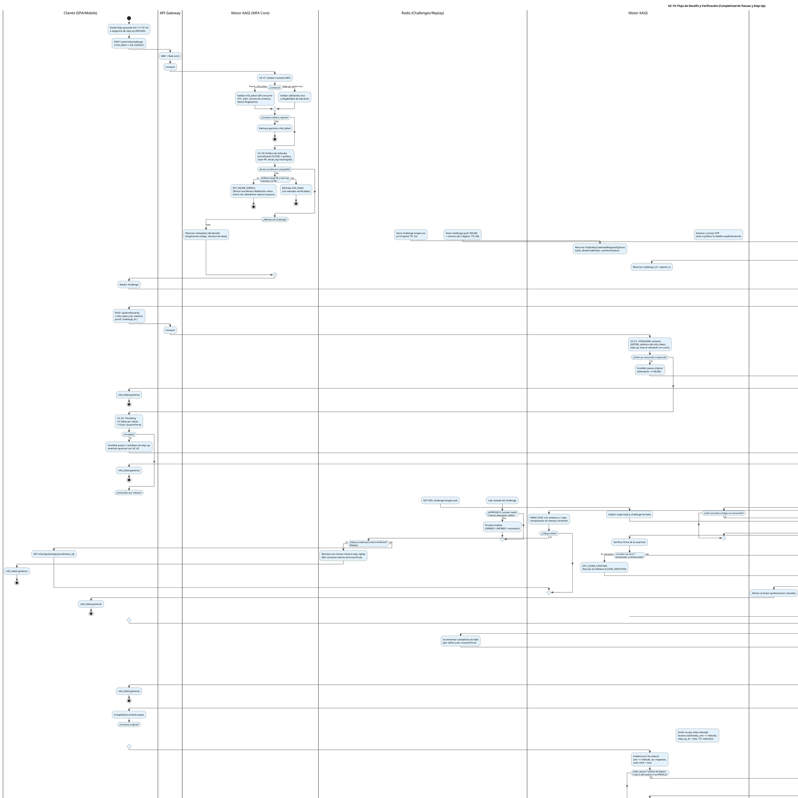
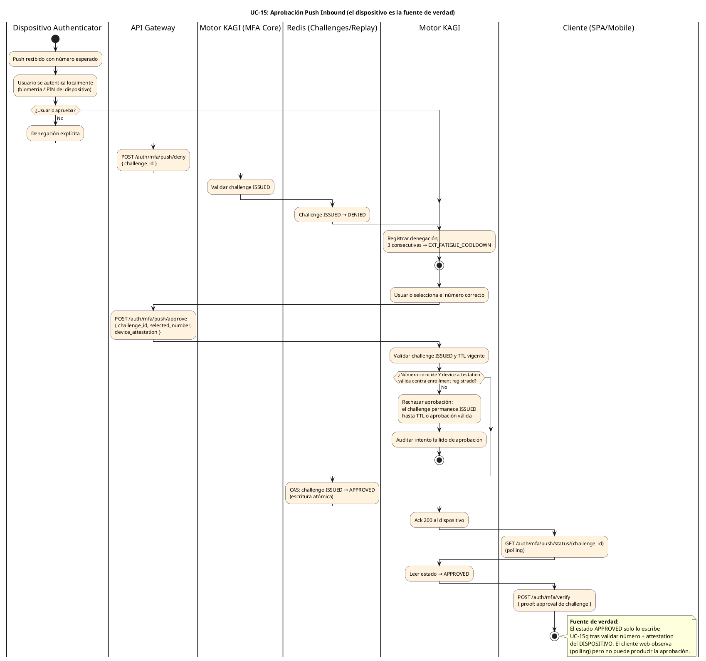
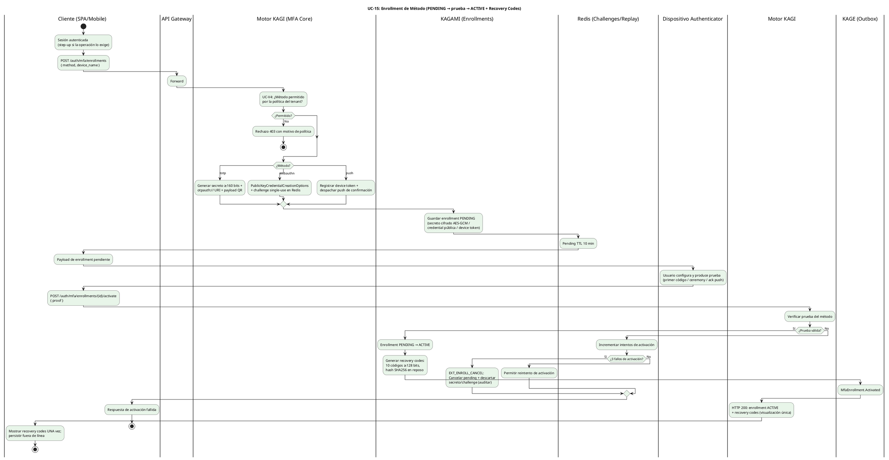

# UC-15: Multi-Factor Authentication (MFA) - Diagrama de Actividades

| Metadatos del Documento | |
| :--- | :--- |
| **Proyecto:** | SHUGO - Identity & Access Platform |
| **Caso de Uso:** | UC-15 - Multi-Factor Authentication (MFA - TOTP, WebAuthn/FIDO2, Push, Recovery) |
| **Documento:** | 03_Activity_Diagram.md |
| **Metodología:** | UML 2.5 + ICONIX + DDD + Security by Design (Evidence-Based Completion) |
| **Autor:** | Gastón Ruiz |
| **Versión Actual:** | 1.0.0 |
| **Fecha:** | 23/10/2026 |

---

## Historial de Versiones

| Versión | Fecha | Autor | Descripción de Cambios | Impacto |
| :--- | :--- | :--- | :--- | :--- |
| **1.0.0** | 23/10/2026 | Gastón Ruiz | **Creación inicial.** Diagramas de Actividades UML con carriles (swimlanes) para UC-15 en tres partes: (1) el flujo Challenge→Verify con consumo atómico del `mfa_token`, throttling pre-criptografía, los cinco verificadores por método con sus contenciones propias (replay TOTP, clonación WebAuthn, number matching push, single-use recovery) y la completitud context-aware que reanuda pausas de UC-11/13/14 o emite elevación de step-up; (2) el flujo inbound de aprobación push donde el dispositivo es la fuente de verdad; y (3) el flujo de enrollment con activación por prueba y generación de recovery codes. | Documento base del paquete de diseño Tier 1 del UC-15. Sirve como el "guion de ejecución" del MFA Core, fijando el orden throttling→verificación→replay-guard→completitud, la invalidez de pausa ante token reutilizado o throttling, y el mapa fail-secure por dependencia — de modo que ningún token elevado pueda existir sin que el camino completo de evidencia haya sido transitado. |

---

## 1. Introducción y Propósito

El **Diagrama de Actividades** para el UC-15 materializa la lógica de negocio y las reglas de seguridad definidas en la Especificación de Requisitos (01) y el Diagrama de Casos de Uso (02). Su propósito es:

1. **Fijar el Orden de los Controles:** Consumo atómico del `mfa_token` → throttling → verificación criptográfica → guardas anti-replay/anti-clonación → completitud. Este orden es una propiedad de seguridad: el throttling evalúa antes de gastar criptografía, y el replay guard escribe después de verificar.
2. **Modelar los Cinco Verificadores como Ramas con Contenciones Propias:** TOTP (replay por step), WebAuthn (counter monotónico con contención de clonación), Push (estado aprobado por el dispositivo), Recovery Code (single-use con consecuencias), y Email OTP (restringido).
3. **Distinguir la Completitud por Contexto:** El verify exitoso reanuda una pausa de login/refresh/federación **o** emite una elevación de step-up — dos actos distintos con la misma evidencia.
4. **Documentar los Flujos Asíncronos:** La aprobación push llega desde el dispositivo (inbound) y se observa por polling; el enrollment se activa por prueba con cancelación tras tres fallos.
5. **Dejar Explícito el Mapa Fail-Secure:** Qué ocurre cuando Redis, KAGAMI o el canal de push fallan en cada punto del flujo.

---

## 2. Diagrama de Actividades #1: Challenge → Verify (Completitud de Pausas y Step-Up)



---

## 3. Diagrama de Actividades #2: Aprobación Push Inbound (Dispositivo → KAGI)



---

## 4. Diagrama de Actividades #3: Enrollment con Activación por Prueba



---

## 5. Análisis de los Carriles (Swimlanes) y Responsabilidades

### 5.1. Diagrama #1 (Challenge → Verify)

1. **Cliente (SPA/Mobile):** Orquesta challenge→prueba→verify y el polling push; no produce evidencia propia: solo transporta la prueba del authenticator.
2. **API Gateway:** WAF y Rate Limit sobre la superficie pausada/anónima de MFA.
3. **Motor KAGI (MFA Core):** Único orquestador: validación de contexto (UC-V1), política de métodos (UC-V4), throttling (UC-V2), despacho a verificadores, contenciones, completitud context-aware y emisión de evidencia en tokens.
4. **Dispositivo Authenticator:** Produce la prueba fuera del perímetro; solo interactúa con el usuario y (en push) con el flujo inbound.
5. **Redis:** Challenges single-use, replay guards (`laststep`), contadores de throttling y estados de challenge push — todo efímero con TTL.
6. **KAGAMI:** Fuente de verdad durable: secretos TOTP cifrados, credentials WebAuthn con counter, códigos de recuperación hasheados, enrollments y trusted devices.
7. **Flujos Pausados (UC-11/13/14):** Receptores de la completitud: cada uno expone su acto de reanudación; KAGI aporta la evidencia.
8. **KAGE:** Auditoría inmutable de cada verificación con motivo interno.
9. **Notification Service:** Despacho de push y alertas al titular (clonación, recovery).

### 5.2. Diagrama #2 (Push Inbound)

Tres carriles esenciales: **Dispositivo Authenticator** (iniciador), **Motor KAGI** (validador de número + attestation) y **Redis** (estado del challenge). El Cliente aparece solo como observador (polling). La escritura `ISSUED → APPROVED` es CAS atómica: dos aprobaciones simultáneas no producen doble estado.

### 5.3. Diagrama #3 (Enrollment)

El ciclo completo de enrollado con activación por prueba: pending efímero (10 min), tres fallos → cancelación, y activación exitosa que **genera los recovery codes en el mismo acto** — el usuario nunca queda con un método activo sin break-glass.

---

## 6. Puntos Críticos de Seguridad en el Flujo

### 6.1. Consumo Atómico ANTES de Cualquier Verificación

El `GETDEL` del `mfa_token` ocurre en el primer paso del verify, antes del throttling y de cualquier criptografía.

*   **Justificación:** Dos verifies simultáneos con el mismo token → exactamente uno consume; el otro cae en `token_reuse` e **invalida la pausa original**. El sondeo iterativo con un token reciclado es imposible, y el costo de un verify duplicado es un rechazo barato, no una doble verificación.

### 6.2. Throttling Antes de Criptografía (Control Dual)

UC-V2 se evalúa antes de los verificadores de método:

*   **Seguridad:** El brute-force del espacio de 6 dígitos queda acotado a 5 intentos por pausa y 10 por usuario/hora.
*   **Capacidad:** Un flood de códigos o assertions basura no gasta HMAC-SHA1 ni verificaciones ECDSA — el throttling es también el control anti-DoS del MFA Core.

### 6.3. Replay TOTP como Clase Distinta de Brute-Force

El replay de un step ya aceptado se rechaza **sin consumir intento de brute-force** (no es una adivinanza: es reutilización), pero queda auditado como `totp_replay`. Dos replays consecutivos elevan alerta de posible sesión compartida o código observado. Esta distinción evita que un usuario legítimo que reenvía su código queme el umbral de seguridad.

### 6.4. Clonación WebAuthn como Camino Terminal de Contención

La regresión de counter con firma válida no es un fallo de verificación más: es un camino terminal propio que (a) revoca **solo el enrollment clonado** (los demás métodos del usuario sobreviven), (b) emite `MfaCloneDetected` como alerta SIEM crítica, y (c) notifica al titular. La actualización de counter ocurre únicamente en el camino exitoso.

### 6.5. Push: el Dispositivo Escribe, el Cliente Observa

El estado `APPROVED` solo puede escribirlo el flujo inbound (UC-15g) tras validar número y attestation del dispositivo registrado. El polling del cliente (UC-15f) es puramente observacional: un cliente web comprometido que mienta sobre la aprobación no tiene efecto, porque el verify exige el challenge en estado `APPROVED` escrito por el camino del dispositivo.

### 6.6. Invalidez de Pausa como Consecuencia de Abuso

Tres condiciones invalidan la pausa original (attempt/tx → FAILED): token reutilizado, throttling alcanzado, y abandono por expiración natural. Esto convierte al `mfa_token` en un recurso **finito y no reciclable**: el atacante que lo intercepta tiene una ventana de ≤5 min y ≤5 intentos, tras la cual el usuario legítimo simplemente re-inicia el flujo desde su contraseña.

### 6.7. Completitud Context-Aware sin Bifurcación de Evidencia

El mismo verify exitoso produce cuatro completitudes distintas (login, refresh, federación, step-up) seleccionadas por contexto, pero **una sola evidencia**: `amr += método`, `acr` mapeado y `auth_time` se graban en todos los casos. No existe un camino de emisión elevado que omita la evidencia del método.

### 6.8. Mapa Fail-Secure por Dependencia

| Fallo de Dependencia | Punto del Flujo | Comportamiento | Justificación |
| :--- | :--- | :--- | :--- |
| **Redis caído** (challenges/replay/throttle) | Challenge o verify | Rechazo fail-secure (sin replay guard no hay garantía anti-replay); la pausa **no** se invalida | Sin garantía anti-replay no se acepta evidencia; el usuario reintenta tras recuperación |
| **KAGAMI caído** | Lookup de enrollment | HTTP 503 fail-secure; pausa vigente | Sin fuente de verdad de enrollments no hay verificación posible |
| **Despacho push falla** | Challenge push | Challenge retorna `push_unavailable` + ofrece otros métodos del usuario | Un canal caído no bloquea al usuario si tiene métodos alternativos |
| **KAGAMI caído en update de counter** | Verify WebAuthn exitoso | Rechazar completitud (503) | Sin counter actualizado la próxima verificación no puede detectar clonación; mejor fallar que degradar la detección |
| **Notification caído** | Alertas de clonación/recovery | Completitud continúa; alerta encolada con retry (Outbox) | La evidencia ya está verificada; la notificación es consecuente, no bloqueante |

---

## 7. Trazabilidad con Otros Documentos del Paquete

| Documento | Relación |
| :--- | :--- |
| `01_Requirements_Specification.md` | Implementa visualmente los escenarios 2.1-2.2.5 y 4.1-4.10, las invariantes INV-97 a INV-104 y las reglas RN-32 a RN-35. |
| `02_Use_Case_Diagram.md` | Los carriles y switch por método materializan UC-15a/b/c/d/e/f/g, UC-V1 a UC-V4 y las extensiones EXT_INLINE/CANCEL/CLONE/FATIGUE/TRUST/REUSE/RECOV. |
| `04_Initial_Domain_Model.md` | Los verificadores por método se mapearán a `TotpVerifier`, `WebAuthnVerifier`, `PushVerifier`, `RecoveryCodeVerifier`; la completitud context-aware a `IPausedFlowResolver`. |
| `05_State_Machine_Diagram.md` | Las decisiones "¿token consumido?", "¿counter regression?", "¿challenge APPROVED?" son las guardas de las máquinas de `mfa_token`, `MfaEnrollment` y `MfaChallenge`. |
| `07_Sequence_Diagram.md` | Definirá el orden temporal exacto de los round-trips (KAGAMI lookup, Redis GETDEL, despacho push async, completitud del flujo pausado). |
| `10_UC_Specific_Data_Model.md` | Los keyspaces Redis (`mfa:challenge:*`, `mfa:totp:laststep:*`, `mfa:throttle:*`) y las tablas `mfa_enrollments`/`recovery_codes` soportan los carriles de este diagrama. |
| `11_UC_Specific_Security_Threats.md` | El orden throttling-pre-criptografía y las contenciones de replay/clonación/fatigue mitigan los ataques modelados allí. |
| `UC-11/UC-13/UC-14 (Docs 01-03)` | Los actos de completitud (`CompleteAuthentication`, `ResumeFromStepUp`, emisión federada elevada) son exactamente las transiciones de pausa definidas en esos paquetes. |

---

## 8. Notas de Implementación

### 8.1. Sintaxis PlantUML Moderna
- Sintaxis **Activity Diagram Beta** con carriles (`|Lane|`), `switch/case/endswitch` para el despacho por método, `if/then/else/endif` para guardas y `note right` para decisiones de seguridad.
- Tres diagramas separados porque tienen **actores iniciadores distintos**: el usuario (verify), el dispositivo authenticator (push inbound) y el usuario autenticado en sesión (enrollment).
- Bloques `<style>` con colores semánticos: azul para el flujo de verificación, naranja para el push inbound (flujo de dispositivo), verde para enrollment (operación de configuración).

### 8.2. Esqueleto del Despacho de Verificadores

```csharp
public async Task<MfaVerifyResult> VerifyAsync(MfaVerifyCommand cmd, CancellationToken ct)
{
    // 1. CONSUMO atómico del contexto (antes de todo)
    var context = await _contextStore.ConsumeAsync(cmd.MfaToken, _clock.UtcNow, ct);
    if (context is null)
    {
        await _pauseInvalidator.InvalidateAsync(cmd.MfaToken, InvalidateReason.TokenReuse, ct);
        return MfaVerifyResult.Fail(FailReason.TokenReuse);
    }

    // 2. THROTTLING antes de criptografía
    if (!await _throttle.TryAcquireAsync(context, ct))
    {
        await _pauseInvalidator.InvalidateAsync(cmd.MfaToken, InvalidateReason.Throttled, ct);
        return MfaVerifyResult.Fail(FailReason.Throttled);
    }

    // 3. VERIFICADOR por método (estrategia)
    var verifier = _verifiers[cmd.Method];
    var verification = await verifier.VerifyAsync(context, cmd.Proof, ct);

    if (!verification.Succeeded)
    {
        await _throttle.RecordFailureAsync(context, ct);
        if (verification.Reason == FailReason.ThresholdReached)
            await _pauseInvalidator.InvalidateAsync(cmd.MfaToken, InvalidateReason.Throttled, ct);
        return MfaVerifyResult.Fail(verification.Reason);   // colapso genérico en el boundary
    }

    // 4. COMPLETITUD context-aware con evidencia
    return await _completer.CompleteAsync(context, verification, ct);
}
```

### 8.3. Convenciones de Nomenclatura
- **Verificadores por método:** `TotpVerifier`, `WebAuthnVerifier`, `PushVerifier`, `RecoveryCodeVerifier`, `EmailOtpVerifier` (restringido) implementan `IMethodVerifier` con `VerifyAsync(context, proof, ct)`.
- **Motivos internos vs respuesta:** `FailReason.{TokenReuse, Throttled, InvalidCode, TotpReplay, Clone, PushMismatch, CodeConsumed}` viven en métricas/auditoría; el cliente siempre recibe `mfa_failed`.
- **Notas de seguridad:** Texto en negrita (**CONSUMIR**, **fuente de verdad**, **NO consume intento**) para resaltar decisiones de orden que no son evidentes en el flujo.

---
*Fin del Documento 03_Activity_Diagram para UC-15*