# UC-15: Multi-Factor Authentication (MFA) - Modelo de Dominio Inicial

| Metadatos del Documento | |
| :--- | :--- |
| **Proyecto:** | SHUGO - Identity & Access Platform |
| **Caso de Uso:** | UC-15 - Multi-Factor Authentication (MFA - TOTP, WebAuthn/FIDO2, Push, Recovery) |
| **Documento:** | 04_Initial_Domain_Model.md |
| **Metodología:** | ICONIX (Modelo de Análisis) + DDD (Domain-Driven Design) + Security by Design (Evidence-Based Completion) + Hexagonal Architecture |
| **Autor:** | Gastón Ruiz |
| **Versión Actual:** | 1.0.0 |
| **Fecha:** | 23/10/2026 |

---

## Historial de Versiones

| Versión | Fecha | Autor | Descripción de Cambios | Impacto |
| :--- | :--- | :--- | :--- | :--- |
| **1.0.0** | 23/10/2026 | Gastón Ruiz | **Creación inicial.** Definición del Modelo de Dominio Conceptual para el segundo factor. Introduce los Aggregate Roots `MfaEnrollment` (con credenciales específicas por método y detección de clonación como decisión de dominio) y `RecoveryCodeBatch` (break-glass con consumo single-use), la Entity efímera `MfaChallenge` (ISSUED→APPROVED/DENIED/EXPIRED con aprobación validada por número y attestation), los Value Objects `PausedFlowContext`, `MethodProof` (jerarquía sellada), `MfaPolicy` (snapshot de política), `AssuranceEvidence` y `TrustedDeviceCredential`, y los Domain Services `IMethodVerifier` (cinco estrategias), `MfaCompleter` (punto único de completitud), `MfaThrottle` (incluida push-fatigue), `EnrollmentManager` y `PushApprovalHandler`. | Documento base del paquete de diseño Tier 1 del UC-15. Establece cómo el dominio convierte pruebas heterogéneas (código, assertion firmada, aprobación push, código de recuperación) en una única `AssuranceEvidence` tipada, y cómo la completitud de pausas y la elevación de step-up viven en un solo servicio — haciendo imposible emitir tokens elevados sin evidencia de método. |

---

## 1. Introducción y Propósito

Este documento presenta el **Modelo de Dominio Inicial** para el Caso de Uso UC-15 (Multi-Factor Authentication).

El segundo factor impone tres desafíos de modelado que este documento resuelve:

1. **Heterogeneidad de pruebas, unicidad de evidencia:** Cinco métodos radicalmente distintos (código TOTP, assertion WebAuthn, aprobación push, código de recuperación, OTP de email) deben converger en un único objeto de evidencia (`AssuranceEvidence`) que la completitud consume. El dominio normaliza la prueba, nunca la completitud.
2. **El método es el adversario potencial:** Un enrollment no es solo un dato: un authenticator WebAuthn puede estar **clonado** (counter regression), una app push puede sufrir **fatiga inducida**, un secreto TOTP puede ser **interceptado**. El modelo trata cada enrollment como un sujeto con detecciones propias, no como una credencial pasiva.
3. **Cuatro completitudes, una evidencia:** Login pausado, refresh pausado, federación pausada y step-up en sesión viva se completan desde el mismo verify exitoso. El modelo centraliza la completitud en `MfaCompleter` con resolutores por tipo de pausa, preservando la dirección de dependencia: los flujos pausados exponen cómo completarse; UC-15 solo aporta la evidencia.

El modelo se centra en:
- **Enrollments como Aggregate Roots con detecciones de dominio:** La clonación WebAuthn es un resultado de método (`CounterCheck.CloneDetected`), no una excepción; el replay TOTP es una guarda explícita que no consume umbral de brute-force.
- **Challenges como Entities efímeras:** Con estado, TTL y transiciones CAS (la aprobación push la escribe el dispositivo, no el cliente).
- **Política como snapshot:** `MfaPolicy` viaja con el contexto de verificación; un cambio de política del tenant a mitad de un desafío no altera las reglas con las que ese desafío se verifica.
- **Secretos con disciplina de memoria:** El secreto TOTP en plaintext existe únicamente durante la verificación (`try/finally` con `Clear()`); en reposo vive cifrado AEAD.

---

## 2. Diagrama de Modelo de Dominio Conceptual (PlantUML)

```plantuml
@startuml UC-15_DominioConceptual
<style>
diagram {
  BackgroundColor #FFFFFF
}
</style>
skinparam classAttributeIconSize 0
skinparam classBackgroundColor #FFFFFF
skinparam classBorderColor #1565C0
skinparam classHeaderBackgroundColor #E3F2FD

title UC-15: Modelo de Dominio Conceptual - MFA (Evidencia Única, Métodos Heterogéneos)

' ============================================
' AGGREGATE ROOTS & ENTITIES
' ============================================
class MfaEnrollment <<Aggregate Root>> {
  - id: EnrollmentId
  - identityId: IdentityId
  - tenantId: TenantId
  - method: MfaMethod
  - status: EnrollmentStatus
  - totp: TotpCredential?
  - webAuthn: WebAuthnCredential?
  - push: PushDeviceInfo?
  - activationFailures: int
  - activatedAt: DateTime?
  - revokedAt: DateTime?
  - revocationReason: EnrollmentRevocationReason?

  + {static} CreatePending(tenant, identity, method, payload, now): MfaEnrollment
  + Activate(now): void
  + RecordActivationFailure(): void
  + ActivationExhausted: bool
  + Revoke(reason, now): void
  + RecordWebAuthnCounter(presented, now): CounterCheck
  + AssuranceClass: AssuranceClass
}

class RecoveryCodeBatch <<Aggregate Root>> {
  - id: BatchId
  - identityId: IdentityId
  - codes: List<RecoveryCode>
  - issuedAt: DateTime
  - supersededAt: DateTime?

  + {static} Generate(identity, tenant, entropy, now): RecoveryCodeBatch
  + TryConsume(presented, now): RecoveryConsumeResult
  + Remaining: int
  + Supersede(now): void
}

class MfaChallenge <<Entity (efímera, Redis)>> {
  - id: ChallengeId
  - context: PausedFlowContext
  - method: MfaMethod
  - status: ChallengeStatus
  - challengeValue: string
  - numberToMatch: int?
  - enrollmentId: EnrollmentId?
  - denialCount: int
  - expiresAt: DateTime

  + TryApprove(selectedNumber, attestationValid, now): ApprovalResult
  + RecordDenial(now): void
  + IsExpired(now): bool
}

enum MfaMethod {
  Totp
  WebAuthn
  Push
  EmailOtp
}

enum EnrollmentStatus {
  Pending
  Active
  Revoked
}

enum ChallengeStatus {
  Issued
  Approved
  Denied
  Expired
}

enum CounterCheck {
  Ok
  CloneDetected
  NotApplicable
}

enum AssuranceClass {
  PhishingResistant
  SomethingYouHave
  Restricted
}

' ============================================
' VALUE OBJECTS
' ============================================
class PausedFlowContext <<Value Object>> {
  - kind: PauseKind
  - originUc: string
  - referenceId: Guid
  - tenantId: TenantId
  - identityId: IdentityId
  - deviceFingerprint: string
  - createdAt: DateTime
  - expiresAt: DateTime
  + IsExpired(now): bool
}

enum PauseKind {
  LoginPause
  RefreshPause
  FederationPause
  StepUp
}

abstract class MethodProof <<sealed>> {
  + Method: MfaMethod
}

class TotpProof {
  + Code: string
}

class WebAuthnProof {
  + Assertion: PublicKeyAssertion
}

class PushProof {
  + ChallengeId: ChallengeId
}

class RecoveryProof {
  + Code: string
}

class EmailOtpProof {
  + Code: string
}

MethodProof <|-- TotpProof
MethodProof <|-- WebAuthnProof
MethodProof <|-- PushProof
MethodProof <|-- RecoveryProof
MethodProof <|-- EmailOtpProof

class MfaPolicy <<Value Object>> {
  + RequiredLevel: AssuranceLevel
  + RequirePhishingResistant: bool
  + EmailOtpAllowed: bool = false
  + TrustedDeviceBypassEnabled: bool = false
  + TrustedDeviceTtl: TimeSpan
  + StepUpFreshness: TimeSpan
  + TotpSkewSteps: int = 1
  + MaxAttemptsPerToken: int = 5
  + MaxAttemptsPerUserHour: int = 10
  + PushMaxChallengesPerWindow: int = 3
  + PushWindow: TimeSpan
  + PushCooldown: TimeSpan
}

class AssuranceEvidence <<Value Object>> {
  + Method: MfaMethod
  + AmrValue: string
  + ResultingLevel: AssuranceLevel
  + PhishingResistant: bool
  + AuthTime: DateTime
  + EnrollmentId: EnrollmentId
}

class TrustedDeviceCredential <<Value Object>> {
  + TokenId: string
  + IdentityId: IdentityId
  + DeviceFingerprint: string
  + ExpiresAt: DateTime
  + {static} Issue(identity, fingerprint, policy, now): TrustedDeviceCredential
}

class TotpCredential <<Value Object>> {
  + EncryptedSecret: string
  + Digits: int
  + PeriodSeconds: int
}
class WebAuthnCredential <<Value Object>> {
  + CredentialId: string
  + PublicKey: byte[]
  + SignCount: long
  + Attachment: string
  + UserVerification: string
  + WithSignCount(n): WebAuthnCredential
}
class PushDeviceInfo <<Value Object>> {
  + DeviceToken: string
  + DeviceName: string
  + DeviceFingerprint: string
}
class RecoveryCode <<Value Object>> {
  + Index: int
  + Hash: string
  + ConsumedAt: DateTime?
}

' ============================================
' DOMAIN SERVICES
' ============================================
interface IMethodVerifier <<Strategy>> {
  + Method: MfaMethod
  + VerifyAsync(context, proof, policy, ct): Task<MethodVerificationResult>
}
class TotpVerifier
class WebAuthnVerifier
class PushVerifier
class RecoveryCodeVerifier
class EmailOtpVerifier
IMethodVerifier <|.. TotpVerifier
IMethodVerifier <|.. WebAuthnVerifier
IMethodVerifier <|.. PushVerifier
IMethodVerifier <|.. RecoveryCodeVerifier
IMethodVerifier <|.. EmailOtpVerifier

class MfaCompleter <<Domain Service>> {
  - resolvers: IReadOnlyDictionary<PauseKind, IPausedFlowResolver>
  + CompleteAsync(context, evidence, policy, ct): Task<CompletionResult>
}

class MfaThrottle <<Domain Service>> {
  + TryAcquireAsync(context, policy, ct): Task<bool>
  + RecordFailureAsync(context, ct): Task
  + TryIssuePushChallengeAsync(deviceId, policy, ct): Task<PushIssueResult>
  + RecordPushDenialAsync(deviceId, policy, ct): Task
}

class EnrollmentManager <<Domain Service>> {
  + BeginAsync(identity, method, policy, ct): Task<EnrollmentPending>
  + ActivateAsync(id, proof, policy, ct): Task<ActivationResult>
  + RevokeAsync(id, reason, ct): Task
  + RegenerateRecoveryCodesAsync(identity, ct): Task<RecoveryCodeBatch>
}

class PushApprovalHandler <<Domain Service>> {
  + HandleApprovalAsync(cmd, ct): Task<PushApprovalResult>
  + HandleDenialAsync(cmd, ct): Task
}

class TrustedDeviceBroker <<Domain Service>> {
  + TryIssueAsync(context, evidence, policy, optIn, ct): Task<TrustedDeviceCredential?>
  + ValidateAsync(token, ct): Task<TrustedDeviceValidation>
}

enum VerificationStatus {
  Succeeded
  Failed
  CloneDetected
}

class MethodVerificationResult <<Value Object>> {
  + Status: VerificationStatus
  + Reason: FailReason?
  + Evidence: AssuranceEvidence?
}

' ============================================
' PUERTOS (Interfaces)
' ============================================
interface IMfaTokenStore {
  + ConsumeAsync(mfaToken, now, ct): Task<PausedFlowContext?>
}
interface IMfaChallengeStore {
  + SaveAsync(challenge, ct): Task
  + GetAsync(id, ct): Task<MfaChallenge?>
  + CompareAndSetStatusAsync(id, from, to, ct): Task<bool>
}
interface ITotpReplayGuard {
  + TryMarkAsync(enrollmentId, step, ct): Task<bool>
}
interface IMfaEnrollmentRepository {
  + FindActiveAsync(identity, method, ct): Task<MfaEnrollment?>
  + FindActiveAnyAsync(identity, ct): Task<IReadOnlyList<MfaEnrollment>>
  + SaveAsync(enrollment, ct): Task
}
interface IRecoveryCodeRepository {
  + HasActiveBatchAsync(identity, ct): Task<bool>
  + SaveAsync(batch, ct): Task
}
interface ICipher {
  + Encrypt(plaintext: SecretBytes): string
  + Decrypt(ciphertext: string): SecretBytes
}
interface IPushDispatcher {
  + DispatchAsync(enrollment, challenge, ct): Task<bool>
}
interface IPausedFlowResolver {
  + Kind: PauseKind
  + CompleteAsync(context, evidence, ct): Task<CompletionResult>
}

' ============================================
' RELACIONES
' ============================================
MfaEnrollment *-- TotpCredential
MfaEnrollment *-- WebAuthnCredential
MfaEnrollment *-- PushDeviceInfo
MfaEnrollment *-- AssuranceClass

RecoveryCodeBatch *-- RecoveryCode

MfaChallenge *-- PausedFlowContext
TotpVerifier --> MfaEnrollment : valida contra
TotpVerifier --> ITotpReplayGuard
WebAuthnVerifier --> MfaEnrollment : RecordWebAuthnCounter()
PushVerifier --> MfaChallenge : estado APPROVED
RecoveryCodeVerifier --> RecoveryCodeBatch : TryConsume()

MfaCompleter --> IPausedFlowResolver
MfaCompleter ..> AssuranceEvidence : consume
TrustedDeviceBroker ..> TrustedDeviceCredential

note right of MfaEnrollment
  **El método es adversario potencial:**
  CloneDetected es un RESULTADO de dominio
  (no excepción): revoca este enrollment,
  preserva los demás, alerta al titular.
end note

note bottom of MfaChallenge
  **El dispositivo escribe, el cliente observa:**
  APPROVED solo lo produce TryApprove()
  con número + attestation válidos,
  persistido por CAS en Redis.
end note

note left of MfaCompleter
  **Punto único de evidencia:**
  Cuatro completitudes (login/refresh/
  federación/step-up), una sola
  AssuranceEvidence.
end note

@enduml
```



---

## 3. Detalle de Conceptos de Dominio (DDD)

### 3.1. Aggregate Root: `MfaEnrollment`

Cada enrollment es un sujeto con ciclo de vida y **detecciones propias**. La credencial del método vive como sub-Value Object consistente con `Method`.

```csharp
public class MfaEnrollment : AggregateRoot
{
    public EnrollmentId Id { get; private set; }
    public IdentityId IdentityId { get; private set; }
    public TenantId TenantId { get; private set; }
    public MfaMethod Method { get; private set; }
    public EnrollmentStatus Status { get; private set; }
    public string? DeviceName { get; private set; }

    public TotpCredential? Totp { get; private set; }
    public WebAuthnCredential? WebAuthn { get; private set; }
    public PushDeviceInfo? Push { get; private set; }

    public DateTime CreatedAt { get; private set; }
    public DateTime? ActivatedAt { get; private set; }
    public int ActivationFailures { get; private set; }
    public DateTime? RevokedAt { get; private set; }
    public EnrollmentRevocationReason? RevocationReason { get; private set; }

    private MfaEnrollment() { }

    public static MfaEnrollment CreatePending(
        TenantId tenant, IdentityId identity, MfaMethod method,
        EnrollmentPayload payload, DateTime now)
    {
        var e = new MfaEnrollment
        {
            Id = new EnrollmentId(Guid.NewGuid()),
            TenantId = tenant,
            IdentityId = identity,
            Method = method,
            Status = EnrollmentStatus.Pending,
            DeviceName = payload.DeviceName,
            CreatedAt = now
        };
        // El payload se asigna según método; el secreto TOTP ya llega CIFRADO (ICipher)
        e.AssignPayload(payload);
        return e;
    }

    public void Activate(DateTime now)
    {
        if (Status != EnrollmentStatus.Pending)
            throw new DomainException($"Cannot activate enrollment in status {Status}.");
        Status = EnrollmentStatus.Active;
        ActivatedAt = now;
    }

    public void RecordActivationFailure() => ActivationFailures++;
    public bool ActivationExhausted => ActivationFailures >= 3;   // RN-33

    public void Revoke(EnrollmentRevocationReason reason, DateTime now)
    {
        if (Status == EnrollmentStatus.Revoked) return;            // idempotente
        Status = EnrollmentStatus.Revoked;
        RevokedAt = now;
        RevocationReason = reason;
    }

    /// <summary>
    /// INV-99: detección de clonación como DECISIÓN DE DOMINIO.
    /// Counter no-cero debe ser estrictamente creciente.
    /// </summary>
    public CounterCheck RecordWebAuthnCounter(long presented, DateTime now)
    {
        if (Method != MfaMethod.WebAuthn || WebAuthn is null)
            throw new DomainException("Counter applies only to WebAuthn enrollments.");

        if (presented == 0)
            return CounterCheck.NotApplicable;   // authenticators sin counter (ej. algunos platform)

        if (presented <= WebAuthn.SignCount)
            return CounterCheck.CloneDetected;   // firma válida + counter no creciente = clon

        WebAuthn = WebAuthn.WithSignCount(presented);
        return CounterCheck.Ok;
    }

    public AssuranceClass AssuranceClass => Method switch
    {
        MfaMethod.WebAuthn => AssuranceClass.PhishingResistant,   // INV-100
        MfaMethod.Totp     => AssuranceClass.SomethingYouHave,
        MfaMethod.Push     => AssuranceClass.SomethingYouHave,
        MfaMethod.EmailOtp => AssuranceClass.Restricted,
        _ => throw new InvalidOperationException()
    };
}
```

### 3.2. Aggregate Root: `RecoveryCodeBatch` (Break-Glass)

```csharp
public class RecoveryCodeBatch : AggregateRoot
{
    public const int BatchSize = 10;
    public const int MinEntropyBits = 128;

    public BatchId Id { get; private set; }
    public IdentityId IdentityId { get; private set; }
    private readonly List<RecoveryCode> _codes = new();
    public DateTime IssuedAt { get; private set; }
    public DateTime? SupersededAt { get; private set; }

    public IReadOnlyList<RecoveryCode> Codes => _codes.AsReadOnly();
    public int Remaining => _codes.Count(c => c.ConsumedAt is null);

    /// <summary>
    /// Genera el lote con ≥128 bits de entropía por código; retorna los valores
    /// en plaintext UNA vez (para visualización) y persiste solo hashes SHA256.
    /// </summary>
    public static (RecoveryCodeBatch Batch, IReadOnlyList<string> PlaintextOnce) Generate(
        IdentityId identity, ICryptographicRandom random, DateTime now)
    {
        var batch = new RecoveryCodeBatch { Id = new BatchId(Guid.NewGuid()), IdentityId = identity, IssuedAt = now };
        var plaintext = new List<string>(BatchSize);

        for (var i = 0; i < BatchSize; i++)
        {
            var code = random.GenerateBase32(MinEntropyBits);
            plaintext.Add(code);
            batch._codes.Add(new RecoveryCode(i, Sha256(code), null));
        }
        return (batch, plaintext);
    }

    /// <summary>INV-102: consumo single-use con comparación en tiempo constante.</summary>
    public RecoveryConsumeResult TryConsume(string presented, DateTime now)
    {
        if (SupersededAt is not null) return RecoveryConsumeResult.BatchSuperseded;

        var hash = Sha256(presented);
        var match = _codes.FirstOrDefault(c =>
            c.ConsumedAt is null &&
            CryptographicOperations.FixedTimeEquals(c.Hash, hash));

        if (match is null) return RecoveryConsumeResult.NoMatch;

        _codes[_codes.IndexOf(match)] = match.Consume(now);
        return RecoveryConsumeResult.Consumed(match.Index);
    }

    public void Supersede(DateTime now) => SupersededAt = now;
}
```

### 3.3. Entity Efímera: `MfaChallenge`

```csharp
public class MfaChallenge : Entity
{
    public ChallengeId Id { get; private set; }
    public PausedFlowContext Context { get; private set; }
    public MfaMethod Method { get; private set; }
    public ChallengeStatus Status { get; private set; }
    public string ChallengeValue { get; private set; }      // WebAuthn challenge / binding push
    public int? NumberToMatch { get; private set; }         // Push: number matching
    public EnrollmentId? EnrollmentId { get; private set; } // Push: dispositivo destino
    public int DenialCount { get; private set; }
    public DateTime ExpiresAt { get; private set; }

    public bool IsExpired(DateTime now) => now >= ExpiresAt;

    /// <summary>
    /// La aprobación SOLO ocurre con número coincidente y attestation válida.
    /// El resultado es un enum, no una excepción: el dispositivo es la fuente de verdad.
    /// </summary>
    public ApprovalResult TryApprove(int? selectedNumber, bool attestationValid, DateTime now)
    {
        if (IsExpired(now))               return ApprovalResult.Expired;
        if (Status != ChallengeStatus.Issued) return ApprovalResult.AlreadyResolved;
        if (!attestationValid)            return ApprovalResult.AttestationInvalid;
        if (NumberToMatch.HasValue && selectedNumber != NumberToMatch)
            return ApprovalResult.NumberMismatch;

        Status = ChallengeStatus.Approved;
        return ApprovalResult.Approved;
    }

    public void RecordDenial(DateTime now)
    {
        if (IsExpired(now) || Status != ChallengeStatus.Issued) return;
        DenialCount++;
        Status = ChallengeStatus.Denied;
    }
}
```

### 3.4. Value Objects de Contexto y Evidencia

```csharp
/// <summary>El contexto que el mfa_token porta; inmutable y con expiración propia.</summary>
public sealed record PausedFlowContext(
    PauseKind Kind,                 // LoginPause | RefreshPause | FederationPause | StepUp
    string OriginUc,                // "UC-11" | "UC-13" | "UC-14" | "KIZUNA"
    Guid ReferenceId,               // attemptId | txId | familyRootId(sid)
    TenantId TenantId,
    IdentityId IdentityId,
    string DeviceFingerprint,       // binding del dispositivo de origen (INV-97)
    DateTime CreatedAt,
    DateTime ExpiresAt)
{
    public bool IsExpired(DateTime now) => now >= ExpiresAt;
}

/// <summary>Jerarquía sellada: el compilador garantiza el manejo de cada método.</summary>
public abstract record MethodProof(MfaMethod Method);
public sealed record TotpProof(string Code) : MethodProof(MfaMethod.Totp);
public sealed record WebAuthnProof(PublicKeyAssertion Assertion) : MethodProof(MfaMethod.WebAuthn);
public sealed record PushProof(ChallengeId ChallengeId) : MethodProof(MfaMethod.Push);
public sealed record RecoveryProof(string Code) : MethodProof(MfaMethod.Recovery);
public sealed record EmailOtpProof(string Code) : MethodProof(MfaMethod.EmailOtp);

/// <summary>La ÚNICA salida de evidencia que la completitud consume.</summary>
public sealed record AssuranceEvidence(
    MfaMethod Method,
    string AmrValue,               // "otp" | "hwk" | "push" | "otk"
    AssuranceLevel ResultingLevel, // AAL2 | AAL3 (webauthn hardware + uv)
    bool PhishingResistant,
    DateTime AuthTime,
    EnrollmentId EnrollmentId);

/// <summary>Política como snapshot: invariante durante todo el desafío/verificación.</summary>
public sealed class MfaPolicy : ValueObject
{
    public AssuranceLevel RequiredLevel { get; }
    public bool RequirePhishingResistant { get; }
    public bool EmailOtpAllowed { get; }              // default false
    public bool TrustedDeviceBypassEnabled { get; }   // default false
    public TimeSpan TrustedDeviceTtl { get; }
    public TimeSpan StepUpFreshness { get; }
    public int TotpSkewSteps { get; }                 // default 1 (±1)
    public int MaxAttemptsPerToken { get; }           // default 5
    public int MaxAttemptsPerUserHour { get; }        // default 10
    public int PushMaxChallengesPerWindow { get; }    // default 3
    public TimeSpan PushWindow { get; }               // 10 min
    public TimeSpan PushCooldown { get; }             // 30 min

    public MfaPolicy(/* ... */)
    {
        // Guardas de sanidad: PR implica sin bypass; skew acotado; umbrales ≥1
        if (RequirePhishingResistant && TrustedDeviceBypassEnabled)
            throw new DomainException("Phishing-resistant policy cannot enable trusted-device bypass.");
        if (TotpSkewSteps is < 0 or > 1)
            throw new DomainException("TOTP skew must be 0 or 1 step.");
        // ... asignaciones ...
    }

    /// <summary>RN-32: métodos verificables = intersección con policy.</summary>
    public bool IsVerifiable(MfaEnrollment enrollment) =>
        enrollment.Status == EnrollmentStatus.Active &&
        enrollment.Method switch
        {
            MfaMethod.WebAuthn => true,
            MfaMethod.EmailOtp => EmailOtpAllowed && !RequirePhishingResistant,
            _ => !RequirePhishingResistant
        };
}
```

### 3.5. Domain Services

#### **Estrategia de Verificadores (`IMethodVerifier`)**

```csharp
public interface IMethodVerifier
{
    MfaMethod Method { get; }
    Task<MethodVerificationResult> VerifyAsync(
        PausedFlowContext context, MethodProof proof, MfaPolicy policy, CancellationToken ct);
}

public class TotpVerifier : IMethodVerifier
{
    private readonly IMfaEnrollmentRepository _enrollments;
    private readonly ITotpReplayGuard _replay;
    private readonly ICipher _cipher;
    private readonly IClock _clock;

    public MfaMethod Method => MfaMethod.Totp;

    public async Task<MethodVerificationResult> VerifyAsync(
        PausedFlowContext context, MethodProof proof, MfaPolicy policy, CancellationToken ct)
    {
        var p = (TotpProof)proof;
        var enrollment = await _enrollments.FindActiveAsync(context.IdentityId, MfaMethod.Totp, ct);
        if (enrollment?.Totp is null)
            return MethodVerificationResult.Failed(FailReason.NoEnrollment);

        // El plaintext vive SOLO durante esta verificación
        var secret = _cipher.Decrypt(enrollment.Totp.EncryptedSecret);
        try
        {
            var currentStep = Totp.TimeStep(_clock.UtcNow, enrollment.Totp.PeriodSeconds);
            var window = Enumerable.Range(-policy.TotpSkewSteps, 2 * policy.TotpSkewSteps + 1);

            foreach (var offset in window)
            {
                var step = currentStep + offset;
                var expected = Totp.Compute(secret, step, enrollment.Totp.Digits);

                if (CryptographicOperations.FixedTimeEquals(expected, p.Code))
                {
                    // INV-98: replay guard POST-verificación; si falla, NO consume intento
                    if (!await _replay.TryMarkAsync(enrollment.Id, step, ct))
                        return MethodVerificationResult.Failed(FailReason.TotpReplay);

                    return MethodVerificationResult.Succeeded(new AssuranceEvidence(
                        MfaMethod.Totp, "otp", AssuranceLevel.AAL2,
                        PhishingResistant: false, AuthTime: _clock.UtcNow, enrollment.Id));
                }
            }
            return MethodVerificationResult.Failed(FailReason.InvalidCode);
        }
        finally
        {
            secret.Clear();   // disciplina de memoria
        }
    }
}

public class WebAuthnVerifier : IMethodVerifier
{
    public async Task<MethodVerificationResult> VerifyAsync(/* ... */)
    {
        // 1. Challenge single-use + origin/rpId binding
        // 2. Firma de la assertion contra WebAuthn.PublicKey
        // 3. Counter check como decisión de dominio
        var check = enrollment.RecordWebAuthnCounter(p.Assertion.SignCount, _clock.UtcNow);

        switch (check)
        {
            case CounterCheck.CloneDetected:
                enrollment.Revoke(EnrollmentRevocationReason.CloneDetected, _clock.UtcNow);
                await _enrollments.SaveAsync(enrollment, ct);
                await _outbox.PublishAsync(new MfaCloneDetected(
                    enrollment.IdentityId, enrollment.Id,
                    enrollment.WebAuthn!.SignCount, p.Assertion.SignCount, _clock.UtcNow), ct);
                return MethodVerificationResult.Cloned();

            case CounterCheck.Ok:
            case CounterCheck.NotApplicable:
                await _enrollments.SaveAsync(enrollment, ct);   // counter actualizado
                return MethodVerificationResult.Succeeded(EvidenceFor(enrollment));
        }
    }
}
```

#### **MfaCompleter (Punto Único de Completitud)**

```csharp
public class MfaCompleter : IMfaCompleter
{
    private readonly IReadOnlyDictionary<PauseKind, IPausedFlowResolver> _resolvers;
    private readonly ITrustedDeviceBroker _trusted;

    public MfaCompleter(IEnumerable<IPausedFlowResolver> resolvers, ITrustedDeviceBroker trusted)
    {
        _resolvers = resolvers.ToDictionary(r => r.Kind);
        _trusted = trusted;
    }

    public async Task<CompletionResult> CompleteAsync(
        PausedFlowContext context, AssuranceEvidence evidence,
        MfaPolicy policy, bool trustedOptIn, CancellationToken ct)
    {
        // Invariante estructural: toda pausa debe tener su resolutor
        var resolver = _resolvers[context.Kind];
        var result = await resolver.CompleteAsync(context, evidence, ct);

        // Trusted device: solo login pause + política + opt-in + nunca PR/AAL3 (INV-104)
        if (context.Kind == PauseKind.LoginPause && policy.TrustedDeviceBypassEnabled &&
            trustedOptIn && !policy.RequirePhishingResistant &&
            evidence.ResultingLevel.Value != "AAL3")
        {
            result = result.WithTrustedDevice(
                await _trusted.TryIssueAsync(context, evidence, policy, trustedOptIn, ct));
        }

        return result;
    }
}
```

#### **MfaThrottle (incluida Push-Fatigue)**

```csharp
public class MfaThrottle : IMfaThrottle
{
    public async Task<bool> TryAcquireAsync(PausedFlowContext context, MfaPolicy policy, CancellationToken ct)
    {
        // INV-101: dos dimensiones de throttling
        var perToken = await _store.GetFailuresAsync(context.ReferenceId, ct);
        var perUser = await _store.GetUserHourFailuresAsync(context.IdentityId, ct);
        return perToken < policy.MaxAttemptsPerToken && perUser < policy.MaxAttemptsPerUserHour;
    }

    public async Task<PushIssueResult> TryIssuePushChallengeAsync(
        string deviceId, MfaPolicy policy, CancellationToken ct)
    {
        // RN-34: 3 challenges por ventana de 10 min; exceso → cooldown 30 min
        var count = await _store.GetPushChallengesAsync(deviceId, policy.PushWindow, ct);
        if (count >= policy.PushMaxChallengesPerWindow)
        {
            await _store.SetPushCooldownAsync(deviceId, policy.PushCooldown, ct);
            await _outbox.PublishAsync(new MfaPushFatigueSuspected(deviceId, count, _clock.UtcNow), ct);
            return PushIssueResult.Cooldown(policy.PushCooldown);
        }
        await _store.IncrementPushChallengesAsync(deviceId, policy.PushWindow, ct);
        return PushIssueResult.Allowed();
    }
}
```

### 3.6. Eventos de Dominio

| Evento | Disparador | Consumidores |
| :--- | :--- | :--- |
| `MfaVerification.Succeeded` | Verify exitoso (cualquier método) | KAGE, UC-17 (baseline), métricas de adopción |
| `MfaVerification.Failed` | Fallo con motivo interno (invalid_code, totp_replay, token_reuse, throttled, clone, denied, expired) | KAGE, SIEM, UC-42 (interlock opcional) |
| `MfaCloneDetected` | Counter regression con firma válida | SIEM (crítica), KAGE, Notification |
| `MfaEnrollment.Activated` / `.Revoked` | Ciclo de vida del enrollment | KAGE, UC-22 (gestión de dispositivos) |
| `MfaStepUp.Completed` | Elevación en sesión viva | KIZUNA, KAGE |
| `MfaRecovery.Used` | Consumo de recovery code | KAGE, Notification, flag `mfa_review_required` |
| `MfaPushFatigueSuspected` | Cooldown por rate o 3 denegaciones | SIEM, UC-17 |

---

## 4. Decisiones de Diseño DDD (ADR)

### 4.1. ¿Por qué `MfaEnrollment` unifica credenciales de métodos distintos?

**Decisión:** Un único Aggregate con sub-VOs (`TotpCredential`, `WebAuthnCredential`, `PushDeviceInfo`) consistentes con `Method`.

**Justificación:**
- **Ciclo de vida común:** Todos los métodos comparten PENDING→ACTIVE→REVOKED, activación por prueba y revocación auditable. Modelarlos como AR separados cuadruplicaría el estado.
- **Detecciones donde viven:** La clonación es específica de WebAuthn, pero la **decisión** (revocar este enrollment, preservar otros, alertar) es del enrollment, no del verificador.
- **La heterogeneidad de persistencia es detalle de infraestructura:** El repositorio decide cómo mapear los sub-VOs (columnas, JSON, tablas); el dominio permanece unificado.

### 4.2. ¿Por qué la clonación es un resultado y no una excepción?

**Decisión:** `RecordWebAuthnCounter` retorna `CounterCheck.{Ok, CloneDetected, NotApplicable}`.

**Justificación:** Una excepción sugeriría un fallo de procesamiento; la clonación es una **determinación de seguridad** con consecuencias orquestadas (revocación selectiva + evento + notificación). El verificador trata `CloneDetected` como camino terminal de contención, no como error a propagar — coherente con el Diagrama de Actividades §6.4.

### 4.3. ¿Por qué el replay TOTP no consume intento de brute-force?

**Decisión:** `FailReason.TotpReplay` se emite sin incrementar contadores de throttling.

**Justificación:** Un replay indica **reutilización de un código válido observado**, no adivinanza: tratarlo como intento de brute-force quemaría el umbral de un usuario legítimo que reenvió su código (ej. doble-submit por latencia). La señal de seguridad correcta es la auditoría del replay y la alerta tras replays consecutivos, no el throttling.

### 4.4. ¿Por qué `RecoveryCodeBatch` es un Aggregate independiente del enrollment?

**Decisión:** El break-glass se modela por **identidad**, no por método.

**Justificación:** Si el usuario pierde el dispositivo TOTP *y* la llave WebAuthn, necesita un break-glass que no dependa de ningún enrollment particular. El lote se genera en la primera activación (Diagrama #3), se regenera completo (el anterior queda `Superseded`), y su consumo dispara consecuencias a nivel de identidad (`mfa_review_required`).

### 4.5. ¿Por qué `MfaChallenge` es Entity persistida en Redis?

**Decisión:** Estado con transiciones (ISSUED→APPROVED/DENIED/EXPIRED), identidad (`ChallengeId`) y TTL natural, persistido vía `IMfaChallengeStore` con `CompareAndSetStatusAsync`.

**Justificación:** La aprobación push es asíncrona y concurrente: el dispositivo aprueba mientras el cliente pollea. El CAS previene que una aprobación tardía y una denegación explícita se contradigan, y el TTL (60s push / 5m webauthn) elimina challenges colgados sin jobs de limpieza.

### 4.6. ¿Por qué `MfaPolicy` es un snapshot y no una referencia viva?

**Decisión:** La política se captura al emitir el `mfa_token`/challenge y viaja con el contexto.

**Justificación:** Un admin que cambia umbrales o habilita `email_otp` durante un desafío en curso no puede alterar las reglas con las que ese desafío se verifica — la misma garantía que el snapshot de conexión federada de UC-14. Las guardas del constructor (PR incompatible con bypass, skew ≤1) hacen ilegales las políticas peligrosas al nacer.

### 4.7. ¿Por qué la completitud vive en `MfaCompleter` y no en cada verificador?

**Decisión:** Los verificadores producen `AssuranceEvidence`; solo `MfaCompleter` reanuda pausas o emite elevaciones.

**Justificación:** Centraliza la invariante "no existe token elevado sin evidencia" en un único punto, y hace que los flujos pausados (UC-11/13/14) expongan sus resolutores como puertos (`IPausedFlowResolver`) — la dirección de dependencia apunta hacia el dominio de UC-15, no al revés.

### 4.8. ¿Por qué el secreto TOTP se cifra en reposo y se limpia en memoria?

**Decisión:** `TotpCredential.EncryptedSecret` (AES-256-GCM vía `ICipher` con clave KMS); el plaintext solo existe dentro del `try/finally` de `TotpVerifier`.

**Justificación:** Un dump de base de datos o de memoria no debe entregar secretos TOTP utilizables: el dump de DB entrega ciphertext; el dump de memoria tiene una ventana de microsegundos por verificación, no secretos persistentes.

---

## 5. Trazabilidad

| Documento | Relación |
| :--- | :--- |
| `01_Requirements_Specification.md` | Implementa INV-97 (PausedFlowContext binding), INV-98 (replay guard), INV-99 (CounterCheck), INV-100 (AssuranceClass), INV-101 (MfaThrottle), INV-102 (RecoveryCodeBatch), INV-103 (AssuranceEvidence), INV-104 (TrustedDeviceBroker), RN-32 a RN-35 (MfaPolicy, EnrollmentManager, MfaChallenge). |
| `02_Use_Case_Diagram.md` | `IMethodVerifier` materializa UC-15b/UC-V3; `MfaCompleter` materializa el Punto Único de Completitud; `PushApprovalHandler` materializa UC-15g; `EnrollmentManager` materializa UC-15d/UC-15e. |
| `03_Activity_Diagram.md` | El orden consumo→throttling→verificación→completitud corresponde a `VerifyAsync` del orquestador (doc 06); los switch por método se implementan como estrategias `IMethodVerifier`. |
| `05_State_Machine_Diagram.md` | `Activate/Revoke`, `TryApprove/RecordDenial` y el consumo del mfa_token son las transiciones de las máquinas de `MfaEnrollment`, `MfaChallenge` y `mfa_token`. |
| `08_Final_Class_Design.md` | Refinará el orquestador `MfaHandler` (challenge/verify/stepup) y las firmas completas con `CancellationToken` y resultados tipados. |
| `10_UC_Specific_Data_Model.md` | `mfa_enrollments`, `recovery_codes`, trusted devices y keyspaces Redis (`mfa:challenge:*`, `mfa:totp:laststep:*`, `mfa:throttle:*`) persisten estos conceptos. |
| `11_UC_Specific_Security_Threats.md` | Las detecciones de dominio (CloneDetected, TotpReplay, fatigue) son las señales que el threat model convierte en amenazas mitigadas. |

---

## 6. Notas para la Implementación

### 6.1. Ubicación en Clean Architecture

- **Dominio (`SHUGO.Domain.Mfa`):** `MfaEnrollment`, `RecoveryCodeBatch`, `MfaChallenge`, todos los VOs, `MfaPolicy`, `AssuranceEvidence`, los cinco `IMethodVerifier`, `MfaCompleter`, `MfaThrottle`, `EnrollmentManager`, `PushApprovalHandler`, `TrustedDeviceBroker` y los puertos.
- **Infraestructura:** `RedisMfaChallengeStore` (CAS), `RedisTotpReplayGuard` (SET NX por step), `RedisMfaThrottleStore`, `KagamiMfaEnrollmentRepository` (EF Core), `KmsAesCipher`, `FcmApnsPushDispatcher`.
- **Resolutores de pausa:** `LoginPauseResolver` (UC-11), `RefreshPauseResolver` (UC-13), `FederationPauseResolver` (UC-14), `StepUpResolver` (KIZUNA) — cada uno en su contexto de origen, registrados por `PauseKind`.

### 6.2. Testeo Unitario (Invariantes de MFA)

```csharp
[Test]
public void WebAuthnEnrollment_CounterRegression_ReturnsCloneDetected_AndRevokes()
{
    var enrollment = ActiveWebAuthnEnrollment(signCount: 42);
    var check = enrollment.RecordWebAuthnCounter(presented: 42, Now);
    check.Should().Be(CounterCheck.CloneDetected);
    // La revocación la orquesta el verificador; el enrollment expone la determinación.
}

[Test]
public async Task TotpVerifier_ReplayedStep_FailsWithoutConsumingBruteForceAttempt()
{
    ReplayGuard.Setup(g => g.TryMarkAsync(It.IsAny<EnrollmentId>(), It.IsAny<long>(), It.IsAny<CancellationToken>()))
               .ReturnsAsync(false);   // step ya usado

    var result = await Verifier.VerifyAsync(Context, new TotpProof(ValidCode), Policy, CT);

    result.Status.Should().Be(VerificationStatus.Failed);
    result.Reason.Should().Be(FailReason.TotpReplay);
    Throttle.Verify(t => t.RecordFailureAsync(It.IsAny<PausedFlowContext>(), It.IsAny<CancellationToken>()), Times.Never);
}

[Test]
public void MfaPolicy_PhishingResistant_WithTrustedBypass_ThrowsOnConstruction()
{
    var act = () => new MfaPolicy(requirePhishingResistant: true, trustedDeviceBypassEnabled: true /* ... */);
    act.Should().Throw<DomainException>();   // INV-104 por construcción
}

[Test]
public void Policy_IsVerifiable_BlocksTotp_WhenRequirePhishingResistant()
{
    var policy = PolicyWith(requirePhishingResistant: true);
    policy.IsVerifiable(ActiveTotpEnrollment).Should().BeFalse();
    policy.IsVerifiable(ActiveWebAuthnEnrollment).Should().BeTrue();
}

[Test]
public async Task PushThrottle_FourthChallengeInWindow_EntersCooldown_AndEmitsFatigueEvent()
{
    for (var i = 0; i < 3; i++) await Throttle.TryIssuePushChallengeAsync("dev-7", Policy, CT);
    var fourth = await Throttle.TryIssuePushChallengeAsync("dev-7", Policy, CT);
    fourth.Should().Be(PushIssueResult.Cooldown(TimeSpan.FromMinutes(30)));
    Outbox.VerifyPublished<MfaPushFatigueSuspected>(Times.Once);
}

[Test]
public void RecoveryBatch_ConsumeTwice_SecondFails_AndSupersededBatchAlwaysFails()
{
    var (batch, plain) = RecoveryCodeBatch.Generate(Identity, Random, Now);
    batch.TryConsume(plain[3], Now).Should().Be(RecoveryConsumeResult.Consumed(3));
    batch.TryConsume(plain[3], Now).Should().Be(RecoveryConsumeResult.NoMatch);

    batch.Supersede(Now);
    batch.TryConsume(plain[4], Now).Should().Be(RecoveryConsumeResult.BatchSuperseded);
}

[Test]
public void MfaCompleter_HasResolverFor_EveryPauseKind()
{
    // Invariante estructural: toda pausa tiene su resolutor
    Enum.GetValues<PauseKind>().Should().AllSatisfy(k => Completer.HasResolverFor(k).Should().BeTrue());
}

[Test]
public void Challenge_Approve_WithWrongNumber_DoesNotTransition()
{
    var challenge = PushChallenge(numberToMatch: 42);
    var result = challenge.TryApprove(selectedNumber: 17, attestationValid: true, Now);
    result.Should().Be(ApprovalResult.NumberMismatch);
    challenge.Status.Should().Be(ChallengeStatus.Issued);   // sigue esperando aprobación válida
}
```

---

## 7. Glosario de Términos Específicos de UC-15

| Término | Definición |
| :--- | :--- |
| **AssuranceEvidence** | Único objeto de evidencia que produce una verificación exitosa: método, valor amr, nivel resultante, clase de resistencia y auth_time. La completitud consume evidencia, nunca pruebas crudas. |
| **CounterCheck** | Determinación de dominio del signature counter WebAuthn: Ok, CloneDetected o NotApplicable (authenticators sin counter). No es una excepción: es un veredicto. |
| **Replay Guard (TOTP)** | Registro del último step aceptado por enrollment; un código del mismo step se rechaza sin consumir intento de brute-force. |
| **PausedFlowContext** | Contexto inmutable que porta el mfa_token: tipo de pausa, UC de origen, referencia, identidad y fingerprint del dispositivo de origen. |
| **MethodProof** | Jerarquía sellada de pruebas por método; el compilador obliga a manejar cada método en los switch de verificación. |
| **MfaChallenge** | Entity efímera con estado (ISSUED/APPROVED/DENIED/EXPIRED) y TTL; la aprobación push solo la produce TryApprove con número + attestation válidos, persistida por CAS. |
| **RecoveryCodeBatch** | Lote break-glass por identidad (10 códigos, ≥128 bits, hashes SHA256); la regeneración supersede el lote anterior completo. |
| **MfaCompleter** | Punto único donde la evidencia se convierte en completitud: reanuda pausas (UC-11/13/14) o emite elevaciones (step-up) mediante resolutores por PauseKind. |
| **AssuranceClass** | Clasificación del enrollment: PhishingResistant (webauthn), SomethingYouHave (totp/push), Restricted (email_otp). |
| **PushIssueResult** | Resultado del rate limit de push: Allowed o Cooldown con duración; el cooldown emite MfaPushFatigueSuspected. |

---
*Fin del Documento 04_Initial_Domain_Model para UC-15*