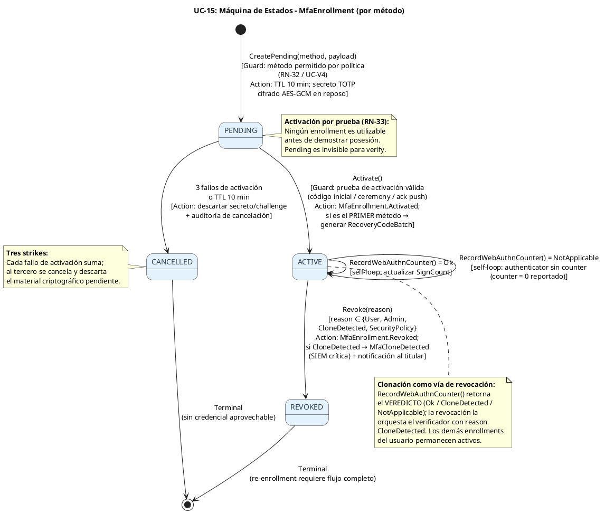
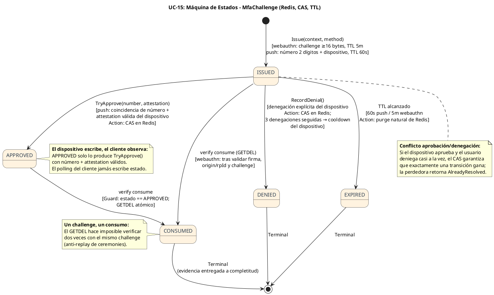
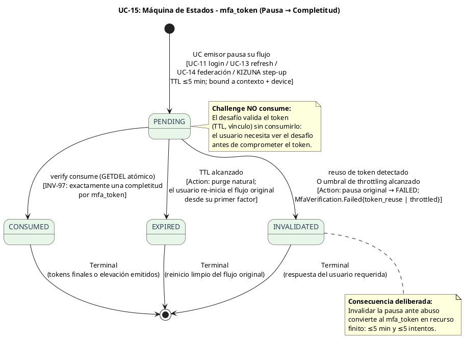
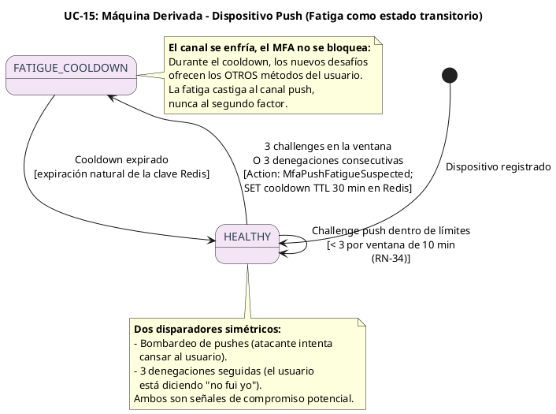
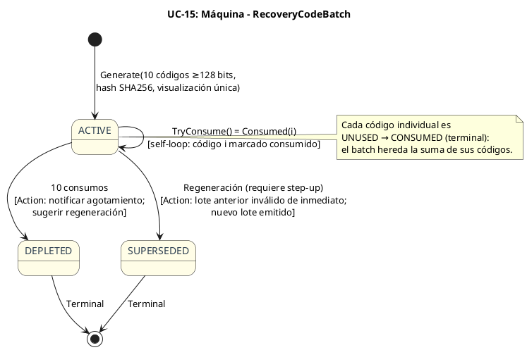

# UC-15: Multi-Factor Authentication (MFA) - Diagrama de Máquina de Estados

| Metadatos del Documento | |
| :--- | :--- |
| **Proyecto:** | SHUGO - Identity & Access Platform |
| **Caso de Uso:** | UC-15 - Multi-Factor Authentication (MFA - TOTP, WebAuthn/FIDO2, Push, Recovery) |
| **Documento:** | 05_State_Machine_Diagram.md |
| **Metodología:** | UML 2.5 + DDD (State Pattern) + Concurrency Control (CAS) + Security by Design |
| **Autor:** | Gastón Ruiz |
| **Versión Actual:** | 1.0.0 |
| **Fecha:** | 23/10/2026 |

---

## Historial de Versiones

| Versión | Fecha | Autor | Descripción de Cambios | Impacto |
| :--- | :--- | :--- | :--- | :--- |
| **1.0.0** | 23/10/2026 | Gastón Ruiz | **Creación inicial.** Definición de cinco máquinas de estados para UC-15: (1) `MfaEnrollment` (PENDING → ACTIVE → REVOKED, con cancelación por tres fallos de prueba y clonación como vía de revocación); (2) `MfaChallenge` (ISSUED → APPROVED/DENIED/EXPIRED → CONSUMED con transiciones CAS); (3) `mfa_token` (PENDING → CONSUMED/EXPIRED/INVALIDATED); (4) máquina derivada de **Dispositivo Push** (HEALTHY → FATIGUE_COOLDOWN); y (5) las máquinas secundarias de `RecoveryCodeBatch` y `TrustedDeviceCredential`. Se documentan las guardas de concurrencia (CAS de aprobación vs denegación, GETDEL de consumo) y las consecuencias de cada transición terminal. | Documento base del paquete de diseño Tier 1 del UC-15. Convierte las reglas de evidencia única en transiciones ejecutables: un mfa_token produce exactamente una completitud, un challenge push tiene exactamente una resolución de dispositivo, y un enrollment clonado se revoca sin afectar los demás métodos del usuario. |

---

## 1. Introducción y Propósito

El **Diagrama de Máquina de Estados** para el UC-15 visualiza las restricciones de comportamiento temporal de cinco sujetos con naturalezas distintas:

1. **`MfaEnrollment` (persistente, por método):** Ciclo de vida de la credencial del segundo factor, con un estado PENDING que solo se supera mediante prueba, y una vía de revocación específica para clonación.
2. **`MfaChallenge` (efímera, concurrente):** El desafío vive en Redis con dos fuentes de transición simultáneas —el dispositivo que aprueba/deniega y el verify que consume— resueltas por CAS.
3. **`mfa_token` (efímera, single-use):** El puente entre la pausa y la completitud, con tres terminales que distinguen consumo legítimo, expiración natural e invalidación por abuso.
4. **Dispositivo Push (derivada, operacional):** Estado de salud por dispositivo que modela la fatiga como condición transitoria con enfriamiento, no como fallo permanente.
5. **`RecoveryCodeBatch` y `TrustedDeviceCredential` (secundarias):** El ciclo del break-glass (agotamiento y supersede) y el ciclo del bypass restringido (expiración y revocación por tres motivos).

Estas máquinas garantizan las propiedades cardinales del UC:
- **Un mfa_token produce exactamente una completitud.**
- **Un challenge push tiene exactamente una resolución escrita por el dispositivo.**
- **Una clonación revoca un enrollment, no la capacidad MFA del usuario.**
- **La fatiga enfría el canal push, no bloquea el segundo factor.**

---

## 2. Máquina de Estados #1: MfaEnrollment (Persistente, por Método)

### 2.1. Diagrama de Máquina de Estados (PlantUML)



### 2.2. Descripción de Estados y Transiciones

| Estado | Descripción | Transiciones de Salida | Invariante Clave |
| :--- | :--- | :--- | :--- |
| **PENDING** | Credencial creada pero no probada. Invisible para challenge/verify. TTL 10 min. | → `ACTIVE` (prueba válida), → `CANCELLED` (3 fallos o TTL). | `ActivationFailures < 3`; material cifrado y descartable. |
| **ACTIVE** | Credencial verificada y utilizable. | Self-loop (counter WebAuthn), → `REVOKED`. | Un enrollment ACTIVE por `(identity, method, device)` según unicidad de datos. |
| **CANCELLED** | Pending descartado tras fallos o expiración. | Ninguna (Terminal). | Material criptográfico eliminado/auditado. |
| **REVOKED** | Credencial invalidada con motivo auditable. | Ninguna (Terminal). | `RevokedAt != null` y `RevocationReason != null`. |

### 2.3. Guardas (Guards) Críticas

#### Transición: `PENDING` → `ACTIVE` (Activación por Prueba)

```csharp
public void Activate(DateTime now)
{
    ValidateTransition(EnrollmentStatus.Active);
    if (ActivationFailures >= 3)
        throw new DomainException("Enrollment exhausted: cannot activate after 3 failures.");
    Status = EnrollmentStatus.Active;
    ActivatedAt = now;
}
```

#### Determinación de Clonación (veredicto, no transición)

```csharp
public CounterCheck RecordWebAuthnCounter(long presented, DateTime now)
{
    if (presented == 0) return CounterCheck.NotApplicable;      // self-loop silencioso
    if (presented <= WebAuthn!.SignCount) return CounterCheck.CloneDetected;
    WebAuthn = WebAuthn.WithSignCount(presented);               // self-loop con mutación
    return CounterCheck.Ok;
}
// El verificador traduce CloneDetected en: Revoke(CloneDetected) + MfaCloneDetected + notificación.
```

**Justificación del diseño:** La transición a `REVOKED` tiene un solo origen sintáctico (`Revoke(reason)`), pero cuatro semánticas distintas. `CloneDetected` es la única que además preserva los demás enrollments del usuario y dispara alerta crítica — la contención es por credencial, no por identidad.

---

## 3. Máquina de Estados #2: MfaChallenge (Efímera, Concurrente)

### 3.1. Diagrama de Máquina de Estados (PlantUML)



### 3.2. Descripción de Estados y Transiciones

| Estado | Descripción | Transiciones de Salida | Invariante Clave |
| :--- | :--- | :--- | :--- |
| **ISSUED** | Desafío emitido y vigente. | → `APPROVED` (push), → `DENIED` (push), → `CONSUMED` (webauthn), → `EXPIRED`. | `Status == Issued` hasta que una transición CAS gane. |
| **APPROVED** | El dispositivo aprobó con número + attestation válidos. | → `CONSUMED`. | Solo verificadores push consumen desde APPROVED. |
| **DENIED** | Denegación explícita registrada. | Ninguna (Terminal). | `DenialCount` alimenta el contador de fatiga. |
| **CONSUMED** | El verify extrajo la evidencia del challenge. | Ninguna (Terminal). | GETDEL ejecutado exactamente una vez. |
| **EXPIRED** | TTL alcanzado sin resolución. | Ninguna (Terminal). | Purge natural; sin limpieza por jobs. |

### 3.3. Guardas (Guards) de Concurrencia

#### Aprobación con CAS (Compare-And-Set)

```csharp
public ApprovalResult TryApprove(int? selectedNumber, bool attestationValid, DateTime now)
{
    if (IsExpired(now)) return ApprovalResult.Expired;
    if (Status != ChallengeStatus.Issued) return ApprovalResult.AlreadyResolved;
    if (!attestationValid) return ApprovalResult.AttestationInvalid;
    if (NumberToMatch.HasValue && selectedNumber != NumberToMatch)
        return ApprovalResult.NumberMismatch;

    Status = ChallengeStatus.Approved;
    return ApprovalResult.Approved;
}
```

La transición se persiste con `CompareAndSetStatusAsync(id, from: Issued, to: Approved)`: si la denegación ganó la carrera, el CAS falla y `TryApprove` retorna `AlreadyResolved` en la re-lectura. **Exactamente una resolución por challenge**, sin importar el interleaving.

#### Consumo Único del Challenge

El verify de WebAuthn ejecuta `GETDEL` sobre el challenge; el de Push exige estado `APPROVED` antes del `GETDEL`. Ningún camino puede verificar dos veces con el mismo challenge: el segundo consumo encuentra la clave ausente y falla genérico.

---

## 4. Máquina de Estados #3: mfa_token (Efímera, Single-Use)

### 4.1. Diagrama de Máquina de Estados (PlantUML)



### 4.2. Descripción de Estados y Transiciones

| Estado | Descripción | Transiciones de Salida | Invariante Clave |
| :--- | :--- | :--- | :--- |
| **PENDING** | Pausa activa; el token puede ser desafiado múltiples veces pero consumido una. | → `CONSUMED`, → `EXPIRED`, → `INVALIDATED`. | `ExpiresAt ≤ CreatedAt + 5min`; vínculo de contexto y device intacto. |
| **CONSUMED** | Completitud ejecutada exactamente una vez. | Ninguna (Terminal). | Tokens emitidos con evidencia en `amr`. |
| **EXPIRED** | Fin de vida natural sin consumo. | Ninguna (Terminal). | El flujo original se reinicia desde el primer factor. |
| **INVALIDATED** | Abuso detectado: reuso o throttling. | Ninguna (Terminal). | La pausa original transiciona a FAILED una única vez (idempotente). |

**Justificación de la asimetría:** La expiración es **inocente** (el usuario puede reintentar el login normalmente); la invalidación es **reactiva** (alguien intentó reciclar o forzar el token). Distinguirlas permite que el usuario legítimo se recupere sin fricción mientras el abuso queda contenido y auditado.

---

## 5. Máquina de Estados #4: Dispositivo Push (Derivada, Operacional)

### 5.1. Diagrama de Máquina de Estados (PlantUML)



### 5.2. Descripción de Estados

| Estado | Descripción | Transiciones | Persistencia |
| :--- | :--- | :--- | :--- |
| **HEALTHY** | El dispositivo puede recibir challenges dentro de límites. | Self-loop (challenge dentro de límites), → `FATIGUE_COOLDOWN`. | Contadores con TTL de ventana en Redis. |
| **FATIGUE_COOLDOWN** | Canal push suspendido para el dispositivo. | → `HEALTHY` (expiración del cooldown). | Clave `mfa:push:cooldown:{device}` TTL 30 min. |

**Justificación:** Modelar la fatiga como estado del **dispositivo** (no de la identidad) permite que el usuario siga verificándose con TOTP o WebAuthn durante el cooldown, y que un segundo dispositivo push registrado permanezca disponible. El ataque de fatiga degrada un canal, no la cuenta.

---

## 6. Máquinas Secundarias: RecoveryCodeBatch y TrustedDeviceCredential

### 6.1. RecoveryCodeBatch (Break-Glass)



**Regla clave:** La regeneración **supersede** el lote anterior completo — nunca coexisten dos lotes activos, eliminando códigos olvidados como superficie de ataque.

### 6.2. TrustedDeviceCredential (Bypass Restringido)

| Estado | Descripción | Transiciones |
| :--- | :--- | :--- |
| **ISSUED** | Credencial de dispositivo vigente (TTL de política, fingerprint vinculado). | → `EXPIRED` (TTL), → `REVOKED` (User, Risk, Admin). |
| **EXPIRED** | Fin de vida natural. | Terminal. |
| **REVOKED** | Revocada con motivo: `User` (UC-22), `Risk` (señal UC-17), `Admin` (UC-21). | Terminal. |

**Reglas de la máquina (INV-104):** La emisión solo ocurre tras verify exitoso de **login pause** con política habilitada y opt-in; nunca existe bajo `RequirePhishingResistant` ni para AAL3; y su validación **nunca** satisface un step-up.

---

## 7. Implementación en el Dominio (Código C#)

### 7.1. Validación de Transiciones de MfaEnrollment

```csharp
private void ValidateTransition(EnrollmentStatus next)
{
    var allowed = Status switch
    {
        EnrollmentStatus.Pending => new[] { EnrollmentStatus.Active, EnrollmentStatus.Cancelled },
        EnrollmentStatus.Active  => new[] { EnrollmentStatus.Revoked },
        _ => Array.Empty<EnrollmentStatus>()   // CANCELLED y REVOKED son terminales
    };

    if (!allowed.Contains(next))
        throw new DomainException($"Invalid enrollment transition {Status} → {next}.");
}
```

### 7.2. Orquestador de Verificación: las Máquinas en Secuencia

```csharp
public async Task<MfaVerifyResult> VerifyAsync(MfaVerifyCommand cmd, CancellationToken ct)
{
    // Máquina #3: mfa_token PENDING → CONSUMED (GETDEL atómico)
    var context = await _tokenStore.ConsumeAsync(cmd.MfaToken, _clock.UtcNow, ct);
    if (context is null)
    {
        // Segundo consumo = token_reuse: la pausa se invalida UNA sola vez (idempotente)
        await _pauseInvalidator.InvalidateOnceAsync(cmd.MfaToken, InvalidateReason.TokenReuse, ct);
        return MfaVerifyResult.Fail(FailReason.TokenReuse);
    }

    // Throttling (dimensión por token y por usuario/hora)
    if (!await _throttle.TryAcquireAsync(context, _policy, ct))
    {
        await _pauseInvalidator.InvalidateOnceAsync(cmd.MfaToken, InvalidateReason.Throttled, ct);
        return MfaVerifyResult.Fail(FailReason.Throttled);
    }

    // Máquina #2: challenges push requieren estado APPROVED antes del consumo
    var verifier = _verifiers[cmd.Method];
    var verification = await verifier.VerifyAsync(context, cmd.Proof, _policy, ct);

    if (verification.Status == VerificationStatus.Failed)
    {
        await _throttle.RecordFailureAsync(context, ct);
        return MfaVerifyResult.Fail(verification.Reason!.Value);   // colapso genérico en el boundary
    }

    // Máquina #1: la clonación ya revocó el enrollment dentro del verificador
    if (verification.Status == VerificationStatus.CloneDetected)
        return MfaVerifyResult.Fail(FailReason.Clone);

    // Completitud: evidencia única → cuatro contextos posibles
    return await _completer.CompleteAsync(context, verification.Evidence!, _policy, cmd.TrustedOptIn, ct);
}
```

### 7.3. Testing de Máquinas de Estados

```csharp
[Test]
public void Enrollment_Activate_FromRevoked_ThrowsInvalidTransition()
{
    var e = ActiveTotpEnrollment();
    e.Revoke(EnrollmentRevocationReason.User, Now);
    var act = () => e.Activate(Now);
    act.Should().Throw<DomainException>().WithMessage("*Revoked → Active*");
}

[Test]
public void Enrollment_ThirdActivationFailure_MakesActivationImpossible()
{
    var e = PendingTotpEnrollment();
    e.RecordActivationFailure(); e.RecordActivationFailure(); e.RecordActivationFailure();
    e.ActivationExhausted.Should().BeTrue();
    var act = () => e.Activate(Now);
    act.Should().Throw<DomainException>().WithMessage("*exhausted*");
}

[Test]
public async Task Challenge_ApproveAndDeny_Race_ExactlyOneWins_ViaCas()
{
    // Simulación: denegación gana el CAS; aprobación tardía llega después
    Store.SetupCasDenyWins();

    var denial = await Handler.HandleDenialAsync(DenialCmd, CT);
    var late = await Handler.HandleApprovalAsync(ApprovalCmd, CT);   // número correcto, attestation válida

    denial.Should().Be(PushApprovalResult.Denied);
    late.Should().Be(PushApprovalResult.AlreadyResolved);   // el CAS rechazó la segunda escritura
}

[Test]
public void Challenge_TryApprove_WhenAlreadyApproved_ReturnsAlreadyResolved()
{
    var ch = PushChallenge(numberToMatch: 42);
    ch.TryApprove(42, attestationValid: true, Now).Should().Be(ApprovalResult.Approved);
    ch.TryApprove(42, attestationValid: true, Now).Should().Be(ApprovalResult.AlreadyResolved);
}

[Test]
public async Task MfaToken_SecondConsume_InvalidatesPause_ExactlyOnce()
{
    await Verifier.VerifyAsync(cmd, CT);                       // primer consumo: éxito
    await Verifier.VerifyAsync(cmd, CT);                       // segundo consumo: token_reuse

    PauseInvalidator.Verify(p => p.InvalidateOnceAsync(cmd.MfaToken, InvalidateReason.TokenReuse, It.IsAny<CancellationToken>()),
        Times.Once);                                           // idempotencia de la invalidación
}

[Test]
public async Task PushDevice_FourthChallengeInWindow_EntersCooldown_AndRecoversAfterTtl()
{
    for (var i = 0; i < 3; i++)
        (await Throttle.TryIssuePushChallengeAsync("dev-7", Policy, CT)).IsAllowed.Should().BeTrue();

    var fourth = await Throttle.TryIssuePushChallengeAsync("dev-7", Policy, CT);
    fourth.Should().Be(PushIssueResult.Cooldown(TimeSpan.FromMinutes(30)));

    Clock.Advance(TimeSpan.FromMinutes(31));                   // expiración natural del cooldown
    (await Throttle.TryIssuePushChallengeAsync("dev-7", Policy, CT)).IsAllowed.Should().BeTrue();
}

[Test]
public void RecoveryBatch_DepletesAtTen_AndRegenerationSupersedes()
{
    var (batch, plain) = RecoveryCodeBatch.Generate(Identity, Random, Now);
    for (var i = 0; i < 10; i++)
        batch.TryConsume(plain[i], Now).IsConsumed.Should().BeTrue();
    batch.Remaining.Should().Be(0);

    batch.Supersede(Now);
    batch.TryConsume(plain[0], Now).Should().Be(RecoveryConsumeResult.BatchSuperseded);
}
```

---

## 8. Trazabilidad con Otros Documentos del Paquete

| Documento | Relación |
| :--- | :--- |
| `01_Requirements_Specification.md` | INV-97 (máquina del mfa_token), INV-98 (self-loop de replay en TOTP), INV-99 (vía CloneDetected), INV-101 (transición INVALIDATED por throttling), INV-102 (máquina de batch), INV-104 (máquina de trusted device), RN-33 (PENDING→ACTIVE/CANCELLED), RN-34 (máquina del dispositivo push). |
| `03_Activity_Diagram.md` | Las guardas de los Diagramas #1/#2 (consumo antes de criptografía, CAS de aprobación) son las transiciones aquí formalizadas. |
| `04_Initial_Domain_Model.md` | `Activate/Revoke`, `TryApprove/RecordDenial`, `RecordWebAuthnCounter` y `TryConsume` son los métodos que ejecutan estas máquinas. |
| `07_Sequence_Diagram.md` | Detallará el orden temporal: consumo del mfa_token, resolución del challenge por método y completitud context-aware. |
| `10_UC_Specific_Data_Model.md` | Los estados de challenge, cooldown y replay viven en keyspaces Redis; enrollment y batch en tablas PostgreSQL. |
| `11_UC_Specific_Security_Threats.md` | Las transiciones INVALIDATED y CloneDetected son las respuestas de dominio a token recycling y authenticator cloning. |
| `UC-11/UC-13/UC-14 (05_State_Machine)` | Las pausas que alimentan `mfa_token PENDING` son los estados `STEP_UP_PENDING` (UC-13/14) y el punto de MFA del login (UC-11). |

---

## 9. Glosario de Términos Específicos de UC-15

| Término | Definición |
| :--- | :--- |
| **Activación por Prueba** | Requisito de máquina: ningún enrollment alcanza ACTIVE sin demostrar posesión; tres fallos lo cancelan. |
| **Veredicto de Counter** | Resultado de `RecordWebAuthnCounter` (Ok / CloneDetected / NotApplicable): la clonación se determina en el enrollment y se ejecuta en el verificador. |
| **CAS de Resolución** | Compare-And-Set que garantiza exactamente una resolución por challenge push cuando aprobación y denegación compiten. |
| **Consumo Único** | GETDEL del mfa_token y de los challenges: la completitud y la ceremonia ocurren exactamente una vez por artefacto. |
| **Invalidación Reactiva** | Terminal del mfa_token ante abuso (reuso/throttling) que transiciona la pausa original a FAILED una única vez. |
| **Cooldown de Fatiga** | Estado transitorio por dispositivo que suspende el canal push 30 min sin bloquear el segundo factor. |
| **Supersede** | Efecto de regenerar recovery codes: el lote anterior queda inválido de inmediato; nunca coexisten dos lotes. |
| **Self-Loop de Counter** | Transición ACTIVE→ACTIVE que actualiza SignCount sin cambiar estado: la mutación sana es visible en la máquina. |

---
*Fin del Documento 05_State_Machine_Diagram para UC-15*