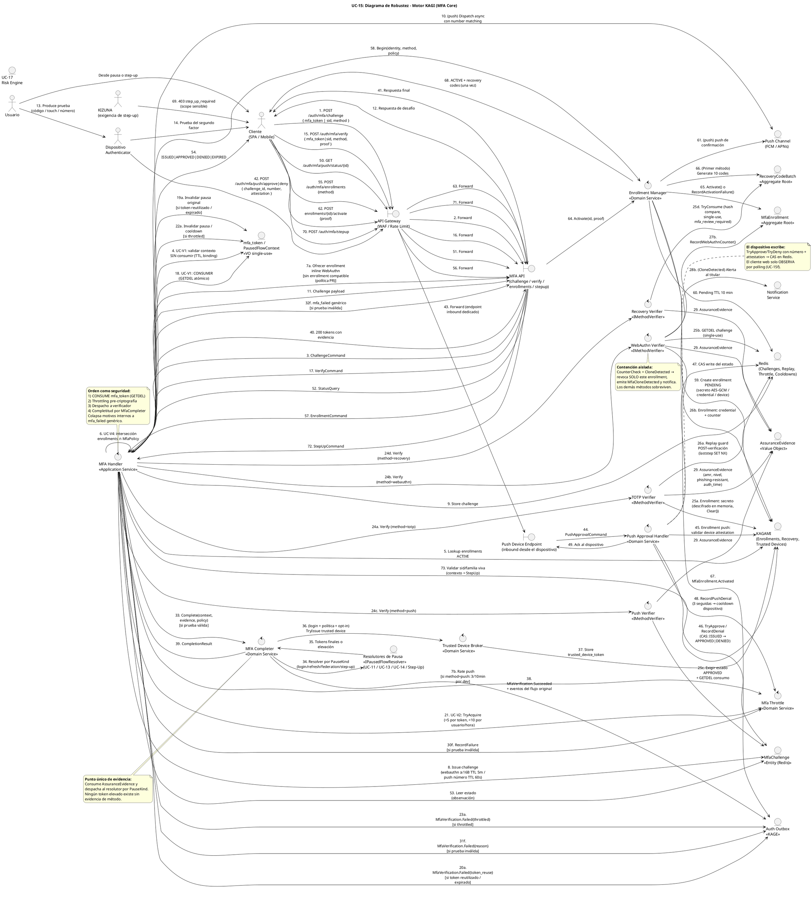

# UC-15: Multi-Factor Authentication (MFA) - Diagrama de Robustez

| Metadatos del Documento | |
| :--- | :--- |
| **Proyecto:** | SHUGO - Identity & Access Platform |
| **Caso de Uso:** | UC-15 - Multi-Factor Authentication (MFA - TOTP, WebAuthn/FIDO2, Push, Recovery) |
| **Documento:** | 06_Robustness_Diagram.md |
| **Metodología:** | ICONIX (Diagrama de Robustez) + DDD + Security by Design (Evidence-Based Completion) + Hexagonal Architecture |
| **Autor:** | Gastón Ruiz |
| **Versión Actual:** | 1.0.0 |
| **Fecha:** | 23/10/2026 |

---

## Historial de Versiones

| Versión | Fecha | Autor | Descripción de Cambios | Impacto |
| :--- | :--- | :--- | :--- | :--- |
| **1.0.0** | 23/10/2026 | Gastón Ruiz | **Creación inicial.** Diagrama de Robustez para UC-15, validando la arquitectura del MFA Core de KAGI. Muestra la colaboración estricta entre tres Boundary Objects (API Gateway, MFA API, Push Device Endpoint inbound), diez Control Objects (MfaHandler, cuatro verificadores de estrategia, MfaThrottle, MfaCompleter, EnrollmentManager, PushApprovalHandler, TrustedDeviceBroker) y los Entity Objects (MfaEnrollment, RecoveryCodeBatch, MfaChallenge, mfa_token/PausedFlowContext, AssuranceEvidence, Redis, KAGAMI, Push Channel, Resolutores de Pausa, Outbox, UC-17). Valida el orden consumo→throttling→verificación→completitud, la contención de clonación aislada en el verificador WebAuthn, la escritura CAS del dispositivo en el challenge push, y el punto único de evidencia de la completitud. | Documento base del paquete de diseño Tier 1 del UC-15. Sirve como puente crítico entre el Modelo de Dominio (04/05) y el Diagrama de Secuencia (07), asegurando que cada control de seguridad tenga un único responsable colaborativo y que la evidencia del segundo factor fluya en una sola dirección: hacia adentro, hacia la completitud, nunca hacia afuera. |

---

## 1. Introducción y Propósito

El **Diagrama de Robustez** para el UC-15 valida que el flujo de segundo factor puede ser orquestado respetando las reglas estrictas de acoplamiento de **ICONIX** y los principios de **DDD**, **Zero Trust** y **Evidence-Based Completion**.

El desafío específico de este caso de uso es séptuple:

1. **Heterogeneidad de pruebas tras una interfaz única:** Cinco verificadores con criptografías, latencias y adversarios distintos deben despacharse por estrategia y converger en una única `AssuranceEvidence`.
2. **Orden de consumo como seguridad:** El `mfa_token` se consume (GETDEL) **antes** del throttling y de cualquier criptografía; los challenges WebAuthn/push se consumen **dentro** de la verificación; el replay guard se escribe **después** de verificar.
3. **Contención aislada por credencial:** La clonación WebAuthn revoca **un enrollment** sin tocar los demás métodos del usuario, y vive dentro del verificador que la detecta.
4. **Fuente de verdad invertida en push:** El estado de aprobación lo escribe el **dispositivo** (vía endpoint inbound con CAS), no el cliente web que pollea.
5. **Completitud como punto único:** Solo `MfaCompleter` convierte evidencia en tokens (finales o elevados), mediante resolutores por tipo de pausa que exponen los flujos originales (UC-11/13/14/KIZUNA).
6. **Enrollment con activación por prueba:** La creación de credenciales es un flujo aparte con pending efímero, tres strikes de cancelación y generación de break-glass en la primera activación.
7. **Colapso Zero Info Leakage:** Todos los motivos internos de fallo (invalid_code, totp_replay, clone, throttled, token_reuse, denied, expired) convergen en `mfa_failed` genérico en el boundary.

---

## 2. Diagrama de Robustez (PlantUML)

A continuación, se presenta el Diagrama de Robustez organizado de izquierda a derecha para mostrar el flujo natural: **Actor → Boundary → Control → Entity**.



---

## 3. Explicación Detallada de los Objetos

### 3.1. Boundary Objects (Objetos de Límite)

| Objeto | Responsabilidad | Mapeo a Clean Architecture |
| :--- | :--- | :--- |
| **`API Gateway`** | WAF y Rate Limiting sobre la superficie de MFA (endpoints pausados/anónimos atacables). | Middleware (Kong, AWS WAF). |
| **`MFA API`** | Expone challenge/verify/enrollments/stepup/push-status. Es el **único** lugar donde los `FailReason` internos se colapsan a `mfa_failed` genérico. | Controllers (ASP.NET Core). |
| **`Push Device Endpoint`** | Boundary inbound exclusivo para el dispositivo authenticator (approve/deny). No comparte camino con el cliente web: su "autenticación" es la attestation del dispositivo contra el enrollment registrado. | Controller dedicado con pipeline propio. |

### 3.2. Control Objects (Objetos de Control)

| Objeto | Responsabilidad | Mapeo a Clean Architecture |
| :--- | :--- | :--- |
| **`MFA Handler`** | **Application Service.** Orquesta challenge y verify: valida/consume contexto, aplica throttling, despacha al verificador por método, delega completitud. Colapsa motivos a error genérico. | Application Service. |
| **`Mfa Throttle`** | **Domain Service.** Dos dimensiones de intentos (por token, por usuario/hora) + rate de push por dispositivo con cooldown de fatiga. | Domain Service. |
| **`TOTP Verifier`** | **Estrategia.** Ventana ±1, comparación tiempo-constante, replay guard post-verificación, secreto con `Clear()`. | `IMethodVerifier`. |
| **`WebAuthn Verifier`** | **Estrategia.** Challenge GETDEL, origin/rpId, firma, y `RecordWebAuthnCounter` con contención de clonación aislada. | `IMethodVerifier`. |
| **`Push Verifier`** | **Estrategia.** Exige challenge `APPROVED` antes del consumo; verifica número y vínculo de dispositivo. | `IMethodVerifier`. |
| **`Recovery Verifier`** | **Estrategia.** Hash compare single-use sobre el batch activo; dispara consecuencias de break-glass. | `IMethodVerifier`. |
| **`MFA Completer`** | **Domain Service.** Punto único de evidencia: despacha al resolutor por `PauseKind` y coordina la emisión opcional de trusted device. | Domain Service. |
| **`Trusted Device Broker`** | **Domain Service.** Emisión/validación del bypass restringido (solo login, nunca step-up, nunca PR/AAL3). | Domain Service. |
| **`Enrollment Manager`** | **Domain Service.** Ciclo de enrollment: begin pending, activar por prueba, cancelar a los 3 fallos, regenerar recovery codes. | Domain Service. |
| **`Push Approval Handler`** | **Domain Service.** Procesa el inbound del dispositivo: valida attestation, ejecuta `TryApprove`/`RecordDenial` con CAS, alimenta el contador de fatiga. | Domain Service. |

### 3.3. Entity Objects (Objetos de Entidad e Infraestructura)

| Objeto | Responsabilidad | Mapeo a DDD / Infra |
| :--- | :--- | :--- |
| **`mfa_token / PausedFlowContext`** | **VO single-use.** Puente entre pausa y completitud con expiración y binding de contexto/dispositivo. | Persistido en Redis vía puerto (GETDEL). |
| **`MfaEnrollment`** | **Aggregate Root.** Credencial del método con detecciones propias (counter, activación, revocación). | Entity (PostgreSQL `mfa_enrollments`). |
| **`RecoveryCodeBatch`** | **Aggregate Root.** Lote break-glass por identidad con consumo single-use y supersede. | Entity (PostgreSQL `recovery_codes`). |
| **`MfaChallenge`** | **Entity efímera.** Estado del desafío con resolución CAS (el dispositivo escribe, el cliente observa). | Entity (Redis `mfa:challenge:*`). |
| **`AssuranceEvidence`** | **Value Object.** Única salida de evidencia de los verificadores; única entrada de la completitud. | VO inmutable en memoria. |
| **`Redis`** | **Infrastructure.** Challenges, replay guard (`laststep`), contadores de throttle, cooldowns de fatiga, consumo de mfa_token. | Infraestructura fail-secure. |
| **`KAGAMI`** | **Infrastructure.** Fuente durable de enrollments (secretos cifrados, credentials, counters), recovery codes y trusted devices. | Infraestructura (EF Core). |
| **`Push Channel`** | **Infrastructure.** Despacho FCM/APNs del desafío push y su número de matching. | Adapter `IPushDispatcher`. |
| **`Resolutores de Pausa`** | **Puertos cross-context.** UC-11 (attempt), UC-13 (tx refresh), UC-14 (federación), KIZUNA (step-up): cada uno expone cómo completarse. | `IPausedFlowResolver` por `PauseKind`. |
| **`Auth Outbox`** | **Infrastructure.** Eventos de verificación con garantía de entrega eventual. | Outbox Pattern. |
| **`UC-17 Risk Engine`** | **Sistema hermano.** Señales de contexto durante verificación; consume eventos de fallo/clonación/fatiga. | Puerto `IRiskEvaluator`. |
| **`Notification Service`** | **Infrastructure.** Alertas al titular (clonación, recovery usado) y despacho push. | Adapter. |

---

## 4. Reglas de Robustez de ICONIX (Validación del Diagrama)

### ✅ Regla 1: Actor → Boundary
- **Cumplida:** `Usuario → Cliente → API Gateway`; y el actor `Dispositivo Authenticator → Push Device Endpoint` para el flujo inbound. KIZUNA dispara step-up a través del cliente (403 → `/stepup`), nunca directamente a un control.

### ✅ Regla 2: Boundary → Boundary
- **Cumplida:** `API Gateway → MFA API` y `API Gateway → Push Device Endpoint`. Los dos boundaries de MFA son independientes: el del dispositivo tiene contrato propio (attestation como autenticación) y no encadena hacia la MFA API.

### ✅ Regla 3: Boundary → Control
- **Cumplida:** `MFA API → MfaHandler` (challenge/verify/stepup/status), `MFA API → EnrollmentManager` (vía handler para begin/activate), y `Push Device Endpoint → PushApprovalHandler`. Ningún boundary toca verificadores ni completitud directamente.

### ✅ Regla 4: Control → Control
- **Cumplida y Crítica:** `MfaHandler` delega en `MfaThrottle`, en los cuatro `IMethodVerifier` por método, y en `MfaCompleter`; `PushApprovalHandler` delega en `MfaThrottle` (fatiga); `MfaCompleter` delega en `TrustedDeviceBroker`.
- **Validación:** Cada regla de seguridad vive en exactamente un control: throttling en `MfaThrottle`, clonación en `WebAuthnVerifier`, evidencia en `MfaCompleter`. El handler permanece como orquestador delgado.

### ✅ Regla 5: Control → Entity
- **Cumplida:**
  - `MfaHandler` consume `mfa_token` y despacha challenges.
  - `TotpVerifier` lee `MfaEnrollment` (secreto) y escribe el replay guard en `Redis`.
  - `WebAuthnVerifier` muta `MfaEnrollment` (counter/revocación) y consume `MfaChallenge`.
  - `PushVerifier` lee/consume `MfaChallenge`; `RecoveryVerifier` consume `RecoveryCodeBatch`.
  - `PushApprovalHandler` transiciona `MfaChallenge` (CAS) tras validar contra `MfaEnrollment`.
  - `EnrollmentManager` crea/activa `MfaEnrollment` y genera `RecoveryCodeBatch`.
  - `MfaCompleter` invoca `Resolutores de Pausa` y escribe trusted devices vía broker.

### ✅ Regla 6: NO Entity → Control / Boundary
- **Cumplida:** Ninguna entidad inicia interacciones. El `Dispositivo Authenticator` es **actor** iniciador del flujo inbound, pero entra por el `Push Device Endpoint`, que valida attestation antes de tocar `PushApprovalHandler`. Los `Resolutores de Pausa` son puertos invocados, no iniciadores.

### ✅ Regla 7: NO Entity → Entity (Directo sin Control)
- **Cumplida:** Todas las interacciones entre entidades están orquestadas por controles. Ejemplo: `MfaChallenge` no escribe directamente el estado de `MfaEnrollment`; el `WebAuthnVerifier` coordina challenge→counter→revocación. `RecoveryCodeBatch` no notifica por sí mismo: el `RecoveryVerifier`/`MfaHandler` disparan la notificación tras el consumo.

---

## 5. Consideraciones de Arquitectura (Security & Resilience)

### 5.1. Estrategia de Verificadores detrás de un Orquestador Único

El diagrama aísla la heterogeneidad de métodos en cuatro `IMethodVerifier` que convergen en `AssuranceEvidence`.

*   **Justificación:** El `MfaHandler` toma decisiones de flujo (throttling, completitud) sobre evidencia tipada, sin conocer HMAC, firmas ECDSA ni aprobaciones push. Añadir un método futuro (ej. hardware OTP) es un verificador registrado, con cero cambios en el orquestador ni en la completitud.
*   **Consecuencia de seguridad:** Las reglas comunes (throttling, colapso genérico, evidencia única) existen **una sola vez**; las reglas específicas de cada método (skew, counter, number matching) existen **una sola vez por método**.

### 5.2. Consumo Atómico antes de Throttling y Criptografía

El paso 18 (`CONSUMIR mfa_token` vía GETDEL) precede al throttling (21) y a los verificadores (24a-d).

*   **Justificación:** Un verify duplicado o replayado muere en el primer control; el umbral de throttling no se contamina con tokens reciclados, y ningún verificador gasta criptografía sobre un contexto ya completado. La invalidación de la pausa ante reuso (19a) es idempotente: el segundo y tercer reuso no duplican efectos.

### 5.3. Throttling como Control Pre-Criptografía

`MfaThrottle` se evalúa antes de los verificadores en el verify (21) y limita el despacho de push en el challenge (7b).

*   **Justificación dual:** Es control de seguridad (brute-force del espacio de 6 dígitos) y de capacidad (flood de códigos/assertions no gasta HMAC ni ECDSA). El rate de push por dispositivo (3/10min) vive en el mismo servicio que los umbrales de intento: toda la economía de abuso del UC en un solo control.

### 5.4. Contención de Clonación Aislada en el Verificador

`WebAuthnVerifier` es el único objeto que ejecuta `RecordWebAuthnCounter` y el único que revoca por `CloneDetected` (27b→28b).

*   **Justificación:** La detección y su consecuencia (revocar **este** enrollment, preservar los demás, emitir `MfaCloneDetected`, notificar) viven juntas: ningún otro camino puede revocar por clonación, y la clonación no puede escalar a revocación de identidad sin pasar por UC-21 explícitamente.

### 5.5. Fuente de Verdad Invertida en Push

El `Push Device Endpoint` + `PushApprovalHandler` son la única vía que transiciona `MfaChallenge` a `APPROVED`/`DENIED` (CAS en Redis, paso 47). El cliente web solo observa (pasos 50-54).

*   **Justificación:** El estado de aprobación es un hecho del **dispositivo** (número + attestation validados), no del browser. Un cliente comprometido que fabrique "aprobado" no tiene camino de escritura; el `PushVerifier` exige el estado escrito por el handler inbound.

### 5.6. MfaCompleter como Único Punto de Evidencia

Solo `MfaCompleter` consume `AssuranceEvidence` (pasos 33-39): resuelve por `PauseKind` (login/refresh/federación/step-up), coordina el trusted device opcional y dispara los eventos de éxito.

*   **Justificación:** La propiedad "no existe token elevado sin `MfaVerification.Succeeded`" es estructural: ningún verificador emite tokens, ningún resolutor acepta completitud sin evidencia. La dirección de dependencia es correcta: los flujos pausados exponen puertos (`IPausedFlowResolver`), UC-15 los invoca.

### 5.7. Enrollment como Flujo con Guardas Propias

`EnrollmentManager` (pasos 58-68) encapsula: pending con TTL, activación por prueba, cancelación a los tres fallos, y generación de `RecoveryCodeBatch` **solo en la primera activación** de la identidad.

*   **Justificación:** Separar enrollment de verify evita que un flujo de configuración (autenticado, en sesión viva) comparta throttling y colapso con un flujo de completitud (pausado, atacable). La generación de break-glass atómica con la primera activación garantiza que nunca exista un método activo sin recovery.

### 5.8. Mapa Fail-Secure por Dependencia

| Fallo de Dependencia | Punto del Flujo | Comportamiento | Justificación |
| :--- | :--- | :--- | :--- |
| **Redis caído** (token/challenges/replay) | Challenge o verify | Rechazo fail-secure; la pausa **no** se invalida (el usuario reintenta tras recuperación) | Sin replay guard ni consumo single-use no hay garantía de evidencia |
| **KAGAMI caído** | Lookup de enrollment o counter update | HTTP 503 fail-secure; si cae tras verificar firma pero antes de actualizar counter, **se rechaza la completitud** | Sin counter actualizado la próxima verificación no detectaría clonación |
| **Push Channel caído** | Despacho de challenge | Challenge retorna `push_unavailable` + ofrece otros métodos del usuario | Un canal caído no bloquea a quien tiene alternativas |
| **Notification caído** | Alertas de clonación/recovery | La completitud continúa; alertas encoladas con retry vía Outbox | La evidencia ya está verificada; la notificación es consecuente |
| **UC-17 caído** | Señales de contexto durante verify | El verify continúa (las señales son aumento, no gate); se degrada la telemetría de riesgo | UC-17 endurece, no habilita: su ausencia no debe bloquear segundos factores |

---

## 6. Trazabilidad con Otros Documentos del Paquete

| Documento | Relación |
| :--- | :--- |
| `01_Requirements_Specification.md` | Valida que los escenarios 2.1-2.2.5 y 4.1-4.10, INV-97 a INV-104 y RN-32 a RN-35 pueden implementarse con los objetos y colaboraciones definidos. |
| `02_Use_Case_Diagram.md` | Los controles materializan UC-15a/b/c/d/e/f/g y UC-V1 a UC-V4; las extensiones EXT_CLONE/FATIGUE/TRUST/CANCEL/RECOV viven en `WebAuthnVerifier`, `MfaThrottle`, `TrustedDeviceBroker`, `EnrollmentManager` y `RecoveryVerifier`. |
| `03_Activity_Diagram.md` | Cada carril de actividad (KAGI, Redis, KAGAMI, Dispositivo, Notification) se mapea a los controles y entidades de este diagrama; los pasos 1-73 corresponden a los nodos del flujo. |
| `04_Initial_Domain_Model.md` | `MfaEnrollment`, `RecoveryCodeBatch`, `MfaChallenge`, `AssuranceEvidence`, los cinco `IMethodVerifier`, `MfaCompleter`, `MfaThrottle`, `EnrollmentManager` y `PushApprovalHandler` son exactamente las clases del modelo de dominio. |
| `05_State_Machine_Diagram.md` | Las transiciones de las cinco máquinas se ejecutan cuando los controles invocan `Activate/Revoke`, `TryApprove/RecordDenial`, `Consume` y `TryConsume`. |
| `07_Sequence_Diagram.md` | Este diagrama define "qué objetos colaboran"; el de secuencia definirá el orden temporal exacto, incluidos el GETDEL de consumo, el CAS de aprobación y el despacho push async. |
| `08_Final_Class_Design.md` | Definirá las firmas exactas de los métodos mostrados aquí (ej. `IMethodVerifier.VerifyAsync`, `MfaCompleter.CompleteAsync`, `PushApprovalHandler.HandleApprovalAsync`). |
| `10_UC_Specific_Data_Model.md` | Los keyspaces Redis (`mfa:challenge:*`, `mfa:totp:laststep:*`, `mfa:throttle:*`, `mfa:push:cooldown:*`) y las tablas `mfa_enrollments`/`recovery_codes` soportan las entidades de este diagrama. |
| `UC-11/UC-13/UC-14 (06_Robustness)` | Los `Resolutores de Pausa` son los mismos controles de emisión de esos UCs expuestos como puertos: `AuthenticationHandler.CompleteAuthentication`, `TokenRotator.ResumeFromStepUp`, `FederationSessionIssuer`. |

---

## 7. Notas de Implementación

### 7.1. Inyección de Dependencias

```csharp
// Aplicación (por request)
services.AddScoped<IMfaHandler, MfaHandler>();
services.AddScoped<IEnrollmentManager, EnrollmentManager>();
services.AddScoped<IPushApprovalHandler, PushApprovalHandler>();

// Dominio: estrategias de verificación (inyección de colección → diccionario por método)
services.AddScoped<IMethodVerifier, TotpVerifier>();
services.AddScoped<IMethodVerifier, WebAuthnVerifier>();
services.AddScoped<IMethodVerifier, PushVerifier>();
services.AddScoped<IMethodVerifier, RecoveryCodeVerifier>();
services.AddScoped<IMethodVerifier, EmailOtpVerifier>();   // registrable solo si política lo permite

// Dominio: servicios de decisión
services.AddScoped<IMfaThrottle, MfaThrottle>();
services.AddScoped<IMfaCompleter, MfaCompleter>();
services.AddScoped<ITrustedDeviceBroker, TrustedDeviceBroker>();

// Resolutores de pausa: cada contexto de origen registra el suyo por PauseKind
services.AddScoped<IPausedFlowResolver, LoginPauseResolver>();       // UC-11
services.AddScoped<IPausedFlowResolver, RefreshPauseResolver>();     // UC-13
services.AddScoped<IPausedFlowResolver, FederationPauseResolver>();  // UC-14
services.AddScoped<IPausedFlowResolver, StepUpResolver>();           // KIZUNA

// Puertos / Adapters
services.AddScoped<IMfaTokenStore, RedisMfaTokenStore>();
services.AddScoped<IMfaChallengeStore, RedisMfaChallengeStore>();     // CAS Lua
services.AddScoped<ITotpReplayGuard, RedisTotpReplayGuard>();
services.AddScoped<IMfaThrottleStore, RedisMfaThrottleStore>();
services.AddScoped<IMfaEnrollmentRepository, MfaEnrollmentRepository>();
services.AddScoped<IRecoveryCodeRepository, RecoveryCodeRepository>();
services.AddScoped<IPushDispatcher, FcmApnsPushDispatcher>();
services.AddScoped<IOutboxPublisher, OutboxPublisher>();
services.AddSingleton<ICipher, KmsAesGcmCipher>();
services.AddSingleton<IClock, SystemUtcClock>();
```

### 7.2. Esqueleto de Orquestación del Verify (Control → Control → Entity)

```csharp
public async Task<MfaOutcome> VerifyAsync(MfaVerifyCommand cmd, CancellationToken ct)
{
    // (1) CONSUMO antes de throttling y criptografía (paso 18)
    var context = await _tokenStore.ConsumeAsync(cmd.MfaToken, _clock.UtcNow, ct);
    if (context is null)
    {
        await _pauses.InvalidateOnceAsync(cmd, InvalidateReason.TokenReuse, ct);
        return MfaOutcome.Fail(FailReason.TokenReuse);
    }

    // (2) THROTTLING pre-criptografía (paso 21)
    if (!await _throttle.TryAcquireAsync(context, _policy, ct))
    {
        await _pauses.InvalidateOnceAsync(cmd, InvalidateReason.Throttled, ct);
        return MfaOutcome.Fail(FailReason.Throttled);
    }

    // (3) VERIFICADOR por método (pasos 24a-d)
    var verification = await _verifiers[cmd.Method].VerifyAsync(context, cmd.Proof, _policy, ct);
    if (verification.Status != VerificationStatus.Succeeded)
    {
        await _throttle.RecordFailureAsync(context, ct);
        return MfaOutcome.Fail(verification.Reason!.Value);
    }

    // (4) COMPLETITUD: única consumidora de evidencia (pasos 33-40)
    return await _completer.CompleteAsync(context, verification.Evidence!, _policy, cmd.TrustedOptIn, ct);
}
```

### 7.3. Convenciones de Nomenclatura del Diagrama

- **Verificadores con sufijo del método:** `TotpVerifier`, `WebAuthnVerifier`, `PushVerifier`, `RecoveryVerifier` — la revisión de seguridad identifica inmediatamente dónde vive la criptografía de cada estándar.
- **Handlers por dirección de tráfico:** `MfaHandler` (cliente→KAGI) vs `PushApprovalHandler` (dispositivo→KAGI), con boundaries separados que reflejan contratos de autenticación distintos (mfa_token vs attestation).
- **Resolutores como puertos con nombre de origen:** `LoginPauseResolver`, `RefreshPauseResolver`, `FederationPauseResolver`, `StepUpResolver` comunican que la completitud delega hacia los contextos dueños de cada pausa.
- **Notas con invariante citada:** Cada nota referencia la propiedad que justifica la colaboración (consumo único, CAS, contención aislada, punto único de evidencia), manteniendo el diagrama autoexplicativo para auditores.

---
*Fin del Documento 06_Robustness_Diagram para UC-15*