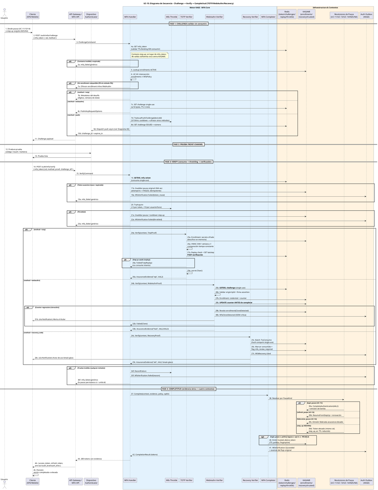
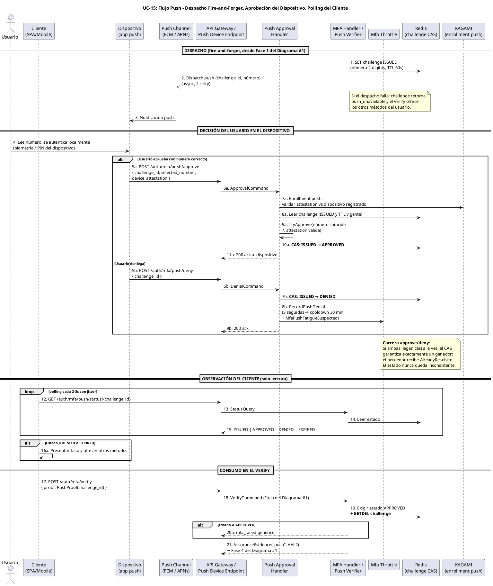
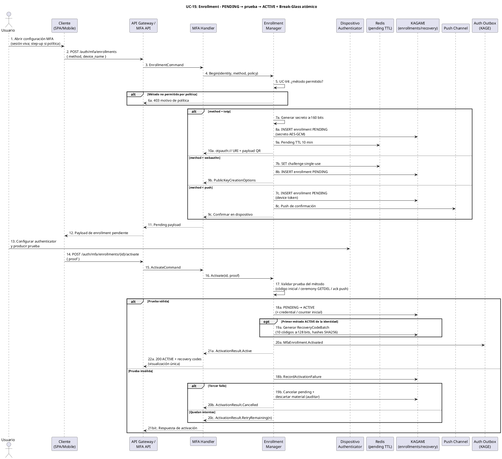

# UC-15: Multi-Factor Authentication (MFA) - Diagrama de Secuencia

| Metadatos del Documento | |
| :--- | :--- |
| **Proyecto:** | SHUGO - Identity & Access Platform |
| **Caso de Uso:** | UC-15 - Multi-Factor Authentication (MFA - TOTP, WebAuthn/FIDO2, Push, Recovery) |
| **Documento:** | 07_Sequence_Diagram.md |
| **Metodología:** | ICONIX (Diagrama de Secuencia) + DDD + Security by Design (Evidence-Based Completion) + Temporal Boundary Analysis |
| **Autor:** | Gastón Ruiz |
| **Versión Actual:** | 1.0.0 |
| **Fecha:** | 23/10/2026 |

---

## Historial de Versiones

| Versión | Fecha | Autor | Descripción de Cambios | Impacto |
| :--- | :--- | :--- | :--- | :--- |
| **1.0.0** | 23/10/2026 | Gastón Ruiz | **Creación inicial.** Diagrama de Secuencia completo para UC-15 en tres partes: (1) el flujo Challenge→Verify→Completitud con el orden GETDEL→throttling→verificación→evidencia→resolución por PauseKind, incluyendo las ramas TOTP (replay post-verificación), WebAuthn (counter update antes de completitud con contención de clonación) y Recovery Code (consumo single-use con consecuencias); (2) el flujo asíncrono de Push con despacho fire-and-forget, aprobación inbound del dispositivo con CAS, carrera approve/deny resuelta, y polling del cliente; y (3) el flujo de Enrollment con activación por prueba, cancelación al tercer fallo y generación atómica del break-glass. | Documento base del paquete de diseño Tier 1 del UC-15. Sirve como guion temporal exacto para la codificación del `MfaHandler` y los verificadores, con presupuesto de timeouts por dependencia, análisis de carreras (double-submit, approve/deny, polling) y la regla fail-secure del counter WebAuthn: nunca completar una verificación cuya detección de clonación no pudo persistirse. |

---

## 1. Introducción y Propósito

El **Diagrama de Secuencia** para el UC-15 materializa temporalmente las colaboraciones definidas en el Diagrama de Robustez. Su propósito es:

1. **Fijar el orden de los controles por fase:** Challenge (validar sin consumir) → producción de prueba front-channel → Verify (consumir → throttling → verificar) → Completitud (evidencia → resolutor → tokens). Cada fase tiene su garantía: el challenge no compromete el token, el verify lo consume una vez, y la completitud solo ocurre con evidencia.
2. **Modelar la asincronía de Push correctamente:** El despacho es fire-and-forget, la aprobación llega por un endpoint inbound desde el dispositivo, el cliente solo pollea — y la carrera entre aprobación y denegación se resuelve por CAS con un ganador exacto.
3. **Documentar las carreras reales:** Double-submit de verify, aprobación tardía tras denegación, y polling concurrente — cada una con su mecanismo de resolución y su comportamiento observable.
4. **Establecer el presupuesto de timeouts:** Cada dependencia (Redis, KAGAMI, firma WebAuthn, despacho push) tiene timeout y política de fallo propios; la verificación local total debe permanecer bajo SLO aunque el canal push sea mediado por humano.
5. **Cerrar la evidencia en el token:** El último paso de toda secuencia exitosa graba `amr`, `acr`, `auth_level` y `auth_time` — o `step_up_at` en elevaciones — haciendo la evidencia verificable por KIZUNA sin confianza en el cliente.

---

## 2. Diagrama de Secuencia #1: Challenge → Verify → Completitud



---

## 3. Diagrama de Secuencia #2: Push Asíncrono (Despacho → Aprobación Inbound → Polling)



---

## 4. Diagrama de Secuencia #3: Enrollment con Activación por Prueba



---

## 5. Análisis Detallado del Flujo

### 5.1. Fase 1: Challenge (Pasos 1-11) — Validar sin Comprometer

**Participantes:** `Usuario`, `Cliente`, `Gateway`, `MfaHandler`, `Redis`, `KAGAMI`, `Throttle`.

*   **Acción:** El challenge valida el contexto (mfa_token o sid vivo) **sin consumirlo**, resuelve la intersección enrollments∩política, y emite el desafío por método.
*   **Justificación del orden:** El usuario necesita ver el desafío (método ofrecido, número push, opciones WebAuthn) antes de comprometer el token. Consumir aquí dejaría al usuario sin capacidad de elegir método o abandonar conscientemente.
*   **Push:** El despacho es fire-and-forget con un retry; si falla, el challenge retorna `push_unavailable` y ofrece los otros métodos — nunca bloquea.

### 5.2. Fase 2: Prueba Front-Channel (Pasos 12-13)

El usuario interactúa con su authenticator fuera del perímetro de SHUGO. Este tramo no tiene SLO (depende del humano y del dispositivo); el timeout relevante es el TTL del challenge (60s push / 5m webauthn), que acota la ventana de validez de la prueba.

### 5.3. Fase 3: Verify (Pasos 14-36) — El Corazón del Orden de Seguridad

**Orden crítico:**
1. **Consumo GETDEL (16)** antes de cualquier otra operación: dos verifies simultáneos con el mismo token → exactamente uno progresa; el otro invalida la pausa una única vez (idempotente).
2. **Throttling (20)** antes de criptografía: el flood de pruebas basura no gasta HMAC ni ECDSA.
3. **Verificación por método** con sus guardas específicas:
   - **TOTP:** ventana ±1 en tiempo constante; el replay guard se escribe **post-verificación** (27a) — quemar steps con códigos falsos es imposible.
   - **WebAuthn:** challenge GETDEL (25b) + firma + **counter update antes de completar** (28b). Si el counter no puede persistirse (KAGAMI caído), la completitud se rechaza: sin counter actualizado, la próxima verificación no detectaría clonación.
   - **Recovery:** hash compare single-use + flag de revisión + consecuencias (27c-28c) dentro del mismo camino de éxito.

### 5.4. Fase 4: Completitud (Pasos 37-45) — Evidencia Única, Cuatro Destinos

`MfaCompleter` despacha al resolutor por `PauseKind`. Cada resolutor emite su artefacto propio (familia nueva, renovación, emisión federada elevada, o token elevado con `step_up_at`), pero **todos** reciben la misma `AssuranceEvidence`. El trusted device se emite solo en login pause con política y opt-in (paso 40). El cierre escribe `MfaVerification.Succeeded` junto a los eventos del flujo original.

### 5.5. Diagrama #2: Push — Tres Actores, Una Fuente de Verdad

*   **Despacho (1-3):** Fire-and-forget; el estado del challenge existe en Redis antes que la notificación llegue.
*   **Decisión (4-11):** Solo el dispositivo escribe estado (CAS). La attestation se valida contra el enrollment registrado: una app no registrada no puede aprobar.
*   **Carrera approve/deny:** El CAS garantiza exactamente un ganador; el perdedor recibe `AlreadyResolved` y el estado final es coherente con la última acción del usuario que ganó la carrera.
*   **Observación (12-16):** El cliente pollea cada 2-3s con jitter; nunca escribe. DENIED/EXPIRED se presentan como fallo con oferta de métodos alternativos.
*   **Consumo (17-21):** El verify exige `APPROVED` y consume el challenge con GETDEL: una aprobación no puede canjearse dos veces.

### 5.6. Diagrama #3: Enrollment — Prueba antes de Confianza

El enrollment nace PENDING e invisible para verify. La activación exige prueba de posesión; tres fallos cancelan y descartan el material. La generación del `RecoveryCodeBatch` ocurre **atómicamente con la primera activación** de la identidad: nunca existe un método activo sin break-glass.

---

## 6. Flujos Alternativos y Excepciones

| # | Escenario | Secuencia abreviada | Resultado |
| :--- | :--- | :--- | :--- |
| 6.1 | **Double-submit de verify** | 16 (GETDEL gana el primero) → 17a-19a | Primer verify completa; segundo invalida la pausa **una vez** (idempotente) y retorna genérico |
| 6.2 | **mfa_token expirado** | 4 falla en challenge o 16 retorna null | Rechazo genérico; el usuario re-inicia el flujo original desde el primer factor |
| 6.3 | **Throttling por token o usuario** | 20-23a | Pausa invalidada / cooldown de step-up; interlock opcional con UC-42 |
| 6.4 | **TOTP replay** | 27a detecta step usado → 28a | Rechazo `TotpReplay` que **no** consume intento; dos replays seguidos alertan sesión compartida |
| 6.5 | **Clonación WebAuthn** | 28b counter regression → 29b-32b | Revocación del enrollment clonado + `MfaCloneDetected` crítica + notificación; otros métodos intactos |
| 6.6 | **Push con número incorrecto** | 9a TryApprove = NumberMismatch | El challenge permanece ISSUED hasta TTL; intento auditado; el usuario puede reintentar |
| 6.7 | **Push fatiga** | 8b tercera denegación o 2 en Diagrama #1 (7d) | Cooldown 30 min del dispositivo + `MfaPushFatigueSuspected`; otros métodos disponibles |
| 6.8 | **Recovery code reutilizado** | 25c TryConsume = NoMatch | Rechazo genérico; el lote mantiene su contabilidad; segundo uso del mismo código imposible |
| 6.9 | **Tercer fallo de activación** | 18b-20b (Diagrama #3) | Pending cancelado, material descartado y auditado; el usuario re-inicia el enrollment |
| 6.10 | **Redis caído durante verify** | 16 falla | Fail-secure: verify rechazado; la pausa **no** se invalida (el token puede no haber sido consumido) |
| 6.11 | **KAGAMI caído tras firma WebAuthn** | 28b falla | Completitud rechazada (503): sin counter persistido no hay detección de clonación futura garantizada |
| 6.12 | **Despacho push falla** | 2 (Diagrama #2) con error | Challenge retorna `push_unavailable`; el cliente ofrece TOTP/WebAuthn/recovery del usuario |

---

## 7. Consideraciones de Arquitectura (Security & Performance)

### 7.1. Presupuesto de Timeouts y Latencias por Dependencia

| Dependencia | Operación | Timeout / Latencia esperada | Comportamiento de fallo |
| :--- | :--- | :--- | :--- |
| **Redis** | GETDEL mfa_token / challenges / replay / throttle | 50 ms | Fail-secure: verify rechazado; pausa no invalidada |
| **KAGAMI** | Lookup enrollment / counter update / activation | 200 ms c/u | Fail-secure 503; counter update fallido bloquea completitud |
| **HMAC TOTP** | Ventana ±1 (3 cómputos) | ~0.3 ms | n/a (CPU local) |
| **Firma WebAuthn** | Verificación ECDSA/EdDSA | ~1 ms | Fallo = prueba inválida |
| **Despacho push** | FCM/APNs | 2 s, 1 retry, fire-and-forget | `push_unavailable` + métodos alternativos |
| **Aprobación push** | Mediada por humano | TTL 60 s | EXPIRED terminal; sin reintentos automáticos |
| **Polling cliente** | GET status | Intervalo 2-3 s con jitter | Backoff si Redis degradado |

**SLO local del verify (excluye interacción humana):** p95 < 30 ms TOTP, p95 < 80 ms WebAuthn, p95 < 20 ms push consume (tras aprobación ya registrada).

### 7.2. Carreras y sus Mecanismos de Resolución

| Carrera | Mecanismo | Comportamiento observable |
| :--- | :--- | :--- |
| **Double-submit de verify** | GETDEL atómico del mfa_token | Uno completa; el otro invalida la pausa una vez |
| **Approve vs deny simultáneos** | CAS `ISSUED → APPROVED/DENIED` | Exactamente un ganador; el perdedor recibe AlreadyResolved |
| **Aprobación tardía tras expiración** | TTL del challenge + `IsExpired` en TryApprove | `Expired`; el verify posterior falla genérico |
| **Dos activaciones concurrentes del mismo pending** | CAS sobre estado del enrollment (PENDING→ACTIVE) | Una activa; la otra recibe AlreadyActivated |
| **Polling concurrente** | Lectura simple de estado (sin escritura) | Inofensivo: el polling nunca muta estado |

### 7.3. Counter Update antes de Completitud (Fail-Secure)

El paso 28b del Diagrama #1 ocurre **antes** de la completitud (37). Si KAGAMI falla entre la verificación de firma y la persistencia del counter, el verify retorna 503 en lugar de emitir tokens: aceptar la verificación sin counter actualizado dejaría la próxima verificación ciega ante clonación. Es la misma filosofía que el replay guard post-verificación de TOTP, aplicada al estado durable.

### 7.4. Evidencia en el Token: el Último Paso es el Más Importante

Toda secuencia exitosa termina grabando en el token:
- `amr` += valor del método (`otp`, `hwk`, `push`, `otk`).
- `acr` mapeado según método y política del tenant.
- `auth_level` resultante (AAL2; AAL3 para WebAuthn hardware + user verification).
- `auth_time` = momento de la verificación.
- `step_up_at` (solo elevaciones) con frescura reutilizable por política.

KIZUNA decide sobre estos claims firmados, nunca sobre declaraciones del cliente.

### 7.5. Traces OpenTelemetry por Método

```text
POST /v1/auth/mfa/verify — TOTP (Root Span) [Total: 9ms]
├── redis.token.consume [2ms]        (GETDEL mfa_token)
├── throttle.acquire [2ms]
├── kagami.enrollment.fetch [3ms]
├── totp.compute_window [0.3ms]      (3 HMAC-SHA1)
├── redis.replay.mark [1ms]
└── completer.resolve [1ms] → login_pause resolver [~15ms en su propio trace UC-11]

POST /v1/auth/mfa/verify — WebAuthn (Root Span) [Total: 12ms]
├── redis.token.consume [2ms]
├── throttle.acquire [2ms]
├── redis.challenge.getdel [2ms]
├── webauthn.verify_signature [1ms]
├── kagami.counter.update [4ms]      ← fail-secure: bloquea completitud si falla
└── completer.resolve [1ms]

POST /auth/mfa/push/approve (Root Span) [Total: 14ms]
├── kagami.attestation.validate [6ms]
├── redis.challenge.read [2ms]
├── challenge.try_approve [0.5ms]    (número + attestation)
└── redis.cas.approved [2ms]
```

---

## 8. Trazabilidad con Otros Documentos del Paquete

| Documento | Relación |
| :--- | :--- |
| `01_Requirements_Specification.md` | Los escenarios 2.1-2.2.5 y 4.1-4.10 se secuencian aquí paso a paso; las excepciones 4.1-4.7 corresponden a las filas de la tabla §6. |
| `03_Activity_Diagram.md` | Cada carril de actividad se convierte en lifeline; los tres diagramas mantienen alineación con los Diagramas #1/#2/#3 de actividad. |
| `05_State_Machine_Diagram.md` | Las transiciones PENDING→CONSUMED (16), ISSUED→APPROVED (10a Diagrama #2), y PENDING→ACTIVE (18a Diagrama #3) ocurren exactamente en estos mensajes. |
| `06_Robustness_Diagram.md` | Este diagrama define el orden temporal de las 73 colaboraciones que el de robustez define estructuralmente. |
| `08_Final_Class_Design.md` | Definirá las firmas exactas con `CancellationToken`, el `MfaTimeouts` record y el colapso `MfaOutcome.Match` en el boundary. |
| `10_UC_Specific_Data_Model.md` | Los GETDEL/CAS de estos diagramas consumen los keyspaces `mfa:token:*`, `mfa:challenge:*`, `mfa:totp:laststep:*`, `mfa:throttle:*` y `mfa:push:cooldown:*`. |
| `11_UC_Specific_Security_Threats.md` | Las carreras de §7.2 y el fail-secure del counter son las mitigaciones ejecutables de token recycling, clone y race attacks. |
| `12_UC_Specific_Performance_Benchmarks.md` | El presupuesto de timeouts (§7.1) y los traces (§7.5) son la base de los SLOs y scripts de k6 con aprobación push simulada. |

---

## 9. Notas de Implementación

### 9.1. Configuración Tipada de Timeouts (C#)

```csharp
public sealed record MfaTimeouts
{
    public TimeSpan RedisOperation   { get; init; } = TimeSpan.FromMilliseconds(50);
    public TimeSpan KagamiOperation  { get; init; } = TimeSpan.FromMilliseconds(200);
    public TimeSpan PushDispatch     { get; init; } = TimeSpan.FromSeconds(2);
    public TimeSpan ChallengeTtlPush { get; init; } = TimeSpan.FromSeconds(60);
    public TimeSpan ChallengeTtlWebAuthn { get; init; } = TimeSpan.FromMinutes(5);
    public TimeSpan PollingInterval  { get; init; } = TimeSpan.FromSeconds(2.5);  // guía de cliente
    public int Retries               { get; init; } = 0;   // solo el despacho push lleva 1 retry
}
```

### 9.2. Verificación de Orden en Tests de Integración

```csharp
[Test]
public async Task Verify_ConsumesToken_Before_Throttling_And_Crypto()
{
    var order = new List<string>();
    TokenStore.Setup(s => s.ConsumeAsync(It.IsAny<string>(), It.IsAny<DateTime>(), It.IsAny<CancellationToken>()))
              .Callback(() => order.Add("consume")).ReturnsAsync(Context);
    Throttle.Setup(t => t.TryAcquireAsync(It.IsAny<PausedFlowContext>(), It.IsAny<MfaPolicy>(), It.IsAny<CancellationToken>()))
            .Callback(() => order.Add("throttle")).ReturnsAsync(true);
    Verifier.Setup(v => v.VerifyAsync(It.IsAny<PausedFlowContext>(), It.IsAny<MethodProof>(), It.IsAny<MfaPolicy>(), It.IsAny<CancellationToken>()))
            .Callback(() => order.Add("verify")).ReturnsAsync(Success);

    await Handler.VerifyAsync(cmd, CT);

    order.Should().ContainInOrder("consume", "throttle", "verify");
}

[Test]
public async Task WebAuthn_CounterUpdateFailure_RejectsCompletion_FailSecure()
{
    Kagami.Setup(k => k.UpdateCounterAsync(It.IsAny<EnrollmentId>(), It.IsAny<long>(), It.IsAny<CancellationToken>()))
          .ThrowsAsync(new InfrastructureException("db down"));

    var outcome = await Handler.VerifyAsync(webauthnCmd, CT);

    outcome.IsFailure.Should().BeTrue();          // 503 fail-secure
    Completer.VerifyNoOtherCalls();                // ninguna completitud sin counter persistido
}

[Test]
public async Task Push_ApproveAndDeny_Race_ExactlyOneWins()
{
    var results = await Task.WhenAll(
        PushHandler.HandleApprovalAsync(approveCmd, CT),
        PushHandler.HandleDenialAsync(denyCmd, CT));

    results.Count(r => r.IsResolved).Should().Be(1);
    results.Count(r => r == PushApprovalResult.AlreadyResolved).Should().Be(1);
}
```

### 9.3. Convenciones de Numeración

- Los sufijos `a/b/c/d` denotan ramas mutuamente excluyentes dentro de un mismo `alt`, manteniendo la numeración base alineada con los Diagramas de Robustez (pasos 1-73) y de Actividades.
- Las flechas `->>` marcan despachos **async fire-and-forget** (push) y notificaciones consecuentes, diferenciándolas de los round-trips síncronos del verify.

---
*Fin del Documento 07_Sequence_Diagram para UC-15*