# UC-15: Multi-Factor Authentication (MFA) - Diagrama de Clases de Diseño Final

| Metadatos del Documento | |
| :--- | :--- |
| **Proyecto:** | SHUGO - Identity & Access Platform |
| **Caso de Uso:** | UC-15 - Multi-Factor Authentication (MFA - TOTP, WebAuthn/FIDO2, Push, Recovery) |
| **Documento:** | 08_Final_Class_Design.md |
| **Metodología:** | ICONIX (Modelo de Diseño) + DDD + Clean Architecture + Hexagonal (Ports & Adapters) + Strategy + Typed Results + Concurrency Control (CAS) |
| **Autor:** | Gastón Ruiz |
| **Versión Actual:** | 1.0.0 |
| **Fecha:** | 23/10/2026 |

---

## Historial de Versiones

| Versión | Fecha | Autor | Descripción de Cambios | Impacto |
| :--- | :--- | :--- | :--- | :--- |
| **1.0.0** | **Creación inicial.** Definición del Modelo de Diseño (Clases de Implementación) para UC-15. Se detallan las firmas exactas del Application Service (`MfaHandler` con `MfaOutcome` tipado y colapso Zero Info Leakage), los cinco `IMethodVerifier` (estrategias selladas), el `MfaCompleter` (punto único de completitud con resolutores por `PauseKind`), el `MfaThrottle` (dos dimensiones de intentos + fatiga push), el `EnrollmentManager` (activación por prueba + break-glass atómico), y el `PushApprovalHandler` (fuente de verdad inbound con CAS). Se incorporan seis refinamientos al modelo inicial: unificación de `MfaMethod` con `RecoveryCode`, atomicidad de contención de clonación (revocación + outbox en la misma TX), asimetría deliberada counter-fail-secure vs trusted-device-best-effort, restricción del reuso de frescura ante step-ups forzados por riesgo, política de consumo de intento como propiedad del resultado de verificación, y disciplina de exposición única de recovery codes. | Documento base del paquete de diseño Tier 1 del UC-15. Sirve como plano exacto de codificación: hace ilegal emitir un token elevado sin `AssuranceEvidence`, convierte el colapso de motivos internos en propiedad verificable en compile-time, y fija el orden GETDEL → throttling → criptografía → completitud como contrato de implementación. |

---

## 1. Introducción y Propósito

Este documento presenta el **Modelo de Diseño** (Diagrama de Clases de Implementación) para el Caso de Uso UC-15 (Multi-Factor Authentication).

A diferencia del Modelo de Dominio Inicial (documento 04), que era conceptual, este documento define **clases concretas con firmas específicas**, visibilidad, manejo de `CancellationToken`, presupuestos de timeout tipados y contratos de fallo, listas para implementar en C# / .NET 8. El diseño debe garantizar:

1. **Heterogeneidad de Pruebas, Unicidad de Evidencia:** Cinco estrategias `IMethodVerifier` convergen en una sola `AssuranceEvidence`; el orquestador nunca conoce HMAC, firmas ECDSA ni aprobaciones push.
2. **Zero Info Leakage Compilable:** `MfaOutcome` con siete casos exactos y `Match<T>` exhaustivo; los motivos internos (`FailReason`) son **dato de auditoría**, nunca respuesta HTTP.
3. **Orden de Seguridad como Contrato:** Consumo atómico del `mfa_token` → throttling → verificación → completitud, con el replay guard **post-verificación** y el counter WebAuthn **pre-completitud**.
4. **Concurrencia Resuelta por Construcción:** GETDEL de tokens/challenges, CAS de resolución push, CAS de activación de enrollment — ninguna carrera produce doble completitud, doble aprobación o doble activación.
5. **Degradaciones Asimétricas y Justificadas:** Redis/KAGAMI caídos → fail-secure; canal push caído → ofrecer métodos alternativos; notificación caída → no bloquea completitud; trusted device caída → no invalida evidencia verificada.

---

## 2. Diagrama de Clases de Diseño (PlantUML)

```plantuml
@startuml UC-15_ClasesDiseno
<style>
diagram {
  BackgroundColor #FFFFFF
}
</style>
skinparam classAttributeIconSize 0
skinparam classBackgroundColor #FFFFFF
skinparam classBorderColor #34495E
skinparam classHeaderBackgroundColor #E3F2FD

title UC-15: Diagrama de Clases de Diseño Final - MFA Core (Evidencia Única, Completitud Centralizada)

' ============================================
' CAPA DE APLICACIÓN (Application Layer)
' ============================================
package "Aplicación (Application Layer)" {

    class MfaHandler <<Application Service>> {
        - tokenStore: IMfaTokenStore
        - policyResolver: IMfaPolicyResolver
        - throttle: IMfaThrottle
        - verifiers: IReadOnlyDictionary<MfaMethod, IMethodVerifier>
        - completer: IMfaCompleter
        - challengeStore: IMfaChallengeStore
        - enrollments: IEnrollmentManager
        - stepUpFreshness: IStepUpFreshnessQuery
        - metrics: MfaMetrics
        - timeouts: MfaTimeouts
        - clock: IClock
        + ChallengeAsync(cmd: MfaChallengeCommand, ct): Task<MfaOutcome>
        + VerifyAsync(cmd: MfaVerifyCommand, ct): Task<MfaOutcome>
        + StepUpAsync(cmd: MfaStepUpCommand, ct): Task<MfaOutcome>
        + PushStatusAsync(challengeId: ChallengeId, ct): Task<MfaOutcome>
    }

    class PushApprovalHandler <<Application Service>> {
        - enrollments: IMfaEnrollmentRepository
        - challengeStore: IMfaChallengeStore
        - throttle: IMfaThrottle
        + HandleApprovalAsync(cmd: PushApprovalCommand, ct): Task<PushApprovalResult>
        + HandleDenialAsync(cmd: PushDenialCommand, ct): Task<PushApprovalResult>
    }

    class EnrollmentManager <<Application Service>> {
        - enrollmentRepo: IMfaEnrollmentRepository
        - recoveryRepo: IRecoveryCodeRepository
        - cipher: ICipher
        - challengeStore: IMfaChallengeStore
        - random: ICryptographicRandom
        - outbox: IOutboxPublisher
        + BeginAsync(cmd: BeginEnrollmentCommand, ct): Task<EnrollmentPending>
        + ActivateAsync(cmd: ActivateEnrollmentCommand, ct): Task<MfaOutcome>
        + RevokeAsync(id: EnrollmentId, reason: RevocationReason, ct): Task
        + RegenerateRecoveryAsync(identityId, ct): Task<MfaOutcome>
    }

    class MfaController <<Boundary / Controller>> {
        + Challenge(cmd): IActionResult
        + Verify(cmd): IActionResult
        + StepUp(cmd): IActionResult
        + PushStatus(id): IActionResult
        + ActivateEnrollment(cmd): IActionResult
        - Map(outcome: MfaOutcome): IActionResult
    }

    class PushDeviceController <<Boundary Inbound>> {
        + Approve(cmd): IActionResult
        + Deny(cmd): IActionResult
    }

    class MfaOutcome <<Typed Result>> {
        + {static} ChallengeIssed(payload: ChallengePayload): MfaOutcome
        + {static} Verified(result: CompletionResult): MfaOutcome
        + {static} EnrollmentRequired(offer: EnrollmentOffer): MfaOutcome
        + {static} EnrollmentActivated(activation: EnrollmentActivationResult): MfaOutcome
        + {static} PushStatusReturned(status: ChallengeStatusView): MfaOutcome
        + {static} ServiceUnavailable(): MfaOutcome
        + {static} Failed(reason: FailReason): MfaOutcome
        + Match<T>(challenge, verified, enrollmentRequired, activated, pushStatus, unavailable, failed): T
    }

    enum FailReason {
        InvalidContext
        TokenReuse
        Throttled
        NoEnrollment
        InvalidCode
        TotpReplay
        WebAuthnInvalid
        Clone
        PushNotApproved
        PushNumberMismatch
        CodeConsumed
        BatchSuperseded
        EnrollmentExhausted
    }

    enum MfaMethod {
        Totp
        WebAuthn
        Push
        RecoveryCode
        EmailOtp
    }

    class MfaVerifyCommand <<DTO>> {
        + MfaToken: string?
        + Method: MfaMethod
        + Proof: JsonElement
        + ChallengeId: string?
        + TrustedOptIn: bool
    }

    class ChallengePayload <<DTO>> {
        + ChallengeId: string
        + Method: MfaMethod
        + PublicKey: JsonElement?
        + NumberMatchingRequired: bool
        + ExpiresIn: int
    }

    class EnrollmentActivationResult <<DTO>> {
        + EnrollmentId: string
        + Status: string
        + RecoveryCodesPlaintextOnce: IReadOnlyList<string>
        + CodesShownOnce: bool
    }

    class MfaTimeouts <<Record>> {
        + RedisOperation: TimeSpan = 50ms
        + KagamiOperation: TimeSpan = 200ms
        + PushDispatch: TimeSpan = 2s
        + ChallengeTtlPush: TimeSpan = 60s
        + ChallengeTtlWebAuthn: TimeSpan = 5min
        + EnrollmentPendingTtl: TimeSpan = 10min
    }

    class MfaMetrics <<Telemetry>> {
        + VerificationTotal: Counter<long>   {method,result}
        + CloneDetectedTotal: Counter<long>
        + TotpReplayTotal: Counter<long>
        + TokenReuseTotal: Counter<long>
        + ThrottledTotal: Counter<long>
        + PushFatigueTotal: Counter<long>
        + EnrollmentActivated: Counter<long>
        + RecoveryUsed: Counter<long>
        + StepUpCompleted: Counter<long>
    }
}

' ============================================
' CAPA DE DOMINIO (Domain Layer)
' ============================================
package "Dominio (Domain Layer)" {

    class MfaEnrollment <<Aggregate Root>> {
        - id / identityId / tenantId
        - method: MfaMethod
        - status: EnrollmentStatus
        - totp: TotpCredential?
        - webAuthn: WebAuthnCredential?
        - push: PushDeviceInfo?
        - activationFailures: int
        + {static} CreatePending(tenant, identity, method, payload, now): MfaEnrollment
        + Activate(now): void
        + RecordActivationFailure(): void
        + ActivationExhausted: bool
        + Revoke(reason, now): void
        + RecordWebAuthnCounter(presented, now): CounterCheck
        + AssuranceClass: AssuranceClass
    }

    class RecoveryCodeBatch <<Aggregate Root>> {
        - id / identityId
        - codes: List<RecoveryCode>
        - issuedAt / supersededAt
        + {static} Generate(identity, random, now): (Batch, PlaintextOnce)
        + TryConsume(presented, now): RecoveryConsumeResult
        + Remaining: int
        + Supersede(now): void
    }

    class MfaChallenge <<Entity (Redis)>> {
        - id / context / method / status
        - challengeValue / numberToMatch
        - enrollmentId / denialCount / expiresAt
        + TryApprove(number, attestationValid, now): ApprovalResult
        + RecordDenial(now): void
        + IsExpired(now): bool
    }

    class MfaPolicy <<Value Object>> {
        + RequiredLevel / RequirePhishingResistant
        + EmailOtpAllowed / TrustedDeviceBypassEnabled
        + TrustedDeviceTtl / StepUpFreshness
        + TotpSkewSteps / MaxAttemptsPerToken / MaxAttemptsPerUserHour
        + PushMaxChallengesPerWindow / PushWindow / PushCooldown
        + IsVerifiable(enrollment): bool
        + AllowsTrustedBypass(assurance): bool
    }

    class PausedFlowContext <<Value Object>> {
        + Kind: PauseKind
        + OriginUc: string
        + ReferenceId: Guid
        + TenantId / IdentityId / DeviceFingerprint
        + RequestedScope: string?
        + RiskForcedStepUp: bool
        + CreatedAt / ExpiresAt
        + IsExpired(now): bool
    }

    abstract class MethodProof <<Record, sealed>> {
        + Method: MfaMethod
    }
    class TotpProof <<Record>>
    class WebAuthnProof <<Record>>
    class PushProof <<Record>>
    class RecoveryCodeProof <<Record>>
    class EmailOtpProof <<Record>>
    MethodProof <|-- TotpProof
    MethodProof <|-- WebAuthnProof
    MethodProof <|-- PushProof
    MethodProof <|-- RecoveryCodeProof
    MethodProof <|-- EmailOtpProof

    class AssuranceEvidence <<Value Object>> {
        + Method / AmrValue
        + ResultingLevel / PhishingResistant
        + AuthTime / EnrollmentId
    }

    class MethodVerificationResult <<Value Object>> {
        + Status: VerificationStatus
        + Reason: FailReason?
        + Evidence: AssuranceEvidence?
        + ConsumesAttemptBudget: bool
        + {static} Succeeded(evidence): MethodVerificationResult
        + {static} Failed(reason, consumesAttempt): MethodVerificationResult
        + {static} Cloned(): MethodVerificationResult
    }

    interface IMethodVerifier <<Strategy>> {
        + Method: MfaMethod
        + VerifyAsync(context, proof, policy, ct): Task<MethodVerificationResult>
    }
    class TotpVerifier
    class WebAuthnVerifier
    class PushVerifier
    class RecoveryCodeVerifier
    class EmailOtpVerifier
    IMethodVerifier <|.. TotpVerifier
    IMethodVerifier <|.. WebAuthnVerifier
    IMethodVerifier <|.. PushVerifier
    IMethodVerifier <|.. RecoveryCodeVerifier
    IMethodVerifier <|.. EmailOtpVerifier

    class MfaCompleter <<Domain Service>> {
        - resolvers: IReadOnlyDictionary<PauseKind, IPausedFlowResolver>
        - trusted: ITrustedDeviceBroker
        - outbox: IOutboxPublisher
        + CompleteAsync(context, evidence, policy, optIn, ct): Task<CompletionResult>
    }

    class MfaThrottle <<Domain Service>> {
        - store: IMfaThrottleStore
        - outbox: IOutboxPublisher
        + TryAcquireAsync(context, policy, ct): Task<bool>
        + RecordFailureAsync(context, ct): Task
        + TryIssuePushChallengeAsync(deviceId, policy, ct): Task<PushIssueResult>
        + RecordPushDenialAsync(deviceId, policy, ct): Task
    }

    class TrustedDeviceBroker <<Domain Service>> {
        - store: ITrustedDeviceStore
        + TryIssueAsync(context, evidence, policy, ct): Task<TrustedDeviceCredential?>
        + ValidateAsync(token, ct): Task<TrustedDeviceValidation>
    }

    interface IPausedFlowResolver {
        + Kind: PauseKind
        + CompleteAsync(context, evidence, ct): Task<CompletionResult>
    }

    interface IMfaTokenStore {
        + PeekAsync(mfaToken, ct): Task<PausedFlowContext?>
        + ConsumeAsync(mfaToken, now, ct): Task<PausedFlowContext?>
    }
    interface IMfaChallengeStore {
        + SaveAsync(challenge, ct): Task
        + GetAsync(id, ct): Task<MfaChallenge?>
        + CompareAndSetStatusAsync(id, from, to, ct): Task<bool>
        + ConsumeAsync(id, ct): Task<MfaChallenge?>
    }
    interface ITotpReplayGuard {
        + TryMarkAsync(enrollmentId, step, ct): Task<bool>
    }
    interface IMfaEnrollmentRepository {
        + FindActiveAsync(identity, method, ct): Task<MfaEnrollment?>
        + FindActiveAnyAsync(identity, ct): Task<IReadOnlyList<MfaEnrollment>>
        + ActivateWithRecoveryAsync(enrollment, batch, ct): Task
        + SaveCounterOrRevokeAsync(enrollment, check, ct): Task
        + ActivateCasAsync(enrollmentId, ct): Task<bool>
    }
    interface IRecoveryCodeRepository {
        + HasActiveBatchAsync(identity, ct): Task<bool>
        + SaveSupersedingBatchAsync(identity, batch, ct): Task
        + FindActiveBatchAsync(identity, ct): Task<RecoveryCodeBatch?>
    }
    interface IMfaThrottleStore {
        + GetTokenFailuresAsync(refId, ct): Task<int>
        + GetUserHourFailuresAsync(identity, ct): Task<int>
        + IncrementFailuresAsync(refId, identity, ct): Task
        + GetPushChallengesAsync(device, window, ct): Task<int>
        + IncrementPushChallengesAsync(device, window, ct): Task
        + SetPushCooldownAsync(device, duration, ct): Task
        + GetPushDenialsAsync(device, ct): Task<int>
    }
    interface ICipher {
        + Encrypt(plaintext: SecretBytes): string
        + Decrypt(ciphertext: string): SecretBytes
    }
    interface IPushDispatcher {
        + DispatchAsync(enrollment, challenge, ct): Task<bool>
    }
    interface ITrustedDeviceStore {
        + IssueAsync(credential, ct): Task
    }
    interface IStepUpFreshnessQuery {
        + IsFreshAsync(sid, requiredLevel, ct): Task<bool>
    }
}

' ============================================
' CAPA DE INFRAESTRUCTURA (Adapters)
' ============================================
package "Infraestructura (Adapters)" {
    class RedisMfaTokenStore <<GETDEL atómico>>
    class RedisMfaChallengeStore <<Lua CAS + GETDEL>>
    class RedisTotpReplayGuard <<SET NX PX por step>>
    class RedisMfaThrottleStore <<INCR + EXPIRE>>
    class KagamiMfaEnrollmentRepository <<EF Core + TX>>
    class RecoveryCodeRepository <<hashes SHA256>>
    class KmsAesGcmCipher <<AEAD + data key cache>>
    class FcmApnsPushDispatcher <<timeout 2s, 1 retry>>
    class RedisTrustedDeviceStore <<TTL + fingerprint>>
    class KagamiStepUpFreshnessQuery <<step_up_at por sid>>
}

' ============================================
' RELACIONES
' ============================================
MfaController --> MfaHandler
MfaController ..> MfaOutcome : Match<T> (colapso ZIL)
PushDeviceController --> PushApprovalHandler
MfaOutcome ..> FailReason
MfaHandler --> IMfaTokenStore
MfaHandler --> IMfaThrottle
MfaHandler --> IMethodVerifier : verifiers[cmd.Method]
MfaHandler --> IMfaCompleter
MfaHandler --> IMfaChallengeStore
MfaHandler --> IStepUpFreshnessQuery
MfaHandler --> EnrollmentManager

EnrollmentManager --> IMfaEnrollmentRepository
EnrollmentManager --> IRecoveryCodeRepository
EnrollmentManager --> ICipher

TotpVerifier ..|> IMethodVerifier
WebAuthnVerifier ..|> IMethodVerifier
PushVerifier ..|> IMethodVerifier
RecoveryCodeVerifier ..|> IMethodVerifier
EmailOtpVerifier ..|> IMethodVerifier

TotpVerifier --> ITotpReplayGuard
TotpVerifier --> ICipher
TotpVerifier --> MfaEnrollment
WebAuthnVerifier --> IMfaChallengeStore
WebAuthnVerifier --> IMfaEnrollmentRepository
WebAuthnVerifier --> MfaEnrollment : RecordWebAuthnCounter()
PushVerifier --> IMfaChallengeStore
RecoveryCodeVerifier --> IRecoveryCodeRepository
RecoveryCodeVerifier --> RecoveryCodeBatch

MfaCompleter --> IPausedFlowResolver
MfaCompleter --> ITrustedDeviceBroker
MfaCompleter ..> AssuranceEvidence : consume

MfaThrottle --> IMfaThrottleStore
PushApprovalHandler --> IMfaChallengeStore : CompareAndSetStatusAsync()
PushApprovalHandler --> IMfaEnrollmentRepository
PushApprovalHandler --> IMfaThrottle

RedisMfaTokenStore ..|> IMfaTokenStore
RedisMfaChallengeStore ..|> IMfaChallengeStore
RedisTotpReplayGuard ..|> ITotpReplayGuard
RedisMfaThrottleStore ..|> IMfaThrottleStore
KagamiMfaEnrollmentRepository ..|> IMfaEnrollmentRepository
RecoveryCodeRepository ..|> IRecoveryCodeRepository
KmsAesGcmCipher ..|> ICipher
FcmApnsPushDispatcher ..|> IPushDispatcher
RedisTrustedDeviceStore ..|> ITrustedDeviceStore
KagamiStepUpFreshnessQuery ..|> IStepUpFreshnessQuery

note right of MfaOutcome
  **Typed Result:**
  Siete casos exactos.
  FailReason es DATO de auditoría.
  Match<T> exhaustivo: agregar un
  caso rompe compilación del boundary.
end note

note bottom of WebAuthnVerifier
  **Fail-Secure:**
  Counter actualizado ANTES de
  completar. Si KAGAMI cae, la
  completitud se rechaza: sin counter
  persistido no hay detección futura.
end note

note left of MfaCompleter
  **Punto único de evidencia:**
  Solo aquí AssuranceEvidence se
  convierte en tokens. Cuatro
  resolutores por PauseKind.
end note

@enduml
```



---

## 3. Detalle de Clases por Capa

### 3.1. Capa de Aplicación (Application Layer)

#### **MfaHandler (Orquestador con Orden de Seguridad Fijado)**

**Responsabilidad:** Orquestar challenge/verify/step-up/push-status produciendo un `MfaOutcome` tipado. **Nunca** traduce a HTTP: esa es responsabilidad exclusiva del boundary.

```csharp
public class MfaHandler : IMfaHandler
{
    private readonly IMfaTokenStore _tokenStore;
    private readonly IMfaPolicyResolver _policyResolver;
    private readonly IMfaThrottle _throttle;
    private readonly IReadOnlyDictionary<MfaMethod, IMethodVerifier> _verifiers;
    private readonly IMfaCompleter _completer;
    private readonly IMfaChallengeStore _challengeStore;
    private readonly IEnrollmentManager _enrollments;
    private readonly IStepUpFreshnessQuery _stepUpFreshness;
    private readonly MfaMetrics _metrics;
    private readonly MfaTimeouts _timeouts;
    private readonly IClock _clock;
    private readonly ILogger<MfaHandler> _logger;

    public MfaHandler(
        IMfaTokenStore tokenStore,
        IMfaPolicyResolver policyResolver,
        IMfaThrottle throttle,
        IEnumerable<IMethodVerifier> verifiers,       // Strategy: inyección de colección
        IMfaCompleter completer,
        IMfaChallengeStore challengeStore,
        IEnrollmentManager enrollments,
        IStepUpFreshnessQuery stepUpFreshness,
        MfaMetrics metrics,
        IOptions<MfaTimeouts> timeouts,
        IClock clock,
        ILogger<MfaHandler> logger)
    {
        _tokenStore = tokenStore;
        _policyResolver = policyResolver;
        _throttle = throttle;
        _verifiers = verifiers.ToDictionary(v => v.Method);  // cinco estrategias registradas
        _completer = completer;
        _challengeStore = challengeStore;
        _enrollments = enrollments;
        _stepUpFreshness = stepUpFreshness;
        _metrics = metrics;
        _timeouts = timeouts.Value;
        _clock = clock;
        _logger = logger;
    }

    /// <summary>Fase 1: VALIDA sin consumir el mfa_token; ofrece métodos según política.</summary>
    public async Task<MfaOutcome> ChallengeAsync(MfaChallengeCommand cmd, CancellationToken ct)
    {
        var context = cmd.MfaToken is not null
            ? await _tokenStore.PeekAsync(cmd.MfaToken, ct)               // NO consume
            : await ResolveLiveStepUpContextAsync(cmd.Sid, ct);          // sid vivo (KIZUNA)

        if (context is null || context.IsExpired(_clock.UtcNow))
            return MfaOutcome.Failed(FailReason.InvalidContext);

        var policy = await _policyResolver.ResolveAsync(context.TenantId, ct);
        var enrollments = await _enrollments.FindActiveAnyAsync(context.IdentityId, ct);
        var eligible = enrollments.Where(policy.IsVerifiable).ToList();

        // RN-32: sin método compatible → oferta neutra de enrollment (no revela la política)
        if (eligible.Count == 0)
            return MfaOutcome.EnrollmentRequired(EnrollmentOffer.For(policy));

        var method = cmd.Method ?? eligible[0].Method;
        if (eligible.All(e => e.Method != method))
            return MfaOutcome.Failed(FailReason.NoEnrollment);

        // Fatiga push: cooldown por dispositivo, no bloqueo del segundo factor
        if (method == MfaMethod.Push)
        {
            var issue = await _throttle.TryIssuePushChallengeAsync(context.DeviceFingerprint, policy, ct);
            if (issue.IsCooldown)
                return MfaOutcome.Failed(FailReason.Throttled);   // colapsa genérico; el cliente ofrece otros métodos
        }

        var challenge = await IssueChallengeAsync(context, method, policy, ct);
        return MfaOutcome.ChallengeIssued(ChallengePayload.From(challenge));
    }

    /// <summary>Fases 3-4: CONSUMO → THROTTLING → VERIFICACIÓN → COMPLETITUD (orden inmutable).</summary>
    public async Task<MfaOutcome> VerifyAsync(MfaVerifyCommand cmd, CancellationToken ct)
    {
        var now = _clock.UtcNow;

        // (1) CONSUMO ATÓMICO ANTES DE TODO (INV-97)
        PausedFlowContext context;
        try
        {
            context = await _tokenStore.ConsumeAsync(cmd.MfaToken!, now, ct)
                ?? throw new MfaRejectedException(FailReason.TokenReuse);
        }
        catch (MfaRejectedException)
        {
            // Segundo consumo: invalida la pausa UNA vez (idempotente)
            await _tokenStore.InvalidatePauseOnceAsync(cmd.MfaToken!, InvalidateReason.TokenReuse, ct);
            _metrics.TokenReuseTotal.Add(1);
            return MfaOutcome.Failed(FailReason.TokenReuse);
        }
        catch (InfrastructureException)
        {
            // Redis caído: fail-secure. NO invalidamos la pausa: el token puede no haberse consumido.
            return MfaOutcome.ServiceUnavailable();
        }

        var policy = await _policyResolver.ResolveAsync(context.TenantId, ct);

        // (2) THROTTLING PRE-CRIPTOGRAFÍA (INV-101)
        if (!await _throttle.TryAcquireAsync(context, policy, ct))
        {
            await _tokenStore.InvalidatePauseOnceAsync(cmd.MfaToken!, InvalidateReason.Throttled, ct);
            _metrics.ThrottledTotal.Add(1);
            return MfaOutcome.Failed(FailReason.Throttled);
        }

        // (3) VERIFICADOR POR MÉTODO (estrategia)
        if (!_verifiers.TryGetValue(cmd.Method, out var verifier))
            return MfaOutcome.Failed(FailReason.NoEnrollment);

        MethodProof proof;
        try
        {
            proof = MethodProofDeserializer.Deserialize(cmd.Method, cmd.Proof);
        }
        catch (DeserializationException)
        {
            await _throttle.RecordFailureAsync(context, ct);
            return MfaOutcome.Failed(FailReason.InvalidCode);
        }

        MethodVerificationResult verification;
        try
        {
            verification = await verifier.VerifyAsync(context, proof, policy, ct);
        }
        catch (InfrastructureException ex)
        {
            // Fail-secure KAGAMI/Redis (incluye counter update fallido): NO completar.
            _logger.LogCritical(ex, "Infrastructure failure during {Method} verification.", cmd.Method);
            return MfaOutcome.ServiceUnavailable();
        }

        if (verification.Status != VerificationStatus.Succeeded)
        {
            // ADR-15-05: la política de consumo de intento la decide el VERIFICADOR, no el handler.
            if (verification.ConsumesAttemptBudget)
                await _throttle.RecordFailureAsync(context, ct);

            _metrics.VerificationTotal.Add(1, Tags(context, cmd.Method, "failed"));
            return MfaOutcome.Failed(verification.Reason!.Value);
        }

        // (4) COMPLETITUD: única consumidora de evidencia
        var completion = await _completer.CompleteAsync(context, verification.Evidence!, policy, cmd.TrustedOptIn, ct);
        _metrics.VerificationTotal.Add(1, Tags(context, cmd.Method, "succeeded"));

        return MfaOutcome.Verified(completion);
    }

    /// <summary>Step-up: reuso de frescura SOLO si el disparador NO fue riesgo forzado.</summary>
    public async Task<MfaOutcome> StepUpAsync(MfaStepUpCommand cmd, CancellationToken ct)
    {
        var context = await ResolveLiveStepUpContextAsync(cmd.Sid, ct);
        if (context is null) return MfaOutcome.Failed(FailReason.InvalidContext);

        var policy = await _policyResolver.ResolveAsync(context.TenantId, ct);

        // ADR-15-04: un step-up forzado por UC-17 NUNCA puede reutilizar frescura previa.
        if (!context.RiskForcedStepUp &&
            await _stepUpFreshness.IsFreshAsync(context.ReferenceId, policy.RequiredLevel, ct))
        {
            return MfaOutcome.Verified(await _completer.ReuseFreshElevationAsync(context, ct));
        }

        // Sin frescura reutilizable: el desafío se emite con contexto step-up (nunca trusted bypass)
        return await ChallengeAsync(new MfaChallengeCommand
        {
            Sid = cmd.Sid,
            Method = cmd.PreferredMethod,
            ContextKind = PauseKind.StepUp
        }, ct);
    }

    public async Task<MfaOutcome> PushStatusAsync(ChallengeId challengeId, CancellationToken ct)
    {
        var challenge = await _challengeStore.GetAsync(challengeId, ct);
        if (challenge is null)
            return MfaOutcome.Failed(FailReason.InvalidContext);

        // Observación pura: el polling NUNCA muta estado (el dispositivo es la fuente de verdad)
        return MfaOutcome.PushStatusReturned(ChallengeStatusView.From(challenge, _clock.UtcNow));
    }
}
```

#### **MfaOutcome (Typed Result con Match Exhaustivo)**

```csharp
public sealed class MfaOutcome
{
    private enum Kind { ChallengeIssued, Verified, EnrollmentRequired, EnrollmentActivated, PushStatusReturned, ServiceUnavailable, Failed }

    private readonly Kind _kind;
    private readonly ChallengePayload? _challenge;
    private readonly CompletionResult? _verified;
    private readonly EnrollmentOffer? _enrollmentRequired;
    private readonly EnrollmentActivationResult? _activated;
    private readonly ChallengeStatusView? _pushStatus;
    private readonly FailReason _reason;

    private MfaOutcome(Kind kind, ChallengePayload? challenge = null, CompletionResult? verified = null,
                       EnrollmentOffer? enrollmentRequired = null, EnrollmentActivationResult? activated = null,
                       ChallengeStatusView? pushStatus = null, FailReason reason = default)
        => (_kind, _challenge, _verified, _enrollmentRequired, _activated, _pushStatus, _reason)
         = (kind, challenge, verified, enrollmentRequired, activated, pushStatus, reason);

    public static MfaOutcome ChallengeIssued(ChallengePayload p)     => new(Kind.ChallengeIssued, challenge: p);
    public static MfaOutcome Verified(CompletionResult r)           => new(Kind.Verified, verified: r);
    public static MfaOutcome EnrollmentRequired(EnrollmentOffer o)  => new(Kind.EnrollmentRequired, enrollmentRequired: o);
    public static MfaOutcome EnrollmentActivated(EnrollmentActivationResult r) => new(Kind.EnrollmentActivated, activated: r);
    public static MfaOutcome PushStatusReturned(ChallengeStatusView s) => new(Kind.PushStatusReturned, pushStatus: s);
    public static MfaOutcome ServiceUnavailable()                   => new(Kind.ServiceUnavailable);
    public static MfaOutcome Failed(FailReason reason)              => new(Kind.Failed, reason: reason);

    /// <summary>
    /// Plegado exhaustivo: CS8509 + TreatWarningsAsErrors garantiza que agregar
    /// un Kind rompe compilación hasta manejarlo. El FailReason NUNCA llega al HTTP.
    /// </summary>
    public T Match<T>(
        Func<ChallengePayload, T> challengeIssued,
        Func<CompletionResult, T> verified,
        Func<EnrollmentOffer, T> enrollmentRequired,
        Func<EnrollmentActivationResult, T> enrollmentActivated,
        Func<ChallengeStatusView, T> pushStatusReturned,
        Func<T> serviceUnavailable,
        Func<FailReason, T> failed) =>
        _kind switch
        {
            Kind.ChallengeIssued      => challengeIssued(_challenge!),
            Kind.Verified             => verified(_verified!),
            Kind.EnrollmentRequired   => enrollmentRequired(_enrollmentRequired!),
            Kind.EnrollmentActivated  => enrollmentActivated(_activated!),
            Kind.PushStatusReturned   => pushStatusReturned(_pushStatus!),
            Kind.ServiceUnavailable   => serviceUnavailable(),
            Kind.Failed               => failed(_reason),
        };
}
```

#### **MfaController (Boundary: Colapso Zero Info Leakage)**

```csharp
[ApiController]
[Route("v1/auth/mfa")]
public class MfaController : ControllerBase
{
    private readonly IMfaHandler _handler;
    private readonly IEnrollmentManager _enrollments;
    private readonly MfaMetrics _metrics;
    private readonly ILogger<MfaController> _logger;

    [HttpPost("challenge")]
    public async Task<IActionResult> Challenge([FromBody] MfaChallengeCommand cmd, CancellationToken ct)
        => Map(await _handler.ChallengeAsync(cmd, ct));

    [HttpPost("verify")]
    public async Task<IActionResult> Verify([FromBody] MfaVerifyCommand cmd, CancellationToken ct)
        => Map(await _handler.VerifyAsync(cmd, ct));

    [HttpPost("stepup")]
    public async Task<IActionResult> StepUp([FromBody] MfaStepUpCommand cmd, CancellationToken ct)
        => Map(await _handler.StepUpAsync(cmd, ct));

    [HttpGet("push/status/{challengeId}")]
    public async Task<IActionResult> PushStatus(string challengeId, CancellationToken ct)
        => Map(await _handler.PushStatusAsync(new ChallengeId(challengeId), ct));

    [HttpPost("enrollments/{id}/activate")]
    public async Task<IActionResult> Activate(string id, [FromBody] ActivateEnrollmentCommand cmd, CancellationToken ct)
        => Map(await _enrollments.ActivateAsync(cmd with { EnrollmentId = id }, ct));

    /// <summary>
    /// ÚNICO lugar donde un FailReason se convierte en HTTP.
    /// Los 13 motivos internos convergen a un cuerpo idéntico: el motivo real
    /// vive solo en logs, métricas y eventos de auditoría.
    /// </summary>
    private IActionResult Map(MfaOutcome outcome) => outcome.Match(
        challengeIssued: p => Ok(p).WithNoStore(),

        verified: r => r.IsElevation
            ? Ok(new ElevationResponse(r.AccessToken, r.AuthLevel, r.Amr, r.StepUpAt)).WithNoStore()
            : Ok(new MfaCompletionResponse("Bearer", r.AccessToken, r.RefreshToken, r.ExpiresIn, r.SessionMeta)).WithNoStore(),

        enrollmentRequired: o => Ok(o),   // oferta neutra: no revela qué política exigió qué método

        enrollmentActivated: a => Ok(a).WithNoStore(),   // recovery codes: visualización única, Cache-Control: no-store

        pushStatusReturned: s => Ok(s),

        serviceUnavailable: () => StatusCode(503, new ErrorResponse("mfa_unavailable",
            "Multi-factor verification is temporarily unavailable."))
            .WithRetryAfter(5),

        failed: reason =>
        {
            _logger.LogInformation("MFA failed: {Reason}", reason);
            _metrics.VerificationTotal.Add(1, new TagList { { "result", reason.ToString() } });
            return BadRequest(new ErrorResponse(
                "mfa_failed", "Multi-factor verification could not be completed."));
        });
}
```

#### **PushApprovalHandler (Fuente de Verdad Inbound con CAS)**

```csharp
public class PushApprovalHandler : IPushApprovalHandler
{
    private readonly IMfaEnrollmentRepository _enrollments;
    private readonly IMfaChallengeStore _challenges;
    private readonly IMfaThrottle _throttle;
    private readonly IClock _clock;

    public async Task<PushApprovalResult> HandleApprovalAsync(PushApprovalCommand cmd, CancellationToken ct)
    {
        var challenge = await _challenges.GetAsync(cmd.ChallengeId, ct);
        if (challenge is null) return PushApprovalResult.AlreadyResolved;

        // La attestation debe corresponder al enrollment push registrado (no a cualquier dispositivo)
        var enrollment = await _enrollments.FindActiveAsync(challenge.Context.IdentityId, MfaMethod.Push, ct);
        var attestationValid = enrollment is not null &&
            enrollment.Push!.DeviceFingerprint == cmd.DeviceFingerprint &&
            await VerifyDeviceAttestationAsync(enrollment, cmd.Attestation, ct);

        var result = challenge.TryApprove(cmd.SelectedNumber, attestationValid, _clock.UtcNow);
        if (result != ApprovalResult.Approved)
            return PushApprovalResult.From(result);

        // CAS: ISSUED → APPROVED. Si una denegación ganó la carrera, falla y no hay aprobación.
        var swapped = await _challenges.CompareAndSetStatusAsync(
            cmd.ChallengeId, ChallengeStatus.Issued, ChallengeStatus.Approved, ct);

        return swapped ? PushApprovalResult.Approved : PushApprovalResult.AlreadyResolved;
    }

    public async Task<PushApprovalResult> HandleDenialAsync(PushDenialCommand cmd, CancellationToken ct)
    {
        var challenge = await _challenges.GetAsync(cmd.ChallengeId, ct);
        if (challenge is null) return PushApprovalResult.AlreadyResolved;

        challenge.RecordDenial(_clock.UtcNow);

        var swapped = await _challenges.CompareAndSetStatusAsync(
            cmd.ChallengeId, ChallengeStatus.Issued, ChallengeStatus.Denied, ct);

        if (swapped)
        {
            // 3 denegaciones seguidas → cooldown de fatiga (el usuario está diciendo "no fui yo")
            await _throttle.RecordPushDenialAsync(challenge.Context.DeviceFingerprint,
                await _policyResolver.ResolveAsync(challenge.Context.TenantId, ct), ct);
        }

        return swapped ? PushApprovalResult.Denied : PushApprovalResult.AlreadyResolved;
    }
}
```

### 3.2. Capa de Dominio (Domain Layer)

#### **IMethodVerifier + TotpVerifier (Estrategia con Replay Guard Post-Verificación)**

```csharp
public interface IMethodVerifier
{
    MfaMethod Method { get; }
    Task<MethodVerificationResult> VerifyAsync(
        PausedFlowContext context, MethodProof proof, MfaPolicy policy, CancellationToken ct);
}

public class TotpVerifier : IMethodVerifier
{
    private readonly IMfaEnrollmentRepository _enrollments;
    private readonly ITotpReplayGuard _replay;
    private readonly ICipher _cipher;
    private readonly IClock _clock;

    public MfaMethod Method => MfaMethod.Totp;

    public async Task<MethodVerificationResult> VerifyAsync(
        PausedFlowContext context, MethodProof proof, MfaPolicy policy, CancellationToken ct)
    {
        var p = (TotpProof)proof;
        var enrollment = await _enrollments.FindActiveAsync(context.IdentityId, MfaMethod.Totp, ct);
        if (enrollment?.Totp is null)
            return MethodVerificationResult.Failed(FailReason.NoEnrollment, consumesAttempt: false);

        var secret = _cipher.Decrypt(enrollment.Totp.EncryptedSecret);
        try
        {
            var step = Totp.TimeStep(_clock.UtcNow, enrollment.Totp.PeriodSeconds);
            var offsets = Enumerable.Range(-policy.TotpSkewSteps, 2 * policy.TotpSkewSteps + 1);

            foreach (var offset in offsets)
            {
                var candidate = step + offset;
                var expected = Totp.Compute(secret, candidate, enrollment.Totp.Digits);

                if (!CryptographicOperations.FixedTimeEquals(expected, p.Code))
                    continue;

                // INV-98: replay guard SOLO tras una coincidencia válida.
                // Quemar steps con códigos falsos es estructuralmente imposible.
                if (!await _replay.TryMarkAsync(enrollment.Id, candidate, ct))
                    return MethodVerificationResult.Failed(FailReason.TotpReplay, consumesAttempt: false);

                return MethodVerificationResult.Succeeded(new AssuranceEvidence(
                    MfaMethod.Totp, "otp", AssuranceLevel.AAL2,
                    PhishingResistant: false, AuthTime: _clock.UtcNow, EnrollmentId: enrollment.Id));
            }

            return MethodVerificationResult.Failed(FailReason.InvalidCode, consumesAttempt: true);
        }
        finally
        {
            secret.Clear();   // disciplina de memoria: el plaintext no sobrevive al método
        }
    }
}
```

#### **WebAuthnVerifier (Counter Fail-Secure + Contención Atómica de Clonación)**

```csharp
public class WebAuthnVerifier : IMethodVerifier
{
    private readonly IMfaChallengeStore _challenges;
    private readonly IMfaEnrollmentRepository _enrollments;
    private readonly IWebAuthnAssertionValidator _validator;
    private readonly IClock _clock;

    public MfaMethod Method => MfaMethod.WebAuthn;

    public async Task<MethodVerificationResult> VerifyAsync(
        PausedFlowContext context, MethodProof proof, MfaPolicy policy, CancellationToken ct)
    {
        var p = (WebAuthnProof)proof;

        // Challenge single-use (GETDEL): una ceremonia no puede reutilizarse
        var challenge = await _challenges.ConsumeAsync(p.Assertion.ChallengeId, ct)
            ?? throw new MfaRejectedException(FailReason.WebAuthnInvalid);

        if (!_validator.ValidateOriginAndRpId(p.Assertion, context) ||
            !_validator.VerifySignature(p.Assertion, out var signCount))
            return MethodVerificationResult.Failed(FailReason.WebAuthnInvalid, consumesAttempt: true);

        var enrollment = await _enrollments.FindActiveAsync(context.IdentityId, MfaMethod.WebAuthn, ct)
            ?? throw new MfaRejectedException(FailReason.NoEnrollment);

        // Veredicto de dominio: Ok / CloneDetected / NotApplicable
        var check = enrollment.RecordWebAuthnCounter(signCount, _clock.UtcNow);

        if (check == CounterCheck.CloneDetected)
        {
            enrollment.Revoke(EnrollmentRevocationReason.CloneDetected, _clock.UtcNow);

            // ADR-15-02: revocación + evento de contención en la MISMA transacción.
            // Nunca puede existir una clonación detectada sin su evidencia auditada.
            await _enrollments.SaveCounterOrRevokeAsync(enrollment, check, ct);   // incluye outbox en la TX
            _metrics.CloneDetectedTotal.Add(1);
            return MethodVerificationResult.Cloned();   // ConsumesAttemptBudget = false
        }

        // FAIL-SECURE: si este UPDATE falla, la excepción InfrastructureException
        // propaga al handler → 503. NO se completa la verificación: sin counter
        // persistido, la próxima verificación no podría detectar clonación.
        await _enrollments.SaveCounterOrRevokeAsync(enrollment, check, ct);

        var level = enrollment.WebAuthn!.IsHardwareAttachment() &&
                    enrollment.WebAuthn.UserVerification == "required"
            ? AssuranceLevel.AAL3 : AssuranceLevel.AAL2;

        return MethodVerificationResult.Succeeded(new AssuranceEvidence(
            MfaMethod.WebAuthn, "hwk", level, PhishingResistant: true,
            AuthTime: _clock.UtcNow, EnrollmentId: enrollment.Id));
    }
}
```

#### **PushVerifier y RecoveryCodeVerifier**

```csharp
public class PushVerifier : IMethodVerifier
{
    public MfaMethod Method => MfaMethod.Push;

    public async Task<MethodVerificationResult> VerifyAsync(
        PausedFlowContext context, MethodProof proof, MfaPolicy policy, CancellationToken ct)
    {
        var p = (PushProof)proof;

        // El estado APPROVED solo lo escribió el flujo inbound del dispositivo.
        // El cliente NO puede declarar "aprobado" en el proof.
        var challenge = await _challenges.ConsumeAsync(p.ChallengeId, ct);

        if (challenge is null || challenge.Status != ChallengeStatus.Approved ||
            challenge.Context.ReferenceId != context.ReferenceId ||
            challenge.IsExpired(_clock.UtcNow))
            return MethodVerificationResult.Failed(FailReason.PushNotApproved, consumesAttempt: true);

        return MethodVerificationResult.Succeeded(new AssuranceEvidence(
            MfaMethod.Push, "push", AssuranceLevel.AAL2,
            PhishingResistant: false, AuthTime: _clock.UtcNow, EnrollmentId: challenge.EnrollmentId!.Value));
    }
}

public class RecoveryCodeVerifier : IMethodVerifier
{
    public MfaMethod Method => MfaMethod.RecoveryCode;

    public async Task<MethodVerificationResult> VerifyAsync(
        PausedFlowContext context, MethodProof proof, MfaPolicy policy, CancellationToken ct)
    {
        // INV-100: bajo política PR el break-glass NO es verificable.
        // La recuperación exige re-enroll PR o intervención administrativa (UC-21).
        if (policy.RequirePhishingResistant)
            return MethodVerificationResult.Failed(FailReason.NoEnrollment, consumesAttempt: false);

        var p = (RecoveryCodeProof)proof;
        var batch = await _recovery.FindActiveBatchAsync(context.IdentityId, ct);

        if (batch is null)
            return MethodVerificationResult.Failed(FailReason.NoEnrollment, consumesAttempt: true);

        var result = batch.TryConsume(p.Code, _clock.UtcNow);
        if (result is not RecoveryConsumeResult.Consumed consumed)
            return MethodVerificationResult.Failed(
                result == RecoveryConsumeResult.BatchSuperseded ? FailReason.BatchSuperseded : FailReason.CodeConsumed,
                consumesAttempt: true);

        // Consecuencias de break-glass en la misma TX: consumo + flag de revisión + evento
        await _recovery.SaveConsumptionAndReviewFlagAsync(batch, consumed.Index, ct);
        _metrics.RecoveryUsed.Add(1);

        return MethodVerificationResult.Succeeded(new AssuranceEvidence(
            MfaMethod.RecoveryCode, "otk", AssuranceLevel.AAL2,
            PhishingResistant: false, AuthTime: _clock.UtcNow, EnrollmentId: batch.Id.AsEnrollmentAnchor()));
    }
}
```

#### **MfaCompleter (Punto Único de Evidencia → Completitud)**

```csharp
public class MfaCompleter : IMfaCompleter
{
    private readonly IReadOnlyDictionary<PauseKind, IPausedFlowResolver> _resolvers;
    private readonly ITrustedDeviceBroker _trusted;
    private readonly IOutboxPublisher _outbox;
    private readonly IClock _clock;

    public MfaCompleter(IEnumerable<IPausedFlowResolver> resolvers, ITrustedDeviceBroker trusted,
                        IOutboxPublisher outbox, IClock clock)
    {
        _resolvers = resolvers.ToDictionary(r => r.Kind);
        _trusted = trusted;
        _outbox = outbox;
        _clock = clock;
    }

    public async Task<CompletionResult> CompleteAsync(
        PausedFlowContext context, AssuranceEvidence evidence, MfaPolicy policy, bool trustedOptIn, CancellationToken ct)
    {
        // Invariante estructural: toda pausa tiene exactamente un resolutor (test de exhaustividad)
        var resolver = _resolvers[context.Kind];

        // El resolutor emite el artefacto de su contexto (familia, renovación, federación, elevación)
        // y publica MfaVerification.Succeeded en la MISMA TX que la emisión.
        var result = await resolver.CompleteAsync(context, evidence, ct);

        // ADR-15-03: ASIMETRÍA deliberada con el counter WebAuthn.
        // El trusted device es una CONVENIENCIA: si falla su emisión, la completitud
        // verificada NO se revierte (la evidencia ya existe y está auditada).
        // El counter, en cambio, es DETECCIÓN: sin persistencia no hay completitud.
        if (context.Kind == PauseKind.LoginPause &&
            policy.AllowsTrustedBypass(evidence) && trustedOptIn)
        {
            try
            {
                var credential = await _trusted.TryIssueAsync(context, evidence, policy, ct);
                result = result.WithTrustedDevice(credential);
            }
            catch (InfrastructureException ex)
            {
                _logger.LogWarning(ex, "Trusted device issuance failed after verified completion. Convenience degraded.");
            }
        }

        return result;
    }

    public async Task<CompletionResult> ReuseFreshElevationAsync(PausedFlowContext context, CancellationToken ct)
    {
        // Reuso legítimo: la evidencia existe (MfaStepUp.Completed previo) y está dentro de frescura.
        // Solo aplicable a step-ups de política, NUNCA a riesgo forzado (ADR-15-04).
        var resolver = _resolvers[PauseKind.StepUp];
        return await resolver.ReuseFreshElevationAsync(context, ct);
    }
}
```

#### **MfaThrottle (Dos Dimensiones + Fatiga de Push)**

```csharp
public class MfaThrottle : IMfaThrottle
{
    public async Task<bool> TryAcquireAsync(PausedFlowContext context, MfaPolicy policy, CancellationToken ct)
    {
        var perToken = await _store.GetTokenFailuresAsync(context.ReferenceId, ct);
        var perUser  = await _store.GetUserHourFailuresAsync(context.IdentityId, ct);

        return perToken < policy.MaxAttemptsPerToken && perUser < policy.MaxAttemptsPerUserHour;
    }

    public async Task<PushIssueResult> TryIssuePushChallengeAsync(string deviceId, MfaPolicy policy, CancellationToken ct)
    {
        if (await _store.IsPushInCooldownAsync(deviceId, ct))
            return PushIssueResult.Cooldown(policy.PushCooldown);

        var count = await _store.GetPushChallengesAsync(deviceId, policy.PushWindow, ct);
        if (count >= policy.PushMaxChallengesPerWindow)
        {
            await _store.SetPushCooldownAsync(deviceId, policy.PushCooldown, ct);
            await _outbox.PublishAsync(new MfaPushFatigueSuspected(deviceId, count, _clock.UtcNow), ct);
            return PushIssueResult.Cooldown(policy.PushCooldown);
        }

        await _store.IncrementPushChallengesAsync(deviceId, policy.PushWindow, ct);
        return PushIssueResult.Allowed();
    }

    public async Task RecordPushDenialAsync(string deviceId, MfaPolicy policy, CancellationToken ct)
    {
        var denials = await _store.IncrementPushDenialsAsync(deviceId, policy.PushWindow, ct);
        if (denials >= 3)
        {
            await _store.SetPushCooldownAsync(deviceId, policy.PushCooldown, ct);
            await _outbox.PublishAsync(new MfaPushFatigueSuspected(deviceId, denials, _clock.UtcNow), ct);
        }
    }
}
```

### 3.3. Capa de Infraestructura (Adapters Clave)

```csharp
public class RedisMfaTokenStore : IMfaTokenStore
{
    /// <summary>Consumo atómico GETDEL: dos verifies simultáneos → uno gana.</summary>
    public async Task<PausedFlowContext?> ConsumeAsync(string mfaToken, DateTime now, CancellationToken ct)
    {
        var payload = await _redis.StringGetDeleteAsync($"mfa:token:{Hash(mfaToken)}");
        if (payload.IsNullOrEmpty) return null;

        var context = MfaTokenSerializer.Deserialize(payload);
        return context.IsExpired(now) ? null : context;
    }

    /// <summary>Invalidación idempotente de la pausa: SETNX con motivo; el segundo llamado no duplica efectos.</summary>
    public async Task InvalidatePauseOnceAsync(string mfaToken, InvalidateReason reason, CancellationToken ct)
    {
        await _redis.StringSetAsync($"mfa:pause:invalid:{Hash(mfaToken)}", reason.ToString(),
            TimeSpan.FromMinutes(10), When.NotExists);
    }
}

public class RedisMfaChallengeStore : IMfaChallengeStore
{
    // Lua CAS: transición solo si el estado actual coincide con el esperado.
    private const string CasLua = """
        local current = redis.call('HGET', KEYS[1], 'status')
        if current == ARGV[1] then
            redis.call('HSET', KEYS[1], 'status', ARGV[2])
            return 1
        end
        return 0
        """;

    public async Task<bool> CompareAndSetStatusAsync(
        ChallengeId id, ChallengeStatus from, ChallengeStatus to, CancellationToken ct)
        => (long)await _redis.ScriptEvaluateAsync(CasLua,
               new RedisKey[] { $"mfa:challenge:{id.Value}" },
               new RedisValue[] { from.ToString(), to.ToString() }) == 1;
}

public class RedisTotpReplayGuard : ITotpReplayGuard
{
    /// <summary>SET NX PX: un step por enrollment se marca exactamente una vez. TTL = 2 períodos + skew.</summary>
    public async Task<bool> TryMarkAsync(EnrollmentId enrollmentId, long step, CancellationToken ct)
        => await _redis.StringSetAsync($"mfa:totp:laststep:{enrollmentId.Value}:{step}", "1",
               TimeSpan.FromSeconds(90), When.NotExists);
}

public class KagamiMfaEnrollmentRepository : IMfaEnrollmentRepository
{
    /// <summary>
    /// Contención atómica: counter update O revocación por clonación + INSERT outbox
    /// en la MISMA transacción. No puede existir clonación detectada sin evidencia auditada.
    /// </summary>
    public async Task SaveCounterOrRevokeAsync(MfaEnrollment enrollment, CounterCheck check, CancellationToken ct)
    {
        await using var tx = await _db.Database.BeginTransactionAsync(ct);
        _db.Enrollments.Update(enrollment);

        if (check == CounterCheck.CloneDetected)
            await _outbox.InsertAsync(new MfaCloneDetected(
                enrollment.IdentityId, enrollment.Id, enrollment.RevokedAt!, _clock.UtcNow), ct);

        await _db.SaveChangesAsync(ct);
        await tx.CommitAsync(ct);
    }

    /// <summary>
    /// Activación + break-glass atómicos: PENDING→ACTIVE y (si es el primer método)
    /// RecoveryCodeBatch en la misma transacción de KAGAMI. Nunca un método activo sin recovery.
    /// </summary>
    public async Task ActivateWithRecoveryAsync(MfaEnrollment enrollment, RecoveryCodeBatch? batch, CancellationToken ct)
    {
        await using var tx = await _db.Database.BeginTransactionAsync(ct);
        var cas = await _db.Enrollments
            .Where(e => e.Id == enrollment.Id && e.Status == EnrollmentStatus.Pending)
            .ExecuteUpdateAsync(s => s.SetProperty(e => e.Status, EnrollmentStatus.Active)
                                     .SetProperty(e => e.ActivatedAt, DateTime.UtcNow), ct);

        if (cas == 0) throw new EnrollmentAlreadyActivatedException(enrollment.Id);

        if (batch is not null) _db.RecoveryBatches.Add(batch);
        await _db.SaveChangesAsync(ct);
        await tx.CommitAsync(ct);
    }
}
```

---

## 4. Patrones de Diseño Aplicados

### 4.1. Strategy Sellada para Heterogeneidad de Métodos
**Dónde:** `IMethodVerifier` con cinco implementaciones resueltas por `_verifiers[cmd.Method]` desde inyección de colección.
**Beneficio:** El orquestador toma decisiones sobre `AssuranceEvidence` sin conocer criptografía por método. Añadir hardware OTP futuro es registrar un verificador; el `MethodProof` sellado garantiza que el deserializador y los switch cubran cada caso en compile-time.

### 4.2. Typed Result con Match Exhaustivo (Zero Info Leakage Compilable)
**Dónde:** `MfaOutcome` + `MfaController.Map`.
**Beneficio:** Trece `FailReason` internos colapsan a un único `400 mfa_failed`; el motivo es dato de logs/métricas/eventos. Agregar un `Kind` nuevo rompe compilación (CS8509 + TreatWarningsAsErrors) hasta manejarlo explícitamente.

### 4.3. CAS y GETDEL como Primitivas de Concurrencia
**Dónde:** `RedisMfaTokenStore` (GETDEL), `RedisMfaChallengeStore` (Lua CAS de resolución), `KagamiMfaEnrollmentRepository` (UPDATE condicional de activación).
**Beneficio:** Ninguna carrera produce doble completitud (double-submit), doble aprobación (approve vs deny), doble denegación o doble activación de enrollment.

### 4.4. Fail-Secure Diferenciado: Detección vs Conveniencia
**Dónde:** `WebAuthnVerifier.SaveCounterOrRevokeAsync` (bloqueo de completitud si falla) vs `MfaCompleter.TryIssueTrustedDevice` (best-effort post-commit).
**Beneficio:** La detección de clonación es seguridad dura: sin counter persistido, la próxima verificación sería ciega, por lo que se rechaza. El trusted device es fricción reducida: su falla no invalida una evidencia ya verificada y auditada.

### 4.5. Contención Atómica por Credencial
**Dónde:** `WebAuthnVerifier` → `enrollment.Revoke(CloneDetected)` + outbox en la misma transacción.
**Beneficio:** Revoca **solo el enrollment clonado** (los demás métodos del usuario sobreviven) y garantiza que la detección y su evidencia de auditoría committean juntas. La notificación al titular es consecuente, post-commit, con retry.

### 4.6. Política como Snapshot y Guardas por Construcción
**Dónde:** `MfaPolicy` capturado por `IMfaPolicyResolver` al inicio del contexto; constructor que rechaza PR+bypass y skew > 1; `IsVerifiable` como intersección enrollment∩política.
**Beneficio:** Un cambio de umbrales o habilitación de `email_otp` durante un desafío en curso no altera las reglas con las que ese desafío se verifica.

### 4.7. Activación por Prueba + Break-Glass Atómico
**Dónde:** `EnrollmentManager.ActivateAsync` → `ActivateWithRecoveryAsync` (CAS PENDING→ACTIVE + `RecoveryCodeBatch` en una TX).
**Beneficio:** Nunca existe un método ACTIVE sin recovery codes; la regeneración supersede el lote anterior completo, eliminando códigos olvidados como superficie.

### 4.8. Disciplina de Memoria y Exposición Única
**Dónde:** `ICipher.Decrypt` + `finally { secret.Clear(); }` en TOTP; `RecoveryCodeBatch.Generate` retorna plaintext **una vez** como tuple separado de la entidad persistida; `Cache-Control: no-store` en la respuesta de activación.
**Beneficio:** Los secretos no sobreviven al método en memoria; los recovery codes nunca se loguean, metrican ni persisten en plaintext.

### 4.9. Política de Consumo de Intento como Propiedad del Resultado
**Dónde:** `MethodVerificationResult.ConsumesAttemptBudget`.
**Beneficio:** El handler no bifurca por método para decidir si un fallo cuenta como brute-force: el verificador lo declara (TOTP replay = false, clonación = false, código inválido = true). La regla de seguridad vive donde está el conocimiento del método.

---

## 5. Consideraciones de Concurrencia y Transaccionalidad

### 5.1. Tabla de Carreras y Resolución

| Carrera | Primitiva | Resultante |
| :--- | :--- | :--- |
| Double-submit de verify | GETDEL del `mfa_token` | Uno completa; el otro invalida la pausa **una vez** (SETNX de invalidación idempotente). |
| Aprobación vs denegación push | CAS `ISSUED → APPROVED/DENIED` | Exactamente un ganador; el perdedor recibe `AlreadyResolved`. |
| Polling concurrente | Lectura pura (sin escritura) | Inofensivo: el polling nunca muta el challenge. |
| Dos activaciones del mismo pending | UPDATE condicional `WHERE status = PENDING` | Una activa; la otra recibe `EnrollmentAlreadyActivatedException`. |
| Reuso de recovery code en paralelo | UPDATE condicional sobre `consumed_at IS NULL` + CAS | Un consumo gana; el segundo retorna `NoMatch`. |
| Step-up concurrente con logout del usuario | Lookup de sid vivo + revocación de familia | El step-up muere si la familia ya fue revocada; no se emite elevación de sesión terminada. |

### 5.2. Límites Transaccionales por Camino

| Camino | Dentro de TX | Post-Commit (best-effort) |
| :--- | :--- | :--- |
| **Verify exitoso** | Emisión del flujo original (familia/renovación/federación/elevación) + outbox `MfaVerification.Succeeded` | Emisión de trusted device (conveniencia). |
| **Clonación WebAuthn** | Revocación del enrollment + outbox `MfaCloneDetected` | Notificación al titular. |
| **Recovery code usado** | Consumo del código + flag `mfa_review_required` + outbox `MfaRecovery.Used` | Notificación al titular y admins. |
| **Activación de enrollment** | CAS PENDING→ACTIVE + `RecoveryCodeBatch` (primer método) | Evento `MfaEnrollment.Activated` (si el outbox es local, dentro de la misma TX). |
| **Aprobación push** | — (Redis CAS) | Polling del cliente observa el estado. |

### 5.3. Regla de Frescura de Step-Up (ADR-15-04)

El reuso de elevación dentro de `step_up_freshness` **solo** aplica a step-ups exigidos por política de scope. Cuando el disparador es una **escalada de riesgo de UC-17** (`context.RiskForcedStepUp == true`), se exige verificación nueva: un riesgo emergente no puede ser evadido reutilizando elevación previa obtenida bajo un perfil de riesgo distinto. El trusted device bypass **nunca** satisface un step-up (INV-104).

---

## 6. Manejo de Errores y Mapeo a HTTP

| Origen | Tipo Interno | HTTP | Cuerpo | Justificación |
| :--- | :--- | :--- | :--- | :--- |
| Contexto inválido / expirado | `Failed(InvalidContext)` | **400** | `mfa_failed` | INV-97: sin contexto vigente no hay completitud. |
| Token reutilizado | `Failed(TokenReuse)` | **400** | `mfa_failed` | Invalidación idempotente de la pausa; motivo solo en auditoría. |
| Throttling alcanzado | `Failed(Throttled)` | **400** | `mfa_failed` | INV-101; interlock opcional con UC-42 según política. |
| Código TOTP inválido | `Failed(InvalidCode)` | **400** | `mfa_failed` | Consume intento; espacio de 6 dígitos acotado. |
| TOTP replay | `Failed(TotpReplay)` | **400** | `mfa_failed` | **No** consume intento; señal de sesión compartida. |
| WebAuthn inválido | `Failed(WebAuthnInvalid)` | **400** | `mfa_failed` | Origin/rpId/firma/challenge single-use. |
| Clonación detectada | `Failed(Clone)` | **400** | `mfa_failed` | Contención ya ejecutada: enrollment revocado + alerta SIEM. |
| Push no aprobado / mismatch | `Failed(PushNotApproved)` | **400** | `mfa_failed` | El cliente no puede fabricar aprobación. |
| Recovery consumido / lote superseded | `Failed(CodeConsumed / BatchSuperseded)` | **400** | `mfa_failed` | Single-use del break-glass. |
| Sin enrollment compatible | `EnrollmentRequired` | **200** | Oferta neutra de enrollment | No revela política ni existencia de métodos del usuario. |
| Activación exitosa | `EnrollmentActivated` | **200** | ACTIVE + recovery codes (una vez) | `Cache-Control: no-store`; nunca logueados. |
| Consulta de estado push | `PushStatusReturned` | **200** | ISSUED/APPROVED/DENIED/EXPIRED | Observación del propio challenge del usuario. |
| Redis / KAGAMI caído | `ServiceUnavailable` | **503** | `mfa_unavailable` + Retry-After | Fail-secure; la pausa NO se invalida ante fallo de Redis en consumo. |

---

## 7. Trazabilidad con Otros Documentos del Paquete

| Documento | Relación |
| :--- | :--- |
| `01_Requirements_Specification.md` | Implementa INV-97 a INV-104 y RN-32 a RN-35; los trece `FailReason` corresponden a las excepciones 4.1-4.7 y escenarios BDD 4.1-4.10. |
| `04_Initial_Domain_Model.md` | Este diseño incorpora seis refinamientos: unificación de `MfaMethod` con `RecoveryCode`, atomicidad de contención de clonación, asimetría counter/trusted-device, restricción de frescura por riesgo, `ConsumesAttemptBudget` como propiedad del resultado, y exposición única de recovery codes. |
| `05_State_Machine_Diagram.md` | `Activate/Revoke`, `TryApprove/RecordDenial`, `Consume` y `TryConsume` ejecutan las cinco máquinas; los CAS son sus primitivas de concurrencia. |
| `06_Robustness_Diagram.md` | Las colaboraciones Boundary→Control→Entity se materializan en `MfaController`/`PushDeviceController` → `MfaHandler`/`PushApprovalHandler` → estrategias y puertos. |
| `07_Sequence_Diagram.md` | El orden de `VerifyAsync` (consumo → throttling → verificador → completitud) refleja exactamente los pasos 16-45 del diagrama de secuencia, incluidos los timeouts de la tabla §7.1 de ese documento. |
| `09_Modern_Artifacts.md` | Definirá el OpenAPI de los endpoints MFA (challenge/verify/stepup/push-status/enrollments/push inbound), el catálogo OTel de `MfaMetrics` y los Feature Flags de política. |
| `10_UC_Specific_Data_Model.md` | Los keyspaces `mfa:token:*`, `mfa:challenge:*`, `mfa:totp:laststep:*`, `mfa:throttle:*`, `mfa:push:cooldown:*` y las tablas `mfa_enrollments`/`recovery_codes` consumen las estructuras definidas aquí. |
| `11_UC_Specific_Security_Threats.md` | El CAS de resolución, el GETDEL de consumo, la contención atómica y la restricción de frescura son las mitigaciones ejecutables de token recycling, clone, push fatigue y bypass de step-up. |

---

## 8. Notas de Implementación

### 8.1. Inyección de Dependencias

```csharp
// Aplicación (por request)
services.AddScoped<IMfaHandler, MfaHandler>();
services.AddScoped<IPushApprovalHandler, PushApprovalHandler>();
services.AddScoped<IEnrollmentManager, EnrollmentManager>();

// Dominio: estrategias (inyección de colección → diccionario por método)
services.AddScoped<IMethodVerifier, TotpVerifier>();
services.AddScoped<IMethodVerifier, WebAuthnVerifier>();
services.AddScoped<IMethodVerifier, PushVerifier>();
services.AddScoped<IMethodVerifier, RecoveryCodeVerifier>();
services.AddScoped<IMethodVerifier, EmailOtpVerifier>();   // registrable; política decide si es verificable

// Dominio: servicios de decisión
services.AddScoped<IMfaThrottle, MfaThrottle>();
services.AddScoped<IMfaCompleter, MfaCompleter>();
services.AddScoped<ITrustedDeviceBroker, TrustedDeviceBroker>();

// Resolutores de pausa: cada contexto de origen registra el suyo por PauseKind
services.AddScoped<IPausedFlowResolver, LoginPauseResolver>();       // UC-11
services.AddScoped<IPausedFlowResolver, RefreshPauseResolver>();     // UC-13
services.AddScoped<IPausedFlowResolver, FederationPauseResolver>();  // UC-14
services.AddScoped<IPausedFlowResolver, StepUpResolver>();           // KIZUNA

// Puertos / Adapters
services.AddScoped<IMfaTokenStore, RedisMfaTokenStore>();
services.AddScoped<IMfaChallengeStore, RedisMfaChallengeStore>();
services.AddScoped<ITotpReplayGuard, RedisTotpReplayGuard>();
services.AddScoped<IMfaThrottleStore, RedisMfaThrottleStore>();
services.AddScoped<IMfaEnrollmentRepository, KagamiMfaEnrollmentRepository>();
services.AddScoped<IRecoveryCodeRepository, RecoveryCodeRepository>();
services.AddScoped<ITrustedDeviceStore, RedisTrustedDeviceStore>();
services.AddScoped<IStepUpFreshnessQuery, KagamiStepUpFreshnessQuery>();
services.AddScoped<IMfaPolicyResolver, TenantMfaPolicyResolver>();
services.AddScoped<IOutboxPublisher, OutboxPublisher>();
services.AddScoped<IPushDispatcher, FcmApnsPushDispatcher>();

// Singletons stateless y configuración
services.AddSingleton<ICipher, KmsAesGcmCipher>();
services.AddSingleton<IWebAuthnAssertionValidator, WebAuthnL2Validator>();
services.AddSingleton<ICryptographicRandom, CryptoRandom>();
services.AddSingleton<IClock, SystemUtcClock>();
services.AddSingleton<MfaMetrics>();
services.Configure<MfaTimeouts>(config.GetSection("kagi:mfa:timeouts"));
```

### 8.2. Testeo Unitario (Exhaustividad, Carreras e Invariantes)

```csharp
[Test]
public void MfaOutcome_Match_CollapsesAllFailReasons_ToSameResponse()
{
    var bodies = Enum.GetValues<FailReason>().Select(r => MfaOutcome.Failed(r).Match(
        challengeIssued: _ => "200-challenge", verified: _ => "200-tokens",
        enrollmentRequired: _ => "200-offer", enrollmentActivated: _ => "200-activated",
        pushStatusReturned: _ => "200-status", serviceUnavailable: () => "503",
        failed: _ => "400-generic")).Distinct().ToList();

    bodies.Should().BeEquivalentTo("400-generic");   // Zero Info Leakage por construcción
}

[Test]
public async Task Verify_ConsumesBeforeThrottleAndCrypto()
{
    var order = new List<string>();
    TokenStore.Setup(s => s.ConsumeAsync(It.IsAny<string>(), It.IsAny<DateTime>(), It.IsAny<CancellationToken>()))
              .Callback(() => order.Add("consume")).ReturnsAsync(Context);
    Throttle.Setup(t => t.TryAcquireAsync(It.IsAny<PausedFlowContext>(), It.IsAny<MfaPolicy>(), It.IsAny<CancellationToken>()))
            .Callback(() => order.Add("throttle")).ReturnsAsync(true);
    Verifier.Setup(v => v.VerifyAsync(It.IsAny<PausedFlowContext>(), It.IsAny<MethodProof>(), It.IsAny<MfaPolicy>(), It.IsAny<CancellationToken>()))
            .Callback(() => order.Add("verify")).ReturnsAsync(Success);

    await Handler.VerifyAsync(VerifyCmd, CT);
    order.Should().ContainInOrder("consume", "throttle", "verify");
}

[Test]
public async Task TotpReplay_DoesNotConsumeAttemptBudget()
{
    Replay.Setup(g => g.TryMarkAsync(It.IsAny<EnrollmentId>(), It.IsAny<long>(), It.IsAny<CancellationToken>()))
          .ReturnsAsync(false);

    var result = await Totp.VerifyAsync(Context, new TotpProof(ValidCode), Policy, CT);

    result.Status.Should().Be(VerificationStatus.Failed);
    result.Reason.Should().Be(FailReason.TotpReplay);
    result.ConsumesAttemptBudget.Should().BeFalse();
}

[Test]
public async Task WebAuthn_CounterPersistenceFailure_NeverCompletes()
{
    Enrollments.Setup(e => e.SaveCounterOrRevokeAsync(It.IsAny<MfaEnrollment>(), It.IsAny<CounterCheck>(), It.IsAny<CancellationToken>()))
               .ThrowsAsync(new InfrastructureException("db down"));

    var outcome = await Handler.VerifyAsync(WebAuthnCmd, CT);

    outcome.Match(challengeIssued: _ => false, verified: _ => false,
                  enrollmentRequired: _ => false, enrollmentActivated: _ => false,
                  pushStatusReturned: _ => false, serviceUnavailable: () => true,
                  failed: _ => false).Should().BeTrue();
    Completer.VerifyNoOtherCalls();   // ninguna completitud sin counter persistido
}

[Test]
public async Task Push_ApproveVsDeny_CAS_ExactlyOneWinner()
{
    var results = await Task.WhenAll(
        PushHandler.HandleApprovalAsync(ApproveCmd, CT),
        PushHandler.HandleDenialAsync(DenyCmd, CT));

    results.Count(r => r.IsResolved).Should().Be(1);
    results.Count(r => r == PushApprovalResult.AlreadyResolved).Should().Be(1);
}

[Test]
public async Task RecoveryCode_UnderPhishingResistantPolicy_IsNotVerifiable()
{
    var policy = PolicyWith(requirePhishingResistant: true);
    var result = await Recovery.VerifyAsync(Context, new RecoveryCodeProof(ValidCode), policy, CT);

    result.Status.Should().Be(VerificationStatus.Failed);
    result.Reason.Should().Be(FailReason.NoEnrollment);   // re-enroll PR o admin, no break-glass silencioso
}

[Test]
public async Task StepUp_RiskForced_NeverReusesFreshness()
{
    Freshness.Setup(f => f.IsFreshAsync(It.IsAny<Guid>(), It.IsAny<AssuranceLevel>(), It.IsAny<CancellationToken>()))
             .ReturnsAsync(true);

    await Handler.StepUpAsync(new MfaStepUpCommand { Sid = Sid, RiskForced = true }, CT);

    Freshness.Verify(f => f.IsFreshAsync(It.IsAny<Guid>(), It.IsAny<AssuranceLevel>(), It.IsAny<CancellationToken>()),
                     Times.Never);   // ADR-15-04: riesgo forzado exige evidencia nueva
}

[Test]
public void Policy_PhishingResistant_WithTrustedBypass_ThrowsOnConstruction()
{
    var act = () => new MfaPolicy(requirePhishingResistant: true, trustedDeviceBypassEnabled: true /* ... */);
    act.Should().Throw<DomainException>();   // INV-104 por construcción
}

[Test]
public void MfaCompleter_HasResolverFor_EveryPauseKind()
{
    Enum.GetValues<PauseKind>().Should().AllSatisfy(k => Completer.HasResolverFor(k).Should().BeTrue());
}
```

### 8.3. Configuración Tipada de Timeouts

```csharp
public sealed record MfaTimeouts
{
    public TimeSpan RedisOperation       { get; init; } = TimeSpan.FromMilliseconds(50);
    public TimeSpan KagamiOperation      { get; init; } = TimeSpan.FromMilliseconds(200);
    public TimeSpan PushDispatch         { get; init; } = TimeSpan.FromSeconds(2);
    public TimeSpan ChallengeTtlPush     { get; init; } = TimeSpan.FromSeconds(60);
    public TimeSpan ChallengeTtlWebAuthn { get; init; } = TimeSpan.FromMinutes(5);
    public TimeSpan EnrollmentPendingTtl { get; init; } = TimeSpan.FromMinutes(10);
    public int PushDispatchRetries       { get; init; } = 1;   // único retry del UC: canal no crítico
}
```

---
*Fin del Documento 08_Final_Class_Design para UC-15*