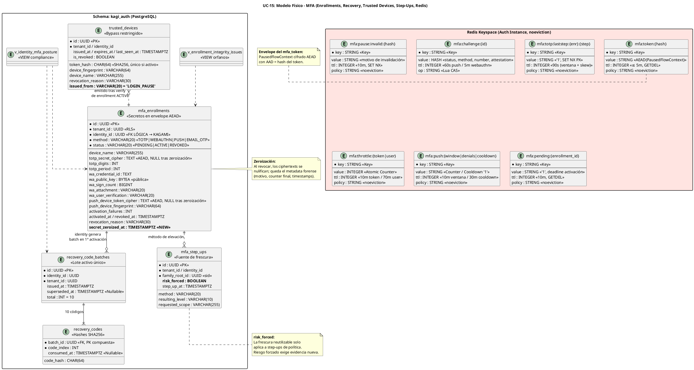

# UC-15: Multi-Factor Authentication (MFA) - Modelo de Datos Físico Específico (Enrollments, Recovery, Trusted Devices, Step-Ups y Keyspaces Redis)

| Metadatos del Documento | |
| :--- | :--- |
| **Proyecto:** | SHUGO - Identity & Access Platform |
| **Caso de Uso:** | UC-15 - Multi-Factor Authentication (MFA - TOTP, WebAuthn/FIDO2, Push, Recovery) |
| **Documento:** | 10_UC_Specific_Data_Model.md |
| **Metodología:** | Physical Data Modeling + Cryptographic Envelopes at Rest + Zeroization on Revocation + Redis Capacity Planning |
| **Base de Datos:** | PostgreSQL 15+ (Enrollments, Recovery, Trusted Devices, Step-Ups) + Redis 7+ (Tokens, Challenges, Replay, Throttle, Cooldowns — política `noeviction`) |
| **Autor:** | Gastón Ruiz |
| **Versión Actual:** | 1.0.0 |
| **Fecha:** | 23/10/2026 |

---

## Historial de Versiones

| Versión | Fecha | Autor | Descripción de Cambios | Impacto |
| :--- | :--- | :--- | :--- | :--- |
| **1.0.0** | 23/10/2026 | Gastón Ruiz | **Creación inicial.** Definición del modelo de datos físico para MFA: tabla `mfa_enrollments` con payloads por método (secreto TOTP y device token push en **envelope AEAD con keyVersion**, credential WebAuthn con counter), unicidades parciales por semántica de método, y **zeroización de secretos al revocar** conservando metadatos forenses; tablas `recovery_code_batches`/`recovery_codes` (hashes SHA256, lote activo único por identidad, consumo condicional single-use); `trusted_devices` (tokens opacos hasheados, invariante `issued_from='LOGIN_PAUSE'`); `mfa_step_ups` (fuente de frescura por `family_root_id` con flag `risk_forced`); vistas de postura MFA e integridad cross-context; y los diez keyspaces Redis de MFA con operaciones GETDEL/CAS/SET-NX y capacity planning (~35 MB pico). | Documento de referencia para DBAs y SREs. Garantiza que los secretos de segundo factor sean ciphertext versionado en reposo e ilegibles tras revocación, que el break-glass sea single-use con lote activo único, que el bypass de trusted device no pueda emitirse fuera de login, y que la frescura de step-up distinga elevaciones de política de las forzadas por riesgo. |

---

## 1. Introducción y Propósito

Este documento define las extensiones y consideraciones físicas específicas para soportar el **UC-15 (Multi-Factor Authentication)**.

Los datos de MFA tienen una naturaleza distinta a los de sesión (UC-11/12/13) y federación (UC-14): son **credenciales de larga vida con secretos reales** (TOTP, device tokens), **artefactos de evidencia** (counters, códigos de recuperación), y **conveniencias restringidas** (trusted devices). El modelo responde a cinco responsabilidades:

1. **Secretos cifrados con sobre versionado:** El secreto TOTP y el device token push nunca se almacenan en plaintext; viajan en un envelope AEAD con `keyVersion` que permite rotación de claves KMS sin re-enroll masivo.
2. **Zeroización al revocar:** Una credencial revocada (especialmente por clonación) **deja de contener material útil**: los ciphertexts se nulifican conservando solo metadatos forenses.
3. **Unicidades con semántica por método:** Un solo TOTP activo por identidad, múltiples WebAuthn por credential, múltiples push por dispositivo — expresado con índices parciales, no con lógica de aplicación.
4. **Break-glass auditado por diseño:** Lote activo único por identidad, códigos single-use por UPDATE condicional, y bandera de revisión en la identidad consumidora.
5. **Frescura de step-up con origen del disparador:** La tabla `mfa_step_ups` registra `risk_forced`, haciendo imposible reutilizar una elevación obtenida bajo riesgo para evadir un riesgo posterior.

---

## 2. Diagrama de Modelo de Datos Físico (ERD de MFA)



---

## 3. Scripts DDL: Tablas, Índices y Vistas

### 3.1. Tabla `mfa_enrollments` (Credenciales con Envelopes AEAD)

```sql
SET search_path TO kagi_auth;

CREATE TABLE kagi_auth.mfa_enrollments (
    id UUID PRIMARY KEY DEFAULT gen_random_uuid(),
    tenant_id UUID NOT NULL,
    identity_id UUID NOT NULL,          -- FK LÓGICA → kagami.identities (cross-context)
    method VARCHAR(20) NOT NULL
        CHECK (method IN ('TOTP', 'WEBAUTHN', 'PUSH', 'EMAIL_OTP')),
    status VARCHAR(20) NOT NULL DEFAULT 'PENDING'
        CHECK (status IN ('PENDING', 'ACTIVE', 'REVOKED')),
    device_name VARCHAR(255),

    -- Payload TOTP: secreto en envelope AEAD (formato §4.2), jamás plaintext
    totp_secret_cipher TEXT,
    totp_digits INT CHECK (totp_digits IN (6, 8)),
    totp_period INT CHECK (totp_period = 30),

    -- Payload WebAuthn: la clave pública NO es secreto; el counter es evidencia de clonación
    wa_credential_id TEXT,
    wa_public_key BYTEA,
    wa_sign_count BIGINT NOT NULL DEFAULT 0,
    wa_attachment VARCHAR(20) CHECK (wa_attachment IN ('platform', 'cross-platform')),
    wa_user_verification VARCHAR(20),

    -- Payload Push: device token en envelope AEAD (permite enviar pushes: privacy-relevante)
    push_device_token_cipher TEXT,
    push_device_fingerprint VARCHAR(64),

    -- Ciclo de vida
    activation_failures INT NOT NULL DEFAULT 0,
    created_at TIMESTAMPTZ NOT NULL DEFAULT NOW(),
    activated_at TIMESTAMPTZ,
    revoked_at TIMESTAMPTZ,
    revocation_reason VARCHAR(30)
        CHECK (revocation_reason IN ('USER', 'ADMIN', 'CLONE_DETECTED', 'SECURITY_POLICY')),
    secret_zeroized_at TIMESTAMPTZ,

    -- Coherencia payload ↔ método
    CONSTRAINT chk_enr_payload CHECK (
        (method = 'TOTP'     AND totp_secret_cipher IS NOT NULL) OR
        (method = 'WEBAUTHN' AND wa_credential_id IS NOT NULL AND wa_public_key IS NOT NULL) OR
        (method = 'PUSH'     AND push_device_token_cipher IS NOT NULL AND push_device_fingerprint IS NOT NULL) OR
        (method = 'EMAIL_OTP')
    ),
    -- Coherencia de estado
    CONSTRAINT chk_enr_lifecycle CHECK (
        (status = 'PENDING' AND activated_at IS NULL AND revoked_at IS NULL) OR
        (status = 'ACTIVE'  AND activated_at IS NOT NULL AND revoked_at IS NULL) OR
        (status = 'REVOKED' AND revoked_at IS NOT NULL AND revocation_reason IS NOT NULL)
    ),
    -- Zeroización solo con credencial revocada
    CONSTRAINT chk_enr_zeroization CHECK (
        secret_zeroized_at IS NULL OR status = 'REVOKED'
    )
);

-- Semántica de unicidad POR MÉTODO (índices parciales):
-- Un solo TOTP activo por identidad
CREATE UNIQUE INDEX uq_enr_active_totp
    ON kagi_auth.mfa_enrollments (identity_id)
    WHERE method = 'TOTP' AND status = 'ACTIVE';

-- Múltiples WebAuthn, pero una credential única por identidad
CREATE UNIQUE INDEX uq_enr_active_webauthn
    ON kagi_auth.mfa_enrollments (identity_id, wa_credential_id)
    WHERE method = 'WEBAUTHN' AND status = 'ACTIVE';

-- Múltiples push, pero un dispositivo único por identidad
CREATE UNIQUE INDEX uq_enr_active_push
    ON kagi_auth.mfa_enrollments (identity_id, push_device_fingerprint)
    WHERE method = 'PUSH' AND status = 'ACTIVE';

-- Caminos calientes: lookup de activos por identidad y por método
CREATE INDEX idx_enr_identity_active
    ON kagi_auth.mfa_enrollments (identity_id, method)
    WHERE status = 'ACTIVE';

-- Postura y forense: revocaciones por motivo (clonaciones)
CREATE INDEX idx_enr_revoked_reason
    ON kagi_auth.mfa_enrollments (revoked_at DESC)
    WHERE status = 'REVOKED';

-- RLS por tenant
ALTER TABLE kagi_auth.mfa_enrollments ENABLE ROW LEVEL SECURITY;
ALTER TABLE kagi_auth.mfa_enrollments FORCE ROW LEVEL SECURITY;
CREATE POLICY enr_tenant_isolation ON kagi_auth.mfa_enrollments
    FOR ALL
    USING (tenant_id = current_setting('app.current_tenant_id', true)::uuid)
    WITH CHECK (tenant_id = current_setting('app.current_tenant_id', true)::uuid);

COMMENT ON COLUMN kagi_auth.mfa_enrollments.totp_secret_cipher IS
    'Envelope AEAD: Base64Url(keyVersion||nonce||ct||tag), AAD = enrollment_id. Plaintext solo en memoria durante verificación.';
COMMENT ON COLUMN kagi_auth.mfa_enrollments.secret_zeroized_at IS
    'Timestamp de zeroización: los ciphertexts se nulifican al revocar; el metadata forense se conserva.';
```

### 3.2. Recovery Codes (Lote Activo Único, Single-Use)

```sql
CREATE TABLE kagi_auth.recovery_code_batches (
    id UUID PRIMARY KEY DEFAULT gen_random_uuid(),
    identity_id UUID NOT NULL,
    tenant_id UUID NOT NULL,
    issued_at TIMESTAMPTZ NOT NULL DEFAULT NOW(),
    superseded_at TIMESTAMPTZ,                 -- regeneración supersede el lote completo
    total INT NOT NULL DEFAULT 10,
    CONSTRAINT chk_batch_size CHECK (total = 10)
);

-- Exactamente UN lote activo por identidad
CREATE UNIQUE INDEX uq_recovery_active_batch
    ON kagi_auth.recovery_code_batches (identity_id)
    WHERE superseded_at IS NULL;

CREATE TABLE kagi_auth.recovery_codes (
    batch_id UUID NOT NULL REFERENCES kagi_auth.recovery_code_batches (id) ON DELETE CASCADE,
    code_index INT NOT NULL CHECK (code_index BETWEEN 0 AND 9),
    code_hash CHAR(64) NOT NULL,               -- SHA256 hex; entropía ≥128 bits → sin salt
    consumed_at TIMESTAMPTZ,
    PRIMARY KEY (batch_id, code_index)
);

-- Consumo single-use: UPDATE condicional (el dominio usa este patrón)
-- UPDATE recovery_codes SET consumed_at = NOW()
--  WHERE batch_id = :batch AND code_hash = :hash AND consumed_at IS NULL
--  RETURNING code_index;   -- 0 filas = ya consumido o inexistente

COMMENT ON TABLE kagi_auth.recovery_codes IS
    'Solo hashes. El plaintext se muestra UNA vez en la activación y jamás se persiste, loguea o metrica.';
```

### 3.3. Trusted Devices (Bypass Restringido)

```sql
CREATE TABLE kagi_auth.trusted_devices (
    id UUID PRIMARY KEY DEFAULT gen_random_uuid(),
    tenant_id UUID NOT NULL,
    identity_id UUID NOT NULL,
    token_hash CHAR(64) NOT NULL,              -- SHA256 del opaco 256 bits
    device_fingerprint VARCHAR(64) NOT NULL,
    device_name VARCHAR(255),
    issued_at TIMESTAMPTZ NOT NULL DEFAULT NOW(),
    expires_at TIMESTAMPTZ NOT NULL,
    last_seen_at TIMESTAMPTZ,
    is_revoked BOOLEAN NOT NULL DEFAULT FALSE,
    revoked_at TIMESTAMPTZ,
    revocation_reason VARCHAR(30)
        CHECK (revocation_reason IN ('USER', 'RISK', 'ADMIN', 'EXPIRED_HYGIENE')),
    -- INV-104 materializado como dato: el bypass SOLO nace de login pause
    issued_from VARCHAR(20) NOT NULL DEFAULT 'LOGIN_PAUSE'
        CHECK (issued_from = 'LOGIN_PAUSE'),
    CONSTRAINT chk_td_revocation CHECK (
        (is_revoked = FALSE AND revoked_at IS NULL) OR
        (is_revoked = TRUE AND revoked_at IS NOT NULL AND revocation_reason IS NOT NULL)
    )
);

CREATE UNIQUE INDEX uq_td_token_hash_active
    ON kagi_auth.trusted_devices (token_hash)
    WHERE is_revoked = FALSE;

CREATE INDEX idx_td_identity_active
    ON kagi_auth.trusted_devices (identity_id, expires_at DESC)
    WHERE is_revoked = FALSE;

COMMENT ON COLUMN kagi_auth.trusted_devices.issued_from IS
    'Invariante física: nunca step-up, nunca emisión bajo política PR/AAL3 (validado además en dominio).';
```

### 3.4. Step-Ups (Fuente de Frescura con Origen del Disparador)

```sql
CREATE TABLE kagi_auth.mfa_step_ups (
    id UUID PRIMARY KEY DEFAULT gen_random_uuid(),
    tenant_id UUID NOT NULL,
    identity_id UUID NOT NULL,
    family_root_id UUID NOT NULL,              -- sid: elevación vinculada a la familia
    method VARCHAR(20) NOT NULL,               -- método que produjo la evidencia
    resulting_level VARCHAR(10) NOT NULL CHECK (resulting_level IN ('AAL2', 'AAL3')),
    requested_scope VARCHAR(255),              -- scope sensible que disparó (KIZUNA)
    risk_forced BOOLEAN NOT NULL DEFAULT FALSE, -- TRUE si el disparador fue UC-17
    step_up_at TIMESTAMPTZ NOT NULL DEFAULT NOW()
);

-- Consulta de frescura: última elevación NO forzada por riesgo para un sid
CREATE INDEX idx_stepups_family_recent
    ON kagi_auth.mfa_step_ups (family_root_id, step_up_at DESC);

-- Auditoría de elevaciones por identidad (compliance, SOC 2)
CREATE INDEX idx_stepups_identity_recent
    ON kagi_auth.mfa_step_ups (identity_id, step_up_at DESC);

COMMENT ON COLUMN kagi_auth.mfa_step_ups.risk_forced IS
    'ADR-15-04: la frescura reutilizable solo aplica a step-ups de política (risk_forced = FALSE). Un riesgo emergente exige evidencia nueva.';
```

### 3.5. Vistas de Postura e Integridad

```sql
-- Postura MFA por identidad (UC-22/UC-23, reportes de compliance, campañas de adopción)
CREATE OR REPLACE VIEW kagi_auth.v_identity_mfa_posture AS
SELECT e.identity_id,
       e.tenant_id,
       array_agg(DISTINCT e.method) FILTER (WHERE e.status = 'ACTIVE') AS active_methods,
       bool_or(e.method = 'WEBAUTHN' AND e.status = 'ACTIVE')          AS has_phishing_resistant,
       EXISTS (SELECT 1 FROM kagi_auth.recovery_code_batches b
                WHERE b.identity_id = e.identity_id AND b.superseded_at IS NULL) AS has_recovery_batch,
       (SELECT COUNT(*) FROM kagi_auth.trusted_devices td
         WHERE td.identity_id = e.identity_id AND td.is_revoked = FALSE
           AND td.expires_at > NOW())                                   AS active_trusted_devices,
       (SELECT MAX(s.step_up_at) FROM kagi_auth.mfa_step_ups s
         WHERE s.identity_id = e.identity_id)                           AS last_step_up_at
FROM kagi_auth.mfa_enrollments e
GROUP BY e.identity_id, e.tenant_id;

-- Integridad cross-context: enrollments huérfanos (identidad purgada sin consumidor)
CREATE OR REPLACE VIEW kagi_auth.v_enrollment_integrity_issues AS
SELECT e.id, e.tenant_id, e.identity_id, e.method, e.status
FROM kagi_auth.mfa_enrollments e
LEFT JOIN kagi_auth.identity_auth_snapshot ias ON ias.identity_id = e.identity_id
WHERE ias.identity_id IS NULL;

COMMENT ON VIEW kagi_auth.v_enrollment_integrity_issues IS
    'Debe retornar 0 filas. Cualquier fila indica falla del consumidor de Identity.Purged (UC-05).';
```

---

## 4. Modelo de Datos en Redis (Keyspaces de MFA)

### 4.1. Estructura de Claves

| Patrón de Clave | Tipo | Valor | TTL | Operación crítica |
| :--- | :--- | :--- | :--- | :--- |
| `mfa:token:{sha256(mfa_token)}` | String | **Envelope AEAD** de `PausedFlowContext` (ver §4.2) | ≤ 5 min (expiry del contexto) | `GET` en challenge (peek), `GETDEL` en verify (consumo) |
| `mfa:pause:invalid:{sha256(mfa_token)}` | String | Motivo de invalidación | 10 min | `SET NX` (invalidación idempotente) |
| `mfa:challenge:{challenge_id}` | Hash | `status, method, context_ref, number, enrollment_id, denial_count, payload` | 60 s push / 5 min webauthn | Lua CAS `HSET status` de→a; `HGETALL` polling; `DEL` en consumo |
| `mfa:totp:laststep:{enrollment_id}:{step}` | String | `"1"` | 90 s (2 períodos + skew) | `SET NX PX` (replay guard post-verificación) |
| `mfa:throttle:token:{reference_id}` | String (int) | Fallos por mfa_token | 10 min | `INCR` / `GET` |
| `mfa:throttle:user:{identity_id}:{yyyyMMddHH}` | String (int) | Fallos por usuario/hora | 70 min | `INCR EX` / `GET` |
| `mfa:push:window:{device_fingerprint}` | String (int) | Challenges push en ventana | 10 min | `INCR EX` |
| `mfa:push:denials:{device_fingerprint}` | String (int) | Denegaciones consecutivas | 10 min | `INCR EX`; `DEL` tras aprobación |
| `mfa:push:cooldown:{device_fingerprint}` | String | `"1"` | 30 min | `SET EX` / `EXISTS` |
| `mfa:pending:{enrollment_id}` | String | `"1"` | 10 min | Deadline de activación; `GETDEL` en activación |

### 4.2. Envelope Criptográfico (mfa_token y Secretos)

El `PausedFlowContext` dentro de `mfa:token:*` contiene `identity_id`, `device_fingerprint` y la referencia de la pausa. Se cifra con el mismo formato que la federación (UC-14) y la Grace Cache (UC-13):

```text
valor = Base64Url( keyVersion:1 byte || nonce:12 bytes || ct || tag:16 bytes )
AAD   = sha256(mfa_token)        → imposible trasplantar contextos entre tokens
clave = data key KMS de KAGI (cacheada en memoria, rotación por keyVersion)
```

**Justificación:** Un compromiso de lectura de Redis durante los ≤5 min de vida del token no revela el contexto de la pausa ni permite fabricar consumos; y el AAD impide mover un contexto válido a otro token.

### 4.3. Lua CAS del Challenge Push

```lua
-- KEYS[1] = mfa:challenge:{id}
-- ARGV[1] = estado esperado (from), ARGV[2] = estado objetivo (to)
local current = redis.call('HGET', KEYS[1], 'status')
if current == false then return -1 end          -- expirado/ausente
if current ~= ARGV[1] then return 0 end         -- perdió la carrera (AlreadyResolved)
redis.call('HSET', KEYS[1], 'status', ARGV[2])
return 1                                        -- ganador
```

La carrera approve/deny se resuelve aquí: exactamente una transición gana; la perdedora retorna `0` y el handler responde `AlreadyResolved` con 200 al dispositivo (contrato push).

### 4.4. Requisito Reafirmado: `noeviction`

Los keyspaces de MFA comparten la instancia Redis Auth con UC-11/12/13/14. Bajo `noeviction`:
- Una evicción de `mfa:token:*` permitiría re-presentar un mfa_token "desaparecido" contra un replay guard ausente.
- Una evicción de `mfa:totp:laststep:*` habilitaría replay de códigos dentro de su ventana.
- Una evicción de `mfa:throttle:*` reiniciaría el presupuesto de brute-force del atacante.

La política `noeviction` es condición de seguridad de MFA, no optimización.

### 4.5. Capacity Planning de los Keyspaces de MFA

| Keyspace | Concurrencia pico | Tamaño/entrada | Memoria pico |
| :--- | :--- | :--- | :--- |
| `mfa:token:*` | 200 pausas/s × 300 s = 60.000 | ~260 B | **~15 MB** |
| `mfa:challenge:*` | 500 verify/s × 60 s (mezcla push-dominante) = 30.000 | ~220 B | **~7 MB** |
| `mfa:totp:laststep:*` | 350 TOTP/s × 90 s = 31.500 | ~90 B | **~3 MB** |
| `mfa:throttle:*` + `mfa:push:*` | Usuarios activos en ventana | ~80 B | **< 2 MB** |
| **Total MFA** | — | — | **~27 MB** |

Sumado a UC-11/12/13 (~130 MB) y UC-14 (~100 MB): la instancia de 2 GB `noeviction` opera bajo el **13% de ocupación** en el peor pico simultáneo de toda la autenticación.

---

## 5. Secretos en Reposo y Zeroización

### 5.1. Disciplina de Secretos por Método

| Material | Sensibilidad | Tratamiento en reposo | Tratamiento en memoria |
| :--- | :--- | :--- | :--- |
| Secreto TOTP | Crítico (permite generar códigos) | Envelope AEAD + AAD=enrollment_id | Decrypt → verify → `Clear()` en `finally` |
| Device token push | Privacy-relevante (permite enviar pushes) | Envelope AEAD | Decrypt solo para el despacho; `Clear()` inmediato |
| Clave pública WebAuthn | No secreta | BYTEA sin cifrar | n/a |
| Recovery codes | Críticos (break-glass) | **Solo SHA256**; plaintext mostrado una vez y nunca persistido | n/a |
| mfa_token context | Sensible (vincula pausa e identidad) | Envelope AEAD en Redis, TTL ≤5 min | n/a |
| Trusted device token | Sensible (bypass de login) | **Solo SHA256** en PostgreSQL | n/a |

### 5.2. Zeroización al Revocar

```sql
-- Ejecutado por el repositorio dentro de la TX de revocación
UPDATE kagi_auth.mfa_enrollments
SET status = 'REVOKED',
    revoked_at = NOW(),
    revocation_reason = :reason,
    totp_secret_cipher = NULL,          -- zeroización
    push_device_token_cipher = NULL,    -- zeroización
    secret_zeroized_at = NOW()
WHERE id = :enrollment_id AND status = 'ACTIVE';
```

**Justificación:** Tras una clonación confirmada (`CLONE_DETECTED`) o una revocación de seguridad, la fila deja de contener material aprovechable incluso para un atacante con acceso de lectura a la DB. El metadata forense (motivo, `wa_sign_count` final, timestamps) se conserva para la investigación; la evidencia completa vive en `MfaCloneDetected` (KAGE).

### 5.3. Rotación de Claves KMS sin Re-Enroll

El `keyVersion` del envelope permite rotar la data key de KAGI: los decrypts intentan la versión del sobre y, si está retirada, el flujo de verificación falla de forma segura (fail-secure) y se ofrece re-enrollment. No existe migración masiva de secretos — los envelopes antiguos simplemente dejan de ser descifrables.

---

## 6. Integridad Cross-Context

### 6.1. FKs Lógicas y Compensación

`mfa_enrollments.identity_id`, `recovery_code_batches.identity_id` y `trusted_devices.identity_id` referencian **KAGAMI** (contexto Identity Lifecycle) sin FK física:

1. **Creación solo por caminos de dominio:** `EnrollmentManager`, `RecoveryCodeVerifier` (consumo) y `TrustedDeviceBroker`.
2. **Consumidor de `Identity.Purged` (UC-05):** elimina enrollments, batches, trusted devices y step-ups de la identidad purgada (derecho al olvido GDPR).
3. **Vista de orfanos alertada:** `v_enrollment_integrity_issues` cada hora; cualquier fila es alerta Alta.

### 6.2. Interacción con el Flag de Revisión

El consumo de un recovery code fija `mfa_review_required` en la identidad (KAGAMI) vía el gateway cross-context, en la misma operación lógica que el consumo. El flag se limpia cuando el usuario completa el re-enrollment o la revisión administrativa (UC-21/UC-22).

---

## 7. Retención y Limpieza

| Objeto | Retención | Mecanismo |
| :--- | :--- | :--- |
| Enrollments `PENDING` | 10 min | TTL Redis `mfa:pending:*` + job horario que cancela pendings expirados en DB |
| Enrollments `ACTIVE` | Vida de la identidad | Purge por consumidor de `Identity.Purged` |
| Enrollments `REVOKED` | Indefinida (metadata), secretos zeroizados | Sin purge: forense de revocaciones; filas pequeñas |
| Recovery batches `superseded` | 90 días tras supersede | Job de limpieza (los hashes sin lote activo carecen de valor operativo) |
| Trusted devices expirados | Marcados `EXPIRED_HYGIENE` por job diario; purge a 90 días | Job `cleanup_trusted_devices` |
| `mfa_step_ups` | 90 días (ventana de auditoría de elevaciones) | Particionamiento mensual + drop |
| Keyspaces Redis | TTL natural | Sin jobs |
| Eventos de verificación/detección | 7 años en KAGE | Outbox → KAGE (incluye `MfaCloneDetected`, `MfaRecovery.Used`) |

```sql
CREATE OR REPLACE FUNCTION kagi_auth.cleanup_mfa_hygiene(p_retention_days INT DEFAULT 90)
RETURNS TABLE(stepups_deleted INT, trusted_purged INT, batches_purged INT) AS $$
DECLARE s INT; t INT; b INT;
BEGIN
    DELETE FROM kagi_auth.mfa_step_ups
    WHERE step_up_at < NOW() - (p_retention_days || ' days')::INTERVAL;
    GET DIAGNOSTICS s = ROW_COUNT;

    UPDATE kagi_auth.trusted_devices
    SET is_revoked = TRUE, revoked_at = NOW(), revocation_reason = 'EXPIRED_HYGIENE'
    WHERE is_revoked = FALSE AND expires_at < NOW();

    DELETE FROM kagi_auth.trusted_devices
    WHERE is_revoked = TRUE AND revoked_at < NOW() - (p_retention_days || ' days')::INTERVAL;
    GET DIAGNOSTICS t = ROW_COUNT;

    DELETE FROM kagi_auth.recovery_code_batches
    WHERE superseded_at IS NOT NULL
      AND superseded_at < NOW() - (p_retention_days || ' days')::INTERVAL;
    GET DIAGNOSTICS b = ROW_COUNT;

    RETURN QUERY SELECT s, t, b;
END;
$$ LANGUAGE plpgsql;
```

---

## 8. Monitoreo y Diagnóstico

### 8.1. Consultas Operativas y Forenses

```sql
-- 1. Clonaciones confirmadas (forense de incidentes)
SELECT e.identity_id, e.tenant_id, e.device_name, e.wa_sign_count AS counter_final,
       e.revoked_at
FROM kagi_auth.mfa_enrollments e
WHERE e.revocation_reason = 'CLONE_DETECTED'
  AND e.revoked_at > NOW() - INTERVAL '24 hours'
ORDER BY e.revoked_at DESC;

-- 2. Postura MFA de un tenant (adopción y cumplimiento)
SELECT tenant_id,
       COUNT(*) FILTER (WHERE has_phishing_resistant) AS identidades_con_pr,
       COUNT(*) FILTER (WHERE has_recovery_batch)     AS identidades_con_breakglass,
       COUNT(*) FILTER (WHERE active_trusted_devices > 0) AS identidades_con_bypass
FROM kagi_auth.v_identity_mfa_posture
GROUP BY tenant_id;

-- 3. Elevaciones recientes por scope (auditoría de step-up)
SELECT identity_id, requested_scope, method, resulting_level, risk_forced, step_up_at
FROM kagi_auth.mfa_step_ups
WHERE step_up_at > NOW() - INTERVAL '24 hours'
ORDER BY step_up_at DESC;

-- 4. Frescura de step-up (la consulta del dominio)
SELECT step_up_at, resulting_level, risk_forced
FROM kagi_auth.mfa_step_ups
WHERE family_root_id = :sid AND risk_forced = FALSE
ORDER BY step_up_at DESC LIMIT 1;

-- 5. Trusted devices activos con expiración próxima (higiene)
SELECT identity_id, device_name, device_fingerprint, expires_at
FROM kagi_auth.trusted_devices
WHERE is_revoked = FALSE AND expires_at < NOW() + INTERVAL '48 hours';

-- 6. Integridad cross-context (debe retornar 0 filas)
SELECT COUNT(*) AS orphan_enrollments FROM kagi_auth.v_enrollment_integrity_issues;
```

### 8.2. Alertas de Integridad de Datos

| Alerta | Condición | Severidad | Acción |
| :--- | :--- | :--- | :--- |
| **Orphan Enrollments** | `v_enrollment_integrity_issues` > 0 | Alta | Falla del consumidor `Identity.Purged`; purgar manualmente y auditar el gap. |
| **Active Batch Violation Attempt** | Error `uq_recovery_active_batch` en logs | Alta | Intento de crear segundo lote activo: verificar que la regeneración haya pasado por supersede. |
| **Zeroization Gap** | Enrollments REVOKED con `secret_zeroized_at IS NULL` y `revoked_at < NOW() - 1h` | **Crítica** | La zeroización no se ejecutó en la revocación: riesgo de secretos aprovechables en DB. Ejecutar zeroización manual y revisar el path de revocación. |
| **Trusted Device Emission Anomaly** | `trusted_devices` con `issued_from != 'LOGIN_PAUSE'` | **Crítica** | Violación del CHECK: bug o escritura fuera de camino; revocar lote afectado. |
| **Step-Up Freshness Drift** | Divergencia entre `stepup_reused_total` y filas de `mfa_step_ups` con `risk_forced=FALSE` | Media | Posible reuso de frescura mal registrado; auditar `IStepUpFreshnessQuery`. |
| **Redis MFA Memory Drift** | Memoria de `mfa:*` diverge >20% de la curva teórica | Media | Fugas de TTL o keyspace contaminado; auditar PX/NX de los adapters. |

---

## 9. Trazabilidad

| Documento | Relación |
| :--- | :--- |
| `01_Requirements_Specification.md` | INV-97 (envelope del mfa_token), INV-98 (replay keyspaces), INV-99 (counter columna + zeroización), INV-102 (batch único + single-use), INV-103 (`mfa_step_ups`), INV-104 (`issued_from` CHECK), RN-33 (`mfa:pending:*` + activation_failures), RN-34 (keyspaces push). |
| `04_Initial_Domain_Model.md` | `MfaEnrollment`, `RecoveryCodeBatch`, `MfaChallenge`, `TrustedDeviceCredential` y `PausedFlowContext` se persisten en las tablas y keyspaces definidos aquí. |
| `05_State_Machine_Diagram.md` | Las transiciones PENDING→ACTIVE→REVOKED, ISSUED→APPROVED/DENIED y PENDING→CONSUMED/INVALIDATED persisten en `status`, el hash CAS y GETDEL respectivamente. |
| `08_Final_Class_Design.md` | `KagamiMfaEnrollmentRepository` (zeroización en la TX de revocación, `ActivateWithRecoveryAsync`), `RedisMfaChallengeStore` (Lua CAS) y `RedisTotpReplayGuard` (SET NX PX) consumen exactamente estas estructuras. |
| `09_Modern_Artifacts.md` | Las métricas `clone_detected_total`, `recovery_used_total` y `trusted_device_issued_total` se alimentan de las columnas y vistas definidas aquí. |
| `UC-13/10_UC_Specific_Data_Model.md` | `mfa_step_ups.family_root_id` referencia la familia de `refresh_tokens`; la frescura consulta el mismo `sid` que el back-channel logout usa para revocar. |
| `UC-14/10_UC_Specific_Data_Model.md` | El envelope AEAD del mfa_token reutiliza el formato y la disciplina de keyVersion de `federate:tx:*`. |
| `UC-05 (Purge)` | El consumidor de `Identity.Purged` elimina enrollments, batches, trusted devices y step-ups (derecho al olvido). |

---

## 10. Anexos: Glosario de Base de Datos (UC-15)

| Término | Definición en Contexto UC-15 |
| :--- | :--- |
| **Envelope AEAD** | Sobre criptográfico `Base64Url(keyVersion‖nonce‖ct‖tag)` con AAD por clave; usado para secretos TOTP, device tokens push y el contexto del mfa_token. |
| **Zeroization** | Nulificación de ciphertexts al revocar un enrollment, conservando metadata forense; convierte una DB comprometida en estéril para credenciales revocadas. |
| **KeyVersion** | Prefijo del envelope que permite rotación de claves KMS: los sobres con versión retirada fallan el descifrado de forma segura (fail-secure + re-enrollment). |
| **Unicidad por Semántica de Método** | Índices parciales que expresan las reglas reales: un TOTP por identidad, múltiples WebAuthn por credential, múltiples push por dispositivo. |
| **Lote Activo Único** | Índice parcial que garantiza exactamente un `recovery_code_batch` sin supersede por identidad; la regeneración supersede antes de crear. |
| **Consumo Condicional** | `UPDATE ... WHERE consumed_at IS NULL RETURNING` como primitiva single-use de recovery codes sin locks explícitos. |
| **Fuente de Frescura** | `mfa_step_ups` como registro consultable de elevaciones por `family_root_id`, con `risk_forced` para distinguir reuso legítimo de evasión de riesgo. |
| **Postura MFA** | Vista agregada por identidad (métodos activos, PR, break-glass, bypass, último step-up) para adopción, compliance y UC-22/23. |

---
*Fin del Documento 10_UC_Specific_Data_Model para UC-15*