# UC-15: Multi-Factor Authentication (MFA) - Análisis de Amenazas Específico (Security Threat Model)

| Metadatos del Documento | |
| :--- | :--- |
| **Proyecto:** | SHUGO - Identity & Access Platform |
| **Caso de Uso:** | UC-15 - Multi-Factor Authentication (MFA - TOTP, WebAuthn/FIDO2, Push, Recovery) |
| **Documento:** | 11_UC_Specific_Security_Threats.md |
| **Metodología:** | STRIDE + DREAD + Attack Trees + Defense-in-Depth + Threat-Driven Hardening |
| **Estándares:** | NIST SP 800-63B (AAL2/AAL3, Restricted Authenticators, Verifier Impersonation Resistance), RFC 6238, W3C WebAuthn Level 2, OWASP ASVS 4.0 (V2) + OWASP MFA Cheat Sheet, PSD2 SCA RTS, GDPR Art. 32, SOC 2 CC6.1/CC7.2, ISO 27001:2022 A.5.18/A.8.15 |
| **Autor:** | Gastón Ruiz |
| **Versión Actual:** | 1.0.0 |
| **Fecha:** | 23/10/2026 |

---

## Historial de Versiones

| Versión | Fecha | Autor | Descripción de Cambios | Impacto |
| :--- | :--- | :--- | :--- | :--- |
| **1.0.0** | 23/10/2026 | Gastón Ruiz | **Creación inicial.** Análisis exhaustivo de amenazas específicas para el segundo factor. Evalúa 10 vectores usando STRIDE+DREAD: brute-force del espacio de 6 dígitos, relay/replay de TOTP, clonación de authenticators WebAuthn, push fatigue y phishing de aprobaciones, robo de recovery codes, interceptación y reciclaje de mfa_token, abuso de trusted devices, secuestro de enrollments, y oráculos de verificación. Introduce hardening threat-driven: **verificación dummy anti-enumeración** cuando el enrollment no existe, política explícita para authenticators WebAuthn sin counter, y el modelo de contención de clonación como señal forense (firma válida + counter stale). | Documento crítico de seguridad del UC-15. Convierte cada ataque a los métodos en un control concreto (throttling, replay guard, CAS, zeroización, dummy HMAC) y en una señal observable (clone, replay, fatigue, token_reuse), cerrando el segundo factor como un sistema donde el adversario paga costo detectable por cada intento. |

---

## 1. Introducción y Alcance

Este documento presenta el **Análisis de Amenazas Específico** para el UC-15 (Multi-Factor Authentication).

El segundo factor es el punto donde el adversario **ya superó el primer factor** (password, federación) y ataca directamente a los mecanismos de verificación. Esto cambia la naturaleza de las amenazas respecto a UC-11/14:

1. **El atacante llega con medio camino recorrido:** Posee el primer factor o un `mfa_token` válido; cada intento de prueba es un intento contra el segundo factor con contexto legítimo.
2. **Los métodos son el objetivo:** TOTP tiene un espacio de 6 dígitos; WebAuthn tiene authenticators clonables; Push tiene usuarios fatigables; los recovery codes son secretos estáticos robables. Cada método exige su propio modelo de ataque.
3. **Las conveniencias son superficies:** Trusted devices y reuso de frescura de step-up reducen fricción legítima pero crean caminos que el atacante intentará explotar.
4. **El tiempo es un arma:** Ventanas de skew, TTLs de challenges, y freshness de elevaciones son parámetros que el adversario intentará estirar o vencer por carrera.

Este documento modela estos vectores y define mitigaciones que respetan el principio del UC: **cada intento del adversario cuesta un evento observable, un presupuesto finito, o una contención automática.**

---

## 2. Attack Trees (Árboles de Ataque)

### 2.1. Attack Tree #1: Vencer el Segundo Factor para Completar la Autenticación

**Objetivo del Atacante:** Producir una `AssuranceEvidence` aceptada con un `mfa_token` o sesión que controla.

```plantuml
@startuml AttackTree_UC-15_Defeat
skinparam defaultFontName Consolas
skinparam backgroundColor #FEFEFE

title Attack Tree: Vencer el Segundo Factor (UC-15)

rectangle "Root: Completar verificación MFA con evidencia aceptada" as ROOT {

    rectangle "1. Adivinar la prueba (brute-force)" as T1 {
        "1.1 TOTP: agotar espacio de 6 dígitos\ndentro de la ventana del mfa_token" as T1_1
        "1.2 Recovery code: adivinar código\n(entropía ≥128 bits)" as T1_2
    }

    rectangle "2. Reutilizar pruebas válidas (replay/relay)" as T2 {
        "2.1 Replay de código TOTP en el mismo step" as T2_1
        "2.2 Relay en tiempo real: phishing proxy\nque reenvía código mientras es válido" as T2_2
        "2.3 Replay de assertion WebAuthn capturada" as T2_3
        "2.4 Reuso de mfa_token robado antes\nque la víctima lo consuma" as T2_4
    }

    rectangle "3. Comprometer o clonar el factor" as T3 {
        "3.1 Clonar authenticator WebAuthn\n(copiar clave privada)" as T3_1
        "3.2 Robar recovery codes almacenados\n(backup, gestor, screenshot)" as T3_2
        "3.3 Comprometer dispositivo push\n(eludir attestation)" as T3_3
    }

    rectangle "4. Explotar conveniencias" as T4 {
        "4.1 Robar trusted_device_token\n(bypass de login)" as T4_1
        "4.2 Reutilizar frescura de step-up\ntras riesgo emergente" as T4_2
    }
}

ROOT --> T1
ROOT --> T2
ROOT --> T3
ROOT --> T4

T1 --> T1_1
T1 --> T1_2
T2 --> T2_1
T2 --> T2_2
T2 --> T2_3
T2 --> T2_4
T3 --> T3_1
T3 --> T3_2
T3 --> T3_3
T4 --> T4_1
T4 --> T4_2

note right of T1_1
  **Mitigación Elite:**
  5 intentos/token × 3 códigos válidos/30s
  ÷ 10^6 ≈ 1.5×10⁻⁵ por pausa.
  Throttling + consumo single-use
  hacen el ataque inviable.
end note

note right of T3_1
  **Mitigación Elite:**
  Counter monotónico: firma válida
  + counter stale = evidencia forense
  de clonación → contención automática.
end note

note bottom of T4_2
  **Mitigación Elite:**
  risk_forced = TRUE impide reuso
  de frescura: un riesgo emergente
  exige evidencia nueva.
end note

@enduml
```



### 2.2. Attack Tree #2: Ingeniería Social sobre el Canal de Aprobación

**Objetivo del Atacante:** Que el usuario legítimo apruebe una verificación iniciada por el atacante.

```text
[Root: Hacer que la víctima apruebe la sesión del atacante]
  |
  +-- [1. Push Fatigue]
  |     +-- 1.1 Bombardear con aprobaciones hasta que el usuario acepte por cansancio.
  |     |        (Mitigado: number matching obligatorio — aprobar exige transcribir el número
  |     |         visible en el flujo origen; rate limit 3/10min + cooldown 30min;
  |     |         3 denegaciones también enfrían; MfaPushFatigueSuspected alerta.)
  |     +-- 1.2 Bombardear fuera de horario para reducir atención.
  |            (Mitigado: el rate limit no distingue horario; el number matching sostiene la barrera.)
  |
  +-- [2. Pretexto y Urgencia]
  |     +-- 2.1 "Soporte técnico" induce a aprobar un push o leer un código.
  |     |        (Mitigado: number matching + documentación de que SHUGO nunca pide códigos;
  |     |         notificaciones con contexto de origen IP/geo para que el usuario detecte anomalía.)
  |     +-- 2.2 Inducir a usar recovery code "para recuperar acceso".
  |            (Mitigado: el uso dispara notificación + mfa_review_required; la víctima ve el uso.)
  |
  +-- [3. Manipulación del Dispositivo]
        +-- 3.1 Malware en el dispositivo push auto-aprueba.
        |        (Mitigado: device attestation contra enrollment registrado + autenticación local
        |         del dispositivo (biometría/PIN) antes de aprobar.)
        +-- 3.2 Robo físico del dispositivo con authenticator WebAuthn.
               (Mitigado: userVerification requerido (biometría/PIN del authenticator);
                el robo sin UV no produce assertions válidas.)
```

### 2.3. Attack Tree #3: Oráculos y Fugas de Información

**Objetivo del Atacante:** Extraer estado del sistema (enrollments, políticas, motivos de fallo) a través de diferencias observables.

```text
[Root: Convertir el flujo MFA en oráculo]
  |
  +-- [1. Enumeración de enrollments por timing]
  |     +-- 1.1 Medir diferencia de latencia entre "usuario sin TOTP" y "usuario con TOTP".
  |     |        (Mitigado: verificación dummy HMAC cuando el enrollment no existe,
  |     |         igualando el costo criptográfico del camino real.)
  |     +-- 1.2 Observar el challenge para inferir métodos disponibles.
  |            (Mitigado: la oferta de enrollment es neutra; el challenge de un método
  |             no revela la ausencia/presencia de otros.)
  |
  +-- [2. Diferenciación por respuesta o motivo]
  |     +-- 2.1 Distinguir "código inválido" de "token reutilizado" por el error HTTP.
  |            (Mitigado: los 13 FailReasons colapsan a mfa_failed idéntico;
  |             el motivo vive solo en métricas/auditoría.)
  |     +-- 2.2 Distinguir throttling de fallo criptográfico por latencia.
  |            (Mitigado: monitoreo de divergencia p50 por reason como detección de drift;
  |             throttling retorna por el mismo cuerpo genérico.)
  |
  +-- [3. Fuga de política por oferta]
        +-- 3.1 Inferir require_phishing_resistant porque solo se ofrece WebAuthn.
               (Mitigado: aceptado como revelación de política de seguridad — revelar que
                un tenant exige PR no ayuda al atacante; lo que no se revela es qué
                identidades concretas cumplen o no la política.)
```

---

## 3. Matriz de Amenazas Específicas (STRIDE + DREAD)

| ID | Amenaza | Categoría STRIDE | D | R | E | A | D | Score | Nivel |
| :--- | :--- | :--- | :---: | :---: | :---: | :---: | :---: | :---: | :---: |
| **T-107** | **Brute-force del espacio TOTP (6 dígitos)** | Spoofing | 8 | 6 | 6 | 7 | 6 | **6.6** | 🟠 |
| **T-108** | **Relay/Replay de TOTP (phishing en tiempo real)** | Spoofing | 9 | 6 | 6 | 8 | 5 | **6.8** | 🟠 |
| **T-109** | **Clonación de authenticator WebAuthn** | Tampering / Spoofing | 9 | 4 | 4 | 7 | 4 | **5.6** | 🟡 |
| **T-110** | **Push fatigue (bombardeo de aprobaciones)** | Social Engineering / DoS | 8 | 7 | 7 | 7 | 6 | **7.0** | 🟠 |
| **T-111** | **Phishing/compromiso del dispositivo push** | Spoofing | 8 | 5 | 5 | 6 | 5 | **5.8** | 🟡 |
| **T-112** | **Robo de recovery codes** | Information Disclosure | 8 | 5 | 5 | 6 | 5 | **5.8** | 🟡 |
| **T-113** | **Interceptación/reciclaje de mfa_token** | Spoofing / Replay | 8 | 6 | 5 | 7 | 5 | **6.2** | 🟠 |
| **T-114** | **Abuso de trusted device robado** | Elevation of Privilege | 8 | 5 | 5 | 7 | 5 | **6.0** | 🟠 |
| **T-115** | **Secuestro de enrollment / exposición de secreto** | Tampering | 8 | 4 | 4 | 6 | 4 | **5.2** | 🟡 |
| **T-116** | **Oráculos de verificación (timing/estado/política)** | Information Disclosure | 6 | 6 | 6 | 7 | 6 | **6.2** | 🟠 |

---

## 4. Análisis Detallado de Amenazas Críticas y Mitigaciones

### 4.1. 🟠 T-107: Brute-Force del Espacio TOTP

**Descripción:** Un atacante con un `mfa_token` válido (primer factor superado) intenta adivinar el código de 6 dígitos dentro de la ventana de vida del token.

**Análisis cuantitativo:**
- Espacio: 10^6 códigos por step de 30s.
- Códigos válidos por instante: 3 (step actual ± 1 de skew).
- Presupuesto por pausa: **5 intentos** (`max_attempts_per_token`) antes de invalidación.
- Probabilidad de éxito por pausa: 5 × 3 / 10^6 = **1.5 × 10⁻⁵**.
- Con 10.000 pausas atacadas simultáneamente: ~0.15 éxitos — y cada pausa atacada es un `token_reuse`/`throttled` alertable.

**Mitigaciones Implementadas:**

1. **Throttling en dos dimensiones (INV-101):** 5 fallos por `mfa_token` (GETDEL ya consumido limita la ventana) y 10 por usuario/hora (limita el ataque multi-pausa).
2. **Comparación en tiempo constante:** `CryptographicOperations.FixedTimeEquals` elimina timing side-channel sobre el código.
3. **Invalidación de pausa al umbral:** El ataque no solo falla: destruye el recurso que atacaba (la pausa), forzando al atacante a re-iniciar desde el primer factor.
4. **Interlock con UC-42:** Tenants con política estricta conectan el throttling de MFA al lockout de cuenta.

```csharp
// La probabilidad de éxito es una función del presupuesto, no de la criptografía:
// 5 intentos × 3 códigos válidos ÷ 10^6 = 1.5e-5 por pausa.
// El throttling convierte cada intento en un evento auditable con fingerprint.
if (!await _throttle.TryAcquireAsync(context, policy, ct))
{
    await _tokenStore.InvalidatePauseOnceAsync(cmd.MfaToken, InvalidateReason.Throttled, ct);
    _metrics.ThrottledTotal.Add(1, Tags(context, "token"));
    return MfaOutcome.Failed(FailReason.Throttled);
}
```

### 4.2. 🟠 T-108: Relay/Replay de TOTP (Phishing en Tiempo Real)

**Descripción:** Dos variantes: (a) **Replay:** el atacante captura un código válido y lo re-presenta dentro de su ventana; (b) **Relay:** un sitio de phishing proxy captura password + código TOTP en tiempo real y los reenvía a SHUGO antes de que expiren.

**Mitigaciones Implementadas:**

1. **Replay Guard por Step (INV-98):** Un código de un step dado se acepta **una sola vez** por enrollment (`mfa:totp:laststep:{enrollment}:{step}`, SET NX PX 90s). El replay directo muere aquí y queda auditado como señal (`totp_replay_total`).
2. **El relay es la debilidad inherente del TOTP:** Un código retransmitido en vivo por la víctima *es* válido. Por eso el modelo no pretende hacer al TOTP phishing-resistant: lo **clasifica** como no-PR (INV-100), y los tenants que necesitan resistencia al phishing configuran `require_phishing_resistant`, que ofrece solo WebAuthn.
3. **`auth_time` corto y step-ups:** Las sesiones TOTP heredan `auth_time` preciso; las operaciones sensibles exigen step-up fresco, reduciendo la ventana útil de una sesión relayed.
4. **Detección del relay:** Sesiones iniciadas con TOTP desde IPs/geo inconsistentes con el baseline (UC-17) disparan riesgo; dos replays consecutivos alertan "posible código compartido".

**Justificación de la postura:** La honestidad del modelo es su fuerza: el TOTP protege contra robo de password estático, **no** contra phishing en tiempo real. La plataforma expresa esa realidad como clasificación de método y política de tenant, no como falsa seguridad.

### 4.3. 🟡 T-109: Clonación de Authenticator WebAuthn

**Descripción:** El atacante copia la clave privada de un authenticator (backup inseguro, malware en authenticator software, llave comprometida) y la usa desde otro dispositivo.

**Mitigaciones Implementadas:**

1. **Counter monotónico (INV-99):** Cada assertion porta un `signCount`; una firma válida con counter ≤ almacenado es **evidencia forense de clonación** (dos dispositivos con la misma clave no pueden sincronizar counters).
2. **Contención automática y aislada:** `CounterCheck.CloneDetected` → revocación del enrollment clonado + `MfaCloneDetected` (SIEM crítica) + notificación al titular — en la misma transacción (doc 08, ADR-15-02). Los demás métodos del usuario sobreviven.
3. **Authenticators sin counter (`signCount = 0`):** Algunos platform authenticators no implementan counter. Política explícita: `CounterCheck.NotApplicable` permite la verificación pero el tenant puede exigir `wa_attachment = cross-platform` con counter para operaciones de alta assurance. La ausencia de counter **nunca** se confunde con counter cero inicial.
4. **UserVerification requerido:** El robo físico de una llave sin biometría/PIN del authenticator no produce assertions válidas.

```csharp
// La clonación se detecta por ARITMÉTICA, no por heurística:
// dos copias de la misma clave no pueden mantener counters monótonos independientes.
var check = enrollment.RecordWebAuthnCounter(presented, now);
if (check == CounterCheck.CloneDetected)
{
    enrollment.Revoke(EnrollmentRevocationReason.CloneDetected, now);
    await _enrollments.SaveCounterOrRevokeAsync(enrollment, check, ct);  // TX con outbox
    _metrics.CloneDetectedTotal.Add(1);
    return MethodVerificationResult.Cloned();  // no consume intento: es evidencia, no adivinanza
}
```

### 4.4. 🟠 T-110: Push Fatigue (Bombardeo de Aprobaciones)

**Descripción:** El atacante, con el primer factor, bombardea al usuario con notificaciones push esperando que apruebe por cansancio, confusión o urgencia percibida.

**Mitigaciones Implementadas (capas):**

1. **Number Matching (barrera cognitiva):** Aprobar exige seleccionar el número de 2 dígitos visible en el flujo origen. El atacante **no puede mostrar el número correcto** en su propio flujo de phishing sin tener el challenge real, y el usuario que ve un número que no coincide con su pantalla detecta el fraude.
2. **Rate limit por dispositivo (RN-34):** 3 challenges por ventana de 10 minutos; el cuarto entra en cooldown de 30 minutos. El bombardeo se auto-extingue.
3. **Denegaciones como señal:** 3 denegaciones consecutivas del usuario también disparan cooldown + `MfaPushFatigueSuspected` — el usuario diciendo "no fui yo" protege su propia cuenta.
4. **Attestation del dispositivo:** La aprobación requiere attestation válida contra el enrollment registrado: un script no puede aprobar sin el dispositivo real.
5. **Residuo documentado:** La ingeniería social pura (convencer a la víctima de aprobar un número que el atacante le dicta) es el único camino restante — mitigado por comunicación al usuario ("SHUGO nunca le pedirá aprobar un acceso que no inició") y por el contexto de origen (IP/geo) visible en la notificación.

### 4.5. 🟠 T-113: Interceptación y Reciclaje de mfa_token

**Descripción:** El atacante obtiene un `mfa_token` (XSS que lee memoria de la SPA, logs mal configurados, extensión maliciosa) e intenta (a) usarlo antes que la víctima, o (b) reutilizarlo tras el consumo legítimo.

**Mitigaciones Implementadas:**

1. **Single-use GETDEL (INV-97):** El primer verify consume el token atómicamente. El atacante y la víctima corren una carrera que **exactamente uno gana**; el perdedor dispara la invalidación de la pausa.
2. **Invalidación idempotente como señal:** El segundo uso (SEA del atacante o de la víctima) marca `mfa:pause:invalid:{hash}` por SETNX y emite `token_reuse` — un token reutilizado nunca pasa desapercibido.
3. **Binding de contexto y dispositivo:** El `PausedFlowContext` incluye `device_fingerprint` del origen de la pausa; un verify desde fingerprint divergente eleva la señal a UC-17.
4. **TTL ≤ 5 min:** La ventana de utilidad de un token interceptado es corta; tras expiración, el atacante debe re-iniciar desde el primer factor.
5. **Sin exposición en URLs ni logs:** El token viaja solo en cuerpos POST; los adaptadores no lo loguean (solo su hash en claves Redis).

```csharp
// La carrera atacante/víctima termina en señal, no en silencio:
// exactamente uno consume; el otro invalida la pausa UNA vez (SETNX idempotente).
catch (MfaRejectedException)
{
    await _tokenStore.InvalidatePauseOnceAsync(cmd.MfaToken!, InvalidateReason.TokenReuse, ct);
    _metrics.TokenReuseTotal.Add(1);   // señal de intercepción activa
    return MfaOutcome.Failed(FailReason.TokenReuse);
}
```

### 4.6. 🟠 T-114: Abuso de Trusted Device Robado

**Descripción:** El atacante roba un `trusted_device_token` (cookie, backup de browser, malware) y lo usa para bypasear el MFA de login.

**Mitigaciones Implementadas (defensa en profundidad):**

1. **El bypass no elimina el primer factor:** El trusted device omite el **segundo** factor; el atacante aún necesita el password o la federación. El robo del token solo es útil combinado con el robo del primer factor.
2. **Nunca en step-up (INV-104):** Las operaciones sensibles exigen segundo factor fresco sin excepción; el token robado no escala privilegios.
3. **Nunca bajo PR/AAL3:** Tenants con `require_phishing_resistant` no emiten bypass: la conveniencia no existe donde la amenaza es sofisticada.
4. **Fingerprint binding + revocación por riesgo:** El token está vinculado a `device_fingerprint`; UC-17 revoca automáticamente ante señales de compromiso; el usuario revoca desde UC-22; el admin desde UC-21.
5. **TTL acotado + higiene:** 14 días por defecto; job diario marca expirados (`EXPIRED_HYGIENE`); el token se almacena como SHA256 (un dump de DB no entrega tokens utilizables).

### 4.7. 🟠 T-116: Oráculos de Verificación

**Descripción:** Diferencias de timing o comportamiento entre "usuario sin enrollment TOTP" y "usuario con enrollment" permiten enumerar qué identidades tienen MFA configurado; diferencias entre motivos de fallo filtran estado interno.

**Mitigaciones Implementadas:**

1. **Verificación dummy anti-enumeración (hardening threat-driven):**

```csharp
// TotpVerifier: si el enrollment no existe, ejecutamos un HMAC dummy
// para igualar el costo criptográfico del camino real.
var enrollment = await _enrollments.FindActiveAsync(context.IdentityId, MfaMethod.Totp, ct);
if (enrollment?.Totp is null)
{
    Totp.Compute(DummySecret, Totp.TimeStep(now, 30), digits: 6);  // mismo costo que el camino real
    return MethodVerificationResult.Failed(FailReason.NoEnrollment, consumesAttempt: false);
}
```

2. **Colapso de respuesta:** Los 13 `FailReason` convergen a un único cuerpo `400 mfa_failed` (doc 08, `MfaController.Map`).
3. **Monitoreo de divergencia:** Histogramas `verify_duration` segmentados por `reason`; una divergencia sostenida entre caminos indica side-channel emergente (regresión de código) y dispara alerta Media.
4. **Oferta de enrollment neutra:** El challenge sin método compatible retorna una oferta genérica que no revela qué métodos específicos faltan ni qué política los exige.

### 4.8. 🟡 T-112 y T-115: Recovery Codes y Enrollments

**T-112 (Robo de recovery codes):** Los códigos robados (backup, gestor de contraseñas comprometido, screenshot) son single-use: el atacante que los usa **se delata** (consumo auditado + notificación al titular + `mfa_review_required`). La regeneración supersede el lote completo, invalidando códigos previamente filtrados. La entropía ≥128 bits hace el brute-force imposible; el robo es el único vector, y su uso es ruidoso por diseño.

**T-115 (Secuestro de enrollment):** El enrollment requiere (a) sesión autenticada (step-up para operaciones sensibles), (b) prueba de posesión antes de activación, y (c) pending con TTL de 10 min. Un atacante que inicia un enrollment en la cuenta de la víctima necesita ya la sesión; el secreto TOTP viaja en payload de respuesta con `Cache-Control: no-store` y se cifra AEAD en reposo inmediatamente; el pending es invisible para verify. La zeroización al revocar (§5.2 del doc 10) garantiza que un enrollment comprometido y revocado no deja material útil.

---

## 5. Compliance y Auditoría (SOC 2 / ISO 27001 / GDPR / NIST / OWASP)

### 5.1. NIST SP 800-63B (Verificadores y Autenticadores)
*   **Requisito:** Los verificadores MFA deben limitar intentos en línea, resistir replay, y clasificar authenticators por resistencia a verifier impersonation.
*   **Implementación UC-15:** Throttling en dos dimensiones (T-107), replay guard por step (T-108), clasificación PR por método (INV-100), y authenticators restringidos (email OTP default OFF).

### 5.2. W3C WebAuthn Level 2
*   **Requisito:** El RP debe verificar el signature counter y tratar la regresión como señal de clonación.
*   **Implementación UC-15:** `RecordWebAuthnCounter` con contención atómica (T-109); política explícita para authenticators sin counter.

### 5.3. OWASP ASVS 4.0 - V2 + OWASP MFA Cheat Sheet
*   **Requisitos:** Resistencia a brute-force del segundo factor, verificación de posesión en enrollments, sin oráculos de estado.
*   **Implementación UC-15:** Dummy HMAC anti-enumeración (T-116), activación por prueba (T-115), colapso de motivos (T-116), number matching (T-110).

### 5.4. PSD2 SCA RTS (Independencia de Canales)
*   **Requisito:** Los factores deben ser independientes; la compromisión de uno no compromete el otro.
*   **Implementación UC-15:** El segundo factor nunca deriva del primero; el trusted device solo omite el segundo factor, y solo en login (T-114).

### 5.5. GDPR Art. 32 / SOC 2 CC6.1-CC7.2 / ISO 27001 A.5.18-A.8.15
*   **Requisito:** Seguridad del tratamiento, control de acceso lógico, monitoreo de eventos de seguridad.
*   **Implementación UC-15:** Zeroización de secretos al revocar, hashes de recovery/trusted tokens, eventos de detección (clone, replay, fatigue, token_reuse) inmutables vía Outbox/KAGE y alertados al SIEM.

---

## 6. Trazabilidad

| Documento | Relación |
| :--- | :--- |
| `01_Requirements_Specification.md` | INV-97 a INV-104 y RN-32 a RN-35 se endurecen aquí con controles criptográficos, throttling y dummy verification. |
| `04_Initial_Domain_Model.md` | `RecordWebAuthnCounter` (T-109), `TryConsume` single-use (T-112), `MfaPolicy.IsVerifiable` (T-108 postura PR) implementan las mitigaciones. |
| `05_State_Machine_Diagram.md` | Las transiciones INVALIDATED (T-113), FATIGUE_COOLDOWN (T-110) y CloneDetected→REVOKED (T-109) son las respuestas de máquina a estas amenazas. |
| `08_Final_Class_Design.md` | El dummy HMAC de `TotpVerifier` (T-116), el CAS de `PushApprovalHandler` (T-110/T-111) y la contención atómica de `WebAuthnVerifier` (T-109) materializan las mitigaciones. |
| `10_UC_Specific_Data_Model.md` | La zeroización (T-115), los envelopes AEAD (T-113), el lote activo único (T-112) y `risk_forced` (T-114 freshness) son controles físicos. |
| `12_UC_Specific_Performance_Benchmarks.md` | Los escenarios de authenticators virtuales (counter stale, fatiga, brute-force) validan empíricamente estas mitigaciones bajo fuego. |

---

## 7. Anexos: Configuración de Seguridad Adicional

### 7.1. Reglas de WAF / API Gateway para Endpoints MFA

```yaml
Rules:
  - Name: MfaVerifyRateLimitPerIdentity
    Priority: 1
    Action: Block
    Statement:
      RateBasedStatement:
        Limit: 30              # verifies por identidad por minuto (más allá del throttling de dominio)
        AggregateKeyType: CUSTOM_KEYS
        CustomKeys:
          - JsonBody: { MatchPattern: { All: {} }, MatchScope: VALUE, OverrideText: identity }

  - Name: MfaProofSizeCap
    Priority: 2
    Action: Block
    Statement:
      SizeConstraintStatement:      # assertions WebAuthn gigantes = DoS de parse
        FieldToMatch: { Body: {} }
        ComparisonOperator: GT
        Size: 32768

  - Name: PushInboundRequiresAttestation
    Priority: 3
    Action: Block
    Statement:
      NotStatement:
        Statement:
          ByteMatchStatement:
            FieldToMatch: { JsonBody: { MatchPattern: { All: {} } } }
            SearchString: "device_attestation"
            PositionalConstraint: CONTAINS
```

### 7.2. Alertas de SIEM para UC-15

```json
[
  {
    "alert_name": "WebAuthnCloneDetected",
    "condition": "count(MfaCloneDetected) >= 1",
    "severity": "Critical",
    "action": "Authenticator clonado confirmado. Verificar con el titular, revisar IPs del verify, evaluar revocación de sesiones (UC-21) y re-enrollment con método PR."
  },
  {
    "alert_name": "TotpReplayPattern",
    "condition": "count(totp_replay_total por identity) >= 2 en 10 min",
    "severity": "High",
    "action": "Posible código compartido o interceptado. Correlacionar device fingerprints e IPs; considerar forzar re-enrollment."
  },
  {
    "alert_name": "MfaTokenReuseCampaign",
    "condition": "rate(token_reuse_total[10m]) > 3x baseline por tenant",
    "severity": "High",
    "action": "Posible interceptación de mfa_tokens. Revisar clientes que loguean tokens, TTLs vigentes, y emisiones de UC-11/13/14 del tenant."
  },
  {
    "alert_name": "PushFatigueAttack",
    "condition": "count(MfaPushFatigueSuspected por device) >= 1",
    "severity": "High",
    "action": "Bombardeo de aprobaciones activo. El cooldown ya opera; verificar con el usuario si inició los accesos; revisar intentos de login concurrentes."
  },
  {
    "alert_name": "RecoveryCodeUsageStorm",
    "condition": "rate(recovery_used_total[1h]) > 5x baseline por tenant",
    "severity": "High",
    "action": "Usos de break-glass anómalos: posible campaña de takeover o pérdida masiva de dispositivos. Verificar notificaciones entregadas y activar revisión de cuentas."
  },
  {
    "alert_name": "TrustedDeviceRevocationWave",
    "condition": "rate(trusted_device_revoked{reason=RISK}[1h]) > baseline",
    "severity": "Medium",
    "action": "UC-17 está revocando bypasses por riesgo: investigar la señal de riesgo subyacente (robo de tokens, cambio de contexto masivo)."
  },
  {
    "alert_name": "VerificationTimingDivergence",
    "condition": "divergencia p50 entre verify_duration{reason=no_enrollment} y {reason=invalid_code} > 10ms sostenido",
    "severity": "Medium",
    "action": "Posible side-channel de enumeración emergente: verificar que el dummy HMAC siga ejecutándose y que el balanceo no segregue caminos."
  }
]
```

---
*Fin del Documento 11_UC_Specific_Security_Threats para UC-15*