# UC-16: Passwordless Authentication - Diagrama de Caso de Uso

| Metadatos del Documento | |
| :--- | :--- |
| **Proyecto:** | SHUGO - Identity & Access Platform |
| **Caso de Uso:** | UC-16 - Passwordless Authentication (Passkeys + Magic Links + OTP Restringido) |
| **Documento:** | 02_Use_Case_Diagram.md |
| **Metodología:** | UML 2.5 + ICONIX + DDD + Security by Design (Phishing-Resistant First) |
| **Autor:** | Gastón Ruiz |
| **Versión Actual:** | 1.0.0 |
| **Fecha:** | 09/11/2026 |

---

## Historial de Versiones

| Versión | Fecha | Autor | Descripción de Cambios | Impacto |
| :--- | :--- | :--- | :--- | :--- |
| **1.0.0** | 09/11/2026 | Gastón Ruiz | **Creación inicial.** Diagrama de Caso de Uso UML para UC-16. Modela los tres canales passwordless como casos de uso núcleo con assurance diferenciada: Autenticación con Passkey (ceremonia WebAuthn de primer factor), ciclo completo de Magic Link dividido en tres casos (Solicitud, Validación sin consumo, Confirmación que consume), y ciclo de OTP (Solicitud y Verificación). Introduce cuatro validaciones obligatorias (`<<include>>`: Control de Abuso de Canal OOB con rate silencioso, Binding y Consumo en Dos Pasos, Ceremonia WebAuthn con UV obligatorio, y Clasificación de Assurance con política de pausa hacia UC-15), y seis extensiones (handoff cross-device, pausa MFA, step-up por riesgo, contención de clonación, señal de replay, y agotamiento de OTP). | Documento base del paquete de diseño Tier 1 del UC-16. Establece las fronteras del sistema passwordless: el Authenticator de Plataforma y el Proveedor de Email como actores externos con roles opuestos (fuente de evidencia criptográfica vs canal de entrega débil), y la convergencia de los tres canales en la misma maquinaria de emisión de sesiones con proveniencia `passwordless_*`. |

---

## 1. Diagrama de Caso de Uso (PlantUML)

A continuación, se presenta el Diagrama de Casos de Uso UML para el UC-16. Este diagrama modela la autenticación sin contraseña no como un "login alternativo", sino como **tres canales con assurance radicalmente distinta** que convergen en una sola maquinaria de emisión, con controles de abuso y validación comunes.

```plantuml
@startuml UC-16_CasoDeUso
<style>
diagram {
  BackgroundColor #FFFFFF
}
</style>
top to bottom direction
skinparam packageStyle rectangle
skinparam actorStyle awesome
skinparam usecaseBackgroundColor #E3F2FD
skinparam usecaseBorderColor #1565C0
skinparam actorBorderColor #2E7D32
skinparam rectangleBackgroundColor #FFF3E0
skinparam rectangleBorderColor #E65100

title UC-16: Passwordless Authentication - Motor KAGI (Passkeys / Magic Link / OTP)

' ============================================
' ACTORES PRIMARIOS
' ============================================
actor "Usuario" as User
actor "Authenticator de\nPlataforma (Passkey)" as Authenticator
actor "Cliente\n(SPA / Mobile)" as Client

' ============================================
' ACTORES SECUNDARIOS (SISTEMAS)
' ============================================
actor "API Gateway\n(WAF / Rate Limit)" as GW
actor "Proveedor de Email\n(Despacho Transaccional)" as EmailProv
actor "KAGAMI\n(Identidades, Credenciales,\nFamilias)" as KAGAMI
actor "Redis\n(Tokens, Intentos, Rate)" as Redis
actor "UC-15 MFA\n(Pausa AAL2+)" as MFA
actor "UC-17 Risk" as Risk
actor "KAGE\n(Audit / Outbox)" as KAGE

' ============================================
' SISTEMA PRINCIPAL: KAGI PASSWORDLESS CORE
' ============================================
rectangle "SHUGO - Motor KAGI (Passwordless Core)" {
  usecase "UC-16a: Autenticar con Passkey\n(ceremonia primer factor,\nUV obligatorio -> AAL2/3)" as UC16a
  usecase "UC-16b: Solicitar Magic Link\n(emisión de token + email)" as UC16b
  usecase "UC-16c: Validar Magic Link\n(GET: valida SIN consumir)" as UC16c
  usecase "UC-16d: Confirmar Magic Link\n(POST: consume y emite)" as UC16d
  usecase "UC-16e: Solicitar OTP de Email\n(emisión restringida)" as UC16e
  usecase "UC-16f: Verificar OTP de Email\n(intentos acotados)" as UC16f
  usecase "UC-16g: Enrollar Passkey\n(desde sesión autenticada,\nusage=first_factor)" as UC16g

  usecase "UC-V1: Control de Abuso de Canal OOB\n(anti-enumeración + rate silencioso\n+ límites de emisión/intentos)" as UCV1
  usecase "UC-V2: Binding y Consumo en Dos Pasos\n(device binding, handoff, GET-no-consume)" as UCV2
  usecase "UC-V3: Ceremonia WebAuthn\n(challenge single-use, origin/rpId,\nUV flag, firma, counter)" as UCV3
  usecase "UC-V4: Clasificación de Assurance\n(catálogo de canales, required_level,\npausa hacia UC-15)" as UCV4
}

' ============================================
' RELACIONES DE INICIO
' ============================================
User --> Client : Selecciona canal passwordless
User <--> Authenticator : Biometría / PIN local\n(ceremonia passkey)
Client --> GW : 1. POST opciones/verify/magic-link/\nlink-confirm/otp-request/otp-verify
GW --> UC16a : 2a. Forward (passkey)
GW --> UC16b : 2b. Forward (magic link solicitud)
GW --> UC16c : 2c. Forward (GET enlace)
GW --> UC16d : 2d. Forward (POST confirm)
GW --> UC16e : 2e. Forward (OTP solicitud)
GW --> UC16f : 2f. Forward (OTP verify)
GW --> UC16g : 2g. Forward (enroll, Bearer sesión)

' ============================================
' PASSKEY (UC-16a / UC-16g)
' ============================================
Authenticator --> UC16a : Assertion firmada\n(UV=1, counter)
UC16a ..> UCV3 : <<include>>\n(challenge, origin/rpId,\nUV obligatorio, firma)
UC16a ..> UCV4 : <<include>>\n(passkey → AAL2/3,\nsin pausa por assurance)
UC16a --> KAGAMI : Resolver identidad por\n(tenant, credentialId)
UC16a --> Risk : Evaluar delta de contexto
UC16a --> KAGAMI : CreateRoot familia\n(auth_method=passwordless_webauthn,\namr=["hwk","user"])
UC16a --> KAGE : Passwordless.WebAuthnAuthenticated
UC16a --> Client : session_code (60s)\n→ canje back-channel

UC16g ..> UCV3 : <<include>>\n(ceremonia de registro +\nattestation por política)
UC16g --> KAGAMI : Guardar credencial\nusage=first_factor,\ndiscoverable
UC16g --> KAGE : Passkey.Enrolled

' ============================================
' MAGIC LINK (UC-16b / UC-16c / UC-16d)
' ============================================
UC16b ..> UCV1 : <<include>>\n(202 genérico exista o no;\nrate silencioso)
UC16b --> Redis : SET magiclink:{token_hash}\n(TTL 10m, device binding)
UC16b --> EmailProv : Despacho ASYNC del enlace
UC16b --> KAGE : MagicLinkIssued

User --> EmailProv : Recibe email
User --> Client : Clic en el enlace
Client --> GW : GET /passwordless/link?token=...
GW --> UC16c
UC16c ..> UCV2 : <<include>>\n(valida TTL, no-consumo,\nbinding → página confirmación)
UC16c --> Client : Confirmación (NO consume)

Client --> GW : POST /passwordless/link/confirm
GW --> UC16d
UC16d ..> UCV2 : <<include>>\n(GETDEL consume +\nhandoff cross-device)
UC16d ..> UCV4 : <<include>>\n(AAL1 → pausa UC-15\nsi required_level ≥ AAL2)
UC16d --> Risk : Evaluar riesgo\n(token + contexto confirm)
UC16d --> KAGAMI : CreateRoot familia\n(auth_method=passwordless_magic_link,\namr=["otk"])
UC16d --> KAGE : MagicLinkConsumed\n(cross_device, ttlElapsed)
UC16d --> MFA : (extensión) Pausa AAL2+\ncon mfa_token

' ============================================
' EMAIL OTP (UC-16e / UC-16f)
' ============================================
UC16e ..> UCV1 : <<include>>\n(202 genérico + máx.\n3 emisiones/hora)
UC16e --> Redis : SET otp:{email_hash}\n(8 dígitos hash, TTL 5m,\nintentos=0)
UC16e --> EmailProv : Despacho ASYNC del código
UC16e --> KAGE : OtpIssued

UC16f ..> UCV1 : <<include>>\n(máx. 5 intentos por emisión)
UC16f ..> UCV4 : <<include>>\n(AAL1 → pausa UC-15\nsi required_level ≥ AAL2)
UC16f --> Redis : Hash compare tiempo-constante\n+ contador de intentos
UC16f --> Risk : Evaluar riesgo
UC16f --> KAGAMI : CreateRoot familia\n(auth_method=passwordless_email_otp,\namr=["otp"])
UC16f --> KAGE : OtpVerified / OtpFailed
UC16f --> MFA : (extensión) Pausa AAL2+

' ============================================
' RELACIONES <<extend>> (CONDICIONALES)
' ============================================
usecase "EXT_HANDOFF:\nCross-device con código 6 dígitos\n(visible solo en dispositivo origen)" as EXT_HANDOFF
usecase "EXT_MFA_PAUSE:\nPausa hacia UC-15\n(canal AAL1 + required_level ≥ AAL2)" as EXT_MFA_PAUSE
usecase "EXT_RISK_STEPUP:\nStep-up o denegación por riesgo\n(UC-17 score alto)" as EXT_RISK
usecase "EXT_CLONE_CONTAIN:\nContención de clonación de passkey\n(counter regression -> revocación)" as EXT_CLONE
usecase "EXT_REPLAY_SIGNAL:\nReplay de enlace consumido\n(alerta de intercepción)" as EXT_REPLAY
usecase "EXT_OTP_EXHAUST:\nIntentos agotados -> invalidar OTP\n+ límite de re-emisión" as EXT_OTP_EX

EXT_HANDOFF .down.> UC16d : <<extend>>\n(device mismatch Y\npolítica cross_device_handoff)
EXT_MFA_PAUSE .down.> UC16d : <<extend>>
EXT_MFA_PAUSE .down.> UC16f : <<extend>>
EXT_RISK .down.> UC16a : <<extend>>
EXT_RISK .down.> UC16d : <<extend>>
EXT_RISK .down.> UC16f : <<extend>>
EXT_CLONE .down.> UCV3 : <<extend>>\n(firma válida +\ncounter no creciente)
EXT_REPLAY .down.> UC16d : <<extend>>\n(token ya consumido:\nrechazo + señal SIEM)
EXT_OTP_EX .down.> UC16f : <<extend>>\n(5º fallo → invalidar)

' ============================================
' NOTAS EXPLICATIVAS
' ============================================
note right of UCV1
  **Anti-enumeración absoluta:**
  202 genérico exista o no la identidad.
  Rate limit suspende el despacho
  SIN cambiar la respuesta.
  La señal vive en Passwordless.RateLimited.
end note

note bottom of UC16c
  **Inmunidad a prefetch:**
  El GET valida y muestra confirmación
  pero NUNCA consume. Scanners y
  pre-renders no destruyen el enlace.
end note

note left of UC16a
  **UV innegociable (INV-105):**
  Assertion sin UV = rechazo.
  Passkey satisface AAL2/3 sin pausa:
  la evidencia ES el factor.
end note

note right of UCV4
  **Assurance como contrato:**
  passkey → AAL2/3 directo.
  magic_link / otp → AAL1:
  si required_level ≥ AAL2,
  pausa hacia UC-15, nunca
  emisión insuficiente.
end note

@enduml
```

---

## 2. Explicación del Diagrama

### 2.1. Límite del Sistema (System Boundary)

El diagrama identifica **tres zonas claramente diferenciadas**:

1. **Motor KAGI - Passwordless Core (UC-16):** El sistema principal con siete casos núcleo (UC-16a a UC-16g) y cuatro validaciones obligatorias (UC-V1 a UC-V4). Los tres canales divergen en la captura de la prueba (ceremonia criptográfica vs enlace vs código) pero **convergen** en UC-V4 (assurance) y en la emisión de familia con proveniencia.
2. **Actores externos con roles opuestos:** El **Authenticator de Plataforma** es fuente de evidencia criptográfica fuerte (la ceremonia produce prueba de posesión vinculada al origen); el **Proveedor de Email** es un canal de entrega débil (transporta tokens AAL1 sin garantías de posesión del buzón). El diagrama los posiciona en lados distintos de la confianza: el primero valida, el segundo solo entrega.
3. **Sistemas de soporte:** KAGAMI (identidades, credenciales passkey, familias), Redis (tokens magic link, OTPs, intentos, rate), UC-15 (receptor de pausas AAL1), UC-17 (riesgo en cada emisión), y KAGE (auditoría con señales de abuso).

**Justificación de los Límites:**
- **El Magic Link se divide en tres casos de uso** (Solicitar, Validar, Confirmar) porque el consumo en dos pasos no es un detalle de implementación: es la propiedad de seguridad central del canal (RN-37). Modelarlo como un solo caso ocultaría que el GET es inofensivo y el POST es el único acto con efectos.
- **UC-V1 agrupa las tres dimensiones de abuso OOB** (anti-enumeración, rate silencioso, límites de emisión/intentos) porque comparten el mismo principio: **la respuesta nunca revela si la operación interna ocurrió**.
- **UC-V4 es la puerta única de emisión:** Ningún canal emite familia sin pasar por la clasificación de assurance que decide entre emisión directa y pausa hacia UC-15.

### 2.2. Actores del Sistema

#### Actores Primarios:

*   **Usuario:** Elige canal, realiza ceremonias (biometría para passkey, clic + confirmación para magic link, transcripción para OTP).
*   **Authenticator de Plataforma:** Produce la assertion passkey con UV; actor en la ceremonia de registro (UC-16g) y autenticación (UC-16a).
*   **Cliente (SPA/Mobile):** Orquesta las llamadas API, renderiza la confirmación del magic link, y canjea el `session_code` por back-channel.

#### Actores Secundarios:

*   **API Gateway:** WAF y Rate Limiting sobre endpoints públicos passwordless (superficie anónima atacable).
*   **Proveedor de Email:** Transporte asíncrono de enlaces y códigos. Su fiabilidad afecta UX, nunca seguridad: los tokens son single-use y TTL-acotados independientemente del despacho.
*   **KAGAMI:** Fuente de verdad de identidades (resolución por email/credentialId), credenciales passkey (`usage=first_factor`) y familias de tokens.
*   **Redis:** Estado efímero de seguridad: tokens magic link por hash con binding, OTPs hasheados con intentos, contadores de emisión y rate limits.
*   **UC-15 MFA:** Receptor de las pausas cuando un canal AAL1 no satisface la política del tenant.
*   **UC-17 Risk:** Evalúa cada emisión passwordless (incluida la confirmación de magic link con su contexto de dispositivo).
*   **KAGE:** Auditoría inmutable con las señales de abuso (`Passwordless.RateLimited`, replays, mismatches).

### 2.3. Relaciones UML

#### Relaciones `<<include>>`: Validaciones Obligatorias

| Relación | Semántica |
| :--- | :--- |
| **UC-16b/e → UC-V1** | Toda solicitud OOB pasa por el control de abuso: respuesta genérica, rate silencioso, límites de emisión. No existe camino que despache sin estas guardas. |
| **UC-16f → UC-V1** | La verificación OTP está gobernada por los límites de intentos (5 por emisión) del mismo control. |
| **UC-16c/d → UC-V2** | El ciclo del enlace existe dentro del contrato de dos pasos: validar sin consumir (UC-16c) y consumir con binding/handoff (UC-16d). |
| **UC-16a/g → UC-V3** | Toda ceremonia WebAuthn (autenticación o registro) valida challenge single-use, origin/rpId, UV, firma y counter. |
| **UC-16a/d/f → UC-V4** | Toda emisión pasa por la clasificación de assurance que decide emisión directa vs pausa UC-15. |

#### Relaciones `<<extend>>`: Extensiones Condicionales

| Extensión | Disparador | Efecto |
| :--- | :--- | :--- |
| **EXT_HANDOFF** | Device mismatch en confirmación con política `cross_device_handoff` habilitada | Exige el código de 6 dígitos mostrado en el dispositivo origen; incorrecto → rechazo sin consumir. |
| **EXT_MFA_PAUSE** | Canal AAL1 + `required_level ≥ AAL2` | La emisión se convierte en pausa UC-15 con `mfa_token`; nunca emisión insuficiente. |
| **EXT_RISK_STEPUP** | Score UC-17 sobre umbral en cualquier emisión | Step-up o denegación preventiva según política del tenant. |
| **EXT_CLONE_CONTAIN** | Firma válida + counter no creciente en UC-V3 | Revocación de la credencial + `PasskeyCloneDetected` (reutiliza el mecanismo de UC-15). |
| **EXT_REPLAY_SIGNAL** | Confirmación con token ya consumido | Rechazo genérico + señal SIEM; repeticiones elevan a alerta de intercepción. |
| **EXT_OTP_EXHAUST** | Quinto intento fallido de OTP | Invalidación del código + sujeción al límite de re-emisión (3/hora). |

---

## 3. Análisis de Coherencia con la Especificación Analítica

Este diagrama es **100% coherente** con el documento `01_Requirements_Specification.md`:

| Elemento del Diagrama | Referencia en Especificación |
| :--- | :--- |
| UC-16a (Passkey con UV) | Escenario principal 2.1, INV-105, INV-110, escenario BDD 4.1 y 4.2 |
| UC-16b (Solicitud Magic Link) | Escenario 2.2.1 pasos 1-3, INV-106, INV-107, INV-109, escenario 4.8 |
| UC-16c (Validación sin consumo) | RN-37 (consumo en dos pasos), escenario 4.5 (prefetch) |
| UC-16d (Confirmación que consume) | Escenario 2.2.1 pasos 5-6, INV-106 (GETDEL), escenarios 4.3 y 4.4 |
| EXT_HANDOFF | Escenario 2.2.2, INV-106 (cross-device solo con handoff), escenario 4.6 |
| UC-16e/f (OTP) | Escenario 2.2.3, RN-38, escenario 4.7 |
| UC-V1 (Control de Abuso) | INV-109 (anti-enumeración), RN-38 (límites), escenarios 4.8 y 4.9, evento `Passwordless.RateLimited` |
| UC-V2 (Binding + Dos Pasos) | RN-37, INV-106, excepción 4.3 (device mismatch) |
| UC-V3 (Ceremonia WebAuthn) | INV-105 (UV), INV-110 (binding de credencial), excepción 4.7 y escenario 4.10 (clonación) |
| UC-V4 (Assurance) | Tabla de catálogo §1.3, INV-108, excepción de pausa en escenarios 4.1/4.3/4.7 |
| EXT_MFA_PAUSE | INV-108 y relación con UC-15 (§1.2) |
| EXT_RISK_STEPUP | Relación con UC-17 (§1.2), paso 7 del escenario principal |
| EXT_CLONE_CONTAIN | Excepción 4.7, evento `PasskeyCloneDetected` (§5) |
| EXT_REPLAY_SIGNAL | Excepción 4.2 (replay como señal de intercepción) |
| EXT_OTP_EXHAUST | Excepción 4.4 |
| UC-16g (Enroll Passkey) | Escenario 2.2.4, INV-110, relación con UC-15/UC-22 (§1.2) |
| session_code en UC-16a/d/f | INV-107 (higiene de tokens), relación con UC-14 (§1.2) |

---

## 4. Consideraciones de Diseño y Arquitectura (Security by Design)

### 4.1. Tres Canales, una Maquinaria de Emisión

Los tres casos de emisión (UC-16a, UC-16d, UC-16f) convergen en las mismas flechas hacia KAGAMI (`CreateRoot familia`) y KAGE (eventos), diferenciadas solo por la proveniencia (`auth_method`, `amr`).

*   **Justificación:** La sesión passwordless no es un sistema paralelo: rota con UC-13, termina con UC-12, y es evaluable por KIZUNA exactamente igual que una sesión por password o federada. La única diferencia vive en la evidencia (`amr`) y en el assurance derivado.
*   **Consecuencia visual:** Cualquier futuro canal passwordless (ej. device binding push) añadiría un caso de captura de prueba apuntando a las mismas flechas de emisión, no una nueva maquinaria.

### 4.2. El Consumo en Dos Pasos como Estructura de Casos de Uso

UC-16c y UC-16d son casos **separados**, no pasos de un solo caso:

*   **UC-16c (Validar):** No tiene efectos sobre el token; puede ejecutarse infinitas veces (scanners, re-aperturas, prefetch). Su salida es una página de confirmación.
*   **UC-16d (Confirmar):** Es el único caso con `<<include>>` de consumo (GETDEL) y el único que dispara emisión o pausa.
*   **Justificación:** Separarlos hace visible en el diagrama que el prefetch es inofensivo por diseño, y que la superficie de consumo es exactamente un endpoint POST.

### 4.3. UC-V1: El Rate Silencioso como Propiedad del Caso, no del Gateway

El control de abuso incluye el rate limiting **dentro** del dominio (no solo en el gateway) porque la respuesta debe permanecer genérica incluso cuando el límite se alcanza:

*   El Gateway aplica límites gruesos anti-DDoS por IP.
*   UC-V1 aplica límites finos por email/identidad **sin cambiar la respuesta**: el despacho se suspende internamente y la señal vive en `Passwordless.RateLimited`.
*   **Justificación:** Un 429 revelaría el umbral y convertiría el límite en oráculo de existencia; la suspensión silenciosa protege la postura anti-enumeración bajo ataque.

### 4.4. UC-V4 como Puerta Única de Assurance

Toda emisión atraviesa UC-V4 antes de tocar KAGAMI:

*   Passkeys pasan con evidencia AAL2/3 y **no pueden pausar** (la ceremonia ya es la evidencia completa).
*   Canales OOB pasan como AAL1 y la política decide: emisión directa (tenant AAL1) o pausa hacia UC-15 (tenant AAL2+).
*   **Justificación:** Centralizar la decisión en una validación incluida evita que cada canal implemente su propia lógica de assurance — la clase de bug donde un canal nuevo emite AAL1 en un tenant AAL2.

### 4.5. Enrollment de Passkey como Flujo Autenticado

UC-16g requiere sesión autenticada (Bearer) y, según política, step-up:

*   El enrollment crea una credencial con `usage=first_factor` — un **nuevo camino de login** para la identidad. Crearlo sin autenticación previa permitiría a un atacante añadir su passkey a una cuenta ajena.
*   La validación de la ceremonia de registro (attestation según política) reutiliza UC-V3.
*   **Justificación:** El enrollment passwordless es una operación de **expansión de superficie de acceso**: exige más assurance que el login que habilita, no menos.

### 4.6. Contención de Clonación Reutilizada, no Duplicada

EXT_CLONE extiende a UC-V3 con exactamente la misma semántica que UC-15: firma válida + counter no creciente → revocación de la credencial + evento crítico + notificación.

*   **Justificación:** El mecanismo de detección de clonación es propiedad de la validación WebAuthn, no del factor en que se use. UC-16 lo hereda por extensión, garantizando que un passkey clonado en login passwordless se contiene igual que un authenticator clonado en MFA.

---

## 5. Trazabilidad con Otros Documentos del Paquete

Este diagrama se relaciona con los siguientes documentos del paquete de diseño:

| Documento | Relación |
| :--- | :--- |
| `01_Requirements_Specification.md` | Define los escenarios 2.1-2.2.4 y 4.1-4.10, invariantes INV-105 a INV-111 y reglas RN-36 a RN-39 que este diagrama visualiza. |
| `03_Activity_Diagram.md` | Mostrará los flujos internos por canal con swimlanes: ceremonia passkey, ciclo magic link (solicitud→email→GET→POST), ciclo OTP, y enrollment. |
| `04_Initial_Domain_Model.md` | Definirá `PasskeyCredential`, `MagicLinkToken`, `EmailOtpIssuance` y los services `PasskeyCeremony`, `MagicLinkFlow`, `OtpFlow` que materializan UC-16a-g. |
| `05_State_Machine_Diagram.md` | Modelará las máquinas de `MagicLinkToken` (ISSUED→VALIDATED→CONSUMED/EXPIRED), `EmailOtpIssuance` y `PasskeyCredential`. |
| `06_Robustness_Diagram.md` | Mostrará la colaboración Boundary→Control→Entity entre PasswordlessHandler, los flujos por canal, el Email Dispatcher y los sistemas externos. |
| `07_Sequence_Diagram.md` | Detallará el orden temporal: despacho async de email, dos pasos del enlace, ceremonias WebAuthn y canje de session_code. |
| `10_UC_Specific_Data_Model.md` | Definirá `passkey_credentials`, keyspaces Redis de magic link/OTP/rate y columnas de proveniencia passwordless en `refresh_tokens`. |
| `11_UC_Specific_Security_Threats.md` | Analizará intercepción de enlaces, prefetch abuse, stuffing, clonación de passkeys y enumeración sobre estas fronteras. |
| `UC-15/02_Use_Case_Diagram.md` | Documento hermano: la pausa AAL1→UC-15 y la contención de clonación reutilizan los casos UC-15b y EXT_CLONE_CONTAIN de ese diagrama. |

---

## 6. Notas de Implementación

### 6.1. Generación del Diagrama
- **Herramienta:** PlantUML (Diagrams as Code).
- **Ventaja:** Versionable en Git, reproducible, sin dependencias de software propietario.
- **Renderizado:** VS Code (extensión PlantUML), GitHub, o Pandoc para exportación a PDF.

### 6.2. Estilos Aplicados
- `<style>` block: Para evitar advertencias de `skinparam` deprecados en versiones modernas de PlantUML.
- `top to bottom direction`: Organiza el flujo desde los actores hacia el Passwordless Core y los sistemas de soporte.
- `skinparam actorStyle awesome`: Íconos modernos para actores, destacando la asimetría Authenticator (evidencia fuerte) vs Proveedor de Email (canal débil).
- `skinparam usecaseBackgroundColor #E3F2FD`: Azul claro para casos de uso de KAGI.
- `skinparam rectangleBackgroundColor #FFF3E0`: Naranja claro para el boundary del Passwordless Core.

### 6.3. Convenciones de Nomenclatura
- **Casos núcleo:** `UC-16a` a `UC-16g` con verbo en infinitivo y calificativo de canal/fase, alineados con la convención de UC-13/14/15.
- **Validaciones obligatorias:** Prefijo `UC-V` (UC-V1 a UC-V4), consistente con los paquetes anteriores, identificando controles de seguridad revisables de un vistazo.
- **Ciclo Magic Link con nombres de fase:** `Solicitar` / `Validar` / `Confirmar` hacen explícito el contrato de dos pasos en el propio nombre del caso.
- **Extensiones:** Prefijo `EXT_` con el efecto explícito (`EXT_HANDOFF`, `EXT_CLONE_CONTAIN`, `EXT_REPLAY_SIGNAL`), comunicando que son reacciones de política o contención, no caminos invocables por el cliente.
- **Notas:** Cada nota cita la invariante o regla que justifica la relación (INV-105, RN-37, INV-109), manteniendo el diagrama autoexplicativo para revisores de seguridad.

### 6.4. Diferenciación Visual por Nivel de Confianza
El diagrama separa deliberadamente los actores que **producen evidencia** (Usuario + Authenticator, izquierda) de los que **transportan tokens** (Proveedor de Email, derecha). Las flechas de emisión hacia KAGAMI son comunes a los tres canales, pero las flechas de captura de prueba difieren en naturaleza: ceremonia criptográfica (UC-16a), confirmación deliberada (UC-16d), y transcripción de código (UC-16f). Un revisor puede leer el nivel de assurance de cada canal directamente de la topología.

---
*Fin del Documento 02_Use_Case_Diagram para UC-16*