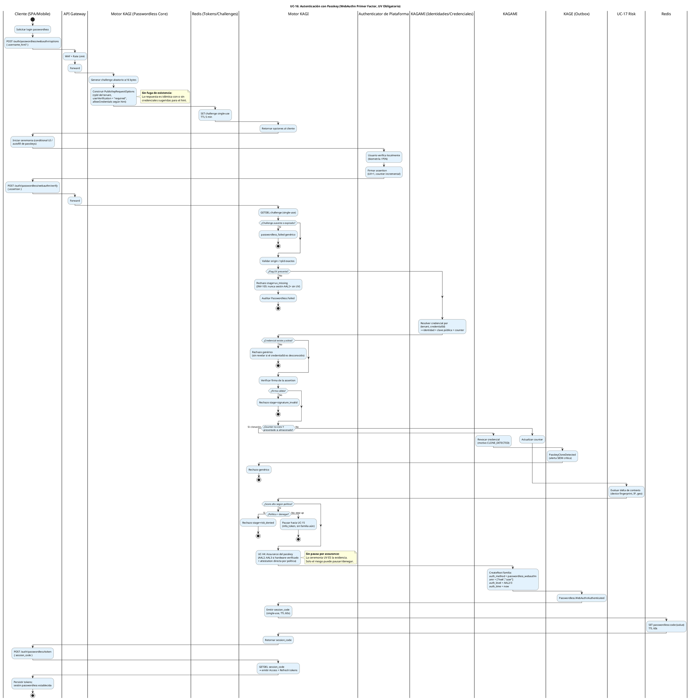
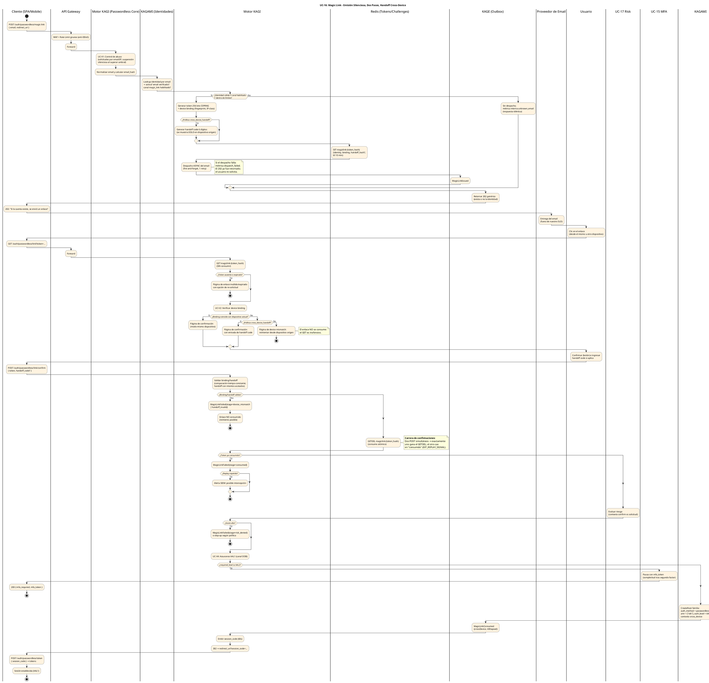
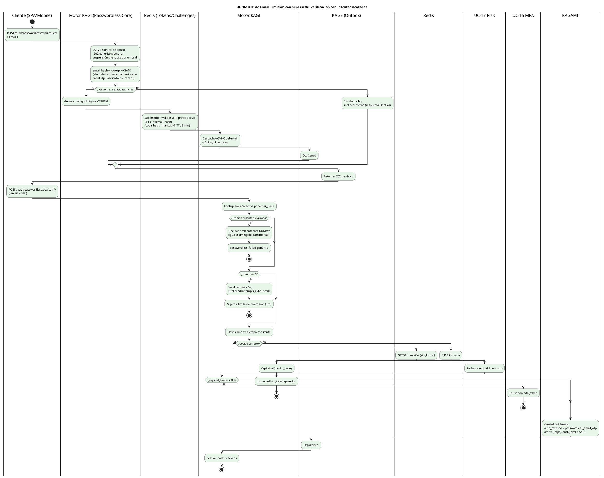
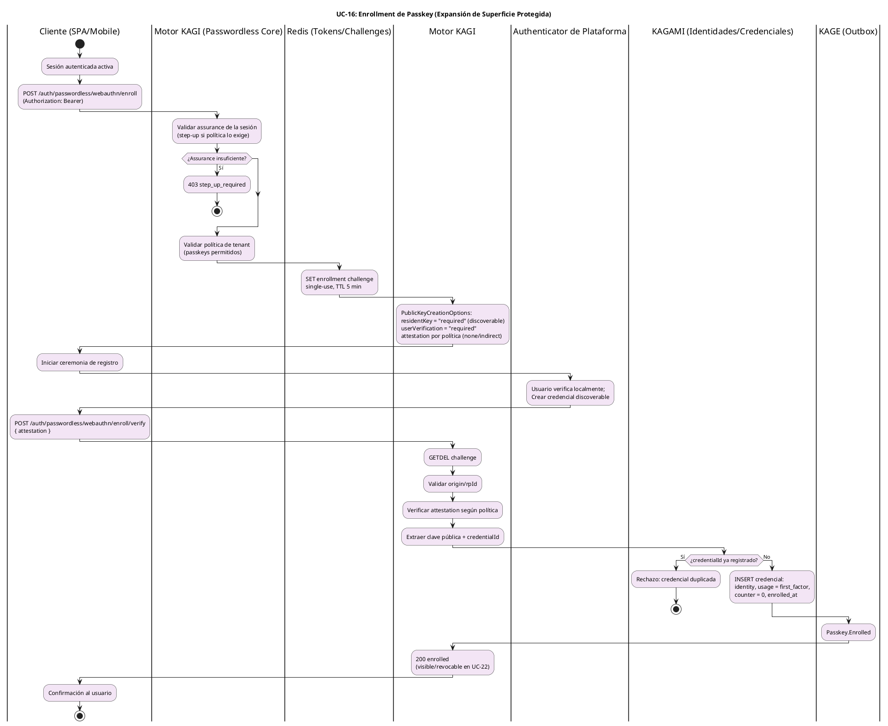

# UC-16: Passwordless Authentication - Diagrama de Actividades

| Metadatos del Documento | |
| :--- | :--- |
| **Proyecto:** | SHUGO - Identity & Access Platform |
| **Caso de Uso:** | UC-16 - Passwordless Authentication (Passkeys + Magic Links + OTP Restringido) |
| **Documento:** | 03_Activity_Diagram.md |
| **Metodología:** | UML 2.5 + ICONIX + DDD + Security by Design (Two-Step Consumption & Silent Issuance) |
| **Autor:** | Gastón Ruiz |
| **Versión Actual:** | 1.0.0 |
| **Fecha:** | 09/11/2026 |

---

## Historial de Versiones

| Versión | Fecha | Autor | Descripción de Cambios | Impacto |
| :--- | :--- | :--- | :--- | :--- |
| **1.0.0** | 09/11/2026 | Gastón Ruiz | **Creación inicial.** Diagramas de Actividades UML con carriles (swimlanes) para UC-16 en cuatro partes: (1) la ceremonia passkey con resolución de identidad por credentialId, UV obligatorio pre-criptografía, contención de clonación y emisión directa AAL2+; (2) el ciclo completo de magic link con emisión silenciosa, despacho async, validación GET sin consumo, confirmación POST con GETDEL post-verificación de binding/handoff y pausa AAL2+; (3) el ciclo OTP con supersede de emisión, dummy hash anti-timing y agotamiento de intentos; y (4) el enrollment de passkey desde sesión autenticada con attestation por política. | Documento base del paquete de diseño Tier 1 del UC-16. Sirve como el "guion de ejecución" del Passwordless Core, fijando el orden consumo-solo-tras-validación, la inmunidad a prefetch por separación GET/POST, la emisión silenciosa idéntica exista o no la identidad, y el mapa fail-secure por dependencia — de modo que ningún canal emita assurance que no pueda demostrar. |

---

## 1. Introducción y Propósito

El **Diagrama de Actividades** para el UC-16 materializa la lógica de negocio y las reglas de seguridad definidas en la Especificación de Requisitos (01) y el Diagrama de Casos de Uso (02). Su propósito es:

1. **Separar los tres canales en flujos explícitos:** Passkey, magic link y OTP tienen naturalezas distintas (ceremonia criptográfica síncrona, enlace mediado por email con dos pasos, código con intentos acotados) y cada una exige su propio diagrama para que el orden de los controles sea auditable.
2. **Fijar el contrato de dos pasos del magic link:** El GET valida sin consumir y el POST consume solo tras verificar binding/handoff — el orden exacto que hace inofensivo el prefetch y única la confirmación.
3. **Modelar la emisión silenciosa:** Los canales OOB responden 202 genérico **antes** de decidir internamente si despachan; el despacho es async y su fallo es métrica, nunca respuesta.
4. **Documentar la pausa por assurance:** Los canales AAL1 divergen hacia UC-15 cuando la política exige más; los passkeys nunca pausan por assurance pero sí pueden ser contenidos por riesgo.
5. **Dejar explícito el mapa fail-secure:** Qué ocurre cuando Redis, KAGAMI o el proveedor de email fallan en cada punto de cada canal.

---

## 2. Diagrama de Actividades #1: Ceremonia Passkey (Primer Factor WebAuthn)



---

## 3. Diagrama de Actividades #2: Ciclo Completo de Magic Link



---

## 4. Diagrama de Actividades #3: Ciclo OTP de Email (Restringido)



---

## 5. Diagrama de Actividades #4: Enrollment de Passkey (desde Sesión Autenticada)



---

## 6. Análisis de los Carriles (Swimlanes) y Responsabilidades

### 6.1. Diagrama #1 (Passkey)

1. **Cliente:** Orquesta opciones → ceremonia → verify → canje de session_code. Con conditional UI/autofill para credenciales discoverable.
2. **Authenticator de Plataforma:** Produce la evidencia fuera del perímetro: biometría local + firma con UV=1 y counter incremental.
3. **Motor KAGI:** Genera challenges, valida ceremonia en orden UV→credencial→firma→counter, evalúa riesgo, emite familia y session_code.
4. **KAGAMI:** Resolución identidad por `(tenant, credentialId)`, actualización de counter, y `CreateRoot` con proveniencia.
5. **UC-17 / KAGE:** Riesgo antes de emisión; auditoría de autenticación y contención.

### 6.2. Diagrama #2 (Magic Link)

1. **Motor KAGI:** Emisión silenciosa (la decisión interna de despachar nunca altera la respuesta), validación GET sin consumo, confirmación POST con GETDEL post-validación.
2. **Proveedor de Email:** Transporte async fuera de SLO; su fallo es métrica, no error.
3. **Redis:** Estado del token (binding, handoff hash, TTL) con consumo atómico.
4. **UC-15:** Receptor de la pausa cuando AAL1 no satisface la política.

### 6.3. Diagrama #3 (OTP)

Ciclo más corto con tres propiedades clave: **supersede** (una emisión activa por identidad), **dummy hash** en verificación sin emisión (timing igualado), y **agotamiento** (5 intentos invalidan la emisión; 3 emisiones/hora limitan el ciclo completo).

### 6.4. Diagrama #4 (Enrollment)

Flujo autenticado con step-up condicional: el enrollment es expansión de superficie de acceso y exige assurance suficiente antes de crear un nuevo camino de login.

---

## 7. Puntos Críticos de Seguridad en el Flujo

### 7.1. Consumo Solo Tras Validación Exitosa (Magic Link)

En el Diagrama #2, el `GETDEL` ocurre **después** de verificar binding/handoff, no antes:

*   **Razón:** Si el consumo precediera a la validación, un device mismatch o handoff incorrecto destruiría el enlace del usuario legítimo (DoS autoinfligido por error).
*   **Carrera controlada:** Dos POST de confirmación simultáneos validan ambos, pero exactamente uno gana el `GETDEL`; el perdedor cae en `stage=consumed` (EXT_REPLAY_SIGNAL). El orden "validar → consumir" preserva el enlace ante fallos de validación sin sacrificar el single-use.

### 7.2. Inmunidad a Prefetch por Separación GET/POST

El GET (Diagrama #2, segundo bloque) ejecuta **solo lecturas**: valida TTL, comprueba binding, y renderiza la confirmación. Scanners de seguridad corporativos, pre-render de Outlook/Gmail, y re-aperturas del usuario ejecutan GETs sin efecto. El único acto con consecuencias es el POST de confirmación.

### 7.3. UV Antes de Criptografía (Passkey)

En el Diagrama #1, el flag UV se comprueba **antes** de resolver la credencial y verificar la firma:

*   **Razón doble:** (a) una assertion sin UV es estructuralmente inaceptable (INV-105) — no merece gasto criptográfico; (b) el motivo interno `uv_missing` queda aislado como fallo de ceremonia, no de credencial, para auditoría.

### 7.4. Identidad desde el Registro, Nunca Desde la Assertion

La resolución de identidad usa `(tenant, credentialId)` contra KAGAMI; el `userHandle` de la assertion se verifica **contra** el registro, no se confía como fuente. Una assertion forjada con userHandle ajeno pero credentialId propio no produce sesión de otra identidad.

### 7.5. Emisión Silenciosa y Despacho Async (Canales OOB)

El 202 genérico se retorna **antes** de la decisión interna de despacho:

*   La respuesta no depende de la existencia de la identidad (anti-enumeración, INV-109).
*   El despacho es fire-and-forget con 1 retry: si el proveedor de email falla, el token existe en Redis pero el email no llega; el usuario re-solicita y la emisión anterior queda superseded. El fallo de despacho **nunca** convierte el 202 en error.

### 7.6. OTP: Supersede + Dummy Hash + Agotamiento

*   **Supersede:** Cada nueva emisión invalida la anterior — nunca hay dos códigos activos por identidad (un atacante no puede multiplicar superficies solicitando emisiones).
*   **Dummy hash:** La verificación contra email sin emisión ejecuta un hash compare fantasma, igualando el timing del camino real (anti-oráculo de existencia en el verify, no solo en el request).
*   **Agotamiento en dos niveles:** 5 intentos invalidan la emisión; 3 emisiones/hora limitan el ciclo completo. Ambos con eventos de rate para el SIEM.

### 7.7. Riesgo Antes de Emisión en Todos los Canales

UC-17 evalúa **después** de la verificación de la prueba y **antes** de la emisión de familia en los tres canales:

*   Passkey: riesgo alto → step-up o denegación (única causa de pausa, nunca el assurance).
*   Magic link: riesgo compara contexto de confirmación vs solicitud (device, geo, tiempo transcurrido).
*   OTP: riesgo sobre el contexto del verify.

### 7.8. Session Code: Tokens Fuera de URLs en Todos los Canales

Los tres caminos de emisión terminan en el mismo puente: `session_code` de 60s single-use canjeado por back-channel. En magic link, el redirect lleva solo el session_code — el token del enlace ya fue consumido y jamás aparece en la URL final ni en el historial del destino.

### 7.9. Mapa Fail-Secure por Dependencia

| Fallo | Canal afectado | Comportamiento | Justificación |
| :--- | :--- | :--- | :--- |
| **Redis caído** | Todos | Emisiones OOB → 503 (sin store no hay token); passkey options/verify → 503; confirm/verify en curso → rechazo sin efectos secundarios | Sin store single-use no hay garantía de consumo único |
| **KAGAMI caído** | Todos | 503 fail-secure; ninguna resolución de identidad ni emisión | Sin fuente de verdad no hay sesión |
| **Proveedor de email caído** | Magic link / OTP | Emisión almacenada en Redis; despacho fallido = métrica; usuario re-solicita (supersede) | El canal de entrega es conveniencia, no seguridad |
| **UC-17 caído** | Todos | Fail-mode por política de tenant (`open` continúa con warning / `stepup` degrada a MFA) | El riesgo aumenta la seguridad; su ausencia no bloquea la autenticación |
| **Notification/KAGE caídos** | Eventos | Completitud continúa; eventos encolados con retry vía Outbox | La evidencia ya está verificada |

---

## 8. Trazabilidad con Otros Documentos del Paquete

| Documento | Relación |
| :--- | :--- |
| `01_Requirements_Specification.md` | Implementa visualmente los escenarios 2.1-2.2.4 y 4.1-4.10, las invariantes INV-105 a INV-111 y las reglas RN-36 a RN-39. |
| `02_Use_Case_Diagram.md` | Los cuatro diagramas materializan UC-16a-g, UC-V1 a UC-V4 y las extensiones EXT_HANDOFF/MFA_PAUSE/RISK_STEPUP/CLONE_CONTAIN/REPLAY_SIGNAL/OTP_EXHAUST. |
| `04_Initial_Domain_Model.md` | Las acciones en los carriles de KAGI se mapearán a `PasskeyCeremony`, `MagicLinkFlow`, `OtpFlow` y `PasskeyEnrollment`. |
| `05_State_Machine_Diagram.md` | Las decisiones "¿token consumido?", "¿UV presente?", "¿counter regression?" son guardas de las máquinas de `MagicLinkToken`, `EmailOtpIssuance` y `PasskeyCredential`. |
| `07_Sequence_Diagram.md` | Definirá el orden temporal exacto de los round-trips: despacho async de email, GET/POST del enlace, ceremonias WebAuthn y canje de session_code. |
| `10_UC_Specific_Data_Model.md` | Los keyspaces Redis (`passwordless:magiclink:*`, `passwordless:otp:*`, `passwordless:code:*`, rate limits) y la tabla de credenciales passkey soportan estos flujos. |
| `11_UC_Specific_Security_Threats.md` | El orden consumo-post-validación (§7.1), el dummy hash (§7.6) y la emisión silenciosa (§7.5) mitigan intercepción, enumeración y stuffing. |
| `UC-15/03_Activity_Diagram.md` | La pausa AAL1→UC-15 (rama `required_level ≥ AAL2`) entrega el control al flujo de challenge/verify de ese diagrama. |

---

## 9. Notas de Implementación

### 9.1. Sintaxis PlantUML Moderna
- Sintaxis **Activity Diagram Beta** con carriles (`|Lane|`), `if/then/else/endif` para guardas y `note right` para decisiones de seguridad.
- Cuatro diagramas separados porque cada canal tiene **actores mediadores distintos**: authenticator (passkey), email + browser (magic link), transcripción (OTP), y sesión autenticada (enrollment).
- Bloques `<style>` con colores semánticos por canal: azul (passkey), naranja (magic link), verde (OTP), púrpura (enrollment).

### 9.2. Esqueleto del Enrutamiento por Canal

```csharp
public class PasswordlessHandler : IPasswordlessHandler
{
    public async Task<PasswordlessOutcome> ConfirmMagicLinkAsync(MagicLinkConfirmCommand cmd, CancellationToken ct)
    {
        // 1. VALIDAR antes de consumir: binding y handoff no destruyen el enlace si fallan
        var stored = await _links.GetAsync(cmd.Token, ct);
        if (stored is null) return PasswordlessOutcome.LinkInvalid();

        var binding = await _bindingValidator.ValidateAsync(stored, cmd, ct);   // incluye handoff
        if (!binding.IsValid)
        {
            await _outbox.PublishAsync(MagicLinkFailed(binding.Stage), ct);
            return PasswordlessOutcome.LinkInvalid();   // enlace intacto
        }

        // 2. CONSUMIR atómico: exactamente un ganador en carreras de confirmación
        var consumed = await _links.ConsumeAsync(cmd.Token, ct);
        if (consumed is null)
        {
            await _signals.RecordReplayAsync(cmd.Token, ct);   // EXT_REPLAY_SIGNAL
            return PasswordlessOutcome.LinkInvalid();
        }

        // 3. RIESGO antes de emitir
        var risk = await _risk.EvaluateAsync(consumed.Context, cmd.Context, ct);
        if (risk.IsDenied) return PasswordlessOutcome.RiskDenied();
        if (risk.RequiresStepUp) return PasswordlessOutcome.StepUp(risk.MfaToken);

        // 4. ASSURANCE: AAL1 → pausa si la política exige más
        var policy = await _policyResolver.ResolveAsync(consumed.TenantId, ct);
        if (policy.RequiredLevel > AssuranceLevel.AAL1)
            return await _mfaPauser.PauseAsync(consumed, ct);

        // 5. EMISIÓN con proveniencia + session_code
        return await _issuer.IssuePasswordlessSessionAsync(consumed, PasswordlessChannel.MagicLink, ct);
    }
}
```

### 9.3. Convenciones de Nomenclatura
- **Etapas de fallo:** `MagicLinkStage.{Expired, Consumed, DeviceMismatch, HandoffInvalid, RiskDenied}` y `OtpReason.{InvalidCode, AttemptsExhausted, Expired, RateLimited}` alineadas con los payloads de eventos del doc 01 (§5).
- **Flags de contexto:** `cross_device`, `ttlElapsed` y `handoff_used` viajan en los eventos de consumo para forense y scoring de riesgo.
- **Notas de seguridad:** Texto en negrita (**SIN consumir**, **consumo atómico**, **UV=1**) para resaltar las decisiones de orden que no son evidentes en el flujo.

---
*Fin del Documento 03_Activity_Diagram para UC-16*