# UC-16: Passwordless Authentication - Modelo de Dominio Inicial

| Metadatos del Documento | |
| :--- | :--- |
| **Proyecto:** | SHUGO - Identity & Access Platform |
| **Caso de Uso:** | UC-16 - Passwordless Authentication (Passkeys + Magic Links + OTP Restringido) |
| **Documento:** | 04_Initial_Domain_Model.md |
| **Metodología:** | ICONIX (Modelo de Análisis) + DDD (Domain-Driven Design) + Security by Design (Two-Step Consumption & Silent Issuance) + Hexagonal Architecture |
| **Autor:** | Gastón Ruiz |
| **Versión Actual:** | 1.0.0 |
| **Fecha:** | 09/11/2026 |

---

## Historial de Versiones

| Versión | Fecha | Autor | Descripción de Cambios | Impacto |
| :--- | :--- | :--- | :--- | :--- |
| **1.0.0** | 09/11/2026 | Gastón Ruiz | **Creación inicial.** Definición del Modelo de Dominio Conceptual para autenticación passwordless. Introduce los Aggregate Roots `PasskeyCredential` (primer factor con UV obligatorio y clone detection compartida con UC-15), `MagicLinkToken` (AR transitorio con validación pura sin mutación y consumo atómico post-validación) y `EmailOtpIssuance` (con supersede y agotamiento de intentos); los Value Objects `DeviceBinding`, `HandoffCode`, `PasswordlessPolicy`, `PasswordlessProvenance` y `SessionCode`; y los Domain Services `PasskeyCeremony`, `PasskeyEnrollment`, `MagicLinkFlow`, `OtpFlow`, `PasswordlessSessionIssuer` y `PasswordlessAbuseControl` — con la separación explícita entre decisión interna de despacho y respuesta pública idéntica que materializa la anti-enumeración como tipo. | Documento base del paquete de diseño Tier 1 del UC-16. Establece cómo tres canales con naturalezas radicalmente distintas (ceremonia criptográfica, enlace de dos pasos, código con intentos) convergen en una única `PasswordlessProvenance` y un único punto de emisión, sin sacrificar las invariantes específicas de cada canal. |

---

## 1. Introducción y Propósito

Este documento presenta el **Modelo de Dominio Inicial** para el Caso de Uso UC-16 (Passwordless Authentication).

El diseño passwordless impone cuatro desafíos de modelado que este documento resuelve:

1. **Tres temporalidades distintas:** La ceremonia passkey es síncrona y criptográfica; el magic link es asíncrono y mediado por email con un artefacto que vive minutos; el OTP es asíncrono con un artefacto que vive minutos y muere por intentos. Cada uno exige su propio Aggregate con ciclo de vida explícito.
2. **Validación sin mutación:** El contrato de dos pasos del magic link requiere que la validación (GET) sea una operación **pura** sobre el token — sin efectos sobre su estado — y que solo la confirmación (POST) lo consuma. El modelo debe hacer imposible que validar destruya.
3. **Anti-enumeración como estructura de tipos:** La emisión silenciosa no es un "if" en el handler: es una separación de dominio entre la **decisión interna** (despachar o suprimir) y el **resultado público** (idéntico en ambos casos).
4. **Assurance como decisión centralizada:** Los tres canales producen evidencia distinta (AAL2/3 con UV vs AAL1 OOB), y la decisión de emitir directamente o pausar hacia UC-15 vive en un único servicio de emisión que consume una proveniencia tipada.

El modelo se centra en:
- **Passkeys como Aggregate de primer factor:** resolución de identidad por credencial, UV como guarda previa a toda criptografía, y counter/clone detection compartiendo el mecanismo de UC-15.
- **Magic links como AR transitorio con binding:** dispositivo e IP-class del solicitante vinculados al token, handoff opcional como segundo factor del canal, y consumo GETDEL como única transición terminal.
- **OTP como emisión con supersede:** una sola emisión activa por identidad, intentos acotados, y dummy hash para timing igualado.
- **Política como snapshot:** `PasswordlessPolicy` viaja con cada flujo; los cambios de configuración del tenant no alteran vuelos en curso.

---

## 2. Diagrama de Modelo de Dominio Conceptual (PlantUML)

```plantuml
@startuml UC-16_DominioConceptual
<style>
diagram {
  BackgroundColor #FFFFFF
}
</style>
skinparam classAttributeIconSize 0
skinparam classBackgroundColor #FFFFFF
skinparam classBorderColor #1565C0
skinparam classHeaderBackgroundColor #E3F2FD

title UC-16: Modelo de Dominio Conceptual - Passwordless (Tres Canales, Una Proveniencia)

' ============================================
' AGGREGATE ROOTS & ENTITIES
' ============================================
class PasskeyCredential <<Aggregate Root>> {
  - id: CredentialId
  - tenantId: TenantId
  - identityId: IdentityId
  - credentialId: string
  - publicKey: byte[]
  - signCount: long
  - usage: FirstFactor
  - attachment: string
  - attestationLevel: string
  - status: CredentialStatus
  - enrolledAt / revokedAt: DateTime?
  - revocationReason: CredentialRevocationReason?

  + {static} Register(tenant, identity, ceremonyResult, now): PasskeyCredential
  + RecordSignCount(presented, now): CounterCheck
  + Revoke(reason, now): void
  + EnsureUsable(): void
}

class MagicLinkToken <<Aggregate Root (transitorio, Redis)>> {
  - tokenHash: string
  - tenantId: TenantId
  - identityId: IdentityId
  - emailHash: string
  - binding: DeviceBinding
  - handoffCodeHash: string?
  - createdAt: DateTime
  - expiresAt: DateTime

  + {static} Issue(tenant, identity, emailHash, binding, policy, random, now): MagicLinkToken
  + IsExpired(now): bool
  + ValidateBinding(context: DeviceBinding): BindingCheck
  + VerifyHandoff(code: HandoffCode): HandoffCheck
  + CanBeConfirmedBy(context, code): ConfirmationGate
}

class EmailOtpIssuance <<Aggregate Root (transitorio, Redis)>> {
  - issuanceId: IssuanceId
  - identityId: IdentityId
  - emailHash: string
  - codeHash: string
  - attempts: int
  - maxAttempts: int = 5
  - issuedAt: DateTime
  - expiresAt: DateTime

  + {static} Issue(identity, emailHash, random, ttl, now): EmailOtpIssuance
  + TryVerify(code: OtpCode, now): OtpVerifyResult
  + IsExhausted: bool
  + IsExpired(now): bool
}

enum CounterCheck {
  Ok
  CloneDetected
  NotApplicable
}

enum BindingCheck {
  SameDevice
  HandoffRequired
  Mismatch
}

enum HandoffCheck {
  Valid
  Invalid
  Exhausted
}

enum OtpVerifyResultKind {
  Success
  Invalid
  Exhausted
  Expired
}

enum CredentialStatus {
  Active
  Revoked
}

' ============================================
' VALUE OBJECTS
' ============================================
class DeviceBinding <<Value Object>> {
  - deviceFingerprint: string
  - ipClass: string
  - createdAt: DateTime
  + Matches(other: DeviceBinding): bool
}

class HandoffCode <<Value Object>> {
  - code: string
  + {static} Generate(random): HandoffCode
  + Hash(): string
}

class OtpCode <<Value Object>> {
  - digits: string
  + {static} Generate(random, digits=8): OtpCode
  + Hash(): string
  + ConstantTimeEquals(hash): bool
}

class SessionCode <<Value Object>> {
  - value: string
  - expiresAt: DateTime
  + {static} Issue(now, ttl=60s): SessionCode
}

class PasswordlessPolicy <<Value Object>> {
  + PasskeysEnabled: bool
  + MagicLinkEnabled: bool
  + EmailOtpEnabled: bool = false
  + RequiredLevel: AssuranceLevel
  + CrossDeviceHandoff: bool
  + MagicLinkTtl: TimeSpan
  + OtpTtl / OtpMaxAttempts / OtpMaxPerHour
  + AttestationPolicy: none | indirect | direct
  + RiskFailMode: open | stepup
}

class PasswordlessProvenance <<Value Object>> {
  + Channel: PasswordlessChannel
  + AuthMethod: string
  + Amr: IReadOnlyList<string>
  + AuthLevel: AssuranceLevel
  + CrossDevice: bool
  + DeviceBinding: DeviceBinding
  + AuthTime: DateTime
}

class IssuanceDecision <<Value Object>> {
  + Kind: Dispatch | SuppressSilently
  + Reason: string
  + {static} Dispatch(token): IssuanceDecision
  + {static} Suppress(reason): IssuanceDecision
}

class ConfirmationGate <<Value Object>> {
  + Allowed: bool
  + RequiresHandoff: bool
  + FailureStage: string?
}

enum PasswordlessChannel {
  Passkey
  MagicLink
  EmailOtp
}

' ============================================
' DOMAIN SERVICES
' ============================================
class PasskeyCeremony <<Domain Service>> {
  + BuildOptionsAsync(hint, policy, ct): Task<CeremonyOptions>
  + VerifyAsync(assertion, policy, ct): Task<PasswordlessOutcome>
}

class PasskeyEnrollment <<Domain Service>> {
  + BuildRegistrationOptionsAsync(session, policy, ct): Task<RegistrationOptions>
  + CompleteAsync(attestation, session, policy, ct): Task<EnrollmentResult>
}

class MagicLinkFlow <<Domain Service>> {
  + RequestAsync(email, redirectUri, context, policy, ct): Task<PublicIssuanceResult>
  + ValidateAsync(token, context, ct): Task<LinkValidationView>
  + ConfirmAsync(token, handoff, context, policy, ct): Task<PasswordlessOutcome>
}

class OtpFlow <<Domain Service>> {
  + RequestAsync(email, context, policy, ct): Task<PublicIssuanceResult>
  + VerifyAsync(email, code, context, policy, ct): Task<PasswordlessOutcome>
}

class PasswordlessSessionIssuer <<Domain Service>> {
  + IssueOrPauseAsync(provenance, policy, identity, ct): Task<PasswordlessOutcome>
}

class PasswordlessAbuseControl <<Domain Service>> {
  + EvaluateIssuanceAsync(emailHash, context, policy, ct): Task<IssuanceDecision>
  + EvaluateVerifyAsync(emailHash, context, policy, ct): Task<bool>
}

' ============================================
' PUERTOS (Interfaces)
' ============================================
interface IPasskeyCredentialRepository {
  + FindActiveAsync(tenant, credentialId, ct): Task<PasskeyCredential?>
  + ExistsAsync(tenant, credentialId, ct): Task<bool>
  + SaveAsync(credential, ct): Task
}
interface IChallengeStore {
  + SaveAsync(challenge, ttl, ct): Task
  + ConsumeAsync(challenge, ct): Task<bool>
}
interface IMagicLinkStore {
  + SaveAsync(token, ct): Task
  + PeekAsync(tokenHash, ct): Task<MagicLinkToken?>
  + ConsumeAsync(tokenHash, ct): Task<MagicLinkToken?>
}
interface IOtpStore {
  + SupersedeAndSaveAsync(issuance, ct): Task
  + GetActiveAsync(emailHash, ct): Task<EmailOtpIssuance?>
  + SaveAttemptsAsync(issuance, ct): Task
  + ConsumeAsync(issuanceId, ct): Task<bool>
}
interface IEmailDispatcher {
  + DispatchMagicLinkAsync(email, link, ct): Task<bool>
  + DispatchOtpAsync(email, code, ct): Task<bool>
}
interface IRiskEvaluator {
  + EvaluatePasswordlessAsync(channel, context, ct): Task<RiskEvaluation>
}
interface IWebAuthnAssertionValidator {
  + ValidateCeremony(assertion, challenge, rpId): CeremonyValidation
  + ValidateRegistration(attestation, challenge, rpId, policy): RegistrationValidation
}
interface IPauseBroker {
  + PauseForMfaAsync(identity, channel, policy, ct): Task<MfaPauseTicket>
}
interface ITokenFamilyFactory {
  + CreatePasswordlessRootAsync(identity, provenance, ct): Task<TokenFamilyId>
}
interface ISessionCodeStore {
  + IssueAsync(code, payload, ct): Task
  + RedeemAsync(code, ct): Task<PasswordlessSessionPayload?>
}

' ============================================
' RELACIONES
' ============================================
PasskeyCredential *-- CounterCheck
PasskeyCredential *-- CredentialStatus

MagicLinkToken *-- DeviceBinding
MagicLinkToken *-- HandoffCode : handoffCodeHash
MagicLinkToken ..> BindingCheck : ValidateBinding()
MagicLinkToken ..> ConfirmationGate : CanBeConfirmedBy()

EmailOtpIssuance *-- OtpCode : codeHash
EmailOtpIssuance ..> OtpVerifyResultKind : TryVerify()

PasskeyCeremony --> IPasskeyCredentialRepository
PasskeyCeremony --> IWebAuthnAssertionValidator
PasskeyCeremony --> IChallengeStore
PasskeyCeremony --> PasswordlessSessionIssuer

PasskeyEnrollment --> IPasskeyCredentialRepository
PasskeyEnrollment --> IWebAuthnAssertionValidator

MagicLinkFlow --> PasswordlessAbuseControl
MagicLinkFlow --> IMagicLinkStore
MagicLinkFlow --> IEmailDispatcher
MagicLinkFlow --> IRiskEvaluator
MagicLinkFlow --> PasswordlessSessionIssuer
MagicLinkFlow ..> IssuanceDecision : interna
MagicLinkFlow ..> PublicIssuanceResult : pública (idéntica)

OtpFlow --> PasswordlessAbuseControl
OtpFlow --> IOtpStore
OtpFlow --> IEmailDispatcher
OtpFlow --> PasswordlessSessionIssuer

PasswordlessSessionIssuer --> ITokenFamilyFactory
PasswordlessSessionIssuer --> IPauseBroker
PasswordlessSessionIssuer --> ISessionCodeStore
PasswordlessSessionIssuer ..> PasswordlessProvenance : consume
PasswordlessSessionIssuer ..> PasswordlessPolicy : required_level

note right of MagicLinkToken
  **Validar ≠ mutar:**
  ValidateBinding() y VerifyHandoff()
  son operaciones PURAS sobre el AR.
  La única transición terminal es
  ConsumeAsync (GETDEL) en el store.
end note

note bottom of IssuanceDecision
  **Anti-enumeración como tipo:**
  La decisión interna (Dispatch |
  SuppressSilently) NUNCA alcanza
  la respuesta pública: ambos caminos
  retornan el mismo PublicIssuanceResult.
end note

note left of PasswordlessSessionIssuer
  **Punto único de emisión:**
 assurance AAL2/3 → emisión directa.
  assurance AAL1 + required ≥ AAL2
  → pausa hacia UC-15.
  Riesgo → step-up o denegación.
end note

@enduml
```



---

## 3. Detalle de Conceptos de Dominio (DDD)

### 3.1. Aggregate Root: `PasskeyCredential` (Primer Factor)

```csharp
public class PasskeyCredential : AggregateRoot
{
    public CredentialId Id { get; private set; }
    public TenantId TenantId { get; private set; }
    public IdentityId IdentityId { get; private set; }
    public string CredentialId { get; private set; }          // id WebAuthn (base64url)
    public byte[] PublicKey { get; private set; }
    public long SignCount { get; private set; }
    public CredentialUsage Usage { get; private set; }        // siempre FirstFactor en UC-16
    public string Attachment { get; private set; }            // platform | cross-platform
    public string AttestationLevel { get; private set; }      // none | indirect | direct
    public CredentialStatus Status { get; private set; }
    public DateTime EnrolledAt { get; private set; }
    public DateTime? RevokedAt { get; private set; }
    public CredentialRevocationReason? RevocationReason { get; private set; }

    private PasskeyCredential() { }

    public static PasskeyCredential Register(
        TenantId tenant, IdentityId identity, RegistrationValidation ceremony, DateTime now)
    {
        if (!ceremony.UserVerified)
            throw new DomainException("Passkey registration requires userVerification."); // INV-105

        return new PasskeyCredential
        {
            Id = new CredentialId(Guid.NewGuid()),
            TenantId = tenant,
            IdentityId = identity,
            CredentialId = ceremony.CredentialId,
            PublicKey = ceremony.PublicKey,
            SignCount = ceremony.InitialSignCount,
            Usage = CredentialUsage.FirstFactor,
            Attachment = ceremony.Attachment,
            AttestationLevel = ceremony.AttestestationLevel,
            Status = CredentialStatus.Active,
            EnrolledAt = now
        };
    }

    /// <summary>
    /// Reutiliza la semántica de UC-15: counter no-cero debe ser estrictamente creciente.
    /// El veredicto es de dominio; la contención la orquesta PasskeyCeremony.
    /// </summary>
    public CounterCheck RecordSignCount(long presented, DateTime now)
    {
        EnsureUsable();
        if (presented == 0) return CounterCheck.NotApplicable;
        if (presented <= SignCount) return CounterCheck.CloneDetected;
        SignCount = presented;
        return CounterCheck.Ok;
    }

    public void Revoke(CredentialRevocationReason reason, DateTime now)
    {
        if (Status == CredentialStatus.Revoked) return;       // idempotente
        Status = CredentialStatus.Revoked;
        RevokedAt = now;
        RevocationReason = reason;
    }

    public void EnsureUsable()
    {
        if (Status != CredentialStatus.Active)
            throw new DomainException($"Passkey credential in status {Status}.");
    }

    /// <summary>Assurance derivado de la evidencia de la credencial.</summary>
    public AssuranceLevel DeriveAssurance(PasswordlessPolicy policy)
    {
        // AAL3 exige hardware verificado + attestation directa según política
        if (Attachment == "cross-platform" && AttestationLevel == "direct" &&
            policy.AttestationPolicy == AttestationPolicy.Direct)
            return AssuranceLevel.AAL3;
        return AssuranceLevel.AAL2;   // UV ya fue verificado en la ceremonia
    }
}
```

### 3.2. Aggregate Root Transitorio: `MagicLinkToken` (Validar ≠ Mutar)

```csharp
public class MagicLinkToken : AggregateRoot
{
    public string TokenHash { get; private set; }             // SHA256 del token 256 bits
    public TenantId TenantId { get; private set; }
    public IdentityId IdentityId { get; private set; }
    public string EmailHash { get; private set; }
    public DeviceBinding Binding { get; private set; }
    public string? HandoffCodeHash { get; private set; }      // presente si política cross-device
    public DateTime CreatedAt { get; private set; }
    public DateTime ExpiresAt { get; private set; }

    private MagicLinkToken() { }

    public static (MagicLinkToken Token, string PlaintextOnce, HandoffCode? HandoffOnce) Issue(
        TenantId tenant, IdentityId identity, string emailHash,
        DeviceBinding binding, PasswordlessPolicy policy,
        ICryptographicRandom random, DateTime now)
    {
        var raw = random.GenerateBytes(32);                   // 256 bits
        var handoff = policy.CrossDeviceHandoff ? HandoffCode.Generate(random) : null;

        var token = new MagicLinkToken
        {
            TokenHash = Sha256(raw),
            TenantId = tenant,
            IdentityId = identity,
            EmailHash = emailHash,
            Binding = binding,
            HandoffCodeHash = handoff?.Hash(),
            CreatedAt = now,
            ExpiresAt = now.Add(policy.MagicLinkTtl)          // INV-106: ≤ 10 min
        };

        return (token, Base64Url.Encode(raw), handoff);       // plaintext solo una vez
    }

    public bool IsExpired(DateTime now) => now >= ExpiresAt;

    /// <summary>
    /// Operación PURA: no muta el token. El GET de validación la usa
    /// para decidir qué página mostrar; el POST la re-evalúa antes de consumir.
    /// </summary>
    public BindingCheck ValidateBinding(DeviceBinding context)
    {
        if (Binding.Matches(context)) return BindingCheck.SameDevice;
        if (HandoffCodeHash is not null) return BindingCheck.HandoffRequired;
        return BindingCheck.Mismatch;
    }

    /// <summary>Comparación en tiempo constante; sin intentos ilimitados.</summary>
    public HandoffCheck VerifyHandoff(HandoffCode presented)
    {
        if (HandoffCodeHash is null) return HandoffCheck.Invalid;
        return CryptographicOperations.FixedTimeEquals(
                   Encoding.UTF8.GetBytes(HandoffCodeHash),
                   Encoding.UTF8.GetBytes(presented.Hash()))
            ? HandoffCheck.Valid
            : HandoffCheck.Invalid;
    }

    /// <summary>
    /// Puerta de confirmación: combina expiración, binding y handoff
    /// en un solo veredicto, SIN tocar el estado del token.
    /// </summary>
    public ConfirmationGate CanBeConfirmedBy(DeviceBinding context, HandoffCode? handoff, DateTime now)
    {
        if (IsExpired(now))
            return ConfirmationGate.Deny(MagicLinkStage.Expired);

        return ValidateBinding(context) switch
        {
            BindingCheck.SameDevice => ConfirmationGate.Allow(),
            BindingCheck.HandoffRequired when handoff is null =>
                ConfirmationGate.NeedsHandoff(),
            BindingCheck.HandoffRequired => VerifyHandoff(handoff!) switch
            {
                HandoffCheck.Valid => ConfirmationGate.Allow(),
                _ => ConfirmationGate.Deny(MagicLinkStage.HandoffInvalid)
            },
            _ => ConfirmationGate.Deny(MagicLinkStage.DeviceMismatch)
        };
    }
}
```

### 3.3. Aggregate Root Transitorio: `EmailOtpIssuance` (Supersede + Agotamiento)

```csharp
public class EmailOtpIssuance : AggregateRoot
{
    public const int MaxAttempts = 5;

    public IssuanceId Id { get; private set; }
    public IdentityId IdentityId { get; private set; }
    public string EmailHash { get; private set; }
    public string CodeHash { get; private set; }
    public int Attempts { get; private set; }
    public DateTime IssuedAt { get; private set; }
    public DateTime ExpiresAt { get; private set; }

    private EmailOtpIssuance() { }

    public static (EmailOtpIssuance Issuance, OtpCode PlaintextOnce) Issue(
        IdentityId identity, string emailHash,
        PasswordlessPolicy policy, ICryptographicRandom random, DateTime now)
    {
        var code = OtpCode.Generate(random, digits: 8);       // 8 dígitos: espacio mayor, TTL menor
        return (new EmailOtpIssuance
        {
            Id = new IssuanceId(Guid.NewGuid()),
            IdentityId = identity,
            EmailHash = emailHash,
            CodeHash = code.Hash(),
            Attempts = 0,
            IssuedAt = now,
            ExpiresAt = now.Add(policy.OtpTtl)                // default 5 min
        }, code);
    }

    public bool IsExpired(DateTime now) => now >= ExpiresAt;
    public bool IsExhausted => Attempts >= MaxAttempts;

    /// <summary>
    /// Verificación con semántica completa: expiración, agotamiento y código.
    /// El consumo (single-use) lo ejecuta el store tras Success.
    /// </summary>
    public OtpVerifyResult TryVerify(OtpCode presented, DateTime now)
    {
        if (IsExpired(now)) return OtpVerifyResult.Expired();
        if (IsExhausted)    return OtpVerifyResult.Exhausted();

        if (!presented.ConstantTimeEquals(CodeHash))
        {
            Attempts++;                                       // mutación local; persistida por el flujo
            return IsExhausted
                ? OtpVerifyResult.Exhausted()
                : OtpVerifyResult.Invalid(remaining: MaxAttempts - Attempts);
        }

        return OtpVerifyResult.Success();
    }
}
```

### 3.4. Value Objects de Contexto, Política y Proveniencia

```csharp
/// <summary>Vinculación del solicitante: fingerprint del dispositivo + clase de IP.</summary>
public sealed record DeviceBinding(string DeviceFingerprint, string IpClass, DateTime CreatedAt)
{
    /// <summary>
    /// Coincidencia de dispositivo: fingerprint idéntico.
    /// La IP-class es señal para riesgo (UC-17), no condición de binding.
    /// </summary>
    public bool Matches(DeviceBinding other) =>
        DeviceFingerprint == other.DeviceFingerprint;
}

/// <summary>Política passwordless del tenant como snapshot inmutable.</summary>
public sealed class PasswordlessPolicy : ValueObject
{
    public bool PasskeysEnabled { get; }
    public bool MagicLinkEnabled { get; }
    public bool EmailOtpEnabled { get; }                      // default false
    public AssuranceLevel RequiredLevel { get; }
    public bool CrossDeviceHandoff { get; }
    public TimeSpan MagicLinkTtl { get; }
    public TimeSpan OtpTtl { get; }
    public int OtpMaxPerHour { get; }
    public AttestationPolicy AttestationPolicy { get; }
    public RiskFailMode RiskFailMode { get; }

    public PasswordlessPolicy(/* ... */)
    {
        if (MagicLinkTtl > TimeSpan.FromMinutes(10))
            throw new DomainException("Magic link TTL above 10 minutes violates INV-106.");
        if (OtpTtl > TimeSpan.FromMinutes(5))
            throw new DomainException("OTP TTL above 5 minutes violates RN-38.");
        // ... asignaciones ...
    }

    public bool IsChannelEnabled(PasswordlessChannel channel) => channel switch
    {
        PasswordlessChannel.Passkey    => PasskeysEnabled,
        PasswordlessChannel.MagicLink  => MagicLinkEnabled,
        PasswordlessChannel.EmailOtp   => EmailOtpEnabled,
        _ => false
    };
}

/// <summary>La única evidencia que consume el punto de emisión.</summary>
public sealed record PasswordlessProvenance(
    PasswordlessChannel Channel,
    string AuthMethod,                    // passwordless_webauthn | passwordless_magic_link | passwordless_email_otp
    IReadOnlyList<string> Amr,            // ["hwk","user"] | ["otk"] | ["otp"]
    AssuranceLevel AuthLevel,
    bool CrossDevice,
    DeviceBinding DeviceBinding,
    DateTime AuthTime);
```

### 3.5. Domain Services

#### **MagicLinkFlow (Emisión Silenciosa + Dos Pasos)**

```csharp
public class MagicLinkFlow : IMagicLinkFlow
{
    private readonly IPasswordlessAbuseControl _abuse;
    private readonly IIdentityDirectory _identities;
    private readonly IMagicLinkStore _links;
    private readonly IEmailDispatcher _email;
    private readonly IRiskEvaluator _risk;
    private readonly IPasswordlessSessionIssuer _issuer;
    private readonly IOutboxPublisher _outbox;
    private readonly ICryptographicRandom _random;
    private readonly IClock _clock;

    /// <summary>
    /// EMISIÓN SILENCIOSA: la decisión interna de despachar NUNCA
    /// altera el resultado público (INV-109 como estructura de tipos).
    /// </summary>
    public async Task<PublicIssuanceResult> RequestAsync(
        MagicLinkRequestCommand cmd, DeviceBinding context,
        PasswordlessPolicy policy, CancellationToken ct)
    {
        var emailHash = EmailHasher.Hash(cmd.Email);

        // 1. Control de abuso: responde aunque la identidad no exista
        var decision = await _abuse.EvaluateIssuanceAsync(emailHash, context, policy, ct);

        // 2. Decisión interna: ¿despachar?
        if (decision.Kind == IssuanceKind.Dispatch)
        {
            var identity = await _identities.FindActiveVerifiedAsync(cmd.Email, ct);

            if (identity is not null && policy.MagicLinkEnabled)
            {
                var (token, plaintext, handoff) = MagicLinkToken.Issue(
                    identity.TenantId, identity.Id, emailHash, context, policy, _random, _clock.UtcNow);

                await _links.SaveAsync(token, ct);

                // Despacho async: su fallo es métrica, nunca respuesta
                _ = _email.DispatchMagicLinkAsync(identity.Email, BuildLink(plaintext), ct)
                    .ContinueWith(t => LogDispatchFailure(t), TaskContinuationOptions.OnlyOnFaulted);

                await _outbox.PublishAsync(new MagicLinkIssued(
                    identity.Id, token.TokenHash, context, handoff is not null, _clock.UtcNow), ct);

                return PublicIssuanceResult.Accepted(handoff);   // handoff visible solo en dispositivo origen
            }
        }

        // 3. Resultado público IDÉNTICO para supresión e identidad inexistente
        return PublicIssuanceResult.Accepted(handoff: null);
    }

    /// <summary>VALIDACIÓN PURA (GET): sin consumo, sin mutación.</summary>
    public async Task<LinkValidationView> ValidateAsync(string token, DeviceBinding context, CancellationToken ct)
    {
        var stored = await _links.PeekAsync(Sha256(token), ct);
        if (stored is null || stored.IsExpired(_clock.UtcNow))
            return LinkValidationView.Invalid();

        return stored.ValidateBinding(context) switch
        {
            BindingCheck.SameDevice        => LinkValidationView.ReadyToConfirm(sameDevice: true),
            BindingCheck.HandoffRequired   => LinkValidationView.ReadyToConfirm(sameDevice: false, requiresHandoff: true),
            _                              => LinkValidationView.DeviceMismatch()
        };
    }

    /// <summary>CONFIRMACIÓN (POST): validar → consumir → riesgo → assurance → emisión/pausa.</summary>
    public async Task<PasswordlessOutcome> ConfirmAsync(
        MagicLinkConfirmCommand cmd, DeviceBinding context,
        PasswordlessPolicy policy, CancellationToken ct)
    {
        var stored = await _links.PeekAsync(Sha256(cmd.Token), ct);
        if (stored is null)
            return PasswordlessOutcome.LinkInvalid(MagicLinkStage.Expired);

        // 1. VALIDAR antes de consumir: el fallo de binding/handoff NO destruye el enlace
        var gate = stored.CanBeConfirmedBy(context, cmd.HandoffCode, _clock.UtcNow);
        if (!gate.Allowed)
        {
            await _outbox.PublishAsync(new MagicLinkFailed(stored.IdentityId, gate.FailureStage!.Value, context, _clock.UtcNow), ct);
            return PasswordlessOutcome.LinkInvalid(gate.FailureStage.Value);
        }

        // 2. CONSUMIR atómico: exactamente un ganador en carreras de confirmación
        var consumed = await _links.ConsumeAsync(stored.TokenHash, ct);
        if (consumed is null)
        {
            await _signals.RecordReplayAsync(stored.TokenHash, ct);
            return PasswordlessOutcome.LinkInvalid(MagicLinkStage.Consumed);
        }

        // 3. RIESGO antes de emitir
        var risk = await _risk.EvaluatePasswordlessAsync(PasswordlessChannel.MagicLink, context, ct);
        if (risk.IsDenied) return PasswordlessOutcome.RiskDenied();
        if (risk.RequiresStepUp) return PasswordlessOutcome.StepUp(risk.MfaToken);

        // 4. EMISIÓN con proveniencia (el issuer decide pausa por assurance)
        var provenance = new PasswordlessProvenance(
            PasswordlessChannel.MagicLink, "passwordless_magic_link",
            Amr: new[] { "otk" }, AuthLevel: AssuranceLevel.AAL1,
            CrossDevice: gate.WasCrossDevice, DeviceBinding: context, AuthTime: _clock.UtcNow);

        return await _issuer.IssueOrPauseAsync(provenance, policy, consumed.IdentityId, ct);
    }
}
```

#### **OtpFlow (Supersede + Dummy Hash)**

```csharp
public class OtpFlow : IOtpFlow
{
    public async Task<PublicIssuanceResult> RequestAsync(
        OtpRequestCommand cmd, DeviceBinding context, PasswordlessPolicy policy, CancellationToken ct)
    {
        var emailHash = EmailHasher.Hash(cmd.Email);
        var decision = await _abuse.EvaluateIssuanceAsync(emailHash, context, policy, ct);

        if (decision.Kind == IssuanceKind.Dispatch)
        {
            var identity = await _identities.FindActiveVerifiedAsync(cmd.Email, ct);
            if (identity is not null && policy.EmailOtpEnabled)
            {
                var (issuance, code) = EmailOtpIssuance.Issue(
                    identity.Id, emailHash, policy, _random, _clock.UtcNow);

                // SUPERSEDE: una sola emisión activa por identidad
                await _otpStore.SupersedeAndSaveAsync(issuance, ct);

                _ = _email.DispatchOtpAsync(identity.Email, code.Digits, ct)
                    .ContinueWith(t => LogDispatchFailure(t), TaskContinuationOptions.OnlyOnFaulted);

                await _outbox.PublishAsync(new OtpIssued(identity.Id, emailHash, context, _clock.UtcNow), ct);
            }
        }

        return PublicIssuanceResult.Accepted(handoff: null);   // idéntico en todos los caminos
    }

    public async Task<PasswordlessOutcome> VerifyAsync(
        OtpVerifyCommand cmd, DeviceBinding context, PasswordlessPolicy policy, CancellationToken ct)
    {
        var emailHash = EmailHasher.Hash(cmd.Email);

        if (!await _abuse.EvaluateVerifyAsync(emailHash, context, policy, ct))
            return PasswordlessOutcome.Failed(OtpReason.RateLimited);

        var issuance = await _otpStore.GetActiveAsync(emailHash, ct);
        if (issuance is null)
        {
            // DUMMY HASH: iguala el timing del camino real (anti-oráculo en el verify)
            OtpCode.DummyCompare(cmd.Code);
            return PasswordlessOutcome.Failed(OtpReason.InvalidCode);
        }

        var result = issuance.TryVerify(cmd.Code, _clock.UtcNow);

        switch (result.Kind)
        {
            case OtpVerifyResultKind.Success:
                await _otpStore.ConsumeAsync(issuance.Id, ct);   // single-use tras éxito
                var risk = await _risk.EvaluatePasswordlessAsync(PasswordlessChannel.EmailOtp, context, ct);
                if (risk.IsDenied) return PasswordlessOutcome.RiskDenied();
                if (risk.RequiresStepUp) return PasswordlessOutcome.StepUp(risk.MfaToken);

                var provenance = new PasswordlessProvenance(
                    PasswordlessChannel.EmailOtp, "passwordless_email_otp",
                    Amr: new[] { "otp" }, AuthLevel: AssuranceLevel.AAL1,
                    CrossDevice: false, DeviceBinding: context, AuthTime: _clock.UtcNow);

                return await _issuer.IssueOrPauseAsync(provenance, policy, issuance.IdentityId, ct);

            case OtpVerifyResultKind.Invalid:
                await _otpStore.SaveAttemptsAsync(issuance, ct);
                await _outbox.PublishAsync(new OtpFailed(issuance.IdentityId, OtpReason.InvalidCode, issuance.Attempts, ct), ct);
                return PasswordlessOutcome.Failed(OtpReason.InvalidCode);

            case OtpVerifyResultKind.Exhausted:
                await _otpStore.InvalidateAsync(issuance.Id, ct);
                await _outbox.PublishAsync(new OtpFailed(issuance.IdentityId, OtpReason.AttemptsExhausted, issuance.Attempts, ct), ct);
                return PasswordlessOutcome.Failed(OtpReason.AttemptsExhausted);

            default:
                return PasswordlessOutcome.Failed(OtpReason.Expired);
        }
    }
}
```

#### **PasswordlessSessionIssuer (Punto Único de Emisión y Pausa)**

```csharp
public class PasswordlessSessionIssuer : IPasswordlessSessionIssuer
{
    private readonly ITokenFamilyFactory _families;
    private readonly IPauseBroker _pauses;                 // puente hacia UC-15
    private readonly ISessionCodeStore _codes;
    private readonly IOutboxPublisher _outbox;

    public async Task<PasswordlessOutcome> IssueOrPauseAsync(
        PasswordlessProvenance provenance, PasswordlessPolicy policy,
        IdentityId identityId, CancellationToken ct)
    {
        // INV-108: los canales AAL1 pausan si la política exige más.
        // Los passkeys (AAL2/3) nunca pausan por assurance.
        if (!provenance.AuthLevel.Satisfies(policy.RequiredLevel))
        {
            var ticket = await _pauses.PauseForMfaAsync(identityId, provenance, policy, ct);
            return PasswordlessOutcome.PausedForMfa(ticket);
        }

        var familyId = await _families.CreatePasswordlessRootAsync(identityId, provenance, ct);

        var code = SessionCode.Issue(_clock.UtcNow);
        await _codes.IssueAsync(code, new PasswordlessSessionPayload(familyId, provenance), ct);

        await _outbox.PublishAsync(new PasswordlessSessionIssued(
            identityId, provenance, familyId, _clock.UtcNow), ct);

        return PasswordlessOutcome.SessionIssued(code);
    }
}
```

#### **PasskeyCeremony (Orden UV → Registro → Firma → Counter)**

```csharp
public class PasskeyCeremony : IPasskeyCeremony
{
    public async Task<PasswordlessOutcome> VerifyAsync(
        WebAuthnAssertion assertion, PasswordlessPolicy policy, CancellationToken ct)
    {
        // 1. Challenge single-use
        var challenge = await _challenges.ConsumeAsync(assertion.ChallengeRef, ct)
            ?? throw new PasswordlessException(CeremonyStage.Challenge);

        // 2. Origin / rpId exactos
        var originCheck = _validator.ValidateOrigin(assertion, challenge.RpId);
        if (!originCheck.Valid) return PasswordlessOutcome.Failed(CeremonyStage.Origin);

        // 3. UV ANTES de toda criptografía (INV-105)
        if (!assertion.UserVerified)
            return PasswordlessOutcome.Failed(CeremonyStage.UvMissing);

        // 4. Identidad desde el REGISTRO, nunca desde la assertion
        var credential = await _credentials.FindActiveAsync(challenge.TenantId, assertion.CredentialId, ct)
            ?? return PasswordlessOutcome.Failed(CeremonyStage.UnknownCredential);

        if (!assertion.MatchesRegisteredUser(credential.IdentityId))
            return PasswordlessOutcome.Failed(CeremonyStage.UserHandleMismatch);

        // 5. Firma
        if (!_validator.VerifySignature(assertion, credential.PublicKey))
            return PasswordlessOutcome.Failed(CeremonyStage.Signature);

        // 6. Counter: veredicto de dominio + contención orquestada
        var check = credential.RecordSignCount(assertion.SignCount, _clock.UtcNow);
        if (check == CounterCheck.CloneDetected)
        {
            credential.Revoke(CredentialRevocationReason.CloneDetected, _clock.UtcNow);
            await _credentials.SaveAsync(credential, ct);    // TX con outbox PasskeyCloneDetected
            return PasswordlessOutcome.Failed(CeremonyStage.Clone);
        }
        await _credentials.SaveAsync(credential, ct);

        // 7. Riesgo (única causa de pausa/denegación para passkeys)
        var risk = await _risk.EvaluatePasswordlessAsync(PasswordlessChannel.Passkey, assertion.Context, ct);
        if (risk.IsDenied) return PasswordlessOutcome.RiskDenied();
        if (risk.RequiresStepUp) return PasswordlessOutcome.StepUp(risk.MfaToken);

        // 8. Emisión directa: la ceremonia UV ES la evidencia
        var provenance = new PasswordlessProvenance(
            PasswordlessChannel.Passkey, "passwordless_webauthn",
            Amr: new[] { "hwk", "user" },
            AuthLevel: credential.DeriveAssurance(policy),
            CrossDevice: false, DeviceBinding: assertion.Context, AuthTime: _clock.UtcNow);

        return await _issuer.IssueOrPauseAsync(provenance, policy, credential.IdentityId, ct);
    }
}
```

### 3.6. Eventos de Dominio

| Evento | Disparador | Consumidores |
| :--- | :--- | :--- |
| `Passwordless.WebAuthnAuthenticated` | Emisión passkey exitosa | KAGE, KIZUNA, UC-17 (baseline) |
| `Passwordless.MagicLinkIssued` | Emisión interna despachada | KAGE, métricas de funnel |
| `Passwordless.MagicLinkConsumed` | Confirmación exitosa | KAGE, KIZUNA, UC-17 |
| `Passwordless.MagicLinkFailed` | Expired/consumed/mismatch/handoff/risk | SIEM (replays, intercepción) |
| `Passwordless.OtpIssued` / `.OtpVerified` / `.OtpFailed` | Ciclo OTP | KAGE, SIEM |
| `Passkey.Enrolled` / `Passkey.Revoked` | Ciclo de credencial | KAGE, UC-22 (device management) |
| `PasskeyCloneDetected` | Counter regression con firma válida | SIEM (crítica), Notification |
| `Passwordless.RateLimited` | Suspensión silenciosa por abuso | SIEM, UC-17 (stuffing) |
| `Passwordless.SessionIssued` | Cualquier emisión de familia | KAGE, KIZUNA |

---

## 4. Decisiones de Diseño DDD (ADR)

### 4.1. ¿Por qué `MagicLinkToken` valida sin mutar?

**Decisión:** `ValidateBinding` y `VerifyHandoff` son operaciones puras; la única transición terminal la ejecuta el store (`ConsumeAsync` = GETDEL).

**Justificación:**
- **Inmunidad a prefetch estructural:** El GET de validación puede ejecutarse infinitas veces (scanners, pre-render, re-aperturas) sin efecto. Si la validación mutara, cada prefetch sería un enlace destruido.
- **Preservación ante fallo de binding:** Un device mismatch o handoff incorrecto no destruye el enlace del usuario legítimo, que puede reintentar desde el dispositivo correcto.
- **Carrera segura:** Dos confirmaciones simultáneas validan ambas, pero exactamente una gana el GETDEL; la semántica de consumo único vive en el átomo, no en la validación.

### 4.2. ¿Por qué `PasskeyCredential` es un Aggregate separado de `MfaEnrollment` (UC-15)?

**Decisión:** Dos agregados distintos que comparten el validador WebAuthn (`IWebAuthnAssertionValidator`) y la semántica de counter (`CounterCheck`).

**Justificación:**
- **Roles de assurance opuestos:** Un passkey de UC-16 **es** la autenticación completa (primer factor, resuelve identidad, UV obligatorio); un enrollment de UC-15 **complementa** una autenticación ya iniciada (segundo factor, opera sobre identidad establecida). Sus políticas, enrollments y consecuencias difieren en naturaleza, no solo en configuración.
- **Resolución de identidad distinta:** El passkey resuelve identidad por credentialId (no hay identity previa en el request); el MFA opera sobre `PausedFlowContext` con identidad ya resuelta.
- **Mecánica compartida, no duplicada:** La firma, el challenge single-use y el counter/clone detection viven en componentes comunes; los agregados difieren en ciclo de vida y semántica de uso.

### 4.3. ¿Por qué OTP con supersede y no con coexistencia de emisiones?

**Decisión:** `SupersedeAndSaveAsync` invalida la emisión anterior al crear una nueva.

**Justificación:**
- **Superficie mínima:** Con coexistencia, un atacante que induzca múltiples emisiones multiplicaría los códigos activos para atacar. Con supersede, existe exactamente un código activo por identidad.
- **UX correcta:** El usuario que re-solicita espera que el último código sea el válido; la coexistencia produciría confusión de códigos cruzados.
- **El límite de 3/hora** gobierna la frecuencia de supersede, no la acumulación.

### 4.4. ¿Por qué `IssuanceDecision` está separada de `PublicIssuanceResult`?

**Decisión:** El abuso control y el directorio de identidades producen una decisión **interna** (despachar o suprimir); el flujo retorna siempre el **mismo** resultado público.

**Justificación:**
- **Anti-enumeración como tipo:** La separación hace imposible por construcción que la respuesta revele la decisión interna — no hay camino de código donde el resultado público dependa de la existencia de la identidad.
- **Auditabilidad:** La decisión interna queda en `IssuanceDecision.Reason` y en métricas (`unknown_email`, `rate_suspended`); el SIEM ve el abuso sin que el atacante vea nada.

### 4.5. ¿Por qué la pausa por assurance vive en el issuer y no en cada canal?

**Decisión:** `PasswordlessSessionIssuer.IssueOrPauseAsync` compara `provenance.AuthLevel` con `policy.RequiredLevel` y pausa hacia UC-15 si no satisface.

**Justificación:**
- **Una sola decisión para tres canales:** Si cada canal implementara su lógica de pausa, un canal nuevo (o un bug) podría emitir AAL1 en un tenant AAL2. Centralizada, la invariante INV-108 es estructural.
- **Los passkeys nunca pausan por assurance:** Su `AuthLevel` derivado ya satisface AAL2; solo el riesgo puede pausarlos — y esa decisión vive en el servicio de riesgo, no en el de assurance.

### 4.6. ¿Por qué `SessionCode` en lugar de tokens en la respuesta directa?

**Decisión:** Toda emisión passwordless retorna un `SessionCode` de 60s canjeable por back-channel.

**Justificación:**
- En magic link, el redirect final no puede llevar tokens (quedarían en historial y logs del destino); el token del enlace ya fue consumido y el session_code es el único artefacto en la URL final.
- En passkey/OTP desde clientes públicos (SPA), el canje back-channel mantiene los tokens fuera de intermediarios del browser.
- El patrón es el mismo de UC-14 (`federate_code`): un puente corto, single-use, sin valor fuera de su ventana.

---

## 5. Trazabilidad

| Documento | Relación |
| :--- | :--- |
| `01_Requirements_Specification.md` | Implementa INV-105 (UV en PasskeyCeremony y Register), INV-106 (MagicLinkToken TTL/binding/handoff), INV-107 (plaintext-once y SessionCode), INV-108 (issuer con pausa), INV-109 (IssuanceDecision/PublicIssuanceResult), INV-110 (PasskeyCredential binding), INV-111 (lookup en directorio), RN-36 (PasswordlessPolicy), RN-37 (validar≠consumir), RN-38 (OtpFlow), RN-39 (PasswordlessProvenance). |
| `02_Use_Case_Diagram.md` | `PasskeyCeremony`/`PasskeyEnrollment` materializan UC-16a/g + UC-V3; `MagicLinkFlow` materializa UC-16b/c/d + UC-V2; `OtpFlow` materializa UC-16e/f; `PasswordlessAbuseControl` materializa UC-V1; `PasswordlessSessionIssuer` materializa UC-V4. |
| `03_Activity_Diagram.md` | El orden de cada diagrama (UV→registro→firma→counter; validar→consumir→riesgo→emisión; supersede→dummy→agotamiento) corresponde exactamente al orden de los métodos de los servicios. |
| `05_State_Machine_Diagram.md` | `RecordSignCount`/`Revoke` (PasskeyCredential), `CanBeConfirmedBy`/consumo (MagicLinkToken) y `TryVerify` (EmailOtpIssuance) son las transiciones de las máquinas de esos agregados. |
| `08_Final_Class_Design.md` | Refinará el orquestador `PasswordlessHandler` con firmas exactas, `CancellationToken` y el Typed Result `PasswordlessOutcome`. |
| `10_UC_Specific_Data_Model.md` | `PasskeyCredential` se persiste en la tabla de credenciales; `MagicLinkToken`/`EmailOtpIssuance`/`SessionCode` en keyspaces Redis con TTL. |
| `UC-15/04_Initial_Domain_Model.md` | `CounterCheck` y el validador WebAuthn se reutilizan; `IPauseBroker` conecta con el `mfa_token` de UC-15. |
| `UC-14/04_Initial_Domain_Model.md` | El patrón `SessionCode` replica el `FederateCode` de federación (one-time bridge de 60s). |

---

## 6. Notas para la Implementación

### 6.1. Ubicación en Clean Architecture

- **Dominio (`SHUGO.Domain.Passwordless`):** `PasskeyCredential`, `MagicLinkToken`, `EmailOtpIssuance`, todos los VOs, los seis Domain Services y los puertos (`IMagicLinkStore`, `IOtpStore`, `IPasskeyCredentialRepository`, `IEmailDispatcher`, `IPauseBroker`, etc.).
- **Infraestructura:** `RedisMagicLinkStore` (PEEK/GETDEL), `RedisOtpStore` (supersede con SET + GETDEL), `RedisSessionCodeStore`, `SesSmtpEmailDispatcher`/`SesEmailDispatcher` (async con 1 retry), `WebAuthnL2Validator` (compartido con UC-15), `KagamiPasskeyCredentialRepository`.
- **Aplicación:** `PasswordlessHandler` que enruta por canal y colapsa outcomes a HTTP (doc 08).

### 6.2. Testeo Unitario (Invariantes Passwordless)

```csharp
[Test]
public void MagicLink_ValidateBinding_IsPure_NoMutation()
{
    var token = IssuedToken(withHandoff: true);
    var before = token.Serialize();

    token.ValidateBinding(DifferentDevice);
    token.VerifyHandoff(HandoffCode.Wrong);
    token.CanBeConfirmedBy(DifferentDevice, HandoffCode.Wrong, Now);

    token.Serialize().Should().Be(before);   // ninguna validación muta el AR
}

[Test]
public void MagicLink_ConfirmationGate_HandoffInvalid_DeniesWithoutConsumption()
{
    var token = IssuedToken(withHandoff: true);
    var gate = token.CanBeConfirmedBy(OtherDevice, HandoffCode.Wrong, Now);
    gate.Allowed.Should().BeFalse();
    gate.FailureStage.Should().Be(MagicLinkStage.HandoffInvalid);
    // El store nunca fue invocado: el enlace sigue intacto para reintento.
}

[Test]
public void Otp_FifthFailedAttempt_ReturnsExhausted_AndInvalidatesIssuance()
{
    var issuance = ActiveIssuance();
    OtpVerifyResult last = null;
    for (var i = 0; i < 5; i++)
        last = issuance.TryVerify(OtpCode.Wrong, Now);

    last!.Kind.Should().Be(OtpVerifyResultKind.Exhausted);
    issuance.IsExhausted.Should().BeTrue();
}

[Test]
public void Otp_Supersede_LeavesExactlyOneActiveIssuance()
{
    // Verificado a nivel de store: la segunda emisión reemplaza la primera
    await Store.SupersedeAndSaveAsync(First, CT);
    await Store.SupersedeAndSaveAsync(Second, CT);

    (await Store.GetActiveAsync(EmailHash, CT))!.Id.Should().Be(Second.Id);
}

[Test]
public void Passkey_AssertionWithoutUv_IsRejected_BeforeRegistryLookup()
{
    var outcome = await Ceremony.VerifyAsync(AssertionWithoutUv, Policy, CT);

    outcome.Stage.Should().Be(CeremonyStage.UvMissing);
    Credentials.Verify(c => c.FindActiveAsync(It.IsAny<TenantId>(), It.IsAny<string>(), It.IsAny<CancellationToken>()),
        Times.Never);   // UV se comprueba ANTES de tocar el registro
}

[Test]
public void Passkey_CloneDetection_RevokesCredential_AndReturnsCloneStage()
{
    Credential.Setup(c => c.RecordSignCount(It.IsAny<long>(), It.IsAny<DateTime>()))
              .Returns(CounterCheck.CloneDetected);

    var outcome = await Ceremony.VerifyAsync(AssertionWithStaleCounter, Policy, CT);

    outcome.Stage.Should().Be(CeremonyStage.Clone);
    Credential.Verify(c => c.Revoke(CredentialRevocationReason.CloneDetected, It.IsAny<DateTime>()), Times.Once);
}

[Test]
public void Policy_MagicLinkTtlAboveTenMinutes_ThrowsOnConstruction()
{
    var act = () => new PasswordlessPolicy(magicLinkTtl: TimeSpan.FromMinutes(15) /* ... */);
    act.Should().Throw<DomainException>().WithMessage("*INV-106*");
}

[Test]
public async Task Issuer_Aal1Provenance_WithAal2Requirement_PausesInsteadOfIssuing()
{
    var policy = PolicyWith(requiredLevel: AssuranceLevel.AAL2);

    var outcome = await Issuer.IssueOrPauseAsync(
        ProvenanceMagicLink(AAL1), policy, IdentityId, CT);

    outcome.IsPausedForMfa.Should().BeTrue();
    Families.VerifyNoOtherCalls();   // ninguna familia AAL1 emitida
}

[Test]
public async Task Request_WithUnknownEmail_ReturnsIdenticalPublicResult()
{
    Identities.Setup(i => i.FindActiveVerifiedAsync(It.IsAny<string>(), It.IsAny<CancellationToken>()))
              .ReturnsAsync((Identity?)null);

    var result = await Flow.RequestAsync(cmd, context, policy, CT);

    result.Should().Be(PublicIssuanceResult.Accepted(null));  // idéntico al caso con identidad
    Email.VerifyNoOtherCalls();                                // sin despacho
}
```

---

## 7. Glosario de Términos Específicos de UC-16

| Término | Definición |
| :--- | :--- |
| **Validación Pura** | Operación sobre `MagicLinkToken` que no muta su estado (`ValidateBinding`, `VerifyHandoff`, `CanBeConfirmedBy`); habilita el contrato de dos pasos y la inmunidad a prefetch. |
| **Emisión Silenciosa** | Separación entre `IssuanceDecision` (interna: despachar o suprimir) y `PublicIssuanceResult` (pública: siempre idéntica); la anti-enumeración como estructura de tipos. |
| **Supersede** | Efecto de una nueva emisión OTP que invalida la anterior: exactamente un código activo por identidad. |
| **Consumo Post-Validación** | Orden del magic link: binding/handoff verificados antes del GETDEL; el fallo de validación preserva el enlace, la carrera de confirmaciones produce un único ganador. |
| **Handoff Code** | Código de 6 dígitos generado en la solicitud y mostrado solo en el dispositivo origen; autoriza la confirmación cross-device del magic link. |
| **Proveniencia Passwordless** | `PasswordlessProvenance`: canal, auth_method, amr, auth_level, cross_device y binding; la única evidencia que consume el punto de emisión. |
| **Session Code** | Puente one-time de 60s entre la emisión passwordless y el canje back-channel de tokens; mantiene tokens fuera de URLs e historiales. |
| **Dummy Hash** | Comparación fantasma ejecutada cuando no hay emisión OTP activa; iguala el timing del camino real contra oráculos de existencia en el verify. |
| **Gate de Confirmación** | `ConfirmationGate`: veredicto único que combina expiración, binding y handoff sin tocar el estado del token. |
| **Assurance por Evidencia** | El nivel AAL se deriva de la evidencia del canal (UV+posesión criptográfica vs posesión de buzón), nunca del canal como etiqueta. |

---
*Fin del Documento 04_Initial_Domain_Model para UC-16*